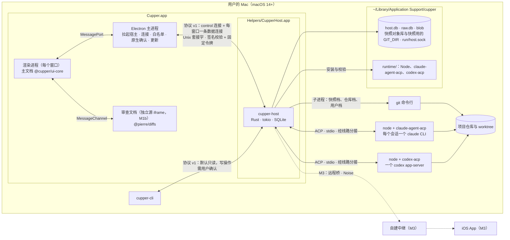
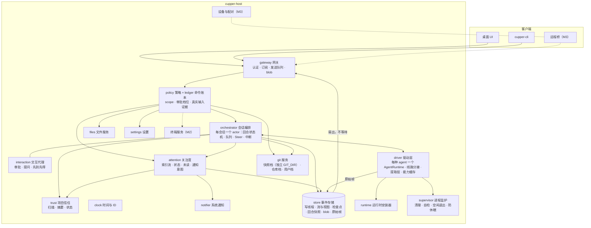

# cupper 技术设计

- 版本：v1.3（v1.0 由用户确认，tag `gate/design`；v1.1 补充：Developer ID 发布推迟到用户开通账号之后，新增 Q35，见 5.12.3；v1.2（2026-10-19，计划评审后，P02）：5.6.9、5.9.4、5.9.10、5.10.7、5.12.2、5.12.3、5.12.4 里的用例编号改成完整写法，不再用缩写、通配和区间，5.9.10 增加截图回归的层前缀 `UI`；5.7.9 增加"自用构建"一列，5.12.3 同步引用；v1.3（2026-10-19，计划评审后，编排者）：仓库没有远端时 CI 在本机执行（5.1.6、5.12.2）、冻结时机见计划（5.12.5）、用例登记改为 `tests/ids.toml`（5.9.10）、四种构建的目录清单（5.4.1、5.8.1）、`dev_key` 只接受拉起宿主的进程与各构建的宿主校验方式（5.8.1）、Q35 的更正）
- 日期：2026-10-16
- 状态：已确认（2026-10-16，tag `gate/design`）
- 依据：PRD v1.2（v1.0 打 tag `gate/prd`）；产品-架构对齐会 `docs/meetings/2026-10-16-prd-arch-alignment/`；设计评审会 `docs/meetings/2026-10-16-design-review/`；`gate/design` 前的用户决定 `docs/meetings/2026-10-16-gate-design-decisions/`

本文件在阶段 ② 中逐步填充：先通过 ADR 和原型实测确定关键选型，再写详细设计，最后经设计评审和用户确认后打 `gate/design`。

## 1. 架构概览

起点是对齐会上架构师给出的骨架（`architect.md` 议题 2），最终形态由 ADR-01 至 ADR-11 确定：

- **会话宿主**是一个与界面分离的 Rust 进程（ADR-01、ADR-02），打包为 `Cupper.app/Contents/Helpers/CupperHost.app`。它持有会话、事件日志、审批与提问、Git 和 worktree，是唯一的事实来源，也是本地鉴权和项目信任的信任锚。宿主运行在所有 agent 沙箱之外，所以它自动执行的 git 不运行仓库配置里的程序，未经信任的项目不加载项目自带的 agent 配置。
- **桌面界面**（Electron + React，ADR-03）和 **cupper-cli** 都是宿主的客户端，用同一套自有协议（ADR-04）经 Unix 套接字连接，宿主按代码签名和固定令牌认证客户端（ADR-05）。M3 起 iOS 经远程桥接入网关，作为又一个客户端。
- 宿主通过 **ACP** 驱动 claude-agent-acp 和 codex-acp（ADR-07），每种 agent 一个适配器进程（ADR-09）。适配器跑在随 App 带的、用 cupper 身份重签并随 App 公证的 Node 上，驱动用户本机已登录的 CLI（ADR-08）。
- 事件日志存在 SQLite，只有宿主写入（ADR-06）；Git 操作全部通过 git 命令行（ADR-10）。

### 1.1 进程与部署视图

### 1.2 宿主模块视图

各模块的职责、接口和并发模型见 [5.2](design/02-host.md)。

### 1.3 贯穿全局的约束

| 约束 | 出处 | 落点 |
|---|---|---|
| 界面只经协议访问会话数据，不直接调用 agent、git 或终端 | NFR-1 | [5.7](design/07-desktop.md) |
| 宿主输出语义，客户端只负责排版和本地化（瘦客户端） | 对齐会 1.3 第 8 条 | [5.3.5](design/03-protocol-v1.md#535-事件类型目录) |
| 每条事件流只有一个写者；事件先落盘再下发 | ADR-06 | [5.2.3](design/02-host.md#523-并发模型) |
| 读 ACP 的路径永远不等待客户端；慢客户端被重置后按游标重同步 | 对齐会 1.3 第 9 条、ADR-02 | [5.2.3](design/02-host.md#523-并发模型) |
| ACP 的类型不出驱动层 | ADR-07 | [5.6](design/06-agent-driver.md) |
| 宿主运行中不读取 App 包内的资源 | ADR-01 | [5.2.12](design/02-host.md#5212-运行时安装器) |
| 写操作和审批必须由用户在桌面端确认；非 UI 的 principal 不能选择 `allow_always`、不能切到完全访问；放宽到 `elevated` 档位需要审批权限 | ADR-05 | [5.8](design/08-security.md) |
| 宿主自动执行的 git 不运行仓库配置指定的任何程序 | 安全评审 #1 | [5.2.10](design/02-host.md#5210-git-与-worktree-服务) |
| 未经信任的项目不加载项目自带的 agent 配置 | PRD v1.2 PS-2 | [5.2.6](design/02-host.md#项目信任) |
| 时间只经 `Clock`，有状态的决策写成纯核心 | 测试评审 #1 | [5.2.16](design/02-host.md#5216-时间与可测性) |
| 协议和 ShellAPI 的契约在 M1a 冻结，M1b 只加不改 | NFR-1 | [5.12.5](design/12-milestones.md#5125-契约冻结清单) |
| 不为兼容旧系统写任何代码，最低 macOS 14 | 平台约束 | 全文 |

## 平台约束

- 桌面端只支持 macOS 14 及以上，即最近三年的版本（14、15、26）。用户于 2026-10-16 确认（U-T1）。
- **不写兼容代码**：不为兼容旧系统写任何兼容分支或补丁代码。需要新版本系统才有的 API 时，直接提高最低版本（2026-10-16 用户确认）。

## 2. ADR 索引

状态取值：待定 → 讨论中 → 提议 → 已采纳（用户在 `gate/design` 确认）。ADR-01 至 ADR-11 已于 2026-10-16 随 `gate/design` 采纳。

| 编号 | 主题 | 状态 | 依赖 | 文件 |
|---|---|---|---|---|
| ADR-01 | 会话宿主的进程形态与生命周期 | 已采纳（2026-10-16，`gate/design`） | 技术选型讨论会 | `docs/decisions/ADR-01-host-process.md` |
| ADR-02 | 会话宿主的实现语言 | 已采纳（2026-10-16，`gate/design`） | 技术选型讨论会 | `docs/decisions/ADR-02-host-language.md` |
| ADR-03 | 桌面 UI 技术 | 已采纳（2026-10-16，`gate/design`） | R04；用户讨论；必要时 SP-6 | `docs/decisions/ADR-03-desktop-ui.md` |
| ADR-04 | 宿主与客户端之间的协议 | 已采纳（2026-10-16，`gate/design`） | 技术选型讨论会 | `docs/decisions/ADR-04-host-protocol.md` |
| ADR-05 | 本地传输与本地客户端认证 | 已采纳（2026-10-16，`gate/design`） | 技术选型讨论会；SP-4 | `docs/decisions/ADR-05-local-transport-auth.md` |
| ADR-06 | 事件模型与存储 | 已采纳（2026-10-16，`gate/design`） | SP-1、SP-4 | `docs/decisions/ADR-06-event-model-storage.md` |
| ADR-07 | Agent 驱动路径 | 已采纳（2026-10-16，`gate/design`） | SP-1；必要时 SP-3 | `docs/decisions/ADR-07-agent-driver.md` |
| ADR-08 | Agent 程序来源、适配器分发与版本锁定 | 已采纳（2026-10-16，`gate/design`） | SP-2 | `docs/decisions/ADR-08-agent-runtime-distribution.md` |
| ADR-09 | 适配器进程拓扑 | 已采纳（2026-10-16，`gate/design`） | SP-1 | `docs/decisions/ADR-09-adapter-topology.md` |
| ADR-10 | Git 与 worktree | 已采纳（2026-10-16，`gate/design`） | SP-5 | `docs/decisions/ADR-10-git-worktree.md` |
| ADR-11 | 开源许可证与第三方依赖的再分发 | 已采纳（2026-10-16，`gate/design`） | SP-2 | `docs/decisions/ADR-11-license-redistribution.md` |
| ADR-12 | 配对与 E2EE 通道 | M3 前 | SP-8 | — |
| ADR-13 | 中继设计 | M3 前 | — | — |
| ADR-14 | 推送方案 | M3 前 | SP-7 | — |
| ADR-15 | iOS 技术与跨端代码共享 | M3 前 | SP-8 | — |

## 3. 原型实测跟踪

| 编号 | 内容 | 时间 | 状态 | 任务目录 |
|---|---|---|---|---|
| SP-1 | 适配器行为实测 | M1 前 | 已完成（已据此起草 ADR-07、ADR-09，并为 ADR-06 提供依据） | `docs/tasks/SP-1-adapter-behavior/` |
| SP-2 | 本机 CLI 与适配器的版本耦合、分发 | M1 前 | 已完成（已据此起草 ADR-08、ADR-11） | `docs/tasks/SP-2-adapter-distribution/` |
| SP-3 | 直连 Codex app-server 的对照 | 视情况 | 待定 | — |
| SP-4a | 宿主骨架走通（Rust） | M1 前 | 已完成（维持 Rust；已据此起草 ADR-06） | `docs/tasks/SP-4a-host-skeleton/` |
| SP-4b | macOS 本地安全实测 | M1 前 | 已完成（ADR-05 方案成立，已据此修订 ADR-01、ADR-05） | `docs/tasks/SP-4b-local-security/` |
| SP-5 | Git 快照与审查操作 | M1 前 | 已完成（git 命令行方案，已据此起草 ADR-10） | `docs/tasks/SP-5-git-snapshot/` |
| SP-6 | UI 渲染压力测试 | M1b 开头（主进程转发的测量闸门前移到 M1a） | 待定（测试计划见 [5.9.7](design/09-testing.md#597-sp-6-测试计划ui-渲染压力测试)） | — |
| SP-7 | iOS 自建与推送链路 | M3 前 | — | — |
| SP-8 | E2EE 通道互通 | M3 前 | — | — |
| SP-9 | 睡眠与网络切换 | M3 前 | — | — |
| SP-10 | LaunchAgent 注册、TCC 授权归属（含 agent 的全部后代、给适配器做 disclaim）、通知身份（会改动系统设置，需要用户在场） | M2 前；通知身份提前到 M1b 前 | — | — |

## 4. 工作顺序

1. **第一波（并行）**
   - 技术选型讨论会：讨论 ADR-01 至 ADR-05。参会者是三个不同角色的子 agent：架构师、桌面客户端工程师、移动与安全工程师。
   - SP-5。
   - SP-1、SP-2：得到用户许可后开始。
2. **第二波**
   - 根据实测结果起草 ADR-06 至 ADR-11。
   - 用选定的语言做 SP-4 宿主骨架。
3. **第三波**
   - 写详细设计（第 5 节）。
   - 开设计评审会，按结论修订（D02）。
   - 用户确认后打 `gate/design`。

## 5. 详细设计

- 状态：已按设计评审的结论修订（D01 起草，D02 修订：`docs/tasks/D01-detailed-design/`、`docs/tasks/D02-design-revision/`），合并后交用户确认
- 原则：只细化 ADR，不推翻；与 ADR 或实测不一致的地方列在 5.13，附建议
- 用途：读完本节，应当能把 M1a 和 M1b 拆成可以独立完成、独立验证的开发任务（阶段 ③）

| 小节 | 文件 | 内容 |
|---|---|---|
| 5.1 仓库与工程结构 | [design/01-repo-build-ci.md](design/01-repo-build-ci.md) | monorepo 目录布局；crate 与 package 清单；工具链锁定；构建命令；CI 流水线（构建、测试、lint、schema 与生成代码一致性、许可证门禁、iOS 编译检查）；写进 `CLAUDE.md` 的代码约束 |
| 5.2 组件设计：宿主与 cupper-cli | [design/02-host.md](design/02-host.md) | 宿主的 17 个模块：职责、接口、依赖、数据结构；并发模型（线程、actor、channel、锁）；回合状态机、排队、Steer、中断兜底、崩溃恢复、晚到的工具输出、**项目信任**、配置档位；交互代理；事件存储（持久性、`data_epoch`）；关注度与通知；**Git 的三档调用**；文件服务与设置；运行时安装器；进程监护与生命周期；cupper-cli；SP-4a 代码的沿用与改动；**时间与可测性** |
| 5.3 宿主协议 v1 草案 | [design/03-protocol-v1.md](design/03-protocol-v1.md) | 通用约定；握手（`host/hello`、nonce、绑定信道的证明）与版本协商；流与同步（`data_epoch`、历史游标）；**完整的方法清单**（参数、结果、错误、幂等、scope、里程碑）；事件类型目录（最终回答、活动组、晚到的输出）；交互请求模型与 **SP-1 的选项生效范围对照表**；会话能力描述；错误码；限额 |
| 5.4 数据模型 | [design/04-data-model.md](design/04-data-model.md) | 存储位置；**SQLite 表结构草案**（host.db、raw.db）；数据放在哪里；ID 规则；保留与回收；迁移与事件升级器 |
| 5.5 关键流程 | [design/05-flows.md](design/05-flows.md) | 时序图：App 启动、新建会话（含 worktree）、发送/排队/插话、审批先到先得、中断（含晚到的输出）、崩溃恢复（宿主、适配器）、升级（含安装空窗）、审查到提交、归档与 worktree 清理、添加项目与信任 |
| 5.6 Agent 驱动层 | [design/06-agent-driver.md](design/06-agent-driver.md) | 驱动接口；Claude 与 Codex 的提取层对照；交互请求分类；配置项映射与**审批档位**；CLI 发现与版本检查、传给适配器的环境变量；能力缓存；资源回收；**已知问题规避清单（26 项，附回归用例编号）**；线路分接层 |
| 5.7 桌面端 | [design/07-desktop.md](design/07-desktop.md) | 进程与连接（数据连接的生命周期、测量闸门）；主进程模块；ShellAPI；窗口与布局；组件树与**审查文档**；状态管理；快捷键、本地化与主题；**安全加固的具体落点**（Trusted Types、真实输入）；三种构建 |
| 5.8 安全实现 | [design/08-security.md](design/08-security.md) | 固定令牌认证握手与退化模式的双向证明；principal、角色、scope 与**审批档位规则**；**命令 × principal 权限矩阵**；CLI 提权；进程卫生；审计日志；安全边界说明 |
| 5.9 测试策略 | [design/09-testing.md](design/09-testing.md) | 测试分层；假 agent（启动配置、剧本、原始行通道）；录制格式与两层金样例；端到端与 NFR-1 验收；兼容矩阵；性能预算与测量方法；**SP-6 测试计划**；故障点与其他关键测试；**测试替身与注入点**；测试编号与人工验证清单 |
| 5.10 构建与发布 | [design/10-release.md](design/10-release.md) | 包结构；签名与公证；Node 运行时与清单；**打包工具的决定**；更新流程（安装空窗）；Electron 版本；发布流水线（产物检查、签名后冒烟） |
| 5.11 诊断 | [design/11-diagnostics.md](design/11-diagnostics.md) | 日志与轮转；脱敏；诊断包；崩溃信息 |
| 5.12 M1a 与 M1b | [design/12-milestones.md](design/12-milestones.md) | 两步的范围与退出标准；**M1 全部 P0 需求的追溯矩阵**（验证列引用用例编号）；**契约冻结清单** |
| 5.13 待定问题 | [design/13-open-issues.md](design/13-open-issues.md) | 待定问题（已关闭 11 个，仍待定 23 个，含 Q26–Q34）；对 ADR-01 至 ADR-11 的修订建议；对 PRD 的影响（已在 PRD v1.2 落实） |

**本节的主要结论**

- **打包工具：electron-builder + electron-updater**，不用 Electron Forge。决定性的理由是 electron-updater 可以把下载好的更新一直留到我们调用 `quitAndInstall()`，这正是 ADR-01"宿主先退出再安装"所需要的；Forge 默认的更新路径会在下次启动时自动应用（5.10.4）。
- **Electron 起始版本 44.8.0**，始终在官方支持的最新三个大版本之内。
- **M1a** 用 Claude 一个 agent、完整的 cupper-cli 和最简界面，把"宿主是唯一事实来源"做实。第一个宿主任务是"核心骨架与测试基础设施"（时钟、纯核心、传输接口、故障点）；驱动层之前先做技术验证；项目信任、git 的快照档、主进程转发的测量闸门都在 M1a。退出标准是 NFR-1 的验收套件在同一个提交上连续 20 次全绿，并且协议和 ShellAPI 的契约已冻结。**M1b** 加入 Codex、Git 与 worktree 的其余部分、审查面板、界面打磨和签名发布，SP-6 在 M1b 开头完成，只测渲染。
- **设计评审带来的主要变化**（`docs/meetings/2026-10-16-design-review/minutes.md`）：
  - 宿主的时间只经 `Clock`，有状态的决策写成纯核心，时序逻辑可以确定性地测试（5.2.16）；
  - 宿主自动执行的 git 分三档，快照改用 cupper 自己的 GIT_DIR，配置只放行白名单，不运行仓库配置里的任何程序（5.2.10）；
  - 项目信任：未经信任的项目不加载项目自带的 agent 配置（5.2.6）；
  - 审批档位：放宽到 `elevated` 需要审批权限，默认档位视为由创建者设定（5.8.2）；
  - 协议补齐：绑定信道的退化模式证明、`data_epoch`、历史游标、`item.delta` 的 `field`、最终回答、晚到的工具输出、完整摘要（5.3）；
  - 桌面：数据连接的生命周期、ShellAPI 的完整合同、审查面板的 diff 放进独立源的 iframe、主文档禁止 Trusted Types 的 `default` 策略、统一的真实输入规则（5.7）；
  - 测试和发布：测试替身与注入点、两层金样例、故障点、去掉自托管 runner、签名后冒烟（5.9、5.1、5.10）。
- **SP-4a 的代码**：协议 crate 基本沿用；连接、发送队列、账本、恢复、系统调用沿用；存储、会话编排、驱动层需要重构（5.2.15）。
- **用户已定的事项**（2026-10-16，`docs/meetings/2026-10-16-gate-design-decisions/minutes.md`）：bundle identifier 前缀 `dev.cupper`（Q5，M1b 首次签名发布前可以无成本修改）；只出 arm64（Q6）；MS-4、GT-3、NFR-8 的验收口径（Q12、Q13、Q22，记录在 PRD v1.2 第 10 节）；增加项目信任（U-R1）；手机不能放宽到 `elevated`（U-R2）；Node 随 App 一起公证（U-R3）；兼容测试先用真实配置加前后哈希对比（U-R4）；允许用真实 CLI 跑 Q8（U-R5）。5.13.2 中的 ADR 修订由编排者提交。
