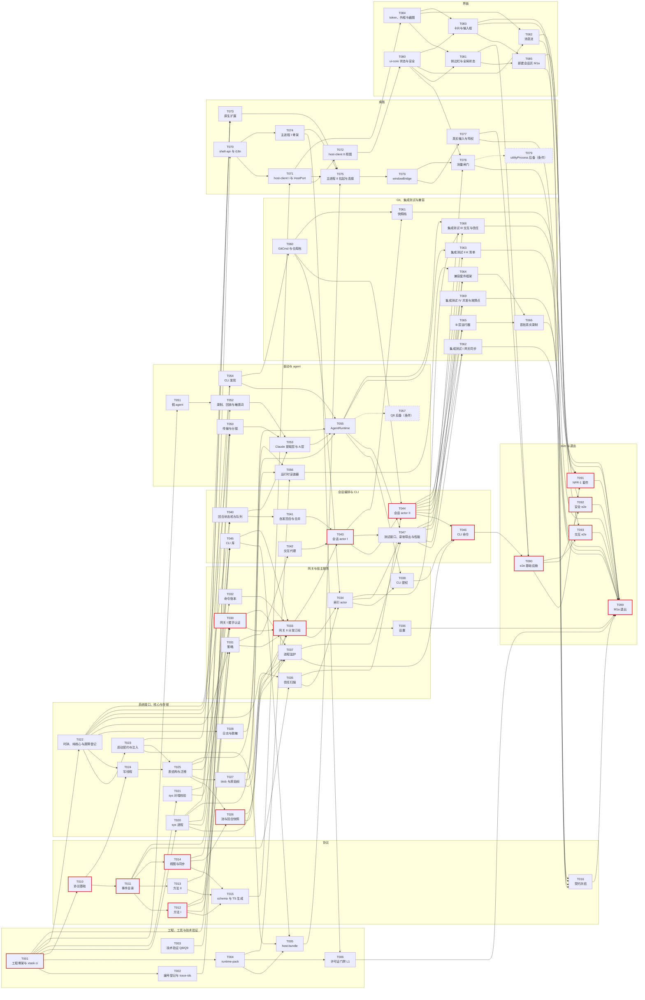
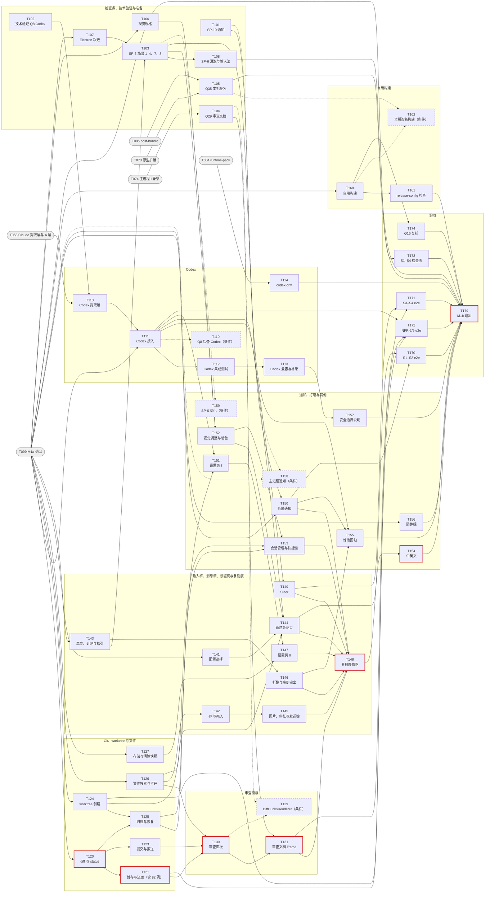
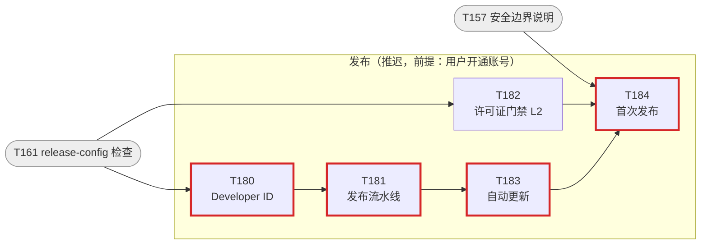

# cupper 开发任务拆分（M1a、M1b）

- 版本：v0.2
- 日期：2026-10-19
- 状态：草案，已按计划评审第一轮意见修订，待 `gate/plan`
- 依据：技术设计 v1.2（[`02-design.md`](02-design.md) 与 [`design/`](design/12-milestones.md)；v1.0 打 tag `gate/design`）；PRD v1.2（[`01-prd.md`](01-prd.md)）；ADR-01 至 ADR-11；设计评审纪要 [`meetings/2026-10-16-design-review/minutes.md`](meetings/2026-10-16-design-review/minutes.md)；用户决定 [`meetings/2026-10-16-gate-design-decisions/minutes.md`](meetings/2026-10-16-gate-design-decisions/minutes.md)（含"补充：Apple Developer 账号"）；计划评审意见 [`meetings/2026-10-16-plan-review/`](meetings/2026-10-16-plan-review/agenda.md) 与编排者裁定（[`tasks/P02-plan-revision/brief.md`](tasks/P02-plan-revision/brief.md)）
- 用途：编排者照着本文件逐个写 brief、派发任务（[`00-process.md`](00-process.md) 的"任务生命周期"）；任务完成后在第 9 节打勾。对评审意见的逐条回应见 [`tasks/P02-plan-revision/responses.md`](tasks/P02-plan-revision/responses.md)

## 1. 拆分原则

### 1.1 粒度与规模

- 一个任务交给一个子 agent 一次完成，在独立 worktree 的独立分支上开发、测试、提交（[`CLAUDE.md`](../CLAUDE.md) 的子 agent 守则）。
- 规模按改动行数估计（含测试，不含生成物、录制、金样例、截图基线和字体等夹具文件）：

  | 规模 | 行数 | 说明 |
  |---|---|---|
  | S | ≤ 400 | 半天到一天 |
  | M | 400–900 | 一到两天 |
  | L | 900–1,500 | 两到三天；表后的注写明为什么不能再拆 |

- 分支名按 [`CLAUDE.md`](../CLAUDE.md) 的约定：`<类型>/<编号>-<英文短名>`，例如 `feat/T043-session-actor`；技术验证类任务用 `spike/<编号>-<短名>`，代码放 `spikes/<编号>-<短名>/`，不进产品代码。
- 上限约 1,500 行。子 agent 开工后发现会明显超出，先停下来汇报，由编排者按注里的拆分点拆成两个任务，不硬塞进一个分支。

### 1.2 每次合并后 main 都可用

- **每个任务的基本验收**：`cargo xtask ci pr` 在本机干净的 worktree 里通过（1.8）；新增的 IT、E2E 用例在本任务里连续跑 10 次全绿，次数和摘要写进汇报（测试 #7）。表里的"验收"一栏只列这之外的内容。
- **未实现的方法统一返回 `unsupported`**：宿主按方法注册执行者，没有执行者的方法返回 `unsupported`。M2、M3 的方法（`session/queue_edit`、`diag/export`、`stream/ack`）在 M1 结束时仍是这样；`host/prepare_upgrade` 在 T183 之前也是。为了不掩盖遗漏，T033 加 UNIT-unsupported-set：枚举协议的全部方法，断言"返回 `unsupported` 的集合"恰好等于按里程碑允许的集合；T099、T179 各核对一次（测试 #8）。
- **接口由使用方先定义，实现方后接上**：例如 T040 定义 `driver::api`，T043 用进程内替身测试，T055 实现；T043 的快照端口在 T061 合并前为空，回合快照记为 `skipped`（与非 git 项目相同）。替身只出现在测试代码里。
- **测试任务"就地修"的上限**：单处修复不超过 100 行、不改接口；超出的另开 fix 任务，测试任务先把相关用例标为待修（测试 #10）。
- 不留技术债（[`CLAUDE.md`](../CLAUDE.md) 的工程原则）：条件任务只在触发时派发，触发前不写后备代码（P-7）。

### 1.3 契约先行

- 协议的全部类型（含 M1b 才用的方法和事件）在 T010–T015 完成，宿主、CLI、host-client、界面都在它之后；`driver::api` 在 T040；ShellAPI 里与协议无关的部分在 T070，依赖协议类型的部分（`HostPort`、`PrivilegedAction` 等）在 T071；帧级 TS mock 宿主和 HostPort 合同测试在 T071。
- 冻结（T016）排在测量闸门 T078 之后，并且依赖 ShellAPI 的主要使用方 T077、T081–T083、T085（P-1）。冻结前修改契约：单独提交，在同一任务里重新生成 `packages/protocol`，在汇报里列出改了什么；T015 的生成物一致性检查从那时起一直开着。冻结之后只能附加（[5.12.5](design/12-milestones.md#5125-契约冻结清单)），`xtask ci protocol` 把关。

### 1.4 测试基础设施先行

| 基础设施 | 任务 | 之后的使用者 |
|---|---|---|
| 本机 CI 入口 `cargo xtask ci` | T001 | 全部任务 |
| 用例编号登记与 trace-ids | T002 | 每个任务在 `tests/ids.toml` 里登记自己产出的编号 |
| 时钟、纯核心框架、静止屏障的参与者登记 | T022 | 全部宿主任务；T047 在它上面实现 `test/clock_advance` |
| 启动载荷、`test_config`（含 `durations`）、故障点框架 | T023 | 全部宿主任务 |
| 假 agent、录制格式与回放、敏感词扫描 | T051、T052 | 驱动、集成测试、金样例、测量闸门、真实录制 |
| test-harness 测试接口（`clock_advance`、`seed`、录制导出） | T047 | 集成测试、闸门、兼容套件 |
| 故障点夹具（断言库） | T069 | T121、T124 只登记新的故障点 |
| 帧级 TS mock 宿主、HostPort 合同测试 | T071 | T076 用同一套合同测试真实实现；界面截图 |
| token、三栏外框、页面骨架、截图测试 | T084 | 全部界面任务 |
| e2e 夹具与辅助函数（一次给齐）、`@smoke` 标签 | T090 | 全部端到端任务只新增用例文件 |
| 兼容套件框架 | T064 | 真实录制（T066、T113） |

时间相关的两条规则（测试 #4）：

- 新增定时器的任务，在同一任务里把时长接到 `test_config.durations`，用例用短时长，不等 T047。
- 新增 actor 的任务，在 T022 的静止屏障里登记；没有登记就启动时，debug 构建断言失败。T047 另有一个用例枚举全部 actor 类型。

### 1.5 并行与区域

区域借用 CODEOWNERS 的思路，判断哪些任务可以同时进行而不冲突：

| 区域 | 代号 | 路径 |
|---|---|---|
| 工程与 CI | C | 根目录配置、`.github/`、`tools/trace-ids`、`tools/license-gate`、`tools/codex-drift`、`tests/` |
| 协议 | P | `crates/cupper-protocol`、`protocol/`、`tools/gen-protocol-ts`、`tools/schema-compat`、`packages/protocol` |
| Rust 宿主 | H.core、H.store、H.gw、H.idx、H.orch、H.drv、H.git、H.rt、H.diag | `crates/cupper-host/src/` 下对应模块（core 含 clock、supervisor、test 接口；idx 含 attention、trust、settings） |
| 系统接口 | H.sys | `crates/cupper-sys` |
| CLI | H.cli | `crates/cupper-cli` |
| 假 agent 与测试数据 | H.fake | `crates/cupper-fake-agent`、`testdata/`、`tools/sanitize`、`tools/rec-shape-diff` |
| xtask 与运行时 | H.xt | `crates/xtask`、`runtime/` |
| TS 库 | T.lib | `packages/shell-api`、`packages/i18n`、`packages/host-client` |
| 界面 | T.ui | `packages/ui-core` |
| 原生扩展 | D.nat | `crates/cupper-desktop-native` |
| 桌面主进程 | D.main | `apps/desktop` |
| 文档、原型实测 | Doc、SP | `docs/user/` 等；`spikes/` |

规则：

- 不同区域的任务可以并行；同一区域的任务默认串行，除非 brief 写明各自拥有哪些目录或文件。以下几处必须写明：
  - 界面：T080 负责状态层，T084 负责外框、骨架、插槽、行类型注册表和基础组件；T082 只写行列表和消息类的行；T083 注册卡片行，写排队条和输入框；T085 写新建会话页（桌面 #2）。
  - 输入框：T083 预留底栏左右两组插槽和弹出层挂载点，T140、T141、T142、T145 只新增文件；T142 与 T145 共用弹出层，串行（桌面 #4）。
  - 桌面主进程：M1b 里改 `apps/desktop` 的任务（T131、T142、T147、T152、T153）在 brief 里列出各自负责的文件。
  - e2e：T090 一次给齐辅助函数，T091–T093 只新增用例文件（桌面 #13）。
  - 测量闸门：T078 的负载页面和钩子放测试专用目录，不碰 T077 的文件（桌面 #10）。
- 共享的热点和避免冲突的约定：
  - 工作区成员用通配（`crates/*`、`packages/*`、`apps/*`、`tools/*`），新 crate 和 package 不改根清单；`[workspace.dependencies]` 的冲突由编排者合并时处理。
  - `crates/cupper-host/src/lib.rs` 只放 `mod` 声明，各模块的接线放在模块内部。
  - `xtask ci` 的每个作业一个文件；workflow 同样一个作业一个文件。
  - i18n 文案按功能分文件（`locales/<语言>/<功能>.json`）。
  - `tests/ids.toml` 按任务分段，每个任务只追加自己的一段，不需要删行（1.6）。
  - 表结构在 T160 之前只改 `0001`（P-4）。
- 实际并行度：作者机器上同时运行的子 agent 建议不超过 3–4 个（Rust 编译占 CPU），e2e 和性能类作业运行时不再并行别的作业。

### 1.6 用例编号与登记

- 验收引用 [5.9.10](design/09-testing.md#5910-测试编号与人工验证清单) 的编号；本计划新增的编号写"新增"，命名同样是 `<层>-<范围>-<名称>`，截图回归用 `UI-` 前缀（设计 v1.2 已写进 5.9.10）。设计里的编号已统一成完整写法，trace-ids 只做精确匹配（P-3，测试 #6）。
- **登记表加自动推导**（测试 #5，替代 5.9.10 原写的 `pending-ids.toml`，设计措辞由编排者另改，见 P-16）：
  - `tests/ids.toml` 列出设计和本计划里的全部编号，每个编号带：里程碑、产出任务、所属套件（PR、每晚、发布、人工）、状态。
  - 一个编号分几次完成时，登记成若干子编号，全部子编号通过才算通过。本计划用到的有：
    - IT-NFR9-failpoints = `-core`（T069）+ `-git`（T121）+ `-worktree`（T124）；
    - UNIT-cli-resolver、UNIT-option-map、GOLD-A-option-map、GOLD-A-tool-fields = `-claude`（T053、T054）+ `-codex`（T110、T111）；
    - E2E-new-session-agent、MAN-compat、COMPAT-untrusted-project = `-claude` + `-codex`；
    - MAN-notification = `-spike`（T101）+ `-product`（T150）；
    - MAN-ui6 = `-shell`（T152）+ `-full`（T148）；
    - UI-settings = `-agents`（T151）+ `-general`（T147）。
  - 互为替代的条件任务（T131 与 T139、T150 与 T158）登记同一个编号，由实际派发的那个产出；MAN-keyboard 每个 Electron 大版本做一次（T077、T107），证据按版本区分。
  - "待完成"由 trace-ids 自动算出，任务不手工删行。
  - trace-ids 读测试运行结果（cargo-nextest 的 JUnit 报告和 Playwright 的 JSON 报告；stable 工具链下 libtest 的 JSON 输出不可用），确认编号确实执行、通过，并且跑在登记的套件里。`#[ignore]`、`test.skip` 的用例不算。
  - 人工项（MAN）的证据是 `docs/` 下带日期和版本的记录，格式由 T173 定；MAN-keyboard 要与当前 Electron 大版本对得上，升级后旧证据失效。
  - 条件任务的编号在检查点通过后标为"不适用（Kx 已通过）"，不挡里程碑退出（P-7）。
- 端到端用例按 5.12.4 的〔PR〕〔晚〕标 `@smoke` 或不标，trace-ids 核对每个编号的套件（T090）。

### 1.7 条件任务与可以提前的任务

- **条件任务**（名称前标"（条件）"）只在检查点不通过时派发：T057、T079、T119、T139、T158、T159；T162 在 Q35 *通过*时派发。依赖图里用虚线表示。
- **可以提前的任务**（前置一栏标"可提前"）：T101、T102、T104、T105、T110、T114。依赖满足后可以在 M1a 期间派发，但评审资源优先给 M1a 的关键链。其余 M1b 任务在 T099 之后派发。

### 1.8 本机 CI（U-P1：先不建远端）

| 项 | 做法 |
|---|---|
| 统一入口 | `cargo xtask ci <作业>`，作业与 [5.1.6](design/01-repo-build-ci.md#516-ci-流水线) 一一对应（`rust`、`protocol`、`ts`、`ui`、`license`、`testdata-scan`、`e2e`、`security-macos14`、`compat-framework`），另有组合作业 `pr`（每个 PR 的全部作业）和 `nightly`（每晚的全部作业，含 e2e 全集、差分测试、性能趋势、`release-config`、`codex-drift`）。workflow 文件照写，只调用这个入口，等有了远端再启用 |
| 环境 | 在退出候选或任务分支的干净 worktree 里运行，`git status` 必须为空 |
| 验收记录 | 入库的只有结构化摘要：提交、工具链版本、macOS 版本、机型泛称、各作业的通过数和失败数、耗时。原始日志放 `.private/`。摘要入库前过个人信息扫描（`xtask ci` 自带字段白名单检查，T052 之后再过 `testdata-scan`）（测试 #11） |
| 每晚作业 | 每一波合并完、开始下一波之前，编排者跑一次 `xtask ci nightly` |
| 截图基线 | 渲染因素固定（随夹具附带开源字体，固定视口、缩放、语言、时区、虚拟时钟，关闭动画，隐藏光标）；基线由专用脚本在本机生成，元数据记下系统和 Chromium 版本，版本对不上就失败，不静默跳过；系统或 Electron 升级后单独提交新基线（T084，测试 #13） |
| LFS | xtask 下载锁定版本的 git-lfs 到缓存目录，核对哈希后使用，本机也能跑（T061、T121，测试 #12） |
| M1a 退出 | 在退出候选的同一个提交上：`xtask ci e2e --suite nfr1` 连续 20 次全绿（Playwright 并行度同 CI 设定，不允许重试、跳过或隔离，失败一次查明根因后清零），再跑 5 次降速变体（占用一半核心的负载进程或降低优先级）；`xtask ci pr` 与 `xtask ci nightly` 各通过一次。运行期间作者不操作机器（T099） |
| 本机替代不了的项 | macOS 14、15 上的对端校验；CI 负载下的稳定性。在 T099、T179 的记录里列为缺口，由用户确认接受。本地 macOS 虚拟机（Virtualization.framework）是可选方案，记为风险 R7，不作为前置条件 |
| 以后建远端时 | 首次在 CI 上再跑一轮 20 次；推送前对全部历史做个人信息扫描；Actions 设置"外部贡献者的工作流需要批准"；不用自托管 runner；签名密钥只放受保护的 environment（R12） |

子 agent 不 push（[`CLAUDE.md`](../CLAUDE.md)）。编排者合并前在本机跑 `xtask ci pr`，与子 agent 的汇报核对。"编排者推送、看 CI"的流程由编排者改 `00-process.md`。

### 1.9 "用户参与"一栏

- **是**：需要用户在场或操作（系统授权框、实体键盘、证书、亲自走流程、抽查入库内容），或会消耗用户的额度。
- **知情**：在作者机器上运行、会弹窗口或长时间占用机器，派发前告知时段，运行期间不操作机器。
- **可选**：用户愿意时可以手动补一项验证。

### 1.10 真实 agent 的使用约束

- T160 交付之前，不用开发构建在真实项目上运行真实 agent；之后只用自用构建处理真实项目，开发构建和测试只用临时目录或 `cupper-dev/`（P-15，安全 #1、#3）。
- 不经宿主的真实运行（T003、T102）：临时仓库放在每个用户自己的临时目录，剧本固定、不联网取内容，不选持久类选项，权限模式显式设定（Claude `default`；Codex `read-only` 或 `workspace-write`），运行前后对配置文件做哈希对比（安全 #8）。
- 经宿主的真实运行（T066、T113）：兼容套件以 test_harness 身份运行，必须自我约束（T064，安全 #4）；录制和报告入库前过本机敏感词清单，并由用户抽查（安全 #5）。
- 真实 Codex 运行前，用户自己备份配置（放在仓库外，权限 0600）；运行后报告列出差异，由用户决定保留还是恢复；子 agent 不改用户配置（P-14）。

### 1.11 界面复刻度

| 时间 | 做什么 | 谁 |
|---|---|---|
| M1a 的 T084 | 建立 token 体系和三栏外框，组件从第一天起只引用 token | 子 agent |
| M1b 开始前 | 按清单补截参考图，只放在本机的 `.private/`（第 6 节） | 作者 |
| T099 之后 | T106 视觉规格：尺寸、间距、字号、圆角、颜色和各区域结构，入库；参考图本身不入库 | 编排者，或经授权只读参考图的子 agent |
| 每个界面任务 | 汇报附固定窗口尺寸、固定夹具下的截图；编排者对照规格审阅，偏差当场退回 | 子 agent 截图，编排者审阅 |
| T152 之后 | MAN-ui6-shell：外框、token、两种主题 | 作者 |
| 全部界面功能完成后 | MAN-ui6-full：全量并排比对，随后 T148 复刻度修正；T154 依赖它，截图基线锁定的是修正后的视觉 | 作者比对，子 agent 修正 |
| T179 | MAN-S1 至 MAN-S4 顺带检查交互细节：折叠、Enter 和 Esc、贴底、跳转 | 作者 |

## 2. 任务清单

前置一栏只列直接依赖，可由其他依赖推出的间接依赖省略。加粗的编号在关键链上（松弛为零）。

### 2.1 M1a：宿主骨架

| 编号 | 名称 | 类型 | 设计依据 | 前置 | 做什么 / 不做什么 | 验收（用例编号） | 规模 | 用户参与 | 区域 |
|---|---|---|---|---|---|---|---|---|---|
| **T001** | 仓库与工程骨架、本机 CI 入口 | build | 5.1.1–5.1.6；1.8 | — | 做：Rust 与 pnpm 两套工作区（成员用通配）、工具链锁定、clippy 的 `disallowed-methods` 与 `await_holding_lock`、`deny.toml`、lint 与格式配置；`xtask` crate 与 `cargo xtask ci <作业>` 入口（`rust`、`ts`、`license` 三个作业先只有 `cargo deny`，结构化摘要与 `.private/` 原始日志，摘要的字段白名单与个人信息自检）；workflow 文件只调用这个入口，暂不启用。不做：其他 crate 和 TS 包 | `xtask ci pr` 在干净 worktree 里通过；`disallowed-methods` 的负面样例让 clippy 失败；新增 UNIT-ci-summary（摘要只含白名单字段，含路径或用户名时拒绝写入） | M | 否 | C、H.xt |
| T002 | 用例编号登记与 trace-ids | build | 5.9.10；1.6 | T001 | 做：`tests/ids.toml`（设计和计划里的全部编号：里程碑、产出任务、套件、子编号、"不适用"状态）；`tools/trace-ids`（精确匹配；读 cargo-nextest 的 JUnit 和 Playwright 的 JSON 报告，确认编号在登记的套件里执行并通过；核对 MAN 证据的日期与版本；待完成清单自动推导）；`xtask ci testdata-scan`。不做：PII 扫描、兼容报告校验 | `xtask ci testdata-scan` 通过；新增 UNIT-trace-ids（缺测试、被跳过、套件不符、MAN 证据过期、子编号未齐都报错） | M | 否 | C |
| T003 | 技术验证：Q8（Claude）、Q9、SP-4b #7 与版本复核 | spike | 5.12.2（技术验证）、5.13 Q8 与 Q9、5.9.5、5.8.4 | — | 做：用 SP-1 的 TS 客户端跑 Claude 并发剧本；用 SDK `=3.3.0` 写探针确认扩展消息的收发；观察真实适配器拉起命令时的进程树；复核锁定版本和测量闸门的负载数字。约束：临时仓库放在每个用户自己的临时目录、剧本固定且不联网取内容、不选持久类选项、权限模式显式设为 `default`。不做：产品代码 | 报告：Q8 逐轮数据（5.9.5 的通过条件）、Q9 逐项结论、SP-4b #7 结论、版本建议；运行前后哈希覆盖 `~/.claude/settings.json` 和 `~/.claude.json` 中与权限有关的字段 | M | 是：真实 Claude CLI，消耗少量额度（U-R5 已许可） | SP |
| T004 | xtask runtime-pack 与运行时清单 | build | 5.1.5、5.10.3、5.6.6 | T001 | 做：`cargo xtask runtime-pack`（下载并校验 Node、codex-acp、esbuild-wasm，本机重签 Node，隔离目录里算 claude-agent-acp 打包产物哈希，提取并归类适配器读取的环境变量）与 `--verify`；`runtime/manifest.json`、`runtime/locks/`、打包脚本、许可证文本。不做：宿主侧安装器 | `runtime-pack --verify` 通过；新增 UNIT-runtime-pack-envscan（未归类的变量名让命令失败） | M | 否 | H.xt |
| T005 | xtask host-bundle | build | 5.10.1、5.10.2、5.7.9 | T004、T023、T045 | 做：`cargo xtask host-bundle` 按构建种类组装 `CupperHost.app`（Info.plist、`Helpers/node`、`Resources/runtime/`）并 ad-hoc 签名，单独签 CLI。不做：自用构建的签名参数（T160）、Developer ID（T180） | 新增 IT-host-bundle-layout（布局、identifier、Info.plist 不含用途说明） | S | 否 | H.xt |
| T006 | 许可证门禁第一层 | ci | 5.1.6（license）、ADR-11 | T004、T074 | 做：`tools/license-gate` 第一层（按锁文件和 metafile 求每个 JS 入口的生产依赖闭包，出现 Anthropic SDK 或 Claude Code 就失败；运行时组件许可证齐全）与负面样例，接入 `xtask ci license`。不做：最终产物扫描（T182） | 新增 UNIT-license-gate-negative | M | 否 | C |
| **T010** | 协议基础：分帧、信封、ID、错误码、规范 JSON 与注解 | feat | 5.3.1、5.3.8、5.3.9、5.4.4、5.2.15 | T001 | 做：迁移 SP-4a 的 frame、rpc（`Method` 加 `SCOPE`、`IDEMPOTENCY`）、open_enum、text、coalesce、sync、transport；事件信封与流 ID、ID 前缀类型、错误码与 reason、限额、RFC 8785 与 `d_` 摘要、六种 schema 注解的机制、整数上界。不做：具体的事件和方法 | UNIT-digest-jcs；新增 UNIT-proto-base | M | 否 | P |
| **T011** | 协议事件目录与领域类型 | feat | 5.3.5、5.3.6、5.3.7、5.12.5 第 2 组 | T010 | 做：两条流的全部事件（含 M1b 才产生的）、条目类型、`ToolCall` 与按 `tool_kind` 的必填字段表、`late_tool_output`、交互请求与 `Option.effect`、能力描述、`PromptContent`、`SessionSummary`、`AgentStatus`；开放枚举、`Unknown` 兜底、严格模式开关。不做：方法、视图 | 新增 UNIT-proto-events（每种事件往返，含未知类型、未知枚举值、残缺数据） | L | 否 | P |
| **T012** | 协议方法 I：握手、流、项目、agent、会话与交互 | feat | 5.3.2、5.3.3、5.3.4 | T011 | 做：`host/hello`、`initialize`（各 `auth` 变体、`role`、`features`、`limits`、`host_proof`）及生命周期、流、项目、agent、会话、交互各方法的参数与结果，逐个声明 scope 与幂等。不做：其余方法（T013） | 新增 UNIT-proto-methods-core（往返；方法级 scope 与 5.8.3 一致） | M | 否 | P |
| T013 | 协议方法 II：git、文件、设置、认证、诊断与测试 | feat | 5.3.4 | T011 | 做：git、worktree、文件、`workspace/open`、设置、`auth/*`、`policy/describe`、`diag/*`、`test/*` 各方法，以及按构建特性门控的方法在 schema 里的标注。不做：任何实现 | 新增 UNIT-proto-methods-ext | M | 否 | P |
| **T014** | 协议视图与同步规则 | feat | 5.3.3、5.2.8（视图窗口）、5.7.6 | T011 | 做：`IndexView`、`SessionView`（窗口、进行中回合、待处理交互、配置、能力、队列）、`apply` 与按 `turn_no` 排序、`late_by_ref`、快照 ops 的生成与切分、连续性与 epoch 重置规则、视图的序列化格式。不做：存储侧检查点、TS reducer | 新增 PROP-view-coalesce、UNIT-view-window、UNIT-view-late-by-ref | M | 否 | P |
| T015 | schema 导出与 TS 生成链 | build | 5.3.10、5.1.5、5.1.6（protocol） | T012、T013、T014 | 做：`export-schema` 完整输出、`protocol/schema/v1.json`、`tools/gen-protocol-ts`（hey-api 与三处后处理）、`packages/protocol` 生成物、`protocol/fixtures/`（含未知值）、`xtask ci protocol`（生成物一致性检查从此一直开着）。不做：兼容比对与冻结（T016） | `xtask ci protocol` 通过；新增 UNIT-proto-fixtures、UNIT-ts-fixtures | M | 否 | P、T.lib、C |
| T016 | 契约冻结 | chore | 5.12.5；P-1 | T077、T078、T082、T085 | 做：`tools/schema-compat`（方向敏感）、`protocol/released/v1-m1a.json`、`packages/shell-api/api-m1a.d.ts` 与类型断言，接入 `xtask ci protocol`。不做：契约内容的修改 | 破坏性改动的样例（删字段、下发方向必填改可选、上行新增必填、ShellAPI 删成员）让 `xtask ci protocol` 失败，附加式改动通过；新增 UNIT-schema-compat | M | 否 | P、T.lib、C |
| T020 | cupper-sys I：进程与系统信息 | feat | 5.1.3、5.8.5、5.2.13 | T001 | 做：迁移 SP-4a 的 `sys.rs`：`spawn`（SETSID 可选、`CLOEXEC_DEFAULT`、显式 stdio、默认信号处置、环境变量白名单）、进程组清理、libproc（启动时间、父进程链、会话与进程组）、`kern.bootsessionuuid`、`DARWIN_USER_TEMP_DIR`。不做：IOPM、UserNotifications | 新增 UNIT-sys-spawn（只继承 fd 0–2；去掉 CLOEXEC 的变异检查应失败）、UNIT-sys-reap-group | M | 否 | H.sys |
| T021 | cupper-sys II：对端校验与代码签名 | feat | 5.8.1、5.1.6（security-macos14）、Q24 | T001 | 做：合并 SP-4b 的 Security FFI：`LOCAL_PEERTOKEN`、`LOCAL_PEERPID`、SecCode 校验与动态状态字、编译期签名要求、csops、四类错误；`xtask ci security-macos14`（在当前系统上运行，macOS 14、15 的覆盖记为缺口） | 新增 IT-sys-peer（最后一次 I/O 进程语义、exec 与 fork 被拒、`SCM_RIGHTS` 被丢弃、csops、错误码）；`xtask ci security-macos14` 在作者机器上通过 | M | 否 | H.sys、C |
| T022 | 宿主核心骨架 I：时钟、纯核心框架与静止屏障登记 | feat | 5.2.16、5.2.3 | T001 | 做：`cupper-host` crate（lib、bin，特性 `dev-auth`、`test-harness`）、`Clock`、`SystemClock`、`ManualClock`、`IdGen`、纯核心 `step(input, now)` 的框架与测试驱动器、静止屏障的参与者登记（actor 未登记就启动时 debug 构建断言失败）。不做：启动契约（T023）、`test/clock_advance` 方法（T047） | 新增 UNIT-clock-manual、UNIT-idgen、UNIT-quiescence-registry | M | 否 | H.core |
| T023 | 宿主核心骨架 II：启动契约、注入点与故障点 | feat | 5.2.13、5.8.1（启动载荷）、5.9.9 | T022 | 做：`--data-dir`、`--build-info`；stdin 启动载荷（2 s 超时、编译期门控、读完指向 `/dev/null`、退出码 1；`test_config` 只经它传入）；`test_config` 全部注入点的结构（含 `durations`）；故障点框架；无特性运行的用例。不做：注入点的使用方 | 新增 UNIT-startup-payload、UNIT-failpoint；UNIT-release-features | M | 否 | H.core |
| T024 | 存储 I：写线程、读池与持久性 | feat | 5.2.8、5.9.8（写线程、数据代次） | T010、T022 | 做：写线程（组提交、每操作 savepoint、只在 `SystemClock` 下等 2 ms、确认回执）、4 个只读连接、两档持久性配置、`data_epoch` 判定纯函数与注入输入。不做：表结构（T025） | 新增 UNIT-writer-savepoint、UNIT-epoch-decision | M | 否 | H.store |
| T025 | 存储 II：表结构、迁移与升级器 | feat | 5.4.2、5.4.6；P-4 | T023、T024 | 做：`0001` 迁移（5.4.2 的全部表与 raw.db）、迁移框架（编进二进制、同事务更新版本、`VACUUM INTO` 备份、退出码 4 和 6、两脚本之间崩溃不重跑、测试可以注入一组脚本）、事件升级器框架、检查点的 `view_v`。不做：业务读写 | IT-migrations（第二个脚本由测试注入） | M | 否 | H.store |
| **T026** | 存储 III：流、检查点、回合快照与历史 | feat | 5.2.3、5.2.8、5.3.3、5.4.5 | T014、T025 | 做：迁移 SP-4a 的 hub 为 `store::streams`（追加三步、订阅在流锁内读取、懒加载、淘汰；同步原语经 `cfg(shuttle)` 门面）、扇出接口、回合结束同事务写检查点和不可变的回合快照、`history/page` 读取、events 裁剪。不做：订阅协议（T033） | 新增 PROP-stream-seq（shuttle）、PROP-stream-replay | L | 否 | H.store |
| T027 | 存储 IV：blob、原始帧与保留清理 | feat | 5.2.8、5.4.5 | T025 | 做：按内容寻址的 BlobStore、原始帧有界队列写 raw.db（满了丢弃并计数）、各类保留清理（经 Clock，时长接 `test_config.durations`）。不做：blob 传输（T033） | 新增 UNIT-blobstore、UNIT-raw-queue、UNIT-retention | M | 否 | H.store |
| T028 | 日志与脱敏 | feat | 5.11.1、5.11.2 | T022 | 做：tracing JSON Lines 与按大小轮转、两档脱敏、`info` 不记内容、适配器 stderr 管道读取（每实例保留 64 KB）、panic hook。不做：诊断包（M2） | UNIT-redaction、UNIT-redact-auth-status | M | 否 | H.diag |
| **T030** | 网关 I：连接、握手与本地认证 | feat | 5.2.4、5.8.1、5.3.2 | T012、T021、T025 | 做：迁移 SP-4a 的 conn、outbox、wire；uid、签名结论与固定令牌（每次读取比对）、`host/hello`、只接受一次的 `initialize`、四种认证与绑定信道的双向证明、principal 与角色、套接字路径与权限、`host.lock`、写循环与慢客户端重置、`ping`、连接审计。不做：方法分发 | 新增 IT-handshake、IT-pinned-token（crate 内，真实套接字）、UNIT-proof-binding | L | 否 | H.gw |
| T031 | 策略 | feat | 5.2.5、5.8.2、5.8.3 | T012、T013、T022 | 做：方法级由 `SCOPE` 驱动；资源级规则（档位、privileged 选项、安全设置键、window 角色的输入证据与按键、400 ms、信任门控的钩子）；`policy/describe`。不做：账本 | UNIT-tier-rules、UNIT-policy-matrix | M | 否 | H.gw |
| T032 | 命令账本 | feat | 5.2.5（账本） | T025 | 做：principal 稳定 ID 加 `command_id` 为键、三种状态、去掉 `command_id`/`attestation`/`input` 后的 JCS 参数哈希、48 小时内存表、`idempotency_mismatch`、`outcome_unknown`、结果与首批事件同事务的接口。不做：路由 | 新增 UNIT-ledger | M | 否 | H.gw |
| **T033** | 网关 II：分发、订阅、历史与 blob 传输 | feat | 5.2.4、5.3.3、5.3.4（流与内容） | T026、T027、T030、T031、T032、T045 | 做：读循环 → 策略 → 账本 → 路由（会话命令按序投递会话邮箱接口，索引命令投递索引接口）、每连接 64 个在途、`stream/subscribe` 四种情况与快照分页、`history/page`、blob 上传下载、断开清理、订阅模式写日志（Q16）、未注册方法返回 `unsupported`。不做：会话和索引的业务；进程级用例（T062） | 只验收网关层（crate 内，以 `Streams::append` 作写者）：新增 IT-gw-subscribe（四种订阅、续传、快照分页、慢客户端重置、帧上限、账本重放、epoch 与游标规则）、IT-command-order、UNIT-unsupported-set（返回 `unsupported` 的方法集合等于按里程碑允许的集合） | L | 否 | H.gw |
| T034 | 索引 actor 与关注度 | feat | 5.2.9、5.3.5（索引流）、5.5.10 | T033、T035、T060 | 做：`IndexActor`（索引流与 `projects` 表的唯一写者）、`project/add`、`project/trust`、`project/trust_info`、状态计算与 100 ms 合并、`session/mark_read`、只采信 desktop_ui 的在场、`notification.intent`、`clients`/`agents`/`host`。不做：系统通知、`project/remove`；通知意图的进程级用例（T062） | UNIT-index-status；新增 UNIT-index-intent（直接向 IndexActor 输入状态变化）、IT-project-add-trust | L | 否 | H.idx |
| T035 | 项目信任扫描 | feat | 5.2.6（项目信任）、5.9.8 | T011、T022 | 做：`trust` 模块：工作区到 git 根目录每一级的项目配置、符号链接一律跟随、2,000 个文件或 16 MB 上限、摘要、findings、工作区外标记、与已信任摘要的差异、状态转换。不做：门控（T044） | 新增 UNIT-trust-scan | M | 否 | H.idx |
| T036 | 设置 | feat | 5.2.11（设置） | T033 | 做：`settings` 表、`settings/get`、`settings/update`（安全相关键要 privileged）、默认值与读取接口。不做：界面偏好 | 新增 UNIT-settings | S | 否 | H.idx |
| T037 | 进程监护与宿主生命周期 | feat | 5.2.13、5.5.6 | T020、T026、T027、T030 | 做：启动 10 步串联、`Supervisor`（按 `adapters` 表清理残留、空闲退出、有序退出、`host/status`、`host/exit`、`host/shutdown`、SIGTERM）、自检与待升级、退出码、主线程 `CFRunLoop`；空闲时长接 `test_config.durations`。不做：防休眠（T156）、准备阶段的会话恢复（T043） | 新增 IT-self-check、IT-lifecycle（启动前直接写库造出运行中的回合和待处理交互，断言转为 interrupted、expired；空闲退出、有序退出） | L | 否 | H.core |
| T038 | CLI 提权（宿主侧） | feat | 5.8.4、5.8.6 | T034、T055 | 做：`auth/elevate`（血缘检查、全局一个未决、被拒静默、2 分钟过期）、`auth/elevation_get`、`auth/elevation_respond`、授权绑定连接与固定令牌、索引流的提权事件、审计；各时长接 `test_config.durations`。不做：原生确认框（T077） | 新增 IT-elevate（适配器后代被拒、限频、过期、断开即失效） | M | 否 | H.gw |
| T040 | 会话纯核心 I：回合状态机与队列 | feat | 5.2.6、5.2.16、5.6.2 | T011、T022 | 做：`driver::api`（5.6.2 的命令、事件、`AgentError` 分类）；`TurnMachine`（各状态、3 s 准备超时、10 s 中断兜底、在途规则、先 close 再 resume）；`QueueCore`。不做：Steer（T140）、自发回合（T041） | PROP-queue-fifo、PROP-interrupt-10s、PROP-turn-single-prompt、PROP-prompt-inflight-no-end | L | 否 | H.orch |
| T041 | 会话纯核心 II：自发回合、合并器与最终回答 | feat | 5.2.6、5.3.5、5.2.15 | T040 | 做：`AutonomousJudge`（Q10）、`Coalescer`（迁移写入时合并）、`group_id` 与 `final_item_ids` 判定、晚到输出与回合快照不可变的模型检查。不做：actor 接线 | PROP-autonomous-dequeue-guard、PROP-turn-snapshot-immutable、UNIT-final-items、UNIT-grouping；新增 PROP-coalescer | M | 否 | H.orch |
| T042 | 交互代理纯核心 | feat | 5.2.7、5.3.6 | T031 | 做：`InteractionBroker`：入账（摘要、`actionable_by`）、回答检查链、撤回与失效、Claude 多问题提问的拆分与合并、`unsupported_schema`。不做：选项对照表数据（T053） | 新增 PROP-interaction、UNIT-question-mapping | M | 否 | H.orch |
| **T043** | 会话 actor I：创建、发送、中断与持久化 | feat | 5.2.6、5.5.2（本地模式）、5.5.3、5.5.5 | T033、T041、T042 | 做：`SessionManager`、`SessionActor` 适配层、`session/create`（本地模式，第一条消息随受理落盘）、`send`（排队）、`interrupt`、`queue_resume`、`get`、`capabilities`、交互的接线、回合事件与检查点、快照端口、准备阶段的恢复；各时长接 `test_config.durations`；用进程内驱动替身测试。不做：档位、信任门控、崩溃（T044） | 新增 IT-orch-lifecycle（进程内） | L | 否 | H.orch |
| **T044** | 会话 actor II：档位、信任门控、崩溃与晚到输出 | feat | 5.2.6（配置项、项目信任、崩溃与恢复、晚到的工具输出） | T035、T043、T060 | 做：档位核对与 `config_unconfirmed`、回合中越权先改回再中断、`session/confirm_config`；三个时机重扫信任（git 根目录经 T060 取得）、stale 暂停、"不加载项目配置继续"；适配器退出后 resume、K6、K7；`late_tool_output` 与 `may_still_run`。不做：进程级集成测试（T062、T063、T068） | 新增 IT-orch-gating（进程内） | L | 否 | H.orch |
| T045 | cupper-cli I：客户端库与 Mirror | feat | 5.2.14、5.3.3 | T012、T014、T020 | 做：迁移 SP-4a 的 client 与 mirror：握手（peer、harness）、请求关联、订阅与连续性、epoch 重置、套接字发现、发布构建的宿主签名校验与拒绝 `weak_auth`、`--build-info`。不做：子命令 | 新增 UNIT-mirror | M | 否 | H.cli |
| **T046** | cupper-cli II：命令行 | feat | 5.2.14 | T037、T038、T044 | 做：`status`、`sessions`、`watch`、`history`、`new`、`send`、`interrupt`、`pending`、`approve`/`reject`、`answer`、`elevate`、`repl`、`--json`、`--harness-key-fd`（仅测试构建）。不做：`cupper diff`（T120）、`--steer`（T140） | 新增 IT-cli-commands（真实宿主加假 agent，逐个命令断言 `--json` 输出） | M | 否 | H.cli |
| T047 | test-harness 测试接口、录制导出与宿主性能 | feat | 5.2.16、5.9.9、5.9.3、5.9.6 | T034、T037、T043、T055 | 做：`test/clock_advance`（用 T022 的登记实现全宿主静止屏障）、`test/run_maintenance`、`test/seed`（含 SP-1 分布和单回合 2,000 条目）、`host/status.pid`、`diag/recording_export`、其余注入点接线；迁移 SP-4a 的 `measure.rs`（原 T067）。不做：通知的记录模式（T150） | 新增 IT-clock-advance（含"全部 actor 类型都已登记"的枚举用例）、IT-seed、IT-recording-export、PERF-host-cold-start、PERF-index-snapshot、PERF-host-memory | L | 否 | H.core |
| T050 | 驱动层 I：传输、线路分接与 ACP 连接 | feat | 5.6.1、5.6.10、5.2.16 | T003、T022 | 做：`AcpTransport`（stdio、内存双工）、线路分接（编号、结构化脱敏入原始帧、K19 改写、扩展消息路由）、ACP 连接任务（回调只发 channel、`fs`/`terminal` 不支持、`clientInfo.name` 固定）、按 Q9 结论实现扩展请求。不做：提取层、AgentRuntime | 新增 UNIT-tap、UNIT-transport-memory | M | 否 | H.drv |
| T051 | 假 agent：剧本模式与 persona | feat | 5.9.2 | T001 | 做：迁移 SP-4a 的假 agent；启动配置（persona、登录状态、故障注入、进程分段）、5.9.2 新增的全部剧本命令、回显收到的 `_meta` 选项（供 IT-trust-settingsources）、原始行通道、全局不变式。不做：回放模式（T052） | 新增 UNIT-fake-scripts | L | 否 | H.fake |
| T052 | 录制格式、回放模式、SP-1 录制转换与敏感信息扫描 | feat | 5.9.2、5.9.3 | T002、T051 | 做：录制格式 v1 的读写库、假 agent 回放模式、SP-1 的 48 份录制一次性转换入 `testdata/recordings/`、`tools/sanitize` 迁移、`testdata/` 通用 PII 扫描与本机敏感词清单（只放 `.private/`，不入库）接入 `xtask ci testdata-scan`。不做：录制导出（T047） | 新增 UNIT-rec-format、UNIT-replay、UNIT-sensitive-list；PII 扫描通过 | M | 否 | H.fake |
| T053 | Claude 提取层、选项对照表与 A 层金样例 | feat | 5.6.3–5.6.5、5.3.6、5.9.3 | T040、T050、T052 | 做：Claude 提取层（逐帧纯函数）、选项对照表（按工具区分 `allow-with-updates`，Q7）、kind 兜底与未知 kind、配置项与档位、能力提取；A 层金样例运行器接入 `xtask ci rust`；"每份录制都有金样例"和"取值都在表里"两项检查。不做：Codex（T110） | GOLD-A-claude-s01、s02c、s03、s05、s06、s07、s07b、s09（及其余 Claude 录制）、GOLD-A-unknown-enums、GOLD-A-tool-fields-claude、GOLD-A-option-map-claude、UNIT-option-map-claude、UNIT-capabilities、UNIT-capabilities-plan | L | 否 | H.drv、H.fake |
| T054 | CLI 发现、登录 shell 环境与可信 PATH | feat | 5.6.6、5.2.10（程序路径） | T020、T022 | 做：登录 shell 取环境、可信 PATH 规则、`claude`/`git`/`git-lfs` 的绝对路径、数据驱动的 CLI 解析器（Q19 Claude 部分）、版本分类、配置目录校验、适配器环境变量规则、git 版本检测。不做：Codex 的安装布局（T111） | UNIT-cli-resolver-claude、UNIT-version-classify、UNIT-realpath；新增 UNIT-env-rules | M | 否 | H.drv |
| T055 | 驱动层 II：AgentRuntime 与 Claude 接入 | feat | 5.6.1、5.6.2、5.6.7、5.6.8、5.8.5 | T027、T028、T053、T054 | 做：`AgentRuntime`（拉起适配器并写 `adapters` 表、拉起前核对、路由、各驱动命令、退出广播、重启退避与 crashed（时长接 `test_config.durations`）、能力缓存与探测目录、`agents/capabilities`、`agents/refresh`、`AgentStatus`、资源采样接口、stderr 接日志、测试构建的 agent 注入）。不做：Codex、Steer | IT-process-hygiene、IT-K13-echo-cwd、IT-K21-reap-group、IT-K26-client-info；新增 IT-adapter-restart（用例直接驱动 `AgentRuntime`） | L | 否 | H.drv |
| T056 | 运行时安装器 | feat | 5.2.12、5.10.3、ADR-08 | T004、T020、T025 | 做：清单编译期内嵌、组件状态机、自检后按清单复制包内文件、按锁文件下载 npm tarball（SRI、路径检查、不运行脚本、UA 不含用户信息）、本机打包 claude-agent-acp 并核对哈希、原子提交、旧版本回收、registry 注入、`--self-test`。不做：codex-acp 的复制（T111） | 新增 IT-runtime-install（SP-2 的 5 种故障加"复制中包被替换"，本地夹具离线运行） | L | 否 | H.rt |
| T057 | （条件）Q8 后备：同一种 agent 的 prompt 全局串行 | feat | 5.13 Q8、ADR-09 | T055 | 触发：K1 的 Q8（Claude）不通过。做：按 agent 配置的串行闸门，或只对该 agent 退回每会话一个适配器进程（按 T003 的报告二选一） | 新增 IT-q8-fallback-claude | M | 否 | H.drv |
| T060 | Git 服务 I：GitCmd 三档与仓库档防护 | feat | 5.2.10（调用约定、仓库档、指纹） | T054 | 做：`GitCmd` 构造器（固定参数、绝对路径、可信 PATH、环境、工作目录、超时）、三档类型从第一次调用起分开、仓库档的读配置、拒绝、覆盖、不重试、指纹比对与 notice。不做：快照档（T061）、用户档（T123） | 新增 IT-git-repo-tier-malicious、UNIT-git-fingerprint | M | 否 | H.git |
| T061 | Git 服务 II：快照档与回合快照 | feat | 5.2.10（快照档）、5.2.6、5.9.8 | T043、T060 | 做：私有对象库、每工作区 GIT_DIR、白名单配置、复制 info 文件与 sharedindex、保留 mtime、自定义过滤器占位、LFS 标准取值（用 xtask 下载、核对哈希的锁定版本 git-lfs）、排除超大和嵌套仓库、`snapshot.recorded`，接入快照端口；Q32 快照档逐键确认。不做：diff（T120） | IT-git-snapshot-parity；新增 IT-git-racy、IT-git-filter-placeholder、IT-git-snapshot-malicious、IT-git-lfs-snapshot、PERF-snapshot | L | 否 | H.git、H.xt |
| T062 | 宿主集成测试 I：网关同步、历史与通知意图 | test | 5.9.1、5.9.8；测试 #2 | T044、T047 | 做：真实宿主进程加 claude 形态假 agent 加 CLI 库：迁移 SP-4a 端到端测试 1–7、数据代次的进程级用例、历史与通知意图；缺陷按 1.2 的上限就地修 | IT-gw-sync、IT-NFR2-epoch、IT-history-from-host、IT-notification-intent | L | 否 | H.gw、H.orch |
| T063 | 宿主集成测试 II：驱动与回合（K 清单） | test | 5.9.1、5.6.9 | T044、T055 | 做：claude 形态假 agent 的进程级 K 清单用例；依赖一满足就派发；缺陷按 1.2 的上限就地修。不做：codex 形态（T112） | IT-K1-close-resume、IT-K5-withdraw、IT-K6-crash-resume、IT-K6-output-then-crash、IT-K9-autonomous、IT-K14-old-cli-auth、IT-auth-none、IT-K19-unknown-kind-privileged、IT-thought-claude、IT-plan-entries | M | 否 | H.orch、H.drv |
| T064 | 兼容套件框架 | feat | 5.9.5、5.1.6（compat-framework、testdata-scan） | T044、T047、T056 | 做：`cargo xtask compat`（5.9.5 的剧本全集，含 Q8、未信任项目、Q28、Q34、思考流）、只断言结构、真实配置的前后哈希对比、报告与 JSON schema、录制脱敏并过本机敏感词清单后入库、`--fake`；真实模式的自我约束（每个剧本显式设权限模式：Claude `default`、Codex `read-only` 或 `workspace-write`；拒绝 privileged 选项和放宽档位，除非剧本声明且只作用于临时仓库；临时仓库只建在每个用户自己的临时目录）；`xtask ci compat-framework`；`testdata-scan` 加报告校验和已验证范围重算；`tools/rec-shape-diff`；`lsof` 断言 | `xtask ci compat-framework` 通过；新增 UNIT-compat-report、UNIT-compat-guards | L | 否 | H.xt、H.fake |
| T065 | B 层金样例运行器 | test | 5.9.3（B 层、规范化） | T044、T047 | 做：进程内宿主核心加内存传输加按录制 `t` 推进的 ManualClock、按 `x-id`/`x-time`/`x-path` 的规范化、严格模式、`pnpm test:golden` 的 B 层；先用假 agent 经宿主产出的录制 | 新增 GOLD-B-fake | M | 否 | H.orch、H.fake |
| T066 | 首批真实录制：Claude 兼容套件 | test | 5.9.3、5.9.5 | T064、T065 | 做：在作者机器上用真实 Claude 跑兼容套件；录制、A/B 层金样例、报告入库前过本机敏感词清单并由用户抽查；"已验证 CLI 范围"由报告生成；记录 Q8 复核、Q10、Q28、Q34（Claude）的结论。通过条件见注 | MAN-compat-claude、COMPAT-claude-thinking、COMPAT-untrusted-project-claude；新增 GOLD-B-claude（至少覆盖普通回合、审批、取消三个剧本） | M | 是：真实 Claude CLI，消耗额度（思考流剧本用 sonnet 或 opus）；入库前抽查录制和报告 | H.fake |
| T068 | 宿主集成测试 III：交互、信任与档位 | test | 5.9.1、5.9.8（项目信任、配置档位） | T034、T044、T055 | 做：提问、计划确认、交互失效、档位越权、项目信任的进程级用例；依赖一满足就派发；缺陷按 1.2 的上限就地修 | IT-form、IT-plan-confirm、IT-interaction-expire、IT-config-unconfirmed、IT-trust-stale、IT-trust-rescan-before-prompt、IT-trust-settingsources | M | 否 | H.orch、H.idx |
| T069 | 宿主集成测试 IV：并发、故障点、崩溃一致性与外发 | test | 5.9.1、5.9.8（故障点、崩溃一致性） | T044、T047 | 做：6 个会话共用假适配器；故障点夹具（断言库：完整性检查、seq 连续、历史前缀、账本语义、第一条消息不丢）与 M1a 的故障点；高负载下反复 `kill -9`；宿主放进拒绝出站的 Seatbelt。不做：git 写操作与 worktree 的故障点（T121、T124 只登记新点、复用夹具） | IT-six-sessions-shared-adapter、IT-NFR9-failpoints-core、IT-NFR9-crash-under-load；新增 IT-host-egress-seatbelt | L | 否 | H.orch、H.store |
| T070 | shell-api（与协议无关的部分）与 i18n | feat | 5.7.3、5.7.7（本地化） | T001 | 做：`@cupper/shell-api` 里不依赖协议类型的成员（`init` 与 `ShellInfo`、`onCommand`、`onNavigate`、`openExternal`、`pickDirectory`、`system`、`window`、`prefs`、`updates`）及其浏览器 mock；`@cupper/i18n`（i18next、语义码为键、按功能分文件、一种语言、不可见字符转义工具）。不做：`host.*`、`HostPort`、`requestPrivileged` 的类型（T071） | 新增 UNIT-shell-mock、UNIT-i18n-escape | M | 否 | T.lib |
| T071 | host-client I：连接与续传，ShellAPI 的协议部分 | feat | 5.7.6、5.3.3、5.7.3 | T015、T070 | 做：连接状态机、切帧（含 `0x02`）、请求关联、断线后同一 `command_id` 重发、订阅与游标（含 `data_epoch`）、快照重置、连续性与三种计数；ShellAPI 的 `host.*`、`HostPort`、`Handshake`、`PrivilegedAction`/`PrivilegedResult`；帧级 TS mock 宿主与浏览器 mock 的 HostPort；HostPort 合同测试套件。不做：视图（T072） | 新增 UNIT-hc-conn、UNIT-hc-sync、UNIT-hostport-contract-mock | L | 否 | T.lib |
| T072 | host-client II：视图 reducer 与交叉验证 | feat | 5.7.6、5.9.1（差分测试） | T071 | 做：TS 的两个视图 reducer（窗口、历史插入、`late_by_ref`）与按条目订阅的版本号；与 Rust 视图用 fixtures 交叉验证（接入 `xtask ci protocol`）；差分测试接入 `xtask ci nightly` | 新增 UNIT-views-parity、UNIT-views-differential | M | 否 | T.lib、P |
| T073 | cupper-desktop-native | feat | 5.1.3、5.7.2、5.8.1 | T020、T021、T023 | 做：napi-rs 扩展：经 `cupper-sys::spawn` 拉起宿主并写启动载荷、连接并完整校验宿主签名后返回 fd、每次读取的令牌比对、`dev_key` 证明与 `host_proof` 校验。不做：Electron 侧逻辑 | 新增 UNIT-native（对 ad-hoc 宿主跑通拉起、校验、证明） | M | 否 | D.nat |
| T074 | 桌面主进程 I：应用骨架、构建与加固基线 | feat | 5.7.2、5.7.8、5.7.9、5.10.6 | T070 | 做：`apps/desktop`、Vite 构建三个入口、`app://cupper` 与 CSP、路径规范化、webPreferences、导航与新窗口拦截、权限处理器、开关白名单、单实例锁、userData、构建种类常量、dev 与 e2e 的打包配置、prefs、main.log、菜单骨架。不做：宿主连接、自用构建配置（T160） | 新增 UNIT-main-hardening；`pnpm build:e2e` 产物可启动 | L | 否 | D.main |
| T075 | 桌面主进程 II：拉起宿主、control 连接与退出确认 | feat | 5.7.1、5.7.2、5.5.1 | T005、T071、T073、T074 | 做：`hostLauncher`（载荷留内存、被杀后重传、500 ms、退出码 3–6）、`hostConnection`、`controlClient`、`lifecycle`（退出确认、关机跳过）、"无法验证宿主"与"重启宿主"（发信号前核对 `host.lock` 里的 pid 的可执行文件路径和 cdhash 属于本构建的宿主）、`CUPPER_E2E_DIR` | 新增 UNIT-launcher（含"pid 不属于本构建的宿主时不发信号"） | M | 否 | D.main |
| T076 | 桌面主进程 III：windowBridge 与 preload | feat | 5.7.1、5.7.3、5.7.8（命令白名单） | T075 | 做：每窗口 `windowBridge`（数据连接绑定文档实例、代发 initialize、入方向字节块批量、出方向解析与白名单与重新序列化、`sendBlob`、8 MB 流控、重连顺序、按窗口断连的钩子）、preload 的 ShellAPI 实现；用 TS mock 宿主按判定负载做一次预测量。不做：真实输入与特权（T077） | 新增 UNIT-bridge-whitelist、UNIT-bridge-flow、UNIT-bridge-lifecycle；UNIT-hostport-contract-bridge（与 mock 用同一套合同） | L | 否 | D.main |
| T077 | 桌面主进程 IV：真实输入、特权操作与 Q26 | feat | 5.7.8（真实输入、原生确认框）、5.7.2、Q26 | T076 | 做：`inputGuard`（9 条规则、可注入时钟）、证据写入与已放行 `command_id` 表、`privileged`（取内容、原生确认框、control 发送、一次一个、逐次加长的冷却）、`add_project` 流程；在 Electron 上复测 Q26 | 新增 UNIT-input-guard、UNIT-privileged；MAN-keyboard（按当前 Electron 大版本记录） | L | 是：MAN-keyboard 需要作者用实体键盘确认 | D.main |
| T078 | 测量闸门：主进程转发 | test | 5.7.1（测量闸门）、5.9.6 | T047、T076、T080 | 做：按判定负载（索引流加 4 条会话流、5 MB blob、5,000 事件重同步）产生负载；消费端是用 T080 store 的真实渲染进程（到达即应用、随即确认）；测主进程事件循环延迟 p99 与流重置，可见和遮挡各一次，另出 6 条流的压力报告；负载页面和钩子放测试专用目录，不碰 T077 的文件 | 判定报告（p99 < 5 ms 且无流重置；记下机型泛称、系统与 Electron 版本、负载参数，附 T076 的预测量）；新增 PERF-bridge-gate | M | 知情：在作者机器上弹窗口运行约 20 分钟 | D.main、H.core |
| T079 | （条件）utilityProcess 宿主桥加委托票据 | feat | Q33、5.7.1、5.8.1 | T078 | 触发：K2 不达标。前提：编排者按注里的安全要求修订 5.7.1、5.8.1 与 ADR-03，交安全评审和用户确认。做：协议加 `auth/delegate` 与 `auth: ticket`、网关的票据认证、主进程取票据交给 utilityProcess、由它持有数据连接；出方向白名单和 `input` 证据仍由主进程写入 | 重测 PERF-bridge-gate 达标；新增 IT-ticket-auth（重放、过期、跨窗口兑换、非 helper 兑换、伪造 `input`） | L | 是：ADR-03 修订需要用户确认 | D.main、P、H.gw |
| T080 | ui-core I：状态层与安全规则 | feat | 5.7.6、5.7.8（Trusted Types、代码规则） | T072 | 做：`packages/ui-core` 的状态层：流 store（到达即应用、确认、按条目订阅）、订阅策略（索引加 LRU 3）、zustand、TanStack Query、`security/policies.ts`、ESLint 安全与文案规则。不做：外框与页面（T084） | 新增 UNIT-ui-store、UNIT-ui-lint-rules（负面样例触发规则） | M | 否 | T.ui |
| T081 | ui-core III：侧边栏与全局状态 | feat | 5.7.4、5.7.5、5.12.2（界面） | T080、T084 | 做：侧边栏（项目分组、状态点、"未信任"、提权横幅）、添加项目、页头与"未信任""配置待确认"横幅、弱认证标记、重连状态、Toaster。不做：新建会话页（T085） | 新增 UI-sidebar、UI-banners | M | 否 | T.ui |
| T082 | ui-core IV：消息流 | feat | 5.7.4（消息流）、5.7.6（长会话）、5.7.8（Markdown） | T080、T084 | 做：在 T084 的行类型注册表上实现行列表（按行虚拟化、加载更早的历史与视口锚点、贴底与 ↓）和消息类的行：带状态的回合标题（不折叠）、用户与助手消息（streamdown 配置）、工具单行摘要、思考、提示、错误。不做：卡片行（T083）；高亮、计划、恢复指引、折叠（T143、T146） | UNIT-md-injection、UI-stream-markdown、UI-stream-tools；新增 UNIT-stream-anchor | L | 否 | T.ui |
| T083 | ui-core V：交互卡片、排队条与输入框 | feat | 5.7.4（卡片）、5.7.7、5.7.8 | T080、T084 | 做：注册卡片行（三类卡片与未知类型、各状态、不可见字符转义、"已截断"、"效果未知"、500 ms 与"可以操作"标记、"请再按一次"、privileged 选项经 `requestPrivileged`）；排队条；输入框（发送、排队、中断、输入法；超过帧预算的文本经 `sendBlob` 与 `text_blob`；预留底栏左右两组插槽和弹出层挂载点） | UNIT-composer-ime；新增 UI-cards、UNIT-composer-long-text | L | 否 | T.ui |
| T084 | ui-core II：token、三栏外框、页面骨架与截图测试 | feat | 5.7.4、5.7.5、5.7.7（主题）、5.9.1（截图回归） | T071 | 做：设计 token（CSS 变量，亮色取截图笔记的估值，暗色占位）、三栏外框（侧边栏、主区、右侧标签容器）、Providers 与路由、会话页和新建会话页的骨架与插槽、行类型注册表、基础组件；截图测试（随夹具附带开源字体，固定视口、缩放、语言、时区、虚拟时钟，关闭动画，隐藏光标；基线由专用脚本生成，元数据记下系统和 Chromium 版本，对不上就失败）、`xtask ci ui`、发布 CSP 下的违规计数 | `xtask ci ui` 通过；新增 UI-shell、UI-csp-zero | L | 否 | T.ui |
| T085 | ui-core VI：新建会话页（M1a） | feat | 5.7.4（新建会话页） | T081、T083 | 做：新建会话页（Claude、本地模式、项目选择），复用 T083 的输入框（`mode="new"`） | 新增 UI-new-session | S | 否 | T.ui |
| **T090** | e2e 基础设施 | test | 5.9.4（环境）、5.9.9 | T046、T077、T081 | 做：Playwright `_electron` 夹具（e2e 构建、每用例临时根目录、临时仓库、假 agent、CLI 以 `--harness-key-fd` 接入）；一次给齐辅助函数（原生确认框替换并记录、`__cupperTest`、按窗口断连、事件屏障、`kill -9`、CLI 提权、外发采样、按键）；`@smoke` 标签与 PR、每晚套件的对应；`xtask ci e2e` | E2E-single-instance、E2E-quit-confirm | M | 否 | D.main、C |
| **T091** | NFR-1 验收套件 | test | 5.9.4（NFR-1） | T082、T083、T090 | 做：严格按 5.9.4 写五个用例，含 CLI 提权走原生确认、"可以操作"后两端同时回答、三种断开、两次带屏障的 `kill -9`；只新增用例文件 | E2E-NFR1-1、E2E-NFR1-2、E2E-NFR1-3、E2E-NFR1-4、E2E-NFR1-5 | M | 否 | D.main、H.cli |
| **T092** | 安全 e2e 与外发检查 | test | 5.9.4（安全）、Q27 | T083、T090 | 做：e2e 构建上的安全用例；验证 `nettop` 采样整个 App 进程树的可行性（Q27），不可行就换方法并上报；只新增用例文件 | E2E-SEC-csp、E2E-SEC-real-input、E2E-SEC-privileged、E2E-SEC-fake-host、E2E-SEC-egress；新增 E2E-SEC-no-key-client（没有密钥的客户端不能以 desktop_ui 接入，最多得到只读的 cli 身份）、E2E-SEC-double-initialize（window 连接上的第二次 `initialize` 在主进程被拦下） | M | 否 | D.main |
| **T093** | 交互与项目 e2e | test | 5.9.4、5.12.4 | T085、T090 | 做：卡片的键盘操作、提问卡片、持久选项的原生确认、添加项目与信任、新建 Claude 会话；只新增用例文件 | E2E-approve-enter-esc、E2E-question-card、E2E-persistent-option-native、E2E-project-add-trust、E2E-new-session-agent-claude | M | 否 | D.main、T.ui |
| **T099** | M1a 退出验收 | chore | 5.12.2（退出标准）；1.8 | T006、T016、T036、T061、T062、T063、T066、T068、T069、T091、T092、T093 | 做：在退出候选的同一个提交上：`xtask ci e2e --suite nfr1` 连跑 20 次，再跑 5 次降速变体，`xtask ci pr` 与 `xtask ci nightly` 各通过一次；核对 UNIT-unsupported-set、M1a 的待完成登记为空、契约已冻结；写记录（含本机替代不了的缺口）。不稳定用例的修复另开 fix 任务 | 运行记录（结构化摘要）存档；缺口经用户确认；M1a 同步会纪要 | M | 知情：运行期间不操作机器；是：确认缺口、参加同步会 | C |

**注**

- **T001**：`xtask ci` 的摘要是 JSON，字段固定（1.8）；写入前检查字段白名单，并检查值里有没有路径、用户名这类内容，有就拒绝写入。原始日志写 `.private/ci/`。工具链版本按 5.1.4"开工时按当天复核"。SP-4a 的 `frame.rs` 改由 T010 迁移。
- **T002**：机制见 1.6。初始登记按本计划第 5 节填写里程碑和产出任务；之后每个任务只追加自己的一段。
- **T003**：报告是以下任务的输入：T050（Q9 决定扩展请求走 SDK 还是分接层）、T055 和 T057（Q8）、T038（SP-4b #7 影响血缘信号）、T074（Electron 版本）、T078（负载数字）。代码放 `spikes/T003-driver-preflight/`。约束见 1.10。可以与 T001 同时开始。
- **T005**：5.9.4 要求 e2e 构建"打包方式与发布构建相同"，需要组装 `CupperHost.app`；5.12.2 没有列它（P-8）。
- **T011（L）**：事件目录是第 2 组冻结字段的主体，`ToolCall` 的必填字段表、交互模型、能力描述互相引用，拆开就不能一次评审完整的事件契约。代码以类型为主，测试是机械的往返。
- **T012、T013**：都只依赖 T011，彼此并行；按文件分开（例如 `methods/core.rs` 和 `methods/ext.rs`）。
- **T016**：排在测量闸门之后（P-1）。K2 不达标时等 T079 合并后再做。
- **T022**：静止屏障的参与者登记在这里，屏障本身（`test/clock_advance`）在 T047。
- **T025**：T160 之前只改 `0001`；测试注入一组迁移脚本，覆盖"两脚本之间崩溃不重跑"（P-4，测试 #19）。
- **T026（L）**：流状态、检查点、回合快照共用"追加三步"和"回合快照写入后不可变"两条不变式，PROP-stream-replay 必须同时覆盖三者。shuttle 要求同步原语经 `cfg(shuttle)` 门面，写法在 brief 里写明（测试 #20）。
- **T030（L）**：握手、固定令牌和四种认证是一条不可分的安全路径，只合并一半会在 main 上留下可以绕过的连接入口。
- **T033（L）**：replay、snapshot 与断开清理共用连接和订阅状态。只验收合并时就能跑的网关层用例；迁移 SP-4a 端到端测试和数据代次的进程级用例移到 T062（测试 #2）。
- **T034（L）**：索引流的唯一写者同时承载项目、状态、在场和通知意图，状态计算依赖全部输入；`project/add` 用 T060 的仓库档取 git common dir。通知意图的进程级用例在 T062（测试 #3）。
- **T037（L）**：启动顺序、残留清理、空闲退出和有序退出共用子进程登记与退出路径，IT-lifecycle 需要它们同时存在。用例用"启动前直接写库"的夹具造数据，不需要会话和适配器（测试 #3）。
- **T040（L）**：TurnMachine 和 QueueCore 由同一组性质测试驱动（出队取决于回合结束），驱动接口类型是它们的输入。
- **T043（L）**：一个邮箱、一个动作执行器承担创建、发送、中断和回合结束，拆开后 main 上的会话走不完一个回合。驱动用实现 `driver::api` 的进程内替身测试；索引通知经 T033 定义的接口。
- **T044（L）**：四类处理都是"驱动事件或外部变化 → 暂停、中断或写提示"，共用暂停与恢复逻辑和 IT-orch-gating 的夹具。
- **T046**：IT-cli-commands 要 `new`、`send`、`approve`，前置补上了 T037、T043、T044（测试 #3）。
- **T047（L）**：并入原 T067（测试 #18），性能测量和测试接口共用 `test/seed`；IT-recording-export 需要真实适配器进程产生的原始帧，所以依赖 T055（测试 #3）。
- **T051（L）**：persona 决定每个剧本命令发出的帧形态，分开后剧本命令的测试无法断言真实形态。
- **T052**：SP-1 的录制只进 A 层（5.9.2）。本机敏感词清单由用户在 `.private/` 里维护（第 6 节），扫描器只读它，清单本身和命中的内容都不进仓库和汇报。
- **T053（L）**：提取层、对照表和 A 层金样例互为验收；金样例文件是生成物，不计行数。Q7 按"按工具区分，判断不出按持久"实现；是否向上游反馈由用户决定（第 6 节）。
- **T055（L）**：拉起、路由、退出广播与重启作用于同一个适配器实例的生命周期。用例直接驱动 `AgentRuntime`，不经会话 actor。
- **T056（L）**：下载、校验、打包、原子提交是一个整体，5 种故障用例要覆盖全过程。外发请求只访问 `registry.npmjs.org`，UA 不含用户信息。
- **T061（L）**：各种 index 形态、过滤器和恶意配置的断言共用同一套临时仓库夹具和 GIT_DIR 生成逻辑。
- **T062（L）**：SP-4a 的端到端测试 1–7 共用一套"多客户端加 `kill -9`"的夹具，数据代次的用例复用同一套重启夹具，分开会重复搭夹具。
- **T062、T063、T068、T069**：原 T062、T063 按主题拆成四个，依赖一满足就派发（测试 #10）。缺陷按 1.2 的上限就地修，超出的另开 fix 任务；与同波的 T064、T065 同在 H.orch，brief 写明各自的文件。
- **T066**：通过条件（K12，测试 #16）：剧本结果允许"不确定"，但第一批 GOLD-B-claude 至少覆盖普通回合、审批、取消三个剧本；每个剧本最多重试 3 次，整套最多重跑 2 次。仍然不行时，由用户决定 M1a 是否先退出、真实 B 层是否挪到 M1b 开头（届时 T066 改为 M1b 第 1 波的任务，T099 不再依赖它）。
- **T069（L）**：故障点夹具、M1a 的故障点和高负载 `kill -9` 共用"注入崩溃 → 重启 → 完整性检查"的同一套框架（测试 #15）。
- **T070、T071**：原 T070 拆开（桌面 #1）：T070 只做与协议无关的部分，第 1 波就能做，T074 只依赖它；`HostPort`、`Handshake`、`PrivilegedAction` 这些用到协议类型的成员挪进 T071。
- **T071（L）**：连接状态机、切帧和续传共用一个连接对象；ShellAPI 的协议部分、mock 宿主和 HostPort 合同测试都围绕同一个 `HostPort` 语义（桌面 #11）。
- **T074（L）**：加固基线必须与应用骨架同时出现，否则 main 上会有一个未加固的 Electron 应用。Electron 版本按 T003 的复核。
- **T075**：退化模式下"重启宿主"向 `host.lock` 里的 pid 发 SIGTERM，发之前先核对它是本构建的宿主（安全 #9）。
- **T076（L）**：生命周期、转发和流控作用于同一条连接，UNIT-bridge-flow 要三者一起。预测量结果附进 T078 的报告。
- **T077（L）**：真实输入规则和特权操作共用输入证据的记录与消耗，`requestPrivileged` 本身也要求真实输入。
- **T078**：判定以作者机器为准（5.9.6）；Electron 大版本升级时随 MAN-keyboard 一起复测（测试 #21）。
- **T079（L）**：触发时 5.8.1 的修订至少写清：票据一次性、几秒内过期、只能兑换 window 角色并绑定到某一个窗口；兑换方必须是本 App 的 helper（按签名要求校验），父进程是持票的 UI 主进程；票据不经 argv 或环境变量；control 连接一断开全部作废；出方向白名单和 `input` 证据仍由主进程写入，utilityProcess 不能自己填（`interaction/respond` 这类方法仍经主进程转发，或由主进程按 `command_id` 下发一次性证据，二选一写进修订）。修订稿交安全评审（安全 #7、桌面 #7）。
- **T080、T084**：原 T080 拆成两个（桌面 #3）：T080 状态层与安全规则；T084 外框与截图基础，只依赖 T071，与 T080 并行。
- **T084（L）**：token、外框、页面骨架、行类型注册表和截图测试是全部界面任务的共同前提，截图基线需要一个渲染出来的外框；附带的开源字体（例如 Inter、Noto Sans SC）连同许可证文本一起入库。
- **T082、T083（L）**：各自围绕一个组件（消息列表；卡片与输入框）和它的滚动或键盘规则。
- **T085**：新建会话页复用 T083 的输入框，所以排在 T083 之后（桌面 #2）。
- **T090**：辅助函数一次给齐，T091–T093 只新增用例文件（桌面 #13）。
- **T099**：规模按 M 估（测试 #9）。记录是结构化摘要（1.8），另列缺口，交用户确认。

### 2.2 M1b：桌面 MVP

| 编号 | 名称 | 类型 | 设计依据 | 前置 | 做什么 / 不做什么 | 验收（用例编号） | 规模 | 用户参与 | 区域 |
|---|---|---|---|---|---|---|---|---|---|
| T101 | SP-10 通知身份（Q2） | spike | 5.13 Q2、5.2.9 | —（可提前） | 做：在 `Contents/Helpers` 里的 helper bundle 申请通知授权、弹通知、点击回调并按 bundle id 激活主 App，确认系统设置里的名称和图标。不做：TCC 归属与 disclaim（M2） | MAN-notification-spike；判定报告 | S | 是：会弹系统授权框，需要用户在场 | SP |
| T102 | 技术验证：Q8（Codex）、SP-4b #7（Codex）与 Q31 | spike | 5.13 Q8、Q31、5.9.5 | —（可提前） | 做：用 SP-1 的 TS 客户端跑 Codex 并发剧本；观察 codex-acp 拉起命令时的进程树；核对 `agentMessage.phase` 是否经 `_meta` 透出；初查 Codex 权限模式的取值（Q25）。约束同 T003，权限模式用 `read-only` 或 `workspace-write`；运行前用户自己备份配置（P-14） | 报告：Q8 逐轮数据、SP-4b #7、Q31 结论；运行前后哈希覆盖 `~/.codex/config.toml`、`~/.codex/hooks.json`，列出差异 | M | 是：真实 Codex CLI，消耗额度；运行前自己备份配置，运行后决定保留还是恢复 | SP |
| T103 | SP-6 渲染压力测试：场景 1–4、7、8 | spike | 5.9.7 | T107、T143 | 做：在作者机器上按 5.9.7 跑场景 1–4、7、8（含遮挡），出带数据和 trace 的报告；场景 7 中"从通知跳过去"一项在 T150 合并后由 T155 补测。不做：场景 5、6（T108），场景 9（T104） | SP-6 报告（场景 1–4、7、8） | M | 知情：在作者机器上运行并弹窗口 | SP、T.ui |
| T104 | Q29 审查文档可行性（SP-6 场景 9） | spike | 5.7.5（审查文档）、5.9.7、Q29 | T074（可提前） | 做：在 `spikes/` 里用与 `apps/desktop` 相同的协议注册和 CSP 搭双源原型，验证 constructable stylesheet、跨源 iframe 里的 Worker 与模块脚本、桌面确认的 8 点、5,000 行 diff 的冷启动、内存、滚动和违规数 | Q29 判定报告 | M | 知情：在作者机器上测量 | SP |
| T105 | 技术验证：Q35 本机签名身份 | spike | 5.13 Q35、5.8.1、5.7.9 | T005、T073（可提前） | 做：按注里的六项验证两种本机签名身份：私钥隔离（通过条件）、负面矩阵、两种身份下的签名事实、证书到期与更换、Team ID 和证书摘要的去向、签名后运行与重连与 CLI 提权 | Q35 判定报告（两种来源分别给结论）；仓库里不出现证书摘要、Team ID 和证书名 | M | 是：在专用钥匙串里建证书或登录 Xcode，设置钥匙串密码，需要用户在场 | SP |
| T106 | 视觉规格 | docs | 5.7.4、UI-6；桌面 #5 | T099 | 做：从作者补截的参考图提取尺寸、间距、字号、圆角、颜色和各区域结构，写成入库的规格文档；参考图只在本机 `.private/` 里读取，不入库。之后全部界面任务的 brief 以它为依据 | 规格文档经编排者对照参考图审阅 | S | 是：M1b 开始前按清单补截参考图（第 6 节） | Doc |
| T107 | Electron 大版本跟进 | build | 5.10.6；桌面 #14 | T099 | 做：升级到官方支持的最新大版本（满两周），跑全量 `xtask ci pr`、`xtask ci nightly`、`xtask ci e2e`；排在 SP-6 之前，保证 SP-6 测的就是要交付的版本 | MAN-keyboard（新的 Electron 大版本）；全量作业通过 | S | 是：MAN-keyboard 需要作者用实体键盘确认 | D.main |
| T108 | SP-6 场景 5、6：浸泡与输入法 | spike | 5.9.7（场景 5、6） | T103 | 做：8 小时浸泡（每 5 分钟一个带工具调用的回合，对照内存增长上限）；流式输出期间用拼音输入（场景 6） | 浸泡报告；MAN-ime | S | 是：机器空出 8 小时；场景 6 需要作者用拼音输入 | SP、T.ui |
| T110 | Codex 提取层、选项对照表与 A 层金样例 | feat | 5.6.3–5.6.5、5.3.6、Q25、Q31 | T053、T102（可提前） | 做：Codex 提取层（`threadStatus`、`_meta.codex.error`、文本形式的错误、读取类命令、Q31）、选项对照表、配置项与档位（未知取值按 full_access） | GOLD-A-codex-s02、s04、s04b、s05、s06、s07、s10x（及其余 Codex 录制）、GOLD-A-tool-fields-codex、GOLD-A-option-map-codex、UNIT-option-map-codex | L | 否 | H.drv |
| T111 | Codex 接入：发现、运行时与回收 | feat | 5.6.6–5.6.8、5.2.6、5.2.12 | T099、T110 | 做：codex-acp 从包内复制、`CODEX_PATH` 解析（Q19 Codex 布局、K15）、`CODEX_HOME` 校验、未信任项目返回 `project_untrusted`、`RunState` 接入自发回合、回收策略、`agents/restart` | UNIT-cli-resolver-codex、IT-K20-reclaim；新增 IT-codex-untrusted | L | 否 | H.drv、H.rt |
| T112 | Codex 回合语义集成测试 | test | 5.6.9（K2–K4、K7、K12、K17、K18） | T111 | 做：codex 形态假 agent 的进程级用例；缺陷按 1.2 的上限就地修 | IT-K2-reject-ends-turn、IT-K3-late-output、IT-K4-cancel-pending-approval、IT-K7-restartable、IT-K12-plan-confirm-idle、IT-K17-text-error、IT-K18-upstream-retry | M | 否 | H.orch、H.drv |
| T113 | Codex 兼容矩阵与 B 层补录 | test | 5.9.5、5.9.3 | T112 | 做：用真实 Codex 跑兼容套件（Q8 复核、Q25、Q34、未信任项目拒绝启动），用宿主重录取消场景补 K3 的 B 层金样例，已验证范围写进清单；录制和报告入库前过本机敏感词清单并由用户抽查 | MAN-compat-codex、COMPAT-untrusted-project-codex、GOLD-B-codex-s07 | M | 是：真实 Codex CLI，消耗额度；运行前备份配置（P-14）；入库前抽查录制和报告 | H.fake |
| T114 | codex-drift 检查 | ci | 5.1.6（codex-drift）、ADR-08 | T004（可提前） | 做：由 SP-2 的脚本迁移 `tools/codex-drift`，作为 `xtask ci nightly` 的一步，在发现新 codex 版本时比对 app-server 方法 | 新增 UNIT-codex-drift | S | 否 | C |
| T119 | （条件）Q8 后备（Codex） | feat | 5.13 Q8、ADR-09 | T111 | 触发：K6 不通过。做：对 Codex 启用 T057 的串行闸门（T057 未做时在这里实现） | IT-q8-fallback-codex | M | 否 | H.drv |
| **T120** | Git 服务 III：diff、file_diff、status 与 branches | feat | 5.2.10（diff 与 hunk、git/status）、5.3.4 | T099 | 做：四种范围的 `git/diff`（`diff_token`、`caveats`、`index_unmerged`、`stat`、`filter_unsupported`）、`git/file_diff`（三种操作单位）、`DiffCache`、`git/status`、`git/branches`、`cupper diff`。不做：写操作 | IT-git-diff-scopes | L | 否 | H.git、H.cli |
| **T121** | Git 服务 IV：暂存、取消暂存与还原（含 SP-5 的 82 个用例） | feat | 5.2.10（hunk 操作、并发）、5.2.5、5.9.8 | T120 | 做：仓库档 `apply --cached` 和 `-R`、`RepoLock`、`pending_external` 强制同步、`stale_diff`、暂存前 `check-attr`；把 SP-5 的 82 个 hunk 用例改写成 Rust 测试（原 T122）；Q32 仓库档写操作逐键确认；LFS 路径用锁定版本的 git-lfs 实测；在 T069 的夹具上登记写操作前后的故障点 | IT-git-hunk、IT-NFR9-failpoints-git；新增 IT-git-stage | L | 否 | H.git |
| T123 | Git 服务 V：提交与推送（用户档）与 Q23 | feat | 5.2.10（用户档）、Q23 | T120 | 做：`commit -F -`、`push --set-upstream`、错误映射与脱敏的 stderr 尾部、指纹变化的确认参数；Q23（SSH agent、GPG、凭据助手）的验证与恢复指引 | IT-git-commit-push（本地裸仓库） | M | 可选：用作者的 SSH 和 GPG 配置手动验证 Q23 | H.git |
| T124 | worktree 创建（CP-5） | feat | 5.2.10（worktree）、5.5.2、5.2.13 | T099 | 做：`worktree add`（位置与权限、分支名校验与后缀、lock、1 秒后 refresh、进度、required 过滤器的提示）、`session/create` 的 worktree 分支、崩溃后复用已登记的 worktree；在 T069 的夹具上登记"worktree add 进行中"故障点 | IT-worktree-create、IT-NFR9-failpoints-worktree | L | 否 | H.git、H.orch |
| T125 | worktree 检查、归档、恢复与重命名 | feat | 5.2.10、5.2.6、5.5.9 | T120、T124 | 做：`worktree/check` 的 7 条规则、`session/archive`、`session/restore`、`session/rename`、`session/list_archived`、`project/remove` | IT-worktree-check-rules、IT-session-archive-restore | L | 否 | H.git、H.orch、H.idx |
| T126 | 文件搜索、提示内容映射与在外部应用打开 | feat | 5.2.11（文件服务）、5.3.4 | T099 | 做：`files/search`（快照档 `ls-files`、非 git 目录遍历、缓存、模糊匹配、UTF-16 区间）；`image`、`file_ref`、`review_comment`、`text_blob` 映射为 ACP 内容块；`workspace/open` | 新增 IT-files-search、UNIT-prompt-mapping、IT-workspace-open | M | 否 | H.git、H.orch |
| T127 | 存储用量与清除快照对象 | feat | 5.4.5、5.7.4（设置页"存储"）；P-6 | T099 | 前提：写 brief 时编排者按 P-6 补进设计。做：查询各类数据大小（scope read）、清除快照对象（scope privileged，经原生确认），均为附加式方法；清除后旧回合的 diff 返回 `snapshot_missing` | 新增 IT-snapshot-purge | S | 否 | H.git、H.store、P |
| **T130** | 审查面板：主文档部分 | feat | 5.7.4、5.7.5、5.5.8 | T121、T123、T126 | 做：在 T084 的右侧标签容器里：范围切换、文件列表、暂存栏（还原要主文档确认控件和真实输入）、待发送评论与"发给 agent"、提交框（hooks 与指纹提示）、`caveats`；为 diff 视图留接口 | 新增 UNIT-review-actions、UI-review | L | 否 | T.ui |
| **T131** | 审查文档（独立源 iframe） | feat | 5.7.5（审查文档）、5.7.8 | T104、T130 | 前提：K9 通过。做：第二个渲染入口与 `app://cupper-review`、独立 CSP、iframe 的 sandbox 与导航限制、@pierre/diffs（`workerFactory`、`shiki-js`）、版本化 MessageChannel 协议（两侧 zod）、无状态视图、`reviewDocumentUrl`；浏览器 mock 下审查文档也从第二个源、按生产 CSP 加载；新入口接入许可证门禁第一层 | E2E-SEC-review-iso、E2E-review-comment；新增 UNIT-review-injection | L | 否 | D.main、T.ui |
| T139 | （条件）审查面板后备：DiffHunksRenderer | feat | 5.7.5（后备方案） | T104、T130 | 触发：K9 不通过。做：`DiffHunksRenderer` 生成 HAST，在主文档用 React 渲染，自写虚拟滚动和 hunk 交互 | E2E-review-comment；新增 UNIT-hast-render | L | 否 | T.ui |
| T140 | Steer：宿主、驱动、CLI 与界面 | feat | 5.2.6、5.6.2、5.5.3、NFR-7 | T111 | 做：纯核心的 Steer 判定、驱动 `Steer`（按 Q9 结论）、能力里的 `steer`、`cupper send --steer`、界面默认排队并可显式插话（用 T083 的插槽）；能力降级的用例 | PROP-steer-only-prompting、IT-K10-steer-explicit-only、IT-K11-steer-idle-queued、E2E-composer-steer-default、IT-degrade-steering、IT-degrade-plan、IT-degrade-thinking | L | 否 | H.orch、H.drv、T.ui |
| T141 | 配置选择：set_config 与模式选择器 | feat | 5.2.6（配置项）、5.6.5、5.8.2 | T099 | 做：宿主 `session/set_config`（档位规则、`mode_set_by`）；输入框底栏插槽里的模型、推理强度、权限模式选择器；完全访问走 `requestPrivileged`；`elevated` 提示 | E2E-full-access-native；新增 IT-set-config-tier | L | 否 | H.orch、T.ui |
| T142 | 输入框增强 I：@ 文件引用与拖入文件 | feat | 5.7.4（输入框）、5.7.3 | T126 | 做：`@` 模糊搜索的弹出层（挂在 T083 的挂载点，UTF-16 区间高亮）、拖入文件生成引用（ShellAPI 新增 `pathForFile`，主进程用 `webUtils.getPathForFile`） | E2E-file-ref | M | 否 | T.ui、D.main |
| T143 | 消息流增强 I：代码高亮、计划与恢复指引 | feat | 5.7.4（消息流）、MS-1、MS-4、MS-5 | T099 | 做：Shiki 懒加载与双主题、计划与待办条目（entries 带状态，markdown 计划）、错误条目的恢复指引（语义码到文案和操作） | UI-code-highlight、E2E-error-guidance；新增 UI-plan、UI-error | M | 否 | T.ui |
| T144 | 新建会话页：两种 agent、工作区与分支 | feat | 5.7.4（新建会话页）、CP-5、AG-3、AG-4 | T111、T124、T141、T152 | 做：agent 选择（带可用状态）、本地或新建 worktree、起始分支、分支名显示在页头和标题栏、第一条消息前显示缓存的能力 | E2E-new-session-agent-codex、E2E-new-session-before-first-message | M | 否 | T.ui |
| T145 | 输入框增强 II：图片、斜杠命令、↑ 与发送键 | feat | 5.7.4（输入框）、CP-1、CP-2、CP-3 | T142 | 做：粘贴或拖入图片（`HostPort.sendBlob` 与 `blob/put`）、斜杠命令菜单（来自能力）、输入框为空时 ↑ 恢复、Enter 或 ⌘Enter 的设置（prefs） | E2E-image-paste、E2E-slash-commands、E2E-send-key-setting | M | 否 | T.ui |
| T146 | 消息流增强 II：回合折叠与晚到输出 | feat | 5.7.4（回合折叠、晚到的输出）、5.3.5 | T143 | 做：按回合折叠与耗时（`final_item_ids`、始终显示在折叠之外的条目）、`late_tool_output` 的显示与跳转、原条目旁的"最终退出码"、`may_still_run` 提示 | UI-stream-fold；新增 UI-late-output | M | 否 | T.ui |
| T147 | 设置页 II：通用、通知、外观、存储与命令行工具 | feat | 5.7.4（设置页）、UI-2；P-6 | T127、T151 | 做：通用、通知开关、外观（主题覆盖、语言覆盖）、存储（大小、清除快照对象）、"安装命令行工具"（`PrivilegedAction` 的 `install_cli`：默认 `~/.local/bin`，先检查 App 在"应用程序"文件夹里；CLI 连不上宿主时隐藏） | UI-settings-general | M | 否 | T.ui、D.main |
| **T148** | 复刻度修正 | feat | UI-6；桌面 #5 | T131、T140、T144、T145、T146、T147、T150、T153 | 做：作者做第二次 MAN-ui6（全量并排比对），按比对结果修正视觉；规模按结果定，必要时拆成多个任务 | MAN-ui6-full；修正后的截图 | M | 是：MAN-ui6-full 需要作者并排比对 | T.ui |
| T150 | 系统通知与 ui/navigate | feat | 5.2.9、5.7.2、AP-3 | T099、T101 | 前提：K5 通过。做：cupper-sys 的 UserNotifications、宿主 `notifier`（主线程 run loop、内置中英文案、设置开关、`test_config.notifier: record`）、点击后经 control 连接发 `ui/navigate` 并按 bundle id 激活、`ShellAPI.onNavigate` 只导航不聚焦卡片 | MAN-notification-product；新增 IT-notifier-record、E2E-notification-navigate | L | 是：MAN-notification-product 复核 | H.idx、H.sys、D.main、T.ui |
| T151 | 设置页 I：agent 状态、连接与已归档会话 | feat | 5.7.4（设置页）、AG-2、AG-5 | T111、T125 | 做：设置页框架；agent 状态（CLI 路径与版本、已验证范围、登录状态、配置目录校验、运行时、资源占用、重启）、连接与设备、已归档会话（恢复） | UI-settings-agents | M | 否 | T.ui |
| T152 | 视觉调整：token 取值、暗色主题与窗口外观 | feat | 5.7.4、5.7.7（主题）、PS-1、UI-3、UI-6 | T103、T106 | 做：按视觉规格调整 token 的取值，完成暗色主题（两个文档共用）、跟随系统与覆盖、Shiki 双主题、窗口外观（标题栏、交通灯位置、侧边栏标题行）；不改动内部组件。排在 SP-6 的场景 1–4、7、8 之后 | UI-layout、UI-theme；MAN-ui6-shell | M | 是：MAN-ui6-shell 需要作者并排比对 | T.ui、D.main |
| T153 | 会话管理界面、快捷键与"打开"按钮 | feat | 5.7.7（快捷键）、5.5.9、PS-4、UI-0、UI-4 | T125、T126、T152 | 做：归档时的 worktree 清理提示、重命名、5.7.7 的快捷键（菜单加速键经 `onCommand`，含 ⌘⌥A 跳到下一个需要处理的会话）、标题栏"打开" | E2E-archive-cleanup、E2E-next-needs-action、E2E-shortcuts、E2E-workspace-open | M | 否 | T.ui、D.main |
| **T154** | 中英文与截图基线 | feat | 5.7.7（本地化）、UI-5 | T148 | 做：补齐中英文文案（含主进程原生确认框）、跟随系统语言与覆盖、截图回归扩到两种主题乘两种语言；基线锁定的是 T148 修正后的视觉 | UI-locale | M | 否 | T.ui、D.main |
| T155 | SP-6 场景改写为性能回归 | test | 5.9.7（产出） | T103、T146、T150 | 做：把场景 2、3、4、7、8 改写成 `xtask ci nightly` 的性能回归与趋势阈值，覆盖代码高亮、回合折叠和"从通知跳过去" | 新增 PERF-ui-stream、PERF-ui-long-session、PERF-ui-switch、PERF-ui-occluded | M | 否 | T.ui、C |
| T156 | 防休眠（NFR-13） | feat | 5.2.13（防休眠） | T099 | 做：cupper-sys 的 IOPMAssertion、Supervisor 的引用计数、`host.updated.power_assertion` | 新增 IT-power-assertion | S | 否 | H.sys、H.core |
| T157 | 安全边界说明（用户文档，完整版） | docs | 5.8.7、Q21、Q28、Q34 | T113 | 做：在 T160 的"自用前须知"基础上，按 5.8.7 写完整的用户文档，补上 Codex 部分和 Q28、Q34 的结论 | MAN-security-doc | S | 否（建议用户审阅） | Doc |
| T158 | （条件）主进程通知后备 | feat | 5.7.2（notifications）、Q2 | T099、T101 | 触发：K5 不通过。做：主进程在 control 连接上订阅索引流，取 `notification.intent` 弹通知（不放批准按钮），点击只导航；替代 T150 的宿主通知部分 | E2E-notification-navigate；新增 UNIT-main-notifications | M | 否 | D.main |
| T159 | （条件）SP-6 不达标项的优化 | perf | 5.9.7（判定与后续） | T103 | 触发：K8 有不达标项。做：按报告逐项优化，必要时拆成多个任务 | 对应的 PERF 用例达标 | 待定 | 否 | T.ui |
| T160 | 自用构建 | build | 5.7.9（自用构建）、5.12.3、5.10.1；P-5、P-15 | T099 | 做：`electron-builder.release.yml` 与自用构建配置（5.7.9 自用构建一列：独立身份与数据目录、`dev-auth` 开 `test-harness` 关、fuses 同发布、ad-hoc 签名并开启 hardened runtime、entitlements 只多 `disable-library-validation`）；本机安装与手动更新说明；一页"自用前须知" | 新增 IT-selfuse-build（entitlements 白名单、`@electron/fuses read` 逐项、无测试钩子、`--build-info`）、E2E-selfuse-coexist（与开发构建同时运行互不干扰）、E2E-selfuse-replace（手动替换 App 时旧宿主进入待升级） | L | 知情：在作者机器上同时运行两种构建 | D.main、H.xt、Doc |
| T161 | release-config 检查 | ci | 5.1.6（release-config）、5.10.7；P-11 | T160 | 做：`xtask ci nightly` 里的发布配置构建（不签名）：fuses 逐项、`ElectronAsarIntegrity`、asar 清单、未知开关即退出、测试钩子标记扫描、`--build-info`、`runtime-pack --verify`；同样扫描自用构建的产物 | E2E-SEC-switches；新增 UNIT-release-config-scan | M | 否 | C、D.main |
| T162 | （条件）本机签名构建 | feat | 5.13 Q35、5.8.1、5.7.9、ADR-05 | T105、T160 | 触发：K7 通过。前提：编排者补设计和 ADR-05（私钥放在哪里、签名要求串、负面矩阵），交用户确认。做：本机构建配置（不进仓库）注入签名要求，宿主、原生扩展、CLI 按它校验，自用构建改走 `codesign` 认证，身份和数据目录沿用 T160 | 新增 MAN-local-signed（UI 被杀后新 UI 接上旧宿主、CLI 只读接入、`weak_auth` 为 false、负面矩阵） | L | 是：需要作者本机的签名身份与钥匙串密码 | H.sys、D.nat、D.main、H.xt |
| T170 | M1b 端到端：S1 与 S2 | test | 5.9.4（M1b 的端到端） | T144、T150 | 做：用假 agent 跑 S1（claude 与 codex 两种 persona 各一个会话，各在一个 worktree，侧边栏状态）、S2（审批、提问、通知意图的记录） | E2E-S1、E2E-S2 | M | 否 | D.main、T.ui |
| T171 | M1b 端到端：S3 与 S4 | test | 5.9.4（M1b 的端到端） | T131、T140 | 做：用假 agent 跑 S3（审查、行内评论、按 hunk 暂存、提交）、S4（排队、Steer、中断）；K9 不通过时 S3 走 T139 的视图 | E2E-S3、E2E-S4 | M | 否 | D.main、T.ui |
| T172 | M1b 端到端：NFR-2、NFR-9 与容量 | test | 5.9.4（NFR-2、NFR-9）、NFR-11 | T111、T121、T124 | 做：断线后同一 `command_id` 重发不重复执行、适配器和 CLI 崩溃后恢复、6 个会话同时运行；核对故障点的子编号全部通过 | E2E-NFR2-retry、E2E-NFR9-adapter-crash、E2E-NFR9-cli-crash、E2E-six-sessions、IT-NFR9-failpoints | M | 否 | D.main |
| T173 | S1–S4 逐步检查表与人工证据格式 | docs | 5.12.3（退出标准 ①）、5.9.10 | T099 | 做：写 MAN-S1 至 MAN-S4 的检查表（步骤、通过条件、CLI 与适配器版本、日期）；定下全部 MAN 项证据的统一格式，与 trace-ids 的核对对齐 | 检查表与证据格式经编排者审阅 | S | 否 | Doc |
| T174 | Q16 保留参数复核 | chore | 5.13 Q16 | T160 | 做：只读、只统计宿主日志里的订阅模式和游标落后量，据此调整窗口和保留参数，补边界性质测试；日志原文不进仓库也不进汇报 | 新增 PROP-retention-boundary | S | 是：授权读取作者自用一段时间后的本机日志 | H.store |
| **T179** | M1b 退出验收 | chore | 5.12.3（退出标准） | T105、T108、T114、T154、T155、T156、T157、T161、T170、T171、T172、T173、T174 | 做：作者用自用构建、两种 agent 按检查表走完 S1–S4 并存档；在同一提交上 `xtask ci pr`、`xtask ci nightly` 各通过一次；核对 NFR-2、NFR-9 的用例、UNIT-unsupported-set、M1b 的待完成登记为空；写记录（含本机替代不了的缺口） | MAN-S1、MAN-S2、MAN-S3、MAN-S4；运行记录存档；缺口经用户确认；M1b 同步会纪要 | S | 是：作者亲自走 S1–S4（真实 CLI，消耗额度），确认缺口 | C |

**注**

- **可以提前的任务**（T101、T102、T104、T105、T110、T114）见 1.7。
- **T101**：只验证 helper 的通知身份；TCC 归属与 disclaim（MAN-tcc）留在 M2 的 SP-10。
- **T102**：作者机器上的 Codex 走自定义网关，常因过载重连（SP-1），结果"不确定"时重跑。隔离的 `CODEX_HOME` 要等 Q30 确认刷新令牌不会轮换之后才考虑（P-14）。
- **T103、T108**：SP-6 拆成两个（桌面 #8）：T103 测场景 1–4、7、8，排在 T107（Electron 跟进）和 T143（代码高亮）之后，结论交给 T152；T108 是 8 小时浸泡和输入法，不挡 T152。K8 只有部分指标不达标时 T152 照常进行，只有触发 ADR-03 的改变条件时才停下。
- **T105**：验证项（安全"对两个问题的回答"第 1 题）：
  1. 私钥隔离（通过条件）：签名身份放在只装它的专用钥匙串里，有独立密码、不在默认搜索列表、签完即锁、访问控制每次确认；实测同用户的另一个进程在没有用户输入时用它签名必须失败；
  2. 负面矩阵：同名自签名证书签的程序、ad-hoc 副本、四个 Electron helper、node、开发构建和 e2e 构建、同一身份签但带 `get-task-allow` 或未开 runtime 的程序，都被拒绝；
  3. 两种身份下各自需不需要 `disable-library-validation`，导出完整的 entitlements 和动态状态字；
  4. 证书到期、撤销、更换时宿主的行为与重新编译步骤；
  5. Team ID 和证书摘要在 `--build-info`、审计日志、诊断包、录制里都经过脱敏，本机构建配置在仓库之外；
  6. 签名后能否运行、UI 被杀后新 UI 能否接上旧宿主、CLI 能否只读接入并走完提权。
- **T106**：参考图在主仓库的 `.private/` 里，不在任务的 worktree 里，由编排者自己做，或授权子 agent 只读（P-20）。
- **T107**：保证 SP-6 测的就是要交付的 Electron 版本（桌面 #14）。
- **T110（L）**：同 T053。
- **T111（L）**：发现、运行时复制和回收都作用于 Codex 的 AgentRuntime，IT-K20-reclaim 需要完整路径。
- **T120（L）**：四种范围共用 `diff_token` 与 `DiffCache`。
- **T121（L）**：并入原 T122（测试 #17）：82 个用例本来就是暂存操作的验收，分开后 T121 合并时只剩 IT-git-stage。
- **T124（L）**：worktree 添加、`session/create` 的 worktree 分支和崩溃恢复是同一个准备流程。
- **T125（L）**：7 条规则的结论直接决定归档和恢复的行为。
- **T127、T147**：方法名、ShellAPI 成员在写 brief 时由编排者按 P-6 的裁定补进设计。
- **T130（L）**：面板各部分共用同一个 `diff_token` 和选择状态；右侧标签容器在 M1a 的 T084 就有，不再等 T152（桌面 #3）。
- **T131、T139（L）**：审查文档是一个完整的独立文档加消息协议，后备方案是整体替代，两者只做其一。
- **T140（L）**：宿主、驱动、CLI 和界面要同时出现，否则宿主侧就是没人用的代码。IT-K11 用 codex 形态，所以排在 T111 之后。
- **T141（L）**：`session/set_config` 的宿主侧与选择器同时出现才有使用方。
- **T143、T146**：同在消息流里，T146 排在 T143 之后。
- **T148**：规模按 MAN-ui6-full 的结果定，偏差多时拆成多个任务。
- **T150（L）**：通知身份、点击回调和激活是 SP-10 验证过的同一条路径，拆开无法端到端验证。K5 不通过时由 T158 替代宿主通知部分。
- **T152**：范围收窄（桌面 #3）：只调整 token 的取值、做暗色主题和窗口外观，不改内部组件，所以从 L 降为 M。
- **T154**：放在 T148 之后，两种语言的截图基线锁定修正后的视觉。
- **T157**：安全说明分两步：T160 附"自用前须知"，T157 在 M1b 末尾写完整版（P-15）。
- **T160（L）**：自用构建的配置、签名和它的校验要一起合并，否则 main 上会有一个没经校验、却每天在真实项目上使用的构建。"自用前须知"的内容：退化认证意味着什么（沙箱外的同用户进程只要能杀掉宿主、再以注入的方式重新启动 App，就能接管）；不要因为 agent 的操作给 Cupper 授予辅助功能或自动化权限；开启 agent 自带的沙箱；Codex 的工作区模式不开网络访问；在 cupper 里提交会运行仓库的 hooks（安全 #3）。T160 之后每次改表结构都要附样例数据库和迁移用例（P-4）。
- **T162（L）**：签名要求要同时改宿主、原生扩展、CLI 和构建脚本，缺任何一端都连不上。派发前补的设计必须写清私钥放在哪里、签名要求串怎么写、负面矩阵包括哪些（安全 #6）。
- **T170、T171**：K5 不通过时 T170 改依赖 T158；K9 不通过时 T171 改依赖 T139。
- **T173**：只依赖 T099，在 M1b 开头写好，不在关键链上（测试 #14）。
- **T174**：只读、只统计；Q35 通过后，日志里的个人 Team ID 按 5.11.2 脱敏（安全 #12）。
- **T179**：作者用 T160 的自用构建走 S1–S4；Q35 通过时建议先完成 T162。

### 2.3 发布（推迟）

**前提：用户开通 Apple Developer Program 账号**（2026-10-16 用户决定暂不开通，先自用，见 [用户决定的补充](meetings/2026-10-16-gate-design-decisions/minutes.md#补充apple-developer-账号2026-10-16)）。派发时间标"账号到位后"；不计入 M1b 的退出标准，不在 M1b 关键路径上。

| 编号 | 名称 | 类型 | 设计依据 | 前置 | 做什么 / 不做什么 | 验收（用例编号） | 规模 | 用户参与 | 区域 |
|---|---|---|---|---|---|---|---|---|---|
| T180 | Developer ID 签名与公证 | build | 5.10.2、U-R3 | T161；账号到位 | 前提：账号到位。做：宿主、CLI、Node、App 与 helper 的 Developer ID 签名、entitlements 白名单、公证与 staple（App、DMG）、Team ID 写进签名要求 | MAN-node-notarize；新增 UNIT-signing-check（codesign、spctl、entitlements 白名单、Info.plist 不含用途说明） | L | 是：Developer ID 证书、App Store Connect API key | H.xt、D.main、C |
| T181 | 发布流水线、签名后冒烟与 RC | ci | 5.10.7 | T180 | 做：发布流水线（版本一致、macOS 14 最近一次通过、逐个二进制构建、`--self-test`、产物检查、签名后冒烟、草稿上传）与 RC 演练；那时是否已有远端，按当时情况定 | SMOKE-SIGNED-codesign-auth、SMOKE-SIGNED-no-weak-auth、SMOKE-SIGNED-cli-readonly、SMOKE-SIGNED-reattach、SMOKE-SIGNED-handshake-matrix、SMOKE-SIGNED-reject-fake-host、SMOKE-SIGNED-reject-weak-host | L | 是：签名凭据与发布环境 | C |
| T182 | 许可证门禁第二层与第三方声明 | ci | 5.10.7（第二层）、ADR-11 | T161 | 做：最终产物的内容指纹扫描（锁文件按哈希放行）与负面样例、THIRD_PARTY_NOTICES 生成 | 新增 UNIT-license-gate-l2、UNIT-third-party-notices | M | 否 | C |
| T183 | 自动更新与升级流程 | feat | 5.10.5、5.5.7、Q20 | T181 | 做：electron-updater 与 `updater`、`host/prepare_upgrade`、安装空窗、安装位置检查、`before-quit-for-update`；升级演练 | MAN-upgrade；新增 IT-prepare-upgrade | L | 是：升级演练需要两个签名版本 | D.main、H.core |
| T184 | 首次正式发布 | chore | 5.10.7、ADR-11、PRD 第 8 节 | T157、T182、T183 | 做：确认 bundle id 前缀（Q5 的最后机会）、大范围公开前确认政策边界、发布草稿 | 发布记录 | S | 是：用户决定发布与公开范围 | C |

**注**

- **T180（L）**：签名和公证必须一次覆盖全部 Mach-O，否则公证不通过。
- **T181（L）**：流水线的每一步以前一步的产物为输入，签名后冒烟要完整的签名产物。
- **T182**：技术上不需要账号，按 v1.1 归入本组；如果想在作者日常使用前就核对第三方声明，可以提前（R11）。
- **T183（L）**：更新器、`host/prepare_upgrade` 与安装空窗是一条升级路径，MAN-upgrade 要整条演练。

### 2.4 v0.1 → v0.2 的任务变化

| 变化 | 任务 | 依据 |
|---|---|---|
| 新增 | T068、T069（集成测试按主题拆开）；T084（token、外框与截图基础）；T085（新建会话页 M1a）；T106（视觉规格）；T107（Electron 跟进）；T108（SP-6 浸泡与输入法）；T148（复刻度修正） | 测试 #10；桌面 #2、#3、#5、#8、#14 |
| 合并 | T067 并入 T047；T122 并入 T121（编号空出，不复用） | 测试 #17、#18 |
| 拆分或改范围 | T070 拆出协议部分到 T071；T080 拆出外框到 T084；T062、T063 重新划分为 T062、T063、T068、T069；T103 拆出 T108；T152 收窄 | 桌面 #1、#3、#8；测试 #10 |
| 验收改挂 | T033 只验收网关层，进程级用例移到 T062；T034 的通知意图进程级用例移到 T062；T037 改用写库夹具 | 测试 #2、#3 |
| 依赖调整 | T046 补 T037、T043、T044；T047 补 T055；T068 补 T034；T090 补 T037；T016 补 T081–T083、T085；T078 补 T080；T103 补 T107、T143；T130 去掉 T152；T144、T153 补 T152；T155 补 T143、T146、T150；T173 只依赖 T099；T099、T179 依赖本里程碑的全部非条件任务 | 测试 #3、#14；桌面 #3、#4、#8、#10、#15；核对时发现的遗漏 |
| 规模 | T002 S→M；T047 M→L；T080 L→M；T099 S→M；T121 M→L；T152 L→M；T160 M→L | 测试 #9；桌面 #3 |
| 本机 CI | 全部"作业通过"改为 `xtask ci <作业>`；T001 建入口；T021、T061、T084、T099 的验收改为本机可判定 | U-P1；测试 #1 |

## 3. 依赖图

实线是依赖，虚线连着条件任务；红色粗边框是关键链上的任务；灰色圆角框是其他里程碑里的前置任务。只画直接依赖。

### 3.1 M1a

### 3.2 M1b

M1b 的任务（可以提前的除外）都隐含依赖 T099，图中只在没有其他前置时画出这条边。

### 3.3 发布（推迟）

### 3.4 关键路径

| 范围 | 路径 | 加权长度 |
|---|---|---|
| M1a | T001 → T010 → T011 → T014 → T026 → T033 → T043 → T044 → T046 → T090 → T091 → T099 | 29 |
| M1b（T099 之后） | T099 → T120 → T121 → T130 → T131 → T148 → T154 → T179 | 17 |
| 发布（推迟，T161 之后） | T161 → T180 → T181 → T183 → T184 | 10 |

M1a 里松弛为 1 的还有桌面链（T015、T071、T075、T076、T077）、兼容链（T047、T064、T066）和网关链的 T034、T038。关键链上的任务优先派发、优先评审；同一波里的其他任务用空档。

## 4. 派发波次与检查点

波次按依赖算出：同一波的任务前置都已在更早的波次完成，彼此可以并行（同区域的仍按 1.5 处理）。加粗的在关键链上。每一波合并完、开始下一波之前，编排者跑一次 `xtask ci nightly`（1.8）。

### 4.1 M1a

| 波次 | 任务（可并行） | 说明 |
|---|---|---|
| W0 | **T001**、T003 | T001 与 T003 同时开始；T003 的结论是 K1 |
| W1 | T002、T004、**T010**、T020、T021、T022、T051、T070 | 协议、系统接口、宿主核心、假 agent、TS 库同时起步 |
| W2 | **T011**、T023、T024、T028、T050、T052、T054、T074 | T050 按 K1 的 Q9 结论实现扩展请求 |
| W3 | T006、**T012**、T013、**T014**、T025、T035、T040、T060、T073 | 纯核心（T040）与信任扫描（T035）不依赖存储，先做 |
| W4 | T015、**T026**、T027、**T030**、T031、T032、T041、T045、T053、T056 | T053 起 A 层金样例进入 `xtask ci rust` |
| W5 | T005、**T033**、T037、T042、T055、T071 | T055 合并后假 agent 可以经驱动跑通；K1 的 Q8 不通过时在此之后派 T057 |
| W6 | T034、T036、**T043**、T072、T075、T084 | T043 用进程内驱动替身；T084 只依赖 T071，与 T080 并行 |
| W7 | T038、**T044**、T047、T061、T076、T080 | T044 合并后 T063、T068 立即可派 |
| W8 | **T046**、T062、T063、T064、T065、T068、T069、T077、T078、T081、T082、T083 | T078 测量闸门（K2）；T077 含 MAN-keyboard |
| W9 | T066、T085、**T090** | T066 用真实 Claude（K12）；T078 不达标时 T079 先于 T016 |
| W10 | T016、**T091**、**T092**、**T093** | T016 契约冻结（K3） |
| W11 | **T099** | M1a 退出（K4） |
| 条件 | T057（K1 的 Q8 不通过，W5 之后）、T079（K2 不通过，W9） | 只在触发时派发 |

### 4.2 M1b

| 波次 | 任务（可并行） | 说明 |
|---|---|---|
| 提前（M1a 期间） | T101（W0 起）、T102（W0 起）、T104（W3 起）、T105（W6 起）、T110（W5 起）、T114（W2 起） | SP-10（K5）、Q8 Codex（K6）、Q35（K7）、Q29（K9）的结论都要在用到它们的任务之前出来 |
| B1 | T106、T107、T111、**T120**、T124、T126、T127、T141、T143、T150、T156、T160、T173 | T106 依赖作者补截的参考图；T107 先于 SP-6；T160 交付自用构建与"自用前须知" |
| B2 | T103、T112、**T121**、T123、T125、T140、T142、T146、T161、T174 | T103 SP-6（K8）测场景 1–4、7、8，T152 等它和 T106 |
| B3 | T108、T113、**T130**、T145、T151、T152、T155、T172 |  |
| B4 | **T131**、T144、T147、T153、T157 | T131 与 T139 只做其一（K9） |
| B5 | **T148**、T170、T171 | T148 开始时作者做 MAN-ui6-full |
| B6 | **T154** |  |
| B7 | **T179** | M1b 退出（K10） |
| 条件 | T119（K6 不通过）、T139（K9 不通过，代替 T131）、T158（K5 不通过，代替 T150 的宿主部分）、T159（K8 有不达标项）、T162（K7 通过） | 只在触发时派发 |

### 4.3 发布（推迟）

账号到位（K11）之后按下表派发。前置是 M1b 的 T161（T184 另需 T157）；这一组不影响 M1b 的退出。

| 波次 | 任务（可并行） | 说明 |
|---|---|---|
| R1 | **T180**、T182 | 前提：账号到位（K11） |
| R2 | **T181** |  |
| R3 | **T183** |  |
| R4 | **T184** |  |

### 4.4 检查点

| # | 检查点 | 位置 | 判定 | 通过 | 不通过时启用 | 受影响的任务 |
|---|---|---|---|---|---|---|
| K1 | 驱动层前的技术验证 | T003（W0） | Q8：两个会话各 3 个 prompt、5 分钟内全部返回、不串话、3 轮（5.9.5）；Q9：扩展消息能否经 SDK 收发 | 按原设计写 T050、T055 | Q8：T057（全局串行或每会话一个适配器进程）；Q9：分接层在 stdin 侧发送并关联响应（写进 T050，不另开任务） | T050、T055、T069（IT-six-sessions-shared-adapter 的期望）、NFR-11 的含义 |
| K2 | 测量闸门 | T078（W8） | 参考机器上主进程事件循环延迟 p99 < 5 ms，并且没有流重置 | 维持 control + 每窗口数据连接 | T079（utilityProcess 宿主桥 + 委托票据），编排者按 T079 注里的安全要求修订 5.7.1、5.8.1 和 ADR-03，交安全评审和用户确认 | T075、T076 的连接持有方；T077 的输入证据怎样到达 utilityProcess；T030 加票据认证；协议附加两项；T090 的断连钩子；T016 推迟；ui-core 不受影响 |
| K3 | 契约冻结 | T016（W10） | `schema-compat` 与 ShellAPI 快照接入 `xtask ci protocol` | 之后只能附加 | — | M1b 新增的方法与成员（T127、T142、T147）只能附加 |
| K12 | 首批真实录制 | T066（W9） | 第一批 GOLD-B-claude 覆盖普通回合、审批、取消；其余剧本允许"不确定"；重试不超过上限（T066 的注） | 进入 T099 | 由用户决定 M1a 是否先退出、真实 B 层挪到 M1b 开头 | T099 的依赖 |
| K4 | M1a 退出 | T099 | 1.8 的 M1a 退出标准；契约已冻结；M1a 的待完成登记为空；UNIT-unsupported-set 通过；缺口经用户确认 | 进入 M1b | 查明根因，修复另开 fix 任务，计数清零 | — |
| K5 | SP-10 通知身份 | T101（可提前） | helper 能申请授权、弹通知、点击后激活主 App | T150 | T158（主进程通知后备） | T150、T170 |
| K6 | Q8（Codex） | T102（可提前） | 同 K1 | 按原设计写 T111 | T119 | T111、T172（E2E-six-sessions） |
| K7 | Q35 本机签名 | T105（可提前） | **私钥隔离**（同用户进程无用户输入时签名失败）；负面矩阵全部被拒；hardened runtime 与库校验下各组件可运行；CLI 能接入 | T162，并补设计和 ADR-05 | 维持退化模式，T162 不派发 | 见 7.3 |
| K8 | SP-6 | T103（M1b B2）；T108 | 5.9.6 与 5.9.7 的预算 | T152、T155 | T159（规模待定）；只有部分指标不达标时 T152 照常进行，触发 ADR-03 的改变条件时停下讨论 | T152、T155，最坏情况影响整个桌面端 |
| K9 | Q29 审查文档 | T104（可提前） | 5.9.7 场景 9 与 5.7.5 的 8 点 | T131 | T139（DiffHunksRenderer） | T131 或 T139、T171、E2E-SEC-review-iso |
| K10 | M1b 退出 | T179 | 5.12.3 的退出标准 ①②③；同一提交上 `xtask ci pr` 与 `xtask ci nightly` 各通过一次；M1b 的待完成登记为空；缺口经用户确认 | 进入 M2 | — | — |
| K11 | 账号到位 | 用户 | 用户开通 Apple Developer Program | 派发 T180–T184 | 发布组继续悬空 | 发布组 |

## 5. 覆盖核对

### 5.1 5.12.2 M1a 的每一项

对照 [5.12.2](design/12-milestones.md#5122-m1a宿主骨架)。

| 部分 | 要点 | 任务 |
|---|---|---|
| 工程 | 仓库结构、两套工作区、工具链锁定 | T001 |
| | CI（本机执行，1.8）：`rust`（含金样例） | T001（入口）、T053（A 层）、T065（B 层） |
| | CI：`protocol` | T015、T072（视图交叉验证）、T016（兼容比对） |
| | CI：`ts` | T001、T015 |
| | CI：`ui` | T084 |
| | CI：`license`（第一层） | T001（`cargo deny`）、T006 |
| | CI：`testdata-scan` | T002、T052、T064 |
| | CI：`e2e` | T090 |
| | CI：`security-macos14` | T021（本机运行，macOS 14、15 为缺口） |
| | CI：`compat-framework` | T064 |
| 核心骨架与测试基础设施 | `Clock`、`IdGen`、`disallowed-methods`、纯核心框架 | T022（clippy 配置在 T001） |
| | `AcpTransport`（stdio 和内存） | T050 |
| | 故障点、`--test-config` 与 stdin 载荷、`--build-info` | T023 |
| | 写线程的组提交 | T024 |
| 技术验证 | Q8（Claude）、Q9、SP-4b 遗留第 7 条 | T003 |
| | Q26 | T077 |
| | Q27 | T092 |
| `cupper-protocol` | v1 的全部类型（含 M1b 的方法） | T010–T014 |
| | schema 导出、注解、视图的序列化格式 | T010（注解机制）、T014（视图格式）、T015（导出） |
| | TS 生成链及后处理 | T015 |
| | 合并时冻结 | T016（时机见 P-1） |
| `cupper-sys` | `spawn`、进程组、libproc、`kern.bootsessionuuid`、`DARWIN_USER_TEMP_DIR` | T020 |
| | `LOCAL_PEERTOKEN`、`LOCAL_PEERPID`、SecCode、csops | T021 |
| 宿主 | 网关（握手、只接受一次的 `initialize`、三种认证与双向证明、角色） | T030、T033 |
| | 策略与账本（档位、真实输入证据、信任门控） | T031、T032 |
| | 事件存储（组提交、迁移与备份、检查点、回合快照、blob、原始帧、持久性、`data_epoch`） | T024、T025、T026、T027 |
| | 会话编排（纯核心、排队、中断兜底、自发回合与出队保护、崩溃后 resume、第一条消息落盘、准备阶段恢复、晚到输出、`config_unconfirmed`） | T040、T041、T043、T044 |
| | 项目信任（扫描、摘要、`settingSources`、stale） | T035、T034（添加与信任）、T044（门控与 stale） |
| | 交互代理（权限、提问、计划确认、未知 kind） | T042、T043、T053（对照表） |
| | 关注度（状态、未读、在场、通知意图） | T034 |
| | 驱动层（只有 Claude） | T050、T053、T054、T055 |
| | git 的快照档（`GitCmd` 从第一次调用起分三档） | T060、T061 |
| | 运行时安装器 | T056（清单由 T004 产出） |
| | 进程监护（清理、自检、空闲退出、有序退出） | T037 |
| | 日志与脱敏 | T028 |
| `cupper-cli` | NFR-1 需要的全部命令、`elevate`、`repl`、`--json`、`--build-info`、`--harness-key-fd` | T045、T046（宿主侧提权 T038） |
| 假 agent | 启动配置、剧本命令、原始行通道、全局不变式 | T051 |
| | 回放模式、录制格式、SP-1 录制转换 | T052 |
| | A 层金样例 | T053 |
| | 第一批 B 层金样例 | T065、T066 |
| 桌面端（最简） | 主进程：经原生扩展拉起宿主、两类连接、校验宿主与双向证明 | T073、T075 |
| | 数据连接生命周期、出方向解析与白名单 | T076 |
| | 真实输入、原生确认框 | T077 |
| | 基本加固（sandbox、CSP 与 Trusted Types、`app://cupper`、开关白名单、导航限制） | T074、T080（Trusted Types 策略） |
| | windowBridge 的测量闸门 | T078（不达标：T079） |
| | ShellAPI（M1a 的完整接口，冻结） | T070、T071、T076、T077、T016 |
| | 界面：外框与 token | T084 |
| | 界面：侧边栏、添加项目与信任确认、各类横幅、弱认证标记、重连状态、Toaster | T081 |
| | 界面：新建会话（Claude、本地模式） | T085 |
| | 界面：消息流（按行虚拟化、streamdown、工具摘要、思考、错误、提示、带状态的回合标题） | T082 |
| | 界面：审批与提问卡片、排队条、输入框 | T083 |
| | 文案走 i18n 的键 | T070、T080（ESLint 规则） |
| | 只有开发构建和 e2e 构建 | T074、T005 |
| 测试 | 宿主集成测试（故障点、`data_epoch`、6 个会话共用假适配器） | T062、T063、T068、T069（网关层在 T033） |
| | 性质测试 | T014、T026、T040、T041、T042 |
| | NFR-1 的端到端验收套件 | T091 |
| | 安全 e2e（e2e 构建能跑的部分） | T092、T093 |
| | 发布 CSP 下 `securitypolicyviolation` 为 0 | T084（UI-csp-zero）、T092（E2E-SEC-csp） |
| 退出标准 | 20 次全绿（本机，1.8）；契约已冻结 | T099、T016 |

### 5.2 5.12.3 M1b 的每一项

对照 [5.12.3](design/12-milestones.md#5123-m1b桌面-mvp)。

| 部分 | 要点 | 任务 |
|---|---|---|
| SP-6 | 只测渲染；Q29 | T103、T108、T104（后续 T155，必要时 T159）；Electron 先跟进到要交付的版本（T107） |
| SP-10 的通知部分 | AP-3 依赖它 | T101 |
| Codex | Q8 的 Codex 部分 | T102 |
| | `AgentRuntime`、提取层与对照表、`threadStatus`、晚到输出、未信任项目拒绝启动、资源回收 | T110、T111、T112（晚到输出的宿主逻辑在 T044） |
| | 兼容矩阵跑 Codex，重录取消场景补 K3 的 B 层 | T113 |
| Git 与 worktree | git 服务全部方法（三档、Q32、LFS） | T120、T121、T123（快照档在 T061） |
| | 新建 worktree（CP-5） | T124 |
| | 归档、恢复与清理（PS-3、GT-5） | T125、T153 |
| | 审查面板（GT-1 至 GT-4，含行内评论） | T130、T131 或 T139、T126（评论排成文本） |
| | "清除快照对象" | T127、T147 |
| 输入框 | `@` 文件搜索、拖入文件 | T142、T126 |
| | 图片粘贴、斜杠命令菜单、↑ 恢复、Enter/⌘Enter | T145、T126 |
| | 模型、推理强度、权限模式（档位规则、完全访问的原生确认） | T141、T144 |
| | Steer | T140 |
| 消息流 | 代码高亮、计划与待办、错误的恢复指引 | T143 |
| | 按回合折叠与耗时、晚到输出的显示 | T146 |
| 关注度与通知 | 系统通知、`ui/navigate` | T150（不通过：T158） |
| | 跳到下一个需要处理的会话 | T153 |
| agent 状态 | 设置页的 agent 状态与重启 | T151（`agents/restart` 在 T111） |
| 界面打磨 | Codex 式三栏布局 | T084（外框）、T152（视觉调整） |
| | 亮暗主题 | T084（token）、T152（暗色） |
| | 视觉（UI-6） | T106、T148、T152 |
| | 设置页各项（含存储、安装命令行工具） | T147、T151 |
| | 快捷键、UI-0 的"打开" | T153（`workspace/open` 在 T126） |
| | 中英文 | T154 |
| 自用构建 | 作者日常使用的本机构建（5.7.9 自用构建一列） | T160（含"自用前须知"） |
| | `release-config` 构建（fuses、调试开关、asar 清单、产物扫描，不签名） | T161（含自用构建的产物） |
| | 许可证门禁第一层（每个 PR） | T006（M1a 起一直运行） |
| | Q35 的技术验证 | T105（通过：T162） |
| 发布（推迟） | 发布构建、Developer ID 签名、公证 | T180 |
| | 签名后冒烟、RC 标签 | T181 |
| | electron-updater（安装空窗、安装位置检查）、升级演练 | T183 |
| | 许可证门禁第二层、第三方声明 | T182 |
| 其他 | 防休眠（NFR-13） | T156 |
| | 安全边界说明（MAN-security-doc） | T160（自用前须知）、T157（完整版） |
| 退出标准 | ① MAN-S1、MAN-S2、MAN-S3、MAN-S4 | T173、T179 |
| | ② E2E-NFR2-retry、IT-NFR2-epoch | T172、T062 |
| | ③ E2E-NFR9-adapter-crash、E2E-NFR9-cli-crash、IT-NFR9-failpoints、IT-NFR9-crash-under-load | T172、T069、T121、T124 |

### 5.3 5.12.4 追溯矩阵：每条 P0 需求的验证用例由谁产出

对照 [5.12.4](design/12-milestones.md#5124-追溯矩阵m1-的全部-p0-需求)（设计 v1.2 的完整编号）。原先依赖"发布"的用例改指"发布（推迟）"组或 Q35 的结果（标 †）。拆成子编号的见 1.6。

| 需求 | 验证用例 → 产出任务 |
|---|---|
| AG-1 | MAN-compat → T066（`-claude`）、T113（`-codex`）；`license` 第一层 → T006；许可证门禁第二层 → T182 † |
| AG-2 | IT-auth-none、IT-K14-old-cli-auth → T063；UNIT-cli-resolver → T054（`-claude`）、T111（`-codex`） |
| AG-3 | E2E-new-session-agent → T093（`-claude`）、T144（`-codex`） |
| AG-4 | UNIT-capabilities → T053；E2E-new-session-before-first-message → T144 |
| AG-5 | UNIT-version-classify → T054；`testdata-scan` 的范围比对 → T064 |
| PS-1 | UI-layout → T152（外框 UI-shell 在 T084） |
| PS-2 | E2E-project-add-trust → T093；IT-trust-stale、IT-trust-rescan-before-prompt、IT-trust-settingsources → T068；COMPAT-untrusted-project → T066（`-claude`）、T113（`-codex`） |
| PS-3 | IT-session-archive-restore → T125；E2E-archive-cleanup → T153 |
| PS-4 | UNIT-index-status → T034；E2E-next-needs-action → T153 |
| PS-8 | E2E-NFR1-5 → T091；IT-history-from-host → T062 |
| CP-1 | UNIT-composer-ime → T083；E2E-send-key-setting → T145；MAN-ime → T108 |
| CP-2 | E2E-image-paste → T145；E2E-file-ref → T142 |
| CP-3 | E2E-slash-commands → T145 |
| CP-4 | UNIT-tier-rules → T031；IT-config-unconfirmed → T068；E2E-full-access-native → T141 |
| CP-5 | IT-worktree-create → T124；E2E-S1 → T170 |
| CP-6 | PROP-queue-fifo → T040；IT-K10-steer-explicit-only、IT-K11-steer-idle-queued → T140；E2E-NFR1-2 → T091 |
| CP-7 | PROP-interrupt-10s → T040；IT-K1-close-resume → T063；E2E-NFR1-2 → T091 |
| MS-1 | UI-stream-markdown、UNIT-md-injection → T082；UI-code-highlight → T143 |
| MS-2 | IT-thought-claude → T063；GOLD-A-codex-s02 → T110；COMPAT-claude-thinking → T066 |
| MS-3 | GOLD-A-tool-fields → T053（`-claude`）、T110（`-codex`）；UNIT-final-items、UNIT-grouping → T041；UI-stream-tools → T082；UI-stream-fold → T146 |
| MS-4 | GOLD-A-claude-s05 → T053；GOLD-A-codex-s05 → T110；IT-plan-entries → T063 |
| MS-5 | IT-K6-crash-resume、IT-K6-output-then-crash → T063；IT-K7-restartable、IT-K17-text-error → T112；E2E-error-guidance → T143 |
| AP-1 | E2E-SEC-real-input → T092；E2E-approve-enter-esc → T093；MAN-keyboard → T077、T107（每个 Electron 大版本一次） |
| AP-2 | GOLD-A-option-map、UNIT-option-map → T053（`-claude`）、T110（`-codex`）；E2E-persistent-option-native → T093 |
| AP-3 | IT-notification-intent → T062；MAN-notification → T101（`-spike`）、T150（`-product`） |
| AP-4 | E2E-NFR1-3 → T091 |
| AP-5 | IT-form、IT-plan-confirm → T068；E2E-question-card → T093 |
| GT-1 | IT-git-diff-scopes → T120；IT-git-snapshot-parity → T061；E2E-S3 → T171 |
| GT-2 | E2E-review-comment → T131（K9 不通过时 T139） |
| GT-3 | IT-git-hunk → T121 |
| GT-4 | IT-git-commit-push → T123 |
| GT-5 | IT-worktree-check-rules → T125 |
| UI-0 | E2E-workspace-open → T153 |
| UI-2 | UI-settings → T151（`-agents`）、T147（`-general`） |
| UI-3 | UI-theme → T152 |
| UI-4 | E2E-shortcuts → T153 |
| UI-5 | UI-locale → T154 |
| UI-6 | MAN-ui6 → T152（`-shell`）、T148（`-full`）；视觉规格 T106 |
| SEC-6 | E2E-SEC-egress → T092；宿主的 Seatbelt 外发检查 → T069（IT-host-egress-seatbelt） |
| SEC-8 | UNIT-policy-matrix → T031；UNIT-release-features → T023；IT-process-hygiene → T055；E2E-SEC-csp、E2E-SEC-real-input、E2E-SEC-privileged、E2E-SEC-fake-host、E2E-SEC-egress → T092；E2E-SEC-review-iso → T131；E2E-SEC-switches → T161；SMOKE-SIGNED-codesign-auth、SMOKE-SIGNED-no-weak-auth、SMOKE-SIGNED-cli-readonly、SMOKE-SIGNED-reattach、SMOKE-SIGNED-handshake-matrix、SMOKE-SIGNED-reject-fake-host、SMOKE-SIGNED-reject-weak-host → T181 †（Q35 通过时，T162 的 MAN-local-signed 在作者机器上覆盖其中的握手、重连和 `weak_auth`）；另有新增的 E2E-SEC-no-key-client、E2E-SEC-double-initialize → T092 |
| SEC-10 | IT-interaction-expire → T068；UNIT-digest-jcs → T010 |
| NFR-1 | E2E-NFR1-1、E2E-NFR1-2、E2E-NFR1-3、E2E-NFR1-4、E2E-NFR1-5 → T091；连续 20 次全绿 → T099（本机，1.8） |
| NFR-2 | E2E-NFR2-retry → T172；IT-NFR2-epoch → T062（决策表在 T024） |
| NFR-4 | E2E-SEC-egress → T092；代码审查"宿主只访问 npm 仓库" → T056 的评审 |
| NFR-5 | MAN-compat → T066、T113；`testdata-scan` 的范围比对与取值检查 → T064、T053 |
| NFR-6 | PERF（5.9.6）→ T047、T061、T078、T155；SP-6 → T103、T108 |
| NFR-7 | IT-degrade-steering、IT-degrade-plan、IT-degrade-thinking → T140 |
| NFR-8 | E2E-single-instance、E2E-quit-confirm → T090；SMOKE-SIGNED-reattach → T181 †，或 Q35 通过时 T162 的 MAN-local-signed †；MAN-upgrade → T183 †；自用构建手动替换时的待升级路径 → T160（E2E-selfuse-replace） |
| NFR-9 | E2E-NFR9-adapter-crash、E2E-NFR9-cli-crash → T172；IT-NFR9-failpoints → T069（`-core`）、T121（`-git`）、T124（`-worktree`），T172 核对全部子编号；IT-NFR9-crash-under-load → T069 |
| NFR-10 | IT-migrations → T025；IT-n-minus-1-cli → 第二个发布版起（不在本计划，登记为"发布（推迟）"之后） |
| NFR-11 | IT-six-sessions-shared-adapter → T069；E2E-six-sessions → T172 |
| NFR-12 | UNIT-redaction → T028 |
| 第 8 节合规 | MAN-compat 报告里的配置哈希对比 → T066、T113（T003、T102 也做） |

### 5.4 规避清单与其他编号

对照 [5.6.9](design/06-agent-driver.md#569-已知问题的规避清单) 与 [5.9.4](design/09-testing.md#594-端到端测试与-nfr-1-验收)、[5.9.10](design/09-testing.md#5910-测试编号与人工验证清单)。

| 来源 | 用例 → 任务 |
|---|---|
| K1 | PROP-turn-single-prompt → T040；IT-K1-close-resume → T063；假 agent 的全局不变式 → T051；GOLD-A-claude-s06 → T053；GOLD-A-codex-s06 → T110 |
| K2 | GOLD-A-codex-s04、GOLD-A-codex-s04b → T110；IT-K2-reject-ends-turn → T112 |
| K3 | GOLD-A-codex-s07 → T110；IT-K3-late-output → T112；PROP-turn-snapshot-immutable → T041；GOLD-B-codex-s07 → T113 |
| K4 | IT-K4-cancel-pending-approval → T112 |
| K5 | GOLD-A-claude-s07 → T053；IT-K5-withdraw → T063 |
| K6 | GOLD-A-claude-s07b → T053；IT-K6-crash-resume、IT-K6-output-then-crash → T063 |
| K7 | IT-K7-restartable → T112 |
| K8 | GOLD-A-claude-s09 → T053；IT-history-from-host → T062 |
| K9 | IT-K9-autonomous → T063；PROP-autonomous-dequeue-guard → T041 |
| K10、K11 | IT-K10-steer-explicit-only、E2E-composer-steer-default、PROP-steer-only-prompting、IT-K11-steer-idle-queued → T140 |
| K12 | GOLD-A-codex-s05 → T110；IT-K12-plan-confirm-idle → T112；PROP-prompt-inflight-no-end → T040 |
| K13 | UNIT-realpath → T054；IT-K13-echo-cwd → T055 |
| K14、K15 | UNIT-version-classify、UNIT-cli-resolver → T054（Codex 样例 T111）；IT-K14-old-cli-auth → T063 |
| K16 | GOLD-A-claude-s01 → T053；UNIT-redact-auth-status → T028 |
| K17、K18 | GOLD-A-codex-s10x → T110；IT-K17-text-error、IT-K18-upstream-retry → T112 |
| K19 | GOLD-A-unknown-enums → T053；IT-K19-unknown-kind-privileged → T063 |
| K20、K21 | IT-K20-reclaim → T111；IT-K21-reap-group → T055 |
| K22、K24、K25 | GOLD-A-claude-s03、GOLD-A-claude-s02c、UNIT-capabilities-plan → T053；GOLD-A-codex-s05 → T110 |
| K23 | 不测（5.6.9） |
| K26 | IT-K26-client-info → T055 |
| 端到端 | E2E-S1、E2E-S2 → T170；E2E-S3、E2E-S4 → T171 |
| 人工清单 | MAN-S1、MAN-S2、MAN-S3、MAN-S4 → T179（检查表 T173）；MAN-keyboard → T077、T107；MAN-ime → T108；MAN-notification → T101、T150；MAN-tcc → M2 的 SP-10（不在本计划）；MAN-ui6 → T152、T148；MAN-upgrade → T183 †；MAN-node-notarize → T180 †；MAN-compat → T066、T113；MAN-security-doc → T157 |
| 其他 | 差分测试 → T072；GOLD-B → T065、T066、T113；兼容报告校验 → T064 |

### 5.5 5.13 待定问题由谁负责

对照 [5.13.1](design/13-open-issues.md#5131-待定问题)。只列"仍待定"的项。

| # | 何时定（5.13） | 负责任务 |
|---|---|---|
| Q2 | M1b 开始前 | T101（不通过：T158） |
| Q7 | 实现时；上游 | T053；向上游反馈由用户决定（第 6 节） |
| Q8 | M1a 驱动层前；M1b Codex 前 | T003、T102；复核 T066、T113；后备 T057、T119 |
| Q9 | M1a | T003；落实在 T050，Steer 的使用在 T140 |
| Q10 | M1a | T041；验证 T063（IT-K9-autonomous）、T066（真实录制） |
| Q16 | M1b | T026、T027（参数可覆盖）、T033（记录订阅模式）、T174（复核） |
| Q17 | M2 | 不在本计划；M1b 的清除入口在 T127、T147 |
| Q18 | M1a | T054 |
| Q19 | M1a（Claude）、M1b（Codex） | T054、T111 |
| Q20 | M1b 发布任务 | T183 † |
| Q21 | SP-10（M2 前） | 自用前须知里的警示 T160、完整说明 T157；disclaim 评估在 M2 |
| Q23 | M1b | T123 |
| Q24 | M1a 起 | T021（本机运行，macOS 14、15 为缺口）；发布前的检查 T181 † |
| Q25 | M1b | T102（初查）、T110（未知取值按 full_access）、T113（实测） |
| Q26 | M1a | T077；Electron 升级后随 MAN-keyboard 复测（T107） |
| Q27 | M1a | T092 |
| Q28 | M1a 兼容套件 | T064（剧本）、T066（结论）、T157（写进说明） |
| Q29 | M1b 开头 | T104（不通过：T139） |
| Q30 | 改用隔离模式之前 | 不在本计划；兼容套件按 U-R4 用真实配置，报告记录运行模式（T064）；隔离的 `CODEX_HOME` 在 Q30 之后才考虑（P-14） |
| Q31 | M1b Codex 提取层 | T102（初查）、T110 |
| Q32 | M1a（快照档）、M1b（仓库档写操作、LFS） | T061、T121 |
| Q33 | 闸门不达标时 | T079 |
| Q34 | M1a 兼容套件（Claude）、M1b（Codex） | T064、T066、T113；结论写进 T157；需要调整扫描范围时另开缺陷修复任务改 T035 |
| Q35 | M1b 技术验证 | T105（通过条件含私钥隔离；通过：T162） |
| SP-4b #7 | M1a 驱动任务前 | T003（Claude）、T102（Codex） |
| SP-4b #6 | 实现时 | T021（`SCM_RIGHTS` 被丢弃） |

### 5.6 契约冻结清单

对照 [5.12.5](design/12-milestones.md#5125-契约冻结清单)。

| 组 | 内容 | 任务 |
|---|---|---|
| 第 1 组 | ① `initialize` 与绑定信道的证明 | T012、T030、T073 |
| | ② `stream/subscribe` 的 `epoch` 与重置 | T012、T014、T033 |
| | ③ `history/page` 的游标 | T012、T026 |
| | ④ `item.delta` 的 `field` 与 `output_state` | T011、T041 |
| | ⑤ 完整摘要与 RFC 8785 | T010 |
| | ⑥ 要批准的内容不截断 | T011、T042 |
| | ⑦ 策略语义（档位、信任门控、输入证据、未知 kind） | T031、T044 |
| | ⑧ ShellAPI | T070、T071、T076、T077 |
| | ⑨ 宿主启动契约 | T023 |
| 第 2 组 | 时间字段、`final_item_ids`、活动组、`ToolCall` 字段与必填表、晚到输出、信任与 `project_config`、`confirm_config`、快照与 diff 的字段、`Option.effect` 的新字段、错误 reason 与 notice code、`ui/navigate`、`host/status.pid`、schema 注解与视图格式 | T010、T011、T013、T014（实现分布在相应的宿主任务） |
| 第 3 组 | 审查文档、仓库档写与用户档、Codex 提取层、安装空窗与签名后冒烟与许可证第二层、`pathForFile` | T131、T121、T123、T110–T112、T181–T183 †、T142 |
| 机制 | `released/v1-m1a.json`、`schema-compat`、ShellAPI 快照 | T016 |

### 5.7 CI 作业

对照 [5.1.6](design/01-repo-build-ci.md#516-ci-流水线)。全部经 `cargo xtask ci <作业>` 在本机执行（1.8）。

| 作业 | 建立 | 扩充 |
|---|---|---|
| `pr`、`nightly`（组合作业） | T001 | 各作业建立时登记进去 |
| `rust` | T001 | T022、T023（无特性运行）、T053、T065（金样例） |
| `protocol` | T015 | T072、T016 |
| `ts` | T001 | T015、T070 |
| `ui` | T084 | 各界面任务 |
| `license` | T001 | T006；第二层 T182 † |
| `testdata-scan` | T002 | T052、T064 |
| `e2e` | T090 | 各端到端任务 |
| `release-config` | T161 | — |
| `security-macos14` | T021 | — |
| `compat-framework` | T064 | — |
| `codex-drift` | T114 | — |
| `release` | T181 † | — |
| 每晚的其他检查（差分测试、性能趋势） | T072、T047 | T061、T078、T155 |

## 9. 进度

任务合并后由编排者打勾（[`00-process.md`](00-process.md) 的任务生命周期第 4 步）。条件任务在不需要时标"不适用"。

**M1a**

- [ ] T001 仓库与工程骨架、本机 CI 入口
- [ ] T002 用例编号登记与 trace-ids
- [ ] T003 技术验证：Q8（Claude）、Q9、SP-4b #7 与版本复核
- [ ] T004 xtask runtime-pack 与运行时清单
- [ ] T005 xtask host-bundle
- [ ] T006 许可证门禁第一层
- [ ] T010 协议基础：分帧、信封、ID、错误码、规范 JSON 与注解
- [ ] T011 协议事件目录与领域类型
- [ ] T012 协议方法 I：握手、流、项目、agent、会话与交互
- [ ] T013 协议方法 II：git、文件、设置、认证、诊断与测试
- [ ] T014 协议视图与同步规则
- [ ] T015 schema 导出与 TS 生成链
- [ ] T016 契约冻结
- [ ] T020 cupper-sys I：进程与系统信息
- [ ] T021 cupper-sys II：对端校验与代码签名
- [ ] T022 宿主核心骨架 I：时钟、纯核心框架与静止屏障登记
- [ ] T023 宿主核心骨架 II：启动契约、注入点与故障点
- [ ] T024 存储 I：写线程、读池与持久性
- [ ] T025 存储 II：表结构、迁移与升级器
- [ ] T026 存储 III：流、检查点、回合快照与历史
- [ ] T027 存储 IV：blob、原始帧与保留清理
- [ ] T028 日志与脱敏
- [ ] T030 网关 I：连接、握手与本地认证
- [ ] T031 策略
- [ ] T032 命令账本
- [ ] T033 网关 II：分发、订阅、历史与 blob 传输
- [ ] T034 索引 actor 与关注度
- [ ] T035 项目信任扫描
- [ ] T036 设置
- [ ] T037 进程监护与宿主生命周期
- [ ] T038 CLI 提权（宿主侧）
- [ ] T040 会话纯核心 I：回合状态机与队列
- [ ] T041 会话纯核心 II：自发回合、合并器与最终回答
- [ ] T042 交互代理纯核心
- [ ] T043 会话 actor I：创建、发送、中断与持久化
- [ ] T044 会话 actor II：档位、信任门控、崩溃与晚到输出
- [ ] T045 cupper-cli I：客户端库与 Mirror
- [ ] T046 cupper-cli II：命令行
- [ ] T047 test-harness 测试接口、录制导出与宿主性能
- [ ] T050 驱动层 I：传输、线路分接与 ACP 连接
- [ ] T051 假 agent：剧本模式与 persona
- [ ] T052 录制格式、回放模式、SP-1 录制转换与敏感信息扫描
- [ ] T053 Claude 提取层、选项对照表与 A 层金样例
- [ ] T054 CLI 发现、登录 shell 环境与可信 PATH
- [ ] T055 驱动层 II：AgentRuntime 与 Claude 接入
- [ ] T056 运行时安装器
- [ ] T057 （条件）Q8 后备：同一种 agent 的 prompt 全局串行
- [ ] T060 Git 服务 I：GitCmd 三档与仓库档防护
- [ ] T061 Git 服务 II：快照档与回合快照
- [ ] T062 宿主集成测试 I：网关同步、历史与通知意图
- [ ] T063 宿主集成测试 II：驱动与回合（K 清单）
- [ ] T064 兼容套件框架
- [ ] T065 B 层金样例运行器
- [ ] T066 首批真实录制：Claude 兼容套件
- [ ] T068 宿主集成测试 III：交互、信任与档位
- [ ] T069 宿主集成测试 IV：并发、故障点、崩溃一致性与外发
- [ ] T070 shell-api（与协议无关的部分）与 i18n
- [ ] T071 host-client I：连接与续传，ShellAPI 的协议部分
- [ ] T072 host-client II：视图 reducer 与交叉验证
- [ ] T073 cupper-desktop-native
- [ ] T074 桌面主进程 I：应用骨架、构建与加固基线
- [ ] T075 桌面主进程 II：拉起宿主、control 连接与退出确认
- [ ] T076 桌面主进程 III：windowBridge 与 preload
- [ ] T077 桌面主进程 IV：真实输入、特权操作与 Q26
- [ ] T078 测量闸门：主进程转发
- [ ] T079 （条件）utilityProcess 宿主桥加委托票据
- [ ] T080 ui-core I：状态层与安全规则
- [ ] T081 ui-core III：侧边栏与全局状态
- [ ] T082 ui-core IV：消息流
- [ ] T083 ui-core V：交互卡片、排队条与输入框
- [ ] T084 ui-core II：token、三栏外框、页面骨架与截图测试
- [ ] T085 ui-core VI：新建会话页（M1a）
- [ ] T090 e2e 基础设施
- [ ] T091 NFR-1 验收套件
- [ ] T092 安全 e2e 与外发检查
- [ ] T093 交互与项目 e2e
- [ ] T099 M1a 退出验收

**M1b**

- [ ] T101 SP-10 通知身份（Q2）
- [ ] T102 技术验证：Q8（Codex）、SP-4b #7（Codex）与 Q31
- [ ] T103 SP-6 渲染压力测试：场景 1–4、7、8
- [ ] T104 Q29 审查文档可行性（SP-6 场景 9）
- [ ] T105 技术验证：Q35 本机签名身份
- [ ] T106 视觉规格
- [ ] T107 Electron 大版本跟进
- [ ] T108 SP-6 场景 5、6：浸泡与输入法
- [ ] T110 Codex 提取层、选项对照表与 A 层金样例
- [ ] T111 Codex 接入：发现、运行时与回收
- [ ] T112 Codex 回合语义集成测试
- [ ] T113 Codex 兼容矩阵与 B 层补录
- [ ] T114 codex-drift 检查
- [ ] T119 （条件）Q8 后备（Codex）
- [ ] T120 Git 服务 III：diff、file_diff、status 与 branches
- [ ] T121 Git 服务 IV：暂存、取消暂存与还原（含 SP-5 的 82 个用例）
- [ ] T123 Git 服务 V：提交与推送（用户档）与 Q23
- [ ] T124 worktree 创建（CP-5）
- [ ] T125 worktree 检查、归档、恢复与重命名
- [ ] T126 文件搜索、提示内容映射与在外部应用打开
- [ ] T127 存储用量与清除快照对象
- [ ] T130 审查面板：主文档部分
- [ ] T131 审查文档（独立源 iframe）
- [ ] T139 （条件）审查面板后备：DiffHunksRenderer
- [ ] T140 Steer：宿主、驱动、CLI 与界面
- [ ] T141 配置选择：set_config 与模式选择器
- [ ] T142 输入框增强 I：@ 文件引用与拖入文件
- [ ] T143 消息流增强 I：代码高亮、计划与恢复指引
- [ ] T144 新建会话页：两种 agent、工作区与分支
- [ ] T145 输入框增强 II：图片、斜杠命令、↑ 与发送键
- [ ] T146 消息流增强 II：回合折叠与晚到输出
- [ ] T147 设置页 II：通用、通知、外观、存储与命令行工具
- [ ] T148 复刻度修正
- [ ] T150 系统通知与 ui/navigate
- [ ] T151 设置页 I：agent 状态、连接与已归档会话
- [ ] T152 视觉调整：token 取值、暗色主题与窗口外观
- [ ] T153 会话管理界面、快捷键与"打开"按钮
- [ ] T154 中英文与截图基线
- [ ] T155 SP-6 场景改写为性能回归
- [ ] T156 防休眠（NFR-13）
- [ ] T157 安全边界说明（用户文档，完整版）
- [ ] T158 （条件）主进程通知后备
- [ ] T159 （条件）SP-6 不达标项的优化
- [ ] T160 自用构建
- [ ] T161 release-config 检查
- [ ] T162 （条件）本机签名构建
- [ ] T170 M1b 端到端：S1 与 S2
- [ ] T171 M1b 端到端：S3 与 S4
- [ ] T172 M1b 端到端：NFR-2、NFR-9 与容量
- [ ] T173 S1–S4 逐步检查表与人工证据格式
- [ ] T174 Q16 保留参数复核
- [ ] T179 M1b 退出验收

**发布（推迟）**

- [ ] T180 Developer ID 签名与公证
- [ ] T181 发布流水线、签名后冒烟与 RC
- [ ] T182 许可证门禁第二层与第三方声明
- [ ] T183 自动更新与升级流程
- [ ] T184 首次正式发布

## 附录：修订记录

| 版本 | 日期 | 变更 |
|---|---|---|
| v0.1 | 2026-10-16 | 初稿（P01）：按设计 v1.1 拆分 M1a、M1b 与"发布（推迟）"组 |
| v0.2 | 2026-10-19 | 按计划评审第一轮意见和编排者裁定修订（P02）：本机 CI（U-P1）；用例登记改为登记表加自动推导；验收改挂与依赖补全；集成测试与界面任务重新拆分；复刻度检查贯穿 M1b；自用构建的身份与加固；新增 T068、T069、T084、T085、T106、T107、T108、T148，T067、T122 并入其他任务；待处理改为"已定"和 P-16 至 P-20。逐条回应见 `tasks/P02-plan-revision/responses.md` |
