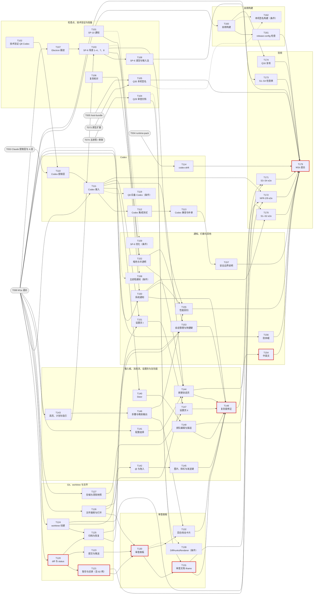

# cupper 开发任务拆分（M1a、M1b）

- 版本：v1.3.55
- 日期：2026-10-20
- 状态：v1.0 已确认（2026-10-19，用户确认任务的顺序和粒度，tag `gate/plan`）；v1.1 按用户决定"界面 100% 复刻 Codex"修订（D04）；v1.2 落实安全工程师对请求面板的确认条件（D04 第 2 轮）；v1.3 写进技术验证 T003 的结论（D05），待编排者确认
- 依据：技术设计 v1.6（[`02-design.md`](02-design.md) 与 [`design/`](design/12-milestones.md)；v1.0 打 tag `gate/design`）；PRD v1.3（[`01-prd.md`](01-prd.md)）；界面复刻程度的用户决定 F1–F6 [`meetings/2026-10-19-ui-fidelity/minutes.md`](meetings/2026-10-19-ui-fidelity/minutes.md)（v1.1，任务书 [`tasks/D04-ui-fidelity-revision/brief.md`](tasks/D04-ui-fidelity-revision/brief.md)）；请求面板的安全确认 [`meetings/2026-10-19-ui-fidelity/security-engineer.md`](meetings/2026-10-19-ui-fidelity/security-engineer.md)（v1.2，任务书 [`brief-r2.md`](tasks/D04-ui-fidelity-revision/brief-r2.md)）；技术验证 T003 的汇报 [`tasks/T003-tech-validation/report.md`](tasks/T003-tech-validation/report.md)（v1.3，任务书 [`tasks/D05-t003-findings/brief.md`](tasks/D05-t003-findings/brief.md)）；ADR-01 至 ADR-11；设计评审纪要 [`meetings/2026-10-16-design-review/minutes.md`](meetings/2026-10-16-design-review/minutes.md)；用户决定 [`meetings/2026-10-16-gate-design-decisions/minutes.md`](meetings/2026-10-16-gate-design-decisions/minutes.md)（含"补充：Apple Developer 账号"）；计划评审意见与第二轮确认 [`meetings/2026-10-16-plan-review/`](meetings/2026-10-16-plan-review/agenda.md)，编排者裁定（[`tasks/P02-plan-revision/brief.md`](tasks/P02-plan-revision/brief.md)、[`brief-r2.md`](tasks/P02-plan-revision/brief-r2.md)）
- 用途：编排者照着本文件逐个写 brief、派发任务（[`00-process.md`](00-process.md) 的"任务生命周期"）；任务完成后在第 9 节打勾。对评审意见的逐条回应见 [`tasks/P02-plan-revision/responses.md`](tasks/P02-plan-revision/responses.md)

## 0. 结论

- **共 137 个任务**：M1a 78 个（含 2 个条件任务），M1b 54 个（含 5 个条件任务），"发布（推迟）"5 个。规模：M1a 非条件任务 S 3、M 48、L 25；M1b 非条件任务 S 11、M 26、L 12；发布组 S 1、M 1、L 3。L 的都在表后注明了为什么不再拆。
- **没有远端也能验收**（U-P1：先不建远端）：所有 CI 检查都经 `cargo xtask ci <作业>` 在本机干净的 worktree 里执行，workflow 文件照写、暂不启用；入库的只有结构化摘要（1.8）。M1a 退出改为在作者机器上连跑 20 次加 5 次降速变体（T099）；本机替代不了的两项（macOS 14、15 上的对端校验，CI 负载下的稳定性）在 T099、T179 的记录里列为缺口，由用户确认。
- **M1a 关键路径**（按规模加权，S=1、M=2、L=3，共 35；2026-10-19 v1.3.11 后）：T001 → T010 → T011 → T017 → T012 → T013 → T031 → T033 → T043 → T088 → T044 → T046 → T090 → T091 → T099。v1.3.11 拆分 T043 后，交互接线（T088）串在 T043 与 T044 之间，关键路径由 33 增至 35；桌面链等其他零松弛链见第 3.4 节。任务表里加粗的编号在零松弛的链上。
- **M1b 关键路径**（从 T099 起，共 17）：T099 → T120 → T121 → T130 → T131 → T148 → T154 → T179。
- **v1.3 的变化**（D05：技术验证 T003 的结论，设计 v1.6；明细见 2.8）：K1 已通过，T057 不触发；T050 的扩展消息全部走 SDK，加两条 SDK 约束的用例；T055 加 `CommandsChanged` 去重和新的关闭顺序；T038 按"对 Claude 工具命令只剩祖先链"设定血缘信号的期望；T063、T066 观察多次 resume 后的进程数，T066 加 6 会话和关闭时有命令运行两个剧本；T074 的 Electron 起始版本改为 44.x 的最新补丁。依赖和波次不变。
- **v1.2 的变化**（D04 第 2 轮：安全工程师对请求面板"附条件可以"，设计 v1.5；明细见 2.7）：请求面板的焦点、编号、"拒绝并附一条消息"的规则写进 T083；导航键清掉尚未用掉的输入（T077）；宿主核对 `digit` 与序号（T031）、记录 `reply_to`（T011、T012、T043）；还原确认按触发来源分开（T130、T131、T139）；通知没有操作按钮的单元测试（T150、T158）；新增 E2E-SEC-panel-numbering、E2E-reject-with-message、E2E-SEC-revert-confirm、UNIT-notifier-no-actions。依赖和波次不变。
- **v1.1 的变化**（D04：用户决定界面 100% 复刻作者本机安装的 Codex，设计 v1.4、PRD v1.3；明细见 2.6）：
  - 界面任务按设计 v1.4 的 Codex 规格改写"做"和验收；T084 直接用设计 5.7.10 的 token，不再等 T106。
  - 审批和提问改为替换输入框位置的请求面板：T083 改为"请求面板与请求记录行"，输入框和排队消息拆到新增的 T086；真实输入规则的变化在 T077，e2e 在 T090–T093（新增 E2E-SEC-panel-arming）。请求面板的安全落点待安全工程师确认（设计 Q41，8.2 的 P-23）。
  - F3 定为进 M1 的元素都有了归属（5.8）：新增 T132（回合改动卡片与撤销）、T149（排队消息的编辑与插话，`session/queue_edit` 提前到 M1b，属于附加，在契约冻结之前写进契约）。
  - T106 改为"复刻核对：暗色与未核实项"，可以提前，只有 T152 依赖它；M1b 的界面任务不再依赖 T106，M1b 由 B1–B8 变为 B1–B7。关键路径不变。
  - 以后的界面任务可以按 F2 只读查看本机 App 包（1.11）。
- **v0.3 的变化**（第二轮确认的 17 条条件，明细见 2.5）：
  - 本机 CI 补细则：机器级锁，e2e、`ui`、性能、nfr1 类作业串行；"干净 worktree"的含义；摘要里加逐编号结果清单；截图元数据只严格比对 Chromium；`security-macos14` 在作者机器上运行，不算作 macOS 14 的覆盖（1.8）。
  - 5.8.1（设计 v1.3）落到任务：`dev_key` 只接受拉起宿主的进程（T021、T030、T037）；CLI 按构建种类校验宿主，自用构建的 CLI 编进宿主的 cdhash（T005、T045、T092）。
  - M1b 的界面任务都依赖视觉规格 T106；T106 由子 agent 只读主仓库里的参考图（P-20 已裁定）。
  - 自用构建关闭 `enableCookieEncryption`，`disable-library-validation` 也给 helper，验收用 T160 自己的产物；剩余风险写进"自用前须知"和 T157。
  - 更正：退化模式下 CLI 照常按 uid 只读接入，`install_cli` 不隐藏；K7 不通过的影响只有 NFR-8 不成立和 TCC 授权要重新确认（7.3）。
- **v0.2 的主要变化**（明细见 2.4）：
  - 验收挂错任务的都改了（测试 #2、#3）：T033 只验收网关层；宿主集成测试拆成 T062、T063、T068、T069 四个，依赖一满足就派发。每个进程级用例需要的执行者，都在它所属任务的前置闭包里，核对方法见 P02 的 `notes.md`。
  - 用例编号改为"登记表加自动推导"：精确匹配，并核对用例确实执行并通过（1.6、T002）。设计里的编号已统一成完整写法（设计 v1.2）。
  - 界面：token 和三栏外框提前到 M1a 的 T084；输入框预留插槽；复刻度贯穿 M1b，包括视觉规格 T106、两次 MAN-ui6、复刻度修正 T148（1.11）。
  - 自用构建单独一套身份和数据目录，开启 hardened runtime；T160 合并时附"自用前须知"（P-5、P-15）。
  - 新增 Electron 大版本跟进 T107；SP-6 拆成 T103 和 T108，T103 排在代码高亮之后。
  - 安全要求写进任务：兼容套件的自我约束（T064）、真实录制过本机敏感词清单并由用户抽查（T052、T066、T113）、Q35 以私钥隔离为通过条件（T105）、委托票据的安全要求（T079）。
- **检查点**：K1 技术验证 T003 → 驱动层（已通过，2026-10-19）；K2 测量闸门 T078 → K3 契约冻结 T016；K12 首批真实录制 T066；K4 M1a 退出 T099；K5–K9 是 M1b 的验证与 SP-6；K10 M1b 退出；K11 账号到位（4.4）。
- **还需要用户定的事**：第 6 节第 1 行（上游反馈；T099、T179 的缺口届时确认），以及 T106 之前补截暗色主界面等截图（第 6 节第 12 行）。P-16 至 P-21 都已处理（8.1）；第 8.2 节有 1 条需要编排者处理的事项。

## 1. 拆分原则

### 1.1 粒度与规模

- 一个任务交给一个子 agent 一次完成，在独立 worktree 的独立分支上开发、测试、提交（[`CLAUDE.md`](../CLAUDE.md) 的子 agent 守则）。
- 规模按改动行数估计（含测试，不含生成物、录制、金样例、截图基线和字体等夹具文件）：

  | 规模 | 行数 | 说明 |
  |---|---|---|
  | S | ≤ 400 | 半天到一天 |
  | M | 400–900 | 一到两天 |
  | L | 900–1,500 | 两到三天；表后的注写明为什么不能再拆 |

- 分支名按 [`CLAUDE.md`](../CLAUDE.md) 的约定：`<类型>/<编号>-<英文短名>`，例如 `feat/T043-session-actor`；技术验证类任务用 `spike/<编号>-<短名>`，代码放 `spikes/<编号>-<短名>/`，不进产品代码。
- 上限约 1,500 行。子 agent 开工后发现会明显超出，先停下来汇报，由编排者按注里的拆分点拆成两个任务，不硬塞进一个分支。
- 执行经验（2026-10-19，M1a 前两波）：测试通常占改动的 40%–55%，例如 T024 实现约 690 行、测试约 560 行。测试基础设施类任务，测试客户端和断言辅助本身就很大：T051 的测试实际 922 行，估计时只算了约 420 行。写任务书和估行数时，把测试和测试辅助单独列一项。
- 执行经验（2026-10-19，M1a 第 3–5 波）：宿主任务的实现常比草估多出约 70%，rustfmt 会把字段多的结构体字面量展开；组合多个纯核心的性质测试要模拟很多端口，约多出 50%。估规模时，实现按草估的 1.7 倍、组合性质测试按 1.5 倍计（T058 的建议）。

### 1.2 每次合并后 main 都可用

- **每个任务的基本验收**：`cargo xtask ci pr` 在本机干净的 worktree 里通过（1.8）；新增的 IT、E2E 用例在本任务里连续跑 10 次全绿，次数和摘要写进汇报（测试 #7）。表里的"验收"一栏只列这之外的内容。界面任务（T081–T086、T130–T132、T139–T149、T150–T154）的汇报另附复刻度审阅用的截图，在使用系统字体（SF Pro、苹方）的 e2e 构建里截取，不用开源字体的回归基线（1.11）。
- **未实现的方法统一返回 `unsupported`**：宿主按方法注册执行者，没有执行者的方法返回 `unsupported`。M2、M3 的方法（`diag/export`、`stream/ack`）以及 `session/queue_edit` 的 `remove`、`move` 两种 op 在 M1 结束时仍是这样（`queue_edit` 的 `replace`、`steer` 按 F3 在 T149 实现）；`host/prepare_upgrade` 在 T183 之前也是。为了不掩盖遗漏，T033 加 UNIT-unsupported-set：枚举协议的全部方法，断言"返回 `unsupported` 的集合"恰好等于按里程碑允许的集合；T099、T179 各核对一次（测试 #8）。
- **接口由使用方先定义，实现方后接上**：例如 T040 定义 `driver::api`，T043 用进程内替身测试，T055 实现；T043 的快照端口在 T061 合并前为空，回合快照记为 `skipped`，不带 `reason`（T043 裁定：写 `not_a_repo` 对 git 项目是错的）。替身只出现在测试代码里。
- **测试任务"就地修"的上限**：单处修复不超过 100 行、不改接口；超出的另开 fix 任务，测试任务先把相关用例标为待修（测试 #10）。
- 不留技术债（[`CLAUDE.md`](../CLAUDE.md) 的工程原则）：条件任务只在触发时派发，触发前不写后备代码（P-7）。

### 1.3 契约先行

- 协议的全部类型（含 M1b 才用的方法和事件）在 T010–T015 完成，宿主、CLI、host-client、界面都在它之后；`driver::api` 在 T040；ShellAPI 里与协议无关的部分在 T070，依赖协议类型的部分（`HostPort`、`PrivilegedAction` 等）在 T071；帧级 TS mock 宿主和 HostPort 合同测试在 T071。
- 冻结（T016）排在测量闸门 T078 之后，并且依赖 ShellAPI 的主要使用方 T077、T081–T083、T085、T086（P-1）。冻结前修改契约：单独提交，在同一任务里重新生成 `packages/protocol`，在汇报里列出改了什么；T015 的生成物一致性检查从那时起一直开着。冻结之后只能附加（[5.12.5](design/12-milestones.md#5125-契约冻结清单)），`xtask ci protocol` 把关。

### 1.4 测试基础设施先行

| 基础设施 | 任务 | 之后的使用者 |
|---|---|---|
| 本机 CI 入口 `cargo xtask ci` | T001 | 全部任务 |
| 用例编号登记与 trace-ids | T002 | 每个任务在 `tests/ids.toml` 里登记自己产出的编号 |
| 时钟、纯核心框架、静止屏障的参与者登记 | T022 | 全部宿主任务；T047 在它上面实现 `test/clock_advance` |
| 启动载荷、`test_config`（含 `durations`）、故障点框架 | T023 | 全部宿主任务 |
| 只运行网关的测试夹具（test-harness 门控） | T030 | T033、T073 的 `dev_key` 用例由拉起夹具的测试进程出示密钥 |
| 假 agent、录制格式与回放、敏感词扫描 | T051、T052、T067 | 驱动、集成测试、金样例、测量闸门、真实录制 |
| test-harness 测试接口（`clock_advance`、`seed`、录制导出） | T047 | 集成测试、闸门、兼容套件 |
| 故障点夹具（断言库） | T069 | T121、T124 只登记新的故障点 |
| 帧级 TS mock 宿主、HostPort 合同测试 | T071 | T076 用同一套合同测试真实实现；界面截图 |
| token、三栏外框、页面骨架 | T084 | 全部界面任务 |
| 截图回归设施、`xtask ci ui` | T118 | 全部界面任务 |
| 行类型注册表、基础组件 | T128 | 全部界面任务 |
| e2e 夹具与辅助函数（一次给齐）、`@smoke` 标签 | T090 | 全部端到端任务只新增用例文件 |
| 兼容套件框架 | T064 | 真实录制（T066、T113） |

时间相关的两条规则（测试 #4）：

- 新增定时器的任务，在同一任务里把时长接到 `test_config.durations`，用例用短时长，不等 T047。
- 新增 actor 的任务，在 T022 的静止屏障里登记；没有登记就启动时，debug 构建断言失败。T047 另有一个用例枚举全部 actor 类型。

### 1.5 并行与区域

区域借用 CODEOWNERS 的思路，判断哪些任务可以同时进行而不冲突：

| 区域 | 代号 | 路径 |
|---|---|---|
| 工程与 CI | C | 根目录配置、`.github/`、`tools/trace-ids`、`tools/license-gate`、`tools/codex-drift`、`tests/` |
| 协议 | P | `crates/cupper-protocol`、`protocol/`、`tools/gen-protocol-ts`、`tools/schema-compat`、`packages/protocol` |
| Rust 宿主 | H.core、H.store、H.gw、H.idx、H.orch、H.drv、H.git、H.rt、H.diag | `crates/cupper-host/src/` 下对应模块（core 含 clock、supervisor、test 接口；idx 含 attention、trust、settings） |
| 系统接口 | H.sys | `crates/cupper-sys` |
| CLI | H.cli | `crates/cupper-cli` |
| 假 agent 与测试数据 | H.fake | `crates/cupper-fake-agent`、`testdata/`、`tools/sanitize`、`tools/rec-shape-diff` |
| xtask 与运行时 | H.xt | `crates/xtask`、`runtime/` |
| TS 库 | T.lib | `packages/shell-api`、`packages/i18n`、`packages/host-client` |
| 界面 | T.ui | `packages/ui-core` |
| 原生扩展 | D.nat | `crates/cupper-desktop-native` |
| 桌面主进程 | D.main | `apps/desktop` |
| 文档、原型实测 | Doc、SP | `docs/user/` 等；`spikes/` |

规则：

- 不同区域的任务可以并行；同一区域的任务默认串行，除非 brief 写明各自拥有哪些目录或文件。以下几处必须写明：
  - 界面：T080 负责状态层与查询，T136 负责安全规则（v1.3.28），T084 负责外框、骨架和插槽，T128 负责行类型注册表和基础组件，T118 负责截图设施（v1.3.22）；T082 只写行列表和消息类的行；T083 写请求面板和请求记录行，T086 写输入框和排队消息，两者经 T084 的输入框位置插槽衔接（v1.1）；T085 写新建会话页（桌面 #2）。
  - 输入框：T086 预留底栏左右两组插槽和弹出层挂载点，T140、T141、T142、T145、T149 只新增文件；T142 与 T145 共用弹出层，串行（桌面 #4）。
  - 桌面主进程：M1b 里改 `apps/desktop` 的任务（T131、T142、T147、T152、T153）在 brief 里列出各自负责的文件。
  - e2e：T090 一次给齐辅助函数，T091–T093 只新增用例文件（桌面 #13）。
  - 测量闸门：T078 的负载页面和钩子放测试专用目录，不碰 T077 的文件（桌面 #10）。
- 共享的热点和避免冲突的约定：
  - 工作区成员用通配（`crates/*`、`packages/*`、`apps/*`、`tools/*`），新 crate 和 package 不改根清单；`[workspace.dependencies]` 的冲突由编排者合并时处理。
  - `crates/cupper-host/src/lib.rs` 只放 `mod` 声明，各模块的接线放在模块内部。
  - `xtask ci` 的每个作业一个文件；workflow 同样一个作业一个文件。
  - i18n 文案按功能分文件（`locales/<语言>/<功能>.json`）。
  - `tests/ids.toml` 按任务分段，每个任务只追加自己的一段，不需要删行（1.6）。
  - 表结构在 T160 之前只改 `0001`（P-4）。
- 实际并行度：作者机器上同时运行的子 agent 建议不超过 3–4 个（Rust 编译占 CPU）；e2e、`ui`、性能、nfr1 这几类作业由 `xtask ci` 的机器级锁串行（1.8）。
- 截图基线的合并顺序：T152 修正暗色取值、加上半透明侧边栏时，一并更新它影响到的已有基线；与 T152 同波的界面任务（v1.1 为 T130、T145、T149、T151）等 T152 先合并，再在新的取值下重新生成各自新增的基线后合并。

### 1.6 用例编号与登记

- 验收引用 [5.9.10](design/09-testing.md#5910-测试编号与人工验证清单) 的编号；本计划新增的编号写"新增"，命名同样是 `<层>-<范围>-<名称>`，截图回归用 `UI-` 前缀（设计 v1.2 已写进 5.9.10）。设计里的编号已统一成完整写法，trace-ids 只做精确匹配（P-3，测试 #6）。
- **登记表加自动推导**（测试 #5；设计 v1.3 的 5.9.10 已改为这套机制）：
  - `tests/ids.toml` 列出设计和本计划里的全部编号，每个编号带：里程碑、产出任务、所属套件（PR、每晚、发布、人工）、状态。
  - 一个编号分几次完成时，登记成若干子编号，全部子编号通过才算通过。本计划用到的有：
    - IT-NFR9-failpoints = `-core`（T069）+ `-git`（T121）+ `-worktree`（T124）；
    - UNIT-cli-resolver、UNIT-option-map、GOLD-A-option-map、GOLD-A-tool-fields = `-claude`（T053、T054、T095）+ `-codex`（T110、T111）；
    - E2E-new-session-agent、MAN-compat、COMPAT-untrusted-project = `-claude` + `-codex`；
    - MAN-notification = `-spike`（T101）+ `-product`（T150）；
    - MAN-ui6 = `-shell`（T152）+ `-full`（T148）；
    - UI-settings = `-agents`（T151）+ `-general`（T147）；
    - IT-sys-peer = `-current`（T021，作者机器上的系统）+ `-macos14` + `-macos15`（后两个是缺口）。
  - 互为替代的条件任务（T131 与 T139、T150 与 T158）登记同一个编号，由实际派发的那个产出；MAN-keyboard 每个 Electron 大版本做一次（T077、T107），证据按版本区分。
  - "待完成"由 trace-ids 自动算出，任务不手工删行。
  - trace-ids 读测试运行结果（cargo-nextest 的 JUnit 报告和 Playwright 的 JSON 报告；stable 工具链下 libtest 的 JSON 输出不可用），确认编号确实执行、通过，并且跑在登记的套件里。`#[ignore]`、`test.skip` 的用例不算。
  - 人工项（MAN）的证据是 `docs/` 下带日期和版本的记录，格式由 T173 定；MAN-keyboard 要与当前 Electron 大版本对得上，升级后旧证据失效。
  - 条件任务的编号在检查点通过后标为"不适用（Kx 已通过）"，不挡里程碑退出（P-7）。
  - 本机替代不了的编号（IT-sys-peer-macos14、IT-sys-peer-macos15）标为"缺口"，在 T099、T179 由用户确认后改为"缺口（用户已确认）"。本机跑的 `security-macos14` 只记作 `IT-sys-peer-current`，摘要记下系统版本，不算作 macOS 14 的覆盖。
  - 里程碑退出时，trace-ids 读入库摘要里的逐编号结果清单（1.8），所以"待完成为空"可以从仓库复核。
- 端到端用例按 5.12.4 的〔PR〕〔晚〕标 `@smoke` 或不标，trace-ids 核对每个编号的套件（T090）。

### 1.7 条件任务与可以提前的任务

- **条件任务**（名称前标"（条件）"）只在检查点不通过时派发：T057（K1 已通过，不触发）、T079（K2 已达标，不触发）、T119、T139、T158、T159；T162 在 Q35 *通过*时派发。依赖图里用虚线表示。
- **可以提前的任务**（前置一栏标"可提前"）：T101、T102、T104、T105、T106（v1.1）、T110、T114。依赖满足后可以在 M1a 期间派发，但评审资源优先给 M1a 的关键链。其余 M1b 任务在 T099 之后派发。

### 1.8 本机 CI（U-P1：先不建远端）

| 项 | 做法 |
|---|---|
| 统一入口 | `cargo xtask ci <作业>`，作业与 [5.1.6](design/01-repo-build-ci.md#516-ci-流水线) 一一对应（`rust`、`protocol`、`ts`、`ui`、`license`、`testdata-scan`、`e2e`、`security-macos14`、`compat-framework`），另有组合作业 `pr`（每个 PR 的全部作业）和 `nightly`（每晚的全部作业，含 e2e 全集、差分测试、性能趋势、`release-config`、`codex-drift`）。workflow 文件照写，只调用这个入口，等有了远端再启用 |
| 环境 | "干净 worktree"指 git 状态干净（`git status` 为空）；可以在 worktree 之间共享的只有下载缓存（cargo registry、pnpm store）和编译器缓存（sccache 这一类），不共用 `CARGO_TARGET_DIR`：cargo 对工作区成员的指纹不含绝对路径，另一个 worktree 编出的、时间更新的产物会被当成最新的（T015 实际遇到）。e2e 用的 App 和 `CupperHost.app` 必须由当前提交构建，摘要记下产物哈希，防止测到别的 worktree 留下的旧产物 |
| 机器级锁 | e2e、`ui`、性能、nfr1 这几类作业取同一把机器级锁，串行运行，避免多个子 agent 和编排者同时跑时互抢 CPU、造成计时类误报。e2e 的 Playwright workers 固定为 2（T090），20 次连跑也按这个数字 |
| 验收记录 | 入库的只有结构化摘要：提交、工具链版本、macOS 版本、机型泛称、各作业的通过数和失败数、耗时，以及逐编号的结果清单（编号、套件、结果、提交）和 e2e 产物哈希。原始日志放 `.private/`。摘要入库前过个人信息扫描（`xtask ci` 自带字段白名单检查，T052 之后再过 `testdata-scan`）（测试 #11） |
| 每晚作业 | 每一波合并完、开始下一波之前，编排者在 main 上跑一次 `xtask ci nightly --record docs/ci/nightly/`，摘要随之提交 |
| 截图基线 | 渲染因素固定（随夹具附带开源字体，固定视口、缩放、语言、时区、虚拟时钟，关闭动画，隐藏光标）；基线由专用脚本在本机生成，元数据记下 macOS 和 Chromium（Electron）版本。Chromium 版本严格比对，对不上就失败；macOS 只比对大版本，小版本变化只给提示，出现像素差异时才重新生成基线（T084，测试 #13） |
| 性能趋势 | "历史中位数"取自入库的历史数值序列（脱敏后只含数值、版本和机型泛称），每次 `xtask ci nightly` 追加一条（T047） |
| LFS | xtask 下载锁定版本的 git-lfs 到缓存目录，核对哈希后使用，本机也能跑（T061、T121，测试 #12） |
| M1a 退出 | 在退出候选的同一个提交上：`xtask ci e2e --suite nfr1` 连续 20 次全绿（Playwright 并行度同 CI 设定，不允许重试、跳过或隔离，失败一次查明根因后清零），再跑 5 次降速变体（占用一半核心的负载进程或降低优先级）；`xtask ci pr` 与 `xtask ci nightly` 各通过一次。运行期间作者不操作机器（T099） |
| 本机替代不了的项 | macOS 14、15 上的对端校验（本机的 `security-macos14` 跑在作者机器的系统上，只记作 `IT-sys-peer-current`）；CI 负载下的稳定性。在 T099、T179 的记录里列为缺口，由用户确认接受。本地 macOS 虚拟机（Virtualization.framework）是可选方案，记为风险 R7，不作为前置条件 |
| 以后建远端时 | 首次在 CI 上再跑一轮 20 次；推送前对全部历史做个人信息扫描；Actions 设置"外部贡献者的工作流需要批准"；不用自托管 runner；签名密钥只放受保护的 environment（R12） |

子 agent 不 push（[`CLAUDE.md`](../CLAUDE.md)）。编排者合并前在本机跑 `xtask ci pr`，与子 agent 的汇报核对（流程见 [`00-process.md`](00-process.md)）。

### 1.9 "用户参与"一栏

- **是**：需要用户在场或操作（系统授权框、实体键盘、证书、亲自走流程、抽查入库内容），或会消耗用户的额度。
- **知情**：在作者机器上运行、会弹窗口或长时间占用机器，派发前告知时段，运行期间不操作机器。
- **可选**：用户愿意时可以手动补一项验证。

### 1.10 真实 agent 的使用约束

- T160 交付之前，不用开发构建在真实项目上运行真实 agent；之后只用自用构建处理真实项目，开发构建和测试只用临时目录或 `cupper-dev/`（P-15，安全 #1、#3）。
- 不经宿主的真实运行（T003、T102）：临时仓库放在每个用户自己的临时目录，剧本固定、不联网取内容，不选持久类选项，权限模式显式设定（Claude `default`；Codex `read-only` 或 `workspace-write`），运行前后对配置文件做哈希对比（安全 #8）。
- 经宿主的真实运行（T066、T113）：兼容套件以 test_harness 身份运行，必须自我约束（T064，安全 #4）；录制和报告入库前过本机敏感词清单，并由用户抽查（安全 #5）。
- 真实 Codex 运行前，用户自己备份 `~/.codex/config.toml` 和 `hooks.json`（放在仓库外，权限 0600）；spike 只在临时仓库里运行，不读写 `auth.json`；运行后报告列出差异，新增的 `[projects]` 信任项单独列出，由用户决定保留还是恢复；子 agent 不改用户配置（P-14）。

### 1.11 界面复刻度

v1.1 起以作者本机安装的 Codex 客户端为准，100% 复刻（用户决定 F1，PRD UI-6 v1.3）；规格在设计 5.7.4、5.7.5、5.7.10。

| 时间 | 做什么 | 谁 |
|---|---|---|
| M1a 的 T084 | 按设计 5.7.10 建立 token（亮色经截图核对，暗色先用推算值）和三栏外框，组件从第一天起只引用 token | 子 agent |
| 每个界面任务 | 按设计的 Codex 规格实现。需要核对细节时，可以按 F2 只读查看本机 App 包：不启动 App，不读用户数据目录，解包只放 `$TMPDIR` 并且用完删除，不把对方的代码、样式表、图标、图片、字体复制进仓库，汇报里写明看过哪些资源。汇报附固定窗口尺寸、固定夹具下的截图，在使用系统字体（SF Pro、苹方）的 e2e 构建里截取，不用开源字体的回归基线；编排者对照设计审阅，偏差当场退回 | 子 agent 截图，编排者审阅 |
| T106 之前 | 补截暗色主界面截图和 ui-spec 7.3 中需要截图核对的几项，只放在主仓库的 `.private/references/`（第 6 节第 12 行） | 作者 |
| 可以提前 | T106 复刻核对：按 F2 只读查看本机 App 包、对照截图，核对设计的 Q36–Q40；结果由编排者更新设计 5.7.10，T152 据此修正暗色 | 子 agent（P-20） |
| T152 之后 | MAN-ui6-shell：外框、token、两种主题，与本机 Codex 并排比对 | 作者 |
| 全部界面功能完成后 | MAN-ui6-full：与本机 Codex 全量并排比对，随后 T148 复刻度修正；T154 依赖它，截图基线锁定的是修正后的视觉 | 作者比对，子 agent 修正 |
| T179 | MAN-S1 至 MAN-S4 顺带检查交互细节：折叠、请求面板的按键、贴底、跳转 | 作者 |

## 2. 任务清单

前置一栏只列直接依赖，可由其他依赖推出的间接依赖省略。加粗的编号在关键链上（松弛为零）。

### 2.1 M1a：宿主骨架

| 编号 | 名称 | 类型 | 设计依据 | 前置 | 做什么 / 不做什么 | 验收（用例编号） | 规模 | 用户参与 | 区域 |
|---|---|---|---|---|---|---|---|---|---|
| **T001** | 仓库与工程骨架、本机 CI 入口 | build | 5.1.1–5.1.6；1.8 | — | 做：Rust 与 pnpm 两套工作区（成员用通配）、工具链锁定、clippy 的 `disallowed-methods` 与 `await_holding_lock`、`deny.toml`、lint 与格式配置；`xtask` crate 与 `cargo xtask ci <作业>` 入口（`rust`、`ts`、`license` 三个作业先只有 `cargo deny`；运行前检查 git 状态干净；e2e、`ui`、性能、nfr1 类作业取机器级锁、串行运行；结构化摘要含逐编号结果清单与 e2e 产物哈希，原始日志放 `.private/`，摘要的字段白名单与个人信息自检）；workflow 文件只调用这个入口，暂不启用。不做：其他 crate 和 TS 包 | `xtask ci pr` 在干净 worktree 里通过；`disallowed-methods` 的负面样例让 clippy 失败；新增 UNIT-ci-summary（摘要只含白名单字段，含路径或用户名时拒绝写入）、UNIT-ci-lock（两个持锁作业不会同时运行；git 状态不干净时拒绝运行） | M | 否 | C、H.xt |
| T002 | 用例编号登记与 trace-ids | build | 5.9.10；1.6 | T001 | 做：`tests/ids.toml`（设计和计划里的全部编号：里程碑、产出任务、套件、子编号、"不适用"状态）；`tools/trace-ids`（精确匹配；读 cargo-nextest 的 JUnit 和 Playwright 的 JSON 报告，确认编号在登记的套件里执行并通过；里程碑退出时改读入库摘要里的逐编号结果清单；核对 MAN 证据的日期与版本；"缺口（用户已确认）"状态；待完成清单自动推导）；`xtask ci testdata-scan`。不做：PII 扫描、兼容报告校验 | `xtask ci testdata-scan` 通过；新增 UNIT-trace-ids（缺测试、被跳过、套件不符、MAN 证据过期、子编号未齐都报错） | M | 否 | C |
| T003 | 技术验证：Q8（Claude）、Q9、SP-4b #7 与版本复核 | spike | 5.12.2（技术验证）、5.13 Q8 与 Q9、5.9.5、5.8.4 | — | 做：用 SP-1 的 TS 客户端跑 Claude 并发剧本；用 SDK `=3.3.0` 写探针确认扩展消息的收发；观察真实适配器拉起命令时的进程树；复核锁定版本和测量闸门的负载数字。约束：临时仓库放在每个用户自己的临时目录、剧本固定且不联网取内容、不选持久类选项、权限模式显式设为 `default`。不做：产品代码 | 报告：Q8 逐轮数据（5.9.5 的通过条件）、Q9 逐项结论、SP-4b #7 结论、版本建议；运行前后哈希覆盖 `~/.claude/settings.json` 和 `~/.claude.json` 中与权限有关的字段 | M | 是：真实 Claude CLI，消耗少量额度（U-R5 已许可） | SP |
| T004 | xtask runtime-pack 与运行时清单 | build | 5.1.5、5.10.3、5.6.6 | T001 | 做：`cargo xtask runtime-pack`（下载并校验 Node、codex-acp、esbuild-wasm，本机重签 Node，隔离目录里算 claude-agent-acp 打包产物哈希，提取并归类适配器读取的环境变量）与 `--verify`；`runtime/manifest.json`、`runtime/locks/`、打包脚本、许可证文本。不做：宿主侧安装器 | `runtime-pack --verify` 通过；新增 UNIT-runtime-pack-envscan（未归类的变量名让命令失败） | M | 否 | H.xt |
| T005 | xtask host-bundle | build | 5.10.1、5.10.2、5.7.9 | T004、T023、T045 | 做：`cargo xtask host-bundle` 按构建种类组装 `CupperHost.app`（Info.plist、`Helpers/node`、`Resources/runtime/`）并 ad-hoc 签名；构建顺序是先签宿主、取得 cdhash，再编译 CLI（自用构建把宿主 cdhash 编进 CLI，5.8.1）并单独签名。不做：自用构建的签名参数（T160）、Developer ID（T180） | 新增 IT-host-bundle-layout（布局、identifier、Info.plist 不含用途说明、CLI 内嵌的 cdhash 等于同一产物里宿主的 cdhash） | S | 否 | H.xt |
| T006 | 许可证门禁第一层 | ci | 5.1.6（license）、ADR-11 | T004、T074 | 做：`tools/license-gate` 第一层（按锁文件和 metafile 求每个 JS 入口的生产依赖闭包，出现 Anthropic SDK 或 Claude Code 就失败；运行时组件许可证齐全）与负面样例，接入 `xtask ci license`。不做：最终产物扫描（T182） | 新增 UNIT-license-gate-negative | M | 否 | C |
| T007 | 桌面主进程 II-b：退出确认与重启宿主 | feat | 5.7.2（`lifecycle`）、5.5.1、5.8.1（退化模式） | T075 | 做：`cupper-sys` 按 pid 取可执行文件路径（`proc_pidpath`）和 cdhash（`csops`），原生扩展导出 `processImage(pid)`、`fileCdhash(path)`；`lifecycle`（单实例锁、退出前查 `host/status` 弹原生确认框、`host/exit`、关机和 `before-quit-for-update` 跳过）；"无法验证宿主"与"重启宿主"（发 SIGTERM 前核对 `host.lock` 里的 pid 的可执行文件路径和 cdhash 属于本构建的宿主） | 新增 UNIT-host-restart（含"pid 不属于本构建的宿主时不发信号"、关机跳过确认） | M | 否 | D.main |
| T008 | 驱动层 II-b：适配器的生命周期 | feat | 5.6.1、5.6.8 | T055 | 做：重启退避与 `crashed`（时长接 `test_config.durations`）、关闭顺序按 5.6.8（先 `session/close`，发信号前枚举全部后代，按各自的进程组发信号）、资源采样（记下后代的进程组和 `claude` 进程数，Q43）与采样接口、假 agent 的 `setsid` 孙进程 | IT-K21-reap-group（补"后代在另一个进程组"）、IT-adapter-restart（v1.3.18 由 T055 移来） | M | 否 | H.drv |
| T009 | 驱动层 II-c：能力与状态 | feat | 5.6.2、5.6.7 | T055 | 做：能力缓存与探测目录（`steering.supported` 从 `initialize` 响应顶层的 `_meta` 读取）、`CommandsChanged` 按会话去重、`agents/capabilities`、`agents/refresh`、`AgentStatus`（交给索引的接口，T034 之前空实现） | UNIT-commands-dedup（v1.3.18 由 T055 移来）；能力缓存与 `agents/refresh` 的用例 | M | 否 | H.drv |
| **T010** | 协议基础：分帧、信封、ID、错误码、规范 JSON 与注解 | feat | 5.3.1、5.3.8、5.3.9、5.4.4、5.2.15 | T001 | 做：迁移 SP-4a 的 frame、rpc（`Method` 加 `SCOPE`、`IDEMPOTENCY`）、open_enum、text、coalesce、sync、transport；事件信封与流 ID、ID 前缀类型、错误码与 reason、限额、RFC 8785 与 `d_` 摘要、六种 schema 注解的机制、整数上界。不做：具体的事件和方法 | UNIT-digest-jcs；新增 UNIT-proto-base | M | 否 | P |
| **T011** | 协议事件目录 I：事件基础、领域类型与索引流 | feat | 5.3.5、5.3.7、5.4.4、5.12.5 第 2 组；协议补充 5.3.11 | T010 | 做：`open_union!` 宏与严格/宽容两种解码（`Strictness`）；`EventBody` 的骨架与所属流的判定；公共领域类型（`Content`、`BlobRef`、`PromptContent`、`AgentKind`、`PrincipalKind`、`ClientKind`、`ClientRole`、`Tier`、`ResolvedBy`、`Cost`，`ids` 新增 `BlobHash`、`IntentId`、`GroupId`）；索引流的全部事件（`project.upserted` 的 `trust_state`、`SessionSummary` 的 `pending_kind`、`AgentStatus` 等）；`SessionCapabilities`（含 `turn.interrupt_stops_commands`）；`fallback.summary` 的填法；`ErrorData.resolved_by` 改为具名字段。不做：会话流的事件、条目、交互请求（T017）；方法、视图 | 新增 UNIT-proto-events-index（索引流与领域类型往返，含未知类型、未知枚举值、残缺数据在严格与宽容模式下的结果；`open_union!`） | L | 否 | P |
| **T017** | 协议事件目录 II：会话流、条目、ToolCall 与交互请求 | feat | 5.3.5、5.3.6、5.12.5 第 2 组；协议补充 5.3.11 | T011 | 做：会话流的全部事件（`session.configured` 的 `project_config` 与 `confirmation_required`、`workspace.*`、`turn.*` 的时间字段与 `final_item_ids`、`item.*` 与 `ItemPatch`、`queue.updated` 的条目带 `content` 与 `reply_to`、`snapshot.recorded` 的 `stat` 与 `reason`、用量）；条目联合（`user_message` 的 `reply_to`、`tool_call` 即 `ToolCall` 与按 `tool_kind` 的必填字段表、`late_tool_output`、`plan`、`notice`、`error` 等）；交互请求与 `Option.effect`（`unknown`、`tier_after`、`rule`、`ends_turn`）、回答；`request_digest`；`item.delta` 的 `field` 与 `Mergeable`、`x-mergeable`。不做：方法、视图 | 新增 UNIT-proto-events-session（会话流、条目、交互请求往返，含未知与残缺；`item.delta` 按 `(item_id, field)` 合并） | L | 否 | P |
| **T012** | 协议方法 I：方法基础、握手与流 | feat | 5.3.2、5.3.3、5.3.4（前两组） | T017 | 做：方法声明的基础（`MILESTONE`、`ERRORS` 常量与 `x-milestone`、`x-errors` 注解，`ErrorData.supported` 具名字段，声明宏，方法目录，权限矩阵、`command_id` 与幂等、整数上界三类测试的框架）；`host/hello`、`initialize`（各 `auth` 变体、`role`、`features`、`limits`、`host_proof`）及生命周期各方法；流与内容各方法（`stream/*`、`history/page`、`blob/*`，事件按 `Raw<T>` 宽容解码）；逐个声明 scope 与幂等。不做：项目、agent、会话、交互（T018）；其余方法（T013） | 新增 UNIT-proto-methods-core-stream（往返；方法级 scope 与 5.8.3 一致；宽容解码） | M | 否 | P |
| **T018** | 协议方法 I-b：项目、agent、会话与交互 | feat | 5.3.4（第三至五组）、5.2.6 | T012 | 做：项目与 agent、会话（`session/archive` 除外，v1.3.4 移给 T013）、交互各方法的参数与结果（含 v1.4 定义的 `session/queue_edit` 的 `QueueOp`、`interaction/respond` 的 `input.key: digit`，以及 v1.5 的 `session/send.reply_to`），按 T012 的声明方式逐个声明 scope、幂等、里程碑与错误码，并往 T012 的方法目录和测试表里加行；5.3.11 中"T012 开工前的裁定"的各项取值。不做：其余方法（T013） | 新增 UNIT-proto-methods-core-session（往返；方法级 scope 与 5.8.3 一致） | M | 否 | P |
| **T013** | 协议方法 II：git、文件、设置、认证、诊断与测试 | feat | 5.3.4 | T012 | 做：git、worktree（含与 `session/archive` 共用的阻塞原因枚举；v1.3.4 起 `session/archive` 也在本任务）、文件、`workspace/open`、设置、`auth/*`、`policy/describe`、`diag/*`、`test/*` 各方法，以及按构建特性门控的方法在 schema 里的标注。不做：任何实现 | 新增 UNIT-proto-methods-ext | M | 否 | P |
| T014 | 协议视图与同步规则 | feat | 5.3.3、5.2.8（视图窗口）、5.7.6 | T017 | 做：`IndexView`、`SessionView`（窗口、进行中回合、待处理交互、配置、能力、队列）、`apply` 与按 `turn_no` 排序、`late_by_ref`、快照 ops 的生成与切分、连续性与 epoch 重置规则、视图的序列化格式。不做：存储侧检查点、TS reducer | 新增 PROP-view-coalesce、UNIT-view-window、UNIT-view-late-by-ref | M | 否 | P |
| T015 | schema 导出与 TS 生成链 | build | 5.3.10、5.1.5、5.1.6（protocol） | T013、T014、T018 | 做：`export-schema` 完整输出、`protocol/schema/v1.json`、`tools/gen-protocol-ts`（hey-api 与三处后处理）、`packages/protocol` 生成物、`protocol/fixtures/`（含未知值）、`xtask ci protocol`（生成物一致性检查从此一直开着）。不做：兼容比对与冻结（T016） | `xtask ci protocol` 通过；新增 UNIT-proto-fixtures、UNIT-ts-fixtures | M | 否 | P、T.lib、C |
| T016 | 契约冻结 | chore | 5.12.5；P-1 | T077、T134、T135、T078、T082、T166、T083、T085 | 做：`tools/schema-compat`（方向敏感）、`protocol/released/v1-m1a.json`、`packages/shell-api/api-m1a.d.ts` 与类型断言，接入 `xtask ci protocol`。不做：契约内容的修改 | 破坏性改动的样例（删字段、下发方向必填改可选、上行新增必填、ShellAPI 删成员）让 `xtask ci protocol` 失败，附加式改动通过；新增 UNIT-schema-compat | M | 否 | P、T.lib、C |
| T020 | cupper-sys I：进程与系统信息 | feat | 5.1.3、5.8.5、5.2.13 | T001 | 做：迁移 SP-4a 的 `sys.rs`：`spawn`（SETSID 可选、`CLOEXEC_DEFAULT`、显式 stdio、默认信号处置、环境变量白名单）、进程组清理、libproc（启动时间、父进程链、会话与进程组）、`kern.bootsessionuuid`、`DARWIN_USER_TEMP_DIR`。不做：IOPM、UserNotifications | 新增 UNIT-sys-spawn（只继承 fd 0–2；去掉 CLOEXEC 的变异检查应失败）、UNIT-sys-reap-group | M | 否 | H.sys |
| T021 | cupper-sys II：对端校验与代码签名 | feat | 5.8.1、5.1.6（security-macos14）、Q24 | T001 | 做：合并 SP-4b 的 Security FFI：`LOCAL_PEERTOKEN`、`LOCAL_PEERPID`、SecCode 校验与动态状态字、编译期签名要求、csops、四类错误；实测 `proc_pidinfo` 的 `PROC_PIDUNIQIDENTIFIERINFO`（读自己的 `p_puniqueid`、对端的 `p_uniqueid`，供 5.8.1 的"`dev_key` 只接受拉起宿主的进程"）；`xtask ci security-macos14`（在作者机器的系统上运行，摘要记下系统版本） | 新增 IT-sys-peer-current（最后一次 I/O 进程语义、exec 与 fork 被拒、`SCM_RIGHTS` 被丢弃、csops、错误码；作者机器上的系统），IT-sys-peer-macos14、IT-sys-peer-macos15 登记为缺口；新增 UNIT-sys-uniqueid（不可行时报告并退回"pid 加启动时间"） | M | 否 | H.sys、C |
| T022 | 宿主核心骨架 I：时钟、纯核心框架与静止屏障登记 | feat | 5.2.16、5.2.3 | T001 | 做：`cupper-host` crate（lib、bin，特性 `dev-auth`、`test-harness`）、`Clock`、`SystemClock`、`ManualClock`、`IdGen`、纯核心 `step(input, now)` 的框架与测试驱动器、静止屏障的参与者登记（actor 未登记就启动时 debug 构建断言失败）。不做：启动契约（T023）、`test/clock_advance` 方法（T047） | 新增 UNIT-clock-manual、UNIT-idgen、UNIT-quiescence-registry | M | 否 | H.core |
| T023 | 宿主核心骨架 II：启动契约、注入点与故障点 | feat | 5.2.13、5.8.1（启动载荷）、5.9.9 | T022 | 做：`--data-dir`、`--build-info`；stdin 启动载荷（2 s 超时、编译期门控、读完指向 `/dev/null`、退出码 1；`test_config` 只经它传入）；`test_config` 全部注入点的结构（含 `durations`）；故障点框架；无特性运行的用例。不做：注入点的使用方 | 新增 UNIT-startup-payload、UNIT-failpoint；UNIT-release-features | M | 否 | H.core |
| T024 | 存储 I：写线程、读池与持久性 | feat | 5.2.8、5.9.8（写线程、数据代次） | T010、T022 | 做：写线程（组提交、每操作 savepoint、只在 `SystemClock` 下等 2 ms、确认回执）、4 个只读连接、两档持久性配置、`data_epoch` 判定纯函数与注入输入。不做：表结构（T025） | 新增 UNIT-writer-savepoint、UNIT-epoch-decision | M | 否 | H.store |
| T025 | 存储 II：表结构、迁移与升级器 | feat | 5.4.2、5.4.6；P-4 | T023、T024 | 做：`0001` 迁移（5.4.2 的全部表与 raw.db）、迁移框架（编进二进制、同事务更新版本、`VACUUM INTO` 备份、退出码 4 和 6、两脚本之间崩溃不重跑、测试可以注入一组脚本）、事件升级器框架、检查点的 `view_v`。不做：业务读写 | IT-migrations（第二个脚本由测试注入） | M | 否 | H.store |
| T026 | 存储 III：流、检查点、回合快照与历史 | feat | 5.2.3、5.2.8、5.3.3、5.4.5 | T014、T025 | 做：迁移 SP-4a 的 hub 为 `store::streams`（追加三步、订阅在流锁内读取、懒加载、淘汰；同步原语经 `cfg(shuttle)` 门面）、扇出接口、回合结束同事务写检查点和不可变的回合快照、`history/page` 读取、events 裁剪。不做：订阅协议（T033） | 新增 PROP-stream-seq（shuttle）、PROP-stream-replay | L | 否 | H.store |
| T027 | 存储 IV：blob、原始帧与保留清理 | feat | 5.2.8、5.4.5 | T025 | 做：按内容寻址的 BlobStore、原始帧有界队列写 raw.db（满了丢弃并计数）、各类保留清理（经 Clock，时长接 `test_config.durations`）。不做：blob 传输（T033） | 新增 UNIT-blobstore、UNIT-raw-queue、UNIT-retention | M | 否 | H.store |
| T028 | 日志与脱敏 | feat | 5.11.1、5.11.2 | T022 | 做：tracing JSON Lines 与按大小轮转、两档脱敏、`info` 不记内容、适配器 stderr 管道读取（每实例保留 64 KB）、panic hook。不做：诊断包（M2） | UNIT-redaction、UNIT-redact-auth-status | M | 否 | H.diag |
| T030 | 网关 I：连接、握手与本地认证（peer、codesign） | feat | 5.2.4、5.8.1、5.3.2 | T012、T021、T025 | 做：迁移 SP-4a 的 conn、outbox、wire；监听套接字的路径与权限、`host.lock`；准入（uid、签名结论、固定令牌，每次读取后比对）；读循环经 `recv_closing_fds`，收到 fd 就断开并记审计；写循环（编好的帧进入发送队列，按字节预算，超出时按流重置）；`host/hello`、只接受一次的 `initialize`、版本协商；`peer` 与 `codesign` 两种认证、principal 与角色；`ping`、连接审计。`dev_key`、`harness` 在本任务里一律回 `unauthenticated`（v1.3.5 起归 T039）。不做：方法分发、发送时合并与补发（T033）、"孤立"状态（T037） | 新增 IT-handshake（peer、codesign 与错误码部分）、IT-pinned-token（crate 内，真实套接字，含收到 fd 的用例） | L | 否 | H.gw |
| T039 | 网关 I-b：密钥认证与双向证明 | feat | 5.8.1、5.3.2 | T030、T045 | 做：证明的计算放进 `cupper-protocol`（纯函数，HMAC-SHA256，常量时间比较，CLI 和原生扩展共用）；`dev_key`（只接受拉起宿主的那个进程：比对对端的 `p_uniqueid` 与自己的 `p_puniqueid`）与 `harness` 认证；宿主的 `host_proof`；`dev-auth` 构建启动时 ppid 已是 1 就以退出码 1 退出；`cupper-sys` 按 pid 等待退出码（kqueue `NOTE_EXITSTATUS`）；CLI 客户端库的 `harness` 认证与 e2e 构建按 `harness` 证明校验宿主；只运行网关的测试夹具进程（test-harness 门控，T073 复用）。不做：审计落盘（T037） | 新增 UNIT-proof-binding、IT-devkey-launcher-only（拉起夹具的测试进程出示 `dev_key` 被接受，持同一密钥的其他进程被拒）、IT-devkey-orphan-start；IT-handshake 的密钥部分 | M | 否 | H.gw |
| **T031** | 策略 | feat | 5.2.5、5.8.2、5.8.3 | T013、T018、T022 | 做：方法级由 `SCOPE` 驱动；资源级规则（档位、privileged 选项、安全设置键、window 角色的输入证据与按键（v1.4：`digit` 须与所选选项的序号相符）、400 ms、信任门控的钩子）；`policy/describe`。不做：账本 | UNIT-tier-rules、UNIT-policy-matrix（含 `digit` 与序号的核对：特权和效果未知的选项也占序号） | M | 否 | H.gw |
| T032 | 命令账本 | feat | 5.2.5（账本） | T025 | 做：principal 稳定 ID 加 `command_id` 为键、三种状态、去掉 `command_id`/`attestation`/`input` 后的 JCS 参数哈希、48 小时内存表、`idempotency_mismatch`、`outcome_unknown`、结果与首批事件同事务的接口。不做：路由 | 新增 UNIT-ledger | M | 否 | H.gw |
| **T033** | 网关 II：分发、账本与路由 | feat | 5.2.4、5.2.5、5.3.4 | T026、T027、T030、T031、T032、T045 | 做：读循环 → 策略 → 账本 → 路由（方法表在运行时登记，带 `x-builds` 的只在相应构建登记；会话命令按序投递会话端口，索引命令投递索引端口；`Ticket` 随调用交给执行者）、每连接 64 个在途、`policy/describe` 的处理器（`Facts` 由会话端口提供）、连接与断开的通知、未注册方法返回 `unsupported`、组装入口；用到 `dev_key` 的用例由拉起网关夹具的测试进程自己出示。不做：订阅与历史（v1.3.7 起归 T019）、blob 传输（T029）、会话和索引的业务、进程级用例（T062） | 只验收网关层（crate 内，端口用替身）：新增 IT-command-order、UNIT-unsupported-set（返回 `unsupported` 的方法集合等于按里程碑允许的集合，每项写明原因）；账本重放、策略拒绝在网关层的用例 | L | 否 | H.gw |
| T019 | 网关 III：订阅、历史与发送合并 | feat | 5.3.3、5.3.4（流）、5.2.8 | T033 | 做：`stream/subscribe` 四种情况与快照分页、补发与缺口处理（补发读到缺口时发 `stream/reset`）、`stream/unsubscribe`、发送时按 `coalesce_ms` 合并、慢客户端重置、订阅模式写日志（Q16，经审计 channel 进 host.log）、`history/page`（`not_found` 按会话流 head 为 0 判定）。不做：分发（T033）、blob（T029） | 新增 IT-gw-subscribe（四种订阅、续传、快照分页、慢客户端重置、帧上限、epoch 与游标规则） | L | 否 | H.gw |
| T029 | 网关 IV：blob 上传与下载 | feat | 5.3.1、5.3.4（blob）、5.3.9 | T033 | 做：`0x02` 分片的接收与缓冲上限、`blob/put`（声明的 `size` 与哈希核对，`Mismatch` → `conflict`，`TooLarge` → `too_large`）、`blob/get`（`offset`/`length` 截取、分片下发）、断开时丢弃上传缓冲。不做：图片按 agent 的 10 MiB 限制（T043） | 新增 IT-gw-blob | S | 否 | H.gw |
| T034 | 索引 actor 与项目信任 | feat | 5.2.9、5.3.5（索引流）、5.5.10 | T033、T035、T037、T098 | 做：`IndexActor`（索引流与 `projects` 表的唯一写者）骨架与 `IndexPort`、`Part` 与检查点、启动第 7 步并每次按 `projects`、`sessions` 表对账、`project/add`（git 不可用时照常添加，`is_git = false`）、`project/trust`、`project/trust_info`（findings 与差异合计不超过 48,000 字节，协议附加 `findings_omitted`、`diff_omitted`）、`clients`、`host`（含 `last_exit_abnormal`）、宿主组装（登录 shell → `CliLocator` → git 的发现，T055 复用）；`IndexNotes` 先只接 `pending`。不做：状态计算、已读与在场、通知意图（v1.3.19 起归 T100）；系统通知、`project/remove` | 新增 IT-project-add-trust；对账与检查点的用例 | L | 否 | H.idx |
| T035 | 项目信任扫描：范围、摘要与状态 | feat | 5.2.6（项目信任）、5.9.8 | T011、T022 | 做：`trust` 模块：工作区到 git 根目录每一级的项目配置、符号链接一律跟随、2,000 个文件或 16 MB 上限、摘要、工作区外标记、逐文件清单（`projects.trust_manifest`）与差异、状态转换。不做：门控（T044）；findings 解析（v1.3.15 起归 T096） | 新增 UNIT-trust-scan | L | 否 | H.idx |
| T036 | 设置 | feat | 5.2.11（设置） | T033 | 做：`settings` 表、`settings/get`、`settings/update`（安全相关键要 privileged）、默认值与读取接口。不做：界面偏好 | 新增 UNIT-settings | S | 否 | H.idx |
| T037 | 宿主生命周期 I：启动串联与有序退出 | feat | 5.2.13、5.5.6 | T020、T026、T027、T030 | 做：主线程 `CFRunLoop` 与 `main` 重组、stdio 重定向、数据目录检查、启动 10 步串联与退出码 3–6、启动时直接写库清理状态（回合 → interrupted、交互 → expired、`sessions.state`）、写线程死亡的通知、有序退出（SIGTERM、`host/exit`、写线程死亡）、网关的连接登记表与 `host/shutdown` 广播、`host/status`、`host/exit`。不做：空闲退出、孤立状态、自检、按 `adapters` 表清理残留、审计落盘（v1.3.10 起归 T059）；防休眠（T156）；会话恢复（T043） | 新增 IT-lifecycle（启动前直接写库造出运行中的回合和待处理交互，断言转为 interrupted、expired；SIGTERM 与 `host/exit` 的有序退出；退出码 3–6；与真实宿主握手） | L | 否 | H.core |
| T059 | 宿主生命周期 II：监护、孤立、自检与清理 | feat | 5.2.13、5.5.6、5.8.1 | T037 | 做：监护者纯核心（空闲退出、孤立状态、待升级、是否接受新会话和新回合；空闲时长接 `test_config.durations`）、`dev-auth` 构建下监视父进程、自检（新连接、适配器拉起之前；`host/status` 与 `host.updated` 的 `pending_upgrade`）、按 `adapters` 表与 `groups` 清理残留（TERM → 限时等待 → KILL；清理完才启动 Maintenance）、给 T129 的待升级入口、`routes.streams`。不做：防休眠（T156）；审计落盘与正式格式（T138，v1.3.31） | 新增 UNIT-orphan-policy、IT-self-check、IT-idle-exit | L | 否 | H.core |
| T038 | CLI 提权 I（宿主侧）：状态与授权 | feat | 5.8.4、5.8.6、5.2.4 | T034、T055 | 做：提权纯核心（全局一个未决、10 分钟内被拒 2 次后静默 10 分钟、2 分钟过期、按连接授权最长 15 分钟、断开即撤销）；`IndexActor` 接线（`auth/elevate`、`auth/elevation_get`、`auth/elevation_respond`、定时器、`elevation.*` 与 `clients.updated` 的 `elevated`、审计）；网关里连接与提权共享的已授 scope，`Dispatch` 与权限矩阵按它判定；授权绑定连接与固定令牌；各时长接 `test_config.durations`；血缘与核实信息先经一个窄接口取（v1.3.24）。不做：血缘与核实信息的实现、IT-elevate（T133）；原生确认框（T077） | 新增 UNIT-elevation-core、IT-elevation-grant（进程内：授予、scope 更新、断开与过期撤销） | L | 否 | H.gw |
| T133 | CLI 提权 II：血缘、核实信息与 IT-elevate | feat | 5.8.4、5.8.5、5.8.1 | T038 | 做：`cupper-sys` 补控制终端、签名身份（identifier 与 Team ID）、`setsid` 包装；血缘三信号（同会话、同进程组、祖先链；适配器取 `adapters` 表里未结束的行，`start_us` 防 pid 复用），信号的期望按 T003 的结论（5.8.4）：对 Claude 的工具命令只有祖先链会命中，CLI、MCP、hooks 仍在适配器的进程组里；`auth/elevation_get` 的核实信息（路径、签名身份或未签名、pid、父进程链、"无法确认来源"）与"是否本 App 自带的命令行工具"（路径相符，且运行中的代码与宿主同一签名证书、identifier 为 CLI 的，不读 App 包内的文件，设计 5.8.4；协议加字段）；测试构建专用的提权探针与假 agent 扩展 | IT-elevate（v1.3.24 由 T038 移来：适配器后代被拒：经祖先链识别的工具命令、与适配器同进程组的 MCP 或 hooks；限频、过期、断开即失效）；新增 UNIT-lineage-signals | M | 否 | H.gw |
| **T040** | 会话纯核心 I：驱动接口与队列 | feat | 5.2.6、5.6.2 | T017、T022 | 做：`driver::api`（5.6.2 的命令、事件、`AgentError` 分类）；`QueueCore`（先进先出、暂停与恢复、版本号、`queue_edit` 的 `replace`、上限 50）。不做：`TurnMachine` 与四条 PROP（T048）、Steer（T140）、自发回合（T041） | 新增 UNIT-queue-core | M | 否 | H.orch |
| **T048** | 会话纯核心 I-b：回合状态机 | feat | 5.2.6、5.2.16、5.6.2 | T040 | 做：`TurnMachine`（各状态、3 s 准备超时、10 s 中断兜底、在途规则、先 close 再 resume；结束顺序为 Settle → 结束快照 → `turn.completed`；出队与暂停）及其与 `QueueCore` 的接线；`ResolutionReason` 补 `turn_ended`。不做：Steer（T140）、自发回合（T041）、交互请求的跟踪（T042） | PROP-queue-fifo、PROP-interrupt-10s、PROP-turn-single-prompt、PROP-prompt-inflight-no-end | L | 否 | H.orch |
| **T041** | 会话纯核心 II：合并器、分组与最终回答 | feat | 5.2.6、5.3.5、5.2.15 | T048 | 做：与 `TurnMachine` 的衔接（`HoldQueue`、`TurnSignal`）；`Coalescer`（迁移写入时合并：40 ms 窗口、条目模型、Settle 收尾、晚到输出、`turn.completed` 与 `final_item_ids`）；`group_id` 与 `final_item_ids` 判定。不做：`AutonomousJudge` 与组合测试环境（v1.3.8 起归 T058）、actor 接线 | UNIT-final-items、UNIT-grouping；新增 PROP-coalescer | M | 否 | H.orch |
| **T058** | 会话纯核心 II-b：自发回合判定与组合 | feat | 5.2.6、5.3.5、Q10 | T041 | 做：`AutonomousJudge`（Q10：Codex 以 threadStatus 为准、Claude 以带 `cost` 的 `usage_update` 或 10 s 静默为准；静默结束后的 30 s 出队保护；Ending 期间到达的更新在 `turn.completed` 后立即开自发回合承载）；组合测试环境（把回合机、裁判、合并器按 T043 的接线组合成测试用核心，兼作 T043 接线的参考）。不做：actor 接线（T043） | PROP-autonomous-dequeue-guard、PROP-turn-snapshot-immutable | M | 否 | H.orch |
| T042 | 交互代理纯核心 | feat | 5.2.7、5.3.6 | T031 | 做：`InteractionBroker`：入账（摘要、`actionable_by`）、回答检查链、撤回与失效、Claude 多问题提问的拆分与合并、`unsupported_schema`。不做：选项对照表数据（T053） | 新增 PROP-interaction、UNIT-question-mapping | M | 否 | H.orch |
| **T043** | 会话 actor I：骨架、创建、发送与中断 | feat | 5.2.6、5.5.2（本地模式）、5.5.3、5.5.5 | T033、T041、T042、T058 | 做：组合核心（从 `session_props` 提成正式代码）、`SessionActor` 循环与执行、`Alarm`、`AgentPort`、`sessions`/`turns`/`queue_entries` 的行、`SessionManager` 与 `SessionPort`、`session/create`（本地模式，第一条消息随受理落盘）、`send`（排队；`queue.updated` 的条目带完整 `content`）、`interrupt`、`queue_resume`、`get`、`capabilities`、回合事件与检查点、快照端口（T061 前记 `skipped`）；经网关的整条路径；用进程内驱动替身测试。不做：交互接线与 `reply_to`（v1.3.11 起归 T088）；恢复、空闲退出与超长输出（T089）；档位、信任门控、崩溃（T044） | 新增 IT-orch-lifecycle（进程内：创建、发送与排队、中断、恢复队列、经网关的整条路径） | L | 否 | H.orch |
| **T088** | 会话 actor I-b：交互接线 | feat | 5.2.7、5.3.6、5.3.4（交互） | T043 | 做：把交互代理接进组合核心（替换性质测试里的计数替身）、`interaction/respond`、`interaction/get`、`session/send.reply_to` 的核对（写进用户消息和排队条目）、`interactions` 行、通知索引的接口、`interaction.responded` 审计（带 `ConnId` 的网关审计记录）。不做：恢复（T089） | 新增 IT-orch-interaction | M | 否 | H.orch |
| T089 | 会话 actor I-c：载入与恢复 | feat | 5.2.6、5.2.8、5.5.5 | T043 | 做：按需载入（`deliver` 与重启后的 `get`；并发载入同一会话只起一个 actor）；`TurnMachine`、`QueueCore`（含 `command_id`、`reply_to`、暂停原因）、设定者、信任闸门从库恢复；`ignore_for_good` 持久化（迁移 `0002`）；`Input::Ended` 载入已结束的请求，`interaction/get` 读表；补写 T037 启动清理留下的事件并决定是否暂停队列；`StreamWriter::append` 空 `bodies` 的行为；恢复后 `session/get` 与索引一致。检查点作废与准备阶段崩溃拆给 T169，空闲退出与超长输出拆给 T175（v1.3.38）。不做：崩溃与晚到输出的后续（T044） | 新增 IT-orch-recovery | M | 否 | H.orch |
| T169 | 会话 actor I-d：崩溃后的重建与会话层的特权审计 | feat | 5.2.6（崩溃与恢复）、5.2.8、5.8.6 | T089、T163 | 做：检查点作废（`view_v` 不符、日志已修剪）时从行和能力缓存重发 `session.configured`、`session.capabilities`、`queue.updated`；准备阶段崩溃后重开第一个回合，第一条消息不丢；被中断回合里没结束的条目（如进行中的工具调用）补写 `item.completed`（v1.3.41）；会话层的 `privileged.executed`（经 `session/create`、`session/set_config` 切到 `full_access`，经 `interaction/respond` 选写入权限规则的特权选项，在会话 actor 判定通过处发出，格式照 T163 的 `formal()`）（v1.3.39） | 新增 IT-orch-rebuild、UNIT-audit-session-privileged | M | 否 | H.orch |
| T175 | 会话 actor I-e：空闲退出与订阅时载入 | feat | 5.2.6、5.2.13 | T089 | 做：actor 空闲 10 分钟退出（经 `Clock`、可经 `test_config.durations` 缩短，登记进静止屏障），退出后再投递走按需载入；订阅会话流时会话不在内存也触发按需载入，让重启后的补写马上进流（v1.3.43）。超长输出拆给 T177（v1.3.45） | 新增 IT-orch-actor-idle | S | 否 | H.orch |
| T177 | 会话 actor I-f：超长工具输出 | feat | 5.3（`output_state`）、5.2.6 | T175 | 做：超过内联上限后停发 delta、转 `truncated`，宿主每秒至多一次用 `item.updated` 更新 `output_tail` 和 `output_bytes`，结束时给出 blob 引用加尾部预览；状态与节拍在合并器（纯核心）里，写 blob 由 actor await，`item.completed` 排在 blob 引用之后；回合结束时仍在运行的超长工具记 `abandoned`、保留尾部、不写 blob（v1.3.45 由 T175 拆出） | 新增 IT-orch-long-output | S | 否 | H.orch |
| T178 | e2e 不联网，启动时就装好对话框替身 | test | 5.9.4、5.9.9 | T176 | 做：e2e 夹具默认把 `runtime.registry_url` 指向本机，检查普通用例跑完没有非回环连接；e2e 构建里在主进程弹出第一个对话框之前就装好替身（非 e2e 构建不含，`flavors.test.ts` 证明），补"启动时套接字就被占住"的 E2E-SEC-fake-host 变体（v1.3.49，T176 的发现） | 不新增编号 | S | 否 | D.main |
| T185 | `cargo xtask size`：按任务书的停止线报告行数 | chore | 1.2；守则第 8 条 | — | 做：统计任务分支自己的增删（排除 lock、生成物、文档与数据、合进来的 main），读任务书的停止线并报告余量或超出，`--json`；写进流程或任务书模板：每次提交后跑一次（v1.3.49，三个任务写完才统计、越线才发现） | 不新增编号 | S | 否 | C |
| **T044** | 会话 actor II：档位、越权、崩溃与晚到输出 | feat | 5.2.6（配置项、崩溃与恢复、晚到的工具输出） | T035、T043、T088、T095、T098 | 做：档位核对与 `config_unconfirmed`、回合中越权先改回再中断、发送闸门（暂停期间空闲时也不开回合）、`session/confirm_config`、`facts` 的 `mode_tier`（`session/set_config` 仍是 M1b，越权判断预留它作为合法来源）；适配器退出后 resume 与 `agent_restarted`、K6、K7；`late_tool_output` 与 `may_still_run` 的核对。不做：信任门控（v1.3.19 起归 T109）；进程级集成测试（T062、T063、T068） | 新增 IT-orch-gating（进程内） | L | 否 | H.orch |
| T045 | cupper-cli I：客户端库、连接与宿主校验 | feat | 5.2.14、5.3.3 | T012、T014、T020 | 做：迁移 SP-4a 的 client：构建种类（特性 `dev-auth`、`self-use`、`test-harness`，都不开为发布）与 `--build-info`、套接字发现、按构建种类校验宿主（5.8.1：发布按签名要求；自用按编译期写入的宿主 cdhash，经审计令牌比对，之后每次读取比对令牌；开发按同目录宿主文件的 cdhash 弱校验并在输出里标"宿主未经签名校验"；e2e 由 T039 补上 `harness` 证明），发布构建拒绝 `weak_auth`；连接与握手（peer）、请求关联、`command_id`。不做：Mirror 与客户端同步状态机（v1.3.6 起归 T049）；子命令；cdhash 的写入（T005） | 新增 UNIT-cli-host-verify（四种构建的校验分支；cdhash 不符时拒绝连接）、UNIT-cli-client（握手与请求关联） | M | 否 | H.cli |
| T049 | cupper-cli I-b：Mirror 与客户端同步状态机 | feat | 5.2.14、5.3.3 | T045 | 做：纯核心 `Mirror<V: View>`（只能经 `Mirror::index()`、`Mirror::session(id)` 构造）；`Waiting`、`Loading`、`Live` 三态；只有游标对得上的 `replay` 才保留视图和游标，其余（包括未知的 mode）一律丢弃；快照页核对 `at_seq`、`epoch` 和页序号；连续性缺口带游标重新订阅，`ViewError` 或信封解码失败不带游标重新订阅；`stream/reset` 保留游标；`Waiting` 时旧订阅的数据一律忽略。不做：子命令（T046） | 新增 UNIT-mirror | S | 否 | H.cli |
| **T046** | cupper-cli II：命令行 | feat | 5.2.14 | T038、T133、T044、T049、T100 | 做：`status`、`sessions`、`watch`、`history`、`new`、`send`、`interrupt`、`pending`、`approve`/`reject`、`answer`、`elevate`、`repl`、`--json`、`--harness-key-fd`（仅测试构建）。不做：`cupper diff`（T120）、`--steer`（T140） | 新增 IT-cli-commands（真实宿主加假 agent，逐个命令断言 `--json` 输出） | L | 否 | H.cli |
| T047 | test-harness 测试接口与静止屏障 | feat | 5.2.16、5.9.9 | T034、T039、T043、T055 | 做：全宿主静止屏障（`Participant::idle` 的唤醒器判定，写线程、另起的 task 与 `spawn_blocking`、外部 I/O 三类另计）与各参与者接线、`test/clock_advance`、`test/run_maintenance`、`test/seed`（含 SP-1 分布和单回合 2,000 条目，seed 之后经 test-harness 专用入口让索引重新对账）、`host/status.pid`、已能接上的注入点。不做：录制导出（v1.3.21 起归 T116）、性能测量与趋势（归 T117）；通知的记录模式（T150） | 新增 IT-clock-advance（含"全部 actor 类型都已登记"的枚举用例）、IT-seed | L | 否 | H.core |
| T050 | 驱动层 I：传输、线路分接与 ACP 连接 | feat | 5.6.1、5.6.9（K27、K28）、5.6.10、5.2.16 | T003、T022 | 做：`AcpTransport`（stdio、内存双工）、线路分接（编号、结构化脱敏入原始帧（含 `_auth/status_update` 的账号字段）、K19 改写；不再路由扩展消息）、ACP 连接任务（回调只发 channel、`fs`/`terminal` 不支持、`clientInfo.name` 固定）、扩展消息按 T003 的结论全部走 SDK（`_session/steering` 用派生宏声明为请求类型，`_auth/status_update` 用类型化的通知处理器，`$/cancel_request` 由 SDK 标记 `Responder::cancellation()`）；SDK 的两条约束：处理器链最后注册无类型的 `on_receive_dispatch`（K27），放弃等待用 `detach()`、不丢弃 future（K28）；SDK 保持 `=3.3.0`。不做：提取层、AgentRuntime | 新增 UNIT-tap、UNIT-transport-memory、UNIT-acp-unhandled（沿用 T003 的 `tests/unhandled.rs`：未知请求回 method not found，未知通知丢弃）、UNIT-acp-detach（放弃等待后不发 `$/cancel_request`） | M | 否 | H.drv |
| T051 | 假 agent：剧本模式与 persona | feat | 5.9.2 | T001 | 做：迁移 SP-4a 的假 agent；启动配置（persona、登录状态、故障注入、进程分段）、5.9.2 新增的全部剧本命令、回显收到的 `_meta` 选项（供 IT-trust-settingsources）、原始行通道、全局不变式。不做：回放模式（T052） | 新增 UNIT-fake-scripts | L | 否 | H.fake |
| T052 | 录制格式、SP-1 录制转换与敏感信息扫描 | feat | 5.9.3 | T002、T051 | 做：录制格式 v1 的读写库（`cupper-protocol`，不做文件 I/O）、SP-1 的 48 份录制一次性转换入 `testdata/recordings/`、`tools/sanitize` 迁移、`testdata/` 与入库 CI 摘要的通用 PII 扫描、本机敏感词清单（只放 `.private/`，不入库）接入 `xtask ci testdata-scan`。不做：录制导出（T047）、回放模式与 persona 比对（v1.3.12 起归 T067） | 新增 UNIT-rec-format、UNIT-sensitive-list；PII 扫描通过 | L | 否 | H.fake |
| T053 | Claude 提取层、能力提取与 A 层金样例 | feat | 5.6.2–5.6.5、5.6.7、5.3.6、5.9.3 | T040、T050、T052 | 做：Claude 提取层（逐帧纯函数）、交互请求的分类与构造（选项先按 kind 兜底，结果保守）、kind 兜底与未知 kind、配置项按 category 透传、能力提取；A 层金样例运行器接入 `xtask ci rust`；"每份录制都有金样例"的检查。不做：Codex（T110）；按工具区分的选项对照表、档位表与"取值都在表里"的检查（v1.3.14 起归 T095） | GOLD-A-claude-s01、s02c、s03、s05、s06、s07、s07b、s09（及其余 Claude 录制）、GOLD-A-unknown-enums、GOLD-A-tool-fields-claude、UNIT-capabilities、UNIT-capabilities-plan | L | 否 | H.drv、H.fake |
| T054 | CLI 发现：可信 PATH、CLI 解析与环境变量规则 | feat | 5.6.6、5.2.10（程序路径） | T020、T022 | 做：可信 PATH 规则、运行时清单编译期内嵌（已验证范围、`env` 分类）、`claude`/`git`/`git-lfs` 的绝对路径、数据驱动的 CLI 解析器（Q19 Claude 部分，按"realpath 落在哪个包的哪个入口位置"认 npm 安装）、配置目录校验、适配器环境变量规则。不做：登录 shell 与版本检测（v1.3.13 起归 T094）、Codex 的安装布局（T111） | UNIT-cli-resolver-claude、UNIT-realpath；新增 UNIT-env-rules | L | 否 | H.drv |
| T055 | 驱动层 II：AgentRuntime 核心与宿主组装 | feat | 5.6.1、5.6.2、5.8.5 | T027、T028、T053、T054、T094 | 做：`AgentRuntime` actor（实例、路由、在途 prompt、`AskId` 与应答句柄）、拉起（注入与运行时目录两种分支、按内嵌清单的核对函数、`CliLocator`、环境规则、登录 shell、`spawn`、`adapters` 表、`AdapterLog`、`Tap` 与连接）、驱动命令、事件与交互请求、退出广播、宿主组装（`SessionManager` 与 `AgentRuntime` 作为 `Part`）、假 agent 的路径约定。不做：Codex、Steer；重启退避、关闭顺序、资源采样（v1.3.18 起归 T008）；能力缓存、去重、`agents/*`、`AgentStatus`（归 T009）；运行时目录本身（T056） | IT-process-hygiene、IT-K13-echo-cwd、IT-K26-client-info；宿主经网关用假 agent 跑通一个回合 | L | 否 | H.drv |
| T056 | 运行时安装器 I：复制、原子提交与自检 | feat | 5.2.12、5.10.3、ADR-08 | T004、T020、T025 | 做：内嵌清单补字段、组件状态机（纯核心）与驱动、自检后按清单复制包内文件（边读边算 sha-256，Node 另核对 cdhash，复制中包被替换能发现）、`<数据目录>/runtime/<组件>/<版本>/` 与 staging、原子提交、坏了挪开重装、旧版本回收、`--self-test`（退出码只反映随包组件与内嵌清单一致，已安装运行时的状态作为字段输出）。不做：按锁文件下载与本机打包（v1.3.20 起归 T115）；codex-acp 的复制（T111） | 新增 IT-runtime-install（不需要下载的故障：包内文件哈希不一致、提交前被杀、安装后被篡改、重复运行、复制中包被替换；`--self-test`） | L | 否 | H.rt |
| T057 | （条件）Q8 后备：同一种 agent 的 prompt 全局串行（K1 已通过，不触发） | feat | 5.13 Q8、ADR-09 | T055 | 不触发：K1 已通过（T003，2026-10-19），IT-q8-fallback-claude 在 `tests/ids.toml` 里标"不适用（K1 已通过）"。原触发条件：K1 的 Q8（Claude）不通过。做：按 agent 配置的串行闸门，或只对该 agent 退回每会话一个适配器进程（按 T003 的报告二选一） | 新增 IT-q8-fallback-claude | M | 否 | H.drv |
| T060 | Git 服务 I：GitCmd 与三档类型 | feat | 5.2.10（调用约定、三档） | T054 | 做：`GitCmd` 构造器（固定参数、绝对路径、可信 PATH、环境、工作目录、超时）、带 stdin 和 stderr 的 git 拉起辅助、三档类型从第一次调用起分开（编译期证明）、快照档的最小入口。不做：仓库档的规则与指纹（v1.3.16 起归 T097）、仓库档的执行（T098）、快照档（T061）、用户档（T123） | 新增 UNIT-git-cmd | M | 否 | H.git |
| T061 | Git 服务 II：快照档与回合快照 | feat | 5.2.10（快照档）、5.2.6、5.9.8 | T043、T060 | 做：私有对象库、每工作区 GIT_DIR、白名单配置（含 LFS 标准取值换成绝对路径的生成）、复制 info 文件与 sharedindex、保留 mtime、自定义过滤器占位、排除超大和嵌套仓库、`snapshot.recorded`，接入快照端口；Q32 快照档逐键确认。真实 git-lfs 实测、`xtask git-lfs` 与性能基准拆给 T186（v1.3.51）。不做：diff（T120） | IT-git-snapshot-parity；新增 IT-git-racy、IT-git-filter-placeholder、IT-git-snapshot-malicious | L | 否 | H.git |
| T186 | Git 服务 II-b：LFS 实测、快照的性能与回合前后的配置指纹 | test | 5.2.10（快照档、LFS）、5.9.6 | T061 | 做：`cargo xtask git-lfs`（锁定版本从官方 release 下载、核对哈希、解压，请求不带个人信息）与 CI 步骤；用真实 git-lfs 跑快照档（Q32 的 LFS 部分）；PERF-snapshot 与基准数据（`perf` 作业未实现前写成每晚运行的用例）；回合开始和结束时随快照计算仓库可执行配置指纹（T097 的纯函数），前后不同就在回合里写 `notice{repo_config_changed, params: {paths}}`（v1.3.53，T061 的发现）（v1.3.51 由 T061 拆出） | 新增 IT-git-lfs-snapshot、PERF-snapshot（由 T061 移来）、IT-git-turn-fingerprint | S | 否 | H.git、H.xt |
| T062 | 宿主集成测试 I：网关同步、历史与通知意图 | test | 5.9.1、5.9.8；测试 #2 | T019、T029、T044、T047、T049、T059、T089、T100 | 做：真实宿主进程加 claude 形态假 agent 加 CLI 库：迁移 SP-4a 端到端测试 1–7、数据代次的进程级用例、历史与通知意图；缺陷按 1.2 的上限就地修 | IT-gw-sync、IT-NFR2-epoch、IT-history-from-host、IT-notification-intent；新增 IT-host-orphaned（回合进行中拉起宿主的父进程退出：不再开始新回合，回合结束后有序退出） | L | 否 | H.gw、H.orch |
| T063 | 宿主集成测试 II：驱动与回合（K 清单） | test | 5.9.1、5.6.9 | T008、T009、T037、T044、T055 | 做：claude 形态假 agent 的进程级 K 清单用例；多次 resume 同一个会话后，断言宿主侧没有累积进程（上游 #1011，Q43）；依赖一满足就派发；缺陷按 1.2 的上限就地修。不做：codex 形态（T112） | IT-K1-close-resume、IT-K5-withdraw、IT-K6-crash-resume（含多次 resume 后的进程数）、IT-K6-output-then-crash、IT-K9-autonomous、IT-K14-old-cli-auth、IT-auth-none、IT-K19-unknown-kind-privileged、IT-thought-claude、IT-plan-entries | M | 否 | H.orch、H.drv |
| T064 | 兼容套件框架 | feat | 5.9.5、5.1.6（compat-framework） | T044、T047、T056、T116 | 做：`cargo xtask compat` 的编排与剧本表类型、"基本"组 10 个剧本（新建会话、普通回合、非零退出码、允许、拒绝、提问、计划、两种取消、思考流）、执行者核心（cupper-host 的 test-harness 测试目标）、只断言结构、报告与 JSON schema（schemars 生成）、录制脱敏并过本机敏感词清单后入库、`--fake`（可重复地用假 agent 经宿主产出 B 层录制与金样例，替换 T065 的一次性程序）、`xtask ci compat-framework`。真实模式与其余剧本拆给 T187，审阅与校验工具拆给 T188（v1.3.55） | `xtask ci compat-framework` 通过；新增 UNIT-compat-report | L | 否 | H.xt、H.fake |
| T187 | 兼容套件 II：真实模式与剧本补全 | feat | 5.9.5 | T064 | 做：真实模式的自我约束（每个剧本显式设权限模式：Claude `default`、Codex `read-only` 或 `workspace-write`；拒绝 privileged 选项和放宽档位，除非剧本声明且只作用于临时仓库；临时仓库只建在每个用户自己的临时目录）、真实配置的前后哈希对比、`--dry-run`、真实配置的宿主启动；其余 11 个剧本（两种恢复、图片、Steer 记不适用、Q8、6 个会话、关闭时有命令在跑、resume 后的进程数、未信任项目、Q28、Q34）；`lsof` 断言（v1.3.55 由 T064 拆出） | 新增 UNIT-compat-guards（由 T064 移来） | M | 否 | H.xt、H.fake |
| T188 | 兼容套件 III：审阅与校验工具 | feat | 5.9.5、5.1.6（testdata-scan）、5.10.3 | T064 | 做：`testdata-scan` 加报告校验和已验证范围重算（没有报告时以 ADR-08 的起始值为基线，之后取基线与通过的报告的并集）、`tools/rec-shape-diff`、`tools/trace-ids --compat <报告>`（v1.3.55 由 T064 拆出） | 新增 UNIT-compat-tools | M | 否 | H.xt |
| T065 | B 层金样例运行器 | test | 5.9.3（B 层、规范化） | T044、T047 | 做：进程内宿主核心加内存传输加按录制 `t` 推进的 ManualClock、按 `x-id`/`x-time`/`x-path` 的规范化、严格模式、`pnpm test:golden` 的 B 层；先用假 agent 经宿主产出的录制 | 新增 GOLD-B-fake | L | 否 | H.orch、H.fake |
| T066 | 首批真实录制：Claude 兼容套件 | test | 5.9.3、5.9.5 | T064、T065、T115、T187、T188 | 做：在作者机器上用真实 Claude 跑兼容套件；录制、A/B 层金样例、报告入库前过本机敏感词清单并由用户抽查；"已验证 CLI 范围"由报告生成；记录 Q8 复核、Q10、Q28、Q34（Claude）的结论；claude-agent-acp 保持锁定的 0.91.0，0.93 只作为候选版本跑（升级前先处理 Q42）；按 T003 新增三个剧本：6 个会话并发、关闭时有命令正在运行（K21）、多次 resume 同一会话后的 `claude` 进程数（Q43）；扩展已验证的 Claude CLI 范围。通过条件见注 | MAN-compat-claude、COMPAT-claude-thinking、COMPAT-untrusted-project-claude；新增 COMPAT-claude-six-sessions、COMPAT-claude-close-running、COMPAT-claude-resume-procs；新增 GOLD-B-claude（至少覆盖普通回合、审批、取消三个剧本） | M | 是：真实 Claude CLI，消耗额度（思考流剧本用 sonnet 或 opus）；入库前抽查录制和报告 | H.fake |
| T067 | 假 agent 回放模式与 persona 比对 | feat | 5.9.2（回放模式） | T052 | 做：假 agent 的 `--replay`（与下一个 `send` 帧比对：方法相同、JSON-RPC id 重映射、路径换占位、`_meta` 忽略、prompt 精确比较；比对通过后按序发出 `recv` 帧；进程级回放按 1/100 压缩时间；适配器发起的请求等宿主应答，并要求选项与录制一致；多实例录制按段回放，接 `--segment-file`）、persona 与 SP-1 录制形态的自动比对（替换 T051 的常量核对）。不做：宽松比对档（没有使用方）、B 层回放（T065） | UNIT-replay（v1.3.12 由 T052 移来） | M | 否 | H.fake |
| T068 | 宿主集成测试 III：交互、信任与档位 | test | 5.9.1、5.9.8（项目信任、配置档位） | T009、T034、T044、T055、T096、T109 | 做：提问、计划确认、交互失效、档位越权、项目信任的进程级用例；依赖一满足就派发；缺陷按 1.2 的上限就地修 | IT-form、IT-plan-confirm、IT-interaction-expire、IT-config-unconfirmed、IT-trust-stale、IT-trust-rescan-before-prompt、IT-trust-settingsources | M | 否 | H.orch、H.idx |
| T069 | 宿主集成测试 IV：并发、故障点、崩溃一致性与外发 | test | 5.9.1、5.9.8（故障点、崩溃一致性） | T044、T047、T089、T169 | 做：6 个会话共用假适配器；故障点夹具（断言库：完整性检查、seq 连续、历史前缀、账本语义、第一条消息不丢）与 M1a 的故障点；高负载下反复 `kill -9`；宿主放进拒绝出站的 Seatbelt。不做：git 写操作与 worktree 的故障点（T121、T124 只登记新点、复用夹具） | IT-six-sessions-shared-adapter、IT-NFR9-failpoints-core、IT-NFR9-crash-under-load；新增 IT-host-egress-seatbelt | L | 否 | H.orch、H.store |
| T070 | shell-api（与协议无关的部分）与 i18n | feat | 5.7.3、5.7.7（本地化） | T001 | 做：`@cupper/shell-api` 里不依赖协议类型的成员（`init` 与 `ShellInfo`、`onCommand`、`onNavigate`、`openExternal`、`pickDirectory`、`system`、`window`、`prefs`、`updates`）及其浏览器 mock；`@cupper/i18n`（i18next、语义码为键、按功能分文件、一种语言、不可见字符转义工具）。不做：`host.*`、`HostPort`、`requestPrivileged` 的类型（T071） | 新增 UNIT-shell-mock、UNIT-i18n-escape | M | 否 | T.lib |
| T071 | host-client I：连接、切帧与握手，ShellAPI 的协议部分 | feat | 5.7.6、5.3.3、5.7.3 | T015、T070 | 做：连接状态机、切帧（含 `0x02`）、握手、请求关联、断线后同一 `command_id` 重发；ShellAPI 的 `host.*`、`HostPort`、`Handshake`、`PrivilegedAction`/`PrivilegedResult`；帧级 TS mock 宿主与浏览器 mock 的 HostPort；HostPort 合同测试套件。不做：订阅、游标与同步规则（v1.3.9 起归 T087）；视图（T072） | 新增 UNIT-hc-conn、UNIT-hostport-contract-mock | L | 否 | T.lib |
| T087 | host-client I-b：订阅与同步 | feat | 5.7.6、5.3.3 | T071 | 做：`sync.ts` 与 `HostClient.subscribe`：订阅与游标（含 `data_epoch`）、快照分页与重置、连续性与三种计数、断线重连后的重新订阅；同步规则与 Rust 的 Mirror 一致；事件逐个 `safeParse`。不做：视图（T072） | 新增 UNIT-hc-sync | M | 否 | T.lib |
| T072 | host-client II：视图 reducer 与交叉验证 | feat | 5.7.6、5.9.1（差分测试） | T087 | 做：TS 的两个视图 reducer（窗口、历史插入、`late_by_ref`）与按条目订阅的版本号；与 Rust 视图用 fixtures 交叉验证（接入 `xtask ci protocol`）；差分测试接入 `xtask ci nightly` | 新增 UNIT-views-parity、UNIT-views-differential | M | 否 | T.lib、P |
| T073 | cupper-desktop-native | feat | 5.1.3、5.7.2、5.8.1 | T020、T039 | 做：napi-rs 扩展：经 `cupper-sys::spawn` 拉起宿主并写启动载荷、连接并完整校验宿主签名后返回 fd、每次读取的令牌比对、`dev_key` 证明与 `host_proof` 校验。用例里由加载扩展的 Node 测试进程拉起 T030 的网关夹具并自己出示 `dev_key`。不做：Electron 侧逻辑 | 新增 UNIT-native（对 ad-hoc 签名的网关夹具跑通拉起、校验、证明） | M | 否 | D.nat |
| T074 | 桌面主进程 I：应用骨架、构建与加固基线 | feat | 5.7.2、5.7.8、5.7.9、5.10.6 | T070 | 做：`apps/desktop`（Electron 用 44.x 的最新补丁版本，2026-10-19 时是 44.9.0，开工时复核）、Vite 构建三个入口、`app://cupper` 与 CSP、路径规范化、webPreferences、导航与新窗口拦截、权限处理器、开关白名单、BrowserWindow 的参数（默认 1280 × 820、最小 480 × 600、`hiddenInset`、交通灯位置，设计 5.7.4）、单实例锁、userData、构建种类常量、dev 与 e2e 的打包配置、prefs、main.log、菜单骨架。不做：宿主连接、自用构建配置（T160） | 新增 UNIT-main-hardening；`pnpm build:e2e` 产物可启动 | L | 否 | D.main |
| T075 | 桌面主进程 II：拉起宿主与 control 连接 | feat | 5.7.1、5.7.2、5.5.1、5.9.9 | T005、T071、T073、T074 | 做：主进程加载原生扩展并用 `buildInfo()` 核对 flavor；dev、e2e 构建的打包配置（`cupper_native.node` 放 asar 外，`CupperHost.app` 放进 `Contents/Helpers/`）；主进程的 `net.Socket` `HostPort`；`hostLauncher`（载荷与 `HostKey` 只留内存、被杀后原样重传、500 ms、退出码 3–6、更新空窗不拉起的开关）；`hostConnection`；`controlClient`；`CUPPER_E2E_DIR`（读 `harness_key`、`test_config.json`）。不做：退出确认与重启宿主（v1.3.17 起归 T007） | 新增 UNIT-launcher（拉起部分）；用 e2e 宿主产物真实拉起并握手的集成用例 | L | 否 | D.main |
| T076 | 桌面主进程 III：windowBridge 与 preload | feat | 5.7.1、5.7.3、5.7.8（命令白名单） | T075 | 做：每窗口 `windowBridge`（数据连接绑定文档实例、代发 initialize、入方向字节块批量、出方向解析与白名单与重新序列化、`sendBlob`、8 MB 流控、重连顺序、按窗口断连的钩子）、preload 的 ShellAPI 实现；用 TS mock 宿主按判定负载做一次预测量。不做：真实输入与特权（T077） | 新增 UNIT-bridge-whitelist、UNIT-bridge-flow、UNIT-bridge-lifecycle；UNIT-hostport-contract-bridge（与 mock 用同一套合同） | L | 否 | D.main |
| T077 | 桌面主进程 IV：真实输入与 Q26 | feat | 5.7.8（真实输入、请求面板的落点）、5.7.2、Q26 | T076 | 做：`inputGuard`（9 条规则、可注入时钟；v1.4：数字键 1–9 进白名单并写 `digit` 证据，↑ ↓ ← → 作为导航键：不触发第 3 条，但清掉尚未用掉的输入，v1.5）与接线（`before-input-event`、鼠标、焦点、`focusedFrame`）、`windowBridge` 的 `#send` 里写入证据、已放行 `command_id` 表（入方向跟住帧边界以认出宿主的响应）、获得焦点的时间改用同一时钟、给 T134 的"消耗一次真实输入"接口；在 Electron 上复测 Q26。不做：特权操作与原生确认框（T134，v1.3.26） | 新增 UNIT-input-guard（含数字键；导航键不触发第 3 条，但清掉尚未用掉的输入）；MAN-keyboard（Enter、Esc、数字键、输入法，按当前 Electron 大版本记录） | M | 是：MAN-keyboard 需要作者用实体键盘确认 | D.main |
| T134 | 桌面主进程 V：特权操作与原生确认框 | feat | 5.7.8（原生确认框）、5.7.3（`PrivilegedAction`）、5.5（添加项目与信任）、5.8.4（提权确认框） | T077 | 做：`privileged` 框架（要求真实输入、Esc 不能触发、一次一个、逐次加长的冷却）、七种 action 各自经 control 连接取内容与发命令（`details` 键按 5.3.11 的 T031 裁定）、原生确认框（默认按钮取消或拒绝、agent 文本逐字显示并转义不可见字符；提权确认框醒目标出"申请方不是本 App 自带的命令行工具"）、`add_project` 流程（含 `digest_mismatch` 后重新确认）、文案、接上 preload 的 `requestPrivileged` | UNIT-privileged（v1.3.26 由 T077 移来） | L | 否 | D.main |
| T135 | 原生确认框补项目路径与"自带 CLI"提示 | feat | 5.7.8（原生确认框）、5.8.4、5.2.6 | T133、T134 | 做：`project/trust_info` 的结果加项目路径、`policy/describe` 对 `session/create` 的 `details` 加项目路径（协议改动，重新生成）；信任项目、新建会话的确认框显示路径；提权确认框按 `VerifiedRequester.bundled_cli` 醒目标出"申请方不是本 App 自带的命令行工具"（T134 评审：被攻破的渲染进程可以请求信任另一个项目，确认框里必须看得出是哪个项目） | 新增 UNIT-privileged-paths | S | 否 | D.main |
| T078 | 测量闸门：主进程转发 | test | 5.7.1（测量闸门）、5.9.6 | T047、T076、T080 | 做：按判定负载（索引流加 4 条会话流、5 MB blob、5,000 事件重同步）产生负载，数字经 T003 复核不变，命令列表的大帧已由 T055 去重、不计入；消费端是用 T080 store 的真实渲染进程（到达即应用、随即确认）；测主进程事件循环延迟 p99 与流重置，可见和遮挡各一次，另出 6 条流的压力报告；负载页面和钩子放测试专用目录，不碰 T077 的文件 | 判定报告（p99 < 5 ms 且无流重置；记下机型泛称、系统与 Electron 版本、负载参数，附 T076 的预测量）；新增 PERF-bridge-gate | M | 知情：在作者机器上弹窗口运行约 20 分钟 | D.main、H.core |
| T079 | （条件）utilityProcess 宿主桥加委托票据（K2 已达标，不触发） | feat | Q33、5.7.1、5.8.1 | T078 | 不触发：K2 已达标（T078，2026-10-26：判定负载下主进程事件循环延迟 p99 1.54–1.65 ms，没有流重置）。原触发条件：K2 不达标。前提：编排者按注里的安全要求修订 5.7.1、5.8.1 与 ADR-03，交安全评审和用户确认。做：协议加 `auth/delegate` 与 `auth: ticket`、网关的票据认证、主进程取票据交给 utilityProcess、由它持有数据连接；出方向白名单和 `input` 证据仍由主进程写入 | 重测 PERF-bridge-gate 达标；新增 IT-ticket-auth（重放、过期、跨窗口兑换、非 helper 兑换、伪造 `input`） | L | 是：ADR-03 修订需要用户确认 | D.main、P、H.gw |
| T080 | ui-core I：状态层 | feat | 5.7.6 | T072 | 做：`packages/ui-core` 的状态层：流 store（到达即应用、确认、按条目订阅、每帧一次 `versions.flush()`）、订阅策略（索引加 LRU 3、缓存未命中）、zustand 界面状态（接管 T084 的路由与布局 store、丢弃过期的 prefs 回传）；TanStack Query 的客户端、按事件失效与一个示例查询；host-client 的 `notify` 与校验模式（生产构建只校验非 delta 事件）。不做：外框与页面（T084）；`security/policies.ts`、ESLint 规则（T136，v1.3.28） | 新增 UNIT-ui-store、UNIT-ui-query | M | 否 | T.ui |
| T136 | ui-core I-b：安全规则 | feat | 5.7.8（Trusted Types、样式与代码规则） | T084 | 做：`security/policies.ts`（只有 `cupper-worker` 一个策略，禁止 `default`）；ESLint 安全规则、`ui-core` 的 import 限制、文案规则（每条有会触发的负面样例），规则落地时已合并的界面代码要全部通过 | UNIT-ui-lint-rules（v1.3.28 由 T080 移来） | S | 否 | T.ui |
| T137 | ui-core III-b：会话页警告框 | feat | 5.7.4、5.7.5（`<SessionBanners>`）、5.2.6 | T080、T081 | 做：会话页上方的"未信任""配置待确认"警告框（数据来自会话流 `session.configured` 的 `confirmation_required` 与项目的信任状态），"配置待确认"的确认走 `requestPrivileged({kind: 'confirm_config'})`，复用 T081 的 Toaster 与特权操作反馈；另修 T081 评审的两处：提权横幅不显示申请方自述的名字（改为通用文案）、"未信任"标签右对齐 | 新增 UI-session-banners、UNIT-ui-session-banners | S | 否 | T.ui |
| T138 | 审计落盘与正式格式 | feat | 5.8.6、5.2.13 | T037 | 做：审计接收端接到写线程，写 `audit` 表（保留 90 天，清理接进 Maintenance）并同时写 host.log；全部审计事件映射成 5.8.6 的事件名和记录内容（含 T088 的 `interaction.responded`、T044 的 `config.*`、T038 的 `elevation.*`）；`conn.accepted` 补对端可执行文件路径、签名 identifier、Team ID；补上还没有产生者的 `config.confirmed` 与 `project.trust.*`（信任、变为 stale、扫描失败）。不做：`host.*`、`git.unsafe_repo_config`、`privileged.executed` 的产生者（T163，v1.3.32） | 新增 UNIT-audit-format、IT-audit-retention | M | 否 | H.core |
| T163 | 审计产生者补全 | feat | 5.8.6、5.2.13、5.2.10 | T059、T138 | 做：`host.*`（启动、退出及原因、进入待升级、处于弱认证模式）在 `Host::start`、有序退出与 T059 的自检处发出；`git.unsafe_repo_config`（宿主拒绝执行的 git 调用：命令类别、配置来源位于工作区内的键）在仓库档拒绝处发出（`ScanContext` 等路径接审计发送端）；`privileged.executed`（方法、操作摘要、principal、连接）在网关受理 privileged scope 的调用处发出；各自的正式格式映射 | 新增 UNIT-audit-producers | S | 否 | H.core |
| T164 | 输入框的长文本 | feat | 5.7.4（输入框）、5.3.4（blob） | T029、T086 | 做：`HostClient` 的 blob 上传（算 sha-256、发 `0x02` 分片、调 `blob/put`；T029 已提供的部分照用）；输入框里超过帧预算的文本经 blob 上传、以 `text_blob` 发送 | UNIT-composer-long-text（v1.3.33 由 T086 移来） | S | 否 | T.ui |
| T165 | ui-core V-b：拒绝并附消息、请求记录行与多请求 | feat | 5.7.4（请求面板）、5.7.8（RP-12） | T083 | 做：RP-12"拒绝并附一条消息"（自由输入行；拒绝成功后才发跟进消息，带 `reply_to`；`already_resolved`、`expired` 时文字留在输入框并提示"已在别处处理"；M1a 一律排队；消息流里标明附属于哪次拒绝）；共用的行类型注册表实例与消息流里的请求记录行（"已批准""已询问 n 个问题""未回答"）；多请求的"1 / 3" | 新增 UNIT-request-followup、UI-request-records | S | 否 | T.ui |
| T166 | ui-core IV-b：消息流 II：消息行与 Markdown | feat | 5.7.4（消息流）、5.7.8（Markdown 与不可信内容）、5.7.10 | T082 | 做：助手正文（streamdown 配置、关闭 rehype-raw 后白名单清洗、只放行 http/https 链接并经 `openExternal`、不放行任何图片前缀、远程图片显示为链接、Markdown 排版参数）、ANSI 只映射到固定的 class；工具单行摘要（图标、过去时文案、运行中闪光、活动组汇总与展开、命令输出块）；思考（"正在思考""已思考 {时长}"）；提示与错误的警告框；登记进 T082 的行注册表实例 | UNIT-md-injection、UI-stream-markdown、UI-stream-tools（v1.3.35 由 T082 移来） | L | 否 | T.ui |
| **T167** | e2e 辅助函数 | test | 5.9.4（环境）、5.7.8（测试）、5.9.9 | T090 | 做：`__cupperTest`（`mount` 的可选 `onClient`，只在 e2e 构建里传入，发布构建经 Vite `define` 去掉）、CLI 的 `clock-advance <ms>`（只在 test-harness 构建里有）、按窗口断连、事件屏障、`kill -9`、CLI 提权、外发采样（只给采样器，`nettop` 能否作验收由 T092 定）、按键（经 `sendInputEvent`）、请求面板（等 `data-ready`、数字键、Tab 激活），各自有自检用例 | 各辅助的自检（写进 notes，不登记编号） | M | 否 | D.main、C |
| T168 | 请求面板与用户气泡的全文 | feat | 5.7.4（请求面板、用户消息）、5.3.4（blob）、5.3.6（`content_truncated`） | T164、T165 | 做：host-client 的 `getBlob`（按 `blob/get` 结果的 `chunks` 收集 `0x02` 分片，与 `putBlob` 对称）；请求面板里标了 `content_truncated` 的内容（命令、路径、详情）展开时下载全文，经 `escapeInvisible` 显示，全文显示出来之后才放开允许类选项（安全 #6）；用户气泡里的长文本块按需下载并显示全文 | 新增 UNIT-blob-fulltext | S | 否 | T.ui |
| T081 | ui-core III：侧边栏、横幅与 toast | feat | 5.7.4（侧边栏、窄窗口、toast）、5.7.5、5.7.10、5.12.2（界面） | T080、T084、T118、T128 | 做：按设计 5.7.4 的 Codex 样式实现侧边栏：头部（产品名、宿主状态点）、"新会话"一行、项目分组（"未信任"、悬停时的"+"和菜单、展开显示）、会话行（30 高；状态的转圈、蓝点、"等待批准""需要用户输入"标签、错误图标）、宽度拖动（240–520，存 prefs）、窗口窄于 768 时的浮层；提权横幅、添加项目、重连状态、Toaster（顶部居中、最多 3 条）、特权操作各返回值的反馈。不做：新建会话页（T085）；会话行和"⋯"菜单里的动作（T153）；会话页上方的"未信任""配置待确认"警告框（T137，v1.3.29） | 新增 UI-sidebar（各状态与 `pending_kind` 的两种标签、两种主题、窄窗口浮层）、UI-banners（含 toast 的位置）；新增 UNIT-ui-sidebar | M | 否 | T.ui |
| T082 | ui-core IV：消息流 I：行列表与锚点 | feat | 5.7.4（消息流）、5.7.6（长会话） | T080、T084、T118、T128 | 做：把会话视图拍平成行；共用的行类型注册表实例（`rows/`，T165、T166 照用）；行列表（按行虚拟化、加载更早的历史与视口锚点、贴底与回到底部按钮，host-client 补 `history/page` 的辅助）；带状态的回合标题（"已处理""你在 … 后停止了""已中断""失败"，不折叠）、用户气泡（最大 70%、折叠与"显示更多"、悬停"复制"）、未知事件的占位；接进会话页。不做：消息行与 Markdown（T166，v1.3.35）；请求记录行（T165）；高亮、计划、恢复指引、折叠（T143、T146）；改动卡片（T132） | 新增 UNIT-stream-anchor、UNIT-stream-rows | M | 否 | T.ui |
| T083 | ui-core V：请求面板与请求记录行 | feat | 5.7.4（请求面板）、5.7.5、5.7.8（请求面板的落点） | T080、T084、T118、T128 | 做：请求面板（在 T084 的输入框位置插槽里替换 T086 的输入框，保留草稿和附件；三类请求与未知类型的占位；编号选项，"效果未知"、持久选项、"拒绝将结束本回合"的标注；自由输入行与"拒绝并附一条消息"（RP-12：拒绝成功后才发跟进消息，带 `reply_to`；`already_resolved`、`expired` 时文字留在输入框并提示"已在别处处理"；遵守"跟进消息默认排队"和插话能力，M1a 没有 Steer，一律排队；消息流里标明附属于哪次拒绝）；"跳过""提交""关闭"到回答的映射；5.7.8 的 RP-1 至 RP-9（v1.5）：待命期、点击、焦点（有草稿或刚打过字时不自动获得焦点，打字键撤销键盘可操作状态，第一下 ⌘Enter 不提交，"请再按一次"只用于冷却期）、初始选中、编号等于 `options` 的序号且不重新排序、数字键与方向键、效果未知与特权选项（经 `requestPrivileged`）；不可见字符转义、"已截断"、"请再按一次"；多个请求时的"1 / 3"；别处处理后收起并提示；`data-ready` 等 DOM 标记）；消息流里的请求记录行（"已批准""已询问 n 个问题""未回答"）。不做：输入框本身（T086）；RP-12"拒绝并附一条消息"、请求记录行与共用的行注册表实例、多请求的"1 / 3"（T165，v1.3.34） | 新增 UNIT-request-panel（待命期、焦点规则、初始选中、动作到回答的映射、打字键撤销、第一下 ⌘Enter、编号与序号）、UI-request-panel（三类请求与单个请求的各状态、两种主题） | L | 否 | T.ui |
| T084 | ui-core II：token、三栏外框与页面骨架 | feat | 5.7.4、5.7.5、5.7.7（主题）、5.7.10 | T071 | 做：`packages/ui-core` 包骨架；设计 token 直接按设计 5.7.10（亮色经截图核对；暗色先用推算值，T106 核对后由 T152 修正）；三栏外框（侧边栏；主区；右侧侧边面板与 46 高的标签条，宽度拖动与键盘调整，宽度经 ShellAPI 的 prefs 存取；窗口窄于 768 时侧边栏变浮层，主区放不下时侧边面板自动收起）、Providers 与状态路由（不引入路由库）、会话页和新建会话页的骨架与插槽（输入框位置的插槽供 T086 和 T083 使用）、渲染进程挂载。不做：截图设施（T118）；行类型注册表与基础组件（T128） | 新增 UNIT-ui-shell-resize（拖动与键盘调整、窄窗口浮层、侧边面板自动收起与恢复）；桌面 App 启动后显示外框 | L | 否 | T.ui |
| T085 | ui-core VI：新建会话页（M1a） | feat | 5.7.4（新建会话页） | T081、T086 | 做：新建会话页（设计 5.7.4：大标题与项目选择器、输入框锚在视口高度的 42% 处、输入框下方的动作条：agent 选择（M1a 只有 Claude）、工作区（M1a 只有本地））；复用 T086 的输入框（`mode="new"`） | 新增 UI-new-session | S | 否 | T.ui |
| T086 | ui-core VII：输入框与排队消息（M1a） | feat | 5.7.4（输入框、排队消息）、5.7.7、5.7.10 | T080、T084、T118、T128 | 做：输入框（设计 5.7.4 的外形与底栏、发送按钮三态、附件条、Esc 的处理顺序与"两次 Esc 停止"；运行中发送：M1a 没有 Steer，一律排队；输入法；队列暂停时发送的确认；底栏左右两组插槽和弹出层挂载点）；排队消息的预览、暂停与"继续"；`data-send-state` 等 DOM 标记。不做：插话、排队消息的编辑（T140、T149）；请求面板（T083）；超过帧预算的长文本（T164，v1.3.33） | UNIT-composer-ime；新增 UNIT-composer-esc（两次 Esc 与 Esc 的处理顺序）、UI-composer（发送按钮三态、附件条、排队消息） | M | 否 | T.ui |
| **T090** | e2e 基础设施 | test | 5.9.4（环境）、5.9.9 | T007、T019、T029、T046、T077、T134、T081 | 做：Playwright `_electron` 夹具（e2e 构建、每用例临时根目录、临时仓库、假 agent、CLI 以 `--harness-key-fd` 接入）；原生确认框的替换与记录；`tools/e2e` 包与 `pnpm test:e2e`；其余辅助函数拆给 T167（v1.3.36）；`@smoke` 标签与 PR、每晚套件的对应；Playwright workers 固定为 2；`xtask ci e2e`（e2e 的 App 和 `CupperHost.app` 由当前提交构建，摘要记下产物哈希） | E2E-single-instance、E2E-quit-confirm | M | 否 | D.main、C |
| **T091** | NFR-1 验收套件 | test | 5.9.4（NFR-1） | T082、T166、T083、T165、T086、T089、T090、T167 | 做：严格按 5.9.4 写五个用例，含 CLI 提权走原生确认、"可以操作"后两端同时回答、三种断开、两次带屏障的 `kill -9`；只新增用例文件 | E2E-NFR1-1、E2E-NFR1-2、E2E-NFR1-3、E2E-NFR1-4、E2E-NFR1-5 | M | 否 | D.main、H.cli |
| **T092** | 安全 e2e I：窗口内 | test | 5.9.4（安全） | T083、T086、T090、T167 | 做：e2e 构建上窗口内的安全用例；假 agent 加可自定义权限选项的剧本；`__cupperTest` 在 e2e 分支加 `command`；`cupper-cli` 的 `exit_code()` 单元测试；连接层与外发拆给 T176（v1.3.44）；只新增用例文件 | E2E-SEC-csp、E2E-SEC-real-input（含数字键证据）、E2E-SEC-panel-arming（打字中或有草稿时不自动获得焦点、打字键撤销、第一下 ⌘Enter 不提交、"请再按一次"只在冷却期、待命期、点击、连续请求、弹出菜单遮挡）、E2E-SEC-panel-numbering（特权和效果未知的选项占编号；按效果未知选项的编号无效，按特权选项的编号走原生确认；`digit` 不符被拒）、E2E-SEC-privileged、E2E-SEC-double-initialize（window 连接上的第二次 `initialize` 在主进程被拦下） | M | 否 | D.main |
| T176 | 安全 e2e II：连接层与外发 | test | 5.9.4（安全）、Q27 | T090、T167 | 做：Node 的原始协议客户端与假宿主脚本；验证 `nettop` 采样整个 App 进程树的可行性（Q27），不可行就换方法并上报；评估网关上传缓冲的"每连接未决上传数"上限（T029），在 1.2 的上限内就地修；只新增用例文件（v1.3.44 由 T092 拆出） | E2E-SEC-fake-host、E2E-SEC-egress、E2E-SEC-no-key-client（没有密钥的客户端不能以 desktop_ui 接入，最多得到只读的 cli 身份；出示 `auth: dev_key` 但证明错误或缺失时得到 `unauthenticated` 并被断开，不降级成只读）、E2E-SEC-cli-fake-host（假宿主占住套接字时 CLI 拒绝连接） | S | 否 | D.main、H.gw |
| **T093** | 交互与项目 e2e | test | 5.9.4、5.12.4 | T083、T165、T085、T090、T167、T137 | 做：请求面板的键盘与点击（Enter、Esc、数字键、方向键，"跳过""关闭"的映射，"拒绝并附一条消息"）、提问面板、持久选项的原生确认、添加项目与信任、新建 Claude 会话；只新增用例文件 | E2E-approve-enter-esc、E2E-question-panel、E2E-persistent-option-native、E2E-project-add-trust、E2E-new-session-agent-claude；新增 E2E-reject-with-message（拒绝成功后才发送；CLI 先批准时文字留在输入框并提示"已在别处处理"；M1a 走排队） | M | 否 | D.main、T.ui |
| T095 | Claude 选项对照表与档位表 | feat | 5.6.4、5.6.5、5.3.6、Q7 | T053 | 做：按工具区分 `allow-with-updates` 的选项对照表与前缀风险（Q7：判断不出按持久）、模式到档位的映射表、"取值都在表里"的检查，换下 T053 的按 kind 兜底并重新生成受影响的金样例（s04、s04b、s05 等）。不做：Codex（T110） | GOLD-A-option-map-claude、UNIT-option-map-claude（v1.3.14 由 T053 移来） | M | 否 | H.drv |
| T096 | 项目信任 findings 解析 | feat | 5.2.6（项目信任：findings） | T035 | 做：从扫描范围里的文件解析 hooks、`env`、`apiKeyHelper`、`statusLine`、MCP 服务器、skills、agents、commands 和 `.codex/` 的配置项与 hooks；解析不了的记一条 `unparsed`（`FindingKind` 新增取值）；工作区外的目标逐项列出。不做：确认框（桌面任务） | 新增 UNIT-trust-findings | M | 否 | H.idx |
| T097 | Git 服务 I-b：仓库档的规则与指纹 | feat | 5.2.10（仓库档：每次调用前读配置、仓库可执行配置指纹） | T022 | 做：纯函数：`git config --list --show-origin --includes -z` 输出的解析、配置来源检查（工作区内与其他 agent 可写的位置，git 目录除外、include 到工作区照样拒绝）、覆盖参数的计算（无条件覆盖、可执行类键置空、git-lfs 标准取值例外、子段带 `=` 的键拒绝）、仓库布局与可执行配置指纹。不做：执行（T098） | 新增 UNIT-git-repo-rules；UNIT-git-fingerprint（v1.3.16 由 T060 移来） | M | 否 | H.git |
| T098 | Git 服务 I-c：仓库档的执行 | feat | 5.2.10（仓库档） | T060、T097 | 做：`RepoTier::run` 把 T060 的 `GitCmd` 与 T097 的规则接起来：调用前读配置并检查、覆盖、执行、不重试（被置空的 `required=true` 过滤器导致失败才判 `unsafe_repo_config`）、调用后比对指纹（只读命令丢结果）、`GitError` 与 notice 信号 | IT-git-repo-tier-malicious（v1.3.16 由 T060 移来） | S | 否 | H.git |
| T094 | 登录 shell 环境与版本检测 | feat | 5.6.6（登录 shell、版本检查）、5.2.10（git 版本检测） | T020、T022 | 做：带 `Clock` 超时的拉起辅助、登录 shell 取环境（标记截取、解析、退回常见路径与语义码）、`--version` 与四种版本分类、git 版本（暂定最低 2.39）与 git-lfs 检测（`/usr/bin/git` 是 xcode-select 占位程序时不运行它）。不做：可信 PATH 与 CLI 解析（T054） | UNIT-version-classify（v1.3.13 由 T054 移来）；新增 UNIT-login-shell | M | 否 | H.drv |
| **T099** | M1a 退出验收 | chore | 5.12.2（退出标准）；1.8 | T006、T016、T036、T061、T062、T063、T066、T067、T068、T069、T091、T092、T093、T117、T129、T136、T138、T163、T164、T168、T175、T176、T177、T186 | 做：在退出候选的同一个提交上：`xtask ci e2e --suite nfr1` 连跑 20 次，再跑 5 次降速变体，`xtask ci pr` 与 `xtask ci nightly` 各通过一次；核对 UNIT-unsupported-set、M1a 的待完成登记为空（按入库的逐编号结果清单复核）、契约已冻结；写记录（含本机替代不了的缺口：IT-sys-peer-macos14、IT-sys-peer-macos15，CI 负载下的稳定性）。不稳定用例的修复另开 fix 任务 | 运行记录（结构化摘要）存档；缺口经用户确认；M1a 同步会纪要 | M | 知情：运行期间不操作机器；是：确认缺口、参加同步会 | C |
| T100 | 索引 II：状态计算、已读、在场与通知意图 | feat | 5.2.9 | T034 | 做：会话状态计算（含 v1.4 的 `pending_kind`）与 100 ms 合并的纯核心、`IndexNotes` 扩充与会话 actor 的接线（会话创建、回合开始与结束、标题、分支、归档、最近活动）、`session/mark_read`、只采信 desktop_ui 的在场、`notification.intent`、`agents` 的接口（T009 的 `AgentStatus`）。不做：系统通知；通知意图的进程级用例（T062） | UNIT-index-status（含 `pending_kind`）；新增 UNIT-index-intent（直接向 IndexActor 输入状态变化）（v1.3.19 由 T034 移来） | M | 否 | H.idx |

**注**

- **T001**：`xtask ci` 的摘要是 JSON，字段固定（1.8）；写入前检查字段白名单，并检查值里有没有路径、用户名这类内容，有就拒绝写入。原始日志写 `.private/ci-logs/`。工具链版本按 5.1.4"开工时按当天复核"。SP-4a 的 `frame.rs` 改由 T010 迁移。
- **T002**：机制见 1.6。初始登记按本计划第 5 节填写里程碑和产出任务；之后每个任务只追加自己的一段。
- **T003**：报告是以下任务的输入：T050（Q9 决定扩展请求走 SDK 还是分接层）、T055 和 T057（Q8）、T038（SP-4b #7 影响血缘信号）、T074（Electron 版本）、T078（负载数字）。代码放 `spikes/T003-tech-validation/`。约束见 1.10。可以与 T001 同时开始。v1.3：已完成，K1 通过；结论已写进设计 v1.6 和 T038、T050、T055、T057、T063、T066、T074、T078。
- **T005**：5.9.4 要求 e2e 构建"打包方式与发布构建相同"，需要组装 `CupperHost.app`；5.12.2 没有列它（P-8）。CLI 晚于宿主编译，才能把宿主的 cdhash 编进去（5.8.1）；CLI 与宿主是两个独立的 Mach-O，不存在 UI 与宿主之间那种互相依赖。
- **T011、T017（L）**：事件目录原为一个任务（T011）。开工前的模块估算约 2,150 行，超出上限，按守则第 8 条停下汇报后拆成两个依次进行的任务（2026-10-19）：T011 是事件基础、领域类型与索引流（约 1,055 行），T017 是会话流、条目、ToolCall 与交互请求（约 1,100 行）。拆分计划见 `docs/tasks/T011-protocol-events/notes.md`。
- **T012、T013**：T012 依赖 T017（用到交互请求的类型），T013 依赖 T011，彼此可以并行；按文件分开（例如 `methods/core.rs` 和 `methods/ext.rs`）。
- **T016**：排在测量闸门之后（P-1）。K2 不达标时等 T079 合并后再做。v1.3.54：K2 已达标，T016 不再等 T079。
- **T021**：`PROC_PIDUNIQIDENTIFIERINFO` 的字段名凭评审者记忆，以实测为准；不可行时报告，T030 退回"pid 加进程启动时间"（5.8.1）。
- **T022**：静止屏障的参与者登记在这里，屏障本身（`test/clock_advance`）在 T047。
- **T025**：T160 之前只改 `0001`；测试注入一组迁移脚本，覆盖"两脚本之间崩溃不重跑"（P-4，测试 #19）。
- **T026（L）**：流状态、检查点、回合快照共用"追加三步"和"回合快照写入后不可变"两条不变式，PROP-stream-replay 必须同时覆盖三者。shuttle 要求同步原语经 `cfg(shuttle)` 门面，写法在 brief 里写明（测试 #20）。
- **T030（L）**：握手、固定令牌和四种认证是一条不可分的安全路径，只合并一半会在 main 上留下可以绕过的连接入口。"只接受拉起宿主的进程"只限 `dev_key`，`harness` 认证不受影响；启动时 ppid 为 1 的退出码按 5.2.13 用 1（其他错误）。用到 `dev_key` 的用例由测试进程拉起只运行网关的夹具进程、再由同一个测试进程出示密钥（安全确认）；这个夹具在 test-harness 下编译，T033、T073 复用。"孤立"状态放在 T037。
- **T033（L）**：replay、snapshot 与断开清理共用连接和订阅状态。只验收合并时就能跑的网关层用例；迁移 SP-4a 端到端测试和数据代次的进程级用例移到 T062（测试 #2）。
- **T034（L）**：索引流的唯一写者同时承载项目、状态、在场和通知意图，状态计算依赖全部输入；`project/add` 用 T098 的仓库档取 git common dir。通知意图的进程级用例在 T062（测试 #3）。
- **T037（L）**：启动顺序、残留清理、空闲退出和有序退出共用子进程登记与退出路径，IT-lifecycle 需要它们同时存在。用例用"启动前直接写库"的夹具造数据，不需要会话和适配器（测试 #3）。"孤立"状态的进程级用例（回合进行中父进程退出）在 T062。
- **T034、T063、T068**：都跑真实宿主进程，补上依赖 T037（测试确认 #3）。
- **T048（L）**：TurnMachine 和 QueueCore 由同一组性质测试驱动（出队取决于回合结束），驱动接口类型（T040）是它们的输入。v1.3.3 起，T040 只做驱动接口和 `QueueCore`。
- **T043（L）**：一个邮箱、一个动作执行器承担创建、发送、中断和回合结束，拆开后 main 上的会话走不完一个回合。驱动用实现 `driver::api` 的进程内替身测试；索引通知经 T033 定义的接口。
- **T044（L）**：四类处理都是"驱动事件或外部变化 → 暂停、中断或写提示"，共用暂停与恢复逻辑和 IT-orch-gating 的夹具。v1.3.19 起信任门控拆给 T109，复用 T044 的发送闸门。
- **T045**：自用构建的 CLI 校验宿主用的 cdhash 由 T005 在编译期写入；开发构建的弱校验在输出里标"宿主未经签名校验"（5.8.1）。
- **T046**：IT-cli-commands 要 `new`、`send`、`approve`，前置补上了 T037、T043、T044（测试 #3）。
- **T047（L）**：并入原 T067（测试 #18），性能测量和测试接口共用 `test/seed`；IT-recording-export 需要真实适配器进程产生的原始帧，所以依赖 T055（测试 #3）。
- **T051（L）**：persona 决定每个剧本命令发出的帧形态，分开后剧本命令的测试无法断言真实形态。
- **T052**：SP-1 的录制只进 A 层（5.9.2）。本机敏感词清单由用户在 `.private/` 里维护（第 6 节），扫描器只读它，清单本身和命中的内容都不进仓库和汇报。
- **T053（L）**：提取层、对照表和 A 层金样例互为验收；金样例文件是生成物，不计行数。Q7 按"按工具区分，判断不出按持久"实现；是否向上游反馈由用户决定（第 6 节）。
- **T055（L）**：拉起、路由、退出广播与重启作用于同一个适配器实例的生命周期。用例直接驱动 `AgentRuntime`，不经会话 actor。
- **T056（L）**：下载、校验、打包、原子提交是一个整体，5 种故障用例要覆盖全过程。外发请求只访问 `registry.npmjs.org`，UA 不含用户信息。
- **T061（L）**：各种 index 形态、过滤器和恶意配置的断言共用同一套临时仓库夹具和 GIT_DIR 生成逻辑。
- **T062（L）**：SP-4a 的端到端测试 1–7 共用一套"多客户端加 `kill -9`"的夹具，数据代次的用例复用同一套重启夹具，分开会重复搭夹具。
- **T062、T063、T068、T069**：原 T062、T063 按主题拆成四个，依赖一满足就派发（测试 #10）。缺陷按 1.2 的上限就地修，超出的另开 fix 任务；与同波的 T064、T065 同在 H.orch，brief 写明各自的文件。
- **T066**：通过条件（K12，测试 #16）：剧本结果允许"不确定"，但第一批 GOLD-B-claude 至少覆盖普通回合、审批、取消三个剧本；每个剧本最多重试 3 次，整套最多重跑 2 次。仍然不行时，由用户决定 M1a 是否先退出、真实 B 层是否挪到 M1b 开头（届时 T066 改为 M1b 第 1 波的任务，T099 不再依赖它）。
- **T069（L）**：故障点夹具、M1a 的故障点和高负载 `kill -9` 共用"注入崩溃 → 重启 → 完整性检查"的同一套框架（测试 #15）。
- **T070、T071**：原 T070 拆开（桌面 #1）：T070 只做与协议无关的部分，第 1 波就能做，T074 只依赖它；`HostPort`、`Handshake`、`PrivilegedAction` 这些用到协议类型的成员挪进 T071。
- **T071（L）**：连接状态机、切帧和续传共用一个连接对象；ShellAPI 的协议部分、mock 宿主和 HostPort 合同测试都围绕同一个 `HostPort` 语义（桌面 #11）。
- **T074（L）**：加固基线必须与应用骨架同时出现，否则 main 上会有一个未加固的 Electron 应用。Electron 版本按 T003 的复核：44.x 的最新补丁版本（2026-10-19 时是 44.9.0），开工时再复核一次。
- **T073**：前置由 T023 改为 T030，用例对 T030 的网关夹具跑通，由加载扩展的 Node 测试进程拉起夹具并自己出示 `dev_key`；真实宿主的端到端连接在 T090 起的 e2e 里覆盖。
- **T007**（v1.3.17 由 T075 拆出）：退化模式下"重启宿主"向 `host.lock` 里的 pid 发 SIGTERM，发之前先核对它是本构建的宿主（安全 #9）。
- **T076（L）**：生命周期、转发和流控作用于同一条连接，UNIT-bridge-flow 要三者一起。预测量结果附进 T078 的报告。
- **T077、T134**：真实输入规则和特权操作共用输入证据的记录与消耗，`requestPrivileged` 本身也要求真实输入。v1.3.26 起拆成两个任务：T077 做真实输入并提供"消耗一次真实输入"的接口，T134 在它之上做特权操作与原生确认框，所以串行。
- **T078**：判定以作者机器为准（5.9.6）；Electron 大版本升级时随 MAN-keyboard 一起复测（测试 #21）。
- **T079（L）**：触发时 5.8.1 的修订至少写清：票据一次性、几秒内过期、只能兑换 window 角色并绑定到某一个窗口；兑换方必须是本 App 的 helper（按签名要求校验），父进程是持票的 UI 主进程；票据不经 argv 或环境变量；control 连接一断开全部作废；出方向白名单和 `input` 证据仍由主进程写入，utilityProcess 不能自己填（`interaction/respond` 这类方法仍经主进程转发，或由主进程按 `command_id` 下发一次性证据，二选一写进修订）。修订稿交安全评审（安全 #7、桌面 #7）。
- **T080、T084**：原 T080 拆成两个（桌面 #3）：T080 状态层与安全规则；T084 外框与截图基础，只依赖 T071，与 T080 并行。
- **T084（L）**：token、外框、页面骨架是全部界面任务的共同前提。v1.3.22 起截图设施拆给 T118（截图基线需要一个渲染出来的外框，所以排在 T084 之后；附带的开源字体（例如 Inter、Noto Sans SC）连同许可证文本一起入库），行类型注册表和基础组件拆给 T128；两者都只依赖 T084，可以并行。
- **T082、T083（L）**：各自围绕一个组件和它的滚动或键盘规则：T082 是消息列表；T083 是请求面板，它的待命期、焦点、按键和回答映射是一条安全路径（设计 5.7.8 的 RP-1 至 RP-9），拆开后中间状态会让按键落到错误的地方。输入框和排队消息在 v1.1 拆到 T086。
- **T083、T086**：两者都依赖 T084 的输入框位置插槽，可以并行；请求面板替换输入框时保留草稿和附件，接口由 T084 的插槽约定。
- **T085**：新建会话页复用 T086 的输入框，所以排在 T086 之后（桌面 #2）。
- **T090**：辅助函数一次给齐，T091–T093 只新增用例文件（桌面 #13）。workers 固定为 2：每个用例启动一个 App 实例，作者机器上更多并行会让焦点和冷却类用例不稳定；以后有远端时按 runner 的核数重新定，并在 CI 上重跑一轮 20 次。
- **T099**：规模按 M 估（测试 #9）。记录是结构化摘要（1.8），另列缺口，交用户确认。

### 2.2 M1b：桌面 MVP

| 编号 | 名称 | 类型 | 设计依据 | 前置 | 做什么 / 不做什么 | 验收（用例编号） | 规模 | 用户参与 | 区域 |
|---|---|---|---|---|---|---|---|---|---|
| T101 | SP-10 通知身份（Q2） | spike | 5.13 Q2、5.2.9 | —（可提前） | 做：在 `Contents/Helpers` 里的 helper bundle 申请通知授权、弹通知、点击回调并按 bundle id 激活主 App，确认系统设置里的名称和图标。不做：TCC 归属与 disclaim（M2） | MAN-notification-spike；判定报告 | S | 是：会弹系统授权框，需要用户在场 | SP |
| T102 | 技术验证：Q8（Codex）、SP-4b #7（Codex）与 Q31 | spike | 5.13 Q8、Q31、5.9.5 | —（可提前） | 做：用 SP-1 的 TS 客户端跑 Codex 并发剧本；观察 codex-acp 拉起命令时的进程树；核对 `agentMessage.phase` 是否经 `_meta` 透出；初查 Codex 权限模式的取值（Q25）。约束同 T003，权限模式用 `read-only` 或 `workspace-write`；只在临时仓库里运行，不读写 `auth.json`；运行前用户自己备份 `~/.codex/config.toml` 和 `hooks.json`（仓库外，0600）（P-14） | 报告：Q8 逐轮数据、SP-4b #7、Q31 结论；运行前后哈希覆盖 `~/.codex/config.toml`、`~/.codex/hooks.json`，列出差异，新增的 `[projects]` 信任项单独列出 | M | 是：真实 Codex CLI，消耗额度；运行前自己备份配置，运行后决定保留还是恢复 | SP |
| T103 | SP-6 渲染压力测试：场景 1–4、7、8 | spike | 5.9.7 | T107、T143 | 做：在作者机器上按 5.9.7 跑场景 1–4、7、8（含遮挡），出带数据和 trace 的报告；场景 7 中"从通知跳过去"一项在 T150 合并后由 T155 补测。不做：场景 5、6（T108），场景 9（T104） | SP-6 报告（场景 1–4、7、8） | M | 知情：在作者机器上运行并弹窗口 | SP、T.ui |
| T104 | Q29 审查文档可行性（SP-6 场景 9） | spike | 5.7.5（审查文档）、5.9.7、Q29 | T074（可提前） | 做：在 `spikes/` 里用与 `apps/desktop` 相同的协议注册和 CSP 搭双源原型，验证 constructable stylesheet、跨源 iframe 里的 Worker 与模块脚本、桌面确认的 8 点、5,000 行 diff 的冷启动、内存、滚动和违规数 | Q29 判定报告 | M | 知情：在作者机器上测量 | SP |
| T105 | 技术验证：Q35 本机签名身份 | spike | 5.13 Q35、5.8.1、5.7.9 | T005、T073（可提前） | 做：按注里的六项验证两种本机签名身份：私钥隔离（通过条件）、负面矩阵、两种身份下的签名事实、证书到期与更换、Team ID 和证书摘要的去向、签名后运行与重连与 CLI 提权 | Q35 判定报告（两种来源分别给结论）；仓库里不出现证书摘要、Team ID 和证书名 | M | 是：在专用钥匙串里建证书或登录 Xcode，设置钥匙串密码，需要用户在场 | SP |
| T106 | 复刻核对：暗色与未核实项 | docs | 5.7.10、5.13 Q36–Q40；F2 | —（可提前） | 做：由子 agent 执行。按 F2 只读查看本机 App 包（不启动 App，不读用户数据目录，解包只放临时目录、结束时删除，不把任何代码或资源复制进仓库），并对照作者补截的截图（主仓库 `.private/references/`，只读，P-20）：逐项核对 5.7.10 的暗色取值（含输入框底色，Q37）、左栏 340 是否含导航栏（Q36）、会话行尾的时间与 diff 统计（Q38）、↑ 恢复（Q39）和 Q40 的各项，以及 Codex 的数字键是否"选中即提交"（Q41）；写成核对报告和"设计需要更正的取值"清单，由编排者更新设计 5.7.10 与 5.13。截图不复制进 worktree、不入库 | 核对报告（Q36–Q41 逐项结论，每项注明来源：本机包、截图或推测）经编排者审阅 | S | 是：补截暗色主界面等截图（第 6 节） | Doc |
| T107 | Electron 大版本跟进 | build | 5.10.6；桌面 #14 | T099 | 做：升级到官方支持的最新大版本（满两周），跑全量 `xtask ci pr`、`xtask ci nightly`、`xtask ci e2e`；排在 SP-6 之前，保证 SP-6 测的就是要交付的版本 | MAN-keyboard（新的 Electron 大版本）；全量作业通过 | S | 是：MAN-keyboard 需要作者用实体键盘确认 | D.main |
| T108 | SP-6 场景 5、6：浸泡与输入法 | spike | 5.9.7（场景 5、6） | T103 | 做：8 小时浸泡（每 5 分钟一个带工具调用的回合，对照内存增长上限）；流式输出期间用拼音输入（场景 6） | 浸泡报告；MAN-ime | S | 是：机器空出 8 小时；场景 6 需要作者用拼音输入 | SP、T.ui |
| T109 | 会话 actor II-b：信任门控 | feat | 5.2.6（项目信任） | T034、T044 | 做：Attach、每次发 prompt 之前（写 `turn.started` 之前，扫描期间消息留在队列）、每个回合结束三个时机重扫信任（git 根目录经仓库档、可写根目录取全部未删除项目的路径、扫描放阻塞线程池）；未信任时 `settingSources: ["user"]` 与 `project_config: ignored`；变为 `stale` 时经 `IndexNotes` 交给 IndexActor 改 `projects` 表、暂停本会话的队列并写 notice；"不加载项目配置继续"只做宿主内部入口（协议方法由 M1b 做确认界面的任务加）；复用 T044 的发送闸门 | 新增 IT-orch-trust-gating（进程内） | M | 否 | H.orch |
| T115 | 运行时安装器 II：按锁文件下载与本机打包 | feat | 5.2.12、ADR-08、ADR-11 | T056 | 做：HTTP 客户端（reqwest 加 rustls，加密实现用 `ring`，根证书用系统的，以 `cargo deny` 通过为准）、解析锁文件与注入的 registry、下载与 SRI、解包的路径检查、不运行包脚本、User-Agent 为 `cupper-runtime-installer/<版本>`、遵守登录 shell 的 `HTTPS_PROXY`、网络错误按 `Clock` 退避重试 3 次、用随包 Node 打包 claude-agent-acp（环境只有 `PATH`）并核对产物哈希 | 新增 IT-runtime-download（网络失败重试、SRI 不符、越界的 tarball、打包产物不符、经本地 registry 的完整安装，全部离线） | M | 否 | H.rt |
| T116 | 录制导出 | feat | 5.9.3、5.9.9 | T047 | 做：`diag/recording_export`（test-harness、dev-auth 构建）从 `raw.db` 导出录制格式 v1（`Header::to_line`、`Frame::to_line`，`ts` 换算成段内相对时间），导出未脱敏的录制，由调用方入库前跑 `tools/sanitize`；适配器的 `stderr` 逐行、实例启动与退出的 `note` 写进原始帧（结构化脱敏） | 新增 IT-recording-export（v1.3.21 由 T047 移来；真实宿主加假 agent，导出后格式库能读回，经 `tools/sanitize` 和扫描） | M | 否 | H.core |
| T117 | 宿主性能测量与趋势 | test | 5.9.6 | T047 | 做：迁移 SP-4a 的 `measure.rs`（原 T067）成三个 PERF 用例、`xtask ci perf` 作业（nightly）、历史数值序列 `testdata/perf/history.jsonl`（每行日期、版本、指标、p50/p95/max、样本数，不含机器名和路径），按历史中位数的 1.5 倍判定 | PERF-host-cold-start、PERF-index-snapshot、PERF-host-memory（v1.3.21 由 T047 移来） | M | 否 | H.core |
| T118 | ui-core II-b：截图回归设施 | test | 5.9.1（截图回归）、5.1.6（`ui` 作业）、5.7.8（主文档的 CSP） | T084 | 做：Playwright（Chromium）+ 浏览器版 ShellAPI + TS mock 宿主的截图页；渲染因素固定（随夹具附带开源字体及许可证文本，中文字体做子集；固定视口、缩放、语言、时区、虚拟时钟，关闭动画，隐藏光标）；基线由专用脚本生成，元数据记下 macOS 与 Chromium（Electron）版本：Chromium 严格比对，macOS 只比对大版本，小版本变化只提示，出现像素差异才重新生成；`pnpm test:ui`、`xtask ci ui`（机器级锁），按改动路径接进 `xtask ci pr`；发布 CSP 下的违规计数（CSP 取主进程的同一份定义） | `xtask ci ui` 通过；UI-shell、UI-shell-narrow（窗口窄于 768、侧边面板自动收起）、UI-csp-zero（v1.3.22 由 T084 移来）；新增 UNIT-ui-baseline-meta | M | 否 | T.ui |
| T128 | ui-core II-c：基础组件与行类型注册表 | feat | 5.7.5、5.7.10 | T084 | 做：行类型注册表（类型 → 组件，未知类型显示占位）；基础组件（工具栏按钮、菜单、tooltip、开关、警告框），样式按 ui-spec 第 4 节，只引用 token | 新增 UNIT-ui-components、UNIT-ui-row-registry | M | 否 | T.ui |
| T129 | 运行时安装器 III：接进宿主启动 | feat | 5.2.12、5.2.13、ADR-08 | T059、T115 | 做：`Host::start` 在宿主的自检（T059）之后构造 `Installer`（`runtime::plans(manifest::embedded())`、`BundleDir::of_this_host()`、`runtime_dir(data_dir)`、运行中适配器所用的版本、`test_config.runtime.registry_url` 或 `npm::REGISTRY`、登录 shell 的 `HTTPS_PROXY`、`durations`），在后台 `run`，状态写进索引流的 `agents`；`Failed(BundleChanged)` 时转入待升级；下载响应加大小上限（T115 评审） | 新增 IT-runtime-startup（进程级：宿主启动后经本地 registry 装好，`agents` 的运行时状态到 `ready`；包内文件被改时转入待升级） | S | 否 | H.core |
| T110 | Codex 提取层、选项对照表与 A 层金样例 | feat | 5.6.3–5.6.5、5.3.6、Q25、Q31 | T053、T102（可提前） | 做：Codex 提取层（`threadStatus`、`_meta.codex.error`、文本形式的错误、读取类命令、Q31）、选项对照表、配置项与档位（未知取值按 full_access） | GOLD-A-codex-s02、s04、s04b、s05、s06、s07、s10x（及其余 Codex 录制）、GOLD-A-tool-fields-codex、GOLD-A-option-map-codex、UNIT-option-map-codex | L | 否 | H.drv |
| T111 | Codex 接入：发现、运行时与回收 | feat | 5.6.6–5.6.8、5.2.6、5.2.12 | T099、T110 | 做：codex-acp 从包内复制、`CODEX_PATH` 解析（Q19 Codex 布局、K15）、`CODEX_HOME` 校验、未信任项目返回 `project_untrusted`、`RunState` 接入自发回合、回收策略、`agents/restart` | UNIT-cli-resolver-codex、IT-K20-reclaim；新增 IT-codex-untrusted | L | 否 | H.drv、H.rt |
| T112 | Codex 回合语义集成测试 | test | 5.6.9（K2–K4、K7、K12、K17、K18） | T111 | 做：codex 形态假 agent 的进程级用例；缺陷按 1.2 的上限就地修 | IT-K2-reject-ends-turn、IT-K3-late-output、IT-K4-cancel-pending-approval、IT-K7-restartable、IT-K12-plan-confirm-idle、IT-K17-text-error、IT-K18-upstream-retry | M | 否 | H.orch、H.drv |
| T113 | Codex 兼容矩阵与 B 层补录 | test | 5.9.5、5.9.3 | T112 | 做：用真实 Codex 跑兼容套件（Q8 复核、Q25、Q34、未信任项目拒绝启动），用宿主重录取消场景补 K3 的 B 层金样例，已验证范围写进清单；录制和报告入库前过本机敏感词清单并由用户抽查 | MAN-compat-codex、COMPAT-untrusted-project-codex、GOLD-B-codex-s07 | M | 是：真实 Codex CLI，消耗额度；运行前备份配置（P-14）；入库前抽查录制和报告 | H.fake |
| T114 | codex-drift 检查 | ci | 5.1.6（codex-drift）、ADR-08 | T004（可提前） | 做：由 SP-2 的脚本迁移 `tools/codex-drift`，作为 `xtask ci nightly` 的一步，在发现新 codex 版本时比对 app-server 方法 | 新增 UNIT-codex-drift | S | 否 | C |
| T119 | （条件）Q8 后备（Codex） | feat | 5.13 Q8、ADR-09 | T111 | 触发：K6 不通过。做：对 Codex 启用 T057 的串行闸门（T057 未做时在这里实现） | IT-q8-fallback-codex | M | 否 | H.drv |
| **T120** | Git 服务 III：diff、file_diff、status 与 branches | feat | 5.2.10（diff 与 hunk、git/status）、5.3.4 | T099 | 做：四种范围的 `git/diff`（`diff_token`、`caveats`、`index_unmerged`、`stat`、`filter_unsupported`）、`git/file_diff`（三种操作单位）、`DiffCache`、`git/status`、`git/branches`、`cupper diff`。不做：写操作 | IT-git-diff-scopes | L | 否 | H.git、H.cli |
| **T121** | Git 服务 IV：暂存、取消暂存与还原（含 SP-5 的 82 个用例） | feat | 5.2.10（hunk 操作、并发）、5.2.5、5.9.8 | T120 | 做：仓库档 `apply --cached` 和 `-R`、`RepoLock`、`pending_external` 强制同步、`stale_diff`、暂存前 `check-attr`；把 SP-5 的 82 个 hunk 用例改写成 Rust 测试（原 T122）；Q32 仓库档写操作逐键确认；LFS 路径用锁定版本的 git-lfs 实测；在 T069 的夹具上登记写操作前后的故障点 | IT-git-hunk、IT-NFR9-failpoints-git；新增 IT-git-stage | L | 否 | H.git |
| T123 | Git 服务 V：提交与推送（用户档）与 Q23 | feat | 5.2.10（用户档）、Q23 | T120 | 做：`commit -F -`、`push --set-upstream`、错误映射与脱敏的 stderr 尾部、指纹变化的确认参数；Q23（SSH agent、GPG、凭据助手）的验证与恢复指引 | IT-git-commit-push（本地裸仓库） | M | 可选：用作者的 SSH 和 GPG 配置手动验证 Q23 | H.git |
| T124 | worktree 创建（CP-5） | feat | 5.2.10（worktree）、5.5.2、5.2.13 | T099 | 做：`worktree add`（位置与权限、分支名校验与后缀、lock、1 秒后 refresh、进度、required 过滤器的提示）、`session/create` 的 worktree 分支、崩溃后复用已登记的 worktree；在 T069 的夹具上登记"worktree add 进行中"故障点 | IT-worktree-create、IT-NFR9-failpoints-worktree | L | 否 | H.git、H.orch |
| T125 | worktree 检查、归档、恢复与重命名 | feat | 5.2.10、5.2.6、5.5.9 | T120、T124 | 做：`worktree/check` 的 7 条规则、`session/archive`、`session/restore`、`session/rename`、`session/list_archived`、`project/remove` | IT-worktree-check-rules、IT-session-archive-restore | L | 否 | H.git、H.orch、H.idx |
| T126 | 文件搜索、提示内容映射与在外部应用打开 | feat | 5.2.11（文件服务）、5.3.4 | T099 | 做：`files/search`（快照档 `ls-files`、非 git 目录遍历、缓存、模糊匹配、UTF-16 区间）；`image`、`file_ref`、`review_comment`、`text_blob` 映射为 ACP 内容块；`workspace/open` | 新增 IT-files-search、UNIT-prompt-mapping、IT-workspace-open | M | 否 | H.git、H.orch |
| T127 | 存储用量与清除快照对象 | feat | 5.4.5、5.7.4（设置页"存储"）；P-6 | T099 | 前提：写 brief 时编排者按 P-6 补进设计。做：查询各类数据大小（scope read）、清除快照对象（scope privileged，经原生确认），均为附加式方法；清除后旧回合的 diff 返回 `snapshot_missing` | 新增 IT-snapshot-purge | S | 否 | H.git、H.store、P |
| **T130** | 审查面板：主文档部分 | feat | 5.7.5（审查面板）、5.5.8、5.7.8（RP-11） | T121、T123、T126 | 做：在 T084 的侧边面板里按 Codex 样式实现"变更"标签：头部（"查阅来源"范围下拉、增删统计、文件树开关、选项菜单的 M1 项：换行、diff 视图、展开收起全部、刷新）、文件树（默认关闭、⌘⇧E、筛选、Git 状态图标、右键菜单）、hunk 与文件操作的图标按钮、底部整组操作的药丸（还原全部、暂存全部或取消暂存全部）、还原确认控件（真实输入、500 ms 待命期、不提供"不再询问"；由"还原全部"按钮触发时默认焦点在"确认"，由审查文档触发时不自动获得焦点、同一时间只显示一个，RP-11）、"Git 操作"菜单与提交弹窗（"包含未暂存的更改"，提交、提交并推送、推送，hooks 与指纹提示）、`caveats`、空状态；行内评论的草稿由主文档持有，进入输入框的附件条（GT-2）；为 diff 视图留接口 | 新增 UNIT-review-actions、UI-review（文件树开合、整组操作在三种范围下的状态、空状态） | L | 否 | T.ui |
| **T131** | 审查文档（独立源 iframe） | feat | 5.7.5（审查文档）、5.7.8 | T104、T130 | 前提：K9 通过。做：第二个渲染入口与 `app://cupper-review`、独立 CSP、iframe 的 sandbox 与导航限制、@pierre/diffs（`workerFactory`、`shiki-js`）、版本化 MessageChannel 协议（两侧 zod）、无状态视图、`reviewDocumentUrl`；hunk 和文件的还原只经主文档的确认控件（RP-11：不自动获得焦点，同一时间只显示一个，已有一个时忽略新的）；行内评论按 Codex 的交互（悬停行号出现"+"，评论框只写草稿，经 `draft_comment` 交给主文档的附件条）；浏览器 mock 下审查文档也从第二个源、按生产 CSP 加载；新入口接入许可证门禁第一层 | E2E-SEC-review-iso、E2E-review-comment（评论作为附件随下一条消息发出，用户消息显示"{n} 条评论"）；新增 UNIT-review-injection、E2E-SEC-revert-confirm（审查文档触发的还原确认不自动获得焦点、同一时间只有一个；按钮触发的默认焦点在"确认"） | L | 否 | D.main、T.ui |
| T132 | 回合改动卡片与撤销 | feat | 5.7.4（回合改动卡片）、5.3.5（`snapshot.recorded`）、GT-3；F3 | T130、T146 | 做：回合结束且结束快照的 `stat` 有改动时，在最终回答之后显示改动卡片（标题行"{n} 个文件已更改 +a −b"、每个文件一行，文件列表来自 `git/diff` 的 `{turn: id}` 范围；点文件在侧边面板打开"变更"并滚动到该文件）；"撤销"经主文档的确认控件（真实输入、待命期）以该回合范围的 `diff_token` 调用 `git/revert`，补丁应用失败时给出提示和审查面板的入口；快照不完整时注明原因、不提供撤销；卡片显示在回合折叠之外 | 新增 UI-turn-changes、E2E-turn-changes-undo | M | 否 | T.ui |
| T139 | （条件）审查面板后备：DiffHunksRenderer | feat | 5.7.5（后备方案） | T104、T130 | 触发：K9 不通过。做：`DiffHunksRenderer` 生成 HAST，在主文档用 React 渲染，自写虚拟滚动和 hunk 交互；hunk 和文件的还原确认沿用 RP-11 对审查文档触发的规则 | E2E-review-comment、E2E-SEC-revert-confirm；新增 UNIT-hast-render | L | 否 | T.ui |
| T140 | Steer：宿主、驱动、CLI 与界面 | feat | 5.2.6、5.6.2、5.5.3、5.7.4（跟进消息）、NFR-7 | T111 | 做：纯核心的 Steer 判定、驱动 `Steer`（按 Q9 结论）、能力里的 `steer`、`cupper send --steer`；界面按 CP-6 v1.3：运行中 Enter 默认插话、⌘Enter 排队（"发送快捷键"为 ⌘Enter 时是 ⌘⇧Enter），回退时提示"已转为排队"，偏好"跟进消息默认排队"（默认关，设置项的界面在 T147），Claude 会话第一次插话时提示副作用；能力降级的用例 | PROP-steer-only-prompting、IT-K10-steer-explicit-only、IT-K11-steer-idle-queued、E2E-composer-steer-default（默认插话、⌘Enter 排队、偏好对调、回退、"拒绝并附一条消息"走插话路径）、IT-degrade-steering、IT-degrade-plan、IT-degrade-thinking | L | 否 | H.orch、H.drv、T.ui |
| T141 | 配置选择：set_config 与模式选择器 | feat | 5.2.6（配置项）、5.6.5、5.8.2 | T099 | 做：宿主 `session/set_config`（档位规则、`mode_set_by`）；输入框底栏插槽里的权限按钮（图标加短名，下拉）和"{模型} {强度} ⌄"合一的选择器（设计 5.7.4）；完全访问走 `requestPrivileged`，开启后输入框上方显示"完全访问权限已开启"；`elevated` 提示 | E2E-full-access-native；新增 IT-set-config-tier | L | 否 | H.orch、T.ui |
| T142 | 输入框增强 I：@ 文件引用与拖入文件 | feat | 5.7.4（输入框）、5.7.3 | T126 | 做：`@` 模糊搜索的弹出层（Codex 样式，挂在 T086 的挂载点，UTF-16 区间高亮）、拖入文件生成引用（ShellAPI 新增 `pathForFile`，主进程用 `webUtils.getPathForFile`） | E2E-file-ref | M | 否 | T.ui、D.main |
| T143 | 消息流增强 I：代码高亮、计划与恢复指引 | feat | 5.7.4（消息流）、5.7.10、MS-1、MS-4、MS-5；F3 | T099 | 做：Shiki 懒加载与双主题（设计 5.7.10 的代码配色）、计划与待办条目（entries 带状态；Markdown 计划显示为"计划"摘要条）、输入框上方的计划药丸"第 n / m 步"（F3）、错误条目的恢复指引（警告框里的按钮） | UI-code-highlight、E2E-error-guidance；新增 UI-plan（含计划药丸）、UI-error | M | 否 | T.ui |
| T144 | 新建会话页：两种 agent、工作区与分支 | feat | 5.7.4（新建会话页）、CP-5、AG-3、AG-4 | T111、T124、T141、T152 | 做：新建会话页的动作条（设计 5.7.4）：agent 选择（最左边的下拉，两种 agent 及其可用状态）、本地或新建 worktree、起始分支；分支名显示在顶栏标题、第一条消息前显示缓存的能力 | E2E-new-session-agent-codex、E2E-new-session-before-first-message | M | 否 | T.ui |
| T145 | 输入框增强 II：图片、斜杠命令、↑ 与发送键 | feat | 5.7.4（输入框）、CP-1、CP-2、CP-3 | T142 | 做：粘贴、拖入或经"+"添加图片（拖放覆盖层；`HostPort.sendBlob` 与 `blob/put`）、斜杠命令菜单（命令来自能力，菜单样式按 Codex：标题、搜索、最高 320 或 10 行）、输入框为空时 ↑ 恢复（Q39）、"发送快捷键"偏好（Enter 或 ⌘Enter，排队键随之变为 ⌘⇧Enter） | E2E-image-paste、E2E-slash-commands、E2E-send-key-setting | M | 否 | T.ui |
| T146 | 消息流增强 II：回合折叠与晚到输出 | feat | 5.7.4（回合折叠、晚到的输出）、5.3.5 | T143 | 做：按回合折叠与耗时（设计 5.7.4 的文案和样式："用时 {时长}"、箭头动画、下方边线；`final_item_ids`、始终显示在折叠之外的条目，含请求记录行和改动卡片的位置）、`late_tool_output` 的显示与跳转、原条目旁的"最终退出码"、`may_still_run` 提示 | UI-stream-fold；新增 UI-late-output | M | 否 | T.ui |
| T147 | 设置页 II：通用、通知、外观、存储与命令行工具 | feat | 5.7.4（设置页）、UI-2；P-6 | T127、T151 | 做：通用（发送快捷键、跟进消息默认排队及 Claude 插话副作用的说明、默认权限等）、通知开关、外观（主题覆盖、半透明侧边栏、语言覆盖）、存储（大小、清除快照对象）、"安装命令行工具"（`PrivilegedAction` 的 `install_cli`：默认 `~/.local/bin`，先检查 App 在"应用程序"文件夹里；退化模式下 CLI 照常按 uid 只读接入，入口不隐藏） | UI-settings-general | M | 否 | T.ui、D.main |
| **T148** | 复刻度修正 | feat | UI-6；桌面 #5 | T131、T132、T144、T145、T147、T149、T150、T153 | 做：作者做第二次 MAN-ui6（与本机 Codex 同尺寸窗口、同一主题全量并排比对），按比对结果修正视觉，可以按 F2 只读查看本机 App 包核对细节；规模按结果定，必要时拆成多个任务 | MAN-ui6-full；修正后的截图 | M | 是：MAN-ui6-full 需要作者并排比对 | T.ui |
| T149 | 排队消息的编辑与插话 | feat | 5.2.6（排队）、5.3.4（`session/queue_edit`）、5.7.4（排队消息）；CP-6 v1.3、F3 | T140 | 做：宿主 `session/queue_edit` 的 `replace` 和 `steer`（按 `expected_version` 检查；`steer` 回退时放回原位；`remove`、`move` 返回 `unsupported`）；排队消息行的"插话"按钮、菜单（编辑消息、切换"跟进消息默认排队"）、原行展开编辑；队列暂停时发新消息的"发送消息？"弹框（M1 只有"发送"和"取消"）；同步 UNIT-unsupported-set 的允许集合 | 新增 IT-queue-edit（crate 内：版本冲突、改写、插话与回退）、E2E-queue-edit | M | 否 | H.orch、T.ui |
| T150 | 系统通知与 ui/navigate | feat | 5.2.9、5.7.2、AP-3 | T099、T101 | 前提：K5 通过。做：cupper-sys 的 UserNotifications、宿主 `notifier`（主线程 run loop、内置中英文案（措辞参照 Codex）、设置开关、`test_config.notifier: record`）、点击后经 control 连接发 `ui/navigate` 并按 bundle id 激活、`ShellAPI.onNavigate` 只导航不聚焦请求面板；通知上不放"批准"按钮（有意与 Codex 不同，5.7.8） | MAN-notification-product；新增 IT-notifier-record、UNIT-notifier-no-actions（系统通知没有任何操作按钮）、E2E-notification-navigate | L | 是：MAN-notification-product 复核 | H.idx、H.sys、D.main、T.ui |
| T151 | 设置页 I：agent 状态、连接与已归档会话 | feat | 5.7.4（设置页）、AG-2、AG-5 | T111、T125 | 做：设置页框架（设计 5.7.4 的 Codex 样式：占满主区、左侧导航与"返回应用"、内容区最大 768、设置行与开关的规格）；agent 状态（CLI 路径与版本、已验证范围、登录状态、配置目录校验、运行时、资源占用、重启）、连接与设备、已归档会话（恢复） | UI-settings-agents | M | 否 | T.ui |
| T152 | 视觉调整：暗色核对结果、半透明侧边栏与窗口外观 | feat | 5.7.4、5.7.7（主题）、5.7.10、PS-1、UI-3、UI-6 | T103、T106 | 做：按 T106 的核对结果修正暗色取值（编排者先更新设计 5.7.10），完成暗色主题（两个文档共用）、跟随系统与覆盖、Shiki 双主题；半透明侧边栏（`vibrancy: 'menu'`，关闭后和系统"降低透明度"时用不透明的回退色）；窗口外观的细节（顶栏、交通灯与侧边栏头部的对齐）；不改动内部组件；一并更新它影响到的已有截图基线（单独提交）。排在 SP-6 的场景 1–4、7、8 之后；同波里先合并它 | UI-layout、UI-theme；MAN-ui6-shell | M | 是：MAN-ui6-shell 需要作者与本机 Codex 并排比对 | T.ui、D.main |
| T153 | 会话管理界面、快捷键与"打开"按钮 | feat | 5.7.7（快捷键）、5.5.9、PS-4、UI-0、UI-4 | T125、T126、T152 | 做：会话行的悬停菜单和右键菜单、顶栏的"⋯"会话菜单（重命名弹窗、归档与 worktree 清理提示、复制工作目录）；5.7.7 按 Codex 默认值的快捷键子集与 cupper 的别名（⌘.、⌘⌥T），菜单加速键经 `onCommand`（含 ⌘⌥A 跳到下一个需要处理的会话）；顶栏的"打开" | E2E-archive-cleanup、E2E-next-needs-action、E2E-shortcuts、E2E-workspace-open | M | 否 | T.ui、D.main |
| **T154** | 中英文与截图基线 | feat | 5.7.7（本地化）、UI-5 | T148 | 做：补齐中英文文案（含主进程原生确认框）、跟随系统语言与覆盖、截图回归扩到两种主题乘两种语言；基线锁定的是 T148 修正后的视觉 | UI-locale | M | 否 | T.ui、D.main |
| T155 | SP-6 场景改写为性能回归 | test | 5.9.7（产出） | T103、T146、T150 | 做：把场景 2、3、4、7、8 改写成 `xtask ci nightly` 的性能回归与趋势阈值，覆盖代码高亮、回合折叠和"从通知跳过去" | 新增 PERF-ui-stream、PERF-ui-long-session、PERF-ui-switch、PERF-ui-occluded | M | 否 | T.ui、C |
| T156 | 防休眠（NFR-13） | feat | 5.2.13（防休眠） | T099 | 做：cupper-sys 的 IOPMAssertion、Supervisor 的引用计数、`host.updated.power_assertion` | 新增 IT-power-assertion | S | 否 | H.sys、H.core |
| T157 | 安全边界说明（用户文档，完整版） | docs | 5.8.7、Q21、Q28、Q34 | T113 | 做：在 T160 的"自用前须知"基础上，按 5.8.7 写完整的用户文档，补上 Codex 部分和 Q28、Q34 的结论，以及自用构建的剩余风险（包内的库被替换后仍会被加载；每次手动替换 App 都要重新确认 TCC 授权；两者的根本解决都是 Q35） | MAN-security-doc | S | 否（建议用户审阅） | Doc |
| T158 | （条件）主进程通知后备 | feat | 5.7.2（notifications）、Q2 | T099、T101 | 触发：K5 不通过。做：主进程在 control 连接上订阅索引流，取 `notification.intent` 弹通知（不放批准按钮），点击只导航；替代 T150 的宿主通知部分 | E2E-notification-navigate；新增 UNIT-main-notifications（含"通知没有任何操作按钮"） | M | 否 | D.main |
| T159 | （条件）SP-6 不达标项的优化 | perf | 5.9.7（判定与后续） | T103 | 触发：K8 有不达标项。做：按报告逐项优化，必要时拆成多个任务 | 对应的 PERF 用例达标 | 待定 | 否 | T.ui |
| T160 | 自用构建 | build | 5.7.9（自用构建）、5.12.3、5.10.1；P-5、P-15 | T099 | 做：`electron-builder.release.yml` 与自用构建配置（5.7.9 自用构建一列：独立身份与数据目录、`dev-auth` 开 `test-harness` 关、fuses 同发布但关闭 `enableCookieEncryption`、ad-hoc 签名并开启 hardened runtime、`disable-library-validation` 同时写进 `entitlements` 和 `entitlementsInherit`）；本机安装与手动更新说明；一页"自用前须知"（含剩余风险，见注） | 新增 IT-selfuse-build（逐个 Mach-O 比对 entitlements 白名单，helper 也在内；`@electron/fuses read` 逐项；无测试钩子；`--build-info`；CLI 内嵌的宿主 cdhash 相符）、E2E-selfuse-coexist（在 T160 产出的那份 App 上运行：与开发构建同时运行互不干扰，全部 helper 都能起来，原生扩展能加载）、E2E-selfuse-replace（手动替换 App 时旧宿主进入待升级） | L | 知情：在作者机器上同时运行两种构建 | D.main、H.xt、Doc |
| T161 | release-config 检查 | ci | 5.1.6（release-config）、5.10.7；P-11 | T160 | 做：`xtask ci nightly` 里的发布配置构建（不签名）：fuses 逐项、`ElectronAsarIntegrity`、asar 清单、未知开关即退出、测试钩子标记扫描、`--build-info`、`runtime-pack --verify`；同样扫描自用构建的产物（其 fuses 按 5.7.9 自用构建一列断言，`enableCookieEncryption` 关闭） | E2E-SEC-switches；新增 UNIT-release-config-scan | M | 否 | C、D.main |
| T162 | （条件）本机签名构建 | feat | 5.13 Q35、5.8.1、5.7.9、ADR-05 | T105、T160 | 触发：K7 通过。前提：编排者补设计和 ADR-05（私钥放在哪里、签名要求串、负面矩阵），交用户确认。做：本机构建配置（不进仓库）注入签名要求，宿主、原生扩展、CLI 按它校验，自用构建改走 `codesign` 认证，身份和数据目录沿用 T160 | 新增 MAN-local-signed（UI 被杀后新 UI 接上旧宿主、CLI 只读接入、`weak_auth` 为 false、负面矩阵） | L | 是：需要作者本机的签名身份与钥匙串密码 | H.sys、D.nat、D.main、H.xt |
| T170 | M1b 端到端：S1 与 S2 | test | 5.9.4（M1b 的端到端） | T144、T150 | 做：用假 agent 跑 S1（claude 与 codex 两种 persona 各一个会话，各在一个 worktree，侧边栏状态）、S2（请求面板上的审批和提问、通知意图的记录） | E2E-S1、E2E-S2 | M | 否 | D.main、T.ui |
| T171 | M1b 端到端：S3 与 S4 | test | 5.9.4（M1b 的端到端） | T131、T149 | 做：用假 agent 跑 S3（审查、行内评论作为附件发出、按 hunk 暂存、提交）、S4（默认插话、⌘Enter 排队、编辑排队消息、两次 Esc 中断）；K9 不通过时 S3 走 T139 的视图 | E2E-S3、E2E-S4 | M | 否 | D.main、T.ui |
| T172 | M1b 端到端：NFR-2、NFR-9 与容量 | test | 5.9.4（NFR-2、NFR-9）、NFR-11 | T111、T121、T124 | 做：断线后同一 `command_id` 重发不重复执行、适配器和 CLI 崩溃后恢复、6 个会话同时运行；核对故障点的子编号全部通过 | E2E-NFR2-retry、E2E-NFR9-adapter-crash、E2E-NFR9-cli-crash、E2E-six-sessions、IT-NFR9-failpoints | M | 否 | D.main |
| T173 | S1–S4 逐步检查表与人工证据格式 | docs | 5.12.3（退出标准 ①）、5.9.10 | T099 | 做：写 MAN-S1 至 MAN-S4 的检查表（步骤、通过条件、CLI 与适配器版本、日期）；定下全部 MAN 项证据的统一格式，与 trace-ids 的核对对齐 | 检查表与证据格式经编排者审阅 | S | 否 | Doc |
| T174 | Q16 保留参数复核 | chore | 5.13 Q16 | T160 | 做：只读、只统计宿主日志里的订阅模式和游标落后量，据此调整窗口和保留参数，补边界性质测试；日志原文不进仓库也不进汇报 | 新增 PROP-retention-boundary | S | 是：授权读取作者自用一段时间后的本机日志 | H.store |
| **T179** | M1b 退出验收 | chore | 5.12.3（退出标准） | T105、T108、T114、T154、T155、T156、T157、T161、T170、T171、T172、T173、T174 | 做：作者用自用构建、两种 agent 按检查表走完 S1–S4 并存档；在同一提交上 `xtask ci pr`、`xtask ci nightly` 各通过一次；核对 NFR-2、NFR-9 的用例、UNIT-unsupported-set、M1b 的待完成登记为空（按入库的逐编号结果清单复核）；写记录（含本机替代不了的缺口） | MAN-S1、MAN-S2、MAN-S3、MAN-S4；运行记录存档；缺口经用户确认；M1b 同步会纪要 | S | 是：作者亲自走 S1–S4（真实 CLI，消耗额度），确认缺口 | C |

**注**

- **可以提前的任务**（T101、T102、T104、T105、T110、T114）见 1.7。
- **T101**：只验证 helper 的通知身份；TCC 归属与 disclaim（MAN-tcc）留在 M2 的 SP-10。
- **T102**：作者机器上的 Codex 走自定义网关，常因过载重连（SP-1），结果"不确定"时重跑。隔离的 `CODEX_HOME` 要等 Q30 确认刷新令牌不会轮换之后才考虑（P-14）。
- **T103、T108**：SP-6 拆成两个（桌面 #8）：T103 测场景 1–4、7、8，排在 T107（Electron 跟进）和 T143（代码高亮）之后，结论交给 T152；T108 是 8 小时浸泡和输入法，不挡 T152。K8 只有部分指标不达标时 T152 照常进行，只有触发 ADR-03 的改变条件时才停下。
- **T105**：验证项（安全"对两个问题的回答"第 1 题）：
  1. 私钥隔离（通过条件）：签名身份放在只装它的专用钥匙串里，有独立密码、不在默认搜索列表、签完即锁、访问控制每次确认；实测同用户的另一个进程在没有用户输入时用它签名必须失败；
  2. 负面矩阵：同名自签名证书签的程序、ad-hoc 副本、四个 Electron helper、node、开发构建和 e2e 构建、同一身份签但带 `get-task-allow` 或未开 runtime 的程序，都被拒绝；
  3. 两种身份下各自需不需要 `disable-library-validation`，导出完整的 entitlements 和动态状态字；
  4. 证书到期、撤销、更换时宿主的行为与重新编译步骤；
  5. Team ID 和证书摘要在 `--build-info`、审计日志、诊断包、录制里都经过脱敏，本机构建配置在仓库之外；
  6. 签名后能否运行、UI 被杀后新 UI 能否接上旧宿主、CLI 能否只读接入并走完提权。
- **T106**：v1.1 改为复刻核对：R06 的一手规格已经写进设计 v1.4（5.7.4、5.7.10），界面任务不再等它。仍由子 agent 执行（P-20）：brief 写明主仓库里参考图的路径 `.private/references/` 和 F2 的约束，只读不改；产出只有核对报告和需要更正的取值清单。不依赖任何代码，可以提前；只有 T152 依赖它。
- **T107**：保证 SP-6 测的就是要交付的 Electron 版本（桌面 #14）。
- **T110（L）**：同 T053。
- **T111（L）**：发现、运行时复制和回收都作用于 Codex 的 AgentRuntime，IT-K20-reclaim 需要完整路径。
- **T120（L）**：四种范围共用 `diff_token` 与 `DiffCache`。
- **T121（L）**：并入原 T122（测试 #17）：82 个用例本来就是暂存操作的验收，分开后 T121 合并时只剩 IT-git-stage。
- **T124（L）**：worktree 添加、`session/create` 的 worktree 分支和崩溃恢复是同一个准备流程。
- **T125（L）**：7 条规则的结论直接决定归档和恢复的行为。
- **T127、T147**：方法名、ShellAPI 成员在写 brief 时由编排者按 P-6 的裁定补进设计。
- **T130（L）**：面板各部分共用同一个 `diff_token` 和选择状态；右侧标签容器在 M1a 的 T084 就有，不再等 T152（桌面 #3）。v1.1：文件树替代文件列表，整组操作的药丸替代暂存栏，评论草稿改进输入框的附件条，规模不变。
- **T132**：F3 定为进 M1 的元素。"撤销"映射到 GT-3 的还原（`git/revert` 加回合范围的 `diff_token`），确认控件与审查面板共用（T130）。
- **T131、T139（L）**：审查文档是一个完整的独立文档加消息协议，后备方案是整体替代，两者只做其一。
- **T140（L）**：宿主、驱动、CLI 和界面要同时出现，否则宿主侧就是没人用的代码。IT-K11 用 codex 形态，所以排在 T111 之后。
- **T141（L）**：`session/set_config` 的宿主侧与选择器同时出现才有使用方。
- **T143、T146**：同在消息流里，T146 排在 T143 之后。
- **T149**：F3 把排队消息的编辑和插话提前到 M1（PRD v1.3 的 CP-6、CP-8）。`session/queue_edit` 在 v1 的类型里本来就有，设计 v1.4 定义了 `ops` 的形状，在 T016 冻结之前进入契约，属于附加；`remove`、`move` 仍属于 CP-8（P1）。
- **T148**：规模按 MAN-ui6-full 的结果定，偏差多时拆成多个任务。
- **T150（L）**：通知身份、点击回调和激活是 SP-10 验证过的同一条路径，拆开无法端到端验证。K5 不通过时由 T158 替代宿主通知部分。
- **T152**：v1.1 起 token 的取值已在设计 5.7.10，T152 只按 T106 的核对结果修正暗色、加半透明侧边栏、对齐窗口外观，不改内部组件（M）。截图基线的合并顺序见 1.5。T106 不再挡住其他界面任务后，T152 落在 B3，与 T130、T145、T149、T151 同波；在它之前合并的 T140–T143、T146、T150 的基线由 T152 一并更新。
- **T154**：放在 T148 之后，两种语言的截图基线锁定修正后的视觉。
- **T157**：安全说明分两步：T160 附"自用前须知"，T157 在 M1b 末尾写完整版（P-15）。
- **T160（L）**：自用构建的配置、签名和它的校验要一起合并，否则 main 上会有一个没经校验、却每天在真实项目上使用的构建。"自用前须知"的内容：退化认证意味着什么（沙箱外的同用户进程只要能杀掉宿主、再以注入的方式重新启动 App，就能接管）；不要因为 agent 的操作给 Cupper 授予辅助功能或自动化权限；开启 agent 自带的沙箱；Codex 的工作区模式不开网络访问；在 cupper 里提交会运行仓库的 hooks（安全 #3）；剩余风险：开了 `disable-library-validation`，同用户进程替换包内的库并 ad-hoc 重签后仍会被加载，每次手动替换 App 都要重新确认 TCC 授权（文件夹访问、通知），两者的根本解决都是 Q35（桌面确认）。关闭 `enableCookieEncryption` 是编排者裁定：界面不使用 cookie（`connect-src 'none'`），而 ad-hoc 签名下每次替换 App 都会触发钥匙串提示；已写进 5.7.9 自用构建一列的 Fuses 格。T160 之后每次改表结构都要附样例数据库和迁移用例（P-4）。
- **T162（L）**：签名要求要同时改宿主、原生扩展、CLI 和构建脚本，缺任何一端都连不上。派发前补的设计必须写清私钥放在哪里、签名要求串怎么写、负面矩阵包括哪些（安全 #6）。
- **T170、T171**：K5 不通过时 T170 改依赖 T158；K9 不通过时 T171 改依赖 T139。
- **T173**：只依赖 T099，在 M1b 开头写好，不在关键链上（测试 #14）。
- **T174**：只读、只统计；Q35 通过后，日志里的个人 Team ID 按 5.11.2 脱敏（安全 #12）。
- **T179**：作者用 T160 的自用构建走 S1–S4；Q35 通过时建议先完成 T162。

### 2.3 发布（推迟）

**前提：用户开通 Apple Developer Program 账号**（2026-10-16 用户决定暂不开通，先自用，见 [用户决定的补充](meetings/2026-10-16-gate-design-decisions/minutes.md#补充apple-developer-账号2026-10-16)）。派发时间标"账号到位后"；不计入 M1b 的退出标准，不在 M1b 关键路径上。

| 编号 | 名称 | 类型 | 设计依据 | 前置 | 做什么 / 不做什么 | 验收（用例编号） | 规模 | 用户参与 | 区域 |
|---|---|---|---|---|---|---|---|---|---|
| T180 | Developer ID 签名与公证 | build | 5.10.2、U-R3 | T161；账号到位 | 前提：账号到位。做：宿主、CLI、Node、App 与 helper 的 Developer ID 签名、entitlements 白名单、公证与 staple（App、DMG）、Team ID 写进签名要求 | MAN-node-notarize；新增 UNIT-signing-check（codesign、spctl、entitlements 白名单、Info.plist 不含用途说明） | L | 是：Developer ID 证书、App Store Connect API key | H.xt、D.main、C |
| T181 | 发布流水线、签名后冒烟与 RC | ci | 5.10.7 | T180 | 做：发布流水线（版本一致、macOS 14 最近一次通过、逐个二进制构建、`--self-test`、产物检查、签名后冒烟、草稿上传）与 RC 演练；那时是否已有远端，按当时情况定 | SMOKE-SIGNED-codesign-auth、SMOKE-SIGNED-no-weak-auth、SMOKE-SIGNED-cli-readonly、SMOKE-SIGNED-reattach、SMOKE-SIGNED-handshake-matrix、SMOKE-SIGNED-reject-fake-host、SMOKE-SIGNED-reject-weak-host | L | 是：签名凭据与发布环境 | C |
| T182 | 许可证门禁第二层与第三方声明 | ci | 5.10.7（第二层）、ADR-11 | T161 | 做：最终产物的内容指纹扫描（锁文件按哈希放行）与负面样例、THIRD_PARTY_NOTICES 生成 | 新增 UNIT-license-gate-l2、UNIT-third-party-notices | M | 否 | C |
| T183 | 自动更新与升级流程 | feat | 5.10.5、5.5.7、Q20 | T181 | 做：electron-updater 与 `updater`、`host/prepare_upgrade`、安装空窗、安装位置检查、`before-quit-for-update`；升级演练 | MAN-upgrade；新增 IT-prepare-upgrade | L | 是：升级演练需要两个签名版本 | D.main、H.core |
| T184 | 首次正式发布 | chore | 5.10.7、ADR-11、PRD 第 8 节 | T157、T182、T183 | 做：确认 bundle id 前缀（Q5 的最后机会）、大范围公开前确认政策边界、发布草稿 | 发布记录 | S | 是：用户决定发布与公开范围 | C |

**注**

- **T180（L）**：签名和公证必须一次覆盖全部 Mach-O，否则公证不通过。
- **T181（L）**：流水线的每一步以前一步的产物为输入，签名后冒烟要完整的签名产物。
- **T182**：技术上不需要账号，按 v1.1 归入本组；如果想在作者日常使用前就核对第三方声明，可以提前（R11）。
- **T183（L）**：更新器、`host/prepare_upgrade` 与安装空窗是一条升级路径，MAN-upgrade 要整条演练。

### 2.4 v0.1 → v0.2 的任务变化

| 变化 | 任务 | 依据 |
|---|---|---|
| 新增 | T068、T069（集成测试按主题拆开）；T084（token、外框与截图基础）；T085（新建会话页 M1a）；T106（视觉规格）；T107（Electron 跟进）；T108（SP-6 浸泡与输入法）；T148（复刻度修正） | 测试 #10；桌面 #2、#3、#5、#8、#14 |
| 合并 | T067 并入 T047；T122 并入 T121（编号空出，不复用） | 测试 #17、#18 |
| 拆分或改范围 | T070 拆出协议部分到 T071；T080 拆出外框到 T084；T062、T063 重新划分为 T062、T063、T068、T069；T103 拆出 T108；T152 收窄 | 桌面 #1、#3、#8；测试 #10 |
| 验收改挂 | T033 只验收网关层，进程级用例移到 T062；T034 的通知意图进程级用例移到 T062；T037 改用写库夹具 | 测试 #2、#3 |
| 依赖调整 | T046 补 T037、T043、T044；T047 补 T055；T068 补 T034；T090 补 T037；T016 补 T081–T083、T085；T078 补 T080；T103 补 T107、T143；T130 去掉 T152；T144、T153 补 T152；T155 补 T143、T146、T150；T173 只依赖 T099；T099、T179 依赖本里程碑的全部非条件任务 | 测试 #3、#14；桌面 #3、#4、#8、#10、#15；核对时发现的遗漏 |
| 规模 | T002 S→M；T047 M→L；T080 L→M；T099 S→M；T121 M→L；T152 L→M；T160 M→L | 测试 #9；桌面 #3 |
| 本机 CI | 全部"作业通过"改为 `xtask ci <作业>`；T001 建入口；T021、T061、T084、T099 的验收改为本机可判定 | U-P1；测试 #1 |

### 2.5 v0.2 → v0.3 的任务变化

| 变化 | 任务 | 依据 |
|---|---|---|
| 依赖调整 | T034、T063、T068 补 T037；T073 的前置由 T023 改为 T030（用 T030 的网关夹具跑用例）；T130、T140、T141、T142、T143、T150、T151 补 T106（其余 M1b 界面任务经它们间接依赖） | 测试确认 #3；桌面确认 #5；第 2 轮核对 |
| "做"与验收补充 | T001（机器级锁、干净检查、逐编号结果、产物哈希）；T002（读入库结果、缺口状态）；T005（先签宿主再编译 CLI）；T021（`PROC_PIDUNIQIDENTIFIERINFO`）；T030（只接受拉起宿主的进程、ppid 为 1 退出、网关夹具）；T033、T073（`dev_key` 由拉起方出示）；T037（孤立状态）；T038、T077（提权确认框标出非自带 CLI）；T045（按构建种类校验宿主）；T047（性能历史入库）；T062（孤立状态的进程级用例）；T084（截图元数据比对规则）；T090（workers 为 2、产物由当前提交构建）；T092（证明错误时断开、CLI 识破假宿主）；T099、T179（按入库结果复核、缺口清单）；T102（P-14 细节）；T106（P-20）；T147（`install_cli` 不隐藏）；T152（基线合并顺序）；T157、T160（剩余风险、cookie 加密、helper 的 entitlements、用自己的产物验收）；T161（自用构建的 fuses 断言） | 第 2 轮任务书的 17 条 |
| 新增编号 | UNIT-ci-lock、UNIT-sys-uniqueid、IT-sys-peer-current（原 IT-sys-peer 拆成三个子编号）、IT-devkey-launcher-only、IT-devkey-orphan-start、UNIT-orphan-policy、IT-host-orphaned、UNIT-cli-host-verify、E2E-SEC-cli-fake-host | 同上 |
| 更正 | 7.3 中 K7 的两行、T147、8.1 的 P-6：退化模式下 CLI 照常只读接入 | 安全确认 |

### 2.6 v1.0 → v1.1 的任务变化

| 变化 | 任务 | 依据 |
|---|---|---|
| 新增 | T086（输入框与排队消息，从 T083 拆出）；T132（回合改动卡片与撤销）；T149（排队消息的编辑与插话） | 用户决定 F3；设计 v1.4 |
| 改定位 | T106：视觉规格 → 复刻核对（暗色与未核实项），可以提前，只有 T152 依赖它 | R06 已给出一手规格 |
| 依赖调整 | T130、T140、T141、T142、T143、T150、T151 去掉 T106；T085 改依赖 T086；T091、T092 补 T086；T148 补 T132、T149；T171 补 T149 | 同上 |
| 改名 | T081（侧边栏、横幅与 toast）、T083（请求面板与请求记录行）、T106、T152 | 同上 |
| "做"与验收改写 | T011、T012（v1.4 的协议附加：`pending_kind`、排队条目的 `content`、`QueueOp`、`input.key: digit`）；T031（数字键证据）；T034（`pending_kind`）；T043（排队条目带 `content`）；T074（窗口参数）；T077（数字键与导航键）；T081–T086（Codex 规格）；T090、T092、T093（请求面板）；T130、T131（文件树、整组操作、评论进附件条）；T140、T141、T143–T148、T150–T153（Codex 规格）；T170、T171 | 设计 v1.4 |
| 新增编号 | UNIT-request-panel、UI-request-panel（原 UI-cards）、UNIT-composer-esc、UI-composer、UI-shell-narrow、E2E-SEC-panel-arming、E2E-question-panel（原 E2E-question-card）、UI-turn-changes、E2E-turn-changes-undo、IT-queue-edit、E2E-queue-edit | 同上 |

### 2.7 v1.1 → v1.2 的任务变化

依据：安全确认的"必须补的"6 条（[`meetings/2026-10-19-ui-fidelity/security-engineer.md`](meetings/2026-10-19-ui-fidelity/security-engineer.md)）。依赖不变，波次不变。

| # | 条件 | 任务 | 新增或补充的用例 |
|---|---|---|---|
| 1 | 面板焦点：有草稿不自动获得焦点；打字键撤销键盘可操作状态；"请再按一次"只用于冷却期；第一下 ⌘Enter 不提交 | T083 | UNIT-request-panel；E2E-SEC-panel-arming 补场景（T092） |
| 2 | 导航键不触发第 3 条，但清掉尚未用掉的输入 | T077 | UNIT-input-guard |
| 3 | 编号等于 `options` 的序号，特权和效果未知的选项也占编号，不重新排序 | T083（渲染）、T031（宿主核对） | UNIT-policy-matrix；新增 E2E-SEC-panel-numbering（T092） |
| 4 | 还原确认按触发来源分开：审查文档触发的不自动获得焦点、同一时间只显示一个 | T130、T131（K9 不通过时 T139） | 新增 E2E-SEC-revert-confirm（T131）。任务书写的是放在 T093，但 T093 在 M1a，审查面板在 M1b，所以放在 T131 |
| 5 | "拒绝并附一条消息"：拒绝成功后才发送，别处已处理时文字留下，遵守默认排队和插话能力，标明附属的拒绝 | T083；插话路径 T140；`reply_to` 在 T017、T012、T043 | 新增 E2E-reject-with-message（T093）；E2E-composer-steer-default 补插话路径（T140）；IT-orch-lifecycle 补 `reply_to` 的核对（T043） |
| 6 | 通知没有任何操作按钮的单元测试；Codex 数字键的行为交 T106 核对；MAN-keyboard 保留数字键 | T150、T158、T106、T077 | 新增 UNIT-notifier-no-actions（T150）；UNIT-main-notifications 补断言（T158） |

### 2.8 v1.2 → v1.3 的任务变化

依据：技术验证 T003 的汇报与评审（[`report.md`](tasks/T003-tech-validation/report.md)、[`review.md`](tasks/T003-tech-validation/review.md)）。依赖不变，波次不变。

| 结论 | 任务 | 新增或补充的用例 |
|---|---|---|
| K1 通过（Q8 的 Claude 部分） | T057 不触发，它的用例标"不适用（K1 已通过）"；6 个会话的真实场景放进 T066 | COMPAT-claude-six-sessions（T066） |
| Q9：扩展消息全部走 SDK；分接层只做编号与原始帧、脱敏、K19；SDK 的两个坑 | T050 | UNIT-acp-unhandled、UNIT-acp-detach（T050） |
| `steering.supported` 的位置；`CommandsChanged` 去重 | T009；T078 的负载说明 | UNIT-commands-dedup（T009） |
| SP-4b #7：Claude 的工具命令有自己的会话和进程组 | T038（血缘信号的期望）；T055（关闭顺序、记下后代的进程组）；T066 | IT-elevate、IT-K21-reap-group 补场景；COMPAT-claude-close-running（T066） |
| 版本：Electron 44.x 的最新补丁；claude-agent-acp 在 M1a 保持 0.91.0；SDK 保持 `=3.3.0` | T074、T066、T050 | — |
| 上游 #1011：多次 resume 后的孤儿 `claude` 进程（Q43） | T055（采样）、T063、T066 | IT-K6-crash-resume 补进程数（T063）；COMPAT-claude-resume-procs（T066） |
| `/remote-control`（Q42） | T066 只把 0.93 当候选版本跑；升级前的安全评审和拦截另开任务 | — |

## 3. 依赖图

实线是依赖，虚线连着条件任务；红色粗边框是关键链上的任务；灰色圆角框是其他里程碑里的前置任务。只画直接依赖。

### 3.1 M1a

```mermaid
flowchart LR
  subgraph G0["工程、工具与技术验证"]
    T001["T001<br/>工程骨架与 xtask ci"]
    T002["T002<br/>编号登记与 trace-ids"]
    T003["T003<br/>技术验证 Q8/Q9"]
    T004["T004<br/>runtime-pack"]
    T005["T005<br/>host-bundle"]
    T006["T006<br/>许可证门禁 L1"]
  end
  subgraph G1["协议"]
    T010["T010<br/>协议基础"]
    T011["T011<br/>事件目录 I"]
    T017["T017<br/>事件目录 II"]
    T012["T012<br/>方法 I"]
    T013["T013<br/>方法 II"]
    T014["T014<br/>视图与同步"]
    T015["T015<br/>schema 与 TS 生成"]
    T016["T016<br/>契约冻结"]
  end
  subgraph G2["系统接口、核心与存储"]
    T020["T020<br/>sys 进程"]
    T021["T021<br/>sys 对端校验"]
    T022["T022<br/>时钟、纯核心与屏障登记"]
    T023["T023<br/>启动契约与注入"]
    T024["T024<br/>写线程"]
    T025["T025<br/>表结构与迁移"]
    T026["T026<br/>流与回合快照"]
    T027["T027<br/>blob 与原始帧"]
    T028["T028<br/>日志与脱敏"]
  end
  subgraph G3["网关与宿主服务"]
    T030["T030<br/>网关 I 握手认证"]
    T031["T031<br/>策略"]
    T032["T032<br/>命令账本"]
    T033["T033<br/>网关 II 分发订阅"]
    T034["T034<br/>索引 actor"]
    T035["T035<br/>信任扫描"]
    T096["T096<br/>信任 findings"]
    T036["T036<br/>设置"]
    T037["T037<br/>进程监护"]
    T038["T038<br/>CLI 提权 I"]
    T133["T133<br/>CLI 提权 II"]
  end
  subgraph G4["会话编排与 CLI"]
    T040["T040<br/>回合状态机与队列"]
    T041["T041<br/>自发回合与合并"]
    T042["T042<br/>交互代理"]
    T043["T043<br/>会话 actor I"]
    T044["T044<br/>会话 actor II"]
    T100["T100<br/>索引 II：状态与通知意图"]
    T116["T116<br/>录制导出"]
    T117["T117<br/>宿主性能与趋势"]
    T109["T109<br/>信任门控"]
    T045["T045<br/>CLI 库"]
    T046["T046<br/>CLI 命令"]
    T047["T047<br/>测试接口、录制导出与性能"]
  end
  subgraph G5["驱动与 agent"]
    T050["T050<br/>传输与分接"]
    T051["T051<br/>假 agent"]
    T052["T052<br/>录制格式与敏感词"]
    T053["T053<br/>Claude 提取层与 A 层"]
    T095["T095<br/>选项对照表与档位"]
    T067["T067<br/>回放与 persona 比对"]
    T054["T054<br/>CLI 发现"]
    T094["T094<br/>登录 shell 与版本"]
    T055["T055<br/>AgentRuntime"]
    T008["T008<br/>适配器生命周期"]
    T009["T009<br/>能力与状态"]
    T056["T056<br/>运行时安装器"]
    T115["T115<br/>下载与本机打包"]
    T057["T057<br/>Q8 后备（条件，不触发）"]
  end
  subgraph G6["Git、集成测试与兼容"]
    T060["T060<br/>GitCmd 与三档类型"]
    T097["T097<br/>仓库档规则与指纹"]
    T098["T098<br/>仓库档执行"]
    T061["T061<br/>快照档"]
    T062["T062<br/>集成测试 I 网关同步"]
    T063["T063<br/>集成测试 II K 清单"]
    T064["T064<br/>兼容套件框架"]
    T065["T065<br/>B 层运行器"]
    T066["T066<br/>首批真实录制"]
    T068["T068<br/>集成测试 III 交互与信任"]
    T069["T069<br/>集成测试 IV 并发与故障点"]
  end
  subgraph G7["桌面"]
    T070["T070<br/>shell-api 与 i18n"]
    T071["T071<br/>host-client I 与 HostPort"]
    T072["T072<br/>host-client II 视图"]
    T073["T073<br/>原生扩展"]
    T074["T074<br/>主进程 I 骨架"]
    T075["T075<br/>主进程 II 拉起与连接"]
    T007["T007<br/>退出确认与重启宿主"]
    T076["T076<br/>windowBridge"]
    T077["T077<br/>真实输入"]
    T134["T134<br/>特权操作与确认框"]
    T135["T135<br/>确认框补路径"]
    T078["T078<br/>测量闸门"]
    T079["T079<br/>utilityProcess 后备（条件）"]
  end
  subgraph G8["界面"]
    T080["T080<br/>ui-core 状态层"]
    T136["T136<br/>安全规则"]
    T137["T137<br/>会话页警告框"]
    T081["T081<br/>侧边栏与全局状态"]
    T082["T082<br/>消息流"]
    T083["T083<br/>请求面板"]
    T084["T084<br/>token 与外框"]
    T118["T118<br/>截图回归设施"]
    T128["T128<br/>基础组件与行注册表"]
    T129["T129<br/>安装器接进启动"]
    T085["T085<br/>新建会话页 M1a"]
    T086["T086<br/>输入框与排队"]
  end
  subgraph G9["e2e 与退出"]
    T090["T090<br/>e2e 基础设施"]
    T091["T091<br/>NFR-1 套件"]
    T092["T092<br/>安全 e2e"]
    T093["T093<br/>交互 e2e"]
    T099["T099<br/>M1a 退出"]
  end
  T001 --> T002
  T001 --> T004
  T004 --> T005
  T023 --> T005
  T045 --> T005
  T004 --> T006
  T074 --> T006
  T001 --> T010
  T010 --> T011
  T011 --> T017
  T017 --> T012
  T011 --> T013
  T017 --> T014
  T012 --> T015
  T013 --> T015
  T014 --> T015
  T077 --> T016
  T077 --> T134
  T134 --> T016
  T133 --> T135
  T134 --> T135
  T135 --> T016
  T078 --> T016
  T082 --> T016
  T083 --> T016
  T085 --> T016
  T001 --> T020
  T001 --> T021
  T001 --> T022
  T022 --> T023
  T010 --> T024
  T022 --> T024
  T023 --> T025
  T024 --> T025
  T014 --> T026
  T025 --> T026
  T025 --> T027
  T022 --> T028
  T012 --> T030
  T021 --> T030
  T025 --> T030
  T012 --> T031
  T013 --> T031
  T022 --> T031
  T025 --> T032
  T026 --> T033
  T027 --> T033
  T030 --> T033
  T031 --> T033
  T032 --> T033
  T045 --> T033
  T033 --> T034
  T035 --> T034
  T037 --> T034
  T098 --> T034
  T011 --> T035
  T022 --> T035
  T033 --> T036
  T020 --> T037
  T026 --> T037
  T027 --> T037
  T030 --> T037
  T034 --> T038
  T055 --> T038
  T017 --> T040
  T022 --> T040
  T040 --> T041
  T031 --> T042
  T033 --> T043
  T041 --> T043
  T042 --> T043
  T035 --> T044
  T035 --> T096
  T096 --> T068
  T043 --> T044
  T098 --> T044
  T012 --> T045
  T014 --> T045
  T020 --> T045
  T038 --> T133
  T133 --> T046
  T044 --> T046
  T034 --> T047
  T047 --> T116
  T116 --> T064
  T047 --> T117
  T117 --> T099
  T059 --> T129
  T138 --> T099
  T059 --> T163
  T138 --> T163
  T163 --> T099
  T029 --> T164
  T086 --> T164
  T164 --> T099
  T164 --> T168
  T165 --> T168
  T168 --> T099
  T083 --> T165
  T165 --> T091
  T165 --> T093
  T082 --> T166
  T166 --> T091
  T166 --> T016
  T090 --> T167
  T167 --> T091
  T167 --> T092
  T167 --> T093
  T115 --> T129
  T129 --> T099
  T034 --> T100
  T100 --> T046
  T100 --> T062
  T034 --> T109
  T044 --> T109
  T109 --> T068
  T043 --> T047
  T055 --> T047
  T003 --> T050
  T022 --> T050
  T001 --> T051
  T002 --> T052
  T051 --> T052
  T040 --> T053
  T050 --> T053
  T052 --> T053
  T052 --> T067
  T020 --> T054
  T022 --> T054
  T027 --> T055
  T028 --> T055
  T053 --> T055
  T053 --> T095
  T095 --> T044
  T054 --> T055
  T020 --> T094
  T022 --> T094
  T094 --> T055
  T004 --> T056
  T020 --> T056
  T025 --> T056
  T055 -.-> T057
  T054 --> T060
  T043 --> T061
  T060 --> T061
  T060 --> T098
  T022 --> T097
  T097 --> T098
  T044 --> T062
  T047 --> T062
  T037 --> T063
  T044 --> T063
  T055 --> T063
  T055 --> T008
  T055 --> T009
  T008 --> T063
  T009 --> T063
  T009 --> T068
  T044 --> T064
  T047 --> T064
  T056 --> T064
  T056 --> T115
  T115 --> T066
  T044 --> T065
  T047 --> T065
  T064 --> T066
  T065 --> T066
  T034 --> T068
  T044 --> T068
  T055 --> T068
  T044 --> T069
  T047 --> T069
  T001 --> T070
  T015 --> T071
  T070 --> T071
  T071 --> T072
  T020 --> T073
  T030 --> T073
  T070 --> T074
  T005 --> T075
  T071 --> T075
  T073 --> T075
  T074 --> T075
  T075 --> T076
  T075 --> T007
  T007 --> T090
  T076 --> T077
  T047 --> T078
  T076 --> T078
  T080 --> T078
  T078 -.-> T079
  T072 --> T080
  T080 --> T081
  T084 --> T081
  T080 --> T082
  T084 --> T082
  T080 --> T083
  T084 --> T083
  T071 --> T084
  T084 --> T118
  T084 --> T128
  T118 --> T081
  T118 --> T082
  T118 --> T083
  T118 --> T086
  T128 --> T081
  T128 --> T082
  T128 --> T083
  T128 --> T086
  T081 --> T085
  T086 --> T085
  T080 --> T086
  T084 --> T136
  T136 --> T099
  T080 --> T137
  T081 --> T137
  T137 --> T093
  T084 --> T086
  T046 --> T090
  T077 --> T090
  T134 --> T090
  T081 --> T090
  T082 --> T091
  T083 --> T091
  T086 --> T091
  T090 --> T091
  T083 --> T092
  T086 --> T092
  T090 --> T092
  T083 --> T093
  T085 --> T093
  T090 --> T093
  T006 --> T099
  T016 --> T099
  T036 --> T099
  T061 --> T099
  T062 --> T099
  T063 --> T099
  T066 --> T099
  T067 --> T099
  T068 --> T099
  T069 --> T099
  T091 --> T099
  T092 --> T099
  T093 --> T099
  classDef crit stroke:#d62728,stroke-width:3px
  classDef cond stroke-dasharray:5 5
  classDef prior fill:#eeeeee,stroke:#999999
  class T001,T010,T011,T017,T012,T014,T026,T030,T033,T043,T044,T046,T090,T091,T092,T093,T099 crit
  class T057,T079 cond
```

### 3.2 M1b

M1b 的任务（可以提前的除外）都隐含依赖 T099，图中只在没有其他前置时画出这条边。

### 3.3 发布（推迟）

### 3.4 关键路径

| 范围 | 路径 | 加权长度 |
|---|---|---|
| M1a（v1.3.11） | T001 → T010 → T011 → T017 → T012 → T013 → T031 → T033 → T043 → T088 → T044 → T046 → T090 → T091 → T099 | 35 |
| M1b（T099 之后） | T099 → T120 → T121 → T130 → T131 → T148 → T154 → T179 | 17 |
| 发布（推迟，T161 之后） | T161 → T180 → T181 → T183 → T184 | 10 |

M1a 里，v1.3.5 之后，桌面链（T018、T015、T071、T075、T076、T077）和网关链（T030、T039、T073）也是零松弛；松弛为 1 的有存储链（T014、T026）、T045、兼容链（T047、T064、T066）、网关链的 T034、T038，以及 T042。

## 4. 派发波次与检查点

波次按依赖算出：同一波的任务前置都已在更早的波次完成，彼此可以并行（同区域的仍按 1.5 处理）。加粗的在关键链上。每一波合并完、开始下一波之前，编排者跑一次 `xtask ci nightly`（1.8）。

### 4.1 M1a

| 波次 | 任务（可并行） | 说明 |
|---|---|---|
| W0 | **T001**、T003 | T001 与 T003 同时开始；T003 已完成，K1 通过 |
| W1 | T002、T004、**T010**、T020、T021、T022、T051、T070 | 协议、系统接口、宿主核心、假 agent、TS 库同时起步 |
| W2 | **T011**、**T017**、T023、T024、T028、T050、T052、T054、T074 | T050 按 K1 的结论：扩展消息全部走 SDK；T017 在 T011 合并后派发，W3 的 T012、T014、T040 等它 |
| W3 | T006、**T012**、**T013**、T014、**T018**、T025、T035、**T040**、T060 | 纯核心（T040）与信任扫描（T035）不依赖存储，先做 |
| W4 | T015、T026、T027、T030、**T031**、T032、**T041**、T045、**T048**、T053、T056 | T053 起 A 层金样例进入 `xtask ci rust` |
| W5 | T005、**T033**、T039、T019、T029、**T058**、T037、T059、T042、T049、T055、T071、T073 | T055 合并后假 agent 可以经驱动跑通；K1 已通过，T057 不派发 |
| W6 | T034、T036、**T043**、**T088**、T089、T072、T087、T075、T084、T067、T094、T095、T096、T097、T098、T007、T008、T009、T100、T109、T115、T116、T117、T118、T128、T129、T133 | T043 用进程内驱动替身；T084 只依赖 T071，与 T080 并行 |
| W7 | T038、**T044**、T047、T061、T076、T080、T136、T137、T138、T163、T164、T165、T166、T167、T168、T169、T175、T177 | T044 合并后 T063、T068 立即可派 |
| W8 | **T046**、T062、T063、T064、T065、T068、T069、T077、T134、T135、T078、T081、T082、T083、T086 | T078 测量闸门（K2）；T077 含 MAN-keyboard |
| W9 | T066、T085、**T090** | T066 用真实 Claude（K12）；T078 不达标时 T079 先于 T016 |
| W10 | T016、**T091**、**T092**、T176、**T093** | T016 契约冻结（K3） |
| W11 | **T099** | M1a 退出（K4） |
| 条件 | T057（K1 已通过，不触发）、T079（K2 不通过，W9） | 只在触发时派发 |

### 4.2 M1b

| 波次 | 任务（可并行） | 说明 |
|---|---|---|
| 提前（M1a 期间） | T101（W0 起）、T102（W0 起）、T104（W3 起）、T105（W6 起）、T106（W0 起）、T110（W5 起）、T114（W2 起） | SP-10（K5）、Q8 Codex（K6）、Q35（K7）、Q29（K9）的结论都要在用到它们的任务之前出来；T106 的复刻核对要在 T152 之前出来 |
| B1 | T107、T111、**T120**、T124、T126、T127、T141、T143、T150、T156、T160、T173 | 界面任务按设计 5.7.10 直接开工，不等 T106；T107 先于 SP-6；T160 交付自用构建与"自用前须知" |
| B2 | T103、T112、**T121**、T123、T125、T140、T142、T146、T161、T174 | T103 SP-6（K8）测场景 1–4、7、8，T152 等它 |
| B3 | T108、T113、**T130**、T145、T149、T151、T152、T155、T172 | T152 先合并，T130、T145、T149、T151 再按新的取值重新生成各自新增的基线（1.5） |
| B4 | **T131**、T132、T144、T147、T153、T157 | T131 与 T139 只做其一（K9） |
| B5 | **T148**、T170、T171 | T148 开始时作者做 MAN-ui6-full |
| B6 | **T154** |  |
| B7 | **T179** | M1b 退出（K10） |
| 条件 | T119（K6 不通过）、T139（K9 不通过，代替 T131）、T158（K5 不通过，代替 T150 的宿主部分）、T159（K8 有不达标项）、T162（K7 通过） | 只在触发时派发 |

### 4.3 发布（推迟）

账号到位（K11）之后按下表派发。前置是 M1b 的 T161（T184 另需 T157）；这一组不影响 M1b 的退出。

| 波次 | 任务（可并行） | 说明 |
|---|---|---|
| R1 | **T180**、T182 | 前提：账号到位（K11） |
| R2 | **T181** |  |
| R3 | **T183** |  |
| R4 | **T184** |  |

### 4.4 检查点

| # | 检查点 | 位置 | 判定 | 通过 | 不通过时启用 | 受影响的任务 |
|---|---|---|---|---|---|---|
| K1 | 驱动层前的技术验证（**已通过**，2026-10-19） | T003（W0） | Q8：两个会话各 3 个 prompt、5 分钟内全部返回、不串话、3 轮（5.9.5）；Q9：扩展消息能否经 SDK 收发 | 按原设计写 T050、T055；Q9 三项都走 SDK（T003） | Q8：T057（全局串行或每会话一个适配器进程）；Q9：分接层在 stdin 侧发送并关联响应（写进 T050，不另开任务） | T050、T055、T069（IT-six-sessions-shared-adapter 的期望）、NFR-11 的含义 |
| K2 | 测量闸门 | T078（W8） | 参考机器上主进程事件循环延迟 p99 < 5 ms，并且没有流重置 | 维持 control + 每窗口数据连接 | T079（utilityProcess 宿主桥 + 委托票据），编排者按 T079 注里的安全要求修订 5.7.1、5.8.1 和 ADR-03，交安全评审和用户确认 | T075、T076 的连接持有方；T077 的输入证据怎样到达 utilityProcess；T030 加票据认证；协议附加两项；T090 的断连钩子；T016 推迟；ui-core 不受影响 |
| K3 | 契约冻结 | T016（W10） | `schema-compat` 与 ShellAPI 快照接入 `xtask ci protocol` | 之后只能附加 | — | M1b 新增的方法与成员（T127、T142、T147）只能附加 |
| K12 | 首批真实录制 | T066（W9） | 第一批 GOLD-B-claude 覆盖普通回合、审批、取消；其余剧本允许"不确定"；重试不超过上限（T066 的注） | 进入 T099 | 由用户决定 M1a 是否先退出、真实 B 层挪到 M1b 开头 | T099 的依赖 |
| K4 | M1a 退出 | T099 | 1.8 的 M1a 退出标准；契约已冻结；M1a 的待完成登记为空；UNIT-unsupported-set 通过；缺口经用户确认 | 进入 M1b | 查明根因，修复另开 fix 任务，计数清零 | — |
| K5 | SP-10 通知身份 | T101（可提前） | helper 能申请授权、弹通知、点击后激活主 App | T150 | T158（主进程通知后备） | T150、T170 |
| K6 | Q8（Codex） | T102（可提前） | 同 K1 | 按原设计写 T111 | T119 | T111、T172（E2E-six-sessions） |
| K7 | Q35 本机签名 | T105（可提前） | **私钥隔离**（同用户进程无用户输入时签名失败）；负面矩阵全部被拒；hardened runtime 与库校验下各组件可运行；CLI 能接入 | T162，并补设计和 ADR-05 | 维持退化模式，T162 不派发 | 见 7.3 |
| K8 | SP-6 | T103（M1b B2）；T108 | 5.9.6 与 5.9.7 的预算 | T152、T155 | T159（规模待定）；只有部分指标不达标时 T152 照常进行，触发 ADR-03 的改变条件时停下讨论 | T152、T155，最坏情况影响整个桌面端 |
| K9 | Q29 审查文档 | T104（可提前） | 5.9.7 场景 9 与 5.7.5 的 8 点 | T131 | T139（DiffHunksRenderer） | T131 或 T139、T171、E2E-SEC-review-iso |
| K10 | M1b 退出 | T179 | 5.12.3 的退出标准 ①②③；同一提交上 `xtask ci pr` 与 `xtask ci nightly` 各通过一次；M1b 的待完成登记为空；缺口经用户确认 | 进入 M2 | — | — |
| K11 | 账号到位 | 用户 | 用户开通 Apple Developer Program | 派发 T180–T184 | 发布组继续悬空 | 发布组 |

## 5. 覆盖核对

### 5.1 5.12.2 M1a 的每一项

对照 [5.12.2](design/12-milestones.md#5122-m1a宿主骨架)。

| 部分 | 要点 | 任务 |
|---|---|---|
| 工程 | 仓库结构、两套工作区、工具链锁定 | T001 |
| | CI（本机执行，1.8）：`rust`（含金样例） | T001（入口）、T053（A 层）、T065（B 层） |
| | CI：`protocol` | T015、T072（视图交叉验证）、T016（兼容比对） |
| | CI：`ts` | T001、T015 |
| | CI：`ui` | T118 |
| | CI：`license`（第一层） | T001（`cargo deny`）、T006 |
| | CI：`testdata-scan` | T002、T052、T064 |
| | CI：`e2e` | T090 |
| | CI：`security-macos14` | T021（本机运行，macOS 14、15 为缺口） |
| | CI：`compat-framework` | T064 |
| 核心骨架与测试基础设施 | `Clock`、`IdGen`、`disallowed-methods`、纯核心框架 | T022（clippy 配置在 T001） |
| | `AcpTransport`（stdio 和内存） | T050 |
| | 故障点、`--test-config` 与 stdin 载荷、`--build-info` | T023 |
| | 写线程的组提交 | T024 |
| 技术验证 | Q8（Claude）、Q9、SP-4b 遗留第 7 条 | T003 |
| | Q26 | T077 |
| | Q27 | T092 |
| `cupper-protocol` | v1 的全部类型（含 M1b 的方法） | T010–T014 |
| | schema 导出、注解、视图的序列化格式 | T010（注解机制）、T014（视图格式）、T015（导出） |
| | TS 生成链及后处理 | T015 |
| | 合并时冻结 | T016（时机见 P-1） |
| `cupper-sys` | `spawn`、进程组、libproc、`kern.bootsessionuuid`、`DARWIN_USER_TEMP_DIR` | T020 |
| | `LOCAL_PEERTOKEN`、`LOCAL_PEERPID`、SecCode、csops、`PROC_PIDUNIQIDENTIFIERINFO`（设计 v1.3） | T021 |
| 宿主 | 网关（握手、只接受一次的 `initialize`、三种认证与双向证明、角色；`dev_key` 只接受拉起宿主的进程，设计 v1.3） | T030、T033 |
| | 策略与账本（档位、真实输入证据、信任门控） | T031、T032 |
| | 事件存储（组提交、迁移与备份、检查点、回合快照、blob、原始帧、持久性、`data_epoch`） | T024、T025、T026、T027 |
| | 会话编排（纯核心、排队、中断兜底、自发回合与出队保护、崩溃后 resume、第一条消息落盘、准备阶段恢复、晚到输出、`config_unconfirmed`） | T040、T041、T043、T044 |
| | 项目信任（扫描、摘要、`settingSources`、stale） | T035、T096（findings）、T034（添加与信任）、T044（门控与 stale） |
| | 交互代理（权限、提问、计划确认、未知 kind） | T042、T043、T088、T053、T095（对照表） |
| | 关注度（状态、未读、在场、通知意图） | T034 |
| | 驱动层（只有 Claude） | T050、T053、T054、T055、T094、T095、T008、T009 |
| | git 的快照档（`GitCmd` 从第一次调用起分三档） | T060、T061 |
| | git 的仓库档防护（读配置、覆盖、指纹） | T097、T098 |
| | 运行时安装器 | T056（清单由 T004 产出） |
| | 进程监护（清理、自检、空闲退出、有序退出；"孤立"状态，设计 v1.3） | T037 |
| | 日志与脱敏 | T028 |
| `cupper-cli` | NFR-1 需要的全部命令、`elevate`、`repl`、`--json`、`--build-info`、`--harness-key-fd` | T045、T046（宿主侧提权 T038） |
| | 按构建种类校验宿主（设计 v1.3 的 5.8.1） | T045、T005（cdhash 编进 CLI） |
| 假 agent | 启动配置、剧本命令、原始行通道、全局不变式 | T051 |
| | 录制格式、SP-1 录制转换 | T052 |
| | 回放模式与 persona 比对 | T067 |
| | A 层金样例 | T053 |
| | 第一批 B 层金样例 | T065、T066 |
| 桌面端（最简） | 主进程：经原生扩展拉起宿主、两类连接、校验宿主与双向证明 | T073、T075、T007（退出确认与重启宿主） |
| | 数据连接生命周期、出方向解析与白名单 | T076 |
| | 真实输入、原生确认框 | T077（真实输入）、T134（原生确认框） |
| | 基本加固（sandbox、CSP 与 Trusted Types、`app://cupper`、开关白名单、导航限制） | T074、T136（Trusted Types 策略） |
| | windowBridge 的测量闸门 | T078（不达标：T079） |
| | ShellAPI（M1a 的完整接口，冻结） | T070、T071、T076、T077、T134、T016 |
| | 界面：token（设计 5.7.10）、三栏外框、窄窗口行为 | T084 |
| | 界面：侧边栏（状态的转圈、蓝点、文字标签）、添加项目与信任确认、各类横幅、弱认证标记、重连状态、Toaster（顶部居中） | T081（`pending_kind` 在 T011、T034） |
| | 界面：新建会话（Claude、本地模式） | T085 |
| | 界面：消息流（按行虚拟化、streamdown、工具摘要、思考、错误、提示、带状态的回合标题） | T082 |
| | 界面：请求面板与请求记录行（待命期、数字键与焦点规则） | T083（主进程的规则在 T077，宿主核对 `digit` 在 T031） |
| | 界面：输入框（发送按钮三态、两次 Esc）与排队消息的预览 | T086 |
| | 文案走 i18n 的键 | T070、T136（ESLint 规则） |
| | 只有开发构建和 e2e 构建 | T074、T005 |
| 测试 | 宿主集成测试（故障点、`data_epoch`、6 个会话共用假适配器） | T062、T063、T068、T069（网关层在 T033） |
| | 性质测试 | T014、T026、T040、T041、T042 |
| | NFR-1 的端到端验收套件 | T091 |
| | 安全 e2e（e2e 构建能跑的部分） | T092、T093 |
| | 发布 CSP 下 `securitypolicyviolation` 为 0 | T118（UI-csp-zero）、T092（E2E-SEC-csp） |
| 退出标准 | 20 次全绿（本机，1.8）；契约已冻结 | T099、T016 |

### 5.2 5.12.3 M1b 的每一项

对照 [5.12.3](design/12-milestones.md#5123-m1b桌面-mvp)。

| 部分 | 要点 | 任务 |
|---|---|---|
| SP-6 | 只测渲染；Q29 | T103、T108、T104（后续 T155，必要时 T159）；Electron 先跟进到要交付的版本（T107） |
| SP-10 的通知部分 | AP-3 依赖它 | T101 |
| Codex | Q8 的 Codex 部分 | T102 |
| | `AgentRuntime`、提取层与对照表、`threadStatus`、晚到输出、未信任项目拒绝启动、资源回收 | T110、T111、T112（晚到输出的宿主逻辑在 T044） |
| | 兼容矩阵跑 Codex，重录取消场景补 K3 的 B 层 | T113 |
| Git 与 worktree | git 服务全部方法（三档、Q32、LFS） | T120、T121、T123（快照档在 T061） |
| | 新建 worktree（CP-5） | T124 |
| | 归档、恢复与清理（PS-3、GT-5） | T125、T153 |
| | 审查面板（GT-1 至 GT-4；文件树与整组操作；行内评论进输入框的附件条） | T130、T131 或 T139、T126（评论排成文本） |
| | "清除快照对象" | T127、T147 |
| 输入框 | `@` 文件搜索、拖入文件 | T142、T126 |
| | 图片粘贴、斜杠命令菜单、↑ 恢复、Enter/⌘Enter | T145、T126 |
| | 模型、推理强度、权限模式（档位规则、完全访问的原生确认） | T141、T144 |
| | Steer（默认插话、⌘Enter 排队、"跟进消息默认排队"） | T140、T147（设置项） |
| | 排队消息的编辑与插话（`session/queue_edit`） | T149 |
| 消息流 | 代码高亮、计划与待办、计划药丸、错误的恢复指引 | T143 |
| | 按回合折叠与耗时、晚到输出的显示 | T146 |
| | 回合改动卡片与撤销 | T132 |
| 关注度与通知 | 系统通知、`ui/navigate` | T150（不通过：T158） |
| | 跳到下一个需要处理的会话 | T153 |
| agent 状态 | 设置页的 agent 状态与重启 | T151（`agents/restart` 在 T111） |
| 界面打磨 | 100% 复刻 Codex 的布局与 token | T084（token 与外框）、T081–T086（M1a 的组件）、T152 |
| | 亮暗主题 | T084（token）、T152（暗色） |
| | 视觉（UI-6） | T106（核对）、T148、T152 |
| | 半透明侧边栏 | T152、T147（设置项） |
| | 设置页各项（含存储、安装命令行工具） | T147、T151 |
| | 快捷键、UI-0 的"打开" | T153（`workspace/open` 在 T126） |
| | 中英文 | T154 |
| 自用构建 | 作者日常使用的本机构建（5.7.9 自用构建一列） | T160（含"自用前须知"） |
| | `release-config` 构建（fuses、调试开关、asar 清单、产物扫描，不签名） | T161（含自用构建的产物） |
| | 许可证门禁第一层（每个 PR） | T006（M1a 起一直运行） |
| | Q35 的技术验证 | T105（通过：T162） |
| 发布（推迟） | 发布构建、Developer ID 签名、公证 | T180 |
| | 签名后冒烟、RC 标签 | T181 |
| | electron-updater（安装空窗、安装位置检查）、升级演练 | T183 |
| | 许可证门禁第二层、第三方声明 | T182 |
| 其他 | 防休眠（NFR-13） | T156 |
| | 安全边界说明（MAN-security-doc） | T160（自用前须知）、T157（完整版） |
| 退出标准 | ① MAN-S1、MAN-S2、MAN-S3、MAN-S4 | T173、T179 |
| | ② E2E-NFR2-retry、IT-NFR2-epoch | T172、T062 |
| | ③ E2E-NFR9-adapter-crash、E2E-NFR9-cli-crash、IT-NFR9-failpoints、IT-NFR9-crash-under-load | T172、T069、T121、T124 |

### 5.3 5.12.4 追溯矩阵：每条 P0 需求的验证用例由谁产出

对照 [5.12.4](design/12-milestones.md#5124-追溯矩阵m1-的全部-p0-需求)（设计 v1.2 的完整编号）。原先依赖"发布"的用例改指"发布（推迟）"组或 Q35 的结果（标 †）。拆成子编号的见 1.6。

| 需求 | 验证用例 → 产出任务 |
|---|---|
| AG-1 | MAN-compat → T066（`-claude`）、T113（`-codex`）；`license` 第一层 → T006；许可证门禁第二层 → T182 † |
| AG-2 | IT-auth-none、IT-K14-old-cli-auth → T063；UNIT-cli-resolver → T054（`-claude`）、T111（`-codex`） |
| AG-3 | E2E-new-session-agent → T093（`-claude`）、T144（`-codex`） |
| AG-4 | UNIT-capabilities → T053；E2E-new-session-before-first-message → T144 |
| AG-5 | UNIT-version-classify → T094；`testdata-scan` 的范围比对 → T064 |
| PS-1 | UI-layout → T152（外框 UI-shell 在 T118） |
| PS-2 | E2E-project-add-trust → T093；IT-trust-stale、IT-trust-rescan-before-prompt、IT-trust-settingsources → T068；COMPAT-untrusted-project → T066（`-claude`）、T113（`-codex`） |
| PS-3 | IT-session-archive-restore → T125；E2E-archive-cleanup → T153 |
| PS-4 | UNIT-index-status → T100；UI-sidebar → T081；E2E-next-needs-action → T153 |
| PS-8 | E2E-NFR1-5 → T091；IT-history-from-host → T062 |
| CP-1 | UNIT-composer-ime → T086；E2E-send-key-setting → T145；MAN-ime → T108 |
| CP-2 | E2E-image-paste → T145；E2E-file-ref → T142 |
| CP-3 | E2E-slash-commands → T145 |
| CP-4 | UNIT-tier-rules → T031；IT-config-unconfirmed → T068；E2E-full-access-native → T141 |
| CP-5 | IT-worktree-create → T124；E2E-S1 → T170 |
| CP-6 | PROP-queue-fifo → T048；IT-K10-steer-explicit-only、IT-K11-steer-idle-queued、E2E-composer-steer-default → T140；IT-queue-edit、E2E-queue-edit → T149；E2E-NFR1-2 → T091 |
| CP-7 | PROP-interrupt-10s → T048；IT-K1-close-resume → T063；E2E-NFR1-2 → T091 |
| MS-1 | UI-stream-markdown、UNIT-md-injection → T082；UI-code-highlight → T143 |
| MS-2 | IT-thought-claude → T063；GOLD-A-codex-s02 → T110；COMPAT-claude-thinking → T066 |
| MS-3 | GOLD-A-tool-fields → T053（`-claude`）、T110（`-codex`）；UNIT-final-items、UNIT-grouping → T041；UI-stream-tools → T082；UI-stream-fold → T146 |
| MS-4 | GOLD-A-claude-s05 → T053；GOLD-A-codex-s05 → T110；IT-plan-entries → T063；UI-plan（含计划药丸）→ T143 |
| MS-5 | IT-K6-crash-resume、IT-K6-output-then-crash → T063；IT-K7-restartable、IT-K17-text-error → T112；E2E-error-guidance → T143 |
| AP-1 | E2E-SEC-real-input、E2E-SEC-panel-arming、E2E-SEC-panel-numbering → T092；E2E-approve-enter-esc、E2E-reject-with-message → T093；MAN-keyboard → T077、T107（每个 Electron 大版本一次） |
| AP-2 | GOLD-A-option-map、UNIT-option-map → T095（`-claude`）、T110（`-codex`）；E2E-persistent-option-native → T093 |
| AP-3 | IT-notification-intent → T062；UNIT-notifier-no-actions → T150；MAN-notification → T101（`-spike`）、T150（`-product`） |
| AP-4 | E2E-NFR1-3 → T091 |
| AP-5 | IT-form、IT-plan-confirm → T068；E2E-question-panel → T093 |
| GT-1 | IT-git-diff-scopes → T120；IT-git-snapshot-parity → T061；E2E-S3 → T171 |
| GT-2 | E2E-review-comment → T131（K9 不通过时 T139） |
| GT-3 | IT-git-hunk → T121；E2E-turn-changes-undo → T132；E2E-SEC-revert-confirm → T131（K9 不通过时 T139） |
| GT-4 | IT-git-commit-push → T123 |
| GT-5 | IT-worktree-check-rules → T125 |
| UI-0 | E2E-workspace-open → T153 |
| UI-2 | UI-settings → T151（`-agents`）、T147（`-general`） |
| UI-3 | UI-theme → T152 |
| UI-4 | E2E-shortcuts → T153；UNIT-composer-esc → T086 |
| UI-5 | UI-locale → T154 |
| UI-6 | MAN-ui6 → T152（`-shell`）、T148（`-full`）；UI-shell、UI-shell-narrow → T118；复刻核对 T106 |
| SEC-6 | E2E-SEC-egress → T092；宿主的 Seatbelt 外发检查 → T069（IT-host-egress-seatbelt） |
| SEC-8 | UNIT-policy-matrix → T031；UNIT-release-features → T023；IT-process-hygiene → T055；E2E-SEC-csp、E2E-SEC-real-input、E2E-SEC-privileged、E2E-SEC-fake-host、E2E-SEC-egress → T092；E2E-SEC-review-iso → T131；E2E-SEC-switches → T161；SMOKE-SIGNED-codesign-auth、SMOKE-SIGNED-no-weak-auth、SMOKE-SIGNED-cli-readonly、SMOKE-SIGNED-reattach、SMOKE-SIGNED-handshake-matrix、SMOKE-SIGNED-reject-fake-host、SMOKE-SIGNED-reject-weak-host → T181 †（Q35 通过时，T162 的 MAN-local-signed 在作者机器上覆盖其中的握手、重连和 `weak_auth`）；另有新增的 E2E-SEC-no-key-client、E2E-SEC-double-initialize、E2E-SEC-cli-fake-host → T092；IT-sys-peer-current、UNIT-sys-uniqueid → T021（IT-sys-peer-macos14、IT-sys-peer-macos15 为缺口）；IT-devkey-launcher-only、IT-devkey-orphan-start → T030；UNIT-orphan-policy → T037；IT-host-orphaned → T062；UNIT-cli-host-verify → T045 |
| SEC-10 | IT-interaction-expire → T068；UNIT-digest-jcs → T010 |
| NFR-1 | E2E-NFR1-1、E2E-NFR1-2、E2E-NFR1-3、E2E-NFR1-4、E2E-NFR1-5 → T091；连续 20 次全绿 → T099（本机，1.8） |
| NFR-2 | E2E-NFR2-retry → T172；IT-NFR2-epoch → T062（决策表在 T024） |
| NFR-4 | E2E-SEC-egress → T092；代码审查"宿主只访问 npm 仓库" → T056 的评审 |
| NFR-5 | MAN-compat → T066、T113；`testdata-scan` 的范围比对与取值检查 → T064、T095 |
| NFR-6 | PERF（5.9.6）→ T047、T061、T078、T155；SP-6 → T103、T108 |
| NFR-7 | IT-degrade-steering、IT-degrade-plan、IT-degrade-thinking → T140 |
| NFR-8 | E2E-single-instance、E2E-quit-confirm → T090；SMOKE-SIGNED-reattach → T181 †，或 Q35 通过时 T162 的 MAN-local-signed †；MAN-upgrade → T183 †；自用构建手动替换时的待升级路径 → T160（E2E-selfuse-replace） |
| NFR-9 | E2E-NFR9-adapter-crash、E2E-NFR9-cli-crash → T172；IT-NFR9-failpoints → T069（`-core`）、T121（`-git`）、T124（`-worktree`），T172 核对全部子编号；IT-NFR9-crash-under-load → T069 |
| NFR-10 | IT-migrations → T025；IT-n-minus-1-cli → 第二个发布版起（不在本计划，登记为"发布（推迟）"之后） |
| NFR-11 | IT-six-sessions-shared-adapter → T069；E2E-six-sessions → T172 |
| NFR-12 | UNIT-redaction → T028 |
| 第 8 节合规 | MAN-compat 报告里的配置哈希对比 → T066、T113（T003、T102 也做） |

### 5.4 规避清单与其他编号

对照 [5.6.9](design/06-agent-driver.md#569-已知问题的规避清单) 与 [5.9.4](design/09-testing.md#594-端到端测试与-nfr-1-验收)、[5.9.10](design/09-testing.md#5910-测试编号与人工验证清单)。

| 来源 | 用例 → 任务 |
|---|---|
| K1 | PROP-turn-single-prompt → T048；IT-K1-close-resume → T063；假 agent 的全局不变式 → T051；GOLD-A-claude-s06 → T053；GOLD-A-codex-s06 → T110 |
| K2 | GOLD-A-codex-s04、GOLD-A-codex-s04b → T110；IT-K2-reject-ends-turn → T112 |
| K3 | GOLD-A-codex-s07 → T110；IT-K3-late-output → T112；PROP-turn-snapshot-immutable → T041；GOLD-B-codex-s07 → T113 |
| K4 | IT-K4-cancel-pending-approval → T112 |
| K5 | GOLD-A-claude-s07 → T053；IT-K5-withdraw → T063 |
| K6 | GOLD-A-claude-s07b → T053；IT-K6-crash-resume、IT-K6-output-then-crash → T063 |
| K7 | IT-K7-restartable → T112 |
| K8 | GOLD-A-claude-s09 → T053；IT-history-from-host → T062 |
| K9 | IT-K9-autonomous → T063；PROP-autonomous-dequeue-guard → T041 |
| K10、K11 | IT-K10-steer-explicit-only、E2E-composer-steer-default、PROP-steer-only-prompting、IT-K11-steer-idle-queued → T140 |
| K12 | GOLD-A-codex-s05 → T110；IT-K12-plan-confirm-idle → T112；PROP-prompt-inflight-no-end → T048 |
| K13 | UNIT-realpath → T054；IT-K13-echo-cwd → T055 |
| K14、K15 | UNIT-version-classify → T094；UNIT-cli-resolver → T054（Codex 样例 T111）；IT-K14-old-cli-auth → T063 |
| K16 | GOLD-A-claude-s01 → T053；UNIT-redact-auth-status → T028 |
| K17、K18 | GOLD-A-codex-s10x → T110；IT-K17-text-error、IT-K18-upstream-retry → T112 |
| K19 | GOLD-A-unknown-enums → T053；IT-K19-unknown-kind-privileged → T063 |
| K20、K21 | IT-K20-reclaim → T111；IT-K21-reap-group → T008；COMPAT-claude-close-running → T066 |
| K22、K24、K25 | GOLD-A-claude-s03、GOLD-A-claude-s02c、UNIT-capabilities-plan → T053；GOLD-A-codex-s05 → T110 |
| K23 | 不测（5.6.9） |
| K26 | IT-K26-client-info → T055 |
| K27、K28 | UNIT-acp-unhandled、UNIT-acp-detach → T050 |
| 端到端 | E2E-S1、E2E-S2 → T170；E2E-S3、E2E-S4 → T171 |
| 人工清单 | MAN-S1、MAN-S2、MAN-S3、MAN-S4 → T179（检查表 T173）；MAN-keyboard → T077、T107；MAN-ime → T108；MAN-notification → T101、T150；MAN-tcc → M2 的 SP-10（不在本计划）；MAN-ui6 → T152、T148；MAN-upgrade → T183 †；MAN-node-notarize → T180 †；MAN-compat → T066、T113；MAN-security-doc → T157 |
| 其他 | 差分测试 → T072；GOLD-B → T065、T066、T113；兼容报告校验 → T064 |

### 5.5 5.13 待定问题由谁负责

对照 [5.13.1](design/13-open-issues.md#5131-待定问题)。只列"仍待定"的项。

| # | 何时定（5.13） | 负责任务 |
|---|---|---|
| Q2 | M1b 开始前 | T101（不通过：T158） |
| Q7 | 实现时；上游 | T095；向上游反馈由用户决定（第 6 节） |
| Q8 | Claude 部分已关闭（T003）；Codex 部分在 M1b Codex 之前 | T102；复核 T066（6 个会话）、T113；后备 T119（T057 不触发） |
| Q10 | M1a | T041；验证 T063（IT-K9-autonomous）、T066（真实录制） |
| Q16 | M1b | T026、T027（参数可覆盖）、T033（记录订阅模式）、T174（复核） |
| Q17 | M2 | 不在本计划；M1b 的清除入口在 T127、T147 |
| Q18 | M1a | T094 |
| Q19 | M1a（Claude）、M1b（Codex） | T054、T111 |
| Q20 | M1b 发布任务 | T183 † |
| Q21 | SP-10（M2 前） | 自用前须知里的警示 T160、完整说明 T157；disclaim 评估在 M2 |
| Q23 | M1b | T123 |
| Q24 | M1a 起 | T021（在作者机器的系统上运行，记作 IT-sys-peer-current；macOS 14、15 为缺口）；发布前的检查 T181 † |
| Q25 | M1b | T102（初查）、T110（未知取值按 full_access）、T113（实测） |
| Q26 | M1a | T077；Electron 升级后随 MAN-keyboard 复测（T107） |
| Q27 | M1a | T092 |
| Q28 | M1a 兼容套件 | T064（剧本）、T066（结论）、T157（写进说明） |
| Q29 | M1b 开头 | T104（不通过：T139） |
| Q30 | 改用隔离模式之前 | 不在本计划；兼容套件按 U-R4 用真实配置，报告记录运行模式（T064）；隔离的 `CODEX_HOME` 在 Q30 之后才考虑（P-14） |
| Q31 | M1b Codex 提取层 | T102（初查）、T110 |
| Q32 | M1a（快照档）、M1b（仓库档写操作、LFS） | T061、T121 |
| Q33 | 闸门不达标时 | T079 |
| Q34 | M1a 兼容套件（Claude）、M1b（Codex） | T064、T066、T113；结论写进 T157；需要调整扫描范围时另开缺陷修复任务改 T035 |
| Q35 | M1b 技术验证 | T105（通过条件含私钥隔离；通过：T162）。设计 v1.3 已更正：退化模式下 CLI 照常只读接入，Q35 的收益是 NFR-8 成立、UI 和 CLI 都按签名身份校验宿主 |
| Q36 | T106 | T106；结论影响 T084 的侧边栏宽度 |
| Q37 | T106；T152 之前 | T106、T152 |
| Q38 | T106 | T106；需要显示时另开任务 |
| Q39 | T106；T145 之前 | T106、T145 |
| Q40 | T106 | T106；结论落到 T082、T086、T131、T145 |
| Q41 | 安全工程师已附条件确认（v1.2 落实）；剩下 Codex 的数字键是否"选中即提交" | T106；安全确认的 6 条落在 T031、T077、T083、T092、T093、T130、T131、T140、T150（2.7） |
| SP-4b #7 | Claude 已有结论（T003，设计 5.8.4、5.6.8）；Codex 在 M1b 之前 | T038（血缘信号的期望）、T055（回收）、T066（COMPAT-claude-close-running）；T102（Codex） |
| Q42 | 升级 claude-agent-acp 到 0.93 及以上之前 | 安全评审与宿主拦截另开任务；T066 只把 0.93 当候选版本跑 |
| Q43 | M1a | T008（采样）、T063、T066（COMPAT-claude-resume-procs） |
| SP-4b #6 | 已实测（T021） | 普通读取会装入 `SCM_RIGHTS` 的 fd；改用 `recv_closing_fds`（T021），宿主、原生扩展、CLI 的读路径分别在 T030、T073、T045 接入 |

### 5.6 契约冻结清单

对照 [5.12.5](design/12-milestones.md#5125-契约冻结清单)。

| 组 | 内容 | 任务 |
|---|---|---|
| 第 1 组 | ① `initialize` 与绑定信道的证明（v1.3：`dev_key` 只接受拉起宿主的进程） | T012、T021、T030、T073 |
| | ② `stream/subscribe` 的 `epoch` 与重置 | T012、T014、T033 |
| | ③ `history/page` 的游标 | T012、T026 |
| | ④ `item.delta` 的 `field` 与 `output_state` | T017、T041 |
| | ⑤ 完整摘要与 RFC 8785 | T010 |
| | ⑥ 要批准的内容不截断 | T017、T042 |
| | ⑦ 策略语义（档位、信任门控、输入证据（v1.4：数字键 `digit`）、未知 kind） | T031、T044 |
| | ⑧ ShellAPI | T070、T071、T076、T077、T134 |
| | ⑨ 宿主启动契约 | T023 |
| 第 2 组 | 时间字段、`final_item_ids`、活动组、`ToolCall` 字段与必填表、晚到输出、信任与 `project_config`、`confirm_config`、快照与 diff 的字段、`Option.effect` 的新字段、错误 reason 与 notice code、`ui/navigate`、`host/status.pid`、schema 注解与视图格式；v1.4 的 `SessionSummary.pending_kind`、`queue.updated` 条目的 `content`、`session/queue_edit` 的 `ops`；v1.5 的 `reply_to` | T010、T011、T012、T013、T014（实现分布在相应的宿主任务；`queue_edit` 在 T149） |
| 第 3 组 | 审查文档、仓库档写与用户档、Codex 提取层、安装空窗与签名后冒烟与许可证第二层、`pathForFile` | T131、T121、T123、T110–T112、T181–T183 †、T142 |
| 机制 | `released/v1-m1a.json`、`schema-compat`、ShellAPI 快照 | T016 |

### 5.7 CI 作业

对照 [5.1.6](design/01-repo-build-ci.md#516-ci-流水线)。全部经 `cargo xtask ci <作业>` 在本机执行（1.8）。

| 作业 | 建立 | 扩充 |
|---|---|---|
| `pr`、`nightly`（组合作业） | T001 | 各作业建立时登记进去 |
| `rust` | T001 | T022、T023（无特性运行）、T053、T065（金样例） |
| `protocol` | T015 | T072、T016 |
| `ts` | T001 | T015、T070 |
| `ui` | T118 | 各界面任务 |
| `license` | T001 | T006；第二层 T182 † |
| `testdata-scan` | T002 | T052、T064 |
| `e2e` | T090 | 各端到端任务 |
| `release-config` | T161 | — |
| `security-macos14` | T021 | —（本机运行时只记作 IT-sys-peer-current） |
| `compat-framework` | T064 | — |
| `codex-drift` | T114 | — |
| `release` | T181 † | — |
| 每晚的其他检查（差分测试、性能趋势） | T072、T047 | T061、T078、T155 |
| 本机执行的约束（1.8：干净检查、机器级锁、逐编号结果清单、e2e 产物哈希、性能历史入库） | T001（UNIT-ci-summary、UNIT-ci-lock） | T002（里程碑退出读入库的结果清单）、T090（产物由当前提交构建）、T047（性能历史） |

### 5.8 界面复刻：F3 定为进 M1 的元素

对照用户决定 F3（`docs/meetings/2026-10-19-ui-fidelity/minutes.md`）和设计 v1.4。

| 元素 | 设计 | 任务 |
|---|---|---|
| 运行中的转圈、未读蓝点、"等待批准"与"需要用户输入"的文字标签 | 5.7.4 侧边栏；`SessionSummary.pending_kind` | T081（界面）、T034（计算）、T011（类型） |
| 发送按钮的三种状态 | 5.7.4 输入框 | T086 |
| 排队消息的预览、编辑、插话 | 5.7.4 排队消息；5.3.4 `session/queue_edit` | T086（预览、暂停与继续）、T149（编辑与插话）、T140（插话的宿主路径） |
| 计划药丸"第 n / m 步" | 5.7.4 计划 | T143 |
| 回合末尾的改动卡片 | 5.7.4 回合改动卡片 | T132 |
| 审查面板的文件树和底部的整组操作 | 5.7.5 审查面板 | T130 |
| 窄窗口时的行为 | 5.7.4 三栏与尺寸 | T084 |
| 半透明侧边栏 | 5.7.4 窗口与顶栏 | T152（`vibrancy` 与回退）、T147（设置项） |
| toast 的位置 | 5.7.4 其他 | T081 |

仍是 P1（M2）的，设计只预留位置，本计划不派任务：内置终端抽屉（UI-1）、摘要卡片、侧边栏搜索、Activity 视图、组织和排序菜单、置顶分组、不属于项目的"聊天"分组。ChatGPT 的全局导航栏不做。

## 6. 需要用户参与或提供的事项（按时间顺序）

| # | 时间点 | 事项 | 任务 | 用户要做什么 |
|---|---|---|---|---|
| 1 | `gate/plan` 时 | 确认任务顺序和粒度；是否、以谁的名义向 claude-agent-acp 反馈 Q7 和 K19（也可以在 T053 之后再定）；知悉 T099、T179 会列出本机替代不了的缺口，届时确认 | — | 回复决定 |
| 2 | M1a W0 | Q8（Claude）并发剧本，消耗少量额度（U-R5 已许可） | T003 | 知悉运行时段 |
| 3 | 一直有效 | T160 交付之前，不用开发构建在真实项目上运行真实 agent（1.10） | — | 遵守 |
| 4 | T066 之前（约 W8） | 在 `.private/` 里建本机敏感词清单：Codex 网关的域名、用户级 MCP 服务器和 hooks 的名称、组织名、本机项目路径等 | T052、T066 | 建清单并维护 |
| 5 | M1a W8 | MAN-keyboard：用实体键盘确认 Enter 批准、Esc 拒绝、输入法选词不触发（约 10 分钟） | T077 | 亲自操作 |
| 6 | M1a W8 | 测量闸门在作者机器上弹窗运行约 20 分钟；不达标时 ADR-03 的修订要用户确认 | T078、T079 | 运行期间不操作机器；必要时确认修订 |
| 7 | M1a W9 | 真实 Claude 的兼容套件（思考流剧本用 sonnet 或 opus，额度高于 T003；v1.3 加了 6 个会话、关闭时有命令运行、多次 resume 三个剧本）；入库前抽查录制和报告；运行受阻时决定 M1a 是否先退出（K12） | T066 | 知悉额度；抽查；必要时决定 |
| 8 | M1a 期间任意时间，T150 之前 | SP-10：helper 申请通知授权（会弹系统授权框），观察通知和点击跳转 | T101 | 在场点"允许"，确认现象 |
| 9 | M1a 期间任意时间，T111 之前 | Q8（Codex）并发剧本，消耗额度；运行前自己备份 `~/.codex/config.toml` 和 `hooks.json`（仓库外，0600），运行后看差异报告（新增的 `[projects]` 信任项单独列出），决定保留还是恢复 | T102 | 备份、知悉额度、决定 |
| 10 | T005、T073 合并后任意时间 | Q35：在专用钥匙串里建代码签名证书（或用免费 Apple ID 登录 Xcode 后把身份迁入专用钥匙串），设置钥匙串密码，验证时按提示输入；通过后设计与 ADR-05 的补充要用户确认 | T105、T162 | 在场操作；确认修订 |
| 11 | M1a 退出 | 在作者机器上连跑 20 次加 5 次降速变体，可能要几个小时；确认本机替代不了的缺口（IT-sys-peer-macos14、IT-sys-peer-macos15，CI 负载下的稳定性）；M1a 同步会 | T099 | 运行期间不操作机器；确认缺口；参会 |
| 12 | M1b 开始前（T106 之前） | 补截暗色主界面截图，以及 ui-spec 7.3 中需要截图核对的几项（会话行尾的时间与 diff 统计、回到底部按钮、运行中输入框有内容时的发送按钮），放在主仓库的 `.private/references/`（T106 的子 agent 只读） | T106 | 截图 |
| 13 | M1b B1 | 新的 Electron 大版本上做 MAN-keyboard | T107 | 亲自操作 |
| 14 | M1b B1 | 自用构建交付：读"自用前须知"；之后只用自用构建处理真实项目；共存测试会同时运行两种构建 | T160 | 阅读；遵守 |
| 15 | M1b B2 | SP-6 场景 1–4、7、8；Q29 的测量（T104 也可以更早） | T103、T104 | 运行期间不操作机器 |
| 16 | M1b B3 | SP-6 的 8 小时浸泡；流式输出期间用拼音输入（约 15 分钟） | T108 | 让机器空出 8 小时；亲自输入 |
| 17 | M1b | 真实 Codex 的兼容套件，消耗额度；运行前备份配置；入库前抽查录制和报告 | T113 | 备份、知悉额度、抽查 |
| 18 | M1b（可选） | Q23：用作者自己的 SSH agent、GPG 签名配置手动验证一次提交和推送 | T123 | 可选 |
| 19 | M1b | MAN-notification 在产品里复核一次 | T150 | 确认现象 |
| 20 | M1b | 第一次 MAN-ui6：外框、token、两种主题，与本机 Codex 并排比对 | T152 | 比对并给意见 |
| 21 | M1b 后段 | 第二次 MAN-ui6：全量并排比对，结果交 T148 修正 | T148 | 比对并给意见 |
| 22 | M1b（建议） | 审阅安全边界说明 | T157 | 审阅 |
| 23 | M1b 后段 | 作者自用一段时间后，授权子 agent 只读统计本机日志 `~/Library/Logs/cupper-local/` 里的订阅记录 | T174 | 授权 |
| 24 | M1b 退出 | 作者用自用构建、两种 agent 按检查表走完 S1–S4（真实额度，约半天）；确认缺口；M1b 同步会 | T179 | 亲自完成、确认、参会 |
| 25 | 用户开通 Apple Developer Program 之后 | Developer ID Application 证书、App Store Connect API key、Team ID；发布环境与密钥；确认 bundle id 前缀（Q5 的最后机会）；MAN-node-notarize、MAN-upgrade 的演练；大范围公开前确认政策边界（ADR-11 第 5 节、PRD 第 8 节） | T180–T184 | 提供证书与凭据、配置、决定发布 |

## 7. 风险与应对

### 7.1 关键路径与大任务

| 风险 | 应对 |
|---|---|
| R1 M1a 的关键链（宿主核心到 e2e）上 L 任务占多数，桌面链、兼容链只差 1；任何一个 L 超期都会推迟 M1a | 关键链上的任务优先派发、优先评审；brief 写清接口和验收；T043 用进程内驱动替身，T055 直接驱动 `AgentRuntime`，T084 与 T080 并行，减少互相等待；T076 用 TS mock 宿主做闸门的预测量 |
| R2 L 任务实际超出 1,500 行 | 子 agent 超出时先汇报，按表后注里的拆分点拆 |
| R3 冻结前契约的反复修改波及 TS 生成、host-client 和界面 | 1.3 的规则；生成物一致性检查一直开着；评审时编排者逐条看契约差异 |
| R4 共享热点的合并冲突 | 1.5 的约定；编排者按波次合并，同一波内先合关键链上的任务 |
| R5 不稳定用例到退出时才集中暴露 | 每个任务的新用例连跑 10 次（1.2）；集成测试按主题拆开、依赖一满足就派发；T099 按 M 估，不稳定用例的修复另开 fix 任务 |
| R6 人工项集中在 M1b 后段（MAN-S1–S4、两次 MAN-ui6、T174 的日志） | T173 的检查表在 M1b 开头写好；第 6 节的时间点提前约 |

### 7.2 外部条件

| 风险 | 应对 |
|---|---|
| R7 没有远端：macOS 14、15 上的对端校验覆盖不到（最低支持版本），CI 负载下的稳定性也测不到 | 列为缺口由用户确认（1.8）；可选：用 Virtualization.framework 在本机跑 macOS 14、15 虚拟机执行 `cupper-sys` 的测试（镜像与磁盘成本未核实） |
| R8 本机 CI 占用作者机器：20 次加 5 次降速变体、8 小时浸泡、e2e 全集都需要机器空闲；几个子 agent 同时跑会互抢 CPU | 第 6 节提前约时段；e2e、`ui`、性能、nfr1 类作业由机器级锁串行（1.8） |
| R9 截图基线随系统或 Chromium 升级整体漂移 | 1.8 的固定渲染因素；Chromium 版本严格比对，macOS 只比对大版本，有像素差异才重新生成，单独提交并评审差异 |
| R10 真实 CLI 的额度和稳定性：Codex 走自定义网关、常过载（SP-1），结果可能"不确定" | 最便宜的模型、限定剧本；"不确定"允许有上限地重跑（T066 的注）；K12 给出 M1a 的退路 |
| R11 Apple 账号推迟，发布组整体悬空；Electron 大版本在开发期间更替 | 已按 v1.1 移出 M1b；T182 不需要账号，可以按需提前；T107 在 SP-6 前跟进 Electron，之后按 5.10.6 的节奏 |
| R12 以后建远端时，历史里可能有个人信息，公开仓库的 Actions 可能被外部贡献者利用 | 1.8"以后建远端时"一行的清单 |
| R13 安全工程师对请求面板的按键规则附了条件（设计 Q41） | 已附条件接受，条件在 v1.2 落到任务（2.7）；剩下的只是复刻度问题：Codex 的数字键是否"选中即提交"，由 T106 核对 |
| R14 Codex 客户端在开发期间改版，复刻的基准变化 | 以 R06 记录的版本（26.1013）为基准；T148 的 MAN-ui6-full 按当时本机的版本再比对一次，差异由编排者决定是否跟进 |

### 7.3 检查点不通过时的返工范围

| 检查点 | 结果 | 返工范围 |
|---|---|---|
| K2 测量闸门（T078） | 不达标 | T079（L）；T075、T076 的数据连接改由 utilityProcess 持有；T077 的输入证据改为经主进程转发或按 `command_id` 下发一次性证据；T030 加票据认证；协议附加 `auth/delegate` 和 `auth: ticket`；T090 的断连钩子改接；T016 推迟到 T079 之后；ADR-03 与 5.8.1 修订并经安全评审。ui-core（T080–T085）只依赖 ShellAPI 和 HostPort，不受影响 |
| K1 Q8（Claude，T003） | 不通过（K1 已通过，这一行不再适用） | T057（M）；T055 的路由加串行闸门或改每会话一个进程；T069 的 IT-six-sessions-shared-adapter 改为断言串行下不串话；NFR-11 变成"6 个会话同时存在、prompt 轮流"；S1（两种 agent 各一个会话）不受影响 |
| K6 Q8（Codex，T102） | 不通过 | T119（S 或 M）；T111 的路由；T172 的 E2E-six-sessions 的期望 |
| K12 首批真实录制（T066） | 受阻 | 用户决定 M1a 是否先退出；若先退出，T066 移到 M1b 第 1 波，B 层的真实录制和 MAN-compat-claude 的登记改为 M1b |
| K9 Q29（T104） | 不通过 | T139 替代 T131（同为 L）；E2E-SEC-review-iso 标为不适用，审查视图改为主文档里没有 HTML 写入点的 React 渲染；T171 的 S3 走 T139 |
| K5 SP-10（T101） | 不通过 | T158 替代 T150 的宿主通知部分；宿主只写通知意图，通知只在 UI 运行时出现；T170 改依赖 T158 |
| K8 SP-6（T103、T108） | 有不达标项 | T159（规模待定，按报告拆）；只有部分指标不达标时 T152 照常进行；冷启动或内存经应用层优化仍不达标时，按 ADR-03 的改变条件讨论，最坏情况影响整个桌面端 |
| K7 Q35（T105） | 通过 | 派发 T162（L），之前由编排者补 5.7.9、5.8.1 和 ADR-05（用户确认），写清私钥位置、签名要求串和负面矩阵。收益（设计 v1.3 的 Q35）：NFR-8 成立，UI 和 CLI 都按签名身份校验宿主。受影响：T160（自用构建改走 `codesign` 认证，身份和数据目录不变）、T045（CLI 改按本机签名要求校验宿主，编进去的 cdhash 可以保留）、T073（签名要求来自本机配置）、T157（认证方式一节）、T174（日志里的 Team ID 要脱敏） |
| K7 Q35（T105） | 不通过 | 维持退化模式，实际影响只有两点：NFR-8 的"界面崩溃不影响会话"不成立（UI 崩溃后需要重启宿主）；每次手动替换 App 都要重新确认 TCC 授权。CLI 照常按 uid 只读接入，写操作经 UI 的原生确认提权；自用构建的 CLI 按编进去的 cdhash 校验宿主（5.8.1）；"安装命令行工具"照常提供。"本地鉴权较弱"标记常驻，自用前须知与 T157 写明退化认证的实际含义；不提供任何把密钥存进文件或钥匙串的"便利"做法；T162 不派发 |

## 8. 已定与待处理

### 8.1 已定

v0.1 第 8 节的 P-1 至 P-15，编排者已裁定（[P02 的任务书](tasks/P02-plan-revision/brief.md)）；v0.2 的 P-16 至 P-19 由设计 v1.3 处理，P-20 已裁定（[第 2 轮任务书](tasks/P02-plan-revision/brief-r2.md)）；v0.3 的 P-21 已由编排者处理；v1.1 的 P-22 由编排者修订 ADR，P-23 由安全工程师确认。

| # | 问题 | 裁定 | 落点 |
|---|---|---|---|
| P-1 | 契约冻结的时机 | T016 排在测量闸门 T078 之后，并依赖 T081–T083（含拆出的 T085）；冻结前生成物一致性检查一直开着；5.12.5 的措辞由编排者改为"冻结时机见 `03-plan.md`" | 1.3、T016 |
| P-2 | CI 的托管 | 用户定 U-P1"先不建远端"；本机执行，统一入口 `xtask ci` | 1.8、全部任务的验收、T099、T179 |
| P-3 | 用例编号不规整 | 设计里的编号统一成完整写法（设计 v1.2 已改），trace-ids 只做精确匹配；截图回归用 `UI-` 前缀 | 1.6、T002；设计 5.6.9、5.9.4、5.9.10、5.10.7、5.12.2、5.12.3、5.12.4 |
| P-4 | 首次发布前表结构怎样变 | T160 之前只改 `0001`；迁移框架允许测试注入脚本；T160 之后每次改表结构都附样例数据库和迁移用例 | T025、T160 的注 |
| P-5 | 自用构建的种类 | 单独一套身份与数据目录（`dev.cupper.app.local`、`cupper-local/`、`cupper-local://`），`dev-auth` 开、`test-harness` 关，打包与 fuses 同发布，ad-hoc 签名并开启 hardened runtime，只加 `disable-library-validation`；设计 5.7.9 已加一列，5.12.3 已同步 | T160、T161；设计 5.7.9 |
| P-6 | 设置页"存储"和"安装命令行工具"没有接口 | 附加式实现：`install_cli` 放进 `PrivilegedAction`，默认 `~/.local/bin`，先检查 App 在"应用程序"文件夹里；第 2 轮更正：退化模式下 CLI 照常按 uid 只读接入，入口不隐藏；存储用量 scope 为 read；清除快照对象 scope 为 privileged 并经原生确认。具体名字在写 T127、T147 的 brief 时补进设计 | T127、T147 |
| P-7 | Q8 后备与"没人用的代码" | 做成条件任务；trace-ids 支持"不适用（Kx 已通过）" | 1.6、1.7、T057、T119 |
| P-8 | 几项工作没有落到里程碑 | 维持 v0.1 的归属：`xtask host-bundle` 在 T005，`codex-drift` 在 T114，`tools/rec-shape-diff` 在 T064 | T005、T064、T114 |
| P-9 | `--test-config` 的写法 | 只经 stdin 的启动载荷传入 | T023 |
| P-10 | 晚到输出在 M1a 没有进程级用例 | M1a 不造 claude 形态的合成用例；进程级用例在 T112 | T041、T044、T112 |
| P-11 | E2E-SEC-switches 的位置 | 放在 T161；T161 同时扫描自用构建的产物 | T161 |
| P-12 | "M1a 早期"产出 B 层录制 | B 层运行器先用假 agent 的录制（T065），真实录制在 T066；补上 T066 的通过条件和受阻时的用户决定 | T065、T066、K12 |
| P-13 | 许可证门禁第一层出现两次 | 维持原样：一个任务 T006，M1b 只是继续运行 | T006 |
| P-14 | 真实 Codex 运行改写 `~/.codex/config.toml` | 用户运行前自己备份（仓库外，0600），运行后报告差异，由用户决定保留还是恢复；子 agent 不改用户配置；Q30 确认刷新令牌不轮换之后才考虑隔离的 `CODEX_HOME` | 1.10、T102、T113、第 6 节 |
| P-15 | 安全边界说明的归属 | 分两步：T160 附"自用前须知"，T157 留在 M1b 末尾补 Codex 部分和 Q28、Q34 的结论；T160 之前不用开发构建在真实项目上跑真实 agent | 1.10、T157、T160 |
| P-16 | 5.9.10 仍写 `pending-ids.toml` | 设计 v1.3 已改为 `tests/ids.toml` 与自动推导 | 1.6、T002 |
| P-17 | 设计里关于 CI 的措辞按远端写 | 设计 v1.3 的 5.1.6、5.9.1、5.12.2 已改为没有远端时按本机执行 | 1.8 |
| P-18 | 5.8.1、Q22、5.4.1 没跟上自用构建 | 设计 v1.3 已补四种构建的目录清单，并更正 5.8.1、Q22 | T160、第 6 节 |
| P-19 | `dev_key` 绑定拉起宿主的父进程 | 采纳，设计 v1.3 的 5.8.1：用 `p_puniqueid` 比对，启动时 ppid 为 1 就退出，只限 `dev_key`，父进程退出后进入"孤立"状态 | T021、T030、T037、T062 |
| P-20 | T106 读参考图 | 由子 agent 执行；brief 写明主仓库里参考图的路径 `.private/references/`，只读不改；只产出文字规格，参考图不复制进 worktree、不入库，规格里不嵌入图像（v1.1：T106 改为复刻核对，仍按这条执行） | T106、1.11 |
| P-21 | 改了 5.7.9 的 Fuses 格，`02-design.md` 头部的版本说明没有改 | 编排者已处理（2026-10-19）：v1.3 的说明补了一句，5.7.8 的 Fuses 括注改为"e2e 构建和自用构建关闭" | 设计 v1.3 |
| P-22 | ADR-03、ADR-07 与设计 v1.4 不一致 | 编排者已修订（2026-10-19）：ADR-03 改写输入保护一条并追加"界面复刻修订"；ADR-07 第 4 条改写默认行为 | ADR-03、ADR-07 |
| P-23 | 请求面板的真实输入规则与两处有意保留的差异，待安全工程师确认 | 安全工程师"附条件可以"（2026-10-19）：数字键直接提交接受，两处差异理由成立；附加的 6 条写进设计 v1.5 和本计划 v1.2（2.7） | T031、T077、T083、T092、T093、T130、T131、T140、T150 |

### 8.2 仍待处理

| # | 问题 | 涉及 | 建议 | 何时需要定 |
|---|---|---|---|---|
| P-24 | PRD 界面页 `docs/01-prd-ui.html` 上标"待 D04"的各处，设计 v1.4 已定（agent 标识与选择器的位置、"撤销"、审批面板的自由输入、选项菜单、推荐徽标、⌘.、"不再询问"、通知按钮）；另有一处不同：页面的左栏按 340 画，设计取 288（Q36） | `docs/01-prd-ui.html` | 下次修订页面时同步 | T106 之后 |

## 9. 进度

任务合并后由编排者打勾（[`00-process.md`](00-process.md) 的任务生命周期第 4 步）。条件任务在不需要时标"不适用"。

**M1a**

- [x] T001 仓库与工程骨架、本机 CI 入口
- [x] T002 用例编号登记与 trace-ids
- [x] T003 技术验证：Q8（Claude）、Q9、SP-4b #7 与版本复核
- [x] T004 xtask runtime-pack 与运行时清单
- [x] T005 xtask host-bundle
- [x] T006 许可证门禁第一层
- [x] T007 桌面主进程 II-b：退出确认与重启宿主
- [x] T008 驱动层 II-b：适配器的生命周期
- [x] T009 驱动层 II-c：能力与状态
- [x] T010 协议基础：分帧、信封、ID、错误码、规范 JSON 与注解
- [x] T011 协议事件目录 I：事件基础、领域类型与索引流
- [x] T017 协议事件目录 II：会话流、条目、ToolCall 与交互请求
- [x] T012 协议方法 I：方法基础、握手与流
- [x] T018 协议方法 I-b：项目、agent、会话与交互
- [x] T013 协议方法 II：git、文件、设置、认证、诊断与测试
- [x] T014 协议视图与同步规则
- [x] T015 schema 导出与 TS 生成链
- [ ] T016 契约冻结
- [x] T020 cupper-sys I：进程与系统信息
- [x] T021 cupper-sys II：对端校验与代码签名
- [x] T022 宿主核心骨架 I：时钟、纯核心框架与静止屏障登记
- [x] T023 宿主核心骨架 II：启动契约、注入点与故障点
- [x] T024 存储 I：写线程、读池与持久性
- [x] T025 存储 II：表结构、迁移与升级器
- [x] T026 存储 III：流、检查点、回合快照与历史
- [x] T027 存储 IV：blob、原始帧与保留清理
- [x] T028 日志与脱敏
- [x] T039 网关 I-b：密钥认证与双向证明
- [x] T030 网关 I：连接、握手与本地认证
- [x] T031 策略
- [x] T032 命令账本
- [x] T019 网关 III：订阅、历史与发送合并
- [x] T029 网关 IV：blob 上传与下载
- [x] T033 网关 II：分发、订阅、历史与 blob 传输
- [x] T034 索引 actor 与项目信任
- [x] T035 项目信任扫描：范围、摘要与状态
- [ ] T036 设置
- [x] T059 宿主生命周期 II：监护、孤立、自检与清理
- [x] T037 进程监护与宿主生命周期
- [x] T038 CLI 提权 I（宿主侧）：状态与授权
- [x] T040 会话纯核心 I：驱动接口与队列
- [x] T048 会话纯核心 I-b：回合状态机
- [x] T058 会话纯核心 II-b：自发回合判定与组合
- [x] T041 会话纯核心 II：自发回合、合并器与最终回答
- [x] T042 交互代理纯核心
- [x] T088 会话 actor I-b：交互接线
- [x] T089 会话 actor I-c：载入与恢复
- [x] T043 会话 actor I：创建、发送、中断与持久化
- [x] T044 会话 actor II：档位、越权、崩溃与晚到输出
- [x] T049 cupper-cli I-b：Mirror 与客户端同步状态机
- [x] T045 cupper-cli I：客户端库与 Mirror
- [x] T046 cupper-cli II：命令行
- [x] T047 test-harness 测试接口与静止屏障
- [x] T050 驱动层 I：传输、线路分接与 ACP 连接
- [x] T051 假 agent：剧本模式与 persona
- [x] T052 录制格式、SP-1 录制转换与敏感信息扫描
- [x] T053 Claude 提取层、能力提取与 A 层金样例
- [x] T054 CLI 发现：可信 PATH、CLI 解析与环境变量规则
- [x] T055 驱动层 II：AgentRuntime 核心与宿主组装
- [x] T056 运行时安装器 I：复制、原子提交与自检
- [ ] T057 （条件）Q8 后备：同一种 agent 的 prompt 全局串行（K1 已通过，不触发）
- [x] T060 Git 服务 I：GitCmd 与三档类型
- [x] T061 Git 服务 II：快照档与回合快照
- [x] T186 Git 服务 II-b：LFS 实测、快照的性能与回合前后的配置指纹
- [x] T062 宿主集成测试 I：网关同步、历史与通知意图
- [x] T063 宿主集成测试 II：驱动与回合（K 清单）
- [ ] T064 兼容套件框架
- [ ] T187 兼容套件 II：真实模式与剧本补全
- [ ] T188 兼容套件 III：审阅与校验工具
- [x] T065 B 层金样例运行器
- [ ] T066 首批真实录制：Claude 兼容套件
- [x] T067 假 agent 回放模式与 persona 比对
- [x] T068 宿主集成测试 III：交互、信任与档位
- [ ] T069 宿主集成测试 IV：并发、故障点、崩溃一致性与外发
- [x] T070 shell-api（与协议无关的部分）与 i18n
- [x] T087 host-client I-b：订阅与同步
- [x] T071 host-client I：连接与续传，ShellAPI 的协议部分
- [x] T072 host-client II：视图 reducer 与交叉验证
- [x] T073 cupper-desktop-native
- [x] T074 桌面主进程 I：应用骨架、构建与加固基线
- [x] T075 桌面主进程 II：拉起宿主与 control 连接
- [x] T076 桌面主进程 III：windowBridge 与 preload
- [x] T077 桌面主进程 IV：真实输入与 Q26
- [x] T078 测量闸门：主进程转发
- [ ] T079 （条件）utilityProcess 宿主桥加委托票据
- [x] T080 ui-core I：状态层
- [x] T081 ui-core III：侧边栏、横幅与 toast
- [x] T082 ui-core IV：消息流 I：行列表与锚点
- [x] T083 ui-core V：请求面板与请求记录行
- [x] T084 ui-core II：token、三栏外框与页面骨架
- [x] T085 ui-core VI：新建会话页（M1a）
- [x] T086 ui-core VII：输入框与排队消息（M1a）
- [x] T090 e2e 基础设施
- [x] T091 NFR-1 验收套件
- [x] T092 安全 e2e I：窗口内
- [x] T176 安全 e2e II：连接层与外发
- [x] T093 交互与项目 e2e
- [x] T094 登录 shell 环境与版本检测
- [x] T095 Claude 选项对照表与档位表
- [x] T096 项目信任 findings 解析
- [x] T097 Git 服务 I-b：仓库档的规则与指纹
- [x] T098 Git 服务 I-c：仓库档的执行
- [x] T178 e2e 不联网，启动时就装好对话框替身
- [x] T185 `cargo xtask size`：按任务书的停止线报告行数
- [ ] T099 M1a 退出验收
- [x] T100 索引 II：状态计算、已读、在场与通知意图
- [x] T109 会话 actor II-b：信任门控
- [x] T115 运行时安装器 II：按锁文件下载与本机打包
- [x] T116 录制导出
- [ ] T117 宿主性能测量与趋势
- [x] T118 ui-core II-b：截图回归设施
- [x] T128 ui-core II-c：基础组件与行类型注册表
- [x] T129 运行时安装器 III：接进宿主启动
- [x] T133 CLI 提权 II：血缘、核实信息与 IT-elevate
- [x] T134 桌面主进程 V：特权操作与原生确认框
- [x] T135 原生确认框补项目路径与"自带 CLI"提示
- [x] T136 ui-core I-b：安全规则
- [x] T137 ui-core III-b：会话页警告框
- [x] T138 审计落盘与正式格式
- [x] T163 审计产生者补全
- [x] T164 输入框的长文本
- [x] T165 ui-core V-b：拒绝并附消息、请求记录行与多请求
- [x] T166 ui-core IV-b：消息流 II：消息行与 Markdown
- [x] T167 e2e 辅助函数
- [x] T168 请求面板与用户气泡的全文
- [x] T169 会话 actor I-d：崩溃后的重建与会话层的特权审计
- [x] T175 会话 actor I-e：空闲退出与订阅时载入
- [x] T177 会话 actor I-f：超长工具输出

**M1b**

- [ ] T101 SP-10 通知身份（Q2）
- [ ] T102 技术验证：Q8（Codex）、SP-4b #7（Codex）与 Q31
- [ ] T103 SP-6 渲染压力测试：场景 1–4、7、8
- [ ] T104 Q29 审查文档可行性（SP-6 场景 9）
- [ ] T105 技术验证：Q35 本机签名身份
- [ ] T106 复刻核对：暗色与未核实项
- [ ] T107 Electron 大版本跟进
- [ ] T108 SP-6 场景 5、6：浸泡与输入法
- [ ] T110 Codex 提取层、选项对照表与 A 层金样例
- [ ] T111 Codex 接入：发现、运行时与回收
- [ ] T112 Codex 回合语义集成测试
- [ ] T113 Codex 兼容矩阵与 B 层补录
- [ ] T114 codex-drift 检查
- [ ] T119 （条件）Q8 后备（Codex）
- [ ] T120 Git 服务 III：diff、file_diff、status 与 branches
- [ ] T121 Git 服务 IV：暂存、取消暂存与还原（含 SP-5 的 82 个用例）
- [ ] T123 Git 服务 V：提交与推送（用户档）与 Q23
- [ ] T124 worktree 创建（CP-5）
- [ ] T125 worktree 检查、归档、恢复与重命名
- [ ] T126 文件搜索、提示内容映射与在外部应用打开
- [ ] T127 存储用量与清除快照对象
- [ ] T130 审查面板：主文档部分
- [ ] T131 审查文档（独立源 iframe）
- [ ] T132 回合改动卡片与撤销
- [ ] T139 （条件）审查面板后备：DiffHunksRenderer
- [ ] T140 Steer：宿主、驱动、CLI 与界面
- [ ] T141 配置选择：set_config 与模式选择器
- [ ] T142 输入框增强 I：@ 文件引用与拖入文件
- [ ] T143 消息流增强 I：代码高亮、计划与恢复指引
- [ ] T144 新建会话页：两种 agent、工作区与分支
- [ ] T145 输入框增强 II：图片、斜杠命令、↑ 与发送键
- [ ] T146 消息流增强 II：回合折叠与晚到输出
- [ ] T147 设置页 II：通用、通知、外观、存储与命令行工具
- [ ] T148 复刻度修正
- [ ] T149 排队消息的编辑与插话
- [ ] T150 系统通知与 ui/navigate
- [ ] T151 设置页 I：agent 状态、连接与已归档会话
- [ ] T152 视觉调整：暗色核对结果、半透明侧边栏与窗口外观
- [ ] T153 会话管理界面、快捷键与"打开"按钮
- [ ] T154 中英文与截图基线
- [ ] T155 SP-6 场景改写为性能回归
- [ ] T156 防休眠（NFR-13）
- [ ] T157 安全边界说明（用户文档，完整版）
- [ ] T158 （条件）主进程通知后备
- [ ] T159 （条件）SP-6 不达标项的优化
- [ ] T160 自用构建
- [ ] T161 release-config 检查
- [ ] T162 （条件）本机签名构建
- [ ] T170 M1b 端到端：S1 与 S2
- [ ] T171 M1b 端到端：S3 与 S4
- [ ] T172 M1b 端到端：NFR-2、NFR-9 与容量
- [ ] T173 S1–S4 逐步检查表与人工证据格式
- [ ] T174 Q16 保留参数复核
- [ ] T179 M1b 退出验收

**发布（推迟）**

- [ ] T180 Developer ID 签名与公证
- [ ] T181 发布流水线、签名后冒烟与 RC
- [ ] T182 许可证门禁第二层与第三方声明
- [ ] T183 自动更新与升级流程
- [ ] T184 首次正式发布

## 附录：修订记录

| 版本 | 日期 | 变更 |
|---|---|---|
| v0.1 | 2026-10-16 | 初稿（P01）：按设计 v1.1 拆分 M1a、M1b 与"发布（推迟）"组 |
| v0.2 | 2026-10-19 | 按计划评审第一轮意见和编排者裁定修订（P02）：本机 CI（U-P1）；用例登记改为登记表加自动推导；验收改挂与依赖补全；集成测试与界面任务重新拆分；复刻度检查贯穿 M1b；自用构建的身份与加固；新增 T068、T069、T084、T085、T106、T107、T108、T148，T067、T122 并入其他任务；待处理改为"已定"和 P-16 至 P-20。逐条回应见 `tasks/P02-plan-revision/responses.md` |
| v0.3 | 2026-10-19 | 落实三位评审者第二轮确认附加的 17 条条件（P02 第 2 轮）：本机 CI 细则、5.8.1（设计 v1.3）的任务落点、M1b 界面任务依赖 T106、自用构建的 fuses 与 entitlements、更正退化模式下 CLI 的行为；P-16 至 P-20 移入已定，新增 P-21。明细见 2.5，落点见 `tasks/P02-plan-revision/responses.md` 的"第 2 轮" |
| v1.0 | 2026-10-19 | 用户确认任务的顺序和粒度，打 tag `gate/plan`；用户决定不向上游反馈 Q7、K19（见计划评审纪要"用户确认"一节） |
| v1.1 | 2026-10-19 | 按用户决定"界面 100% 复刻 Codex"修订（D04，设计 v1.4、PRD v1.3）：界面任务按 Codex 规格改写；请求面板（T083）与输入框（新增 T086）分开；新增 T132、T149；T106 改为复刻核对并可以提前，M1b 的界面任务不再依赖它；覆盖核对加 5.8（F3 的元素）；待处理改为 P-22 至 P-24。明细见 2.6 |
| v1.2 | 2026-10-19 | 落实安全工程师对请求面板的确认条件（D04 第 2 轮，设计 v1.5）：焦点、导航键、编号、还原确认、"拒绝并附一条消息"、通知按钮的单元测试写进相应任务；新增 E2E-SEC-panel-numbering、E2E-reject-with-message、E2E-SEC-revert-confirm、UNIT-notifier-no-actions；P-22、P-23 移入已定。明细见 2.7 |
| v1.3 | 2026-10-19 | 写进技术验证 T003 的结论（D05，设计 v1.6）：K1 通过，T057 不触发；T050、T055、T038、T063、T066、T074、T078 按新结论改写"做"和验收；新增 UNIT-acp-unhandled、UNIT-acp-detach、UNIT-commands-dedup、COMPAT-claude-six-sessions、COMPAT-claude-close-running、COMPAT-claude-resume-procs；覆盖核对加 K27、K28、Q42、Q43，去掉已关闭的 Q9。明细见 2.8 |
| v1.3.1 | 2026-10-19 | T011 按守则第 8 条在开工前拆分：T011 收窄为事件基础、领域类型与索引流，新增 T017（会话流、条目、ToolCall 与交互请求）；T012、T014、T040 改为依赖 T017；关键路径 29 → 32；UNIT-proto-events 拆成 -index 与 -session 两个子编号 |
| v1.3.2 | 2026-10-19 | T012 按守则第 8 条在开工前拆分（估计约 2,250 行）：T012 收窄为方法基础、握手与流，新增 T018（项目、agent、会话与交互）；T013 改为依赖 T012（要用它的声明方式），T015 改为依赖 T013、T014、T018，T031 改为依赖 T013、T018、T022；关键路径 32 → 33，改经 T012 → T013 → T031；桌面链变为零松弛，存储链（T014 → T026）松弛 1；UNIT-proto-methods-core 拆成 -stream 与 -session 两个子编号；1.1 补充测试行数的执行经验 |
| v1.3.3 | 2026-10-19 | T040 按守则第 8 条中途拆分（实现写完时累计 1,473 行，补完测试预计约 1,950 行）：T040 收窄为驱动接口与 `QueueCore`，新增 T048（`TurnMachine` 与四条 PROP）；T041 改为依赖 T048；新增编号 UNIT-queue-core |
| v1.3.4 | 2026-10-19 | `session/archive` 从 T018 移给 T013：它的 `blockers` 用 T013 定义的阻塞原因枚举，而 T013 的 `git/revert.input` 要复用 T018 的 `InputEvidence`，两个并行任务互相等待；T018 先合并，T013 合入 main 后补上 archive |
| v1.3.5 | 2026-10-19 | T030 开工前按守则第 8 条拆分（估计约 1,815 行）：T030 收窄为连接、准入、读写循环、握手与 peer/codesign 认证；新增 T039（证明的计算放进 `cupper-protocol`，宿主侧 `dev_key`、`harness`、`host_proof`，ppid 为 1 时退出，按 pid 等退出码，CLI 客户端库的 `harness` 认证，网关夹具），依赖 T030、T045；T045 的握手只做 peer；T073、T047 改为依赖 T039。T033 的集成测试用 peer 认证，或在 crate 内直接构造 principal |
| v1.3.6 | 2026-10-19 | T045 按守则第 8 条中途拆分（三个模块已写完 1,161 行，推算总数约 1,720）：T045 收窄为构建种类、宿主校验、连接与请求关联（新增编号 UNIT-cli-client）；新增 T049（Mirror 与客户端同步状态机，UNIT-mirror）；T046、T062 改为依赖 T049。T039 只依赖收窄后的 T045 |
| v1.3.7 | 2026-10-19 | T033 开工前按守则第 8 条拆分（估计约 2,800 行）：T033 收窄为分发、账本与路由（关键路径）；新增 T019（订阅、历史与发送合并，IT-gw-subscribe）与 T029（blob 传输，新增 IT-gw-blob），都依赖 T033，可与 T043 并行；T062、T090 改为也依赖 T019、T029；"账本重放"的用例挪进 T033 的网关层用例 |
| v1.3.8 | 2026-10-19 | T041 按守则第 8 条中途拆分（已写 751 行，推算约 1,600–1,670）：T041 收窄为与回合机的衔接、`Coalescer`、分组与最终回答（PROP-coalescer、UNIT-grouping、UNIT-final-items）；新增 T058（`AutonomousJudge` 与组合测试环境，PROP-autonomous-dequeue-guard、PROP-turn-snapshot-immutable）；T043 改为也依赖 T058 |
| v1.3.9 | 2026-10-19 | T071 第二次超限预警后拆分（已完成 4 个模块 1,052 行，推算约 2,170，越过放宽后的硬停止线 1,900）：T071 收窄为连接、切帧、握手、请求关联、ShellAPI 协议部分与 mock、合同测试（UNIT-hc-conn、UNIT-hostport-contract-mock）；新增 T087（订阅与同步，UNIT-hc-sync），与 T075 并行；T072 改为依赖 T087 |
| v1.3.10 | 2026-10-19 | T037 开工前按守则第 8 条拆分（估计约 2,085 行）：T037 收窄为启动串联与有序退出（IT-lifecycle）；新增 T059（监护、孤立、自检、清理残留、审计落盘；UNIT-orphan-policy、IT-self-check，新增 IT-idle-exit），依赖 T037；T062 改为也依赖 T059 |
| v1.3.11 | 2026-10-19 | T043 开工前按守则第 8 条拆分（估计约 3,530 行，骨架部分约 2,100 行无法再拆）：T043 收窄为骨架与创建、发送、中断（IT-orch-lifecycle，上限放宽到约 2,100、硬停止线 2,200）；新增 T088（交互接线，新增 IT-orch-interaction），T044 改为也依赖它；新增 T089（恢复、空闲退出、超长输出，新增 IT-orch-recovery），T062、T069 改为也依赖它 |
| v1.3.12 | 2026-10-20 | T052 开工前按守则第 8 条拆分（估计约 2,400 行）：T052 收窄为格式库、SP-1 转换、脱敏与扫描（约 1,520 行，规模改为 L，上限约 1,600、硬停止线 1,700），T053 只依赖这部分；新增 T067（假 agent 回放模式与 persona 比对，UNIT-replay 由 T052 移来），依赖 T052，挂在 T099 下 |
| v1.3.13 | 2026-10-20 | T054 开工前按守则第 8 条拆分（估计约 1,620 行）：T054 收窄为可信 PATH、清单内嵌、CLI 解析与环境变量规则（约 1,030 行，规模改为 L，上限约 1,100）；新增 T094（登录 shell 环境与版本检测，约 575 行，UNIT-version-classify 由 T054 移来，新增 UNIT-login-shell），与 T054 互不依赖、可以并行；T055 改为也依赖 T094。设计 5.6.6 按 T054 核实的 Claude npm 布局改写"解析成原生二进制"，5.2.10 补上 xcode-select 占位程序的处理 |
| v1.3.14 | 2026-10-20 | T053 开工前按守则第 8 条拆分（估计约 1,690 行，按 T052 的偏差可能到 1,800–1,900）：T053 收窄为提取层、交互请求（选项先按 kind 兜底）、能力提取、A 层运行器与"每份录制都有金样例"（约 1,310 行，上限约 1,400、硬停止线 1,500），T055 只依赖这部分；新增 T095（按工具区分的选项对照表、档位表、"取值都在表里"，重新生成受影响的金样例；GOLD-A-option-map-claude、UNIT-option-map-claude 由 T053 移来），依赖 T053；T044 改为也依赖 T095 |
| v1.3.15 | 2026-10-20 | T035 开工前按守则第 8 条拆分（估计约 1,445 行）：T035 收窄为范围、摘要与状态（约 1,050 行，规模改为 L，上限约 1,100、硬停止线 1,200），T044 只需要这部分；新增 T096（findings 解析，`FindingKind` 加 `unparsed`，新增 UNIT-trust-findings），依赖 T035，T068 改为也依赖它 |
| v1.3.16 | 2026-10-20 | T060 开工前按守则第 8 条拆分（估计约 1,335 行）：T060 收窄为 GitCmd 与三档类型（约 545 行，新增 UNIT-git-cmd），T061 只依赖它；新增 T097（仓库档的规则与指纹，纯函数，约 465 行，新增 UNIT-git-repo-rules，UNIT-git-fingerprint 由 T060 移来），与 T060 并行；新增 T098（仓库档的执行，约 330 行，IT-git-repo-tier-malicious 由 T060 移来），依赖 T060、T097；T034、T044 改为依赖 T098。5.2.10 按 T060 的实测补了三处：子段带 `=` 的键拒绝、覆盖后失败的判定、仓库档和用户档的环境带 `HOME`，置空清单补了 5 类键 |
| v1.3.17 | 2026-10-20 | T075 开工前按守则第 8 条拆分（估计约 1,460–1,760 行，另查出三处缺口：原生扩展缺按 pid 取路径和 cdhash 的接口、App 里还没打包扩展和宿主、主进程缺 `net.Socket` 的 `HostPort`）：T075 收窄为拉起宿主与 control 连接，并承担 dev、e2e 构建的打包配置（约 900 行，规模改为 L，上限约 1,000、硬停止线 1,100），挡在 T076 前面；新增 T007（退出确认与重启宿主，含 `cupper-sys` 和扩展的新函数，新增 UNIT-host-restart），依赖 T075，T090 改为也依赖它。5.9.9 定下 e2e 启动载荷的文件约定（`CUPPER_E2E_DIR/harness_key`、`test_config.json`） |
| v1.3.18 | 2026-10-20 | T055 开工前按守则第 8 条拆分（估计约 2,400 行）：T055 收窄为运行时核心与宿主组装（约 1,450 行，上限约 1,500、硬停止线 1,600；拉起前核对只做核对函数和注入、运行时目录两种分支，真正的运行时目录由 T056 接上）；新增 T008（适配器的生命周期：重启退避、关闭顺序、资源采样；IT-K21-reap-group、IT-adapter-restart 由 T055 移来）与 T009（能力与状态：能力缓存、去重、`agents/*`、`AgentStatus`；UNIT-commands-dedup 由 T055 移来），都只依赖 T055、可以并行；T063 改为也依赖 T008、T009，T068 改为也依赖 T009 |
| v1.3.19 | 2026-10-20 | T034、T044 开工前按守则第 8 条拆分。T034（估计约 1,820–2,675 行）收窄为骨架、项目与信任（含帧上限的处理）、`clients`、`host`、宿主组装与发现链（约 1,170–1,620 行），T047 仍只依赖它；新增 T100（状态计算、已读与在场、通知意图，UNIT-index-status、UNIT-index-intent 由 T034 移来），T046、T062 改为也依赖它。T044（估计约 1,700 行）收窄为档位、越权、发送闸门、`confirm_config`、崩溃与晚到输出（约 1,060 行）；新增 T109（信任门控，新增 IT-orch-trust-gating），依赖 T034、T044，T068 改为也依赖它。T0xx 的编号已用完，新任务借用 T1xx 段的空号，里程碑仍是 M1a |
| v1.3.20 | 2026-10-20 | T056 开工前按守则第 8 条拆分（估计约 1,360–1,630 行）：T056 收窄为复制、原子提交与 `--self-test`（约 830 行），T064 只依赖它（运行时目录里有 Node 和 esbuild-wasm 即可）；新增 T115（按锁文件下载与本机打包 claude-agent-acp，新增 IT-runtime-download），依赖 T056，T066 改为也依赖它 |
| v1.3.21 | 2026-10-20 | T047 开工前按守则第 8 条拆分（估计约 1,900–2,150 行）：T047 收窄为静止屏障、`test/clock_advance`、`test/run_maintenance`、`test/seed`、注入点（IT-clock-advance、IT-seed）；新增 T116（录制导出，IT-recording-export 由 T047 移来，宿主只导出未脱敏的录制，调用方入库前跑 `tools/sanitize`），T064 改为也依赖它；新增 T117（性能测量与趋势、`xtask ci perf`，三个 PERF 由 T047 移来），挂在 T099 下 |
| v1.3.22 | 2026-10-20 | T084 开工前按守则第 8 条拆分（估计约 2,070 行）：T084 收窄为包骨架、token、外框、Providers 与状态路由、页面骨架与插槽、渲染进程挂载（约 1,110 行，新增 UNIT-ui-shell-resize）；新增 T118（截图回归设施与 `xtask ci ui`，UI-shell、UI-shell-narrow、UI-csp-zero 由 T084 移来，新增 UNIT-ui-baseline-meta）与 T128（基础组件与行类型注册表，新增 UNIT-ui-components、UNIT-ui-row-registry），两者都只依赖 T084、可以并行；T081、T082、T083、T086 改为也依赖两者 |
| v1.3.23 | 2026-10-20 | T115 交回时，运行时安装器接进宿主启动还没有归属的任务：新增 T129（依赖 T059、T115，新增 IT-runtime-startup），T099 改为也依赖它；T115 评审发现的下载响应大小上限一并交给 T129 |
| v1.3.24 | 2026-10-20 | T038 开工前按守则第 8 条拆分（估计约 1,420 行）：T038 收窄为提权的状态与授权（纯核心、`IndexActor` 接线、网关共享的已授 scope；新增 UNIT-elevation-core、IT-elevation-grant，约 800 行）；新增 T133（`cupper-sys` 补充、血缘三信号、核实信息与"是否自带 CLI"、探针与假 agent 扩展；IT-elevate 由 T038 移来，新增 UNIT-lineage-signals），依赖 T038；T046 改为也依赖 T133 |
| v1.3.25 | 2026-10-20 | T038 做完纯核心（490 行，该模块估 380）后按守则第 8 条停下，推算总量约 1,000 行：不再拆分（IT-elevation-grant 是本任务的核心验收），规模改为 L，上限约 1,150、硬停止线 1,250 |
| v1.3.26 | 2026-10-20 | T077 开工前按守则第 8 条拆分（估计约 1,335–1,560 行）：T077 收窄为真实输入、证据写入、`command_id` 重发表与 Q26（约 690 行，规模改为 M，UNIT-input-guard、MAN-keyboard 留下）；新增 T134（特权操作、七种 action、原生确认框、`add_project` 流程；UNIT-privileged 由 T077 移来），依赖 T077；T016、T090 改为也依赖 T134 |
| v1.3.27 | 2026-10-20 | T134 评审：信任项目、新建会话的原生确认框里看不出是哪个项目（读方法不给路径），被攻破的渲染进程可以请求信任另一个项目；提权框的"自带 CLI"提示要等 T133。新增 T135（依赖 T133、T134，新增 UNIT-privileged-paths），T016 改为也依赖它 |
| v1.3.28 | 2026-10-20 | T080 开工前按守则第 8 条拆分（估计约 1,160 行）：T080 收窄为状态层与查询（流 store、订阅策略、zustand、TanStack Query、host-client 的 `notify` 与校验模式，约 870 行；UNIT-ui-store 留下，新增 UNIT-ui-query），仍在关键路径上；新增 T136（`policies.ts`、ESLint 安全、import、文案规则；UNIT-ui-lint-rules 由 T080 移来），只依赖 T084（规则文件不碰状态层），与 T080 并行，合并时已合并的界面代码要全部通过；不挡界面任务，T099 改为也依赖它 |
| v1.3.29 | 2026-10-20 | T081 开工前按守则第 8 条拆分（估计约 845 行，推算 850–970）：会话页上方的"未信任""配置待确认"警告框（数据在会话流、位置在会话页）拆给新增的 T137（依赖 T080、T081，新增 UI-session-banners、UNIT-ui-session-banners），T093 改为也依赖它；T081 新增 UNIT-ui-sidebar |
| v1.3.30 | 2026-10-20 | T046 开工前估计约 1,435 行：不拆分（拆成两份串行会让它从松弛 2 变成零松弛），规模改为 L，上限约 1,450、硬停止线 1,550 |
| v1.3.31 | 2026-10-20 | T059 开工前按守则第 8 条拆分（估计约 1,650 行）：T059 收窄为监护、孤立、自检与清理（约 1,210 行，`routes.streams` 也在这里）；新增 T138（审计落盘与正式格式，约 435 行，另补 `config.confirmed`、`project.trust.*` 的产生者；新增 UNIT-audit-format、IT-audit-retention），只依赖 T037、与 T059 并行，T099 改为也依赖它 |
| v1.3.32 | 2026-10-20 | T138 开工前估计 650–725 行（推算 560–755）：T138 保留落盘、正式格式、`conn.accepted` 补信息与 `config.confirmed`、`project.trust.*` 的产生者（上限约 700、硬停止线 780）；盘点出还没有产生者的 `host.*`、`git.unsafe_repo_config`、`privileged.executed` 交给新增的 T163（依赖 T059、T138，新增 UNIT-audit-producers），T099 改为也依赖它 |
| v1.3.33 | 2026-10-20 | T086 做完其余部分（791 行，另加了设计里 M1 的"队列暂停时发送的确认"），长文本要等 T029 且推算会贴线：拆给新增的 T164（依赖 T029、T086，UNIT-composer-long-text 由 T086 移来），T099 改为也依赖它 |
| v1.3.34 | 2026-10-20 | T083 开工前按守则第 8 条拆分（估计约 1,375 行，推算 1,375–1,600）：T083 收窄为面板外壳与接线、RP-1 至 RP-9、三类请求的内容与占位、回答的映射（约 1,150 行）；新增 T165（RP-12、共用的行注册表实例与请求记录行、多请求计数，约 250 行，新增 UNIT-request-followup、UI-request-records），依赖 T083；T091、T093 改为也依赖 T165 |
| v1.3.35 | 2026-10-20 | T082 开工前按守则第 8 条拆分（估计约 1,425–1,530 行）：T082 收窄为拍平成行、共用的行注册表实例、行列表与锚点、回合标题、用户气泡、未知占位（约 645 行，UNIT-stream-anchor 留下，新增 UNIT-stream-rows，规模改为 M）；新增 T166（助手正文与 Markdown 的安全配置、ANSI、工具行与活动组、思考、提示与错误；UNIT-md-injection、UI-stream-markdown、UI-stream-tools 由 T082 移来），依赖 T082，可先按约定的 `Row` 形状并行开发；T091、T016 改为也依赖 T166 |
| v1.3.36 | 2026-10-20 | T090 开工前按守则第 8 条拆分（估计约 1,545 行）：T090 收窄为套件骨架、夹具、CLI 包装、原生确认框、`xtask ci e2e`（E2E-single-instance、E2E-quit-confirm，约 895 行，上限约 1,000）；新增 T167（其余辅助函数及自检，约 650 行），依赖 T090，同一个执行者接着做；T091、T092、T093 改为也依赖 T167 |
| v1.3.37 | 2026-10-20 | T165 做完 RP-12、请求记录行和多请求（347 行），"展开看全文"放不下（加上约 490 行，超过约 450 的停止线）：新增 T168（host-client 的 `getBlob`、请求面板截断内容的全文与允许类选项的放开、用户气泡长文本块的全文，新增 UNIT-blob-fulltext），依赖 T164、T165；T099 改为也依赖它。在它合并之前，标了 `content_truncated` 的请求只能拒绝 |
| v1.3.38 | 2026-10-20 | T089 开工前按守则第 8 条拆分（估计约 1,320 行）：T089 收窄为载入与恢复（按需载入、各核心恢复、`ignore_for_good` 持久化、`Ended` 与读表、补写、两项零碎，约 800 行，上限约 900）；新增 T169（检查点作废时重发、准备阶段崩溃后重开，约 200 行，新增 IT-orch-rebuild）、T175（actor 空闲退出与超长输出，约 360 行，新增 IT-orch-actor-idle、IT-orch-long-output），都依赖 T089，彼此独立；T069 改为也依赖 T169，T099 改为也依赖 T175 |
| v1.3.39 | 2026-10-20 | T163 评审：网关看不到会话事实，会话层要 privileged 的操作（切到 `full_access`、选写入权限规则的特权选项）还没有 `privileged.executed`。并进 T169（同在会话 actor，约 60 行，新增 UNIT-audit-session-privileged），T169 改为也依赖 T163 |
| v1.3.40 | 2026-10-20 | T091 补依赖 T089：E2E-NFR1-5 要求宿主被 `kill -9` 后旧会话可以继续、回合标"已中断"、请求标"已失效"，靠的是 T089 的按需载入、恢复与补写；T091 先做 NFR1-1 至 NFR1-4，NFR1-5 按约定的行为先写，T089 合并后由编排者把 main 合进来再跑通。另记：T167 在真实 App 上查出两处阻塞性产品缺陷（T076 的 preload HostPort 过不了 `contextBridge`；T080 的 `Frames` 以错误的 `this` 调用 `requestAnimationFrame`），经编排者同意在 T167 分支上单独修复，`@smoke` 改为从渲染进程一侧断言看到数据 |
| v1.3.41 | 2026-10-20 | T089 评审：载入时补写了回合的 `interrupted` 与请求的 `expired`，但被中断回合里没结束的条目在视图里仍是进行中；补写 `item.completed` 并进 T169（同在会话 actor 的崩溃重建）。设计 5.2.13 补写载入时的补写顺序与"队列一律暂停"的规则 |
| v1.3.42 | 2026-10-20 | T169 写完四项后统计为新增 486 行，超过硬停止线 420（会话层审计约 134 行在最后一个提交里，用例比估计多约 70）。代码已完成、变异检查通过，拆出审计只会多一轮评审和 CI，编排者裁定不拆、规模改为 M，按现状收尾 |
| v1.3.43 | 2026-10-20 | T091 发现：宿主重启后，窗口重新订阅会话流不会触发载入，被杀的回合在界面上一直显示运行中、请求面板也还在，直到这个会话收到下一条命令。"订阅会话流时按需载入"并进 T175（同属 actor 的生命周期，约 40 行）；设计 5.2.13 补这条规则 |
| v1.3.44 | 2026-10-20 | T092 开工前按守则第 8 条拆分（估计约 920 行）：T092 收窄为窗口内的安全（CSP、真实输入、面板待命、面板编号、特权操作、二次 `initialize`、`exit_code()` 单元测试，约 520 行）；新增 T176（原始协议客户端与假宿主、fake-host、cli-fake-host、no-key-client、egress 与 Q27、上传缓冲的评估，约 400 行），依赖 T090、T167，与 T092 并行；T099 改为也依赖 T176 |
| v1.3.45 | 2026-10-20 | T175 写完空闲退出与订阅时载入（新增 242 行）后，推算加上超长输出约 452 行，超过约 430 的停止线；执行者逐模块统计，在动手写超长输出之前停下。超长输出拆给新增的 T177（约 210 行，IT-orch-long-output 由 T175 移来），依赖 T175，同一个执行者接着做；T099 改为也依赖 T177 |
| v1.3.46 | 2026-10-20 | T177 写完合并器与 actor（新增 238 行，估 140，合并器经 rustfmt 展开后多出一倍），推算加上用例约 363 行，超过停止线约 300 与硬停止线 340，执行者在写用例之前停下。用例（含 T062 发现的"500 kB 输出后会话仍能订阅"）是本任务的价值所在，拆出约 50 行不值得：编排者裁定不拆，上限提到约 380、硬停止线 400，仍为 S |
| v1.3.47 | 2026-10-20 | T065 开工前估计约 815 行（乘 1.1 约 900），超过约 850 的停止线：首批录制的生成器（约 100 行）不进 T065，首批录制用一次性程序产出，程序作为物料放在任务目录、不编译，步骤写进 notes；可重复的生成器并进 T064 的 `--fake`。T065 约 810，上限约 880、硬停止线 950 |
| v1.3.48 | 2026-10-20 | T065 写完 B 层运行器、规范化与首批金样例后统计为 `crates/` 净增 1,117 行，越过硬停止线 950（规范化做完后没有统计；裁定新增的两条用例约 140 行；规范化与运行器各多出约 90、170 行）。只差 `pnpm test:golden` 与 `xtask` 接入（约 15 行）和 CI，压缩或拆分都回不到线内：编排者裁定放宽上限做完，规模改为 L，上限约 1,150、硬停止线 1,200 |
| v1.3.49 | 2026-10-20 | 用户同意加派三件小事：新增 T178（T176 发现所有 e2e 用例都会连公网 npm 仓库、启动时的对话框接不住），依赖 T176；新增 T185（`cargo xtask size`，今天 T168、T169、T065 都是写完才统计、越线才发现）；T093 修复 1（机器锁用例的偶发失败，与 T037 修复 1 同类）。三者都不新增用例编号 |
| v1.3.50 | 2026-10-20 | T185 写完第一版后用它自己统计为新增 286 行，超过硬停止线 240（rustfmt 展开、历史试跑必需的 `--rev`/`--main` 约 20 行、统计到工作区），在补文档和跑 CI 之前停下。剩下的是模板、流程文档与历史试跑，代码只再动十几行：编排者裁定上限约 300、硬停止线 330 |
| v1.3.51 | 2026-10-26 | T061 开工前按模块估计约 1,140 行，按最近几个任务的实际偏差乘 1.2 约 1,370，越过停止线 1,300：真实 git-lfs 实测、`xtask git-lfs` 与 CI 步骤、PERF-snapshot 拆给新增的 T186（约 180 行，IT-git-lfs-snapshot、PERF-snapshot 由 T061 移来），依赖 T061；T061 约 1,190，停止线不变；T099 改为也依赖 T186 |
| v1.3.52 | 2026-10-26 | RustSec 新发布 RUSTSEC-2026-0382（`rustls-webpki 0.103.15` 可能接受经已不受信任的 emSign 中间证书的证书链，经 `reqwest`、`rustls` 进入 `cupper-host`），所有分支的 license 作业因此失败。编排者在 T178 分支上单独提交升到 0.103.16（只改 `Cargo.lock` 一个包），随 T178 进 main，其他分支合 main 后恢复 |
| v1.3.53 | 2026-10-26 | T061 评审：设计 5.2.10 要求回合开始和结束时随快照计算仓库可执行配置指纹、前后不同写 `notice{repo_config_changed}`，但没有任务认领（T097 只做了纯函数，T098 只在仓库档调用前后比对）。并进 T186（同一执行者、约 80 行，新增 IT-git-turn-fingerprint）。T069 的发现：信任在准备阶段恢复时，这个回合仍按附加时的设定不加载项目配置，M1a 保持现状、写进设计 5.2.6，是否以加载方式重新附加留给 T141 |
| v1.3.54 | 2026-10-26 | K2 测量闸门达标（T078）：判定负载下主进程事件循环延迟 p99 可见 1.60–1.63 ms、遮挡（盖住加停帧）1.54–1.65 ms，没有流重置；保留主进程转发，T079 不触发，T016 不再等它。遮挡用"盖住加停帧"模拟（Playwright 下页面不会进入隐藏状态），真正的隐藏状态待另写脚本测 |
| v1.3.55 | 2026-10-26 | T064 开工前按守则第 8 条拆分（估计约 2,200 行，区间 1,900–2,300）：T064 收窄为框架与 `--fake`（编排、剧本表类型、基本组 10 个剧本、执行者核心、报告与 schema、录制入库、`ci compat-framework`，约 1,050 行，UNIT-compat-report 留下）；新增 T187（真实模式的自我约束、配置哈希、`--dry-run`、其余 11 个剧本、`lsof` 断言，约 740 行，UNIT-compat-guards 由 T064 移来）与 T188（testdata-scan 的报告校验与已验证范围重算、`rec-shape-diff`、`trace-ids --compat`，约 430 行，新增 UNIT-compat-tools），都依赖 T064、彼此独立；T066 改为也依赖 T187、T188 |
