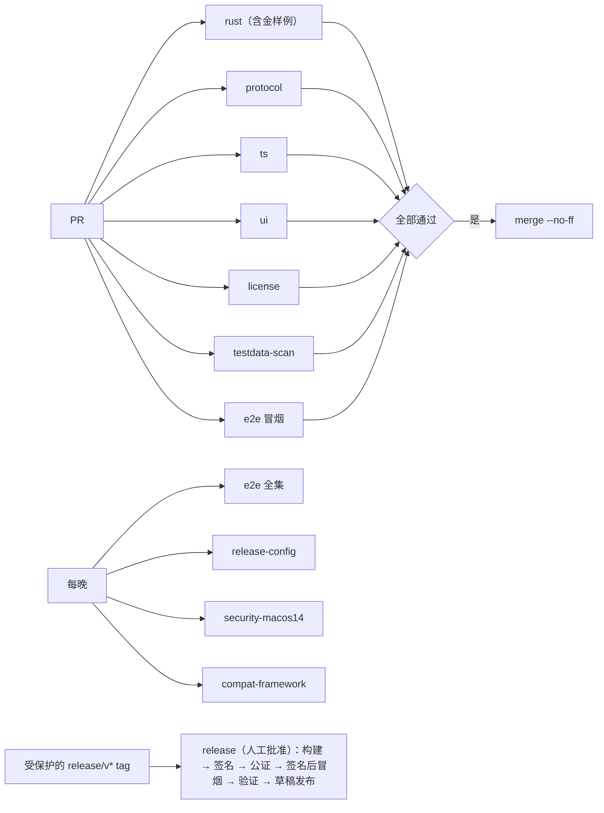

# 5.1 仓库与工程结构

- 所属：`docs/02-design.md` 第 5 节
- 依据：ADR-02（crate 划分）、ADR-03（桌面技术栈）、ADR-04（schema 与代码生成）、ADR-08（运行时清单）、ADR-11（许可证门禁）；SP-4a 的工作区布局

## 5.1.1 总体原则

- **一个仓库，两套工作区**：根目录同时是 Rust workspace（`Cargo.toml`）和 pnpm workspace（`pnpm-workspace.yaml`）。两边只通过两类提交到仓库的产物耦合：`protocol/schema/v<N>.json`（协议契约）和 `runtime/manifest.json`（运行时清单）。
- **产品代码不依赖 `spikes/`**（`CLAUDE.md`）。SP-4a 中可以沿用的代码，由 M1a 的任务迁移进 `crates/`，迁移时按本设计调整；`spikes/` 原样保留，只作参考。迁移清单见 [5.2.15](02-host.md#5215-sp-4a-代码的沿用与改动)。
- **共享 crate 不做 I/O**（ADR-02）：`cupper-protocol` 的库只有类型、帧、同步规则和纯视图，CI 验证它能编译到 `aarch64-apple-ios-sim`；唯一的例外是同一 crate 里导出 schema 的 bin `export-schema`，它不进库，也不进 iOS 构建。
- **`unsafe` 只出现在 `cupper-sys` 一个 crate 里**（ADR-02 的"只在 sys 模块"在多 crate 下的落法）。宿主、CLI 和桌面端的原生扩展都通过它调用系统接口。

## 5.1.2 目录布局

```
cupper/
├── Cargo.toml                    Rust workspace（resolver 3，edition 2024）
├── rust-toolchain.toml           锁定 stable 版本，targets: aarch64-apple-darwin, aarch64-apple-ios-sim
├── deny.toml                     cargo-deny：许可证白名单、禁用 crate、安全公告
├── package.json                  pnpm 根：只放编排脚本，packageManager 锁定 pnpm 版本
├── pnpm-workspace.yaml
├── crates/
│   ├── cupper-protocol/          协议类型、帧、同步规则、纯视图、schema 导出；不做 I/O；可编译到 iOS
│   ├── cupper-sys/               macOS 系统接口：posix_spawn、进程组、libproc、LOCAL_PEERTOKEN、
│   │                             Security 框架（SecCode）、csops、IOPMAssertion、UserNotifications
│   ├── cupper-host/              会话宿主（lib + bin `cupper-host`）
│   ├── cupper-cli/               第二客户端（lib + bin `cupper`）
│   ├── cupper-fake-agent/        假 agent：脚本模式 + 录制回放模式（bin，仅测试）
│   ├── cupper-desktop-native/    napi-rs 原生扩展：桌面主进程连接宿主时的签名校验与令牌比对
│   └── xtask/                    `cargo xtask`：runtime 打包、组装 CupperHost.app、兼容套件（只在 macOS 上编译）
├── apps/
│   └── desktop/                  Electron 应用
│       ├── src/main/             主进程（宿主拉起、连接、命令白名单、原生确认、更新）
│       ├── src/preload/          preload：只暴露 ShellAPI 和宿主端口
│       ├── src/renderer/         渲染进程入口：挂载 @cupper/ui-core，注入 Electron 版 ShellAPI
│       ├── build/                entitlements、Info.plist 片段、图标
│       └── electron-builder.*.yml  release / e2e / dev 三种构建配置
├── packages/
│   ├── protocol/                 由 schema 生成的 TS 类型、zod 校验、已知事件字面量与类型守卫（生成物入库）
│   ├── host-client/              TS 客户端：连接状态机、请求关联、游标与续传、命令重试、视图 reducer
│   ├── shell-api/                ShellAPI 接口定义 + 浏览器 mock 实现
│   ├── ui-core/                  React 界面：组件、状态、路由；不 import 任何 Electron 模块
│   └── i18n/                     zh-CN / en 文案目录（渲染进程和主进程的原生确认框共用）
├── protocol/
│   ├── schema/v1.json            由 cupper-protocol 导出的 JSON Schema（入库，对外契约）
│   ├── fixtures/                 金样例：每种消息和事件的样例，含未知类型、未知枚举值
│   └── released/                 每个已发布版本的 schema 副本，用于方向敏感的兼容性比对
├── runtime/
│   ├── manifest.json             锁定的 Node、codex-acp、esbuild-wasm、claude-agent-acp 版本与哈希
│   └── locks/                    claude-agent-acp 的 package-lock（只是元数据，不含 SDK 本体）
├── testdata/
│   ├── recordings/<adapter>/<adapter-ver>/<cli-ver>/<scenario>.jsonl   脱敏录制（格式规格见 5.9.3）
│   ├── golden/<a\|b>/<adapter>/<adapter-ver>/<scenario>.jsonl          A 层、B 层的规范化金样例
│   ├── compat-reports/            兼容套件的报告（JSON，有 schema）
│   └── repos/                    git 边界用例的生成脚本（不放二进制仓库）
├── tools/
│   ├── gen-protocol-ts/          hey-api 生成 + 后处理（字面量列表、守卫、`.loose()`、开放枚举）
│   ├── schema-compat/            方向敏感的 schema 兼容性检查
│   ├── license-gate/             npm 与 runtime 组件的许可证门禁、THIRD_PARTY_NOTICES 生成
│   ├── sanitize/                 录制脱敏（由 SP-1 的 sanitize.ts 迁移）和 testdata 的通用个人信息扫描
│   ├── rec-shape-diff/           新旧录制的形态差异报告（升级适配器时评审用）
│   ├── codex-drift/              codex 新版本的 app-server 方法 schema 漂移检查（由 SP-2 迁移）
│   └── trace-ids/                文档里的用例编号与测试名的一致性检查（5.9.10）
├── spikes/                       原型实测代码（只读参考，产品代码不依赖）
└── docs/
```

## 5.1.3 crate 与 package 清单

| 名称 | 类型 | 依赖 | 说明 |
|---|---|---|---|
| `cupper-protocol` | Rust lib + bin `export-schema` | serde、schemars、sha2、thiserror | 每个方法用一个类型实现 `Method` trait，并声明 `SCOPE`、`IDEMPOTENCY` 两个关联常量，schema 导出时写成 `x-scope`、`x-idempotent`，策略层和权限矩阵测试都从这里读。**schema 导出放在它自己的 bin `export-schema` 里**，只依赖本 crate，不依赖 `cupper-sys`、`cupper-cli`，所以能在 Linux 上编译，`protocol` 作业可以放在 ubuntu 上（测试核对 4）。库部分仍不做 I/O；iOS 编译检查只编译库 |
| `cupper-sys` | Rust lib | libc、core-foundation | 全部 `unsafe` 在这里。由 SP-4a 的 `sys.rs` 和 SP-4b 的 Security FFI（约 60 行）合并而来 |
| `cupper-host` | Rust lib + bin | protocol、sys、agent-client-protocol `=3.3.0`、tokio、rusqlite（bundled）、reqwest（rustls）、tar、flate2、nucleo-matcher、ignore、tracing | 模块见 [5.2](02-host.md)。特性：`dev-auth`（开发和 e2e 构建用的一次性密钥认证）、`test-harness`（测试 principal、测试方法、注入点和故障点，发布构建永不开启）。`--build-info` 输出启用了哪些特性，发布流水线据此断言 |
| `cupper-cli` | Rust lib + bin | protocol、sys、tokio、clap | 库部分（连接、请求关联、`Mirror`）供宿主集成测试复用。特性 `test-harness` 才有 `--harness-key-fd`；`--build-info` 同宿主 |
| `cupper-fake-agent` | Rust bin | agent-client-protocol | 两种模式见 [5.9](09-testing.md) |
| `cupper-desktop-native` | Rust cdylib（napi-rs） | sys、napi | 产物 `cupper_native.node`，经 electron-builder 的 `extraResources` 放在 asar 外的 `Resources/native/`（T075），由 electron-builder 一并签名 |
| `xtask` | Rust bin | — | 只在开发和 CI 使用，不承担 schema 导出。以后依赖 `cupper-cli` 等 macOS 专用的 crate 时，这部分用 `cfg(target_os = "macos")` 隔离，保证 `ts`、`license`、`testdata-scan` 这类放在 ubuntu 上的作业仍能编译 xtask；做不到就把这些作业改到 macOS 上跑（T001 审阅意见 2） |
| `@cupper/protocol` | TS | zod | 生成物入库；CI 检查与 schema 一致 |
| `@cupper/host-client` | TS | protocol | 渲染进程使用；视图 reducer 与 Rust 视图用同一批金样例交叉验证 |
| `@cupper/shell-api` | TS | — | 接口见 [5.7.3](07-desktop.md#573-shellapi) |
| `@cupper/ui-core` | TS/React | host-client、shell-api、i18n、React 19、Tailwind v4、Radix、streamdown、Shiki、@pierre/diffs、TanStack Virtual/Query、zustand | lint 规则禁止 import `electron` 和 Node 内置模块。两个入口：主文档和审查文档（独立源，[5.7.5](07-desktop.md#审查文档m1b)），共用一份设计 token 的 CSS |
| `@cupper/i18n` | TS | i18next | 文案以语义码为键 |
| `apps/desktop` | Electron | ui-core、shell-api、i18n、electron-updater | 打包工具见 [5.10.4](10-release.md#5104-打包工具electron-builder-还是-electron-forge)。主进程、preload、渲染进程的运行时依赖（含 electron-updater）全部由 Vite 打进 bundle，`apps/desktop` 不声明 `dependencies`；preload 打成单个 CommonJS 文件（沙箱 preload 不支持 ESM）；asar 里只有构建产物，原生扩展放在 asar 外（桌面建议 #19） |

`cupper-client`（不做 I/O 的客户端同步核心）不在 M1 建立：M1 的客户端同步规则（游标、`from` 连续性检查、视图）已经在 `cupper-protocol` 里，CLI 直接使用。是否为 iOS 抽出这个 crate，由 ADR-15 决定。

## 5.1.4 工具链与版本锁定

| 项 | 锁定方式 | 起始值（M1a 开工时按当天复核） |
|---|---|---|
| Rust | `rust-toolchain.toml` | stable 1.96（SP-4a 实测版本；`rust-version = 1.89`，因为用了 `File::try_lock`） |
| ACP SDK | `Cargo.toml` 精确版本 | `agent-client-protocol = "=3.3.0"`（ADR-02；T003 在这个版本上验证了扩展消息和两条约束，升级时重跑它的探针，[5.6.10](06-agent-driver.md#5610-线路分接层)） |
| Node（开发与工具） | `.node-version` | 24 LTS（T001 定为 24.13.0） |
| pnpm | `packageManager` 字段 | 12.x（T001 定为 12.14.0：本机版本，也是当前 latest；12 的依赖脚本白名单键为 `allowBuilds`，与 10.x 的配置格式不兼容） |
| TypeScript | 根 `package.json` 精确版本 | 6.0.x（T001 定为 6.0.3：typescript-eslint 8.71 要求低于 6.1） |
| Electron | `apps/desktop/package.json` 精确版本 | 44.x 的最新补丁版本（2026-10-19 时是 44.9.0，T074 开工时复核；见 [5.10.6](10-release.md#5106-electron-版本)） |
| electron-builder / electron-updater | 精确版本 | 26.x / 6.8.x |
| 适配器、Node 运行时 | `runtime/manifest.json` | claude-agent-acp 0.91.0、codex-acp 2.2.2、Node 24.22.0（SP-1、SP-2 实测版本，T003 复核不变）。claude-agent-acp 在 M1a 保持 0.91.0，升级放到 T066 的兼容运行；升到 0.93 及以上之前，先处理待定问题 Q42（`/remote-control`） |

依赖更新：Rust 和 npm 的依赖由人工按月升级，每次升级跑完整的 CI 和兼容套件。适配器版本升级单独走"兼容矩阵"流程（[5.9.5](09-testing.md#595-兼容矩阵)）。

## 5.1.5 构建命令

开发者只需要记住根目录的 pnpm 脚本；Rust 侧的复杂步骤放在 `cargo xtask`。

| 命令 | 作用 |
|---|---|
| `pnpm i` | 安装 TS 依赖。CI 用 `--frozen-lockfile`；保留 pnpm 10 默认不运行依赖脚本的行为，只有白名单里的包可以运行（`allowBuilds`，T074 时为空：Electron 44 已经没有安装脚本，二进制由 electron-builder 打包时下载；`esbuild` 等需要时再放行） |
| `pnpm dev` | 以 `dev-auth` 特性构建 debug 宿主和 CLI，启动 Vite（渲染进程热重载）和 Electron 开发构建（名称 "cupper Dev"，独立的 bundle id 和数据目录）；重启 Electron 时一并重启宿主（Q22 的局限） |
| `pnpm gen` | `cargo run -p cupper-protocol --bin export-schema` 导出 `protocol/schema/v1.json`，再运行 `tools/gen-protocol-ts` 生成 `packages/protocol`；在 macOS 和 Linux 上都能运行 |
| `pnpm lint` | `cargo fmt --check`、`cargo clippy -D warnings`、ESLint、Prettier 检查、`tsc -b` |
| `pnpm test` | `cargo test --workspace --features cupper-host/test-harness`、一次不带任何特性的 `cargo test -p cupper-host -p cupper-cli`，加 Vitest |
| `pnpm test:golden` | 用录制回放跑宿主，比对金样例；`UPDATE_GOLDEN=1` 时更新 |
| `pnpm test:ui` | Playwright（Chromium）+ mock 宿主的界面截图回归 |
| `pnpm build:e2e` | 构建 e2e 版 App（与发布版同样的打包方式；签名和 fuses 的差异见 [5.7.9](07-desktop.md#579-构建种类)） |
| `pnpm test:e2e` | Playwright `_electron` 驱动 e2e 版 App + 真实宿主 + 假 agent |
| `pnpm build:release` | 完整发布构建（需要签名证书），步骤见 [5.10.7](10-release.md#5107-发布流水线) |
| `cargo xtask runtime-pack` | 下载并校验 Node、codex-acp、esbuild-wasm，重签 Node，计算 claude-agent-acp 本机打包产物的固定哈希，写回 `runtime/manifest.json`；从锁定的适配器产物里提取环境变量读取点，出现未归类的新名字就失败（[5.6.6](06-agent-driver.md#566-cli-的发现与版本检查)） |
| `cargo xtask host-bundle` | 组装并签名 `CupperHost.app` |
| `cargo xtask compat --adapter <a> --cli <path>` | 兼容套件：用真实 CLI 跑剧本、录制并产出报告（只由维护者在本机手动运行，会消耗少量额度，[5.9.5](09-testing.md#595-兼容矩阵)）；`--fake` 用假 agent 跑框架本身 |

## 5.1.6 CI 流水线

**当前的执行方式（2026-10-26 起，替换 U-P1）**：仓库的远端是 GitHub 上的公开仓库 `boris-w/cupper`，下表各 job 在 GitHub Actions 上按 runner 一列运行：每个 PR 由 `ci` workflow 以 `cargo xtask ci <job> --in pr` 跑 `pr` 组合的 8 个 job，main 的保护规则要求它们通过；每晚由 `nightly.yml` 运行。结构化摘要与原始日志作为构件上传，卷宗里记 PR 和运行的链接。截图基线由 `ui-baseline.yml` 在 runner 上生成、经 PR 入库。`security-macos14` 在 `macos-14`、`macos-15` 上都跑，覆盖了原先本机替代不了的对端校验。`perf` 不上 CI，在作者机器上跑。本机的 `cargo xtask ci <job>` 照旧可用，用于复现与自查。细则见 `docs/03-plan.md` 1.8（T197）。

有远端后托管在 GitHub Actions。所有 job 都不需要登录任何 agent；不使用任何 self-hosted runner（测试 #8、安全 #10）。

**通用加固**（安全 #10）：第三方 Action 按提交 SHA 固定；workflow 默认 `permissions: contents: read`，需要更多权限的 job 单独声明；不用 `pull_request_target`；依赖安装用 `pnpm install --frozen-lockfile` 和 `cargo --locked`；macOS runner 固定标签（`macos-15`、`macos-14`），不用 `macos-latest`。

| job | runner | 触发 | 步骤 | 失败即阻止合并 |
|---|---|---|---|---|
| `rust` | `macos-15` | 每个 PR | fmt、clippy（`-D warnings`，所有 target 和特性组合，含 `disallowed-methods`）、`cargo test`（含 `test-harness`）、一次不带任何特性的 `cargo test -p cupper-host -p cupper-cli`（断言发布构建的行为）、`cargo build -p cupper-protocol --lib --target aarch64-apple-ios-sim`；`pnpm test:golden`（A 层和 B 层，严格模式，"类型已知但数据残缺"的事件直接判失败）。`rust` 和 `golden` 合成一个作业，共用构建缓存：金样例要编译依赖 `cupper-sys` 的 `cupper-host`，只能在 macOS 上跑 | 是 |
| `protocol` | ubuntu | 每个 PR | `pnpm gen` 后 `git diff --exit-code`（schema 和 TS 生成物都必须是最新的）；整数安全检查；`tools/schema-compat` 与 `protocol/released/` 中最近一个版本（含 M1a 冻结时的快照）做方向敏感的比对；ShellAPI 类型声明的快照比对（[5.12.5](12-milestones.md#5125-契约冻结清单)）；`protocol/fixtures/` 在 Rust 和 TS 中各做一次往返；TS 视图 reducer 与 Rust 视图对同一批事件序列给出相同结果（`cupper-protocol` 不做 I/O，可以在 Linux 上编译） | 是 |
| `ts` | ubuntu | 每个 PR | `tsc -b`、ESLint（含安全规则，见 [5.7.8](07-desktop.md#578-安全加固的落点)）、Vitest | 是 |
| `ui` | `macos-15` | 每个 PR（按改动路径过滤） | `pnpm test:ui` 截图回归；基线只由 CI 的专用工作流生成（截图依赖系统字体） | 是 |
| `license` | ubuntu | 每个 PR | `cargo deny check`；`tools/license-gate` 第一层：对每个进入 App 的 JS 入口（main、preload、两个渲染入口、runtime 脚本），按 pnpm 锁文件和打包器的 metafile 求出生产依赖的完整闭包，闭包里出现 `@anthropic-ai/claude-agent-sdk` 或 `@anthropic-ai/claude-code` 就失败；runtime 组件的许可证文本齐全。负面测试：故意引入这个依赖的样例工程，门禁必须失败（安全 #11） | 是 |
| `testdata-scan` | ubuntu | 每个 PR | 对 `testdata/` 做通用模式的个人信息扫描（[5.9.3](09-testing.md#593-录制与金样例)）；校验兼容报告符合 schema，并从报告重新生成"已验证 CLI 范围"与清单比对；`tools/trace-ids check` 检查文档里引用的用例编号都登记在 `tests/ids.toml` 里（里程碑、产出任务、套件、状态），待完成清单由 `trace-ids status` 自动推导（T002）（[5.9.10](09-testing.md#5910-测试编号与人工验证清单)） | 是 |
| `e2e` | `macos-15` | 每个 PR（冒烟子集，按改动路径过滤）；每晚（全集） | `pnpm build:e2e`；`pnpm test:e2e` | 是 |
| `release-config` | `macos-15` | 每晚 | 发布配置、不签名的构建：`@electron/fuses read` 逐项断言、Info.plist 里有 `ElectronAsarIntegrity`、`asarUnpack` 为空（原生扩展只经 `extraResources` 放在 `Resources/native/`）、asar 文件清单、带未知命令行开关启动应立即退出、产物里扫描测试钩子的标记串、宿主和 CLI 的 `--build-info` 不含 `dev-auth` 和 `test-harness`、许可证门禁第二层（[5.10.7](10-release.md#5107-发布流水线)）；`cargo xtask runtime-pack --verify` | 否（失败开 issue） |
| `differential` | `macos-15` | 每晚（`nightly` 组合作业） | TS 与 Rust 视图的差分测试（UNIT-views-differential，5.9.1 测试 #16）：Rust 的 proptest 生成随机事件流，各按三种方式 fold，写出用例文件，TS 读同一文件比较视图 JSON（T072） |
| `security-macos14` | `macos-14` | 每晚；改动 `cupper-sys` 的 PR 按路径过滤直接跑 | `cupper-sys` 的对端校验测试：`LOCAL_PEERTOKEN` 的"最后一次 I/O 进程"语义、exec 后 pidversion 变化被拒、fork 出的进程共用 fd 被拒、`SCM_RIGHTS` 传来的 fd 被 `recv_closing_fds` 关闭（v1.8：普通读取会装入 fd，T021 实测）、csops、错误码。macOS 15 由 `rust` 作业覆盖 | 按路径过滤的 PR 上：是；每晚：开 issue。发布前最近一次必须通过（Q24） |
| `compat-framework` | `macos-15` | 每晚；改动 `xtask` 兼容套件的 PR | `cargo xtask compat --fake`：用假 agent 跑兼容套件的框架和报告生成 | 是（PR 上） |
| `codex-drift` | ubuntu | 每天定时 | 发现新的 codex 版本时，检查 codex-acp 引用的 app-server 方法有没有变化（ADR-08） | 否（失败开 issue） |
| `release` | `macos-15` | 推送受保护的 `release/v*` tag（含 `release/vX.Y.Z-rc.N`） | 见 [5.10.7](10-release.md#5107-发布流水线)；放在需要人工批准的 protected environment 里，签名证书和 App Store Connect API key 只对它可见 | — |

兼容套件（`compat`）不在 CI 上运行：由维护者在本机手动执行 `cargo xtask compat`，录制和报告以 PR 提交（[5.9.5](09-testing.md#595-兼容矩阵)）。



**代价**：每个 PR 的 macOS 作业控制在 3 个（`rust`、`ui`、`e2e`），后两个按改动路径过滤；Free、Pro、Team 计划下标准 macOS runner 最多同时跑 5 个作业（测试 #21）。

## 5.1.7 代码约束（gate/design 通过后写进 `CLAUDE.md`）

在 ADR-02 已列出的约束之外，补充：

- 每个协议方法必须声明 `SCOPE` 和 `IDEMPOTENCY`；新增方法不声明就编译不过。
- 每条事件流只有一个写者（见 [5.2.3](02-host.md#523-并发模型)）；其他模块只能通过消息请求写者追加事件。
- 宿主里的时间只经 `Clock` 获取、定时只经 `Clock` 设置、UUIDv7 只经 `IdGen` 生成；禁用清单由 clippy `disallowed-methods` 强制（[5.2.16](02-host.md#5216-时间与可测性)）。有状态的决策逻辑写成纯核心，不在其中做 I/O 或 await。
- 宿主运行期间不读取 App 包内的任何文件（ADR-01），唯一的例外是运行时安装器在通过自检之后、按内嵌清单逐文件核对哈希的复制（[5.2.12](02-host.md#5212-运行时安装器)）。
- `ui-core` 不 import `electron`、`node:*`；渲染进程不出现 `innerHTML`、`dangerouslySetInnerHTML`、`insertAdjacentHTML`、`eval`、`new Function`。
- 只有 `ui-core/src/security/policies.ts` 可以调用 `trustedTypes.createPolicy`，禁止名为 `default` 的策略；agent 给出的字符串不能进入 `<style>` 的文本、`insertRule` 或 CSS 自定义属性（[5.7.8](07-desktop.md#578-安全加固的落点)）。
- 主进程在调用时才经 `dialog.showMessageBox` 等取函数，不在模块加载时解构保存（e2e 要在主进程里替换它们）。
- 宿主、CLI、原生扩展拉起任何子进程都经 `cupper-sys::spawn`（[5.8.5](08-security.md#585-进程卫生)）。
- 界面文案一律走 `@cupper/i18n`，宿主下发语义码，不下发文案（瘦客户端）。
