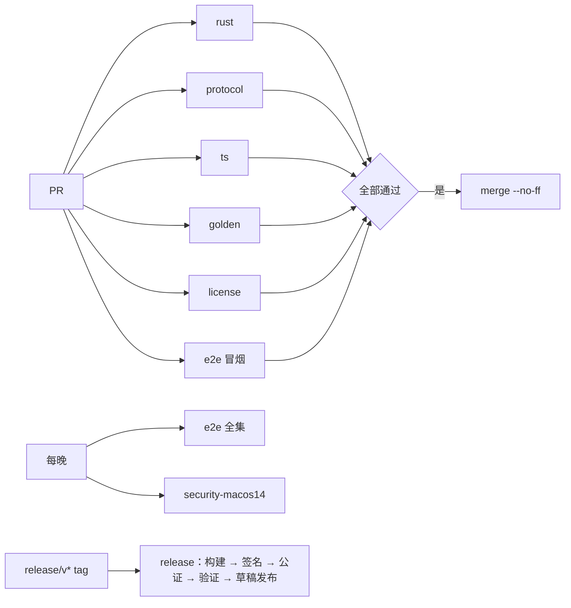

# 5.1 仓库与工程结构

- 所属：`docs/02-design.md` 第 5 节
- 依据：ADR-02（crate 划分）、ADR-03（桌面技术栈）、ADR-04（schema 与代码生成）、ADR-08（运行时清单）、ADR-11（许可证门禁）；SP-4a 的工作区布局

## 5.1.1 总体原则

- **一个仓库，两套工作区**：根目录同时是 Rust workspace（`Cargo.toml`）和 pnpm workspace（`pnpm-workspace.yaml`）。两边只通过两类提交到仓库的产物耦合：`protocol/schema/v<N>.json`（协议契约）和 `runtime/manifest.json`（运行时清单）。
- **产品代码不依赖 `spikes/`**（`CLAUDE.md`）。SP-4a 中可以沿用的代码，由 M1a 的任务迁移进 `crates/`，迁移时按本设计调整；`spikes/` 原样保留，只作参考。迁移清单见 [5.2.15](02-host.md#5215-sp-4a-代码的沿用与改动)。
- **共享 crate 不做 I/O**（ADR-02）：`cupper-protocol` 只有类型、帧、同步规则和纯视图，CI 验证它能编译到 `aarch64-apple-ios-sim`。
- **`unsafe` 只出现在 `cupper-sys` 一个 crate 里**（ADR-02 的"只在 sys 模块"在多 crate 下的落法）。宿主、CLI 和桌面端的原生扩展都通过它调用系统接口。

## 5.1.2 目录布局

```
cupper/
├── Cargo.toml                    Rust workspace（resolver 3，edition 2024）
├── rust-toolchain.toml           锁定 stable 版本，targets: aarch64-apple-darwin, aarch64-apple-ios-sim
├── deny.toml                     cargo-deny：许可证白名单、禁用 crate、安全公告
├── package.json                  pnpm 根：只放编排脚本，packageManager 锁定 pnpm 版本
├── pnpm-workspace.yaml
├── crates/
│   ├── cupper-protocol/          协议类型、帧、同步规则、纯视图、schema 导出；不做 I/O；可编译到 iOS
│   ├── cupper-sys/               macOS 系统接口：posix_spawn、进程组、libproc、LOCAL_PEERTOKEN、
│   │                             Security 框架（SecCode）、csops、IOPMAssertion、UserNotifications
│   ├── cupper-host/              会话宿主（lib + bin `cupper-host`）
│   ├── cupper-cli/               第二客户端（lib + bin `cupper`）
│   ├── cupper-fake-agent/        假 agent：脚本模式 + 录制回放模式（bin，仅测试）
│   ├── cupper-desktop-native/    napi-rs 原生扩展：桌面主进程连接宿主时的签名校验与令牌比对
│   └── xtask/                    `cargo xtask`：schema 导出、runtime 打包、组装 CupperHost.app
├── apps/
│   └── desktop/                  Electron 应用
│       ├── src/main/             主进程（宿主拉起、连接、命令白名单、原生确认、更新）
│       ├── src/preload/          preload：只暴露 ShellAPI 和宿主端口
│       ├── src/renderer/         渲染进程入口：挂载 @cupper/ui-core，注入 Electron 版 ShellAPI
│       ├── build/                entitlements、Info.plist 片段、图标
│       └── electron-builder.*.yml  release / e2e / dev 三种构建配置
├── packages/
│   ├── protocol/                 由 schema 生成的 TS 类型、zod 校验、已知事件字面量与类型守卫（生成物入库）
│   ├── host-client/              TS 客户端：连接状态机、请求关联、游标与续传、命令重试、视图 reducer
│   ├── shell-api/                ShellAPI 接口定义 + 浏览器 mock 实现
│   ├── ui-core/                  React 界面：组件、状态、路由；不 import 任何 Electron 模块
│   └── i18n/                     zh-CN / en 文案目录（渲染进程和主进程的原生确认框共用）
├── protocol/
│   ├── schema/v1.json            由 cupper-protocol 导出的 JSON Schema（入库，对外契约）
│   ├── fixtures/                 金样例：每种消息和事件的样例，含未知类型、未知枚举值
│   └── released/                 每个已发布版本的 schema 副本，用于方向敏感的兼容性比对
├── runtime/
│   ├── manifest.json             锁定的 Node、codex-acp、esbuild-wasm、claude-agent-acp 版本与哈希
│   └── locks/                    claude-agent-acp 的 package-lock（只是元数据，不含 SDK 本体）
├── testdata/
│   ├── recordings/<adapter>/<adapter-ver>/<cli-ver>/<scenario>.jsonl   脱敏录制（SP-1 格式）
│   ├── golden/<adapter>/<scenario>.events.json                        回放后应得到的规范化事件
│   └── repos/                    git 边界用例的生成脚本（不放二进制仓库）
├── tools/
│   ├── gen-protocol-ts/          hey-api 生成 + 后处理（字面量列表、守卫、`.loose()`、开放枚举）
│   ├── schema-compat/            方向敏感的 schema 兼容性检查
│   ├── license-gate/             npm 与 runtime 组件的许可证门禁、THIRD_PARTY_NOTICES 生成
│   ├── sanitize/                 录制脱敏（由 SP-1 的 sanitize.ts 迁移）
│   └── codex-drift/              codex 新版本的 app-server 方法 schema 漂移检查（由 SP-2 迁移）
├── spikes/                       原型实测代码（只读参考，产品代码不依赖）
└── docs/
```

## 5.1.3 crate 与 package 清单

| 名称 | 类型 | 依赖 | 说明 |
|---|---|---|---|
| `cupper-protocol` | Rust lib | serde、schemars、sha2、thiserror | 每个方法用一个类型实现 `Method` trait，并声明 `SCOPE`、`IDEMPOTENCY` 两个关联常量，schema 导出时写成 `x-scope`、`x-idempotent`，策略层和权限矩阵测试都从这里读 |
| `cupper-sys` | Rust lib | libc、core-foundation | 全部 `unsafe` 在这里。由 SP-4a 的 `sys.rs` 和 SP-4b 的 Security FFI（约 60 行）合并而来 |
| `cupper-host` | Rust lib + bin | protocol、sys、agent-client-protocol `=3.3.0`、tokio、rusqlite（bundled）、reqwest（rustls）、tar、lzma-rs、nucleo-matcher、ignore、tracing | 模块见 [5.2](02-host.md)。特性：`dev-auth`（开发和 e2e 构建用的一次性密钥认证）、`test-harness`（测试 principal，发布构建永不开启） |
| `cupper-cli` | Rust lib + bin | protocol、sys、tokio、clap | 库部分（连接、请求关联、`Mirror`）供宿主集成测试复用 |
| `cupper-fake-agent` | Rust bin | agent-client-protocol | 两种模式见 [5.9](09-testing.md) |
| `cupper-desktop-native` | Rust cdylib（napi-rs） | sys、napi | 产物 `cupper_native.node`，放在 asar 外（`asarUnpack`），由 electron-builder 一并签名 |
| `xtask` | Rust bin | — | 只在开发和 CI 使用 |
| `@cupper/protocol` | TS | zod | 生成物入库；CI 检查与 schema 一致 |
| `@cupper/host-client` | TS | protocol | 渲染进程使用；视图 reducer 与 Rust 视图用同一批金样例交叉验证 |
| `@cupper/shell-api` | TS | — | 接口见 [5.7.3](07-desktop.md#573-shellapi) |
| `@cupper/ui-core` | TS/React | host-client、shell-api、i18n、React 19、Tailwind v4、Radix、streamdown、Shiki、@pierre/diffs、TanStack Virtual/Query、zustand | lint 规则禁止 import `electron` 和 Node 内置模块 |
| `@cupper/i18n` | TS | i18next | 文案以语义码为键 |
| `apps/desktop` | Electron | ui-core、shell-api、i18n、electron-updater | 打包工具见 [5.10.4](10-release.md#5104-打包工具electron-builder-还是-electron-forge) |

`cupper-client`（不做 I/O 的客户端同步核心）不在 M1 建立：M1 的客户端同步规则（游标、`from` 连续性检查、视图）已经在 `cupper-protocol` 里，CLI 直接使用。是否为 iOS 抽出这个 crate，由 ADR-15 决定。

## 5.1.4 工具链与版本锁定

| 项 | 锁定方式 | 起始值（M1a 开工时按当天复核） |
|---|---|---|
| Rust | `rust-toolchain.toml` | stable 1.96（SP-4a 实测版本；`rust-version = 1.89`，因为用了 `File::try_lock`） |
| ACP SDK | `Cargo.toml` 精确版本 | `agent-client-protocol = "=3.3.0"`（ADR-02） |
| Node（开发与工具） | `.node-version` | 24 LTS |
| pnpm | `packageManager` 字段 | 10.x |
| Electron | `apps/desktop/package.json` 精确版本 | 44.8.0（见 [5.10.6](10-release.md#5106-electron-版本)） |
| electron-builder / electron-updater | 精确版本 | 26.x / 6.8.x |
| 适配器、Node 运行时 | `runtime/manifest.json` | claude-agent-acp 0.91.0、codex-acp 2.2.2、Node 24.22.0（SP-1、SP-2 实测版本；开工时用兼容套件复核后再定） |

依赖更新：Rust 和 npm 的依赖由人工按月升级，每次升级跑完整的 CI 和兼容套件。适配器版本升级单独走"兼容矩阵"流程（[5.9.5](09-testing.md#595-兼容矩阵)）。

## 5.1.5 构建命令

开发者只需要记住根目录的 pnpm 脚本；Rust 侧的复杂步骤放在 `cargo xtask`。

| 命令 | 作用 |
|---|---|
| `pnpm i` | 安装 TS 依赖（`--frozen-lockfile` 用于 CI） |
| `pnpm dev` | 以 `dev-auth` 特性构建 debug 宿主和 CLI，启动 Vite（渲染进程热重载）和 Electron 开发构建（名称 "cupper Dev"，独立的 bundle id 和数据目录） |
| `pnpm gen` | `cargo xtask schema` 导出 `protocol/schema/v1.json`，再运行 `tools/gen-protocol-ts` 生成 `packages/protocol` |
| `pnpm lint` | `cargo fmt --check`、`cargo clippy -D warnings`、ESLint、Prettier 检查、`tsc -b` |
| `pnpm test` | `cargo test --workspace --features cupper-host/test-harness` 加 Vitest |
| `pnpm test:golden` | 用录制回放跑宿主，比对金样例；`UPDATE_GOLDEN=1` 时更新 |
| `pnpm test:ui` | Playwright（Chromium）+ mock 宿主的界面截图回归 |
| `pnpm build:e2e` | 构建 e2e 版 App（与发布版同样的打包方式和 fuses，只放开调试） |
| `pnpm test:e2e` | Playwright `_electron` 驱动 e2e 版 App + 真实宿主 + 假 agent |
| `pnpm build:release` | 完整发布构建（需要签名证书），步骤见 [5.10.7](10-release.md#5107-发布流水线) |
| `cargo xtask runtime-pack` | 下载并校验 Node、codex-acp、esbuild-wasm，重签 Node，计算 claude-agent-acp 本机打包产物的固定哈希，写回 `runtime/manifest.json` |
| `cargo xtask host-bundle` | 组装并签名 `CupperHost.app` |
| `cargo xtask compat --adapter <a> --cli <path>` | 兼容套件：用真实 CLI 跑剧本并录制（只在维护者机器上运行，会消耗少量额度） |

## 5.1.6 CI 流水线

托管在 GitHub Actions，macOS arm64 runner。所有 job 都不需要登录任何 agent。

| job | 触发 | 步骤 | 失败即阻止合并 |
|---|---|---|---|
| `rust` | 每个 PR | fmt、clippy（`-D warnings`，所有 target 和特性组合）、`cargo test`（含 `test-harness`）、`cargo build -p cupper-protocol --target aarch64-apple-ios-sim`、`cargo deny check` | 是 |
| `protocol` | 每个 PR | `pnpm gen` 后 `git diff --exit-code`（schema 和 TS 生成物都必须是最新的）；整数安全检查（schema 中不得出现超过 2^53−1 的整数类型）；`tools/schema-compat` 与 `protocol/released/` 中最近一个版本做方向敏感的比对；`protocol/fixtures/` 在 Rust 和 TS 中各做一次往返；TS 视图 reducer 与 Rust 视图对同一批事件序列给出相同结果 | 是 |
| `ts` | 每个 PR | `tsc -b`、ESLint（含安全规则，见 [5.7.8](07-desktop.md#578-安全加固的落点)）、Vitest、`pnpm test:ui` 截图回归 | 是 |
| `golden` | 每个 PR | `pnpm test:golden`：全部录制经假 agent 回放，宿主输出与金样例逐字段比对；严格模式，"类型已知但数据残缺"的事件直接判失败（ADR-04 修订第 4 条） | 是 |
| `license` | 每个 PR | `cargo deny check licenses`；`tools/license-gate`：npm 依赖白名单、runtime 组件的许可证文本齐全、**打包输入中出现 `@anthropic-ai/claude-agent-sdk` 直接失败**（ADR-11 红线） | 是 |
| `e2e` | 每个 PR（冒烟子集）；每晚（全集） | `pnpm build:e2e`，检查 fuses（`@electron/fuses read`）；`pnpm test:e2e` | 是 |
| `security-macos14` | 每晚 | 在 macOS 14 runner 上跑 `cupper-sys` 的对端校验测试（`LOCAL_PEERTOKEN` 的"最后一次 I/O 进程"语义、csops、错误码），补 SP-4b 没覆盖的最低系统版本 | 否（失败开 issue） |
| `codex-drift` | 每天定时 | 发现新的 codex 版本时，检查 codex-acp 引用的 app-server 方法有没有变化（ADR-08） | 否（失败开 issue） |
| `release` | 推送 `release/v*` tag | 见 [5.10.7](10-release.md#5107-发布流水线) | — |
| `compat` | 手动 | 只在维护者机器（self-hosted runner）上运行，用真实 CLI 跑兼容套件，产出新录制供评审 | — |



## 5.1.7 代码约束（gate/design 通过后写进 `CLAUDE.md`）

在 ADR-02 已列出的约束之外，补充：

- 每个协议方法必须声明 `SCOPE` 和 `IDEMPOTENCY`；新增方法不声明就编译不过。
- 每条事件流只有一个写者（见 [5.2.3](02-host.md#523-并发模型)）；其他模块只能通过消息请求写者追加事件。
- 宿主运行期间不读取 App 包内的任何文件（ADR-01），唯一的例外是运行时安装器在通过自检之后、按内嵌清单逐文件核对哈希的复制（[5.2.12](02-host.md#5212-运行时安装器)）。
- `ui-core` 不 import `electron`、`node:*`；渲染进程不出现 `innerHTML`、`dangerouslySetInnerHTML`、`eval`、`new Function`。
- 界面文案一律走 `@cupper/i18n`，宿主下发语义码，不下发文案（瘦客户端）。
