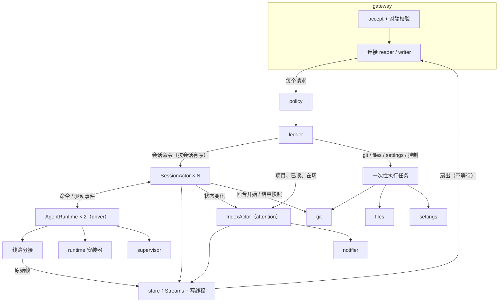
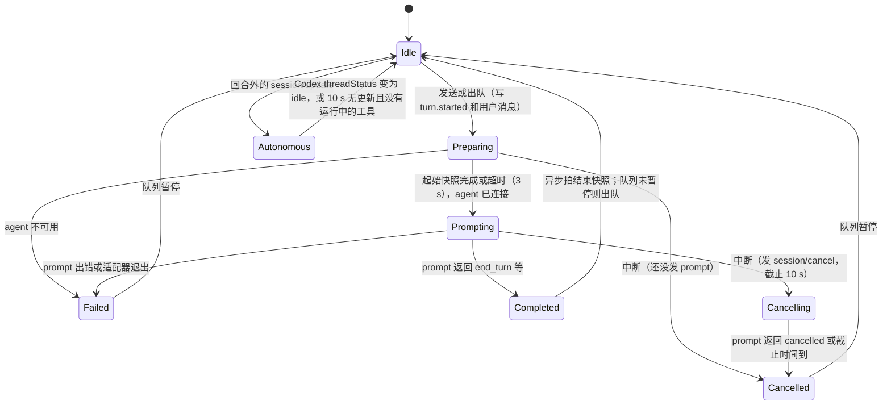

# 5.2 组件设计：会话宿主与 cupper-cli

- 所属：`docs/02-design.md` 第 5 节
- 依据：ADR-01、02、04、05、06、07、09、10；SP-4a 骨架（`spikes/SP-4a-host-skeleton/`）；对齐会架构师意见议题 2
- 相关：驱动层单独成节（[5.6](06-agent-driver.md)）；桌面端见 [5.7](07-desktop.md)；协议契约见 [5.3](03-protocol-v1.md)；表结构见 [5.4](04-data-model.md)

## 5.2.1 模块总览

宿主是一个 Rust 二进制 `cupper-host`，打包在 `Cupper.app/Contents/Helpers/CupperHost.app` 里（ADR-01）。下表是 `cupper-host` crate 内部的模块，每个模块对应一个 Rust 模块目录，模块之间只通过本表"对外接口"一栏的类型交互。

| 模块 | 职责 | 对外接口 | 依赖 | 关键数据结构 | 形态 |
|---|---|---|---|---|---|
| `gateway` 网关 | 接受连接、对端认证（固定令牌）、`host/hello` 与 `initialize`、请求分发、订阅登记、发送队列、blob 传输 | Unix 套接字；内部 `ConnHandle` | policy、ledger、store、各执行者 | `Conn`、`Outbox`、`Principal`、`PinnedPeer`、`Upload` | 每连接 2 个 task |
| `policy` 策略 | `authorize(principal, method, params)`：方法级 scope 加资源级规则 | 纯函数 | protocol（`SCOPE` 常量）、各执行者提供的资源描述 | `Scope`、`Role`、`Rule` | 无状态 |
| `ledger` 命令账本 | 命令幂等：`(principal, command_id)` → 结果 | `begin` / `complete` / `lookup` | store | 内存表 + `commands` 表 | 共享结构 |
| `orchestrator` 会话编排 | 会话的创建、归档、恢复；回合状态机；宿主队列；Steer；中断与超时兜底；崩溃后 resume；配置项 | `SessionManager`、`SessionHandle` | driver、interaction、store、git、attention | `SessionActor`、`Turn`、`Queue` | 每个活跃会话一个 actor |
| `interaction` 交互代理 | 审批和提问对象：分类、选项生效范围、摘要、`actionable_by`、先到先得、撤回与失效 | 由会话 actor 调用 | driver 的选项对照表 | `Interaction`、`OptionEffect` | 会话 actor 内的组件 |
| `store` 事件存储 | 写线程、读连接池、流（seq、视图、扇出）、检查点、回合快照、blob、原始帧、迁移 | `Streams::append` / `subscribe` / `read_page`；`BlobStore` | SQLite | `StreamState`、`WriteOp` | 1 个写线程 + 每流一把锁 |
| `attention` 关注度与通知 | 索引流的唯一写者：会话状态、未读、通知意图、客户端列表、agent 和宿主状态 | `IndexHandle` | store、notifier | `IndexView` | 1 个 actor |
| `notifier` 系统通知 | 用 UserNotifications 弹通知；点击后经 control 连接发 `ui/navigate`，并按 bundle id 激活 Cupper（[5.2.9](#529-关注度与通知)） | channel | cupper-sys | — | 主线程 run loop |
| `driver` 驱动层 | 适配器进程、ACP 连接、线路分接、提取层、能力缓存、CLI 发现 | `AgentRuntimeHandle` | runtime、supervisor | 见 [5.6](06-agent-driver.md) | 每种 agent 一个 actor |
| `git` Git 与 worktree | 快照、diff、hunk 操作、提交、推送、worktree 生命周期 | async 函数 | git 命令行 | `RepoLock`、`DiffCache` | 子进程 + 每仓库锁 |
| `files` 文件服务 | `@` 引用的模糊搜索 | async 函数 | ignore、nucleo-matcher | `FileIndex` | 按需构建、短期缓存 |
| `settings` 设置 | 宿主级设置的读写 | get / update | store | `settings` 表 | 共享结构 |
| `runtime` 运行时安装器 | 安装和校验 Node、适配器（ADR-08） | `RuntimeHandle` | reqwest、cupper-sys | `Manifest`（编译期内嵌） | 1 个 actor |
| `supervisor` 进程监护 | 子进程登记与清理、自检、空闲退出、防休眠、有序退出 | `SupervisorHandle` | cupper-sys、store | `ChildRecord` | 1 个 actor |
| `diag` 诊断 | 日志初始化、脱敏层、诊断包 | — | tracing | — | — |
| `trust` 项目信任 | 扫描项目自带的 agent 配置、计算信任摘要、判定信任状态（[5.2.6](#项目信任)） | 纯函数加只读文件访问 | — | `TrustScan`、`TrustState` | 由 `IndexActor` 和会话 actor 调用 |
| `clock` 时间 | 宿主内唯一的时间来源和 ID 生成器（[5.2.16](#5216-时间与可测性)） | `Clock`、`IdGen` | — | `SystemClock`、`ManualClock` | 共享结构 |

## 5.2.2 模块关系



## 5.2.3 并发模型

**线程**

| 线程 | 数量 | 用途 |
|---|---|---|
| 主线程 | 1 | 运行 `CFRunLoop`，承载 UserNotifications 的代理回调和 IOKit 通知。tokio 运行时不在主线程上 |
| tokio 工作线程 | min(4, 核数) | 所有 actor、连接、子进程 I/O |
| 存储写线程 | 1 | `host.db` 唯一的写连接，组提交 |
| 原始帧写线程 | 1 | `raw.db` 唯一的写连接，批量写入原始帧、裁剪和 `VACUUM`（T027 起与 `host.db` 的写线程分开，避免 `raw.db` 的裁剪挡住事件追加） |
| 阻塞线程池 | 按需（读池用信号量限 4 个并发） | SQLite 只读查询、`waitpid`、文件哈希、tar 解包 |

**actor**（tokio task + mpsc 邮箱；actor 内部顺序处理消息，不 await 耗时操作，耗时操作另起 task，完成后以消息回送）

| actor | 数量 | 邮箱输入 | 它是谁的唯一写者 |
|---|---|---|---|
| `SessionActor` | 每个活跃会话 1 个；空闲 10 分钟后退出 | 网关转来的会话命令；驱动事件；git 快照完成；定时器 | 该会话的会话流；`sessions`、`turns`、`interactions`、`queue` 中属于该会话的行（`sessions.last_read_seq` 一列除外，见 `IndexActor`） |
| `IndexActor` | 1 | 会话状态变化、项目命令、已读、在场、客户端连接与断开、agent 和宿主状态、提权请求 | 索引流；`projects` 表；`sessions.last_read_seq` 一列（已读要对没有加载的会话也生效，会话 actor 只读这一列；T100，2026-10-20） |
| `AgentRuntime` | 每种 agent 1 个（ADR-09） | 会话发来的驱动命令；适配器退出；资源采样定时器 | 适配器进程；`adapters` 表 |
| `RuntimeInstaller` | 1 | 安装、校验请求 | `runtime/` 目录 |
| `Supervisor` | 1 | 子进程登记、自检请求、空闲计时、防休眠引用计数 | 进程记录、电源断言 |

**channel**

| 发送方 → 接收方 | 类型 | 说明 |
|---|---|---|
| 网关 → `SessionActor` | 无界 mpsc，消息带 oneshot 回复 | 同一会话的命令按到达顺序进入邮箱（见下文"命令顺序"） |
| ACP 回调 → `AgentRuntime` → `SessionActor` | 无界 mpsc | ADR-02：ACP 回调里只做 channel 发送，读 ACP 的路径永远不等待任何下游 |
| 各写者 → 存储写线程 | std mpsc（写线程阻塞接收），每个操作带 oneshot 确认 | 写线程攒批（组提交），规则见 [5.2.8](#528-事件存储) |
| 线路分接 → 原始帧写线程 | 有界队列（4,096 条），满了就丢弃并计数 | 原始帧只用于诊断和重算，不能反压 ACP 读路径 |
| 流 → 连接 `Outbox` | 加锁 push，不等待 | 超出该连接的字节预算时重置这条流（SP-4a 已实现） |

**锁**

| 锁 | 类型 | 保护的内容 | 规则 |
|---|---|---|---|
| 每条流的 `StreamState` | std `Mutex` | head、视图、订阅者列表 | 持锁时只做内存操作，不做 I/O、不 await |
| 流注册表 | std `Mutex` | `HashMap<StreamId, Arc<StreamState>>` | 只在查找和懒加载登记时短暂持有 |
| `Outbox` | std `Mutex` + `Notify` | 每连接的发送队列 | 生产者只 push |
| 会话句柄表、账本的进行中表 | std `Mutex` | 查找表 | 极短 |
| `RepoLock` | 每个仓库一把 `tokio::sync::Mutex` | 会修改用户 index 或 worktree 的 git 操作 | 允许跨 await；只读操作和快照不拿这把锁 |

**规则**

1. **每条流只有一个写者。** seq 的分配在写者 actor 内部完成，不需要锁。
2. **追加的三步**：写者给事件分配 seq 并组装成批 → 交给写线程，等待提交确认（不持任何锁） → 拿流锁，把事件应用到视图、推进 head、推给订阅者。订阅也在流锁内读取 head 和视图，所以订阅和追加之间不会漏也不会重（SP-4a 的不变式）。宿主在第二步之后、第三步之前崩溃，重启后从数据库加载，状态一致。
3. **命令结果和它产生的事件在同一个事务里落盘**（见 [5.2.5](#525-策略与命令账本)），这样崩溃后重试不会重复执行。
4. clippy 的 `await_holding_lock` 设为 deny。
5. actor 不 await 长操作：回合开始的快照、连接适配器、建立 agent 会话都另起 task，用完成消息驱动状态机（这是对 SP-4a 的改动：SP-4a 的会话 actor 会 await 适配器启动，期间处理不了中断）。
6. **时间只经 `Clock` 获取，定时只经 `Clock` 设置，ID 只经 `IdGen` 生成**（[5.2.16](#5216-时间与可测性)）。有状态的决策逻辑写成不做 I/O 的纯核心，actor 只负责执行它给出的动作。

## 5.2.4 网关

**连接建立**（细节见 [5.8.1](08-security.md#581-认证握手固定令牌)）

1. `accept` 后先用 `peer_cred()` 核对 uid，不同用户直接关闭。
2. 用 `cupper-sys` 取对端审计令牌并做签名校验，得到 `PeerVerdict`：`desktop_ui`（满足 UI 的签名要求）或 `other`，同时记下令牌作为固定令牌。校验出错按 SP-4b 的四类错误码记审计日志，一律按 `other` 处理。
3. 宿主发出第一帧：`host/hello` 通知，带 32 字节随机 nonce 和协议版本区间。
4. 客户端的第一条消息必须是带同一个 nonce 的 `initialize`，否则断开。每条连接只接受一次 `initialize`，再收到就返回 `forbidden`（`already_initialized`）并断开；角色确定后不可变（安全 #4，[5.8.1](08-security.md#581-认证握手固定令牌)）。
5. 之后每次 `read()` 返回数据，都先比对当前令牌（含 pidversion）与固定令牌，不一致立即断开并记审计日志（SP-4b）。

**每连接的状态**：`Conn { id, principal, role, pinned, outbox, subs: HashSet<StreamId>, uploads, inflight: 计数 }`。

**分发**

- 读循环解析请求 → `policy` 检查 → 查询类请求另起 task 执行；命令类请求先过 `ledger`，再按目标路由：
  - 带 `session_id` 的会话命令：**由读循环直接投递到该会话 actor 的邮箱**（非阻塞），保证同一连接发往同一会话的命令按顺序执行（例如先 `session/send` 后 `session/interrupt`）。SP-4a 是每个请求一个 task，顺序没有保证，这里要改。
  - 项目、已读、在场：投递到 `IndexActor`。
  - git、files、settings、宿主控制：另起 task 执行。
- 每连接最多 64 个进行中的请求，超出返回 `rate_limited`。

**写循环**：沿用 SP-4a 的 `write_loop`：按握手协商的 `coalesce_ms` 攒批；连续的可合并事件做发送时合并；`Replay` 项由写循环从读池分页读取；blob 分片帧原样写出。

**blob 上传**：客户端先发 `0x02` 分片帧，再发 `blob/put` 请求。网关按 hash 把分片收进连接内的缓冲（单个 blob 不超过 32 MiB，每连接未完成的上传合计不超过 64 MiB），`blob/put` 到达时校验长度和 sha-256，写入 `BlobStore`。连接断开时丢弃未完成的上传。

**断开**：从所有流注销订阅；丢弃上传缓冲；撤销这条连接上的提权（ADR-05）；通知 `IndexActor` 更新 `clients`。

## 5.2.5 策略与命令账本

**策略**分两层，都在宿主内执行，客户端（包括桌面主进程）的检查只是第一道防线：

1. **方法级**：每个方法在 `cupper-protocol` 中声明 `SCOPE`（`read`、`write`、`approve`、`privileged`、`ui_local`、`test`），principal 的 scope 集合必须包含它。
2. **资源级**：按方法注册的规则，需要读取参数和宿主状态才能判断：
   - **审批档位**：`session/create` 的 `config`、`session/set_config`、`interaction/respond` 选中带 `mode_after` 的选项，凡是把会话放宽到更高档位的，按 [5.8.2](08-security.md#582-principal角色与-scope) 的档位规则判定；
   - `interaction/respond` 选中的选项 `requires = privileged`（`allow_always` 类、效果未知的选项）时，只接受 `desktop_ui` 的 `control` 角色；
   - `settings/update` 修改安全相关的键（`agents.<agent>.cli_path`、`agents.env_passthrough`、`diagnostics.verbose`）时，同上；
   - **真实输入证据**：来自 `desktop_ui` 的 `window` 角色的 `interaction/respond` 和 `git/revert`，必须带主进程写入的 `input` 参数（[5.7.8](07-desktop.md#578-安全加固的落点)），缺了一律拒绝（`forbidden`，`reason: user_activation_required`），不因为缺参数而跳过检查。`input.key` 为 `escape` 时，只能用于 `dismissed`，或者 `effect.scope` 为 `reject`、`plan_revise` 的选项；`input.key` 为 `digit` 时（v1.4，请求面板的数字键），`permission` 和 `plan_confirm` 要求 `digit` 等于所选选项在 `options` 里的序号；
   - `interaction/respond` 来自 `window` 角色时，距请求创建不足 400 ms 的一律拒绝（`conflict`，`reason: too_early`），把 ADR-03 的"约 500 ms 输入保护"落到宿主侧，不依赖渲染进程；
   - **项目信任**：Attach 和发送 prompt 前按信任状态决定能否运行、怎样运行（[5.2.6](#项目信任)）；
   - M3 的 `remote_device` 按 SEC-9 收窄。

完整的权限矩阵见 [5.8.3](08-security.md#583-权限矩阵)。

**命令账本**

- 键是 `(principal 的稳定 ID, command_id)`。稳定 ID 不随连接变化：`pr_desktop`、`pr_cli`、`pr_test`，M3 起 `pr_dev_<设备 ID>`。这样 UI 断线重连后重试同一条命令，仍然能命中（SP-4a 用的是会变化的 principal ID，要改）。
- 内存里保存最近 48 小时的全部记录（启动时从 `commands` 表加载），读循环可以同步查询，不需要等数据库。
- 状态：
  - `inflight`：同一个命令的重复请求挂在第一次执行上等待结果；
  - `done`：直接回放结果，加 `replayed: true`；参数哈希不同则返回 `idempotency_mismatch`；
  - `pending_external`：会改动用户仓库的 git 命令（`git/commit`、`git/stage` 等）在执行前先写一条这种记录，并且这一批用 `synchronous=FULL` 加 `fullfsync` 提交，确认真正落盘后才执行 git（[5.2.8](#528-事件存储)）。宿主在执行中途崩溃后，重试会得到 `conflict`（`reason: outcome_unknown`），客户端刷新状态后由用户决定。
- **"受理"语义**：会话类命令的结果表示"已受理并落盘"，实际效果从事件里看（对齐会议题 2.3）。执行者把命令结果和它产生的第一批事件放进同一个事务提交。执行前就失败的命令（参数错误、前置条件不满足）不记录，重试会重新判断。
- 每小时清理一次超过 48 小时的记录（ADR-04 要求至少 24 小时）。

## 5.2.6 会话编排

### SessionManager

- `HashMap<SessionId, SessionHandle>`，actor 按需启动，空闲（没有回合、没有排队、没有待处理请求）10 分钟后退出，退出前对 agent 会话调用 `session/close`，释放 Claude 的 CLI 进程（ADR-09）。
- **新建**（`session/create`，详细时序见 [5.5.2](05-flows.md#552-新建会话含新建-worktree)）：校验项目和 agent → 生成 `session_id` → 一个事务写入：`sessions` 行（**第一条消息写进 `initial_prompt_json`**）、会话流的首批事件（`session.configured`、`workspace.preparing`）、命令结果 → 回复 `session_id` → 启动 actor，由它异步准备工作区、连接 agent、发出第一个回合。第一个回合开始时，`turn.started`、用户消息和清空 `initial_prompt_json` 在同一个事务里提交。这样宿主在准备工作区期间（`worktree add` 可能要几分钟）崩溃，已受理的消息也不会丢（测试 #10）。按 ADR-09，**会话总是和第一条消息一起创建**，不存在没有消息的空会话。
- **归档**：先由客户端调用 `worktree/check` 取得能否清理的结论；`session/archive` 关闭 agent 会话，按参数保留或删除 worktree（规则见 [5.2.10](#5210-git-与-worktree-服务)），会话从索引流移除。
- **恢复**：分支还在就重建 worktree；分支不在就把会话标为只读（PS-3）。

### SessionActor 的状态

```
SessionActor {
  rec: SessionRecord,            // 持久化的会话元数据
  writer: StreamWriter,          // 会话流的 next_seq
  link: AgentLink,               // Detached | Attaching | Attached{agent_session_id, instance} | Unavailable{reason}
  turn: Option<Turn>,            // 见下面的状态机
  queue: Queue { version, paused: Option<reason>, entries },
  broker: InteractionBroker,
  config: CurrentConfig, caps: SessionCapabilities,
}
Turn { turn_id, origin: user | queued | steer_new_turn | autonomous,
       phase, prompt_inflight, normalizer, cause, started_at, snapshot_start }
```

### 回合状态机



- **回合由宿主推导**（ADR-06）：以 `session/prompt` 的请求和响应为界；回合外的更新开一个 `origin: autonomous` 的回合。Codex 的 `threadStatus` 只用于显示运行状态和界定自发回合，有 prompt 在途时以 prompt 的响应为准（SP-1 s05：计划确认请求发出时线程状态已是 `idle`，见 K12 和待定问题 Q11）。回合结束时还没完成的工具调用标为 `abandoned`；能力里 `interrupt_stops_commands` 为 false（Codex）时，被中断回合里还在运行的 `execute` 类工具同时标 `may_still_run: true`，界面立刻提示"命令可能仍在运行"。
- **自发回合的结束与出队**（`AutonomousJudge`，待定问题 Q10）：Codex 以 `threadStatus` 变为 idle 为准；Claude 收到带 `cost` 的 `usage_update`，或 10 s 没有更新且没有运行中的工具，就结束自发回合。由静默判定结束的自发回合，结束后再静默 30 s 才允许出队，避免 Claude 其实还在自发工作时就发出新 prompt（K1）。两个时长都经 `Clock`，可以在测试中覆盖。
- **起始快照**：进入 `Preparing` 时另起 task 拍快照（ADR-10 要求回合开始时同步拍，这里的"同步"指 prompt 等快照完成再发），超过 3 s 就不等了，这个回合的 diff 标为不可用。

### 排队、Steer、中断（CP-6、CP-7）

| 情况 | 处理 |
|---|---|
| 空闲时发送 | 开新回合 |
| 回合进行中（含 `Autonomous`）发送，`mode: queue` | 追加到队列，写 `queue.updated`；回复 `disposition: queued` |
| 回合进行中发送，`mode: steer` | 前提：能力里有 `steer`、`expected_turn_id` 等于当前回合、处于 `Prompting`。调用驱动的 steer（超时 5 s）：`injected` → 在当前回合写一条 `steered: true` 的用户消息；`started_new_turn` → 开一个 `origin: steer_new_turn` 的回合；`prompt_required`、不支持、超时、出错 → **自动转为排队**，回复里带原因 |
| 回合正常结束 | 队列未暂停就取出队首，开 `origin: queued` 的新回合 |
| 回合被取消、失败或中断 | 队列暂停（`queue.paused`），等用户发新消息或调用 `session/queue_resume`。Codex 拒绝审批导致的取消（#556）不暂停，因为这是用户主动拒绝，后面排着的消息正是"换个做法" |
| 中断 | 发 `session/cancel`；把挂着的交互请求标为 `cancelled`，对 ACP 回复 `Cancelled`（Codex 不会自己撤回）；进入 `Cancelling`，截止 10 s。截止后宿主把回合标为 `cancelled`（`stop_reason: host_timeout`），之后这个 prompt 的响应直接忽略 |
| 编辑排队消息（`session/queue_edit`，v1.4） | 按 `expected_version` 检查后执行：`replace` 改写一条，写 `queue.updated`；`steer` 取出这一条，按上面"`mode: steer`"一行的规则插话，回退时放回原位，结果带 `fallback_reason`；`remove`、`move` 属于 CP-8（M2），M1 返回 `unsupported` |
| 上一个 prompt 一直没有返回，用户又发了消息 | 先对这个 agent 会话执行 `session/close` 再 `session/resume`，然后才发新的 prompt。**同一个 agent 会话绝不同时有两个 prompt**（SP-1：Claude 会丢回复，Codex 会永久挂起） |

### 崩溃与恢复（NFR-9）

| 情况 | 会话 actor 的处理 |
|---|---|
| 适配器进程退出（`AgentRuntime` 广播 `AdapterExited`） | 当前回合标为 `failed`（`adapter_exited`）；挂着的交互请求标为 `expired`（SEC-10）；`link` 变为 `Detached`；写一条 `notice`（`agent_restarted`）。下一次发送时重新连接并 `session/resume` |
| Claude 的 CLI 在回合中崩溃（`-32603`） | 回合标为 `failed`，写 `notice`。下一次发送收到 "Session not found" 时，自动 `session/resume` 再重发一次（只在这个 prompt 还没有产生任何更新时重发） |
| Codex 的 app-server 被杀（`1001`，`restartable: true`） | 回合标为 `failed`，写 `notice`；下一个 prompt 由 codex-acp 自动重启 app-server |
| 宿主崩溃 | 见 [5.2.13](#5213-进程监护与宿主生命周期) 的启动恢复 |

### 晚到的工具输出

Q14，纪要 D4。原则：**回合快照写入之后不可变**，事后的信息一律写成当前流里的新事件，不修改旧回合的条目。

- **中断时**：见上文，`interrupt_stops_commands` 为 false 时标 `may_still_run`。
- **输出晚到时**（K3：Codex 取消后命令仍在运行，它的输出和 `completed` 在之后才到）：
  - 在当前回合里新建一个 `late_tool_output` 条目（[5.3.5](03-protocol-v1.md#535-事件类型目录)），`ref` 指向原条目，带原条目的标题和命令，信息自足；没有进行中的回合时，按 K9 开一个 `autonomous` 回合承载它，命令确实还在运行，会话显示"运行中"也是准确的；这个自发回合在晚到的条目结束（收到 `completed`）后结束，或者按自发回合的静默规则结束。
  - 每个原工具只建一个这样的条目，之后的输出都追加到它上面（`field: output` 的 delta），收到 `completed` 时结束，带退出码。
  - 输出不丢弃，按普通工具输出的规则内联或转成 blob；原始帧照常保留。
  - 原条目的事件不改。TS 和 Rust 的视图维护反向索引 `late_by_ref`，原条目在内存里时，界面在原条目旁显示"最终退出码 N"和跳转链接（[5.7.6](07-desktop.md#576-状态管理)）。
- **回合快照与历史**：两个回合各自完整，`history/page` 不需要特殊处理。
- **diff**：这个回合的 `git/diff` 带 `caveats: [late_tool_effects]`（[5.2.10](#5210-git-与-worktree-服务)）。
- **不变式**（性质测试和金样例检查，[5.9.8](09-testing.md#598-其他关键测试)）：回合快照写入之后，日志里不再出现 `turn_id` 指向这个回合的事件。

### 项目信任

安全 #2，纪要 D9。是否增加这一步已定（2026-10-16）：采用（U-R1，见 `docs/meetings/2026-10-16-gate-design-decisions/minutes.md`），对应 PRD v1.2 的 PS-2。

结论：cupper 接手 CLI 的工作区信任对话框。项目经用户在原生确认框里信任之后，会话才加载项目自带的 agent 配置；未信任时，Claude 只加载用户级配置，Codex 不能使用。用户级的 MCP、hooks、插件照常继承（AG-6）。

- **为什么需要**：经 ACP 运行时，SDK 会话不显示信任对话框，仓库里的 hooks、`env`、`apiKeyHelper`、`.mcp.json` 照常生效（Claude Code 文档）。已核实：claude-agent-acp 0.91.0 默认 `settingSources: ["user","project","local"]`；codex-acp 2.2.2 在每个会话的配置覆盖里把 cwd 设为 `trust_level = "trusted"`。
- **扫描**（`trust` 模块）：
  - **范围**：从会话实际使用的工作区（本地模式是项目目录，worktree 模式是 worktree）一直到它所在 git 仓库的根目录（`rev-parse --show-toplevel`），**每一级目录**里的 `.claude/`、`.mcp.json`、`.codex/`；不是 git 仓库时只看工作区本身。理由：CLI 可能按层级加载上级目录的项目配置，Codex 的 `.codex/` 就是分层加载的；CLI 是否还会越过 git 根目录向上加载，未核实（待定问题 Q34），核实之前以 git 根目录为界。
  - **符号链接一律跟随**（安全核对 1）：CLI 加载配置时会跟随链接，扫描也必须看链接目标的内容。目录链接递归进入；摘要和 findings 都按解析后的目标内容计算，并记录链接本身和目标的路径。链接悬空、成环，或者目标不是普通文件和目录时，扫描失败。

  | 用途 | 内容 |
  |---|---|
  | **信任摘要** | 对扫描范围里的每个文件（链接按目标），按"相对路径、目标的 realpath、完整内容"做 sha-256，按相对路径排序后合并。按完整内容算，不按已知的键算，CLI 以后新增的可执行键同样会被覆盖（安全确认 ①）；链接目标被改写，摘要随之变化，项目转为 `stale` |
  | **findings** | 从上述文件里解析出的 hooks、`env`、`apiKeyHelper`、`statusLine`、MCP 服务器、skills、agents、commands，以及 `.codex/` 里的配置项和 hooks；只用于在原生确认框里展示 |
  | **工作区外的目标** | 链接目标在工作区之外的，确认框里醒目标出"此配置来自工作区之外：<路径>"，并逐项列出目标里的 findings。不禁止信任：把项目配置链接到用户自己的 dotfiles 是常见做法；目标内容已经计入摘要，之后每次发送 prompt 前都会重新扫描，目标一被改写就转为 `stale`，并不会因为在工作区外而失去保护 |

  文件超过 2,000 个或合计超过 16 MB（含链接目标）时扫描失败，项目保持未信任，确认框说明原因。另有一个实现上的防护：遍历时访问的目录项总数（文件和目录都算，经目录链接重复进入的也算）超过 20,000 时同样失败（`too_many_entries`），防止目录链接组成不成环的分叉结构时遍历次数按指数增长（T035 发现，2026-10-20）。
- **状态**：`untrusted`（默认）→ 用户在原生确认框里信任 → `trusted`（记下摘要）；之后重新扫描时摘要变了 → `stale`，按未信任处理，直到再次确认。扫描范围里一个文件都没有的项目，添加时直接记为 `trusted`（`trusted_by: auto_empty`），不弹确认框；以后出现了这些文件，摘要变化，照样转为 `stale`。流程见 [5.5.10](05-flows.md#5510-添加项目与信任)。
- **重新扫描的时机**（范围和规则同上）：添加项目时；每次 Attach（新建或 resume）之前；**每次发送 prompt 之前**（安全确认 ②：用户在两个回合之间切换分支后，下一个回合会带着新的项目配置运行）；每个回合结束时。
- **未信任或 `stale` 时**：
  - Claude：Attach 时在 `session/new` 和 `session/resume` 的 `_meta.claudeCode.options` 里传入 `settingSources: ["user"]`（[5.6.2](06-agent-driver.md#562-驱动接口)），`session.configured` 写 `project_config: ignored`，界面显示"未信任：项目配置未加载"。
  - Codex：Attach 返回 `unavailable`（`reason: project_untrusted`），因为 codex-acp 无法关闭项目配置。
  - 已经信任、运行中变为 `stale`：暂停队列（原因 `project_config_changed`），写 `notice{code: project_config_changed}`；界面经原生确认框展示差异。用户可以重新信任；Claude 会话也可以选择"不加载项目配置继续"，宿主先 `session/close` 再带 `settingSources: ["user"]` resume（适配器发现这个选项变了会重建会话，已核实）。
- **谁能信任**：`project/trust` 的 scope 是 privileged，只能由桌面主进程在原生确认后经 control 连接发送（[5.8.3](08-security.md#583-权限矩阵)）。CLI 提权后可以添加项目，但添加的项目是未信任的。
- **能力探测目录**：每次探测前把 `<数据目录>/probe/<agent>/` 删掉重建为空目录（0700），视为已信任（安全确认 ④）。
- **残余风险**：回合进行中 agent 改写了项目配置，CLI 可能在回合内就加载它（是否热加载，未核实，待定问题 Q28）；cupper 最迟在下一个 prompt 之前发现并暂停。安全边界说明写明这一点，并建议开启 agent 自带的沙箱（[5.8.7](08-security.md#587-安全边界说明)）。

### 配置项

- `session/set_config` 由 actor 转给驱动的 `set_config`，用返回的最新配置写 `session.configured`。回合进行中也允许修改，由 agent 决定何时生效。新建会话时的初始配置在 `session/new` 之后立即应用（SP-4a 的 `apply_prefs`；resume 之后也要重新应用，因为 agent 会恢复 transcript 里的模式）。
- **档位的设定者**：每次档位变化都记下设定它的 principal（`sessions.mode_set_by`）。新会话的默认档位来自用户自己的 CLI 配置时，视为由创建会话的 principal 设定（安全 #3，纪要 D10）。经原生确认进入 `full_access` 时，记下 `sessions.full_access_confirmed_at`。
- **事后核对**（安全 #3）：Attach、resume 之后，以及收到 `ConfigChanged` 时，核对实际档位。出现以下任一情况，会话进入 `config_unconfirmed`：
  - 实际是 `full_access`，但没有经原生确认的记录；
  - 实际档位高于设定者按档位规则（[5.8.2](08-security.md#582-principal角色与-scope)）能设定的档位。例如只有 write 的 CLI 新建了一个 Codex 会话，而 Codex 的默认档位是 `agent`。
- **回合进行中发现越权**（安全核对 4）：回合进行中收到 `ConfigChanged`，发现实际档位越权（不是经有权限的 `session/set_config` 或选项设定的）时，不能让当前回合在越权档位下跑完：
  1. 先用驱动的 `SetConfig` 把档位改回变化之前的值，等待最多 2 s（经 `Clock`）；
  2. 改回失败、超时，或者 agent 再次改到越权档位时，中断当前回合（与 `session/interrupt` 相同的流程）；
  3. 然后进入 `config_unconfirmed`，写 `notice{code: config_unconfirmed}` 和审计。
- **`config_unconfirmed` 时**：队列暂停（原因 `config_unconfirmed`），新的消息照常排队但不发出；写 `session.configured{confirmation_required: {reason}}` 和审计。解除方式有两种：
  - 桌面端经原生确认调用 `session/confirm_config`；
  - 有权限的一方用 `session/set_config` 把档位降到它有权设定的范围（降档只需要 write）。

**T043 开工前的裁定（2026-10-19）**

- **`queue_entries` 加 `reply_to` 列**：按 P-4 改 `0001`，同时改 5.4.2 的 SQL；不加的话，重启后从库恢复队列时 v1.5 的 `reply_to` 会丢。由 T043 一并改，store 的测试会拿迁移结果与设计里的 SQL 比对。
- **T061 之前的回合快照**：记为 `skipped`，不带 `reason`。写 `not_a_repo` 对 git 项目是错的。
- **能力缓存为空时的 `session/create`**：
  - 模式换算不出档位时，按规则当作 `full_access` 处理；
  - 合并器的 `interrupt_stops_commands` 先取 `false`，attach 之后再按能力更新（`Coalescer` 加一个设置函数）。
- **actor 空闲 10 分钟退出**（5.2.3、5.2.6）：归 T089。
- **组合核心**：把 `orchestrator/session_props.rs` 的 `Session` 提成正式代码，性质测试改用它，免得两份接线各自漂移。
- **超长输出写 blob**：由 actor 直接 await，这样 `item.completed` 一定排在 blob 引用之后（T089）。
- **`interaction.responded` 审计**：新增一种带 `ConnId` 的网关审计记录，由 actor 发进现有的审计 channel，落盘归 T059（T088）。

## 5.2.7 交互代理

交互代理是会话 actor 内部的一个组件，不单独起 actor。先到先得依赖的正是会话 actor 的顺序处理（SP-4a 已验证）。

**收到 agent 的请求时**

1. 用驱动层的提取器分类：`permission`、`question`、`plan_confirm`、`auth_url`（[5.3.6](03-protocol-v1.md#536-交互请求模型)）。
2. 用选项对照表（[5.3.6](03-protocol-v1.md#536-交互请求模型)，数据由驱动层维护）给每个选项标出 `effect` 和 `requires`。
3. 计算 `digest`；按选项的 `requires` 和请求类型算出 `actionable_by`。
4. 先刷出 normalizer 里缓冲的文本（保证因果顺序），再写 `interaction.requested` 和 `interactions` 行；通知 `IndexActor`。
5. 在内存里保存 ACP 的应答句柄，记下它属于哪个适配器实例。

**收到 `interaction/respond` 时**依次检查：请求存在且为 `pending`（否则 `conflict/already_resolved` 带 `resolved_by`，或 `expired`）→ 摘要一致 → principal 在 `actionable_by` 内 → 选项存在、`requires` 满足，带 `mode_after` 的选项另按档位规则 → 来自 window 角色时带 `input` 证据、按键与选项相符、距创建不少于 400 ms（[5.2.5](#525-策略与命令账本)）→ 提问的答案符合字段定义。全部通过后应答 ACP，写 `interaction.resolved`（带 `resolved_by`），回复成功。

**失效与撤回**

| 触发 | 结果状态 |
|---|---|
| Claude 发 `$/cancel_request` 撤回 | `cancelled`（`reason: withdrawn`） |
| 回合被中断（Codex 不撤回，宿主替它应答 `Cancelled`） | `cancelled` |
| 请求所属的适配器实例退出 | `expired`（SEC-10） |
| 宿主重启 | `expired` |

Codex 的 `threadStatus` 变成 idle 不会让挂着的请求失效或被收起，只有上表的四种情况会（Q11，纪要 D3）。

不设超时：用户可能几小时后才回来处理。回合之外也允许出现交互请求（ADR-06 要求放开 SP-4a 的限制），这时 `turn_id` 为空。

## 5.2.8 事件存储

| 组件 | 说明 |
|---|---|
| 写线程 | 持有唯一的写连接，组提交：<br>- 取出队列里现有的操作，最多 256 个；队列为空或攒够 256 个就提交。生产环境（`SystemClock`）在队列为空时最多再等 2 ms 凑批，测试环境（`ManualClock`）不等，但攒批逻辑照常开着，组提交在测试里同样被覆盖；<br>- 每个数据库一个事务，每个操作包在自己的 savepoint 里：某个操作失败只回滚它自己，并单独回复错误，同批的其他操作照常提交；<br>- 提交后逐个回复确认。<br>操作类型：追加事件、行级 upsert（会话、回合、交互、队列、账本）、检查点、回合快照、原始帧（不需要确认）、审计、清理 |
| 读连接池 | 4 个只读连接（WAL 允许并发读），供补发、历史分页、查询使用，经 `spawn_blocking` 调用 |
| `Streams` | 沿用 SP-4a 的 `hub`，但把 `append` 拆成上文的三步；流状态懒加载（检查点 + 其后的事件） |
| 视图 | `IndexView`、`SessionView` 放在 `cupper-protocol::view`，宿主、CLI 和 TS 客户端（另一份实现，用金样例交叉验证）共用同一套语义 |
| 会话视图窗口 | 内存里只保留最近 20 个回合（或不超过 2,000 个条目）、进行中的回合、全部待处理的交互请求、配置、能力和队列。更早的回合在 `turn_snapshots` 表里，通过 `history/page` 获取 |
| 检查点 | 每个回合结束时，在同一个事务里写入：流检查点（窗口视图 + `at_seq`）和这个回合的快照（重建该回合所需的事件体序列）。索引流没有回合，每追加 1,000 条写一次检查点，否则它的日志无法裁剪（T026）；有序退出时各流都写一次 |
| 淘汰 | 会话流状态在没有订阅者、也没有 actor 10 分钟后从内存移除 |
| `BlobStore` | 按内容寻址的文件 `blobs/sha256/<前 2 位>/<hash>`：写临时文件、fsync、改名；`blobs` 表记录大小、媒体类型和引用 |
| 原始帧 | 线路分接的输出进入有界队列，原始帧写线程（与 `host.db` 的写线程分开）批量写入 `raw.db`，一个事务最多 256 帧；队列满了就丢弃并计数（ADR-06 的用途是重算和排障，不能反压 ACP） |
| 升级器与迁移 | 见 [5.4.6](04-data-model.md#546-迁移) |
| 持久性 | 按 SQLite 和 macOS 的文档决定，不做 VM 断电实验（Q15 关闭，纪要 D5）：<br>- 默认 `journal_mode=WAL`、`synchronous=NORMAL`，并开启 `checkpoint_fullfsync`。进程崩溃不丢已提交的事务；断电可能丢最近的事务，但数据库不会损坏；<br>- 写 `pending_external` 的那一批，写线程临时改用 `synchronous=FULL` 加 `fullfsync` 提交（macOS 上普通 fsync 不保证写入盘内缓存），确认后才执行 git；<br>- `raw.db` 不开 fullfsync |
| 数据代次 `data_epoch` | 断电丢事务后，seq 可能被重用，客户端的游标会指向已经不存在的事件。宿主每次启动记下 `kern.bootsessionuuid`（每次开机不同）；**上次运行没有正常退出（`meta.last_clean_exit_at` 早于上次的 `last_start_at`），并且启动会话的 UUID 变了**，就把 `meta.data_epoch` 加 1。`kill -9` 不加：进程崩溃时 WAL 不丢数据。`initialize` 的结果下发 `data_epoch`，订阅时游标的 epoch 不同就走快照（[5.3.3](03-protocol-v1.md#533-流与同步)）。代价是"`kill -9` 之后用户又正常重启了电脑"也会被判成断电，只多一次全量快照。两个输入（启动会话的 UUID、上次是否正常退出）在 test-harness 构建里都可以注入 |
| 回合快照不可变 | 回合快照写入后不再修改，事后的信息写成新事件（[5.2.6](#晚到的工具输出)） |

## 5.2.9 关注度与通知

`IndexActor` 是索引流的唯一写者，它维护每个会话的摘要，并据此计算状态和通知：

| 会话状态 | 条件（从上到下优先） |
|---|---|
| `needs_action` 需要处理 | 有待处理的交互请求 |
| `running` 运行中 | 有进行中的回合（含 `Autonomous`、`Preparing`） |
| `error` 出错 | 最近一个回合失败或 agent 不可用，且之后还没有成功的回合、也还没被查看 |
| `unread` 完成未读 | 有回合在最近一次标记已读之后结束 |
| `idle` 空闲 | 其他 |

- **待处理请求的类别**（v1.4）：`SessionSummary.pending_kind` 取最早一个待处理请求的类别（`approval` 或 `input`），侧边栏据此显示"等待批准"或"需要用户输入"（[5.7.4](07-desktop.md#574-窗口与布局)）。
- **已读**（U4）：客户端在会话可见且窗口在前台时调用 `session/mark_read`，`up_to_seq` 取已看到的最新 seq，宿主只前移不后退，全局生效。
- **在场**：每个客户端用 `client/presence` 上报是否在前台、正在看哪个会话。`IndexActor` 判断某个会话"此刻有人在看"时，只采信 `desktop_ui` 的在场（M3 再加上 `remote_device`），沙箱外的命令以只读身份上报在场，压不掉"需要处理"的通知（安全建议 #16）。CLI 的 `session/mark_read` 按 U4 照常推进已读位置，但不影响"需要处理"的通知。
- **通知意图**：会话进入 `needs_action`、回合结束、出错时，如果此刻没有前台客户端在看这个会话，就写一条 `notification.intent` 事件，同时交给 `notifier` 弹系统通知（按设置开关）。M3 的推送也从这些事件生成。
- **通知的点击**：通知由宿主 helper 弹出，点击后回调到宿主。宿主经 control 连接给已连接的桌面主进程发 `ui/navigate`，并经 LaunchServices 按 bundle id 激活 Cupper；UI 没在运行时，按 bundle id 启动它并只把 URL 交给它，不走任何应用都能注册的 `cupper://` 通用路由（安全 #7）。导航只切换到对应的会话，不把焦点移到请求面板上。
- **通知由宿主弹出**（ADR-01）。宿主内置一小份通知文案（中英文，跟随系统语言），这是"宿主不下发文案"原则的唯一例外，因为通知不经过客户端。helper 的通知身份要由 SP-10 在 M1b 前核实，不行就退回"UI 在时由 UI 弹"（技术选型讨论会的后备方案），见待定问题 Q2。
- 同时维护 `clients`（连接列表）、`agents`（CLI、适配器、运行时、登录状态、资源占用）、`host`（版本、是否弱认证、是否待升级、防休眠）和提权请求，都写在索引流里。

## 5.2.10 Git 与 worktree 服务

全部通过 git 命令行实现（ADR-10）。宿主运行在所有 agent 沙箱之外，而仓库里的配置（fsmonitor、hooks、filter、diff 驱动、include）可能被 agent 写过，所以**宿主自己发起的 git 调用不执行仓库配置指定的任何程序**（安全 #1，纪要 D8）。为此按"在哪里执行"把调用分成三档。

**三档调用**

| 档位 | 在哪里执行 | 用于 | 防护 |
|---|---|---|---|
| 快照档 | cupper 自己的 GIT_DIR，`GIT_WORK_TREE` 指向工作区 | 回合快照；`last_turn`、`turn:<id>`、`unstaged`、`staged` 四种范围的文件列表和补丁；`@` 引用的文件列表；`worktree/check` 中关于工作区内容的规则；`git/status` 的文件状态 | 不读仓库本地的配置和 hooks，配置只放行白名单；属性文件照常读取，但属性引用的过滤器和 diff 驱动都没有定义 |
| 仓库档 | 用户仓库 | 只读引用类：`rev-parse`、`for-each-ref`、`rev-list`、`symbolic-ref`、`merge-base`、`check-ref-format`、`branch --list`；会改动用户仓库的：`apply --cached`（暂存、取消暂存）、`apply -R`（还原）、`update-index --refresh`、`worktree add/lock/unlock/remove/prune/repair` | 每次调用前读配置并覆盖，调用后比对指纹，配置来源在工作区内时拒绝 |
| 用户档 | 用户仓库 | 只用于用户在界面上点"提交""推送"：`commit`、`push` | 与在终端里执行一致：保留 hooks、签名、凭据助手。按钮旁注明"将运行仓库的 hooks"；本会话期间指纹变过时，确认文案带上这条提示 |

**快照档：cupper 自己的 GIT_DIR**（纪要 D8 要求评估的方案。结论：采用；实验记录见 `docs/tasks/D02-design-revision/notes.md`）

- **目录**：
  - 每个仓库一个私有对象库 `<数据目录>/git/<repo_key>/objects/`，写入快照产生的 blob 和 tree；
  - 每个工作区一个 GIT_DIR `<数据目录>/git/<repo_key>/ws/<workspace_key>/`，里面有：cupper 生成的 `config`；从仓库复制的 `info/exclude` 和 `info/attributes`（只是忽略规则和属性，本身不执行程序；复制属性是为了让 `text`、`eol` 等转换与用户的 git 一致，也让下文的过滤器检测覆盖全部属性来源）；从该工作区的 git 目录复制的 `info/sparse-checkout`；仓库使用 split index 时，从同一目录复制 index 引用的 `sharedindex.*`；临时 index。没有 `hooks/`。
  - 全部目录权限 0700。
- **环境**：`GIT_DIR=<工作区的 GIT_DIR>`、`GIT_WORK_TREE=<工作区>`、`GIT_INDEX_FILE=<临时 index>`、`GIT_OBJECT_DIRECTORY=<私有对象库>`、`GIT_ALTERNATE_OBJECT_DIRECTORIES=<仓库的对象目录及其 alternates>`、`GIT_CONFIG_NOSYSTEM=1`、`GIT_CONFIG_GLOBAL=<cupper 的空文件>`。命令行仍固定加 `-c core.fsmonitor=false -c core.hooksPath=<数据目录>/git/empty-hooks`。
- **配置白名单**：每次调用前，从用户的有效配置（`git config --list --show-origin --includes -z`，含系统、全局、仓库、worktree 四级）里只取下列无害键写入 `config`（写临时文件后改名），其余一概不带。这些键只决定"工作区内容怎样变成对象"，不会执行程序；读配置本身也不执行程序。
  - `core.autocrlf`、`core.eol`、`core.ignoreCase`、`core.precomposeUnicode`、`core.fileMode`、`core.symlinks`、`core.checkStat`、`core.trustCtime`、`core.bigFileThreshold`、`core.protectHFS`、`core.protectNTFS`；
  - `core.excludesFile`、`core.attributesFile`（只是文件路径）；
  - `core.untrackedCache`、`core.splitIndex`、`core.sparseCheckout`、`core.sparseCheckoutCone`、`index.sparse`、`index.version`、`index.skipHash`、`feature.manyFiles`；
  - `extensions.objectFormat`（取值不是 sha1 时同时写 `core.repositoryFormatVersion=1`）。
- **过滤器**：属性文件引用的 filter 和 diff 驱动在这份配置里都没有定义，git 按原样处理内容，不执行任何程序。
  - 例外只有 Git LFS：用户有效配置里的 `filter.lfs.*` 恰好是 git-lfs 的标准取值时，cupper 写入同样的取值，但程序一律写成宿主启动时解析出的 git-lfs **绝对路径**（见下文"调用约定"），不按 PATH 查找。这条路径未实测（待定问题 Q32）。
  - 其他自定义过滤器（例如 git-crypt）不执行。**检测**：快照前在快照档执行 `check-attr -z --stdin filter`，覆盖全部属性来源：工作区的 `.gitattributes`、复制过来的 `info/attributes`、`core.attributesFile`；属性来源里没有任何 `filter=` 时跳过这一步。命中的路径标为 `filter_unsupported`：
    - **快照里只存占位**：这些路径不经 `add -A` 写入，而是用 `update-index --cacheinfo` 放一个占位 blob，内容是"未保存（自定义过滤器 <名称>），sha-256 <工作区内容的哈希>"。快照对象库里不出现明文（M1 不回收快照对象），回合 diff 上这类文件只显示"已变化"；
    - 在 `unstaged`、`staged` 范围里不提供 hunk 操作；
    - 仓库档执行 `git/stage` 之前，在用户仓库里对目标路径再用 `check-attr filter` 核对一次（这条命令不执行程序），发现白名单以外的过滤器就拒绝，返回 `git_error`（`reason: filter_unsupported`），避免把工作区的明文暂存进去（安全核对 3）。
- **复制 index 时保留 mtime**（等价 `cp -p`）。实验发现：换成新的 mtime 后，同一秒内改过、大小又没变的文件会被当成未修改，快照里留下旧内容（git 的 racy 检测失效）。SP-5 的临时 index 方案同样受影响，这里一并改正。
- **快照**：预检排除超过 50 MB 的未跟踪文件、嵌套仓库、超大未跟踪目录 → `add -A --ignore-errors -- <排除用的 pathspec>`（固定加 `-c core.safecrlf=false -c advice.addEmbeddedRepo=false`）→ `write-tree`。tree id 写进 `turns` 表，排除的路径写进 `snapshot.recorded` 事件。
  - **快照档的两处细节**（T061，2026-10-26）："超大未跟踪目录"暂定为整个未跟踪目录里文件超过 10,000 个；快照档也带 `HOME`，只为让 git 找到默认的全局忽略文件与属性文件（否则快照与用户的 git 结果不同、属性里的过滤器会漏检），全局配置由 `GIT_CONFIG_GLOBAL` 指向 cupper 的空文件代替，不会读到 `~/.gitconfig` 和 XDG 的 `git/config`。快照档不执行用户配置里的程序，所以不发 `git.unsafe_repo_config`；读不出配置时快照记 `failed/git_failed`。
- **与 SP-5 的关系**：仍然是"从用户 index 播种的临时 index + 私有对象库 + alternates"，只是 GIT_DIR 换成了 cupper 自己的。SP-5 否决的"影子仓库"是空 index 起步、没有 alternates，所以首次要 72 s、占 360 MB，还漏掉"被忽略但已跟踪"的文件；这里播种了 index、读仓库原有的对象，这三个问题都不存在（实验验证）。
- **性能**（实验，合成仓库，热缓存）：`add -A` 加 `write-tree` 本身与 SP-5 方案相当；额外开销是每次重新生成配置，读一次有效配置约 10 ms，加一次 `rev-parse`，预计每次多 15–25 ms，远在 [5.9.6](09-testing.md#596-性能预算) 的预算之内。

**仓库档：每次调用前读配置**（安全 #1 ① ②，纪要 D8）

1. **每次**调用前执行 `git config --list --show-origin --includes -z`，得到有效配置和每个键的来源文件。
2. 任何一个配置来源位于工作区内，或位于其他 agent 可写的位置（任一会话的工作区、任一项目目录）时，不执行这次调用，返回 `git_error`（`reason: unsafe_repo_config`），并在会话流里写 `notice{code: unsafe_repo_config}`。**仓库自己的 git 目录除外**：本地模式下 `.git/config`、worktree 的 `config.worktree` 本来就在项目目录里，这部分由第 3、4 条的覆盖和第 6 条的指纹兜底（两个 agent 的沙箱也都保护 `.git`）；例外只限这几个文件，`include.path` 指向 git 目录之外的工作区文件时，仍按本条拒绝。`core.hooksPath` 指向工作区的情况也不受此限，因为它总被无条件覆盖。
3. 无条件覆盖：`-c core.fsmonitor=false -c core.hooksPath=<数据目录>/git/empty-hooks`；加 `--no-pager`（并设 `GIT_PAGER=cat`）；生成补丁的命令一律加 `--no-ext-diff --no-textconv`。
4. 可执行类键：`filter.*.clean`、`filter.*.smudge`、`filter.*.process`、`diff.*.command`、`diff.*.textconv`、`merge.*.driver`、`core.sshCommand`、`core.pager`、`core.editor`、`core.askPass`、`core.gitProxy`、`sequence.editor`、`gpg.program`、`gpg.*.program`、`credential.helper`、`credential.*.helper`、`uploadpack.packObjectsHook`、`remote.*.receivepack`、`remote.*.uploadpack`，以及 T060 补充的 `diff.external`、`core.alternateRefsCommand`、`gpg.ssh.defaultKeyCommand`、`submodule.*.update`、`pager.*`。取值不在白名单里的（白名单只有 git-lfs 的标准取值），一律用 `-c <键>=` 置空。实验确认：置空的过滤器按原样处理内容、不执行程序。`alias.*` 不在清单里：git 不让别名覆盖内置命令，宿主只用内置命令。**子段里带 `=` 的可执行类键置空不掉**（git 在第一个 `=` 处切分 `-c` 的参数，`-c 'filter.a=b.clean='` 实际给 `filter.a` 赋了值；T060 用 git 2.50 实测），出现这种键时直接拒绝，返回 `unsafe_repo_config`。
5. 覆盖后 git 报错：这次调用失败，**不去掉覆盖重试**。被置空的过滤器设了 `required=true`（置空后 git 会直接报错退出）时返回 `git_error`（`reason: unsafe_repo_config`）；其余失败按普通的 git 失败返回，因为几乎每次调用都会置空一些键（例如 Apple 的 git 自带的系统配置 `credential.helper=osxkeychain`），不能一概归因于覆盖。
6. 调用结束后再算一次指纹（下文）。指纹变了：只读命令丢弃结果、返回 `git_error`（`reason: repo_config_changed`）；写操作已经发生，结果照常返回；两种情况都写 `notice{code: repo_config_changed}`。

实验还发现，`write-tree` 这类看似不碰工作区的命令也会因为 racy 检测去读文件、运行 clean 过滤器，也会触发 fsmonitor 和 `post-index-change` hook。所以仓库档的防护对**每一次**调用都适用，包括辅助命令。

**仓库可执行配置指纹**

- 内容：有效配置的全部来源文件（仓库的 `config` 及其 include 的文件、worktree 的 `config.worktree`，也包括全局和系统配置：从扁平的配置列表里分不清哪些 include 属于仓库配置，而全局配置被改写同样会改变可执行配置；`.git/config`、`config.worktree` 不存在时也记下，之后新建了能被发现。T097 实现时的裁定，2026-10-20）、`hooks/` 和 `core.hooksPath` 指向的目录下的文件（名称和哈希）、`info/attributes`、工作区里的全部 `.gitattributes`。
- 计算时机：回合开始和结束时（随快照），以及每次仓库档调用的前后。
- 回合前后不同时，在回合里写 `notice{code: repo_config_changed, params: {paths}}`；审查面板顶部醒目提示；用户档的确认文案带上这一条。

**diff 与 hunk**

- `git/diff` 按范围生成文件列表，同时返回 `diff_token`，全部在快照档里计算：
  - `last_turn`、`turn:<id>`：两次快照之间 `diff-tree -r -z --raw -M` 加 `--numstat`；回合还在进行时，对比起始快照和现在再拍的一次快照。
  - `unstaged`：用户 index 的树（复制 index 后 `write-tree`）对比现在再拍的一次快照，未跟踪文件自然包含在内。
  - `staged`：`HEAD` 的树对比用户 index 的树。
  - index 里有未合并的条目时（合并冲突中），`unstaged` 和 `staged` 返回 `unavailable`（`reason: index_unmerged`），界面提示先在终端解决冲突。
  - 结果带 `caveats`：`mixed_changes`（本地模式下可能混入用户自己或其他会话的改动，GT-1）；`late_tool_effects`（这个回合里有 `late_tool_output` 条目，或者回合进行期间还有 `may_still_run` 的命令，界面注明"包含取消后仍在运行的命令造成的改动"，纪要 D4）。
- `git/file_diff` 在快照档里对同一对树执行 `diff-tree -p`，固定参数 `--no-color --no-ext-diff --no-textconv --full-index --binary -U3`，切成 hunk。用于暂存的补丁用 `--no-renames` 生成。每个 hunk 有按内容寻址的 `hunk_id`，标明操作单位：`hunk`、`mode`（权限位单独一个单位）、`whole_file`（新增、删除、二进制、符号链接、子模块指针、LFS）；`filter_unsupported` 的路径没有可操作的单位。
- `DiffCache`：`diff_token` → 这次 diff 的全部补丁，每个工作区保留最近 32 个，10 分钟过期。`git/stage`、`git/unstage`、`git/revert` 带 `diff_token` 和 `hunk_id`，宿主取出原始补丁，在仓库档执行 `git apply --whitespace=nowarn [--cached] [-R]`。实验验证：快照档生成的补丁可以直接用 `apply --cached` 应用到用户仓库，结果与 `git add` 相同。token 不存在或补丁应用失败都返回 `conflict`（`reason: stale_diff`），客户端刷新后重试，不做模糊匹配（ADR-10）。这就是 ADR-04 所说"`hunk_id` 加 diff 基线"的具体做法：基线就是 `diff_token`。
- `git/revert` 会丢掉用户的改动，来自 window 角色时必须带主进程记录的真实输入证据（[5.2.5](#525-策略与命令账本)、[5.7.8](07-desktop.md#578-安全加固的落点)）。
- 说明：GT-3 要求能取消暂存，取消暂存需要看到已暂存的内容，所以 `staged` 范围在 M1 就提供，尽管 PRD 把"其余审查范围"（F2）放在 P1。这个口径已定（2026-10-16，Q13，见 `docs/meetings/2026-10-16-gate-design-decisions/minutes.md`），记录在 PRD v1.2 第 10 节。

**git/status**：分支、上游、领先落后用仓库档的只读引用类命令；进行中的操作（合并、cherry-pick、revert、rebase、bisect）直接检查 git 目录里的标记文件；文件状态由快照档计算。

**提交与推送**（用户档）：`commit -F -` 从 stdin 读提交信息，会运行用户自己的 hooks；`push` 默认推当前分支，必要时 `--set-upstream`。失败时把 stderr 末尾（脱敏后）放进错误的 `data`。

**worktree**（ADR-10，仓库档）

- 位置 `~/.cupper/worktrees/<仓库名>-<短哈希>/<会话短名>`，可在设置中修改；根目录建成 0700。
- 分支 `cupper/<短名>`，先 `check-ref-format --branch` 校验，冲突时加后缀。
- 会话存续期间 `worktree lock --reason "cupper session <id>"`；建好后等 1 秒执行一次 `update-index --refresh`；不用 `--relative-paths`。
- `worktree add` 的检出不运行自定义过滤器和 post-checkout hook（仓库档的覆盖）。过滤器设了 `required` 时检出会失败，界面提示"这个仓库配置了自定义过滤器，cupper 不会代为运行；请在终端创建 worktree，或改用本地模式"。
- `worktree/check` 按 ADR-10 的 7 条规则只读检查：第 1、2 条（修改、暂存、未跟踪）由快照档计算；第 3 条检查 git 目录里的标记文件；第 4 条检查锁文件；第 5、6 条用 `rev-list`；第 7 条检查子模块的 git 目录是否存在。返回阻止删除的原因和只提示不阻止的情况（被忽略文件的数量、只因大小写冲突显示为"脏"）。
- 删除用 `git worktree remove`，不加 `--force`；只有"仅大小写冲突"且用户确认时才加 `--force`；默认保留分支。

**调用约定**（三档共用）

- `GitCmd` 构造器：每类命令一组固定参数，统一 `-z`；只读命令加 `--no-optional-locks`；固定加 `-c core.quotepath=false`。
- **程序的路径**（安全核对 2）：宿主启动时（以及 `agents/refresh` 时）把 `git` 和 `git-lfs` 解析成绝对路径，之后只用这两个绝对路径，不在每次调用时按 PATH 查找。解析时只看登录 shell 的 PATH 里的**可信条目**：是绝对路径，并且不在任何项目、工作区、worktree 根目录下，也不在临时目录（`$TMPDIR`、`/tmp`、`/private/var/folders`）下。解析结果和来源目录写进索引流的 `agents` 状态。
- **环境**：git 子进程的 PATH 只保留上述可信条目（git 自己再拉起的 `ssh`、`gpg` 等也只能从这些目录里找到）；`LC_ALL=C`，便于解析报错；`GIT_TERMINAL_PROMPT=0`；继承 `SSH_AUTH_SOCK`。仓库档和用户档还带 `HOME`，让 git 读到用户的全局配置（`core.autocrlf`、`user.name` 等）：全局配置和其他来源一样过第 2 条的来源检查和第 4 条的置空，所以读它是安全的（T060 发现）。快照档用自己的白名单配置，是否带 `HOME` 由 T061 定。
- **工作目录**：git 子进程的工作目录设为 cupper 自己的目录（`<数据目录>/git/`），目标仓库经 `-C <路径>`（仓库档、用户档）或 `GIT_DIR`、`GIT_WORK_TREE`（快照档）指定。
- 所有 git 子进程都经 `cupper-sys::spawn` 拉起（[5.8.5](08-security.md#585-进程卫生)）。
- 超时：只读命令 30 s；快照 60 s；`worktree add` 10 分钟（输出进度事件）；`push` 5 分钟。
- 启动时检测 git 版本（暂定最低 2.39）和 git-lfs，结果放进索引流的 `agents` 状态里一起显示。解析出的 git 是 `/usr/bin/git` 时，它可能只是 xcode-select 的占位程序，没装命令行工具时一运行就弹安装对话框：先用 `xcode-select -p` 确认开发者目录存在、且其下的 `usr/bin/git` 存在，才运行它；否则判为 git 缺失并提示安装命令行工具，绝不运行占位程序（T054 发现，2026-10-20）。

**并发**：会修改用户 index 或 worktree 的操作（stage、unstage、revert、commit、worktree add/remove）按仓库拿 `RepoLock`。快照档的每次调用使用自己的临时 index，不拿锁，可以与其他会话的快照并行；`config` 的重新生成写临时文件后改名。

## 5.2.11 文件服务与设置

**文件服务**（CP-2 的 `@` 引用）

- git 仓库：在快照档（[5.2.10](#5210-git-与-worktree-服务)）执行 `git ls-files -z --cached --others --exclude-standard` 得到文件列表；非 git 目录：用 `ignore` crate 遍历（遵守 `.gitignore`），最多 20 万个文件。
- 列表按工作区缓存 5 秒，回合结束时失效；用 nucleo-matcher 做模糊匹配，返回相对路径、分数和匹配区间（UTF-16 偏移，方便 JS 高亮）。
- 发送时，`@` 引用作为 `resource_link` 内容块传给 agent（ACP 基础能力）。

**设置**

| 键 | 含义 | 修改需要 |
|---|---|---|
| `agents.<agent>.cli_path` | 手动指定 CLI 路径 | `privileged`（等于决定 agent 运行哪个程序） |
| `agents.env_passthrough` | 额外传给适配器的环境变量名（API key 等），规则见 [5.6.6](06-agent-driver.md#566-cli-的发现与版本检查) | `privileged`（等于能影响适配器加载的代码） |
| `worktrees.root` | worktree 根目录 | `write` |
| `notifications.needs_action` / `.turn_completed` / `.error` | 通知开关 | `write` |
| `apps.terminal` / `apps.editor` | UI-0 用哪个应用打开工作区（从内置的应用清单里选） | `write` |
| `sessions.default_agent` | 新建会话默认 agent | `write` |
| `host.idle_exit_minutes` | 空闲退出时间 | `write` |
| `diagnostics.verbose` | 详细日志（可能包含消息内容），默认关 | `privileged` |

只属于界面的偏好（发送快捷键、主题覆盖、面板尺寸、语言覆盖）由桌面主进程存在 App 自己的 userData 里，不是会话数据，不经过宿主。

## 5.2.12 运行时安装器

按 ADR-08 实现，补充以下细化：

- **清单内嵌在宿主二进制里**（编译期由 `runtime/manifest.json` 生成）。宿主不在运行中读取包内的清单文件，清单的签名就是宿主二进制自身的签名。
- **随包携带的组件**：重签过的 Node 作为普通 Mach-O 放在 `CupperHost.app/Contents/Helpers/node`，随 App 一起公证（U-R3，已定（2026-10-16），见 `docs/meetings/2026-10-16-gate-design-decisions/minutes.md`）；codex-acp 的 `index.mjs` 与许可证、esbuild-wasm 和打包脚本放在 `CupperHost.app/Contents/Resources/runtime/`（[5.10.1](10-release.md#5101-包结构)）。claude-agent-acp 的依赖在用户机器上从 npm 下载（ADR-11 红线）。清单覆盖所有会被执行或加载的文件，包括打包脚本。
- **读取包内文件的例外**：只在启动后、通过 cdhash 自检之后做复制，并且逐文件按内嵌清单核对 sha-256（Node 另核对 cdhash）。复制到一半包被替换，哈希就对不上，安装失败、宿主转入"待升级"。
- **状态机**（每个组件）：`missing` → `installing` → `ready`；失败为 `failed{reason}`（`network`、`hash_mismatch`、`disk`、`bundle_changed`）。状态写进索引流的 `agents` 里，界面据此提示"首次使用 Claude 需要联网安装适配器（约 6–8 秒）"。
- **时机**：宿主启动后在后台校验和安装；某个 agent 需要启动适配器而组件还没就绪时，等待安装完成（Codex 的组件全部随包，不需要联网）。
- **网络请求**：只访问 `registry.npmjs.org`；User-Agent 为 `cupper-runtime-installer/<版本>`，不带任何用户信息；遵守登录 shell 里的 `HTTPS_PROXY`。
- **从 npm 安装**：按锁文件直接下载各个包的 tarball，不调用 npm，不运行任何生命周期脚本；先核对 SRI，再解包。tar 解包用 Rust 的 `tar` + `flate2`，逐项检查路径不越界（SP-2 原型调用的系统 tar 不沿用）。registry 地址在 test-harness 构建里可以注入（[5.9.9](09-testing.md#599-测试替身与注入点)）。
- 目录布局、校验、原子提交、旧版本回收按 ADR-08。

## 5.2.13 进程监护与宿主生命周期

**启动顺序**（目标：前 9 步合计不超过 50 ms，SP-4a 实测 p95 为 4.6 ms，不含签名校验）

1. 解析参数：`--data-dir`（默认 `~/Library/Application Support/cupper`）；`--build-info`（输出版本和启用的编译特性后退出，发布流水线据此断言）；`--self-test`。`dev-auth`、`test-harness` 构建读取 stdin 上的启动载荷（`dev_key`、`harness_key`、`test_config`，格式、超时和编译期门控见 [5.8.1](08-security.md#581-认证握手固定令牌)）；之后（发布构建一开始就）把 stdio 指向 `/dev/null`。
2. 初始化日志（轮转、脱敏，见 [5.11](11-diagnostics.md)）。
3. 数据目录和子目录建成 0700，并检查属主。
4. 对 `host.lock` 加 `flock`；已被占用就以退出码 3 退出（UI 改为直接连接）。
5. 打开数据库，必要时先备份再迁移（每个迁移脚本在自己的事务里同时更新 `schema_version`，[5.4.6](04-data-model.md#546-迁移)）；数据库版本比本程序新就以退出码 4 退出（不支持降级，NFR-10）；迁移失败以退出码 6 退出。按 [5.2.8](#528-事件存储) 的规则判定是否把 `data_epoch` 加 1，并记下这次的 `last_start_at` 和启动会话的 UUID。
6. 崩溃恢复（NFR-9）：按 `adapters` 表的进程组和启动时间清理残留（SP-4a 的 `reap_group`），包括资源采样时记下的适配器后代的进程组（v1.6，Claude 的工具命令有自己的进程组，[5.6.8](06-agent-driver.md#568-资源回收)）；运行中的回合写 `turn.completed{status: interrupted}`；待处理的交互请求写 `expired`；账本里 `pending_external` 的记录保留，供重试时返回 `outcome_unknown`；`initial_prompt_json` 不为空、停在准备工作区阶段的会话，交给会话 actor 重新准备工作区（已登记的 worktree 直接复用），失败就写 `workspace.failed`，并把这条消息转成一条暂停中的排队消息，不丢弃。
7. 加载索引流（检查点 + 其后的事件）。
8. 绑定套接字：`run/host.sock`；路径超过 104 字节时退到每个用户自己的临时目录 `confstr(_CS_DARWIN_USER_TEMP_DIR)` 下的 `cupper-<数据目录哈希>/`（系统创建、权限 0700，别的用户无法抢先创建；客户端用同一个算法找到套接字），使用前检查属主和 0700；套接字文件 0600（安全建议 #18）。
9. 启动 actor：`IndexActor`、`Supervisor`、`RuntimeInstaller`（后台校验）；`AgentRuntime` 按需启动。
10. 进入 accept 循环。

**自检**（ADR-01 的 SP-4b 修订）：每次有新连接、每次拉起子进程之前，`Supervisor` 比较宿主自己运行中的 cdhash（`csops`）和磁盘上包的 cdhash。不一致或包不存在时进入**待升级**：拒绝新建会话和新回合（`unavailable`，`reason: pending_upgrade`），空闲时退出。

**空闲退出**（非后台模式）：没有客户端连接、没有进行中的回合、没有待处理请求、没有排队消息、安装器空闲，持续 10 分钟（可设置）后有序退出。

**有序退出**（`host/exit`、SIGTERM、空闲、升级）：停止 accept → 向所有连接发 `host/shutdown` 通知 → 如果是强制退出，运行中的回合标为 `interrupted` → 按 ADR-09 的顺序关闭适配器（逐个 `session/close` → 关闭 stdin → 等进程组退出 3 s → SIGTERM → 2 s → SIGKILL）→ 写检查点、清空写线程队列、写 `meta.last_clean_exit_at` → 释放电源断言 → 删除套接字 → 释放锁。

**防休眠**（NFR-13，M1 为 P1）：有进行中的回合或待处理的交互请求时，持有 `PreventUserIdleSystemSleep` 断言，没有时立即释放。

**资源采样**：每 30 秒采样一次各适配器进程组的常驻内存，写进 `agents` 状态（NFR-11、ADR-09 的设置页显示），并交给驱动层的回收策略（[5.6.8](06-agent-driver.md#568-资源回收)）。

**退出码**：0 正常；3 已有实例；4 数据来自更新的版本；5 数据目录不可用；6 迁移失败（界面给出备份位置和诊断包入口）；1 其他错误（含启动载荷读取超时或格式错误）。

**T037 开工前的裁定（2026-10-19）**

- **启动清理只写库，不追加事件**：上次运行留下的运行中回合标为 `interrupted`，待处理的交互标为 `expired`（`host_restarted`），`sessions.state` 从 `running` 改为 `interrupted`。会话流里对应的 `turn.completed`、`interaction.resolved` 事件，由会话 actor（T043）在载入会话时补写，以守住"每条流只有一个写者"。
- **载入时的补写与队列**（T089，2026-10-20）：会话 actor 载入会话时以会话视图为准，先补写待处理请求的 `interaction.resolved{expired, host_restarted}`，再补写运行中回合的 `turn.completed{interrupted}`，随行和索引通知同一事务提交；队列里有消息又没暂停的，一律以 `turn_interrupted` 暂停，重启后在用户操作之前不自己开始回合。被中断回合里没结束的条目由 T169 补写 `item.completed`。
- **订阅也触发载入**（T091 发现，T175 实现）：客户端订阅一个会话流时，会话不在内存就按需载入，让载入时的补写马上进流；不等这个会话收到下一条命令。载入失败不影响订阅本身。会话流的读取不经 actor，所以订阅者不算 actor 的活动，不阻止空闲退出。
- **数据目录**：
  - 已存在、属主是当前用户、但权限不是 0700：直接收紧，不报错；
  - 属主不对，或者不是目录：以退出码 5 退出。
- **待升级时的空闲退出**：没有运行中的回合、待处理的交互和排队消息时立即退出，不看连接，也不等 10 分钟。
- **`host/shutdown` 的 `reason`**：SIGTERM、孤立、写线程死亡都用 `user_quit`，不新增取值。写线程死亡时以退出码 1 退出，`last_clean_exit_at` 写不了，有序退出的其余步骤照做。
- **`host/status.clients`**：从网关的连接登记表推出，T034 复用这张表。
- **`host/exit` 的回复与 `host/shutdown` 的先后**：两者都在连接关闭之前进入发送队列，先后不保证，客户端不应依赖。
- **自检**：比较 `current_exe()` 文件的 `file_cdhash` 和 `own_cdhash()`；`own_cdhash()` 失败时不做自检（T059）。
- **清理残留**：
  - 没有 ACP 连接，所以跳过 ADR-09 的前两步，直接 TERM → 2 s → KILL，每 50 ms 轮询一次；
  - 两个时长都登记进 `durations.rs`；
  - 后代进程组的表由 T055 补上（T059）。
- **审计格式**：网关夹具的审计行保留 `Debug` 文本，正式格式只用于 `audit` 表（T059）。
- **组装**：
  - `Ledger::load` 另开一个 `open_reader` 连接，因为 `Writer::spawn` 会拿走写连接；
  - `host/exit` 是命令，要登记在带账本的方法表上，所以用 `Routes::new(ledger)` 加账本清理任务；
  - T043、T034 接上时再调整 `Routes::start` 的签名。

## 5.2.14 cupper-cli

第二客户端，用于 NFR-1 验收、端到端测试和开发调试。可执行文件随 App 放在 `Cupper.app/Contents/Helpers/cupper`（Apple 的 bundle 布局：可执行代码不放 `Resources`），签名的 identifier 为 `dev.cupper.cli`，与 UI 不同（ADR-05）。设置页提供"安装命令行工具"，在用户选择的目录里建符号链接。

| 命令 | 协议方法 | 需要的权限 |
|---|---|---|
| `cupper status` | `host/status`、订阅索引流 | read |
| `cupper sessions [--watch]` | 订阅索引流 | read |
| `cupper watch <session>` | 订阅会话流，持续输出 | read |
| `cupper history <session>` | `history/page` | read |
| `cupper new --agent <a> --project <path> [--worktree --base <ref>] <message>` | `project/add`、`session/create` | write |
| `cupper send <session> <text> [--steer] [--wait]` | `session/send` | write |
| `cupper interrupt <session>` | `session/interrupt` | write |
| `cupper pending [<session>]` | 读视图 | read |
| `cupper approve <session> <request> [--option <id>]` / `reject` | `interaction/respond` | approve |
| `cupper answer <session> <request> --field k=v ...` | `interaction/respond` | approve |
| `cupper elevate --scopes write,approve` | `auth/elevate` | — |
| `cupper repl` | 保持一条连接，交互式执行以上命令 | — |
| `cupper diff <session> [--scope last-turn]` | `git/diff`、`git/file_diff` | read |

- 默认是只读的 `cli` principal。写操作需要先 `elevate`，由用户在桌面端的原生确认框里批准；授权只在这条连接上有效，最长 15 分钟（ADR-05），所以连续的写操作用 `cupper repl`。
- 输出：默认是人读的格式；`--json` 输出 JSON Lines，供测试断言。
- 连接时默认校验宿主的签名（发布构建），校验失败就拒绝连接。
- 测试构建可以用 `--harness-key-fd <n>` 以 `test_harness` 身份连接；这个参数在编译期门控，发布版 CLI 没有它。`--build-info` 输出启用的编译特性。
- 库部分保留 SP-4a 的 `Client` 和 `Mirror`（检查 `from` 等于上一个 seq 加 1），供宿主集成测试直接使用。

**T045 实现时的裁定（2026-10-19）**

- **CLI 的构建种类由特性决定**：
  - `dev-auth`：开发构建；
  - `self-use`：自用构建；
  - `test-harness`：e2e 构建；
  - 都不开：发布构建。
  - 同时开了多个时，`test-harness` 优先于 `self-use`，`self-use` 优先于 `dev-auth`。
- **自用构建的宿主 cdhash**：
  - 来自编译期环境变量 `CUPPER_HOST_CDHASH`，40 位小写十六进制；
  - 变量缺失或格式不对时编译失败，不会退成弱校验；
  - T005 的构建命令：`CUPPER_HOST_CDHASH=<cdhash> cargo build -p cupper-cli --release --features self-use`。
- **发布构建**：宿主的签名要求在 T180 带上 Team ID 之前为空，所以在那之前发布版 CLI 不接受任何宿主。发布已经推迟，不影响 M1a。
- **e2e 分支在 T039 之前**：只检查同用户和固定令牌，输出里标"宿主未经签名校验"。
- **订阅的结果按线上顺序进入通知流**（`Incoming::Subscribed`），不走请求的 oneshot。这样 Mirror 能分清哪些数据是旧订阅还在路上的。

## 5.2.15 SP-4a 代码的沿用与改动

SP-4a 的代码由 M1a 的任务迁移进 `crates/`（复制后按下表调整），`spikes/` 原样保留。总体判断：**协议 crate 基本沿用，宿主的连接、发送队列、账本、恢复、系统调用沿用，存储、会话编排和驱动需要重构**。

| SP-4a 文件 | 去向 | 结论 | 需要的改动 |
|---|---|---|---|
| `protocol/frame.rs` | `cupper-protocol` | 原样沿用 | — |
| `protocol/rpc.rs` | 同上 | 沿用 | 补充错误码的 `reason` 清单（[5.3.8](03-protocol-v1.md#538-错误码)）；`Method` trait 增加 `SCOPE`、`IDEMPOTENCY` |
| `protocol/open_enum.rs`、`text.rs`、`coalesce.rs`、`sync.rs`、`schema.rs`、`transport.rs` | 同上 | 沿用 | `schema.rs` 输出 `x-scope`、`x-idempotent`；`sync.rs` 不变 |
| `protocol/events.rs` | 同上 | 沿用框架，扩充内容 | 按 [5.3.5](03-protocol-v1.md#535-事件类型目录) 扩充事件和条目；删除 `agent.notice`（未知的 ACP 更新只进原始帧）；`turn_id` 在交互请求上改为可选 |
| `protocol/messages.rs` | 同上 | 沿用框架，扩充内容 | 增加 `host/hello`、nonce、`role`、`codesign`/`dev_key` 认证方式；补齐方法清单 |
| `protocol/view.rs` | 同上 | 沿用，改造 | 会话视图加窗口（最近 20 个回合）；条目加工具详情、计划、提示、错误；加队列、配置、能力；索引视图加项目、agents、clients、host、提权请求 |
| `host/conn.rs`、`outbox.rs`、`wire.rs` | `gateway` | 沿用 | 加固定令牌、`host/hello`、角色；会话命令改为由读循环按顺序投递；加 `blob/put`、`stream/unsubscribe`、在场 |
| `host/commands.rs` | `ledger` | 沿用逻辑 | principal 改用稳定 ID；结果与事件同事务落盘；增加 `pending_external`；内存表常驻 |
| `host/auth.rs` | `policy` + `gateway` | 部分沿用 | 加签名校验、`dev_key`、提权、角色；scope 表改由协议常量驱动 |
| `host/hub.rs` | `store::streams` | 沿用不变式，重构实现 | `append` 拆成"分配 → 写线程提交 → 加锁应用与扇出"；单写者；懒加载与淘汰 |
| `host/store.rs` | `store` | 重写 | 改为写线程加读池；新的表结构（[5.4](04-data-model.md)）；迁移与备份；blob 改为文件 |
| `host/session.rs` | `orchestrator` + `interaction` | 重构 | 状态机、队列、交互代理改写成纯核心（[5.2.16](#5216-时间与可测性)），actor 只做 I/O 适配；不再直接调用 `Instant::now` 和 `sleep_until`；加队列、Steer、自发回合、中断超时；允许回合外的请求；不再自己持有驱动，改为挂到共享的 `AgentRuntime` |
| `host/driver.rs` | `driver` | 重构 | 每种 agent 一个适配器进程（ADR-09），按 ACP sessionId 路由；传输改为 `AcpTransport` 接口；加线路分接、扩展方法、提取层、能力缓存（[5.6](06-agent-driver.md)） |
| `host/normalize.rs` | `driver::normalize` | 沿用写入时合并逻辑 | 已经把 `now` 作为参数，改成 `Coalescer` 纯核心；输出改为新的条目模型；按 agent 的提取层取退出码、输出、diff |
| `host/host.rs` | `orchestrator::manager` + `supervisor` | 拆分 | 恢复逻辑和 `reap_group` 沿用 |
| `host/sys.rs` | `cupper-sys` | 沿用 | 合并 SP-4b 的 Security FFI；stderr 改为管道（由宿主读出后经脱敏写日志，便于轮转）；加 csops、IOPM、血缘信息 |
| `host/main.rs` | `cupper-host` bin | 沿用流程 | 加迁移、自检、运行时安装、`CFRunLoop` 主线程 |
| `host/util.rs` | `cupper-host::util` | 沿用 | — |
| `host/tests/e2e.rs`、`support/` | 宿主集成测试 | 沿用 | 改用新方法；作为 NFR-1 验收测试的基础 |
| `host/tests/measure.rs` | 性能测试 | 沿用 | 加入签名校验后的冷启动 |
| `cupper-cli` | `cupper-cli` | 沿用 | 扩充命令；加 `elevate`、`repl`、宿主签名校验 |
| `cupper-fake-agent` | 同名 crate | 沿用脚本模式 | 增加录制回放模式（[5.9.2](09-testing.md#592-假-agent)） |
| `ts/` 生成链 | `tools/gen-protocol-ts` + `packages/protocol` | 沿用 | 补 SP-4a 报告提出的三处后处理 |
| `protocol/fixtures/events.json` | `protocol/fixtures/` | 沿用 | 扩充到每种消息和事件 |
| `smoke/*.sh` | 兼容套件 | 不沿用脚本 | 改由 `cargo xtask compat` 实现 |

## 5.2.16 时间与可测性

结论：宿主里所有和时间有关的规则都经 `Clock` 实现；回合状态机等有状态的决策写成不做 I/O 的纯核心；驱动的传输做成接口。这样性质测试、金样例和故障点测试都可以用虚拟时间确定性地运行，不依赖 CI 的负载（测试 #1）。tokio 的 `time::pause` 只适用于 current_thread runtime，管不到 std 线程和 `spawn_blocking`，所以不用它。

**Clock 与 IdGen**

| 项 | 规格 |
|---|---|
| 接口 | `now_mono()`、`now_wall_ms()`、`timer_at(deadline)`（返回可取消的定时器） |
| 实现 | `SystemClock`（生产）；`ManualClock`（测试，只在显式推进时前进） |
| 使用者 | 全部 actor 的定时器；normalizer 的 40 ms 写入合并；`IndexActor` 的 100 ms 合并；Preparing 3 s、Steer 5 s、中断兜底 10 s、自发回合判定；400 ms 最短回答间隔；actor 空闲 10 分钟；账本 48 小时；各类保留清理；supervisor 的空闲退出、重启退避、"5 分钟内失败 5 次"、资源采样、Codex 回收 |
| `IdGen` | 生成全部 UUIDv7（[5.4.4](04-data-model.md#544-id-规则)），时间部分取自同一个 Clock，ID 里的时间和事件的 `ts` 一致 |
| 例外 | 写线程在队列为空时等待凑批的 2 ms 只影响吞吐，不经 Clock（[5.2.8](#528-事件存储)） |
| 禁用清单 | clippy `disallowed-methods`，在 `clock` 模块之外禁止调用：`std::time::Instant::now`、`Instant::elapsed`、`SystemTime::now`、`SystemTime::elapsed`、`tokio::time::Instant::now`、`tokio::time::{sleep, sleep_until, interval, interval_at, timeout, timeout_at}`、`std::thread::sleep`、`uuid::Uuid::now_v7` |

**纯核心**

形式统一为 `step(&mut self, input, now) -> Vec<Action>`：不做 I/O，不 await，不读 Clock（`now` 由调用方传入）。

| 纯核心 | 输入 | 输出的动作 |
|---|---|---|
| `TurnMachine` | 发送、Steer、中断；驱动事件；快照完成；定时器到期 | 写事件、发驱动命令、设或取消定时器、回复命令 |
| `QueueCore` | 入队、出队、暂停、恢复 | `queue.updated`、出队开回合 |
| `InteractionBroker` | agent 的请求、`interaction/respond`、撤回、适配器实例退出 | 写交互事件、应答 ACP、回复命令 |
| `AutonomousJudge` | 回合外的更新、带 `cost` 的 `usage_update`、静默计时、工具状态 | 开始或结束自发回合、是否允许出队（待定问题 Q10） |
| `Coalescer` | 文本片段、其他事件到达、定时器 | 刷出合并后的 delta |

`SessionActor` 是适配层：把邮箱里的消息转成 input，执行动作（写存储、调驱动、设定时器），再把执行结果作为新的 input 送回。性质测试直接驱动纯核心（[5.9.8](09-testing.md#598-其他关键测试)）。

**传输接口 `AcpTransport`**：两种实现，子进程 stdio（生产）和内存双工（测试）。线路分接层（[5.6.10](06-agent-driver.md#5610-线路分接层)）位于它之上，内存实现同样经过分接层。金样例的 B 层在进程内运行宿主核心，用内存传输回放录制，以录制里的 `t` 推进 `ManualClock`（[5.9.3](09-testing.md#593-录制与金样例)）。

**test-harness 构建的测试接口**（只在 `test-harness` 特性下编译；方法的 scope 为 `test`，只有 `test_harness` principal 拥有；全部注入点见 [5.9.9](09-testing.md#599-测试替身与注入点)）

| 接口 | 规格 |
|---|---|
| `--test-config`（经 stdin 传入，格式见 [5.8.1](08-security.md#581-认证握手固定令牌)） | `clock: system \| manual`；全部时长的覆盖值；故障点；其余注入点 |
| `test/clock_advance {ms}` | 推进 `ManualClock`。到期的定时器按到期时间的先后全部触发，由此产生的动作全部执行、相关写入已提交、事件已扇出之后才返回。等待外部进程（假 agent）的场合不用它，仍用事件做屏障 |
| `test/run_maintenance {task}` | 立即运行一次保留清理、账本清理、孤儿 blob 清理等后台任务，完成后返回 |
| `test/seed {profile}` | 经正常的写入路径（写线程、回合快照、检查点）灌入合成数据：会话数、每个会话的回合数和条目数、条目类型的比例、文本长度、单个超大回合，按 `profile` 给出；SP-1 录制的分布做成一个现成的 profile。供冷启动、长会话滚动、SP-6 的夹具使用（[5.9.9](09-testing.md#599-测试替身与注入点)） |
| 进程内回放 | 同一规则：当前帧引起的动作全部处理完，才推进到下一帧的 `t` |
