# 5.5 关键流程

- 所属：`docs/02-design.md` 第 5 节
- 图中"宿主"内部的模块名见 [5.2](02-host.md)，方法和事件见 [5.3](03-protocol-v1.md)。为了可读，图里省略了每条命令的 `command_id`、账本检查和策略检查，它们对每条命令都适用
- 渲染进程发给宿主的消息都经桌面主进程转发（出方向主进程做白名单检查，入方向不解析），图中只在有安全含义的地方画出主进程

## 5.5.1 App 启动：拉起宿主、握手、首屏快照

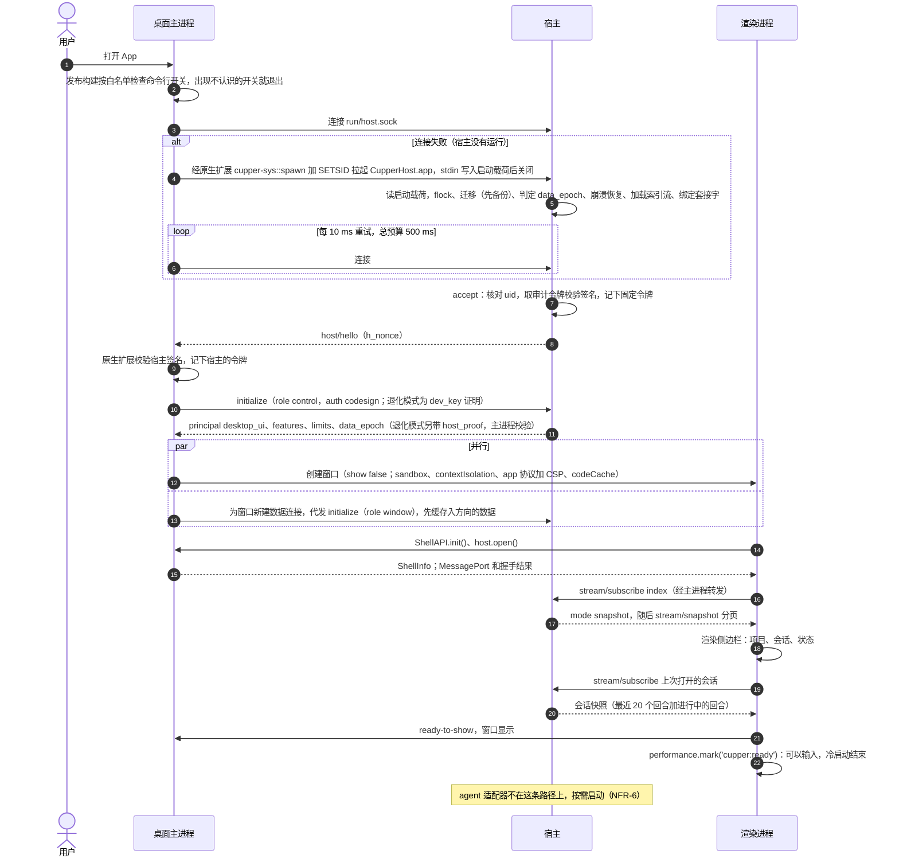

**时间预算**（NFR-6：冷启动到可用不超过 2 秒）

| 阶段 | 预算 | 依据 |
|---|---|---|
| Electron 启动到主进程 `ready` | 700 ms | 主进程在 `ready` 之前就开始连接或拉起宿主，两者并行 |
| 宿主拉起到可连接 | 100 ms | SP-4a 实测 p95 4.2 ms；留出首次运行新二进制时系统安全检查的余量 |
| 双向签名校验与握手 | 50 ms | SP-4b：每次校验中位数约 0.9 ms |
| 索引快照 | 50 ms | SP-4a：20 个会话时 p95 4.6 ms |
| 渲染进程加载与首屏 | 800 ms | SP-6 实测确认 |
| 当前会话快照与渲染 | 300 ms | 窗口只含最近 20 个回合 |

## 5.5.2 新建会话（含新建 worktree）

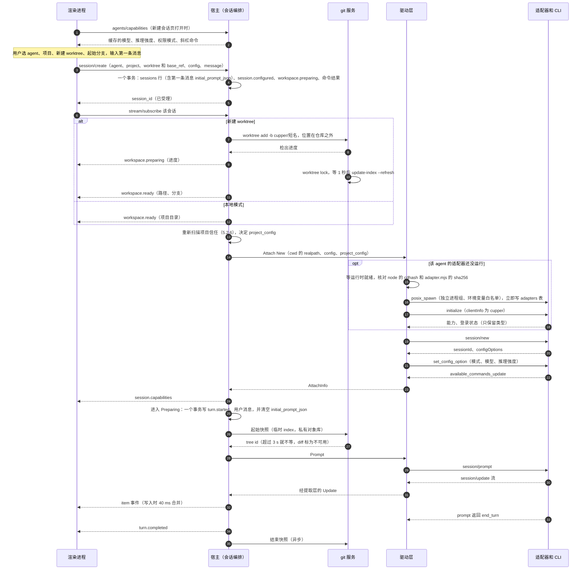

失败分支：CLI 找不到、没登录、运行时安装失败时，`Attach` 返回 `unavailable` 和具体 `reason`；会话流写一条 `error` 条目（带恢复指引），会话状态为 `error`，用户处理后重发即可。worktree 创建失败时写 `workspace.failed`。

## 5.5.3 发送消息、排队、插话（Steer）

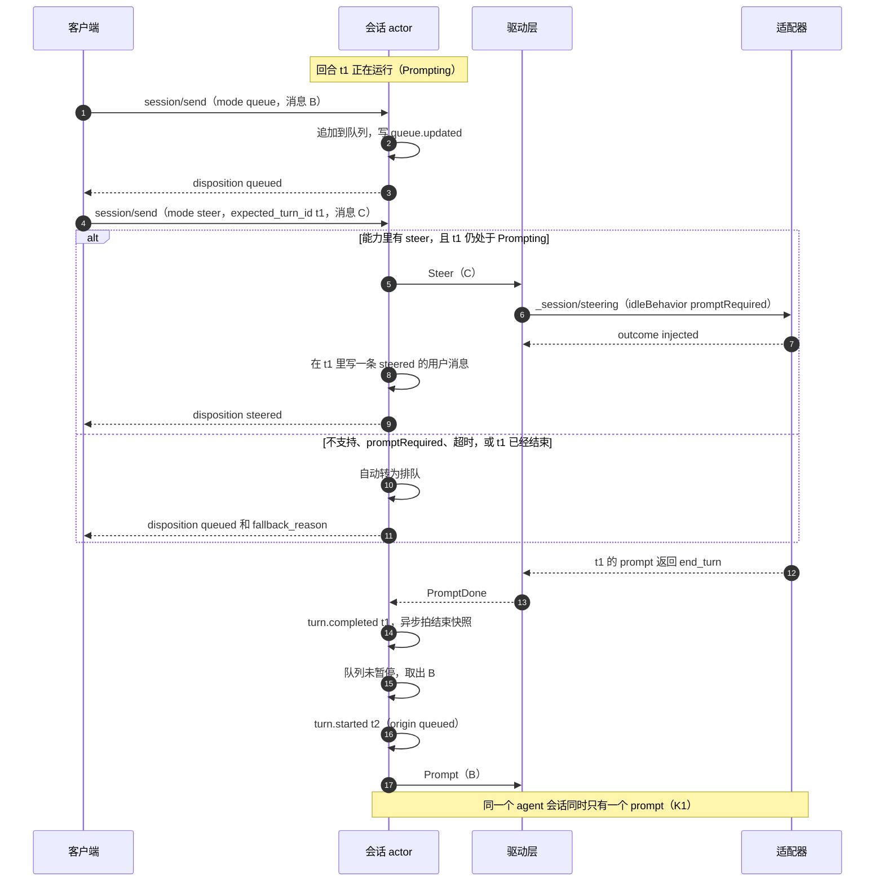

## 5.5.4 审批：先到先得

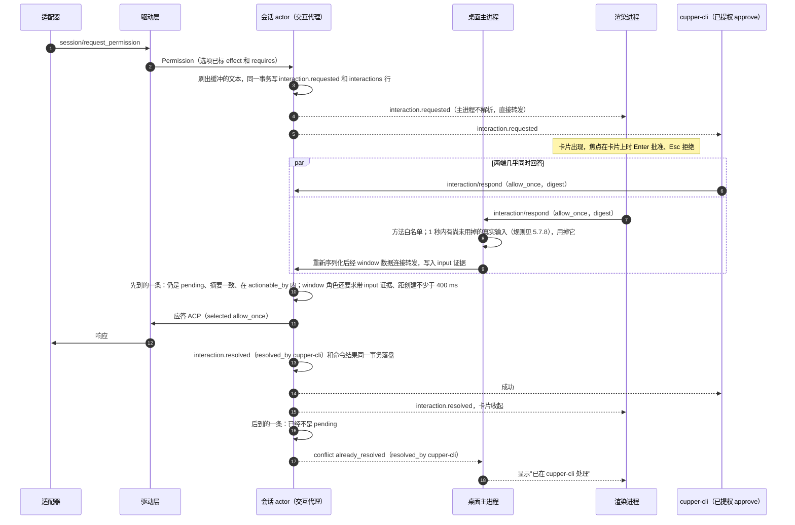

选择 `requires: privileged` 的选项（`allow_always` 类）时路径不同：渲染进程不能直接发送，而是调用 `ShellAPI.requestPrivileged`；主进程经 control 连接用 `interaction/get` 和 `policy/describe` 取得内容，弹出原生确认框，用户确认后由主进程经 control 连接发送 `interaction/respond`（[5.7.8](07-desktop.md#578-安全加固的落点)）。

## 5.5.5 中断

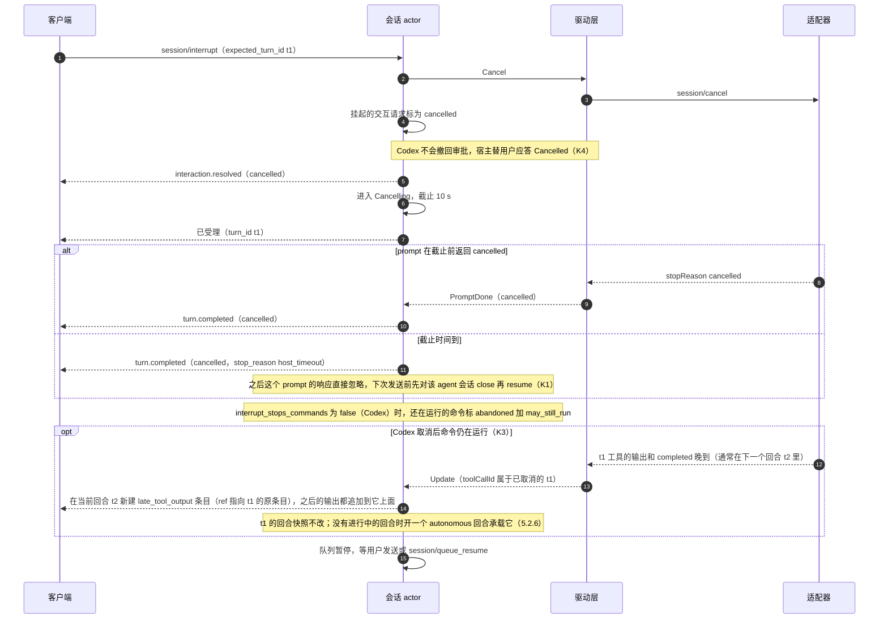

## 5.5.6 崩溃恢复

**宿主崩溃**（NFR-9、NFR-1 第 5 条验收）

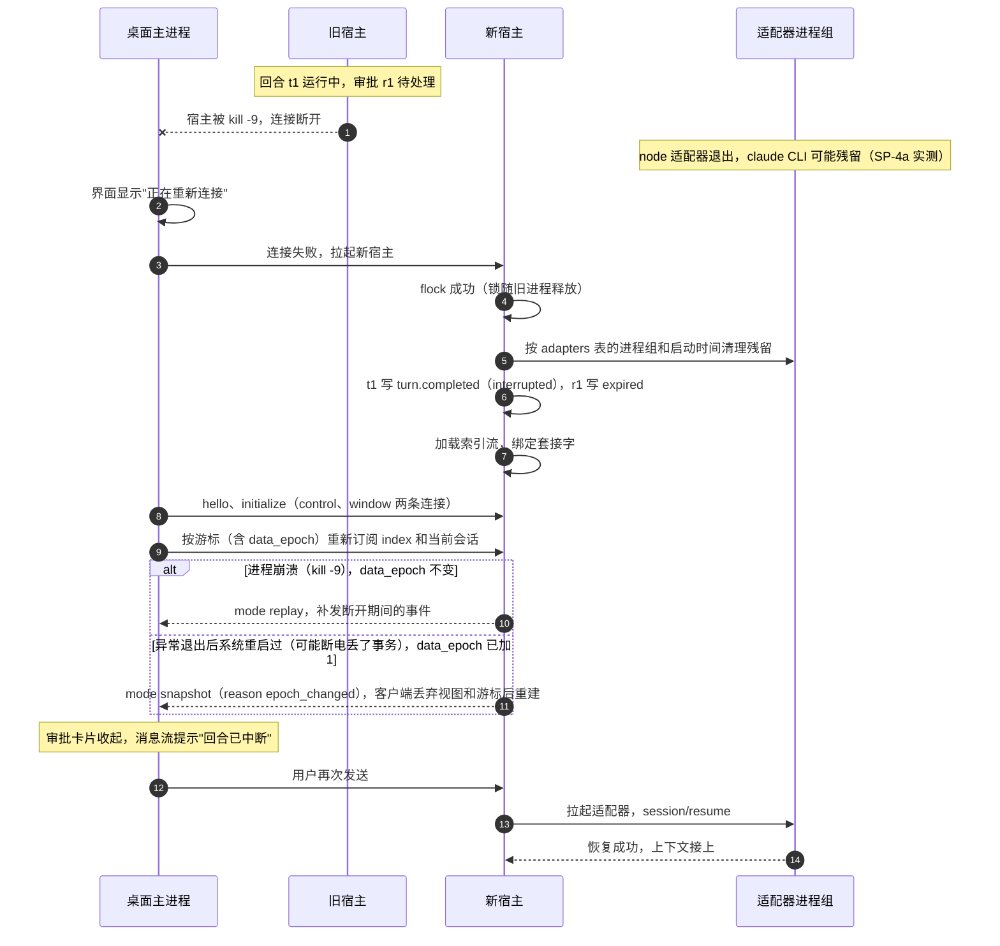

**适配器或 CLI 崩溃**（NFR-9、MS-5）

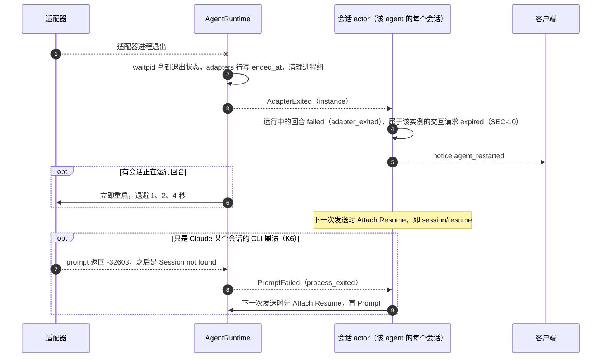

## 5.5.7 升级

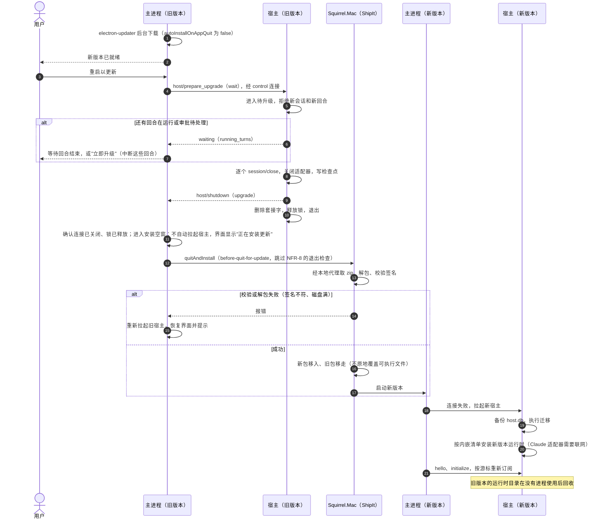

安装空窗、本地代理端口和安装位置检查的细节见 [5.10.5](10-release.md#5105-更新流程)。

其他升级路径（ADR-01 的 SP-4b 修订）：

- **用户手动把新版本拖进"应用程序"覆盖安装**：旧宿主在下一次有连接或要拉起子进程时，发现自己运行中的 cdhash 与磁盘上的不一致，进入待升级、空闲时退出。新版本的主进程校验旧宿主签名时会得到 `-67034` 或 `ENOENT`，按"旧宿主等待退出"处理：不向它发送命令，界面显示等待状态并提供"重启宿主"。
- **用户退出 App 时已有下载好的更新**：主进程按同样的顺序（待升级 → 宿主退出 → 安装）执行，只是不重新启动。M2 的后台模式下，关闭窗口不安装更新（ADR-01）。

## 5.5.8 审查、暂存、提交

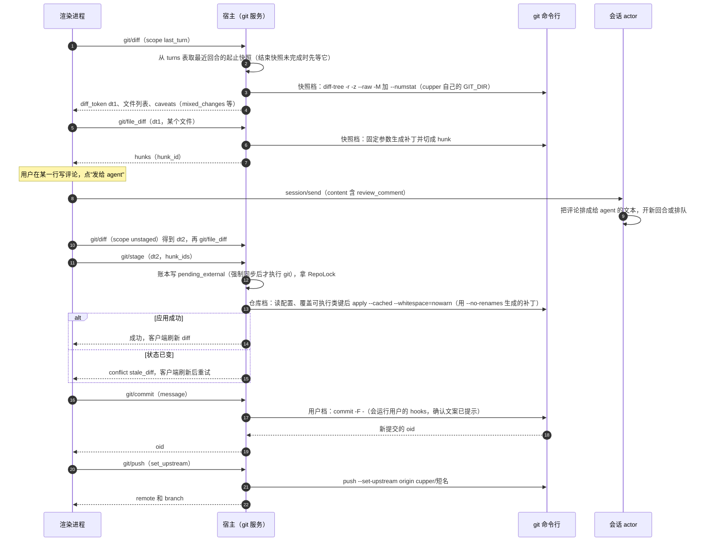

## 5.5.9 归档与 worktree 清理（GT-5、PS-3）

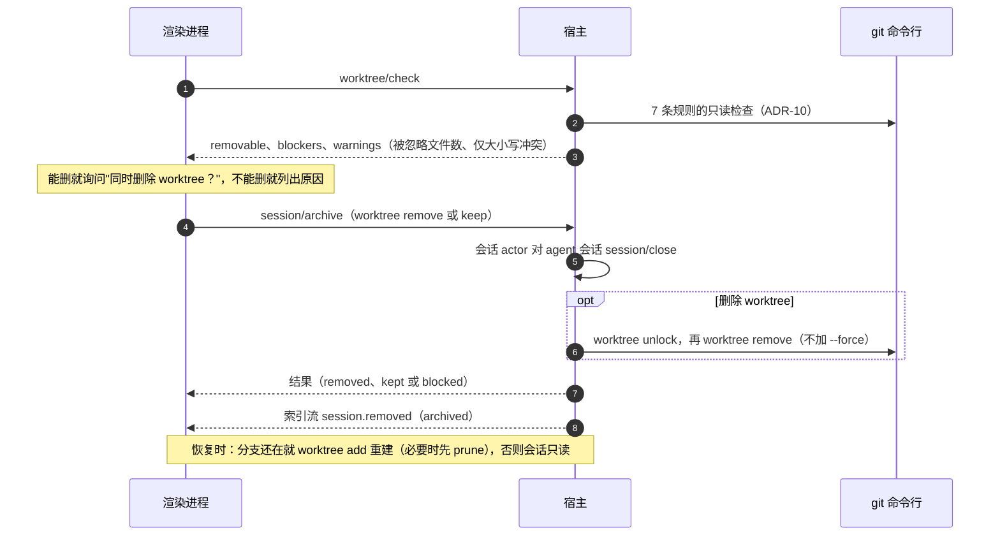

## 5.5.10 添加项目与信任

安全 #2；PRD v1.2 的 PS-2（项目信任已定，U-R1）。规则见 [5.2.6](02-host.md#项目信任)。

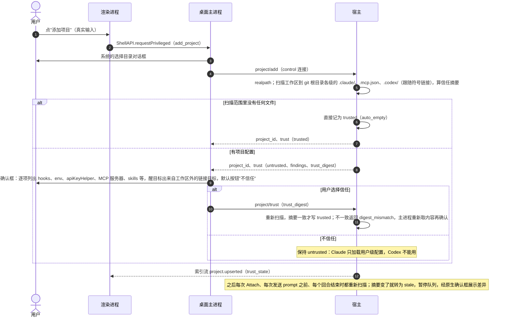
