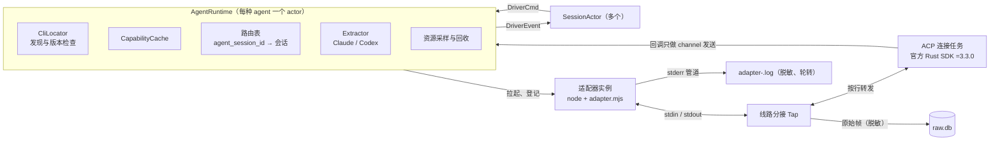

# 5.6 Agent 驱动层

- 所属：`docs/02-design.md` 第 5 节
- 依据：ADR-07（两边都走 ACP 适配器）、ADR-08（本机 CLI、运行时、版本锁定）、ADR-09（每种 agent 一个适配器进程）、ADR-02（ACP 回调只做 channel 发送）；SP-1（行为实测与录制）、SP-2（分发与版本耦合）、SP-4a（`driver.rs`、`normalize.rs`）；v1.6：技术验证 T003（`docs/tasks/T003-tech-validation/report.md`）
- 边界：**ACP 的类型不出驱动层**（对齐会 1.3 第 9 条）。会话编排只看到本节定义的命令和事件，以后增加"直连 Codex app-server"的实现不影响上层

## 5.6.1 结构

| 部件 | 职责 |
|---|---|
| `AgentRuntime` | 每种 agent 一个 actor（ADR-09）。持有当前的适配器实例；把会话的命令转成 ACP 请求；把 ACP 回调经提取层变成 `DriverEvent`，按 `agent_session_id` 路由给会话；维护能力缓存、登录状态和资源采样 |
| 适配器实例 | `cupper-sys::spawn` 拉起 `runtime/node/<版本>/bin/node runtime/<adapter>/<版本>/adapter.mjs`：`POSIX_SPAWN_SETSID`（自成会话和进程组，血缘检查据此判断，[5.8.4](08-security.md#584-cli-提权)）、`POSIX_SPAWN_CLOEXEC_DEFAULT`、默认信号处置、环境变量白名单；stdin、stdout 为管道，stderr 也是管道（由宿主读出、脱敏后写日志，便于轮转；SP-4a 是直接写文件）。拉起后立即写 `adapters` 表 |
| 线路分接（Tap） | 位于管道和 SDK 之间，按行转发 ACP 消息。v1.6（T003）收窄为三件事：给每行编号并记录原始帧；结构化脱敏（含 `_auth/status_update` 里的账号字段）；对 SDK 中封闭枚举的未知值做容错改写（K19）。扩展消息不经分接层，全部走 SDK。见 [5.6.10](#5610-线路分接层) |
| ACP 连接任务 | 沿用 SP-4a 的 `run_connection`：用 SDK 的 `Client` 构建连接，回调里只做 channel 发送；扩展消息也走 SDK（v1.6，Q9）：`_session/steering` 用 SDK 的派生宏声明成请求类型，`_auth/status_update` 由类型化的通知处理器接收，`$/cancel_request` 由 SDK 处理并把对应请求的 `Responder::cancellation()` 标为已取消；必须遵守 [5.6.10](#5610-线路分接层) 的两条 SDK 约束；`initialize` 声明 form 类 elicitation、`_meta.terminal_output`、unstable 的 `plan`，`clientInfo.name` 固定为 `cupper`（ADR-08：它会出现在 codex 发往 OpenAI 的 User-Agent 里）。`fs` 和 `terminal` 两项客户端能力永远声明为不支持：声明了，宿主就要替 agent 在沙箱外读写文件、运行命令；要改必须经过安全评审 |
| Extractor | 按 agent 区分的提取层：把 `SessionUpdate`、权限请求、elicitation、错误转成 cupper 的语义（[5.6.3](#563-提取层claude-与-codex-对照)） |

## 5.6.2 驱动接口

**命令**（会话 actor → `AgentRuntime`，带 oneshot 回复的标"请求"）

| 命令 | 参数 | 回复 / 后续事件 | 说明 |
|---|---|---|---|
| `Attach`（请求） | `session_id`、`New {cwd, config}` 或 `Resume {agent_session_id, cwd, config}`、`project_config: load \| ignore`、事件发送端 | `AttachInfo {agent_session_id, instance_id, config_options, commands, caps}` | 需要时先拉起适配器（等待运行时就绪）；`New` 对应 `session/new`，`Resume` 对应 `session/resume`；之后立即应用 `config`（SP-4a 的 `apply_prefs`，resume 后也要重新应用）。`project_config` 由项目信任决定（[5.2.6](02-host.md#项目信任)）：Claude 为 `ignore` 时在 `_meta.claudeCode.options` 里传 `settingSources: ["user"]`；Codex 为 `ignore` 时直接返回 `unavailable`（`project_untrusted`） |
| `Prompt` | `agent_session_id`、`content: [PromptBlock]` | 之后发 `PromptDone` 或 `PromptFailed` | 文本、图片（base64）、`resource_link`；评论块由宿主排成文本 |
| `Steer`（请求） | `agent_session_id`、`content` | `SteerOutcome: Injected \| StartedNewTurn \| PromptRequired \| Unsupported`，5 s 超时 | 走 `_session/steering` 扩展；总是带 `idleBehavior: promptRequired`（Codex 会忽略它，见规避清单） |
| `Cancel` | `agent_session_id` | — | `session/cancel` 通知 |
| `SetConfig`（请求） | `agent_session_id`、`option`、`value` | 最新的 `config_options` | `session/set_config_option` |
| `Close` | `agent_session_id` | — | `session/close`；从路由表删除 |
| `Probe`（请求） | — | 能力描述 | 能力缓存为空时使用（[5.6.7](#567-能力缓存)） |
| `ListSessions`、`Load` | — | — | PS-5（P1）导入 CLI 原有会话时使用，M1 不实现 |

**事件**（`AgentRuntime` → 会话 actor）

| 事件 | 内容 |
|---|---|
| `Update(NormUpdate)` | 规范化后的更新：`AgentText {message_id, text}`、`Thought {text}`、`ToolStart {tool_call_id, tool_kind, title, paths, command?}`、`ToolUpdate {tool_call_id, title?, status?, output: Append\|Replace?, exit_code?, diffs?}`（`Append` 映射为协议里 `field: output` 的 `item.delta`，`Replace` 映射为结束时给出的完整输出，[5.3.5](03-protocol-v1.md#535-事件类型目录)）、`Plan {entries \| markdown}`、`Compaction {phase, summary?}` |
| `Permission(PermissionAsk, Responder)`、`Question(QuestionAsk, Responder)` | 已分类、已标好选项生效范围的交互请求（[5.6.4](#564-交互请求的分类与选项映射)） |
| `RequestWithdrawn(ask_ref)` | Claude 发来 `$/cancel_request`：SDK 把对应请求的 `Responder::cancellation()` 标为已取消，`AgentRuntime` 据此发出（v1.6） |
| `PromptDone {stop_reason, usage?}`、`PromptFailed(AgentError)` | prompt 的结果 |
| `RunState {active, waiting_on_approval, waiting_on_user_input, system_error}` | Codex 的 `threadStatus` |
| `ConfigChanged(options)`、`CommandsChanged(commands)` | `config_option_update`、`current_mode_update`、`available_commands_update`。**`CommandsChanged` 去重**（v1.6，T003）：Claude 在每个会话开始和每个回合开始时，都推一次完整的命令列表（本机 22–32 KB，取决于装了多少 skill）。`AgentRuntime` 按会话记住上一份列表的摘要，内容没有变化就不发事件；会话流里的 `session.capabilities` 也只在内容变化时写（[5.3.5](03-protocol-v1.md#535-事件类型目录)） |
| `TitleChanged {title, source}`、`Usage {used, size, cost?}` | `session_info_update`、`usage_update` |
| `UpstreamRetry {attempt, max}` | Codex 的 `_meta.codex.error` 且 `willRetry` 为真 |
| `AdapterExited {instance_id, status}` | 广播给该 agent 的所有会话 |

`AgentError` 统一三类错误（ADR-06）：JSON-RPC 错误（保留 `agent_code` 和截断、脱敏后的 `message`）、以文本出现的错误、会自动重试的上游错误；并给出 cupper 的分类：`not_logged_in`、`cli_too_old`、`session_not_found`、`process_exited`、`restartable`、`model_unsupported`、`quota_exhausted`、`other`。

**`AgentRuntime` → `IndexActor`**：`AgentStatus {cli, adapter, runtime, auth, rss, state}`，用于设置页的 agent 状态和新建会话页的提示（AG-2、AG-5）。

## 5.6.3 提取层：Claude 与 Codex 对照

依据 SP-1 实测（claude-agent-acp 0.91.0 + Claude Code 2.1.296；codex-acp 2.2.2 + codex 0.159–0.160）。

| 项 | Claude | Codex | 拿不到时 |
|---|---|---|---|
| 退出码 | `_meta.terminal_exit.exit_code` | 一般命令：`_meta.terminal_exit.exit_code`；归类为读取的命令（`kind: read`）：`rawOutput.exit_code` | `extraction: partial`，界面不显示退出码 |
| 命令输出 | 结束时 `_meta.terminal_output.data` 一次给出，stdout 和 stderr 合并，第一行是 "Exit code N"（去掉这一行）；**不流式** | `_meta.terminal_output.data` 逐行增量；读取类命令的输出在 `content` 文本里 | `output_streaming: false` 时界面显示"运行中"而不是空输出 |
| 命令文本 | `rawInput.command`；标题 | 标题（适配器已把 `sh -c` 拆开）；`rawInput` | 用标题 |
| diff | `content[].diff {path, oldText, newText}`，是带上下文的片段；`_meta.claudeCode.toolResponse.structuredPatch` 有 hunk 列表 | 每个 hunk 一个 `diff`，带 `_meta.kind`（add 或 update）；模型用 shell 运行 `apply_patch` 时**完全没有 diff** | 条目不带 diff；回合级的变更一律以 git 快照为准（GT-1） |
| 工具状态 | 先 `pending`，参数流式补全，最后 `completed` 或 `failed` | 出现时就是 `in_progress`，参数完整 | — |
| 运行状态 | 没有信号，宿主按 prompt 请求和响应推导 | `session_info_update._meta.codex.threadStatus`：`active`（带 `waitingOnApproval` 或 `waitingOnUserInput`）、`idle`、`systemError` | 宿主推导 |
| 思考 | 适配器支持，但 haiku 上没有观察到 | `agent_thought_chunk` | 不显示思考区域（`extraction.thinking: false`） |
| 计划 | TodoWrite 和 Task 工具在 SDK 会话里不可用；只有计划模式的 `plan_update`（unstable，Markdown） | 计划协作模式下的 `plan_update`（Markdown）；`update_plan` 可用时有 `plan` 条目 | `plan: markdown_only`，MS-4 的"每一步状态"对 Claude 可能做不到（待定问题 Q12） |
| 标题 | 回合结束后 `session_info_update` 给 AI 标题 | 先给 prompt 截断的标题，约 5 s 后给 AI 标题 | 用第一条消息截断 |
| 用量 | 每次调用模型后 `usage_update {used, size}`，回合结束时带 `cost`；`_meta` 里有 5 小时和 7 天额度窗口 | `usage_update {used, size}` | — |
| 登录状态 | `_auth/status_update`（带邮箱和组织，**提取层只保留 `kind` 和套餐名**） | 同左 | — |
| 未登录 | `session/new` 成功，`session/prompt` 返回 `-32000 Authentication required` | `session/new` 就返回 `-32000` | 分类为 `not_logged_in`；CLI 版本低于已验证范围时改为 `cli_too_old`（SP-2） |
| 进程崩溃 | CLI 崩溃：`-32603` "process exited unexpectedly"，之后 "Session not found" | app-server 被杀：`1001`，`data.restartable: true` | 分类为 `process_exited`、`session_not_found`、`restartable` |
| 文本形式的错误 | — | 错误原文出现在 `agent_message_chunk` 里，同时 `threadStatus: systemError`，`stopReason` 仍是 `end_turn` | 收到 `systemError` 时，把这段文本转成 `error` 条目（`model_unsupported` 等） |
| 上游重试 | 未遇到 | `_meta.codex.error {message, willRetry}` | `notice: upstream_retry`（同一回合内 upsert） |
| 取消 | 命令被终止；挂起的审批先收到 `$/cancel_request` | 命令**不会**被终止，输出和 `completed` 在下一回合到达；挂起的审批不撤回 | 见规避清单 |

## 5.6.4 交互请求的分类与选项映射

| ACP 消息 | 判定条件 | 分类 |
|---|---|---|
| `session/request_permission` | Claude：工具调用 `kind` 为 `switch_mode`，选项 ID 以 `exit-plan-` 开头 | `plan_confirm`（计划正文取请求里工具调用的 `rawInput`，取不到时用最近一次 `plan_update` 的 Markdown） |
| `session/request_permission` | Codex：`toolCallId` 以 `plan-review:` 开头 | `plan_confirm`（计划正文用最近一次 `plan_update`） |
| `session/request_permission` | 其他 | `permission` |
| `elicitation/create`（form 模式） | — | `question`，字段映射见 [5.3.6](03-protocol-v1.md#536-交互请求模型) |
| `elicitation/create`（url 模式） | 客户端声明了 `interaction.auth_url` | `auth_url`（SP-1 没有观察到，M1 不实现） |

**选项生效范围**：按 `(agent, 场景, option_id)` 查表，表的内容见 [5.3.6](03-protocol-v1.md#536-交互请求模型)。场景由工具决定：Claude 看 `_meta.claudeCode.toolName`（Write、Edit、MultiEdit、NotebookEdit 为"文件编辑"，其余为"命令及其他"）；Codex 看工具调用的 `kind`（`edit` 为文件修改，`execute` 为命令）。

- 对照表是代码里的静态数据（`driver/claude/options.rs`、`driver/codex/options.rs`），与锁定的适配器版本一起维护，每次升级适配器都用录制回归。
- 查不到的选项按 ACP `kind` 保守兜底（`allow_always` 一律视为持久、需要原生确认），并记一条日志，提示更新对照表。
- **kind 本身未知的选项**（安全 #5）：`effect.scope` 为 `unknown`、`persistent: true`、`requires: privileged`，`actionable_by` 只有 `desktop_ui`；协议里下发 agent 给的原值，不下发分接层改写后的值（[5.3.6](03-protocol-v1.md#536-交互请求模型)）。
- 持久选项从选项原文或 `rawInput` 解析命令前缀，标出 `prefix_risk`；适配器在 `_meta` 里透出规则或写入位置时一并带上（[5.3.6](03-protocol-v1.md#536-交互请求模型)）。
- **Claude 的 `allow-with-updates`** 在文件编辑上只对本会话有效，在 Bash 上会写入持久规则（SP-1 录制核实，两者的 option_id 相同），所以必须按工具区分，判断不出来时按持久处理。

## 5.6.5 配置项映射

ACP 的 `configOptions` 按 `category` 映射到 cupper 的配置项，具体取值透传 agent 给的值和名称（CP-4：选项都来自 agent）。宿主只额外给出 `risk`。

| cupper 配置项 | Claude | Codex | `risk` 规则 |
|---|---|---|---|
| `permission_mode` | category `mode`，5 个值：`default`、`acceptEdits`、`plan`、`auto`、`bypassPermissions` | category `mode`，4 个值：`read-only`、`workspace-write`、`agent`（Auto review）、`agent-full-access` | 按下面的档位表 |
| `plan_mode` | 是 `permission_mode` 的一个取值（`plan`） | category 为协作模式的 `collaboration_mode`（default、plan） | `normal` |
| `model` | category `model` | category `model` | `normal` |
| `reasoning_effort` | category `thought_level`（`effort`） | category `thought_level`（`reasoning_effort`） | `normal` |
| 其他 | 原样透传，`id` 用 agent 的原始 ID | 同左 | `normal` |

**审批档位**（安全 #3）：档位有序，`normal` < `elevated` < `full_access`。

| 档位 | 含义 | Claude | Codex |
|---|---|---|---|
| `normal` | 越界操作逐个由用户审批 | `default`、`plan` | `read-only`、`workspace-write` |
| `elevated` | 由分类器或规则代替用户审批一部分操作 | `acceptEdits`、`auto` | `agent`（Auto review） |
| `full_access` | 不再审批 | `bypassPermissions` | `agent-full-access` |
| 表里没有的取值 | 一律按 `full_access` 处理，直到对照表更新；Codex 的完整取值由兼容矩阵补测（待定问题 Q25） | | |

- Codex 旧的 `models` 和 `modes` 字段忽略，以 `configOptions` 为准。
- 新会话的默认值来自用户自己的 CLI 配置（SP-1：可能是贵的大模型加高推理强度，Codex 的默认档位常常是 `agent`）。宿主不覆盖，新建会话页把当前值显示出来，用户自己选。默认档位视为由创建会话的 principal 设定（纪要 D10）。
- 谁能把会话放宽到哪一档，按 [5.8.2](08-security.md#582-principal角色与-scope) 的档位规则判定：`full_access` 只能由桌面主进程经原生确认框设置；`elevated` 在窗口上加提示但不需要原生确认（U6 推荐的低打扰模式），CLI 需要同时有 write 和 approve，M3 的手机不能放宽到它。

## 5.6.6 CLI 的发现与版本检查

**登录 shell 环境**：宿主启动时（以及 `agents/refresh` 时）运行一次 `$SHELL -l -i -c '<在两个标记之间打印 env>'`，stdin 为 `/dev/null`，超时 5 秒，从输出里取 `PATH`、代理变量、`SSH_AUTH_SOCK`、`CLAUDE_CONFIG_DIR`、`CODEX_HOME`，以及设置 `agents.env_passthrough` 里列出的变量名对应的值。取到的环境只放在内存里，不写日志，不进诊断包。GUI 进程自己的 PATH 里没有 Homebrew、nvm 等目录（SP-2）。失败时退回 `/opt/homebrew/bin:/usr/local/bin:/usr/bin:/bin:/usr/sbin:/sbin` 并在 agent 状态里提示。

**查找顺序**（ADR-08）

1. 设置里指定的路径（`agents.<agent>.cli_path`，修改需要原生确认）；
2. 登录 shell 的 PATH 里的 `claude`、`codex`，只在可信条目里找：绝对路径，并且不在任何项目、工作区、worktree 根目录或临时目录下（规则同 git，[5.2.10](02-host.md#5210-git-与-worktree-服务)），避免执行 agent 放在工作区里的同名程序；
3. 常见位置：Homebrew（`/opt/homebrew/bin`）、原生安装器（`~/.local/bin`）、npm 全局目录、nvm 当前版本的 bin 目录。

**解析成原生二进制**：先 `realpath`。是 Mach-O 就直接用；是 `#!/usr/bin/env node` 的 npm shim，按该 agent 的包布局找到包内的平台二进制（ADR-08：不能直接传 shim，GUI 环境里没有 node）；只找到 JS 入口、没有原生二进制的，状态为 `unsupported_install`，提示安装原生版本。各种安装方式的目录布局做成数据驱动的解析器，用目录树样例做单元测试（实际布局在实现时核实，待定问题 Q19）。

**版本检查**：运行 `<binary> --version`（超时 5 秒，环境变量白名单），取第一个语义化版本号，与锁定的适配器附带的"已验证范围"比较：

| 结果 | 条件 | 处理 |
|---|---|---|
| `verified` | 在已验证范围内 | — |
| `newer_untested`、`older_untested` | 在范围外，但没有已知问题 | 提示，不阻止（AG-5） |
| `unsupported` | 低于已知会失败的版本（例如 codex 0.140） | 提示升级；适配器报"需要认证"时改判为 `cli_too_old` |

已验证范围写在 `runtime/manifest.json` 里，随适配器版本一起锁定；起始值取 ADR-08：claude 2.1.200（握手）到 2.1.296（完整回合），codex 0.150.1 到 0.163.0。完整的范围由兼容矩阵确定（[5.9.5](09-testing.md#595-兼容矩阵)）。

**传给适配器的环境变量**（安全 #9，纪要 D14）

| 来源 | 变量 | 规则 |
|---|---|---|
| 固定白名单 | `PATH`（登录 shell 的值）、`HOME`、`USER`、`LOGNAME`、`SHELL`、`TMPDIR`、`LANG`、`LC_*`、`TERM`、代理变量、`SSH_AUTH_SOCK` | 取值来自登录 shell 或宿主自己的环境 |
| 宿主自己设置 | `CLAUDE_CODE_EXECUTABLE` 或 `CODEX_PATH` | 解析出的原生二进制的绝对路径 |
| 宿主校验后设置 | `CLAUDE_CONFIG_DIR`、`CODEX_HOME` | 只从登录 shell 读取，不能经 `agents.env_passthrough` 传入。必须是绝对路径、目录存在、属主是当前用户、realpath 不在任何项目或工作区之内；校验不通过就不设置，并在 agent 状态里提示（用户自定义了配置目录时，不设置会找不到登录态，AG-6）。test-harness 构建可以经 `--test-config` 覆盖 |
| 用户放行 | 设置 `agents.env_passthrough` 列出的变量名（例如 API key、`ANTHROPIC_BASE_URL`） | 修改需要 `privileged`（原生确认，[5.2.11](02-host.md#5211-文件服务与设置)）。名字必须匹配 `^[A-Z][A-Z0-9_]*$`，并且不在下面的禁用清单里；命中禁用清单的条目忽略并提示 |
| 禁用清单（无论设置里写了什么都不传） | 前缀 `NODE_`、`DYLD_`、`LD_`、`ELECTRON_`、`CUPPER_`、`CLAUDE_AGENT_ACP_`；名字 `CLAUDE_CODE_EXECUTABLE`、`CODEX_PATH`、`CLAUDE_CONFIG_DIR`、`CODEX_HOME`，以及适配器的控制变量 `CODEX_CONFIG`、`DEFAULT_AUTH_REQUEST`、`MODEL_PROVIDER`、`INITIAL_AGENT_MODE`、`DISABLE_MCP_CONFIG_FILTERING`、`APP_SERVER_LOGS`、`CLAUDE_AGENT_LOGS`、`CLAUDE_MODEL_CONFIG`、`IS_SANDBOX`；固定白名单里的变量也不能经放行名单覆盖 | 控制变量清单来自对锁定版本适配器的源码核对（claude-agent-acp 0.91.0、codex-acp 2.2.2）。`cargo xtask runtime-pack` 从锁定的适配器产物里提取全部 `process.env` 读取点，出现既不在白名单、也不在禁用清单、也不在"已知无害"清单里的新名字就失败，交人工归类 |

去掉所有 `CUPPER_*`（ADR-05）。

## 5.6.7 能力缓存

- **来源**：`initialize` 的响应（会话能力、`_meta.steering.supported`、`_meta.claudeCode.promptQueueing`；T003 实测 `steering.supported` 在响应顶层的 `_meta` 里，不在 `agentCapabilities._meta` 下）；`session/new` 或 `session/resume` 的响应（`configOptions`）；随后 2–5 ms 到达的 `available_commands_update`（Claude 在每个回合开始时还会再推一次）。
- **存放**：`agent_capabilities` 表，每种 agent 一行；适配器版本或 CLI 版本变化时作废。每次有会话 `Attach` 成功都刷新。
- **新建会话页**（AG-4、ADR-09）：调用 `agents/capabilities` 取缓存，第一条消息发出之前就能显示模型、推理强度、权限模式和斜杠命令。
- **缓存为空时**（首次使用）：`agents/refresh` 做一次探测：先把 `<数据目录>/probe/<agent>/` 删掉重建为空目录（0700，[5.2.6](02-host.md#项目信任)），在里面 `session/new`，读取配置和命令（等 `available_commands_update` 最多 200 ms），然后 `session/close`。Claude 的代价约 0.8 秒；Codex 的探测会拉起用户的 MCP 且不释放，所以探测后把 Codex 适配器标为"空闲时回收"。只建会话不发 prompt，两边都不会留下会话记录（SP-1）。

## 5.6.8 资源回收

| 情况 | 策略 |
|---|---|
| Claude 会话空闲 | 会话 actor 空闲 10 分钟退出时 `session/close`，CLI 进程随之退出（ADR-09） |
| Codex 适配器 | 该 agent 没有进行中的回合、没有待处理的交互请求，并且（进程组常驻内存超过 2 GiB，或距最后一个回合超过 30 分钟）时回收：逐个 `session/close`，停掉适配器，所有会话变为 `Detached`，下次使用时 `session/resume`（代价很小，SP-1） |
| 适配器意外退出 | 有会话在运行回合时立即重启，否则等下次使用再启动；退避 1、2、4 … 最长 30 秒；5 分钟内连续失败 5 次，状态改为 `crashed`，需要用户在设置页手动重启 |
| 手动 | `agents/restart`（界面先提示会影响该 agent 的所有会话） |
| 关闭 | v1.6 的顺序（T003：Claude Code 用 setsid 拉起工具命令，命令有自己的会话和进程组，杀适配器的进程组杀不到它们）： 1. 逐个 `session/close`，让 CLI 自己正常退出； 2. 关闭 stdin，限时等适配器退出； 3. 发任何信号之前，用 libproc 枚举适配器的全部后代，记下每个后代的进程组（组号加启动时间）； 4. 对这些进程组和适配器的进程组逐个发 SIGTERM，限时等待，再对仍在的发 SIGKILL。 顺序不能倒：适配器先退出的话，它的后代会被 launchd 收养，从进程树上再也找不到 |

- **意外退出后的清理**：适配器意外退出时，它的后代已经被 launchd 收养。资源采样时顺带把后代的进程组（组号加启动时间）写进 `adapters` 表，宿主重启或重启适配器时，按记录逐个清理（[5.2.13](02-host.md#5213-进程监护与宿主生命周期)）。
- **孤儿 `claude` 进程**（上游 #1011，待定问题 Q43）：长期运行的适配器反复 resume 同一个会话后，可能累积多个 `claude` 子进程。资源采样记录每种 agent 的 `claude` 进程数，超过会话数时写日志。

容量提示（NFR-11、ADR-09）：设置页显示每种 agent 的进程组内存，并说明"每配置一套 MCP，每个会话还要多占几百 MB"。

## 5.6.9 已知问题的规避清单

回归一列写成"测试层 + 用例编号"（测试 #4）。测试层：`GOLD-A`（提取层金样例，逐帧的纯函数，SP-1 的录制都可以用）、`IT`（宿主集成测试 + 假 agent）、`PROP`（纯核心的性质测试）、`UNIT`（单元测试）、`COMPAT`（兼容剧本，真实 CLI）。编号规则见 [5.9.10](09-testing.md#5910-测试编号与人工验证清单)。

| # | 问题（来源） | 现象 | 规避 | 回归 |
|---|---|---|---|---|
| K1 | 并发 prompt（SP-1 s06） | Claude 并入当前回合并丢掉第一条回复；Codex 的第一个 prompt 永不返回 | 宿主自己排队；同一个 agent 会话同时最多一个 prompt；上一个 prompt 一直不返回时，先**显式**发 `session/close` 再 `session/resume`，然后才发新 prompt（v1.6：放弃等待时先对 `SentRequest` 调 `detach()`，不能丢弃 future，见 K28） | PROP-turn-single-prompt；IT-K1-close-resume（假 agent `hang`）；假 agent 的全局不变式：同一会话收到第二个在途 prompt 立即报错退出，所有 IT 用例都会检查；GOLD-A-claude-s06、GOLD-A-codex-s06 |
| K2 | Codex #556（SP-1 s04、s04b） | 拒绝审批只有 `cancel`，整个回合以 `cancelled` 结束 | 选项标 `ends_turn: true`，界面写明"拒绝将结束本回合"；这种取消不暂停队列 | GOLD-A-codex-s04、GOLD-A-codex-s04b；IT-K2-reject-ends-turn（codex 形态） |
| K3 | Codex 取消后命令不停（s07） | 命令继续运行，输出和 `completed` 在下一个回合到达 | 中断时还在运行的命令标 `abandoned` 加 `may_still_run`；晚到的输出写成当前回合里的 `late_tool_output` 条目，原回合不改（Q14，纪要 D4，[5.2.6](02-host.md#晚到的工具输出)） | GOLD-A-codex-s07（只断言晚到的帧被提取成带原 `toolCallId` 的 ToolUpdate）；IT-K3-late-output（codex 形态的 `late_tool`，断言回合结构）；PROP-turn-snapshot-immutable；GOLD-B-codex-s07（等 M1b 用宿主重新录到 codex 的取消场景后再补） |
| K4 | Codex 取消不撤回审批（s07） | 挂起的审批请求留在适配器那边 | 宿主把请求标为 `cancelled`，并替用户应答 `Cancelled` | IT-K4-cancel-pending-approval（codex 形态）；GOLD-A-codex-s07 |
| K5 | Claude 撤回审批（s07） | 取消时先收到 `$/cancel_request` | SDK 收到后把对应请求的 `Responder::cancellation()` 标为已取消，`AgentRuntime` 发 `RequestWithdrawn`，请求标为 `cancelled`（`agent_withdrew`）（v1.6，Q9） | GOLD-A-claude-s07；IT-K5-withdraw（经原始行通道发 `$/cancel_request`） |
| K6 | Claude CLI 崩溃（s07、s07b） | `-32603`，之后 "Session not found"，适配器不自动重启 CLI | 回合标为 `failed`；下一次发送时自动 `session/resume`，再重发一次（只在该 prompt 没有产生任何更新时） | GOLD-A-claude-s07b；IT-K6-crash-resume（`crash_cli`）；IT-K6-output-then-crash（`output_then_crash`，断言不重发） |
| K7 | Codex app-server 被杀（s07） | `1001`，`restartable: true` | 回合标为 `failed` 并提示；下一个 prompt 由适配器自动重启 app-server | GOLD-A-codex-s07；IT-K7-restartable |
| K8 | 回放不完整、没有时间戳（#1297、#1307、#617） | 回放不能当历史 | 历史只用宿主自己的日志；`session/load` 只用于 PS-5 导入，导入内容标"可能不完整" | GOLD-A-claude-s09；IT-history-from-host（宿主重启后 `history/page` 来自回合快照） |
| K9 | 回合外的更新（s06） | 后台命令结束后 Claude 自发开回合；空闲时 steer 启动回合；Codex 补发遗留输出 | 开 `autonomous` 回合；K3 的遗留输出按 K3 处理；自发回合结束后的出队保护见 [5.2.6](02-host.md#回合状态机) | GOLD-A-claude-s06；IT-K9-autonomous（`autonomous`，含"静默超过阈值后又继续输出"）；PROP-autonomous-dequeue-guard |
| K10 | Claude steering 的副作用（s06） | 工具调用被丢弃、命令被移到后台 | 宿主只在客户端明确要求 `steer` 时插话；界面默认插话（v1.4，PRD CP-6 v1.3 与用户决定 F5），设置里可以改为默认排队，副作用在设置说明和第一次插话时提示（ADR-07 的修订建议见 5.13.2） | IT-K10-steer-explicit-only；E2E-composer-steer-default |
| K11 | Codex 忽略 `idleBehavior`（s06） | 空闲时 steer 直接开新回合 | 宿主只在回合处于 `Prompting` 时 steer | PROP-steer-only-prompting；IT-K11-steer-idle-queued |
| K12 | Codex 的计划确认请求发出时线程状态已是 `idle`（s05） | 若以 `threadStatus` 判断回合结束，会把还在等确认的回合提前结束 | **有 prompt 在途时，回合以 prompt 响应为准**；`threadStatus` 只用于显示运行状态和界定 `autonomous` 回合，变成 idle 也不会让挂着的交互请求失效（纪要 D3） | GOLD-A-codex-s05；IT-K12-plan-confirm-idle（`thread_status idle` 加 `plan_confirm`）；PROP-prompt-inflight-no-end |
| K13 | cwd 必须是真实路径（s08） | Codex 按 cwd 过滤时用 `/var/...` 得到 0 条 | 一律传 realpath | UNIT-realpath；IT-K13-echo-cwd（假 agent `echo_env` 回显 cwd） |
| K14 | CLI 太旧时报"需要认证"（SP-2） | codex 0.140 读不了新配置，报 `Authentication required` | 版本低于已验证范围时改判为 `cli_too_old` | UNIT-version-classify（以 SP-2 的版本数据为样例）；IT-K14-old-cli-auth（`auth_none` 加低版本） |
| K15 | `CODEX_PATH` 指向 npm shim（SP-2） | `env: node: No such file or directory`，`1001` | 解析到包内的原生二进制 | UNIT-cli-resolver（目录树样例） |
| K16 | 邮箱和组织（s01、s10） | `_auth/status_update` 带账号信息 | 分接层在写原始帧前脱敏；提取层只保留类型和套餐名 | GOLD-A-claude-s01；UNIT-redact-auth-status |
| K17 | 文本形式的错误（s10x） | 模型不支持等错误以消息文本出现，`stopReason` 仍是 `end_turn` | 收到 `systemError` 时转成 `error` 条目，回合带 `error_code` | GOLD-A-codex-s10x；IT-K17-text-error |
| K18 | 上游过载（Codex） | 自动重试最多 5 次 | `notice: upstream_retry` 显示进度 | IT-K18-upstream-retry（`upstream_retry`）；有含重连的录制时加 GOLD-A |
| K19 | SDK 的封闭枚举（SP-4a） | `StopReason`、`PermissionOptionKind`、`ToolCallStatus` 出现未知值时整条消息解析失败 | 分接层把未知值改写为可解析的兜底值，原值放进 `_meta.cupper.original`，提取层用原值判断；未知的选项 kind 按最严处理（安全 #5）；同时向上游反馈 | GOLD-A-unknown-enums（经原始行通道发送）；IT-K19-unknown-kind-privileged |
| K20 | Codex 的 MCP 不随 `session/close` 释放（s12） | 内存只增不减 | 资源采样加回收（5.6.8） | IT-K20-reclaim（经注入点设定采样值） |
| K21 | Claude 适配器退出不等子进程（s12、SP-4a）；工具命令有自己的会话和进程组（T003） | `claude` CLI 残留约 300 MB；杀适配器的进程组之后，正在运行的命令仍在（被 launchd 收养） | 关闭时先 `session/close`，再枚举全部后代、按各自的进程组逐个发信号（顺序见 [5.6.8](#568-资源回收)）；意外退出后按 `adapters` 表里记下的进程组清理 | IT-K21-reap-group（沿用 SP-4a 的端到端测试，补"后代在另一个进程组"）；COMPAT-claude-close-running（关闭时有命令正在运行，T066） |
| K22 | Claude 命令输出不流式（s03） | 命令结束前没有任何输出 | `output_streaming: false`，界面显示"运行中" | GOLD-A-claude-s03 |
| K23 | Codex 偶发丢失第一行输出（s07，codex-local 一次） | — | 不做处理，记录在案 | 不测：上游的偶发行为，cupper 没有对应的规避逻辑可测 |
| K24 | Codex 用 shell 运行 `apply_patch`（s05） | 没有 diff | 条目 `extraction: partial`；回合 diff 以 git 为准 | GOLD-A-codex-s05 |
| K25 | Claude 的 TodoWrite 在 SDK 会话不可用（s02c） | 没有 `plan` 条目 | 能力里标 `plan: markdown_only` | GOLD-A-claude-s02c；UNIT-capabilities-plan |
| K26 | `clientInfo.name` 外发（SP-2） | 出现在 codex 发往 OpenAI 的 User-Agent 里 | 固定为 `cupper`，不带任何用户信息 | IT-K26-client-info（假 agent 断言 `clientInfo.name == "cupper"`） |
| K27 | SDK 3.3.0：没有处理器的请求永远收不到响应（T003） | agent 发来的未知请求带 `params.sessionId` 时，Client 角色的默认处理器把它标成"稍后重试"，再也不回，agent 一直挂着；同样带 `sessionId` 的未知通知一直堆在内存里 | 在处理器链的最后注册无类型的 `on_receive_dispatch`：未知请求回 method not found，未知通知直接丢弃，响应照常转发（[5.6.10](#5610-线路分接层)） | UNIT-acp-unhandled（沿用 T003 的 `tests/unhandled.rs`，假 agent 发未知请求和通知） |
| K28 | SDK 3.3.0：丢弃在途请求会发 `$/cancel_request`（T003） | 在收到响应之前丢弃 `SentRequest` 或它的 future，SDK 自动发 `$/cancel_request`；claude-agent-acp 收到后约 5 ms 就把回合取消。用 timeout 或 `select!` 包住等待时很容易踩到 | 只想放弃等待时，先调用 `detach()`；K1 的兜底显式发 `session/close` | UNIT-acp-detach（放弃等待后假 agent 收不到 `$/cancel_request`） |

## 5.6.10 线路分接层

ACP 的 stdio 传输是按行分隔的 JSON-RPC。分接层把适配器的 stdout 和 stdin 包一层，每一行都经过它：

1. **编号和记录**：给每行分配实例内的 `seq`，做结构化脱敏后（只处理账号字段和已知格式的凭据，重点是 `_auth/status_update`，[5.11.2](11-diagnostics.md#5112-脱敏)；不套用日志的长串规则，原始帧才能用于重算历史），送进原始帧队列；队列满了就丢弃并计数，不阻塞。
2. **容错改写**（K19）：只在已知的几个字段上做：`session/prompt` 响应的 `stopReason`、权限请求选项的 `kind`、工具调用的 `status`。值不认识时改写成兜底值（分别为 `end_turn`、`reject_once`、`in_progress`），原值放进该对象的 `_meta.cupper.original`。其余内容一律原样转发。改写只是为了让 SDK 能解析：提取层一律按原值判断，协议里下发的也是原值，未知的选项 kind 按最严处理（安全 #5，[5.6.4](#564-交互请求的分类与选项映射)）。
3. **扩展消息不经分接层**（v1.6，T003 关闭 Q9）：SDK 3.3.0 直接支持三项。
   - `_session/steering`：用 SDK 的派生宏声明成请求类型，发出后能收到响应并对上号。
   - `_auth/status_update`：由类型化的通知处理器接收。分接层只负责在写原始帧前把其中的账号字段脱敏（K16）。
   - `$/cancel_request`：SDK 先把对应请求的 `Responder::cancellation()` 标为已取消，再交给处理器（K5）。
   - 能力位 `steering.supported` 在 `initialize` 响应顶层的 `_meta` 里（[5.6.7](#567-能力缓存)）。
4. 为了少做一次完整解析，只对包含第 1、2 条关键字的行做 JSON 解析，其余的行只做编号和记录。

**SDK 3.3.0 的两条约束**（T003，驱动层必须遵守；T050 的验收含对应用例）：

- **兜底处理器**（K27）：在处理器链的最后注册一个无类型的 `on_receive_dispatch`：未知请求回 method not found，未知通知直接丢弃，响应照常转发。否则带 `sessionId` 的未知请求永远收不到响应，agent 一直挂着。
- **放弃等待用 `detach()`**（K28）：放弃等待一个在途请求时，先对 `SentRequest` 调用 `detach()`，不能直接丢弃它或它的 future，否则 SDK 会发 `$/cancel_request`，claude-agent-acp 随即取消回合。K1 里"上一个 prompt 一直不返回"的兜底，要显式发 `session/close`。
- **版本**：SDK 保持 `=3.3.0`。以后升级（当天最新 3.4.0）时，重跑 T003 的探针（`spikes/T003-tech-validation/q9-probe/`）和其中的 `tests/unhandled.rs`。
