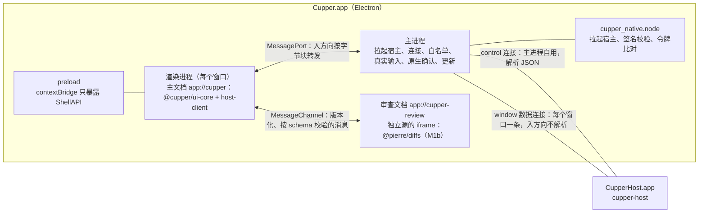

# 5.7 桌面端

- 所属：`docs/02-design.md` 第 5 节
- 依据：ADR-03（Electron + React 19 + TS、进程结构、安全加固）、ADR-05（UI 的认证）、ADR-01（拉起宿主、升级）；R01 第二、三、十三节；截图观察笔记（`docs/meetings/2026-10-16-prd-interview-2/codex-screenshot-notes.md`）；设计评审会（`docs/meetings/2026-10-16-design-review/`）
- 原则：桌面界面只是宿主的一个客户端，除协议外不读写会话数据，不调用 agent、git 或终端（NFR-1）；界面只负责排版和本地化（瘦客户端）

## 5.7.1 进程与连接



- **套接字和凭据永远不进渲染进程**（ADR-03）。所有到宿主的连接都由主进程持有。
- **两类连接**（Q1 定案，纪要 D1）：
  - `control` 连接：主进程自己用，量很小，主进程解析其中的 JSON。用于需要主进程判断或代为发送的操作：原生确认框的内容（`interaction/get`、`policy/describe`、`auth/elevation_get`、`project/trust_info`）、特权命令、退出前检查（`host/status`）、升级（`host/prepare_upgrade`）、通知点击后的 `ui/navigate`、通知的后备方案（下文 `notifications` 模块）。
  - `window` 数据连接：每个窗口一条，`initialize` 由主进程代发（角色 `window`），握手完成后才把端口交给渲染进程（安全 #4）。
  - 为什么不是"所有窗口共用一条连接"：主进程不解析入方向的 JSON，就无法把事件分给不同窗口；每个窗口一条连接，订阅、真实输入检查和流控都天然按窗口隔离。M1 只有一个窗口，所以就是两条连接；每条连接的签名校验约 1 ms。

**数据连接的生命周期**（桌面 #1）

| 情况 | 处理 |
|---|---|
| 绑定对象 | 数据连接绑定到窗口里**主文档的一个实例**，不绑定到窗口 |
| 主框架开始一次非同文档的导航（`did-start-navigation`）、`render-process-gone`、窗口 `closed` | 关闭这条数据连接，宿主上的订阅随之注销，主进程丢弃缓存的数据；清空这个窗口的输入记录和"已放行的 command_id"表（[5.7.8](#578-安全加固的落点)） |
| 新文档加载完成 | 渲染进程调用 `ShellAPI.host.open()`，主进程新建一条数据连接并握手，返回端口和握手结果（`limits`、`features`、`weak_auth`、宿主版本、`data_epoch`） |
| 宿主断开或重启 | 渲染进程显示"正在重新连接"；主进程先重连 control，再为每个窗口重连数据连接；新的握手结果经 `onConnectionState` 推给渲染进程，渲染进程按游标（含 `data_epoch`）重新订阅 |
| 关闭最后一个窗口 | 按 macOS 惯例 App 不退出；control 连接保留，宿主因此不会空闲退出；从 Dock 重新打开时新建窗口和数据连接 |
| 注销或关机（`powerMonitor` 的 `shutdown`） | 跳过 NFR-8 的退出确认框（确认框会挡住关机）；宿主自己处理系统发来的 SIGTERM，按有序退出把运行中的回合标为已中断 |

**转发**（桌面建议 #25、安全 #4）

- **入方向**（宿主 → 窗口）：主进程不切帧、不解析，按字节块转发，约每 16 ms 批量一次，每批用独立的 `ArrayBuffer`（不把 Node 的 Buffer 连同内存池一起复制）；渲染进程的 `host-client` 负责切帧（它本来就要处理 `0x02` 分片）。主进程仍然每次收到数据都比对宿主的令牌。
- **出方向**（窗口 → 宿主）：
  - `send(json)`：主进程 `JSON.parse`，拒绝数组（批量请求），按方法白名单检查，禁止 `initialize`；`interaction/respond`、`git/revert` 另做真实输入检查并写入 `input` 证据；然后**重新序列化**解析后的对象再发出，不转发原始字节（避免 JS 和 serde 对重复键的处理不同）。
  - `sendBlob(...)`：主进程组装 `0x02` 帧，检查头部和这个窗口的上传限额。
  - 其他帧类型一律拒绝。

**流控**（桌面 #2）：渲染进程收到数据就应用到 store，应用完立即确认已处理的字节数，只把"通知组件重新渲染"合并到动画帧。窗口被遮挡、页面变为 hidden、动画帧停止时，应用和确认照常进行，不会积压。某个窗口未确认的数据超过 8 MB 时，主进程暂停读这条连接；宿主那边该连接的发送队列超出 4 MiB 后重置这条流，窗口恢复后按游标重新订阅（ADR-03、ADR-04）。`backgroundThrottling` 保持默认值：确认不再依赖动画帧，不需要为此关闭节流。

**主进程转发的测量闸门**（纪要 D1、桌面 #14，M1a windowBridge 任务的验收项）

- **判定负载**按一个窗口的订阅上限定义：索引流 + 4 条会话流（当前会话加最近 3 个），加一个 5 MB 的 blob 传输和一次 5,000 个事件的重新同步。负载以线路上的帧数和字节数给出，即经过宿主 40 ms 写入合并之后：每条会话流每秒 25 帧、每帧约 2 KB；索引流每秒 5 帧、每帧约 1 KB。M1a 开工时按 SP-1 录制里观察到的最高速率复核这组数字。
- **负载的产生**：会话流的片段由假 agent 的 `flood_rate` 按速率产生，经宿主的写入合并后成为上述线路负载；重新同步用的 5,000 个事件由 `test/seed` 预先灌入（[5.9.2](09-testing.md#592-假-agent)、[5.9.9](09-testing.md#599-测试替身与注入点)）。
- **消费端**是真实的渲染进程（一个窗口经 MessagePort 接收并确认），不在主进程里打桩，因为 MessagePort 的序列化开销落在主进程上。窗口可见和被遮挡两种状态各测一次。
- **判定**：在参考机器上，主进程事件循环延迟（`monitorEventLoopDelay({resolution: 1})`）p99 < 5 ms，并且没有发生流重置。
- 6 条流、每秒 200 个片段的结果只作为压力报告，不参与判定。
- **不达标**：在 M1a 的界面任务之前按 ADR-03 改用"utilityProcess 宿主桥 + 委托票据"（草案见待定问题 Q33），同时修订 5.8.1 的签名要求表。测量放在 M1a，后备方案引入的协议改动也就落在契约冻结之前。

## 5.7.2 主进程模块

| 模块 | 职责 |
|---|---|
| `hostLauncher` | 经 `cupper_native` 调用 `cupper-sys::spawn` 拉起 `Contents/Helpers/CupperHost.app/Contents/MacOS/cupper-host`：`POSIX_SPAWN_SETSID`、`POSIX_SPAWN_CLOEXEC_DEFAULT`、环境变量白名单，与拉起适配器用同一套参数（桌面建议 #18）；开发和 e2e 构建经 stdin 写入启动载荷后立即关闭（[5.8.1](08-security.md#581-认证握手固定令牌)），把载荷留在内存里，宿主被杀后重新拉起时原样再传，发布构建不写载荷；连接重试总预算 500 ms；按退出码处理：3 改为直接连接，4 弹出"数据来自更新的版本"，5 提示数据目录不可用，6 提示迁移失败并给出备份位置；安装更新的空窗期间不自动拉起（[5.10.5](10-release.md#5105-更新流程)） |
| `hostConnection` | 用原生扩展建立并校验连接（返回 fd，再用 `new net.Socket({fd})` 包装，不依赖 Node 的私有 API）；每次收到数据都比对宿主的令牌；处理 `host/hello` 和 `initialize`；退化模式下校验 `host_proof`；发布构建遇到 `weak_auth: true` 拒绝连接 |
| `controlClient` | control 连接上的 JSON-RPC 客户端 |
| `windowBridge` | 每个窗口一个：数据连接的生命周期、入方向的字节块转发、出方向的解析与白名单、真实输入检查、流控 |
| `inputGuard` | 按 [5.7.8](#578-安全加固的落点) 的规则记录每个窗口主框架上的真实输入 |
| `privileged` | 执行 `ShellAPI.requestPrivileged`：检查真实输入 → 经 control 连接取内容 → 原生确认框 → 经 control 连接发送；同一时间只弹一个确认框，取消后的冷却逐次加长 |
| `security` | 注册 `app` 协议（`standard`、`secure`、`supportFetchAPI`、`codeCache`）并为 `cupper`、`cupper-review` 两个主机分别下发 CSP 响应头；路径规范化后检查前缀，防目录穿越；加固 webContents；发布构建按白名单检查命令行开关 |
| `lifecycle` | 单实例锁；退出前经 control 连接查 `host/status`，有运行中的回合或待处理的请求时弹原生确认框（NFR-8），确认后发 `host/exit`；关机和 `before-quit-for-update` 时跳过这一步 |
| `updater` | electron-updater 集成，见 [5.10.5](10-release.md#5105-更新流程) |
| `deeplink` | 按构建种类注册的 URL scheme（[5.7.9](#579-构建种类)），白名单路由，只做导航 |
| `notifications` | 只在通知的后备方案启用时工作（待定问题 Q2）：在 control 连接上订阅索引流，取出 `notification.intent` 弹系统通知；通知上不放"批准"按钮，点击后只导航 |
| `menu` | macOS 菜单和快捷键：加速键在菜单里注册，经 `onCommand` 送到渲染进程，焦点在审查文档里时同样生效 |
| `prefs` | 界面偏好，存在 userData（`cupper/ui/`） |
| `logging` | `main.log` 轮转；渲染进程的错误转写进主进程日志（脱敏） |

主进程的代码在调用时才经 `dialog.showMessageBox` 取函数，不在模块加载时解构保存，这样 e2e 才能在主进程里替换它（测试确认，写进 [5.1.7](01-repo-build-ci.md#517-代码约束gatedesign-通过后写进-claudemd)）。

## 5.7.3 ShellAPI

`@cupper/shell-api` 定义接口，`ui-core` 只依赖这个接口，为以后换外壳留余地（ADR-03）。preload 用 `contextBridge` 暴露 Electron 实现；浏览器 mock 实现用于 Playwright 的界面截图测试。这份接口在 M1a 冻结，之后只加成员（[5.12.5](12-milestones.md#5125-契约冻结清单)）。

```ts
interface ShellAPI {
  init(): Promise<ShellInfo>;                 // 启动时调用一次；静态信息一次取回，不用 sendSync
  host: {
    open(): Promise<{ port: HostPort; handshake: Handshake }>;
    onConnectionState(cb: (s: ConnectionState, handshake?: Handshake) => void): Unsubscribe;
  };
  requestPrivileged(action: PrivilegedAction): Promise<PrivilegedResult>;
  onCommand(cb: (cmd: ShellCommand) => void): Unsubscribe;     // 菜单加速键等
  onNavigate(cb: (target: NavigateTarget) => void): Unsubscribe; // 深链接、通知点击
  openExternal(url: string): void;            // 只接受 http/https，主进程再校验一次
  pickDirectory(): Promise<string | null>;    // 选择目录（如 worktree 根目录）
  pathForFile(file: File): string | null;     // 拖入文件生成 @ 引用（M1b，CP-2），用 webUtils.getPathForFile
  saveFile(name: string, data: ArrayBuffer): Promise<boolean>;   // 诊断包（P1）
  system: { onThemeChange(cb: (t: 'light' | 'dark') => void): Unsubscribe };
  window: { onFocusChange(cb: (focused: boolean, at: number) => void): Unsubscribe };
  prefs: { set(key: string, value: unknown): Promise<void>; onChange(cb): Unsubscribe };
  updates: { onState(cb: (s: UpdateState) => void): Unsubscribe; installNow(): void };
}
interface ShellInfo {
  shell: 'electron' | 'browser';
  flavor: 'release' | 'e2e' | 'dev';
  appVersion: string;
  locale: string;
  theme: 'light' | 'dark';
  prefs: Record<string, unknown>;             // 偏好的初始快照，之后走 onChange
  updateState: UpdateState;
  reviewDocumentUrl: string;                  // 审查文档的地址；浏览器 mock 下不同，ui-core 不写死
}
interface HostPort {
  send(json: string): void;
  sendBlob(hash: string, offset: number, last: boolean, bytes: ArrayBuffer): void;
  onData(cb: (chunk: ArrayBuffer) => void): Unsubscribe;          // 入方向的字节块，由 host-client 切帧
  ack(bytes: number): void;
  close(): void;
}
type ShellCommand = { id: 'new_session' | 'settings' | 'toggle_sidebar' | 'toggle_review'
  | 'interrupt' | 'next_needs_action' | 'prev_session' | 'next_session' | 'session_n'
  | 'archive' | 'rename' | 'model_picker' | 'open_in_terminal' | (string & {}); arg?: number };
type NavigateTarget = { kind: 'session'; session_id: string; request_id?: string }
  | { kind: 'settings'; section?: string } | { kind: (string & {}) };
type PrivilegedAction =
  | { kind: 'interaction'; session_id: string; request_id: string; option_id: string }
  | { kind: 'set_config'; session_id: string; option: string; value: string }
  | { kind: 'confirm_config'; session_id: string }
  | { kind: 'create_session'; params: SessionCreateParams }
  | { kind: 'add_project' }                   // 选目录、project/add、信任确认一次完成
  | { kind: 'trust_project'; project_id: string }
  | { kind: 'elevation'; elevation_id: string }
  | { kind: 'settings'; patch: SettingsPatch };
type PrivilegedResult =
  | { status: 'confirmed'; result?: unknown }  // create_session 带 session_id，add_project 带 project_id
  | { status: 'cancelled' } | { status: 'busy' } | { status: 'cooldown'; retry_after_ms: number }
  | { status: 'user_activation_required' } | { status: 'failed'; error: unknown };
```

- `ShellCommand.id` 是开放枚举，新加的命令不改接口；`ui-core` 遇到不认识的命令忽略。
- 权限处理器只放行 `clipboard-sanitized-write`（两个文档都放行，复制按钮依赖它），其余一律拒绝，包括 `clipboard-read`（桌面 #4）。
- 退出 App 时的确认（NFR-8）由主进程的 `lifecycle` 模块在 `before-quit` 时自己发起，不经过渲染进程。

## 5.7.4 窗口与布局

参照截图笔记和 R01（复刻布局和交互，不使用 OpenAI 的商标和素材，UI-6）。

```
┌──────────────────────────────────────────────────────────────────────────────────┐
│ ● ● ●  ◀ ▶  [侧栏]   项目 A / 修复登录 bug   cupper/fix-login  [弱认证] [打开▾] [审查] │  标题栏与窗口控件融合
├────────────────┬───────────────────────────────────────────┬─────────────────────┤
│ Cupper  [宿主状态]│ 会话区（内容居中，最大宽度取 token）          │ [审查]  ← 标签容器    │
│ [+ 新会话]      │                         [用户消息气泡]        │ 范围：最近一回合 ▾    │
│ 项目            │  ▸ 用时 1m 12s ─────────────────────        │ 文件列表（主文档）    │
│  项目 A     [+] │    已读取 auth.rs · 已运行 cargo test …     │ diff（审查文档）      │
│   (运行) 修 bug  │  助手正文（最终回答，Markdown，不加气泡）     │ [暂存][还原]         │
│   (待处理) 补测试│  ┌ 审批卡片 ────────────────────────┐       │ 待发送的评论 [发给 agent]│
│  项目 B [未信任] │  │ 运行命令：cargo test   Enter / Esc │       │ 提交信息 [提交] [推送]  │
│                │  └──────────────────────────────────┘       │                     │
│                │  排队 1 条                      [ ↓ ]        │                     │
│ [设置]          │  ┌ 输入框 ────────────────────────────┐     │                     │
│                │  │ [+] [权限模式▾]   …   [模型 推理强度▾] (↑)│     │                     │
│                │  └──────────────────────────────────┘     │                     │
└────────────────┴───────────────────────────────────────────┴─────────────────────┘
```

- **尺寸常量做成 token**（桌面建议 #21），取值以截图笔记为准：侧边栏约 170 pt，会话区内容最大宽度约 520 pt，卡片、气泡、输入框的圆角约 12–16 pt。偏离时在 token 旁写明理由；UI-6 的人工评审用同尺寸的窗口与截图并排比对。
- **三栏**（PS-1）：侧边栏、会话区、右侧工作区，侧边栏和右侧都可以隐藏。右侧做成标签容器，M1 只有"审查"一个标签（截图里浮起的圆角卡片是任务面板，属于 P1）。
- **侧边栏**：顶部保留标题行（先放产品名和宿主状态，P1 的入口以后加在这里）；不做左侧图标栏，M1 把设置放在侧边栏底部。
- **标题栏**：弱认证标记放在标题栏（ADR-05），设置页常驻说明；"打开"按钮（终端、编辑器、Finder，UI-0）。
- **会话状态**用颜色点区分（R01 第八节的语义）：运行中蓝色、需要处理琥珀色、完成未读绿色、出错红色、空闲不显示。未信任的项目在项目名旁标"未信任"。
- **新建会话页**：agent 选择（带可用状态）、项目选择、输入框；工作区（本地 / 新建 worktree）和起始分支放在输入框下方，按 Codex 的布局；模型、推理强度、权限模式和斜杠命令来自缓存的能力描述，第一条消息发出前就能显示（AG-4）；当前档位为 `elevated` 时加提示。
- **输入框**：权限模式按钮放在输入框内部的底部一行（截图笔记）；`+` 附件（图片）；右侧是运行状态、模型和推理强度、发送按钮。输入框上方是排队消息和"回到底部"按钮。
- **消息流**：
  - 用户消息靠右的浅灰气泡，长消息折叠；助手正文是 Markdown，不加气泡；
  - 每个回合一个"用时 …"标题；工具活动按 `group_id` 合并成一行摘要，可展开看命令输出、diff 和退出码（MS-3）；思考可折叠（MS-2）；计划和待办（MS-4）；错误和提示带恢复指引（MS-5）。
  - **回合折叠**（桌面 #8）：运行中展开；正常结束后收起过程，只留最终回答（`final_item_ids`，判定规则见 [5.3.5](03-protocol-v1.md#535-事件类型目录)）；失败或取消时不收起。始终显示在折叠之外的有：最终回答、`plan`、`error`、`notice`、`late_tool_output`、未处理的交互卡片、Steer 插进来的用户消息。`final_item_ids` 为空时只显示折叠标题。
  - **晚到的输出**：`late_tool_output` 默认折叠，标"取消后仍在运行"，显示命令和退出码，点击跳到原条目；原条目可见时，在它旁边显示"最终退出码 N"和跳转链接（数据来自视图的反向索引，[5.7.6](#576-状态管理)）。被中断的 Codex 回合里标了 `may_still_run` 的命令，立刻显示"命令可能仍在运行"。
- **审批和提问卡片**（AP-1、AP-5）：
  - 选项按 agent 原文显示，标出"会写入 agent 的权限规则""拒绝将结束本回合"等（AP-2）。
  - 命令和路径完整显示；内容标了 `content_truncated` 时显示"已截断"，展开看到全文后批准按钮才可用（安全 #6）。
  - agent 给出的文本里的双向控制符、零宽字符和其他控制字符一律显示成可见的转义（如 `\u202E`），与原生确认框共用一份转义工具。
  - `effect.scope` 为 `unknown` 的选项显示 agent 原文并标"效果未知"，不套用拒绝的样式，不响应 Enter 和 Esc（安全 #5）。
  - 卡片可见并获得焦点满 500 ms 后才响应键盘；窗口刚被激活的冷却期内按 Enter，卡片提示"请再按一次"，不弹错误 toast（[5.7.8](#578-安全加固的落点)）。
- **设置页**（UI-2）：通用、通知、外观、已归档会话、agent 状态（CLI 路径与版本、适配器版本、登录状态、运行时、配置目录的校验结果、资源占用、重启）、连接与设备（已连接的客户端、弱认证说明）、存储（各类数据的大小、"清除快照对象"）、"安装命令行工具"。

## 5.7.5 组件树

```
<App shell>                         ShellProvider、HostProvider、I18nProvider、ThemeProvider
├── <TitleBar/>                     导航、会话标题、分支、弱认证标记、"打开"、审查开关
├── <Sidebar>
│   ├── <SidebarHeader/>            产品名、宿主状态（待升级等）
│   ├── <NewSessionButton/>
│   ├── <ProjectList> <ProjectGroup trust/> <SessionRow status unread/> … </ProjectGroup> </ProjectList>
│   └── <SidebarFooter/>            设置、提权申请横幅
├── <Main>                          路由
│   ├── <NewSessionPage>  <AgentPicker/> <ProjectPicker/> <Composer mode="new"/> <WorkspacePicker/>
│   ├── <SessionPage>
│   │   ├── <SessionHeader/>        agent 标识、工作区、分支、状态、"未信任"或"配置待确认"的横幅
│   │   ├── <MessageStream>         TanStack Virtual，按行虚拟化；顶部"加载更早的历史"
│   │   │   └── 行：<TurnHeader status duration/> <UserMessage/> <ActivityGroupRow/>（展开后是 <ToolRow/>…）
│   │   │         <AgentMessage/> <Thought/> <Plan/> <Notice/> <ErrorItem/> <LateToolOutput/> <InteractionCard/>
│   │   ├── <QueueTray/>            排队消息、暂停原因、"继续发送"
│   │   └── <Composer/>             输入、@ 文件搜索、/ 命令菜单、图片、模式与模型选择、发送与中断
│   └── <Settings section/>
├── <WorkspaceTabs>                 右侧标签容器，M1 只有审查
│   └── <ReviewPanel> <ScopeSwitch/> <FileList/> <ReviewFrame/>（审查文档） <StageBar/> <PendingComments/> <CommitBox/>
└── <Toaster/>                      连接状态、更新提示、"已在别处处理"
```

`<InteractionCard>` 按请求类型分成 `ApprovalCard`、`QuestionCard`、`PlanConfirmCard`，不认识的类型显示占位并提示"请在桌面端处理"或"此版本不支持"。

### 审查文档（M1b）

结论：审查面板里的 diff 视图放进一个**单独源的 iframe**（`app://cupper-review/`），原样使用 @pierre/diffs 的组件；文件列表、暂存栏、待发送的评论、提交框留在主文档。理由和 Trusted Types 的取舍见 [5.7.8](#578-安全加固的落点)（纪要 D6）。

**隔离**

- `app` 协议注册为 `standard` 和 `secure`，`app://cupper` 与 `app://cupper-review` 是两个不同的源（安全确认 (ii)）。iframe 加 `sandbox="allow-scripts allow-same-origin"`（因为不同源，`allow-same-origin` 只保留它自己的源，Worker 和模块脚本才能正常加载），不给 popups、top-navigation、forms、modals；`allow="clipboard-write"`。
- preload 只在主框架运行（`nodeIntegrationInSubFrames` 保持默认的 false），审查文档里没有 ShellAPI，也没有 HostPort。
- 主进程用 `will-frame-navigate` 阻止它在首次加载之后的任何导航。

**消息协议**（版本化，两个方向都用 zod 校验）

- 建立：主文档创建 `MessageChannel`，在 iframe 加载后把一端连同 `{type: "init", v: 1}` 发给它。审查文档只接受来自 `app://cupper` 的第一个端口，之后忽略所有 `window` 上的 `message` 事件；主文档只接收创建时的那个端口上的消息（安全确认 (iii)）。
- iframe 是无状态的视图：评论草稿、文件的展开状态、当前文件和滚动位置都由主文档持有并下发；iframe 重载后重新 `init`，不丢草稿。

| 方向 | 消息 |
|---|---|
| 主文档 → 审查文档 | `init {v, theme, locale, strings, zoom}`；`theme_changed`、`locale_changed`；`render {diff_token, path, hunks, drafts, expanded}`；`scroll_to {path, line?}`；`clear` |
| 审查文档 → 主文档 | `ready {v}`；`need_file {path}`（懒加载）；`hunk_action {action: stage\|unstage\|revert, hunk_ids}`；`draft_comment {path, range, side, text}`；`key_forward {key, modifiers}` |

- 主文档按持有的 `diff_token` 校验 `hunk_ids`，暂存和取消暂存直接执行。
- **还原会丢掉用户的改动**：iframe 发来的 `revert` 只会在主文档里弹出一个确认控件（"还原这个 hunk？"），只有在主文档里点这个控件（主进程记录到的、主框架上的真实输入）才发出 `git/revert`，不能凭 iframe 的一条消息就执行（安全确认 (iii)）。
- 评论在 iframe 里只能写草稿；"发给 agent"的按钮在主文档里，发往 agent 的内容都经主文档的控件。

**桌面确认列出的 8 点**（纳入 Q29 的验证）

| # | 问题 | 做法 |
|---|---|---|
| 1 | 进程与内存：开启站点隔离时很可能成为进程外 iframe，多一个渲染进程和一份 React、pierre、Shiki | 首次打开后常驻（隐藏而不销毁），空闲时预加载；SP-6 的 5,000 行 diff 场景计入 iframe 的冷启动时间和内存 |
| 2 | 焦点与快捷键：焦点在 iframe 里时主文档收不到按键 | 全局快捷键一律注册为菜单加速键，经 `onCommand` 送达；iframe 只处理 Esc（关闭评论框）和 ⌘Enter（保存评论草稿），其余按键经 `key_forward` 转给主文档 |
| 3 | 真实输入被"借用" | inputGuard 只记录主框架获得焦点时的输入（[5.7.8](#578-安全加固的落点)）；`key_forward` 不算真实输入 |
| 4 | 主题、语言、字号的同步 | `init` 和 `theme_changed` 等消息下发主题覆盖、语言、文案和缩放比例；设计 token 打成一份 CSS，两个入口共用；字体用系统字体，不跨源加载随包字体 |
| 5 | 行内评论与 hunk 操作 | 见上面的消息协议：无状态视图、版本化、zod 校验、只发 `hunk_id` |
| 6 | 剪贴板 | iframe 加 `allow="clipboard-write"`；权限处理器对审查源同样只放行 `clipboard-sanitized-write` |
| 7 | 滚动联动 | 点击文件、从消息流的编辑条目跳转，都经 `scroll_to` 让 iframe 滚动；iframe 占满面板高度，只有一层滚动条 |
| 8 | 复刻度 | 原样使用 pierre，视觉和交互最接近 Codex，这是选这个方案的主要理由 |

**后备方案**：Q29 的验证不通过时，直接改用 pierre 导出的 `DiffHunksRenderer` 只生成 HAST，由我们在主文档里用 React 渲染。这样不需要任何 HTML 写入点，也不需要独立文档；代价是虚拟滚动和 hunk 交互要自己写。

## 5.7.6 状态管理

| 层 | 做法 |
|---|---|
| 连接 | `@cupper/host-client` 的连接状态机：`connecting → handshaking → ready → reconnecting`；断开后用同样的游标（含 `data_epoch`）重新订阅；收到 `mode: snapshot` 时丢弃这条流的视图和游标后重建（[5.3.3](03-protocol-v1.md#533-流与同步)）。暴露缺口、重置、重复的计数，供测试断言 |
| 流状态 | 每条已订阅的流一个 store：游标、视图（TS 版的 `IndexView`、`SessionView` reducer，与 Rust 视图用同一批金样例交叉验证，并做差分测试）。**消息到达即应用、应用后确认**，只有"通知组件重新渲染"合并到动画帧。视图是可变结构加版本号，组件用 `useSyncExternalStore` 按条目订阅，流式输出时只有正在变化的条目重新渲染；store 支持"因为别的条目而变化"，例如建立 `late_by_ref` 反向索引时，原条目所在的行要重新渲染 |
| 订阅策略 | 索引流常驻；当前会话加最近 3 个会话（LRU）保持订阅；其余会话退订，并丢弃视图，但保留它们的草稿和滚动位置（这两样是界面状态，不在视图里）。从通知或"下一个需要处理的会话"跳过去的会话通常不在 LRU 里，走缓存未命中的路径（桌面 #3） |
| 命令 | 命令客户端生成 UUIDv7 的 `command_id`；连接断开时保留未完成的命令，重连后用同一个 `command_id` 重发（NFR-2）。需要真实输入的命令，免输入重发的条件见 [5.7.8](#578-安全加固的落点) |
| 查询 | TanStack Query 管理请求-响应类的数据（`git/*`、`files/search`、`agents/capabilities`、`session/list_archived`）；收到相关事件时失效（例如 `turn.completed` 使该会话的 diff 失效） |
| 界面状态 | zustand：选中的会话、面板开合与尺寸、每个会话的输入草稿和滚动位置、评论草稿（存 prefs，不跨设备同步） |
| 长会话 | **按行虚拟化**（桌面 #12）：把回合标题、活动组摘要、消息、卡片、提示拍平成一个行列表，活动组折叠时只占一行。内存里只有快照窗口加已翻页的历史。两条滚动规则：向前插入历史后视口不跳动（以视口顶部的行为锚点）；流式增长时贴底，用户向上滚动后停止贴底并显示 ↓ 按钮。Shiki 懒加载，代码块完成后再高亮；diff 的高亮在审查文档的 Worker 里 |
| 校验 | 开发和测试构建对每条消息做 zod 校验；生产构建只校验非 delta 的事件（技术选型讨论会桌面工程师意见） |

M1a 的消息流、store、订阅策略、HostPort 生命周期都按这里的最终形态实现，视觉从简（[5.12.2](12-milestones.md#5122-m1a宿主骨架)）。

## 5.7.7 快捷键、本地化与主题

**快捷键**（UI-4 的核心子集；带 ⌘ 的在菜单里注册，经 `onCommand` 送达，焦点在审查文档里时同样生效）

| 动作 | 快捷键 |
|---|---|
| 新建会话 | ⌘N |
| 设置 | ⌘, |
| 切换侧边栏 / 审查面板 | ⌘B / ⌃⇧G |
| 发送 | Enter 或 ⌘Enter（设置里选，另一个用于换行）；输入法组合过程中按 Enter 不发送（CP-1） |
| 恢复上一条 | ↑（输入框为空时） |
| 中断当前回合 | ⌘. |
| 批准 / 拒绝 | Enter / Esc：焦点在卡片上，卡片出现满 500 ms，并且主进程记录到了真实输入（[5.7.8](#578-安全加固的落点)）；Esc 只用于拒绝类选项 |
| 下一个需要处理的会话 | ⌘⌥A |
| 上一个 / 下一个会话 | ⌃⇧Tab / ⌃Tab |
| 第 1–9 个会话 | ⌘1–⌘9 |
| 归档 / 重命名 | ⌘⇧A / ⌘⌥R |
| 模型选择器 | ⌃⇧M |
| 在终端中打开工作区（UI-0） | ⌘⌥T |

P1 再加：⌘K 命令菜单、⌘[ / ⌘] 前进后退、⇧Esc 清除未读、⌘F 会话内查找。

**本地化**（UI-5）：`@cupper/i18n` 基于 i18next，zh-CN 和 en 两套文案，跟随系统语言（主进程用 `app.getPreferredSystemLanguages()` 取得，设置里可覆盖）；日期、时长、数字用 `Intl`。宿主下发的语义码（工具类型、错误码、提示码、恢复指引）在这里映射成文案，例如 `{tool_kind: read, paths: [a.rs]}` 显示为"已读取 a.rs"。主进程的原生确认框和审查文档用同一份文案。**从 M1a 第一天起所有文案都走 i18n 的键**，M1a 只做一种语言。

**主题**（UI-3）：CSS 变量定义亮色和暗色两套 token（背景、前景、次要文字、强调色、五种状态色），打成一份 CSS 供主文档和审查文档共用；默认跟随系统（`nativeTheme.themeSource = 'system'`），设置里可固定；Shiki 用双主题。字体用系统字体（SF Pro、苹方），代码用 SF Mono。视觉参照截图笔记：大圆角、极少边框、浅灰侧边栏。

## 5.7.8 安全加固的落点

| 项 | 落点 | 验证方式 |
|---|---|---|
| Fuses | electron-builder 的 `electronFuses`：关闭 `runAsNode`、`enableNodeOptionsEnvironmentVariable`、`enableNodeCliInspectArguments`（e2e 构建保留）、`grantFileProtocolExtraPrivileges`、`loadBrowserProcessSpecificV8Snapshot`；打开 `enableEmbeddedAsarIntegrityValidation`、`onlyLoadAppFromAsar`、`enableCookieEncryption`（e2e 构建和自用构建关闭，[5.7.9](#579-构建种类)） | CI 对产物运行 `@electron/fuses read` 逐项断言；断言 Info.plist 里有 `ElectronAsarIntegrity`，`asarUnpack` 只有 `cupper_native.node` |
| 命令行开关 | 发布构建启动时按白名单检查命令行开关，出现任何不在白名单里的开关（含 `--inspect*`、`--remote-debugging-*`、`--js-flags`、`--no-sandbox`、`--disable-web-security`、`--user-data-dir`、`--proxy-server` 等）就退出；发布构建不开 DevTools（安全建议 #17） | e2e（发布配置的构建）：带未知开关启动，进程应立即退出 |
| webPreferences | `sandbox`、`contextIsolation` 为 true；`nodeIntegration`、`nodeIntegrationInWorker`、`nodeIntegrationInSubFrames`、`webviewTag`、`allowRunningInsecureContent`、`experimentalFeatures`、`navigateOnDragDrop` 为 false；窗口的 `acceptFirstMouse` 保持默认的 false | 单元测试检查窗口创建参数 |
| 加载方式 | 主文档只从 `app://cupper/` 加载，审查文档只从 `app://cupper-review/` 加载（`protocol.handle` 读取 asar，每个主机一个文件根目录，路径规范化后检查前缀）；不用 `file://`，**不从远端加载渲染层**（ADR-03） | e2e 检查两个文档的 `location.origin`；单元测试：`..`、编码后的 `%2e%2e` 等路径被拒 |
| 主文档的 CSP | `default-src 'none'; script-src 'self'; style-src 'self' 'unsafe-inline'; img-src 'self' blob: data:; font-src 'self'; worker-src 'self'; connect-src 'none'; frame-src app://cupper-review; object-src 'none'; base-uri 'none'; form-action 'none'; frame-ancestors 'none'; require-trusted-types-for 'script'; trusted-types cupper-worker` | e2e：注入内联脚本应被拦截并上报；发布 CSP 下渲染全部组件，`securitypolicyviolation` 事件数为 0（M1a 验收） |
| Trusted Types（纪要 D6） | 主文档**禁止 `default` 策略**，只有一个具名策略 `cupper-worker`，它的 `createScriptURL` 只放行 `app://cupper/assets/` 下的同源脚本；不写 `'allow-duplicates'`。ESLint 规则：只允许在 `ui-core/src/security/policies.ts` 里调用 `trustedTypes.createPolicy`，禁止名为 `default` 的策略 | CI（ESLint）；e2e：创建名为 `default` 的策略应失败 |
| 样式 | 主文档放行 `style-src 'unsafe-inline'`（Radix 经 react-style-singleton 动态插入 `<style>`）。样式不能执行脚本，`img-src`、`font-src`、`connect-src` 已经堵住经 CSS 外发数据的通道。条件：**agent 给出的字符串不能进入 `<style>` 的文本、`insertRule` 或 CSS 自定义属性**，例如 ANSI 颜色只能映射到固定的 class，否则 CSS 注入可以伪装或遮挡审批卡片上的按钮 | ESLint 规则；金样例：含 ANSI 序列和 CSS 片段的输出 |
| 审查文档的 CSP | `default-src 'none'; script-src 'self'; worker-src 'self'; style-src 'self' 'unsafe-inline'; img-src 'self' data:; font-src 'self'; connect-src 'none'; base-uri 'none'; form-action 'none'; frame-ancestors app://cupper`。**不启用 `require-trusted-types-for`**：@pierre/diffs 在 15 处以上把字符串直接写进 shadow root（已核对 1.5.2 的源码），默认策略区分不了调用方。防线是严格的 `script-src`（注入的脚本和内联事件处理器都不会执行）、跨源隔离、窄的消息协议（[5.7.5](#审查文档m1b)）。Worker 经 pierre 的 `workerFactory` 选项由我们构造；高亮器固定为 `preferredHighlighter: "shiki-js"`，不需要 wasm | 见下一行的三条测试 |
| 审查文档的注入防护（纪要 D6，安全确认 (i)–(iii)） | (i) 文件内容、文件名、行内评论里出现 `<style>`、``、`<a>`、`<base>`、`<link>`、`<meta>` 时都按文本显示；(ii) `app` 协议注册为 standard 和 secure；(iii) 只接收创建时那个 MessagePort 上的消息并按 schema 校验，`git/revert` 只能由主文档的控件触发 | (i) 金样例：DOM 里不能出现这些元素；(ii) e2e：两个文档的 origin 不同，iframe 访问 `parent.document` 会抛错；(iii) e2e：从别的端口或 `window.postMessage` 发来的消息被忽略，iframe 发来的 `revert` 不会直接执行 |
| Markdown 与不可信内容 | streamdown 关闭 rehype-raw（不渲染原始 HTML），再做白名单清洗；harden 只放行 `http`、`https` 链接，不放行任何图片前缀，不允许 data 图片，agent 输出里的远程图片显示为链接（桌面 #6）；Mermaid（P1）不用 `srcdoc`，改用与审查文档相同的独立源文档 | 金样例：含 `<script>`、``、`javascript:` 链接、远程图片的消息，渲染后不执行、不加载 |
| 导航与新窗口 | `will-navigate`、`will-redirect`、`will-frame-navigate` 一律阻止（审查文档的首次加载除外）；`setWindowOpenHandler` 一律拒绝；链接经 `ShellAPI.openExternal`，主进程只放行 http、https | e2e |
| 权限请求 | `setPermissionRequestHandler`、`setPermissionCheckHandler`、`setDevicePermissionHandler` 只放行 `clipboard-sanitized-write`，其余一律拒绝 | 单元测试 |
| 命令白名单 | `windowBridge` 出方向只放行 scope 为 `read`、`write`、`approve`、`ui_local` 的方法（清单由协议常量生成）；`privileged`、`test` 方法、`initialize` 和未知方法在本地直接拒绝；拒绝 JSON-RPC 批量数组；转发重新序列化后的对象；只放行 0x01、0x02 帧。宿主再按 window 角色检查一遍（安全 #4） | 单元测试遍历全部方法；mock 宿主的帧级测试 |
| 真实输入 | 见下文 | 见下文 |
| 原生确认框 | ADR-03 列出的操作：切到完全访问、选 `allow_always` 类选项、批准 CLI 提权；另加：信任项目（[5.2.6](02-host.md#项目信任)）、确认会话档位（`config_unconfirmed`）、修改安全相关的设置、有运行中回合时退出、M3 的配对与撤销。确认框的内容由主进程经 control 连接从宿主获取；agent 给出的文本逐字显示，不可见字符显示为转义；默认按钮是"取消"或"拒绝"；持久选项的文案规则见 [5.3.6](03-protocol-v1.md#536-交互请求模型) | e2e：渲染进程无法绕过确认框发出这些命令；替换函数记录调用参数，断言确认框里显示的操作描述 |
| 其他入口 | 深链接只做导航，参数只接受符合格式的 ID；`open-url`、`second-instance`、`open-file`、通知点击同样只做导航，**不把焦点移到交互卡片上**；不提供 AppleScript 字典，不注册 Services 菜单；拖放只往输入框里插入内容 | 单元测试 |
| 通知 | M1 的系统通知上不放"批准"按钮；点击后按 bundle id 打开 Cupper，不走通用的 URL 路由（[5.2.9](02-host.md#529-关注度与通知)） | — |
| 宿主校验失败 | 不向宿主发送任何命令，显示"无法验证宿主"，提供"重启宿主"（ADR-01 的 SP-4b 修订） | e2e：用假宿主占用套接字（e2e 构建靠 dev_key 的双向证明识别假宿主，[5.8.1](08-security.md#581-认证握手固定令牌)） |
| 代码规则 | ESLint 禁止 `innerHTML`、`dangerouslySetInnerHTML`、`insertAdjacentHTML`、`eval`、`new Function`、`window.open`；`ui-core` 禁止 import `electron` 和 `node:*`；上面的 Trusted Types 和样式规则 | CI |

**真实输入**（ADR-03；评审统一方案 (c)，纪要 D7）

规则：

1. **识别用的事件**：
   - 键盘用 `before-input-event`，只认 `type: keyDown`；它带 `key`、`isComposing`、`isAutoRepeat`、modifiers。不用 `input-event` 识别键盘：Electron 44 的类型定义里它只有 `type` 和 `modifiers`（运行时其实带了键码，待定问题 Q26 确认，留作后备）。
   - 鼠标用 `input-event` 里同一按钮的 `mouseDown` 接 `mouseUp`，间隔不超过 1 s，记在 `mouseUp` 的时刻。
   - **只记录主框架获得焦点时的输入**：键盘事件发生时 `webContents.focusedFrame` 必须是主框架；鼠标在 `mouseUp` 时检查同一件事。焦点在审查文档里时的按键和点击一律不记。
   - 主进程为每个窗口记录 `lastInput {kind, key?, at, consumed}`。
2. **算真实输入的按键**：Enter（含小键盘 Enter）、Space、Escape、⌘Enter。要求 `isComposing` 和 `isAutoRepeat` 都为 false；除 ⌘Enter 外不能带 ⌘、⌃、⌥。
3. **打字中的按键不算**：前 1 秒内按过打字键（白名单以外的键）时，紧接着的 Enter 或 Space 不记作真实输入（⌘Enter 除外）。按下打字键时，清掉尚未用掉的输入。
4. **一次输入只能用一次**：这个窗口发出的**任何一条**出方向命令都会用掉尚未消耗的输入；需要真实输入的命令（`interaction/respond`、`git/revert`、`requestPrivileged`）要求有一个不超过 1 秒、尚未用掉的输入。主进程转发时把证据写进 `input: {kind, key?}`，覆盖渲染进程自己填的值。
5. **Esc 和拒绝类选项**：所有 `interaction/respond` 都要求真实输入，Esc 在白名单里。宿主检查 `input.key` 为 `escape` 时只能用于 `dismissed`，或 `effect.scope` 为 `reject`、`plan_revise` 的选项；window 角色发来的 `respond` 和 `revert` 缺少 `input` 时一律拒绝（[5.2.5](02-host.md#525-策略与命令账本)）。`effect.scope` 为 `unknown` 的选项是 privileged，只能走原生确认，键盘无效。
6. **输入法上屏**：`isComposing` 为真的按键一律不记录，包括用 Enter 选词。渲染进程的输入框同样以 `isComposing` 或 keyCode 229 判断不发送（CP-1）。
7. **窗口刚被激活后的冷却**：窗口 `focus` 之后 1,000 ms 内的键盘输入不记录；`focus` 和 `blur` 时清空记录；激活窗口的那次点击按 macOS 默认不送到页面。深链接、`open-url`、`second-instance`、通知点击只做导航，不把焦点移到卡片上。卡片可见并获得焦点满 500 ms 后才响应（渲染进程）；宿主的 400 ms 兜底不变。冷却期内按 Enter 得到 `user_activation_required` 时，卡片提示"请再按一次"；`window.onFocusChange` 带上获得焦点的时间，卡片可以等冷却结束再接受 Enter。
8. **`requestPrivileged`**：同样要求真实输入（Esc 不能触发特权操作）；同一时间只弹一个原生确认框，其他请求返回 `busy`；用户取消后，同一类操作的冷却时间逐次加长：2 s、10 s、60 s，冷却期内返回 `cooldown`；一次确认或连续 10 分钟没有取消后重新计数。NFR-8 的退出确认由主进程自己发起，不受这些限制。
9. **用同一个 `command_id` 重发**：主进程按窗口记录"已放行的 `command_id` → 参数哈希"。只有在上次转发后**没有收到宿主的任何响应**（连接断了）时，同一个 `command_id`、参数哈希也相同的重发才不要求新的输入；收到任何响应（包括 `too_early` 这样的错误）后立即删除这条记录；窗口的文档实例变化时清空。

测试（Playwright，桌面 #13、测试 #13 与确认）：

- 点击用 `page.click()`，它会产生 `input-event`（Q26 一并确认）。
- 按键用 e2e 辅助函数，经 `electronApp.evaluate` 在主进程里调用 `webContents.sendInputEvent({type: 'keyDown', keyCode: 'Return'})`。测试工程师在 Electron 34 上实测：它会触发 `before-input-event`，页面收到的 keydown 是 `isTrusted: true`。按键白名单、"一次输入只能用一次"、冷却、"Esc 只能用于拒绝"和整条链路，在 e2e 里走的都是生产代码；生产代码里没有任何测试分支。
- 自动用例断言 inputGuard 记录的输入证据来自 `before-input-event`，Electron 升级改变了这个行为时 CI 先报出来。
- 负面用例：页面脚本直接经 HostPort 发送应被拒绝（`user_activation_required`）；发送之前先让上一次输入被用掉，或者等超过 1 秒。
- 冷却：主进程执行 `win.blur(); win.focus()` 后立即发 Enter 应被拒，1.2 s 后再发应成功。inputGuard 的时间来自可注入的时钟，时序规则另用 Vitest 的假时钟做单元测试。
- 输入法：给 inputGuard 喂 `isComposing: true` 的 Input 对象（Vitest），再加组件测试（测试建议 #26）。
- 实体键盘：Playwright 和 `sendInputEvent` 都不经过系统的按键事件，所以**每次升级 Electron 大版本**，都按人工验证清单用实体键盘确认三件事：Enter 批准、Esc 拒绝、用输入法选词时不触发（[5.9.10](09-testing.md#5910-测试编号与人工验证清单)）。

## 5.7.9 构建种类

bundle identifier 的前缀定为 `dev.cupper`（Q5，已定（2026-10-16），见 `docs/meetings/2026-10-16-gate-design-decisions/minutes.md`）。它会写进签名要求、TCC 和通知身份；M1b 首次签名发布前可以无成本修改，之后不再改。

| | 发布构建 | 自用构建 | e2e 构建 | 开发构建 |
|---|---|---|---|---|
| 用途 | 正式发布（推迟到用户开通 Apple Developer Program 之后，见 5.12.3） | 作者日常使用的本机构建，在真实项目上运行真实 agent | 端到端测试 | `pnpm dev` |
| UI 的 bundle id | `dev.cupper.app` | `dev.cupper.app.local` | `dev.cupper.app.e2e` | `dev.cupper.app.dev` |
| 宿主的 bundle id | `dev.cupper.app.host` | `dev.cupper.app.local.host` | `dev.cupper.app.e2e.host` | `dev.cupper.app.dev.host` |
| CLI 的 identifier | `dev.cupper.cli` | `dev.cupper.cli.local` | `dev.cupper.cli.e2e` | `dev.cupper.cli.dev` |
| URL scheme | `cupper://` | `cupper-local://` | `cupper-e2e://` | `cupper-dev://` |
| 显示名称 | Cupper | Cupper Local | Cupper E2E | cupper Dev |
| 宿主认证 | `codesign`（Developer ID 要求，只认发布版 UI）；不带 `dev-auth`、`test-harness` | `dev_key`（宿主开 `dev-auth`、不开 `test-harness`），界面提示"本地鉴权较弱"；Q35 通过后改为本机签名的 `codesign` 认证，身份和数据目录不变 | `dev_key`；另开 `test-harness`，供测试中的 CLI 使用 | `dev_key`，界面提示"本地鉴权较弱" |
| Fuses | 全部按上表 | 同发布构建，只关闭 `enableCookieEncryption`（界面不使用 cookie，`connect-src 'none'`；ad-hoc 签名下每次替换 App 都会触发钥匙串提示；P02 第 2 轮，编排者裁定） | 同发布，只保留 `enableNodeCliInspectArguments`（Playwright 需要），关闭 `enableCookieEncryption`（ad-hoc 签名下可能触发钥匙串提示） | 不烧录 |
| 数据目录 | `cupper/` | `cupper-local/`（userData 在其下的 `ui/`）；worktree 根目录也单独一个，默认 `~/.cupper-local/worktrees/` | 每个用例一个临时目录（[5.9.9](09-testing.md#599-测试替身与注入点)） | `cupper-dev/` |
| 签名 | Developer ID + 公证，开启 hardened runtime | ad-hoc，**开启 hardened runtime**；entitlements 在发布构建的基础上只多 `com.apple.security.cs.disable-library-validation`，不带 `get-task-allow`、`allow-dyld-environment-variables`（关闭 hardened runtime 时，同一用户的进程可以用 `DYLD_INSERT_LIBRARIES` 向主进程注入代码） | ad-hoc，**关闭 hardened runtime**（ad-hoc 签名加 hardened runtime 需要 `disable-library-validation`，app-builder-lib 源码有警告） | ad-hoc |
| 更新 | GitHub Releases | 无；手动替换 App，旧宿主经自检进入"待升级"（[5.5.7](05-flows.md#557-升级)） | 无 | 无 |
| 测试钩子 | 不存在：由 Vite `define` 的编译期常量 `__CUPPER_FLAVOR__` 门控，发布产物扫描钩子的标记串（[5.10.7](10-release.md#5107-发布流水线)） | 不存在（同发布构建；`release-config` 每晚也扫描它的产物） | 有 | 有 |

- 宿主按构建种类使用对应的 URL scheme，同时装了发布版和开发版时，通知不会打开错误的 App（桌面建议 #23）。
- 依赖 hardened runtime、codesign 认证、动态状态字的检查只能在发布构建上验证，由签名后的冒烟测试覆盖（[5.10.7](10-release.md#5107-发布流水线)）；5.9.4 的每条安全 e2e 都标明在哪种构建上跑。
- 用户自行构建（没有 Team ID）时，按开发构建的身份和数据目录运行，宿主走退化认证并提示（ADR-05，Q22）。
- **自用构建**（v1.2 新增，见 [5.12.3](12-milestones.md#5123-m1b桌面-mvp)）单独一套身份、数据目录、userData、worktree 根目录和 URL scheme，可以与开发构建同时运行、互不干扰：开发构建抢不到它的 `host.lock`，也读不到它的数据。开发构建和测试只用临时目录或 `cupper-dev/`，不在真实项目上运行真实 agent。
