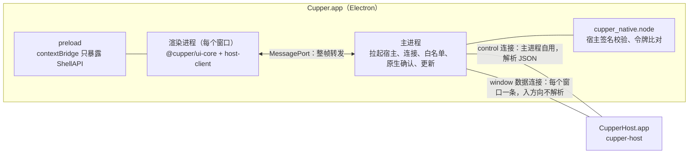

# 5.7 桌面端

- 所属：`docs/02-design.md` 第 5 节
- 依据：ADR-03（Electron + React 19 + TS、进程结构、安全加固）、ADR-05（UI 的认证）、ADR-01（拉起宿主、升级）；R01 第二、三、十三节；截图观察笔记（`docs/meetings/2026-10-16-prd-interview-2/codex-screenshot-notes.md`）
- 原则：桌面界面只是宿主的一个客户端，除协议外不读写会话数据，不调用 agent、git 或终端（NFR-1）；界面只负责排版和本地化（瘦客户端）

## 5.7.1 进程与连接



- **套接字和凭据永远不进渲染进程**（ADR-03）。所有到宿主的连接都由主进程持有。
- **两类连接**（对 ADR-03 的细化，见待定问题 Q1）：
  - `control` 连接：主进程自己用，量很小，主进程解析其中的 JSON。用于需要主进程判断或代为发送的操作：原生确认框的内容（`interaction/get`、`policy/describe`、`auth/elevation_get`）、特权命令、退出前检查（`host/status`）、升级（`host/prepare_upgrade`）。
  - `window` 数据连接：每个窗口一条。入方向（宿主 → 窗口）主进程只按长度前缀切帧，不解析 JSON，约每 16 ms 批量转发；出方向（窗口 → 宿主）主进程解析 JSON，做方法白名单和真实输入检查。
  - 为什么不是"所有窗口共用一条连接"：主进程不解析入方向的 JSON，就无法把事件分给不同窗口；每个窗口一条连接，订阅关系天然清楚。M1 只有一个窗口，所以就是两条连接；每条连接的签名校验约 1 ms。
- **流控**：渲染进程每处理完一批就回一个确认。某个窗口未确认的数据超过 8 MB 时，主进程暂停读这条连接；宿主那边该连接的发送队列超出预算后重置这条流，窗口恢复后按游标重新订阅（ADR-03、ADR-04）。
- **宿主断开**：主进程通知渲染进程"正在重新连接"，按 [5.5.6](05-flows.md#556-崩溃恢复) 重连或重新拉起宿主。
- SP-6 测得主进程事件循环延迟 p99 超过 5 ms 时，按 ADR-03 改用"utilityProcess 宿主桥 + 委托票据"。

## 5.7.2 主进程模块

| 模块 | 职责 |
|---|---|
| `hostLauncher` | 定位 `Contents/Helpers/CupperHost.app/Contents/MacOS/cupper-host`；`child_process.spawn` 加 `detached: true`（即 setsid）拉起；开发和 e2e 构建经 stdin 传一次性密钥后立即关闭 stdin；连接重试总预算 500 ms；按退出码处理：3 改为直接连接，4 弹出"数据来自更新的版本"，5 提示数据目录不可用 |
| `hostConnection` | 用原生扩展建立并校验连接（返回 fd，再用 `new net.Socket({fd})` 包装，不依赖 Node 的私有 API）；每次收到数据都比对宿主的令牌；处理 `host/hello` 和 `initialize` |
| `controlClient` | control 连接上的 JSON-RPC 客户端 |
| `windowBridge` | 每个窗口一个：数据连接、MessagePort、出方向白名单和真实输入检查、入方向批量转发和流控 |
| `inputGuard` | 用 `before-input-event`（键盘）和 `input-event`（鼠标）记录每个窗口最近一次真实输入的时间和类型 |
| `privileged` | 执行 `ShellAPI.requestPrivileged`：经 control 连接取内容 → 原生确认框 → 经 control 连接发送 |
| `security` | 注册 `app://` 协议并加 CSP 响应头；加固 webContents；检查启动参数 |
| `lifecycle` | 单实例锁；退出前经 control 连接查 `host/status`，有运行中的回合或待处理的请求时弹原生确认框（NFR-8），确认后发 `host/exit` |
| `updater` | electron-updater 集成，见 [5.10.5](10-release.md#5105-更新流程) |
| `deeplink` | `cupper://` 白名单路由，只做导航 |
| `menu` | macOS 菜单和快捷键（加速键在菜单里注册，转成渲染进程的命令） |
| `prefs` | 界面偏好，存在 userData（`cupper/ui/`） |
| `logging` | `main.log` 轮转；渲染进程的错误转写进主进程日志（脱敏） |

## 5.7.3 ShellAPI

`@cupper/shell-api` 定义接口，`ui-core` 只依赖这个接口，为以后换外壳留余地（ADR-03）。preload 用 `contextBridge` 暴露 Electron 实现；浏览器 mock 实现用于 Playwright 的界面截图测试。

```ts
interface ShellAPI {
  host: {
    open(): HostPort;                         // send(json: string)、onFrames(cb)、ack()
    onConnectionState(cb: (s: ConnectionState) => void): Unsubscribe;
  };
  requestPrivileged(action: PrivilegedAction): Promise<'confirmed' | 'cancelled' | 'failed'>;
  openExternal(url: string): void;            // 只接受 http/https，主进程再校验一次
  pickDirectory(): Promise<string | null>;    // 添加项目
  saveFile(name: string, data: ArrayBuffer): Promise<boolean>;   // 诊断包（P1）
  system: { locale(): string; theme(): 'light' | 'dark'; onThemeChange(cb): Unsubscribe };
  window: { onFocusChange(cb: (focused: boolean) => void): Unsubscribe };
  prefs: { get<T>(key: string): T | undefined; set(key: string, value: unknown): void };
  updates: { state(): UpdateState; onState(cb): Unsubscribe; installNow(): void };
  platform: { shell: 'electron' | 'browser'; flavor: 'release' | 'e2e' | 'dev'; appVersion: string };
}
type PrivilegedAction =
  | { kind: 'interaction'; session_id: string; request_id: string; option_id: string }
  | { kind: 'set_config'; session_id: string; option: string; value: string }
  | { kind: 'create_session'; params: SessionCreateParams }
  | { kind: 'elevation'; elevation_id: string }
  | { kind: 'settings'; patch: SettingsPatch }
  | { kind: 'quit' };
```

## 5.7.4 窗口与布局

参照截图笔记和 R01（复刻布局和交互，不使用 OpenAI 的商标和素材，UI-6）。

```
┌──────────────────────────────────────────────────────────────────────────────┐
│ ● ● ●  ◀ ▶  [侧栏]   [文件夹] 项目 A / 修复登录 bug   cupper/fix-login   … [审查] │  标题栏与窗口控件融合
├────────────────┬───────────────────────────────────────────┬─────────────────┤
│ 侧边栏（约 260） │ 会话区（内容最大宽度约 760，居中）            │ 审查面板（可隐藏） │
│ [+ 新会话]      │                         [用户消息气泡]        │ 范围：最近一回合 ▾ │
│ 项目            │  ▸ 用时 1m 12s ─────────────────────        │ 文件列表          │
│  项目 A     [+] │    已读取 auth.rs · 已运行 cargo test …     │ diff + 行内评论    │
│   (运行) 修 bug  │  助手正文（Markdown，不加气泡）              │ [暂存][还原]       │
│   (待处理) 补测试│  ┌ 审批卡片 ────────────────────────┐       │ 提交信息           │
│  项目 B         │  │ 运行命令：cargo test   Enter / Esc │       │ [提交] [推送]      │
│                │  └──────────────────────────────────┘       │                 │
│                │  排队 1 条                      [ ↓ ]        │                 │
│ [设置] [弱认证]  │  ┌ 输入框 ────────────────────────────┐     │                 │
│                │  │ [+] [权限模式▾]   …   [模型 推理强度▾] (↑)│     │                 │
│                │  └──────────────────────────────────┘     │                 │
└────────────────┴───────────────────────────────────────────┴─────────────────┘
```

- **三栏**（PS-1）：侧边栏、会话区、右侧工作区，侧边栏和右侧都可以隐藏。M1 的右侧只有审查面板，用占满高度、可调宽度的面板（截图里浮起的圆角卡片是任务面板，属于 P1）。
- **不做左侧图标栏**：截图里的图标栏收纳的是 P1、P2 的入口（技能、定时任务等），M1 把设置放在侧边栏底部。
- **会话状态**用颜色点区分（R01 第八节的语义）：运行中蓝色、需要处理琥珀色、完成未读绿色、出错红色、空闲不显示。
- **新建会话页**：agent 选择（带可用状态）、项目选择、工作区选择（本地 / 新建 worktree 加起始分支）、输入框；模型、推理强度、权限模式和斜杠命令来自缓存的能力描述，第一条消息发出前就能显示（AG-4）。
- **输入框**：权限模式按钮放在输入框内部的底部一行（截图笔记）；`+` 附件（图片）；右侧是运行状态、模型和推理强度、发送按钮。输入框上方是排队消息和"回到底部"按钮。
- **消息流**：用户消息靠右的浅灰气泡，长消息折叠；每个回合一个可折叠的"用时 …"标题；工具活动按 `group_id` 合并成一行摘要，可展开看命令输出、diff 和退出码（MS-3）；思考可折叠（MS-2）；计划和待办（MS-4）；错误和提示带恢复指引（MS-5）；审批和提问卡片（AP-1、AP-5），选项上标出"会写入 agent 的权限规则""拒绝将结束本回合"等（AP-2）。
- **设置页**（UI-2）：通用、通知、外观、已归档会话、agent 状态（CLI 路径与版本、适配器版本、登录状态、运行时、资源占用、重启）、连接与设备（已连接的客户端、弱认证说明）。

## 5.7.5 组件树

```
<App shell>                         ShellProvider、HostProvider、I18nProvider、ThemeProvider
├── <TitleBar/>                     导航、会话标题、分支、审查开关
├── <Sidebar>
│   ├── <NewSessionButton/>
│   ├── <ProjectList> <ProjectGroup> <SessionRow status unread/> … </ProjectGroup> </ProjectList>
│   └── <SidebarFooter/>            设置、弱认证标记、宿主状态（待升级等）、提权申请横幅
├── <Main>                          路由
│   ├── <NewSessionPage>  <AgentPicker/> <ProjectPicker/> <WorkspacePicker/> <Composer mode="new"/>
│   ├── <SessionPage>
│   │   ├── <SessionHeader/>        agent 标识、工作区、分支、状态
│   │   ├── <MessageStream>         TanStack Virtual，按回合虚拟化；顶部"加载更早的历史"
│   │   │   └── <Turn> <UserMessage/> <TurnHeader duration/> <ActivityGroup><ToolRow/>…</ActivityGroup>
│   │   │             <AgentMessage/> <Thought/> <Plan/> <Notice/> <ErrorItem/> <InteractionCard/>
│   │   ├── <QueueTray/>            排队消息、暂停时的"继续发送"
│   │   └── <Composer/>             输入、@ 文件搜索、/ 命令菜单、图片、模式与模型选择、发送与中断
│   └── <Settings section/>
├── <ReviewPanel> <ScopeSwitch/> <FileList/> <DiffView comments/> <StageBar/> <CommitBox/>
└── <Toaster/>                      连接状态、更新提示、"已在别处处理"
```

`<InteractionCard>` 按请求类型分成 `ApprovalCard`、`QuestionCard`、`PlanConfirmCard`，不认识的类型显示占位并提示"请在桌面端处理"或"此版本不支持"。

## 5.7.6 状态管理

| 层 | 做法 |
|---|---|
| 连接 | `@cupper/host-client` 的连接状态机：`connecting → handshaking → ready → reconnecting`；断开后用同样的游标重新订阅 |
| 流状态 | 每条已订阅的流一个 store：游标、视图（TS 版的 `IndexView`、`SessionView` reducer，与 Rust 视图用同一批金样例交叉验证）。事件按动画帧批量应用；视图是可变结构加版本号，组件用 `useSyncExternalStore` 按条目订阅，流式输出时只有正在变化的条目重新渲染 |
| 命令 | 命令客户端生成 UUIDv7 的 `command_id`；连接断开时保留未完成的命令，重连后用同一个 `command_id` 重发（NFR-2） |
| 查询 | TanStack Query 管理请求-响应类的数据（`git/*`、`files/search`、`agents/capabilities`、`session/list_archived`）；收到相关事件时失效（例如 `turn.completed` 使该会话的 diff 失效） |
| 界面状态 | zustand：选中的会话、面板开合与尺寸、每个会话的输入草稿（存 prefs，不跨设备同步） |
| 长会话 | 内存里只有快照窗口加已翻页的历史；虚拟滚动；Shiki 懒加载，代码块完成后再高亮；diff 高亮放在 Web Worker（性能指标见 [5.9.6](09-testing.md#596-性能预算)） |
| 校验 | 开发和测试构建对每条消息做 zod 校验；生产构建只校验非 delta 的事件（技术选型讨论会桌面工程师意见） |

## 5.7.7 快捷键、本地化与主题

**快捷键**（UI-4 的核心子集；带 ⌘ 的在菜单里注册）

| 动作 | 快捷键 |
|---|---|
| 新建会话 | ⌘N |
| 设置 | ⌘, |
| 切换侧边栏 / 审查面板 | ⌘B / ⌃⇧G |
| 发送 | Enter 或 ⌘Enter（设置里选，另一个用于换行） |
| 恢复上一条 | ↑（输入框为空时） |
| 中断当前回合 | ⌘. |
| 批准 / 拒绝 | Enter / Esc（焦点在卡片上，卡片出现 500 ms 后才生效） |
| 下一个需要处理的会话 | ⌘⌥A |
| 上一个 / 下一个会话 | ⌃⇧Tab / ⌃Tab |
| 第 1–9 个会话 | ⌘1–⌘9 |
| 归档 / 重命名 | ⌘⇧A / ⌘⌥R |
| 模型选择器 | ⌃⇧M |
| 在终端中打开工作区（UI-0） | ⌘⌥T |

P1 再加：⌘K 命令菜单、⌘[ / ⌘] 前进后退、⇧Esc 清除未读、⌘F 会话内查找。

**本地化**（UI-5）：`@cupper/i18n` 基于 i18next，zh-CN 和 en 两套文案，跟随系统语言（主进程用 `app.getPreferredSystemLanguages()` 取得，设置里可覆盖）；日期、时长、数字用 `Intl`。宿主下发的语义码（工具类型、错误码、提示码、恢复指引）在这里映射成文案，例如 `{tool_kind: read, paths: [a.rs]}` 显示为"已读取 a.rs"。主进程的原生确认框用同一份文案。

**主题**（UI-3）：CSS 变量定义亮色和暗色两套 token（背景、前景、次要文字、强调色、五种状态色），默认跟随系统（`nativeTheme.themeSource = 'system'`），设置里可固定；Shiki 用双主题。字体用系统字体（SF Pro、苹方），代码用 SF Mono。视觉参照截图笔记：大圆角、极少边框、浅灰侧边栏。

## 5.7.8 安全加固的落点

| 项 | 落点 | 验证方式 |
|---|---|---|
| Fuses | electron-builder 的 `electronFuses`：关闭 `runAsNode`、`enableNodeOptionsEnvironmentVariable`、`enableNodeCliInspectArguments`（e2e 构建保留）、`grantFileProtocolExtraPrivileges`、`loadBrowserProcessSpecificV8Snapshot`；打开 `enableEmbeddedAsarIntegrityValidation`、`onlyLoadAppFromAsar`、`enableCookieEncryption` | CI 对产物运行 `@electron/fuses read` 逐项断言 |
| 调试参数 | 发布构建启动时检查 `--inspect*`、`--remote-debugging-port`、`--remote-debugging-pipe`、`--js-flags`，出现就退出；发布构建不开 DevTools | e2e：带参数启动发布构建，进程应立即退出 |
| webPreferences | `sandbox`、`contextIsolation` 为 true；`nodeIntegration`、`nodeIntegrationInWorker`、`webviewTag`、`allowRunningInsecureContent`、`experimentalFeatures`、`navigateOnDragDrop` 为 false | 单元测试检查窗口创建参数 |
| 加载方式 | 页面只从 `app://cupper/` 加载（`protocol.handle` 读取 asar），不用 `file://`，**不从远端加载渲染层**（ADR-03） | e2e 检查 `location.origin` |
| CSP | `default-src 'none'; script-src 'self'; style-src 'self'; style-src-attr 'unsafe-inline'; img-src 'self' blob: data:; font-src 'self'; worker-src 'self'; connect-src 'none'; frame-src 'self'; object-src 'none'; base-uri 'none'; form-action 'none'; frame-ancestors 'none'; require-trusted-types-for 'script'`。`style-src-attr` 是为 Shiki 和 diff 组件的行内样式开的，样式属性不能执行脚本 | e2e：注入内联脚本应被拦截并上报 |
| 导航与新窗口 | `will-navigate`、`will-redirect` 一律阻止；`setWindowOpenHandler` 一律拒绝；链接经 `ShellAPI.openExternal`，主进程只放行 http、https | e2e |
| 权限请求 | `setPermissionRequestHandler`、`setPermissionCheckHandler`、`setDevicePermissionHandler` 一律拒绝 | 单元测试 |
| Markdown 与不可信内容 | streamdown 禁用原始 HTML，再做白名单清洗；agent 输出里的远程图片不加载，显示为链接；Mermaid（P1）用 strict 安全级别、放在不带 `allow-same-origin` 的沙箱 iframe 里 | 金样例：含 `<script>`、``、`javascript:` 链接的消息，渲染后不执行 |
| 命令白名单 | `windowBridge` 出方向只放行 scope 为 `read`、`write`、`approve`、`ui_local` 的方法（清单由协议常量生成）；`privileged` 方法和未知方法在本地直接拒绝。宿主再按 window 角色检查一遍 | 单元测试遍历全部方法 |
| 真实输入 | `interaction/respond` 必须在主进程观察到的真实按键（Enter、Space）或点击之后 1 秒内发出，每次输入只能用一次；渲染进程另外检查 `navigator.userActivation`。宿主侧另有 400 ms 的最短间隔 | e2e：用脚本直接发送应被拒绝（`user_activation_required`） |
| 原生确认框 | ADR-03 列出的操作：切到完全访问或跳过审批、选 `allow_always` 类选项、批准 CLI 提权；另加：修改 CLI 路径、有运行中回合时退出、M3 的配对与撤销。确认框的内容由主进程经 control 连接从宿主获取；默认按钮是"取消" | e2e：渲染进程无法绕过确认框发出这些命令 |
| 其他入口 | 深链接只做导航，参数只接受符合格式的 ID；`open-url`、`second-instance`、`open-file` 同样只做导航；不提供 AppleScript 字典，不注册 Services 菜单；拖放只往输入框里插入内容 | 单元测试 |
| 通知 | M1 的系统通知上不放"批准"按钮 | — |
| 宿主校验失败 | 不向宿主发送任何命令，显示"无法验证宿主"，提供"重启宿主"（ADR-01 的 SP-4b 修订） | e2e：用假宿主占用套接字 |
| 代码规则 | ESLint 禁止 `innerHTML`、`dangerouslySetInnerHTML`、`eval`、`new Function`、`window.open`；`ui-core` 禁止 import `electron` 和 `node:*` | CI |

## 5.7.9 构建种类

| | 发布构建 | e2e 构建 | 开发构建 |
|---|---|---|---|
| UI 的 bundle id | `<前缀>.app` | `<前缀>.app.e2e` | `<前缀>.app.dev` |
| 宿主的 bundle id | `<前缀>.app.host` | `<前缀>.app.e2e.host` | `<前缀>.app.dev.host` |
| 显示名称 | Cupper | Cupper E2E | cupper Dev |
| 宿主认证 | `codesign`（Developer ID 要求，只认发布版 UI） | `dev_key`；另开 `test-harness`，供测试中的 CLI 使用 | `dev_key`，界面提示"本地鉴权较弱" |
| Fuses | 全部按上表 | 同发布，只保留 `enableNodeCliInspectArguments`（Playwright 需要） | 不烧录 |
| 数据目录 | `cupper/` | 每个用例一个临时目录 | `cupper-dev/` |
| 签名 | Developer ID + 公证 | ad-hoc | ad-hoc |
| 更新 | GitHub Releases | 无 | 无 |

`<前缀>` 是反向域名前缀，在第一次正式签名之前确定（待定问题 Q5），因为它会写进签名要求、TCC 和通知身份，以后改动代价很大。用户自行构建（没有 Team ID）时，宿主按 ADR-05 走退化认证并提示。
