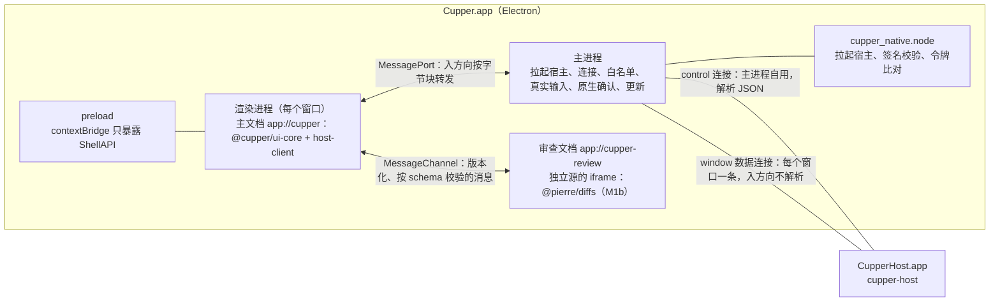

# 5.7 桌面端

- 所属：`docs/02-design.md` 第 5 节
- 依据：ADR-03（Electron + React 19 + TS、进程结构、安全加固）、ADR-05（UI 的认证）、ADR-01（拉起宿主、升级）；R01 第二、三、十三节；截图观察笔记（`docs/meetings/2026-10-16-prd-interview-2/codex-screenshot-notes.md`）；设计评审会（`docs/meetings/2026-10-16-design-review/`）；v1.4：界面复刻程度的用户决定 F1–F6（`docs/meetings/2026-10-19-ui-fidelity/minutes.md`）、R06 的一手规格（`docs/tasks/R06-codex-desktop-ui-firsthand/ui-spec.md`）
- 原则：桌面界面只是宿主的一个客户端，除协议外不读写会话数据，不调用 agent、git 或终端（NFR-1）；界面只负责排版和本地化（瘦客户端）

## 5.7.1 进程与连接



- **套接字和凭据永远不进渲染进程**（ADR-03）。所有到宿主的连接都由主进程持有。
- **两类连接**（Q1 定案，纪要 D1）：
  - `control` 连接：主进程自己用，量很小，主进程解析其中的 JSON。用于需要主进程判断或代为发送的操作：原生确认框的内容（`interaction/get`、`policy/describe`、`auth/elevation_get`、`project/trust_info`）、特权命令、退出前检查（`host/status`）、升级（`host/prepare_upgrade`）、通知点击后的 `ui/navigate`、通知的后备方案（下文 `notifications` 模块）。
  - `window` 数据连接：每个窗口一条，`initialize` 由主进程代发（角色 `window`），握手完成后才把端口交给渲染进程（安全 #4）。
  - 为什么不是"所有窗口共用一条连接"：主进程不解析入方向的 JSON，就无法把事件分给不同窗口；每个窗口一条连接，订阅、真实输入检查和流控都天然按窗口隔离。M1 只有一个窗口，所以就是两条连接；每条连接的签名校验约 1 ms。

**数据连接的生命周期**（桌面 #1）

| 情况 | 处理 |
|---|---|
| 绑定对象 | 数据连接绑定到窗口里**主文档的一个实例**，不绑定到窗口 |
| 主框架开始一次非同文档的导航（`did-start-navigation`）、`render-process-gone`、窗口 `closed` | 关闭这条数据连接，宿主上的订阅随之注销，主进程丢弃缓存的数据；清空这个窗口的输入记录和"已放行的 command_id"表（[5.7.8](#578-安全加固的落点)） |
| 新文档加载完成 | 渲染进程调用 `ShellAPI.host.open()`，主进程新建一条数据连接并握手，返回端口和握手结果（`limits`、`features`、`weak_auth`、宿主版本、`data_epoch`） |
| 宿主断开或重启 | 渲染进程显示"正在重新连接"；主进程先重连 control，再为每个窗口重连数据连接；新的握手结果经 `onConnectionState` 推给渲染进程，渲染进程按游标（含 `data_epoch`）重新订阅 |
| 关闭最后一个窗口 | 按 macOS 惯例 App 不退出；control 连接保留，宿主因此不会空闲退出；从 Dock 重新打开时新建窗口和数据连接 |
| 注销或关机（`powerMonitor` 的 `shutdown`） | 跳过 NFR-8 的退出确认框（确认框会挡住关机）；宿主自己处理系统发来的 SIGTERM，按有序退出把运行中的回合标为已中断 |

**转发**（桌面建议 #25、安全 #4）

- **入方向**（宿主 → 窗口）：主进程不切帧、不解析，按字节块转发，约每 16 ms 批量一次，每批用独立的 `ArrayBuffer`（不把 Node 的 Buffer 连同内存池一起复制）；渲染进程的 `host-client` 负责切帧（它本来就要处理 `0x02` 分片）。主进程仍然每次收到数据都比对宿主的令牌。
- **出方向**（窗口 → 宿主）：
  - `send(json)`：主进程 `JSON.parse`，拒绝数组（批量请求），按方法白名单检查，禁止 `initialize`；`interaction/respond`、`git/revert` 另做真实输入检查并写入 `input` 证据；然后**重新序列化**解析后的对象再发出，不转发原始字节（避免 JS 和 serde 对重复键的处理不同）。
  - `sendBlob(...)`：主进程组装 `0x02` 帧，检查头部和这个窗口的上传限额。
  - 其他帧类型一律拒绝。

**流控**（桌面 #2）：渲染进程收到数据就应用到 store，应用完立即确认已处理的字节数，只把"通知组件重新渲染"合并到动画帧。窗口被遮挡、页面变为 hidden、动画帧停止时，应用和确认照常进行，不会积压。某个窗口未确认的数据超过 8 MB 时，主进程暂停读这条连接；宿主那边该连接的发送队列超出 4 MiB 后重置这条流，窗口恢复后按游标重新订阅（ADR-03、ADR-04）。`backgroundThrottling` 保持默认值：确认不再依赖动画帧，不需要为此关闭节流。

**主进程转发的测量闸门**（纪要 D1、桌面 #14，M1a windowBridge 任务的验收项）

- **判定负载**按一个窗口的订阅上限定义：索引流 + 4 条会话流（当前会话加最近 3 个），加一个 5 MB 的 blob 传输和一次 5,000 个事件的重新同步。负载以线路上的帧数和字节数给出，即经过宿主 40 ms 写入合并之后：每条会话流每秒 25 帧、每帧约 2 KB；索引流每秒 5 帧、每帧约 1 KB。M1a 开工时按 SP-1 录制里观察到的最高速率复核这组数字（v1.6，T003 已复核：SP-1 和 T003 的全部录制里，每条流最高 14 帧/s、14.4 KB/s，单帧 p95 3.6 KB，这组数字偏保守，不用改）。唯一的大帧是 Claude 的命令列表（每个会话和每个回合开始一次，22–32 KB）；宿主对它去重，内容不变就不写进会话流（[5.6.2](06-agent-driver.md#562-驱动接口)），所以负载里不加这一项。
- **负载的产生**：会话流的片段由假 agent 的 `flood_rate` 按速率产生，经宿主的写入合并后成为上述线路负载；重新同步用的 5,000 个事件由 `test/seed` 预先灌入（[5.9.2](09-testing.md#592-假-agent)、[5.9.9](09-testing.md#599-测试替身与注入点)）。
- **消费端**是真实的渲染进程（一个窗口经 MessagePort 接收并确认），不在主进程里打桩，因为 MessagePort 的序列化开销落在主进程上。窗口可见和被遮挡两种状态各测一次。
- **判定**：在参考机器上，主进程事件循环延迟（`monitorEventLoopDelay({resolution: 1})`）p99 < 5 ms，并且没有发生流重置。
- 6 条流、每秒 200 个片段的结果只作为压力报告，不参与判定。
- **不达标**：在 M1a 的界面任务之前按 ADR-03 改用"utilityProcess 宿主桥 + 委托票据"（草案见待定问题 Q33），同时修订 5.8.1 的签名要求表。测量放在 M1a，后备方案引入的协议改动也就落在契约冻结之前。

## 5.7.2 主进程模块

| 模块 | 职责 |
|---|---|
| `hostLauncher` | 经 `cupper_native` 调用 `cupper-sys::spawn` 拉起 `Contents/Helpers/CupperHost.app/Contents/MacOS/cupper-host`：`POSIX_SPAWN_SETSID`、`POSIX_SPAWN_CLOEXEC_DEFAULT`、环境变量白名单，与拉起适配器用同一套参数（桌面建议 #18）；开发和 e2e 构建经 stdin 写入启动载荷后立即关闭（[5.8.1](08-security.md#581-认证握手固定令牌)），把载荷留在内存里，宿主被杀后重新拉起时原样再传，发布构建不写载荷；连接重试总预算 500 ms；按退出码处理：3 改为直接连接，4 弹出"数据来自更新的版本"，5 提示数据目录不可用，6 提示迁移失败并给出备份位置；安装更新的空窗期间不自动拉起（[5.10.5](10-release.md#5105-更新流程)） |
| `hostConnection` | 用原生扩展建立并校验连接；扩展留着宿主的套接字，读一律经 `recv_closing_fds` 并在每次读后比对宿主的令牌，通过后才转给主进程，主进程拿到的是 socketpair 的一端，再用 `new net.Socket({fd})` 包装（T073：Node 的普通 `read(2)` 会把宿主传来的 fd 装进主进程，不能直接把宿主的 fd 交出去；代价是每条连接两个转发线程，由 T076 的测量闸门评估）；处理 `host/hello` 和 `initialize`；退化模式下校验 `host_proof`；发布构建遇到 `weak_auth: true` 拒绝连接 |
| `controlClient` | control 连接上的 JSON-RPC 客户端 |
| `windowBridge` | 每个窗口一个：数据连接的生命周期、入方向的字节块转发、出方向的解析与白名单、真实输入检查、流控 |
| `inputGuard` | 按 [5.7.8](#578-安全加固的落点) 的规则记录每个窗口主框架上的真实输入 |
| `privileged` | 执行 `ShellAPI.requestPrivileged`：检查真实输入 → 经 control 连接取内容 → 原生确认框 → 经 control 连接发送；同一时间只弹一个确认框，取消后的冷却逐次加长 |
| `security` | 注册 `app` 协议（`standard`、`secure`、`supportFetchAPI`、`codeCache`）并为 `cupper`、`cupper-review` 两个主机分别下发 CSP 响应头；路径规范化后检查前缀，防目录穿越；加固 webContents；发布构建按白名单检查命令行开关 |
| `lifecycle` | 单实例锁；退出前经 control 连接查 `host/status`，有运行中的回合或待处理的请求时弹原生确认框（NFR-8），确认后发 `host/exit`；关机和 `before-quit-for-update` 时跳过这一步 |
| `updater` | electron-updater 集成，见 [5.10.5](10-release.md#5105-更新流程) |
| `deeplink` | 按构建种类注册的 URL scheme（[5.7.9](#579-构建种类)），白名单路由，只做导航 |
| `notifications` | 只在通知的后备方案启用时工作（待定问题 Q2）：在 control 连接上订阅索引流，取出 `notification.intent` 弹系统通知；通知上不放"批准"按钮，点击后只导航 |
| `menu` | macOS 菜单和快捷键：加速键在菜单里注册，经 `onCommand` 送到渲染进程，焦点在审查文档里时同样生效 |
| `prefs` | 界面偏好，存在 userData（`cupper/ui/`） |
| `logging` | `main.log` 轮转；渲染进程的错误转写进主进程日志（脱敏） |

主进程的代码在调用时才经 `dialog.showMessageBox` 取函数，不在模块加载时解构保存，这样 e2e 才能在主进程里替换它（测试确认，写进 [5.1.7](01-repo-build-ci.md#517-代码约束gatedesign-通过后写进-claudemd)）。

## 5.7.3 ShellAPI

`@cupper/shell-api` 定义接口，`ui-core` 只依赖这个接口，为以后换外壳留余地（ADR-03）。preload 用 `contextBridge` 暴露 Electron 实现；浏览器 mock 实现用于 Playwright 的界面截图测试。这份接口在 M1a 冻结，之后只加成员（[5.12.5](12-milestones.md#5125-契约冻结清单)）。

```ts
interface ShellAPI {
  init(): Promise<ShellInfo>;                 // 启动时调用一次；静态信息一次取回，不用 sendSync
  host: {
    open(): Promise<{ port: HostPort; handshake: Handshake }>;
    onConnectionState(cb: (s: ConnectionState, handshake?: Handshake) => void): Unsubscribe;
  };
  requestPrivileged(action: PrivilegedAction): Promise<PrivilegedResult>;
  onCommand(cb: (cmd: ShellCommand) => void): Unsubscribe;     // 菜单加速键等
  onNavigate(cb: (target: NavigateTarget) => void): Unsubscribe; // 深链接、通知点击
  openExternal(url: string): void;            // 只接受 http/https，主进程再校验一次
  pickDirectory(): Promise<string | null>;    // 选择目录（如 worktree 根目录）
  pathForFile(file: File): string | null;     // 拖入文件生成 @ 引用（M1b，CP-2），用 webUtils.getPathForFile
  saveFile(name: string, data: ArrayBuffer): Promise<boolean>;   // 诊断包（P1）
  system: { onThemeChange(cb: (t: 'light' | 'dark') => void): Unsubscribe };
  window: { onFocusChange(cb: (focused: boolean, at: number) => void): Unsubscribe };
  prefs: { set(key: string, value: unknown): Promise<void>; onChange(cb): Unsubscribe };
  updates: { onState(cb: (s: UpdateState) => void): Unsubscribe; installNow(): void };
}
interface ShellInfo {
  shell: 'electron' | 'browser';
  flavor: 'release' | 'e2e' | 'dev';
  appVersion: string;
  locale: string;
  theme: 'light' | 'dark';
  prefs: Record<string, unknown>;             // 偏好的初始快照，之后走 onChange
  updateState: UpdateState;
  reviewDocumentUrl: string;                  // 审查文档的地址；浏览器 mock 下不同，ui-core 不写死
}
interface HostPort {
  send(json: string): void;
  sendBlob(hash: string, offset: number, last: boolean, bytes: ArrayBuffer): void;
  onData(cb: (chunk: ArrayBuffer) => void): Unsubscribe;          // 入方向的字节块，由 host-client 切帧
  ack(bytes: number): void;
  close(): void;
}
type ShellCommand = { id: 'new_session' | 'settings' | 'toggle_sidebar' | 'toggle_side_panel'
  | 'open_review_tab' | 'toggle_file_tree' | 'interrupt' | 'next_needs_action'
  | 'prev_sidebar_item' | 'next_sidebar_item' | 'prev_recent' | 'next_recent' | 'session_n'
  | 'archive' | 'rename' | 'model_picker' | 'open_in_terminal' | (string & {}); arg?: number };
type NavigateTarget = { kind: 'session'; session_id: string; request_id?: string }
  | { kind: 'settings'; section?: string } | { kind: (string & {}) };
type PrivilegedAction =
  | { kind: 'interaction'; session_id: string; request_id: string; option_id: string }
  | { kind: 'set_config'; session_id: string; option: string; value: string }
  | { kind: 'confirm_config'; session_id: string }
  | { kind: 'create_session'; params: SessionCreateParams }
  | { kind: 'add_project' }                   // 选目录、project/add、信任确认一次完成
  | { kind: 'trust_project'; project_id: string }
  | { kind: 'elevation'; elevation_id: string }
  | { kind: 'settings'; patch: SettingsPatch };
type PrivilegedResult =
  | { status: 'confirmed'; result?: unknown }  // create_session 带 session_id，add_project 带 project_id
  | { status: 'cancelled' } | { status: 'busy' } | { status: 'cooldown'; retry_after_ms: number }
  | { status: 'user_activation_required' } | { status: 'failed'; error: unknown };
```

- `ShellCommand.id` 是开放枚举，新加的命令不改接口；`ui-core` 遇到不认识的命令忽略。
- 权限处理器只放行 `clipboard-sanitized-write`（两个文档都放行，复制按钮依赖它），其余一律拒绝，包括 `clipboard-read`（桌面 #4）。
- 退出 App 时的确认（NFR-8）由主进程的 `lifecycle` 模块在 `before-quit` 时自己发起，不经过渲染进程。

## 5.7.4 窗口与布局

v1.4 按用户决定 F1–F6（`docs/meetings/2026-10-19-ui-fidelity/minutes.md`）与 PRD v1.3 的 UI-6 重写：界面以作者本机安装的 Codex 客户端为准。一手资料是 R06 的 `docs/tasks/R06-codex-desktop-ui-firsthand/ui-spec.md`（下称 ui-spec）。尺寸、颜色、字号、圆角、阴影、动效的取值集中在 [5.7.10](#5710-设计参数)，本节只写结构和行为。

**复刻的边界**

- **以 Codex 为准**（F1）：布局、尺寸、亮色和暗色配色、圆角、字体与字号、动效、交互、文案结构、快捷键。PRD 和设计与它不一致时，界面形态以 Codex 为准。
- **只复刻，不复制**（F2）：不使用对方的代码、样式表、图标、图片、字体，也不使用 OpenAI 的商标和品牌素材。图标用开源图标库或自绘，字体用系统字体。核对细节时可以只读查看本机 App 包：不启动 App，不读用户数据，解出的文件只放临时目录，用完删除。
- **范围仍按里程碑**（F3）：Codex 有、但 M1 范围之外的功能，界面形态照 Codex 预留位置，交付时间不变。下文标"P1"的就是 M1 不做的部分。
- **安全规则优先**：以下几处有意与 Codex 不同。
  - 系统通知上不放"批准"按钮（[5.7.8](#578-安全加固的落点)）。
  - 请求面板另有待命期和真实输入规则（同上）。
  - 还原确认框不提供"不再询问"：审查文档发来的还原必须经主文档的控件（[5.7.5](#审查文档m1b)）。
  - 这三处交安全工程师确认（待定问题 Q41）。
- **cupper 特有的元素**按 Codex 的视觉语言补充：宿主状态、弱认证标记、"未信任""配置待确认"横幅、提权横幅、agent 选择。

```
┌──────────────────────────────────────────────────────────────────────────────────────┐
│ ● ● ●  [侧栏]   修复登录 bug · cupper/fix-login        [弱认证] [打开▾] [侧边面板] [⋯] │ 顶栏 44，hiddenInset
├──────────────────┬───────────────────────────────────────────────┬───────────────────┤
│ Cupper  (宿主●)   │       会话列：最大 768，正文 736，居中            │ [变更]    ← 标签条 │
│ [✎] 新会话        │                         [用户消息气泡 ≤70%]       │ 最近一轮▾ +12 −3  │
│ 项目 A        [+]│  ▸ 用时 1m 12s                                │ [显示文件] [⋯]     │
│   (转圈) 修 bug   │  ─────────────────────────                    │ 文件树（可开关）   │
│   补测试  等待批准 │  助手正文（Markdown，不加气泡）                   │ diff（审查文档）   │
│   写文档      (•) │  ┌ 3 个文件已更改 +12 −3              撤销 ┐     │                   │
│ 项目 B   未信任   │  └──────────────────────────────────┘     │                   │
│                  │            ( 第 2 / 5 步 )    (↓)               │ (还原全部 暂存全部) │
│                  │  ┌ 排队 1 条：补上单元测试…       [插话] [⋯] ┐   │                   │
│                  │  ┌ 输入框，或替换它的请求面板 ─────────────────┐ │                   │
│ [设置]            │  │ [+] [权限▾]               [模型 强度▾] (↑) │ │                   │
│                  │  └─────────────────────────────────────┘ │                   │
└──────────────────┴───────────────────────────────────────────────┴───────────────────┘
```

**窗口与顶栏**

- 窗口默认 1280 × 820，最小 480 × 600。`titleBarStyle: 'hiddenInset'`，内容一直画到窗口顶部；交通灯放在 x = 16，在 44 高的顶栏里垂直居中（`trafficLightPosition`）。
- 顶栏从左到右：
  - 交通灯；后退、前进（P1，位置预留）；侧边栏开关。
  - 会话区上方是会话标题。worktree 会话在标题后显示分支名。
  - **agent 标识**（AG-3，cupper 特有，Codex 没有）：标题旁一个小标签，写 agent 的短名（"Claude""Codex"），12 号 tertiary 色，1px `--color-border` 描边，圆角 `--radius-xs`。侧边栏的会话行保持 Codex 的样式，不加 agent 图标，悬停的 tooltip 里写 agent 名。
  - 右侧一组按钮：
    - 弱认证标记（cupper 特有，ADR-05）；
    - "打开"（终端、编辑器、Finder，UI-0）；
    - 侧边面板开关；
    - "⋯"会话菜单：重命名、归档、复制工作目录。Codex 菜单里的 Fork、Continue in、侧边会话、新窗口是 P1。
  - Codex 的分享、底部面板、摘要卡片、新建标签页按钮是 P1，不显示。
- 工具栏按钮：
  - 高 28，左右内边距 8，圆角 `--radius-lg`；
  - 平时透明底、tertiary 色，悬停用 `--color-hover`，处于打开状态时用 `--color-btn-secondary` 底；
  - tooltip 延迟出现，带快捷键。
- 窗口背景透明，macOS 上用 `vibrancy: 'menu'`，侧边栏透出半透明材质（F3）。以下两种情况改为不透明的 `--color-surface-sidebar`：设置 → 外观里关掉"半透明侧边栏"；系统开启了"降低透明度"。

**三栏与尺寸**（PS-1）

- **左栏只有侧边栏**，不做 Codex 的导航栏（F3：ChatGPT 的全局导航不做）。
  - 宽度默认 288。Codex 左栏默认 340，按截图推断其中约 52 是导航栏（待定问题 Q36）。
  - 拖动范围 240–520，同时给主区至少留 240；宽度存 prefs。
- **会话列**：
  - 最大宽 768，两侧各 16 的内边距，所以正文和输入框的实际宽度是 736；
  - 表格、Mermaid（P1）这类宽块最宽 896，高不超过 80vh；
  - 会话列在主区里水平居中（Codex 在摘要卡片打开时会让会话列左移，摘要卡片是 P1）。
- **右侧侧边面板**：
  - 外形：贴满整个高度，靠会话区一侧有 1px 边线，背景同 `--color-surface`；不是浮起的卡片（更正 v1.3 的"圆角卡片"）。
  - 顶部是 46 高的标签条，M1 只有"变更"一个标签。
  - 宽度：最小 320，最大为"主区宽 − 352"（保证会话区至少 352）。
  - 默认宽度：max(320, min(窗口高 × 1.6, 主区宽 − 500), min(640, 主区宽 − 352))。
  - 宽度按"最小值到最大值之间的比例"存 prefs，不存像素。
  - 拖拽手柄：role=separator，方向键按步长调整，Home 跳到最小、End 跳到最大；指示线是 1px 的 `--color-border-strong`，平时透明，悬停、拖动或获得焦点时才显示。
  - 开合用 spring 动画，0.5 s，bounce 0.1。
- **P1 的部分**（F3）：摘要卡片（输出内容、来源、计划）、底部面板（终端抽屉，UI-1）、标签拖到其他位置、全宽视图。
- **窄窗口**（F3）：
  - 窗口宽度小于 768 时，侧边栏改为浮在内容上的浮层，点外部或按 Esc 收起；
  - 主区放不下"会话区 352 + 侧边面板 320"时，侧边面板自动收起，窗口变宽后恢复到收起前的状态。

**侧边栏**

- **头部**（高 32）：
  - 左侧是产品名"Cupper"和宿主状态点。状态点沿用 Codex 远程连接状态点的样式：绿色已连接、灰色未连接、红色出错、蓝色转圈连接中；待升级等细节放在 tooltip 里。
  - Codex 头部的铃铛（Activity）和搜索是 P1，位置预留。
- 头部下面是"新会话"一行，带编辑图标。
- **项目分组**：
  - 项目行：文件夹图标加项目名；未信任的项目旁标"未信任"。
  - 项目行悬停时出现"+"（在该项目里新建会话）和菜单（在 Finder 中显示、移除项目）。
  - 会话行缩进挂在项目下，不带图标，单行截断。每个项目默认显示若干条，其余用"展开显示""收起"切换。
  - Codex 的置顶分组、不属于项目的"聊天"分组、组织与排序菜单都是 P1（F3）。
- **行规格**：高 30，圆角 10，左右内边距 8；会话行文字 14、行高 20，分组标题 13。选中和悬停都用 `--color-hover`。
- **会话状态的显示**（F3，替换 v1.3 的四色点）：

  | 状态（[5.2.9](02-host.md#529-关注度与通知)） | 显示 |
  |---|---|
  | `needs_action` | 行尾的文字标签。由 `SessionSummary.pending_kind` 决定（[5.3.5](03-protocol-v1.md#535-事件类型目录)）：待处理的是权限请求或计划确认时写"等待批准"，是提问或授权链接时写"需要用户输入"（沿用 Codex 的中文） |
  | `running` | 行首灰色转圈 |
  | `error` | 行首错误图标（`--color-danger`），tooltip 写出错原因 |
  | `unread` | 行首蓝色实心点（`--color-accent`），无障碍描述"未读" |
  | `idle` | 不显示 |

- **会话行的操作**：
  - 悬停时，行尾出现菜单按钮（20 宽），右键菜单与它相同：重命名、归档。
  - Codex 的置顶、标为未读、永久删除、换 emoji 是 P1。
  - 行尾的相对时间和 diff 统计还没有核实（待定问题 Q38），核实前不显示。
- **底部**：设置入口；CLI 的提权申请横幅（cupper 特有，样式参照 Codex 侧边栏底部的提示卡片）。

**会话区：消息流**（MS-1 至 MS-5）

- **间距**：相邻条目之间 16，同一组内 4。
- **横幅**：cupper 的"未信任""配置待确认"横幅放在会话列顶部，用 Codex 的警告框样式（[5.7.10](#5710-设计参数)）。
- **用户消息**：
  - 靠右的气泡，最大宽为会话列的 70%；内边距 16 × 10，圆角 22，底色 `--color-user-bubble`。
  - 长消息按行数折叠，底部渐隐，用"显示更多""收起"切换。
  - 悬停时气泡下方出现"复制"。Codex 的"编辑消息"是 P1。
  - 带审查评论的消息显示"{n} 条评论"；插话（Steer）进来的消息同样以气泡显示。
- **思考**（MS-2）：运行中显示"正在思考"并带闪光；结束后显示"已思考 {时长}"，可以展开。
- **工具活动**（MS-3）：
  - 每行左侧是 16 的图标，后面是一句过去时的摘要：13–14 号，`--color-fg-tertiary`，80% 透明度，单行截断；动词部分可以单独着色。
  - 运行中写"正在运行 …"并带闪光。
  - 同一活动组（`group_id`）里连续的操作合并成一行汇总；末尾的展开箭头只在悬停时显示；展开后的列表最高 224，超出部分上下渐隐。
  - 展开某条命令后看到命令输出块：1px 边框，圆角 `--radius-lg`；标题条 13 号；正文等宽，最高约 240，可以滚动。
- **回合折叠与用时**（桌面 #8；v1.4 的文案和样式按 Codex）：
  - **结束后**：过程收成一行"用时 {时长}"，左对齐。
    - 前面是 14 的箭头，收起时朝右，展开时转 90°，动画 150 ms；
    - 文字 13–14 号，secondary 色；
    - 下面紧跟一条 1px 的边线，上方留 4。
  - **运行中**：写"已处理 {时长}"，不收起。
  - **其他结局**：用户中断（`cancelled`）写"你在 {时长} 后停止了"；宿主中断（`interrupted`）写"已中断"；失败写"失败"。失败、取消和中断都不收起（规则不变）。
  - **始终显示在折叠之外的**：
    - 最终回答；
    - `plan`、`error`、`notice`、`late_tool_output`；
    - 插话进来的用户消息；
    - 请求记录行；
    - 回合改动卡片。
  - `final_item_ids` 为空时只显示折叠标题。
- **最终回答**：不加气泡，按 [5.7.10](#5710-设计参数) 的 Markdown 排版。
- **回合改动卡片**（F3，M1b）：
  - 出现条件：回合结束，并且 `snapshot.recorded`（`phase: end`）的 `stat` 显示有改动。卡片放在最终回答之后。
  - 标题行：左边"{n} 个文件已更改 +a −b"，右边"撤销"。
  - 文件行：下面每个文件一行，文件列表来自 `git/diff` 的 `{turn: id}` 范围。点击文件，在侧边面板打开"变更"标签并滚动到该文件。
  - 外形：圆角 `--radius-lg`，悬停时变色。
  - "撤销"的流程：
    - 在主文档里弹出确认控件，确认后以该回合范围的 `diff_token` 调用 `git/revert`，目标为全部文件；
    - 要求真实输入，与审查面板的还原相同（[5.7.8](#578-安全加固的落点)）；
    - 补丁应用失败时提示"之后已有新的改动，无法自动撤销"，并给出打开审查面板的入口。
  - 快照状态为 `partial`、`failed` 或 `skipped` 时，卡片注明原因，不提供撤销。
- **计划**（MS-4）：
  - 计划条目：编号步骤，每步一个 16 的状态图标（未开始、进行中、完成）。
  - Markdown 计划显示成"计划"摘要条，可以展开。
  - **计划药丸**（F3，M1b）：回合运行中有 `plan` 条目时，输入框上方浮一枚药丸"第 n / m 步"，n 是进行中的那一步；点击后滚动到计划条目。
  - 计划模式结束时的确认走请求面板（`plan_confirm`）。
- **错误和提示**（MS-5）：用警告框样式，恢复指引是框里的按钮。
- **晚到的输出**：
  - `late_tool_output` 默认折叠，标"取消后仍在运行"，显示命令和退出码，点击跳到原条目。
  - 原条目可见时，在它旁边显示"最终退出码 N"和跳转链接。数据来自视图的反向索引，见 [5.7.6](#576-状态管理)。
  - 被中断的 Codex 回合里标了 `may_still_run` 的命令，立刻显示"命令可能仍在运行"。
- **回到底部**：28 的圆形按钮，浮在输入框上方居中，带向下的箭头。

**会话区：输入框**（底部，距窗口底边 16）

- **外形**：
  - 圆角 22，底色 `--color-surface-composer`，阴影 `--shadow-composer`；
  - 文字区最小高 40，最大高 25dvh，超出后滚动；行高 1.625，左右内边距 12；占位文字 50% 透明。
  - 占位文案：已有会话写"和 {agent} 一起工作"，运行中写"处理中…"。
- **底栏**（按钮 28，间距 4，文字 13）：
  - 左侧：
    - "+"：添加附件（M1b 的图片），拖放时显示覆盖层；
    - 权限按钮：图标加短名，下拉列出 agent 给出的权限模式（CP-4）。
  - 右侧：
    - 模型和推理强度合在一个按钮里，写作"{模型} {强度} ⌄"；
    - 发送按钮。
  - Codex 的上下文用量环默认隐藏，属于 P1。
- **发送按钮的三种状态**（F3）：
  - 输入为空、没有运行中的回合：50% 透明的禁用态。
  - 有内容：可以发送，主按钮色的圆形，向上的箭头。
  - 回合运行中、输入为空：变成停止按钮（实心方块），点击发 `session/interrupt`。
  - 回合运行中、有内容：显示发送，按跟进行为插话或排队。这一形态还要实机核对（待定问题 Q40）。
- **跟进消息**（CP-6 v1.3，F5）：
  - 回合运行中按 Enter 默认插话（`session/send` 的 `mode: steer`），按 ⌘Enter 排队（`mode: queue`）。
  - "发送快捷键"设为 ⌘Enter 时，插话是 ⌘Enter，排队变成 ⌘⇧Enter。
  - 回退：能力里没有 `steer`，或宿主回复里带 `fallback_reason` 时，消息进入队列，toast 提示一次"已转为排队"。
  - 设置"跟进消息默认排队"（通用 → 输入框，默认关）打开后，插话和排队的按键对调。
  - Claude 的插话有副作用（ADR-07：当前的工具调用会被丢弃，正在跑的命令会被移到后台）。设置项的说明里写明；Claude 会话里第一次插话时也提示一次。
  - **影响范围**：这只改变界面发送时默认选的 `mode`。宿主的排队和 Steer 逻辑不变：只有客户端明确要求 `steer` 时才插话，失败时自动转为排队（[5.2.6](02-host.md#排队steer中断cp-6cp-7)）。
- **排队消息**（输入框上方，F3）：
  - 每条一行，显示预览：文本的第一行、图片数、评论数。
  - 行尾是"插话"按钮（tooltip"不打断模型，立即提交"）和菜单。菜单里有"编辑消息"，以及"关闭排队"或"开启排队"（切换"跟进消息默认排队"）。
  - 编辑：在原行展开成文本框，提交后经 `session/queue_edit` 的 `replace` 改写这条消息。
  - 插话：经 `queue_edit` 的 `steer`，这条消息立即插进当前回合；失败时留在原位，并提示原因。
  - 删除和重排属于 CP-8（P1），按钮位置预留。
  - **暂停**：用户中断后，队列暂停，显示"队列已暂停，因为你中断了回合"和"继续"按钮（`session/queue_resume`）。
  - 队列暂停时又发新消息，会弹框"发送消息？"。M1 只提供"发送"（发出新消息并恢复队列）和"取消"；"清空队列"属于 CP-8，是 P1。
- **附件条**（输入框内，文字区上方）：
  - 内容：图片缩略图、`@` 引用的文件、审查评论。
  - 审查评论（GT-2 v1.3）：显示"{n} 条评论"，展开后列出每条评论的文件、行号和正文，可以逐条删除。
  - 附件随下一条消息一起发出，评论作为 `review_comment` 内容块（[5.3.4](03-protocol-v1.md#534-方法清单)）。
- **Esc 的处理顺序**（按 Codex）：
  1. 先关闭输入框里的浮层（`@` 和 `/` 的菜单）。
  2. 回合运行中按第一次 Esc，进入"再按一次 Esc 停止"状态，输入框上方给出提示；再按一次才发 `session/interrupt`。中间按了别的键或输入框失焦，就退出这个状态。
  3. 焦点不在输入框时，Esc 把焦点移回输入框。焦点在审查文档里时，Esc 先关闭评论框。
- **新建会话页**：
  - 页面中部是大标题"你想在 {项目} 中构建什么？"，项目名本身就是项目选择器；没有项目时写"我们要构建什么？"。
  - 输入框锚在视口高度的 42% 处。
  - 输入框下方是一条动作条（`--color-composer-bar` 底），放：
    - agent 选择（AG-3，cupper 特有）：动作条最左边的下拉"Claude ⌄"，列出两种 agent 及其可用状态。放在动作条而不是输入框底栏，因为底栏的权限、模型和推理强度都随所选 agent 变化。会话创建后不能更换 agent；已有会话的 agent 见顶栏的标识；
    - 工作区：本地或新建 worktree，对应 Codex 的"工作位置"和"工作树"；
    - 起始分支。
  - 模型、推理强度、权限模式和斜杠命令来自缓存的能力描述，第一条消息发出前就能显示（AG-4）；当前档位为 `elevated` 时加提示。
  - Codex 的首页建议卡片、云端和远程运行位置、环境选择是 P1 或不做。
  - 已有会话里，这条动作条只在需要时出现；M1 只用它显示分支。

**会话区：请求面板**（AP-1、AP-5 v1.3）

审批和提问不再是消息流里的卡片，而是替换输入框位置的请求面板。

- **位置与外观**：
  - 会话里有待处理的交互请求时，请求面板占据输入框的位置。外观与输入框一致：同样的圆角、阴影和底色。
  - 输入框的草稿和附件原样保留，请求全部处理完后输入框恢复。
  - 排队条和计划药丸仍然在面板上方。
  - 多个待处理请求按创建顺序一次显示一个，面板右上角显示"1 / 3"。
- **结构**（从上到下）：
  - **标题行**：
    - 问句：权限请求按工具写，如"允许 {agent} 运行此命令？""允许 {agent} 编辑以下文件？"；提问用 agent 的 `prompt`；计划确认写"实施此计划？"。
    - 右上角是"关闭"，带 Esc 键帽。
  - **内容**：命令全文（"终端"标签，可以展开或收起）、文件列表、计划全文或提问的说明。
    - 内容标了 `content_truncated` 时显示"已截断"；展开看到全文之前，允许类选项不可选（安全 #6）。
    - agent 给出的文本里的双向控制符、零宽字符和其他控制字符一律显示成可见的转义，如 `\u{202E}`。这份转义工具与原生确认框共用。
  - **选项列表**：
    - 多于一个选项时，每行前面显示编号 1、2、3…。编号就是选项在 `options` 里从 1 起的序号：特权选项和效果未知的选项也占编号，选项不重新排序（v1.5）；
    - 行内标题 13 号 medium，说明 13 号 `--color-fg-tertiary`；
    - 选项按 agent 原文逐字显示，并标注效果（AP-2）：持久选项标"会写入 agent 的权限规则"，Codex 的 `cancel` 标"拒绝将结束本回合"；
    - `effect.scope` 为 `unknown` 的选项标"效果未知"，不套用拒绝的样式；
    - 当前选中行的右侧显示上、下箭头的键盘提示；
    - 提问的多选字段改用复选框。
    - Codex 的"推荐"徽标：驱动层拿不到推荐标记（ACP 的权限选项和提问的字段定义里都没有这一项），所以不显示徽标；agent 在选项原文里写的"(Recommended)"之类照原文显示。
  - **自由输入行**（列表最后一项）：
    - 提问的 `allow_custom` 字段：占位"在此输入"。
    - 权限请求有拒绝类选项时：占位"否，并告诉 {agent} 应该怎么做"，即"拒绝并附一条消息"（映射到 AP-1 的拒绝加 CP-6 的跟进消息；规则见 [5.7.8](#578-安全加固的落点) 的 RP-12）。
      - ACP 的审批选项不带文字反馈，所以先以"跳过"所用的那个拒绝选项回答。
      - 拒绝成功之后，才把这段文字作为跟进消息发出。消息带 `reply_to`，消息流里标明它附属于这次拒绝。
      - 跟进消息遵守"跟进消息默认排队"的设置和 agent 的插话能力。Claude 拒绝后回合继续，默认插话；Codex 的 `cancel` 会结束回合，文字开启下一个回合。
      - 拒绝收到 `already_resolved` 或 `expired` 时不发送，文字留在输入框里，提示"已在别处处理"。
      - 没有拒绝类选项时不显示这一行。
  - **底部按钮**："跳过"和"提交"（带 Enter 键帽）；多题时另有"上一题""下一题"。
- **动作与回答的对应**（协议不变，[5.3.6](03-protocol-v1.md#536-交互请求模型)）：

  | 动作 | `permission`、`plan_confirm` | `question` |
  |---|---|---|
  | 提交（Enter、点"提交"、数字键） | `selected {option_id}`：选中的选项 | `answer {values}` |
  | 跳过 | 选"不持久的拒绝类选项"（`effect.scope` 为 `reject` 或 `plan_revise`，并且 `persistent` 为否）；没有这样的选项时回答 `dismissed` | 跳过当前题。在最后一题上：已有回答就提交 `answer`，跳过的字段留空（只允许非必填字段）；一题都没答就回答 `dismissed` |
  | 关闭（Esc、右上角） | 同"跳过" | `dismissed` |

  `unsupported_schema` 的提问只显示"关闭"。
- **特权选项**：`requires: privileged` 的选项（`allow_always` 类、放宽档位、效果未知）经 `ShellAPI.requestPrivileged` 走原生确认框，面板上标"需要确认"。
- **键盘**（真实输入的规则见 [5.7.8](#578-安全加固的落点)）：
  - 数字键按编号选中选项并立即提交。Codex 的数字键是否"选中即提交"还未核实，交 T106 核对（待定问题 Q41）；
  - ↑ ↓ 移动选中，← → 在多题之间切换；
  - Enter 提交当前选中的选项，Esc 关闭。
  - 面板出现后有 500 ms 的待命期。
- **别处已处理**（AP-4）：请求在别的客户端处理后，面板收起，toast 提示"已在 {客户端} 处理"。请求失效或被撤回时面板也收起，并在消息流的记录行里注明。
- **消息流里的记录行**：请求在消息流里原来的位置留一行记录，如"已批准：运行 cargo test""已拒绝""已询问 2 个问题"（可以展开看回答）"未回答"。

**其他**

- **toast**（F3）：
  - 位置：顶部居中，距顶 40；宽度不超过 790（输入框旁的宽度）。
  - 最多同时 3 条，间距 8，可以向右滑动关闭。
  - 用于连接状态、更新提示、"已在别处处理"、"已转为排队"等。
- **设置页**（UI-2）：
  - 布局：
    - 占满主区；
    - 左侧导航沿用侧边栏的行样式，顶部是"返回应用"；
    - 内容区最大宽 768，水平居中，分节间距 40；
    - 设置行左边是标签（medium）加说明，右边是控件；开关 32 × 19。
  - 分区：
    - 通用：默认权限、发送快捷键、跟进消息默认排队、语言、防休眠等；
    - 通知；
    - 外观：主题、半透明侧边栏；
    - 已归档会话；
    - agent 状态（cupper 特有）：CLI 路径与版本、适配器版本、登录状态、运行时、配置目录的校验结果、资源占用、重启；
    - 连接与设备：已连接的客户端、弱认证说明；
    - 存储：各类数据的大小、"清除快照对象"；
    - "安装命令行工具"。
  - P1：Codex 外观页里的主题导入、强调色、对比度等自定义（UI-7），以及界面和代码字号；快捷键自定义页；Git、Worktrees 等分区。
- **人工评审**（MAN-ui6）：同尺寸的窗口、同一主题，与本机的 Codex 并排比对（F1）。

## 5.7.5 组件树

```
<App shell>                         ShellProvider、HostProvider、I18nProvider、ThemeProvider
├── <TitleBar/>                     侧边栏开关、会话标题与分支、弱认证标记、"打开"、侧边面板开关、会话菜单
├── <Sidebar>                       宽度可拖动；窗口窄于 768 时变为浮层
│   ├── <SidebarHeader/>            产品名、宿主状态点；Activity 与搜索的位置（P1）
│   ├── <NewSessionRow/>
│   ├── <ProjectList> <ProjectGroup trust/> <SessionRow status pendingKind unread/> … </ProjectGroup> </ProjectList>
│   └── <SidebarFooter/>            设置、提权申请横幅
├── <Main>                          路由
│   ├── <NewSessionPage>  <Hero projectPicker/> <ComposerArea mode="new"/> <ComposerActionBar agent workspace branch/>
│   ├── <SessionPage>
│   │   ├── <SessionBanners/>       "未信任""配置待确认"等警告框
│   │   ├── <MessageStream>         TanStack Virtual，按行虚拟化；顶部"加载更早的历史"
│   │   │   └── 行：<TurnHeader status duration/> <UserMessage/> <ActivityGroupRow/>（展开后是 <ToolRow/>…）
│   │   │         <AgentMessage/> <Thought/> <Plan/> <Notice/> <ErrorItem/> <LateToolOutput/> <RequestRecord/> <TurnChanges/>
│   │   ├── <ComposerOverlays/>     计划药丸、回到底部、"再按一次 Esc 停止"等提示
│   │   ├── <QueueList/>            排队消息：预览、编辑、插话、暂停与继续
│   │   └── <ComposerArea>          有待处理的请求时显示 <RequestPanel/>，否则显示 <Composer/>
│   │       ├── <Composer/>         附件条、文字区（@、/）、底栏（+、权限、模型与强度、三态发送按钮）
│   │       └── <RequestPanel/>     PermissionRequest、QuestionRequest、PlanConfirmRequest；不认识的类型显示占位
│   └── <Settings section/>
├── <SidePanel>                     右侧侧边面板：标签条（M1 只有"变更"）、拖拽手柄
│   └── <ReviewPanel> <ReviewHeader scope stats/> <FileTree/> <ReviewFrame/>（审查文档） <BulkActions/> <GitActions/>
└── <Toaster/>                      顶部居中，最多 3 条
```

- `<RequestPanel>` 按请求类型分成三种。遇到不认识的类型，显示占位并提示"请在桌面端处理"或"此版本不支持"。
- 选项按 `options` 的顺序显示，编号等于序号，不重新排序（[5.7.8](#578-安全加固的落点) 的 RP-6）；焦点和键盘可操作状态按 RP-3；"拒绝并附一条消息"按 RP-12 的顺序发出两条命令。
- v1.3 的 `<InteractionCard>` 和 `<PendingComments>` 取消：
  - 请求改在 `<RequestPanel>` 里处理，消息流里只留 `<RequestRecord>`；
  - 评论草稿由主文档持有，显示在 `<Composer>` 的附件条里。
- **审查面板**（GT-1 至 GT-4；"变更"标签，样式按 Codex）：
  - **头部**：
    - 范围下拉"查阅来源"：M1 的选项是"最近一轮""未暂存""已暂存"（Q13）；Codex 的"此分支""未提交""提交"三项是 P1。
    - 增删统计："+N"用新增色，"−N"用删除色。
    - 右侧："显示文件"或"隐藏文件"（切换文件树）和选项菜单。
    - 选项菜单按 Codex 的分组。M1 的项：换行；diff 视图（分栏、统一、自动）；展开全部、收起全部；刷新。这几项只在界面或审查文档里实现，不需要宿主的新参数。
    - 选项菜单的 P1 项：加载完整文件、富预览、按词 diff、隐藏空白、隐藏 import、复制 `git apply` 命令、跳到文件。隐藏空白需要宿主的 diff 参数，其余是审查文档里的增强。
  - **文件树**（F3）：
    - 默认关闭，⌘⇧E 切换；
    - 行高 28，文字 13，目录吸顶，超长文件名在中间截断；
    - Git 状态用图标表示（不用字母），颜色取新增、删除、修改三色；
    - 顶部是"筛选文件…"输入框；
    - 右键菜单：复制路径、在外部应用中打开（UI-0）。
  - **hunk 和文件操作**：只有图标的按钮（ghost 色，28 的圆形），tooltip 写操作名：暂存、取消暂存、还原。
  - **整组操作**（F3）：一枚浮在面板底部居中、距底 20 的药丸，里面是"还原全部"和"暂存全部"；"已暂存"视图里换成"取消暂存全部"，并且没有"还原全部"。
  - **还原确认**：
    - 标题"是否还原更改？"，正文"此操作会移除这些更改。"；
    - 按钮"取消"和"确认"（危险色）；
    - 焦点按触发来源分开（v1.5，RP-11）：由主文档里的按钮触发（"还原全部"）时，默认焦点在"确认"上；由审查文档里 hunk 或文件的还原触发时，不自动获得焦点，必须点击或按 Tab，并且同一时间只显示一个；
    - 不提供 Codex 的"不再询问"（交安全工程师确认，Q41）。理由：
      - 还原会丢掉用户的改动，而且无法撤销；
      - 审查文档里 hunk 和文件的还原只能经主文档的这个控件发出（[审查文档](#审查文档m1b)），跳过它，审查文档的一条消息就能触发还原；
      - 确认控件本身只多一次按键（"确认"默认获得焦点）。
  - **提交**：
    - 入口是"Git 操作"菜单，里面有"提交""推送"。Codex 的"创建分支""切换分支""创建 PR"是 P1。
    - 提交弹窗：宽 420，标题"提交或推送"，写明"提交到 {分支}"；提交信息框高 80；下一步三选一：提交、提交并推送、推送。
    - 提交会运行仓库的 hooks，并显示指纹提示。
    - 复选框"包含未暂存的更改"：勾选时先对"未暂存"范围执行 `git/stage`（目标为全部），再 `git/commit`，两条命令；暂存成功而提交失败时，改动留在已暂存里，与用户自己先暂存再提交的结果相同。
    - Codex 的"留空自动生成提交信息"是 P1。
  - **空状态和结果提示**：文案按 ui-spec 第 4.6 节翻译成中文，例如"尚无文件更改""已暂存""已还原 {path}"。
  - `caveats`（`mixed_changes`、`late_tool_effects`）显示在头部下方。

### 审查文档（M1b）

结论：审查面板里的 diff 视图放进一个**单独源的 iframe**（`app://cupper-review/`），原样使用 @pierre/diffs 的组件；文件列表、暂存栏、待发送的评论、提交框留在主文档。理由和 Trusted Types 的取舍见 [5.7.8](#578-安全加固的落点)（纪要 D6）。

**隔离**

- `app` 协议注册为 `standard` 和 `secure`，`app://cupper` 与 `app://cupper-review` 是两个不同的源（安全确认 (ii)）。iframe 加 `sandbox="allow-scripts allow-same-origin"`（因为不同源，`allow-same-origin` 只保留它自己的源，Worker 和模块脚本才能正常加载），不给 popups、top-navigation、forms、modals；`allow="clipboard-write"`。
- preload 只在主框架运行（`nodeIntegrationInSubFrames` 保持默认的 false），审查文档里没有 ShellAPI，也没有 HostPort。
- 主进程用 `will-frame-navigate` 阻止它在首次加载之后的任何导航。

**消息协议**（版本化，两个方向都用 zod 校验）

- 建立：主文档创建 `MessageChannel`，在 iframe 加载后把一端连同 `{type: "init", v: 1}` 发给它。审查文档只接受来自 `app://cupper` 的第一个端口，之后忽略所有 `window` 上的 `message` 事件；主文档只接收创建时的那个端口上的消息（安全确认 (iii)）。
- iframe 是无状态的视图：评论草稿、文件的展开状态、当前文件和滚动位置都由主文档持有并下发；iframe 重载后重新 `init`，不丢草稿。

| 方向 | 消息 |
|---|---|
| 主文档 → 审查文档 | `init {v, theme, locale, strings, zoom}`；`theme_changed`、`locale_changed`；`render {diff_token, path, hunks, drafts, expanded}`；`scroll_to {path, line?}`；`clear` |
| 审查文档 → 主文档 | `ready {v}`；`need_file {path}`（懒加载）；`hunk_action {action: stage\|unstage\|revert, hunk_ids}`；`draft_comment {path, range, side, text}`；`key_forward {key, modifiers}` |

- 主文档按持有的 `diff_token` 校验 `hunk_ids`，暂存和取消暂存直接执行。
- **还原会丢掉用户的改动**：iframe 发来的 `revert` 只会在主文档里弹出一个确认控件（"还原这个 hunk？"；不自动获得焦点，同一时间只显示一个，[5.7.8](#578-安全加固的落点) 的 RP-11），只有在主文档里点这个控件（主进程记录到的、主框架上的真实输入）才发出 `git/revert`，不能凭 iframe 的一条消息就执行（安全确认 (iii)）。
- 评论在 iframe 里只能写草稿，草稿经 `draft_comment` 交给主文档，列在输入框的附件条里（文件、行号、正文，可以逐条删除）；发往 agent 的内容只经主文档的发送控件（GT-2 v1.3：没有单独的"发给 agent"按钮）。

**桌面确认列出的 8 点**（纳入 Q29 的验证）

| # | 问题 | 做法 |
|---|---|---|
| 1 | 进程与内存：开启站点隔离时很可能成为进程外 iframe，多一个渲染进程和一份 React、pierre、Shiki | 首次打开后常驻（隐藏而不销毁），空闲时预加载；SP-6 的 5,000 行 diff 场景计入 iframe 的冷启动时间和内存 |
| 2 | 焦点与快捷键：焦点在 iframe 里时主文档收不到按键 | 全局快捷键一律注册为菜单加速键，经 `onCommand` 送达；iframe 只处理 Esc（关闭评论框）和 ⌘Enter（保存评论草稿），其余按键经 `key_forward` 转给主文档 |
| 3 | 真实输入被"借用" | inputGuard 只记录主框架获得焦点时的输入（[5.7.8](#578-安全加固的落点)）；`key_forward` 不算真实输入 |
| 4 | 主题、语言、字号的同步 | `init` 和 `theme_changed` 等消息下发主题覆盖、语言、文案和缩放比例；设计 token 打成一份 CSS，两个入口共用；字体用系统字体，不跨源加载随包字体 |
| 5 | 行内评论与 hunk 操作 | 见上面的消息协议：无状态视图、版本化、zod 校验、只发 `hunk_id` |
| 6 | 剪贴板 | iframe 加 `allow="clipboard-write"`；权限处理器对审查源同样只放行 `clipboard-sanitized-write` |
| 7 | 滚动联动 | 点击文件、从消息流的编辑条目跳转，都经 `scroll_to` 让 iframe 滚动；iframe 占满面板高度，只有一层滚动条 |
| 8 | 复刻度 | 原样使用 pierre，视觉和交互最接近 Codex，这是选这个方案的主要理由 |

**后备方案**：Q29 的验证不通过时，直接改用 pierre 导出的 `DiffHunksRenderer` 只生成 HAST，由我们在主文档里用 React 渲染。这样不需要任何 HTML 写入点，也不需要独立文档；代价是虚拟滚动和 hunk 交互要自己写。

## 5.7.6 状态管理

| 层 | 做法 |
|---|---|
| 连接 | `@cupper/host-client` 的连接状态机：`connecting → handshaking → ready → reconnecting`；断开后用同样的游标（含 `data_epoch`）重新订阅；收到 `mode: snapshot` 时丢弃这条流的视图和游标后重建（[5.3.3](03-protocol-v1.md#533-流与同步)）。暴露缺口、重置、重复的计数，供测试断言 |
| 流状态 | 每条已订阅的流一个 store：游标、视图（TS 版的 `IndexView`、`SessionView` reducer，与 Rust 视图用同一批金样例交叉验证，并做差分测试）。**消息到达即应用、应用后确认**，只有"通知组件重新渲染"合并到动画帧。视图是可变结构加版本号，组件用 `useSyncExternalStore` 按条目订阅，流式输出时只有正在变化的条目重新渲染；store 支持"因为别的条目而变化"，例如建立 `late_by_ref` 反向索引时，原条目所在的行要重新渲染 |
| 订阅策略 | 索引流常驻；当前会话加最近 3 个会话（LRU）保持订阅；其余会话退订，并丢弃视图，但保留它们的草稿和滚动位置（这两样是界面状态，不在视图里）。从通知或"下一个需要处理的会话"跳过去的会话通常不在 LRU 里，走缓存未命中的路径（桌面 #3） |
| 命令 | 命令客户端生成 UUIDv7 的 `command_id`；连接断开时保留未完成的命令，重连后用同一个 `command_id` 重发（NFR-2）。需要真实输入的命令，免输入重发的条件见 [5.7.8](#578-安全加固的落点) |
| 查询 | TanStack Query 管理请求-响应类的数据（`git/*`、`files/search`、`agents/capabilities`、`session/list_archived`）；收到相关事件时失效（例如 `turn.completed` 使该会话的 diff 失效） |
| 界面状态 | zustand：选中的会话、面板开合与尺寸、每个会话的输入草稿、附件和滚动位置、评论草稿；侧边栏和侧边面板的宽度、文件树开合、发送快捷键、跟进行为、半透明侧边栏存 prefs（不跨设备同步） |
| 长会话 | **按行虚拟化**（桌面 #12）：把回合标题、活动组摘要、消息、请求记录、改动卡片、提示拍平成一个行列表，活动组折叠时只占一行。内存里只有快照窗口加已翻页的历史。两条滚动规则：向前插入历史后视口不跳动（以视口顶部的行为锚点）；流式增长时贴底，用户向上滚动后停止贴底并显示 ↓ 按钮。Shiki 懒加载，代码块完成后再高亮；diff 的高亮在审查文档的 Worker 里 |
| 校验 | 开发和测试构建对每条消息做 zod 校验；生产构建只校验非 delta 的事件（技术选型讨论会桌面工程师意见） |

M1a 的消息流、store、订阅策略、HostPort 生命周期都按这里的最终形态实现，视觉从简（[5.12.2](12-milestones.md#5122-m1a宿主骨架)）。

**T071 开工前的裁定（2026-10-19）**

- **`ConnectionState`**：采用对象联合：`{status: connecting | handshaking | ready | reconnecting}`，或者 `{status: "failed"; reason}`。
  - `reason` 是开放枚举的语义码。宿主拉起失败的取值（退出码 4–6、宿主校验失败）由 T075 追加。
  - `ready` 时第二个参数带上握手结果。
- **本地拒绝**：
  - 主进程或 mock 拒绝的请求，经 `onData` 回 JSON-RPC 错误响应 `forbidden`；`initialize` 回 `forbidden/already_initialized`。
  - 没有 `id` 的消息和批量数组，直接丢弃、不回复。
  - T076 的 windowBridge 要照做，并通过 HostPort 合同测试。
- **重连时的顺序**：
  - 旧连接的数据全部送达后，才推 `reconnecting`；新连接的数据在 `ready` 之后才开始。
  - 状态和数据必须走同一条有序通道，例如同一个 MessagePort。
- **握手**：
  - `handshake(port, options)` 在 host-client 里，认证由调用方经 `auth(hello)` 和 `verifyHostProof` 提供；
  - host-client 不做 HMAC，证明由原生扩展（T073）计算。
- **三种计数**：
  - `gaps`：seq 越过游标的事件数；
  - `duplicates`：seq 不大于游标的事件数；
  - `resets`：宿主发来的 `stream/reset`，加上客户端每一次丢弃已有视图（快照替换了游标、`ViewError`、信封解不开）。
  - 出现重复或缺口时，带游标重新订阅，与 Rust 的 Mirror 一致。
- **事件校验**：先全部校验。5.7.6 说"生产构建只校验非 delta 事件"，这项性能优化留给 T080。

## 5.7.7 快捷键、本地化与主题

**快捷键**（UI-4 v1.3：按键沿用 Codex 的默认值，ui-spec 第 5 节）

- **怎样注册**：
  - 带 ⌘ 或 ⌃ 的在菜单里注册为加速键，经 `onCommand` 送达；焦点在审查文档里时同样生效。
  - Enter、Esc、数字键这类按键由渲染进程按焦点处理，不注册成加速键。
- **M1 的子集**：

| 动作 | 快捷键 |
|---|---|
| 新建会话 | ⌘N；另有 ⌘⇧O |
| 设置 | ⌘, |
| 切换侧边栏 | ⌘B（光标在输入框中间时 ⌘B 不切换）；另有 ⌘⇧S |
| 切换侧边面板 | ⌘⌥B |
| 打开"变更"标签 | ⌃⇧G |
| 切换文件树 | ⌘⇧E |
| 重命名 / 归档会话 | ⌘⌥R / ⌘⇧A |
| 下一个需要处理的会话 | ⌘⌥A |
| 侧边栏里的上一个 / 下一个会话 | ⌘⌥[ 或 ⌘⌥← / ⌘⌥] 或 ⌘⌥→ |
| 最近的会话之间来回切换 | ⌃⇧Tab / ⌃Tab |
| 侧边栏的第 1–9 个会话 | ⌃1–⌃9（Codex 默认 ⌘1–9 切换标签、⌃1–9 切换会话；M1 只有一个标签，⌘1–9 不占用） |
| 模型和推理强度 | ⌃⇧M |
| 发送 | Enter；⇧Enter 或 ⌥Enter 换行。"发送快捷键"可以设为 ⌘Enter。输入法组合过程中按 Enter 不发送（CP-1） |
| 运行中排队 | ⌘Enter（"发送快捷键"为 ⌘Enter 时是 ⌘⇧Enter）；打开"跟进消息默认排队"后与插话对调（[5.7.4](#574-窗口与布局)） |
| 停止当前回合 | 运行中按两次 Esc：第一次进入确认状态，第二次才停止 |
| 请求面板 | 1–9 选择并提交，↑ ↓ 移动，← → 切换题目，Enter 提交，Esc 关闭（规则见 [5.7.8](#578-安全加固的落点)） |
| 恢复上一条 | ↑（输入框为空时；CP-1 的要求。Codex 的官方快捷键表里有，本机包里没找到对应逻辑，待定问题 Q39） |
| 缩放 / 全屏 | ⌘+、⌘−、⌘0 / ⌘⌃F（菜单角色） |

- **cupper 自己的别名**（Codex 没有这两个动作，或者按键被别的功能占用）：

| 动作 | 快捷键 | 说明 |
|---|---|---|
| 中断当前回合 | ⌘. | Codex 里 ⌘. 是 ChatGPT 的功能；cupper 没有那个功能，把它留作中断的别名，菜单"中断回合"显示它 |
| 在外部终端打开工作区（UI-0） | ⌘⌥T | Codex 的 ⌃` 打开内置终端，内置终端是 P1（UI-1） |

- **P1**（Codex 有，M1 不做，按键先不占用）：
  - 面板与视图：⌘K 或 ⌘⇧P 命令菜单、⌘P 搜索文件、⌘/ 快捷键一览、⌘J 底部面板、⌃` 终端、⌘T 浏览器标签、⌘⇧F 全宽、⌘⇧B 循环布局；
  - 导航：⌘[ / ⌘] 后退前进、⌘F 会话内查找、⌘⌥1–6 最近的会话、⌘⌥U Activity；
  - 会话：⇧Esc 清除全部未读、⌘⇧U 标为未读、⌘⌥P 置顶；
  - 其他：复制类的 ⌘⇧C 等、⌘⌥S 侧边会话、⌃⌘M 最近用过的模型。

**本地化**（UI-5）：

- `@cupper/i18n` 基于 i18next，zh-CN 和 en 两套文案。
- 跟随系统语言：主进程用 `app.getPreferredSystemLanguages()` 取得，设置里可以覆盖。
- 日期、时长、数字用 `Intl`。
- 宿主下发的语义码（工具类型、错误码、提示码、恢复指引）在这里映射成文案，例如 `{tool_kind: read, paths: [a.rs]}` 显示为"已读取 a.rs"。
- 中文文案的措辞参照 Codex 本机的简体中文译文（ui-spec 第 4 节），但由我们自己写。
- 主进程的原生确认框和审查文档用同一份文案。
- **从 M1a 第一天起所有文案都走 i18n 的键**，M1a 只做一种语言。

**主题**（UI-3）：

- token 的取值见 [5.7.10](#5710-设计参数)。
- 打成一份 CSS，主文档和审查文档共用。
- 主题跟随系统（`nativeTheme.themeSource = 'system'`），设置里可以固定成亮色或暗色。
- Shiki 用双主题，配色取 5.7.10 的代码高亮表。
- 字体用系统字体（SF Pro、苹方），代码用系统等宽字体。
- 半透明侧边栏见 [5.7.4](#574-窗口与布局)。
- 暗色的取值在 T106 核对之前只是推算值（待定问题 Q37）。

## 5.7.8 安全加固的落点

| 项 | 落点 | 验证方式 |
|---|---|---|
| Fuses | electron-builder 的 `electronFuses`：关闭 `runAsNode`、`enableNodeOptionsEnvironmentVariable`、`enableNodeCliInspectArguments`（e2e 构建保留）、`grantFileProtocolExtraPrivileges`、`loadBrowserProcessSpecificV8Snapshot`；打开 `enableEmbeddedAsarIntegrityValidation`、`onlyLoadAppFromAsar`、`enableCookieEncryption`（e2e 构建和自用构建关闭，[5.7.9](#579-构建种类)） | CI 对产物运行 `@electron/fuses read` 逐项断言；断言 Info.plist 里有 `ElectronAsarIntegrity`，`asarUnpack` 只有 `cupper_native.node` |
| 命令行开关 | 发布构建启动时按白名单检查命令行开关，出现任何不在白名单里的开关（含 `--inspect*`、`--remote-debugging-*`、`--js-flags`、`--no-sandbox`、`--disable-web-security`、`--user-data-dir`、`--proxy-server` 等）就退出；发布构建不开 DevTools（安全建议 #17） | e2e（发布配置的构建）：带未知开关启动，进程应立即退出 |
| webPreferences | `sandbox`、`contextIsolation` 为 true；`nodeIntegration`、`nodeIntegrationInWorker`、`nodeIntegrationInSubFrames`、`webviewTag`、`allowRunningInsecureContent`、`experimentalFeatures`、`navigateOnDragDrop` 为 false；窗口的 `acceptFirstMouse` 保持默认的 false | 单元测试检查窗口创建参数 |
| 加载方式 | 主文档只从 `app://cupper/` 加载，审查文档只从 `app://cupper-review/` 加载（`protocol.handle` 读取 asar，每个主机一个文件根目录，路径规范化后检查前缀）；不用 `file://`，**不从远端加载渲染层**（ADR-03） | e2e 检查两个文档的 `location.origin`；单元测试：`..`、编码后的 `%2e%2e` 等路径被拒 |
| 主文档的 CSP | `default-src 'none'; script-src 'self'; style-src 'self' 'unsafe-inline'; img-src 'self' blob: data:; font-src 'self'; worker-src 'self'; connect-src 'none'; frame-src app://cupper-review; object-src 'none'; base-uri 'none'; form-action 'none'; frame-ancestors 'none'; require-trusted-types-for 'script'; trusted-types cupper-worker` | e2e：注入内联脚本应被拦截并上报；发布 CSP 下渲染全部组件，`securitypolicyviolation` 事件数为 0（M1a 验收） |
| Trusted Types（纪要 D6） | 主文档**禁止 `default` 策略**，只有一个具名策略 `cupper-worker`，它的 `createScriptURL` 只放行 `app://cupper/assets/` 下的同源脚本；不写 `'allow-duplicates'`。ESLint 规则：只允许在 `ui-core/src/security/policies.ts` 里调用 `trustedTypes.createPolicy`，禁止名为 `default` 的策略 | CI（ESLint）；e2e：创建名为 `default` 的策略应失败 |
| 样式 | 主文档放行 `style-src 'unsafe-inline'`（Radix 经 react-style-singleton 动态插入 `<style>`）。样式不能执行脚本，`img-src`、`font-src`、`connect-src` 已经堵住经 CSS 外发数据的通道。条件：**agent 给出的字符串不能进入 `<style>` 的文本、`insertRule` 或 CSS 自定义属性**，例如 ANSI 颜色只能映射到固定的 class，否则 CSS 注入可以伪装或遮挡请求面板上的按钮 | ESLint 规则；金样例：含 ANSI 序列和 CSS 片段的输出 |
| 审查文档的 CSP | `default-src 'none'; script-src 'self'; worker-src 'self'; style-src 'self' 'unsafe-inline'; img-src 'self' data:; font-src 'self'; connect-src 'none'; base-uri 'none'; form-action 'none'; frame-ancestors app://cupper`。**不启用 `require-trusted-types-for`**：@pierre/diffs 在 15 处以上把字符串直接写进 shadow root（已核对 1.5.2 的源码），默认策略区分不了调用方。防线是严格的 `script-src`（注入的脚本和内联事件处理器都不会执行）、跨源隔离、窄的消息协议（[5.7.5](#审查文档m1b)）。Worker 经 pierre 的 `workerFactory` 选项由我们构造；高亮器固定为 `preferredHighlighter: "shiki-js"`，不需要 wasm | 见下一行的三条测试 |
| 审查文档的注入防护（纪要 D6，安全确认 (i)–(iii)） | (i) 文件内容、文件名、行内评论里出现 `<style>`、``、`<a>`、`<base>`、`<link>`、`<meta>` 时都按文本显示；(ii) `app` 协议注册为 standard 和 secure；(iii) 只接收创建时那个 MessagePort 上的消息并按 schema 校验，`git/revert` 只能由主文档的控件触发 | (i) 金样例：DOM 里不能出现这些元素；(ii) e2e：两个文档的 origin 不同，iframe 访问 `parent.document` 会抛错；(iii) e2e：从别的端口或 `window.postMessage` 发来的消息被忽略，iframe 发来的 `revert` 不会直接执行 |
| Markdown 与不可信内容 | streamdown 关闭 rehype-raw（不渲染原始 HTML），再做白名单清洗；harden 只放行 `http`、`https` 链接，不放行任何图片前缀，不允许 data 图片，agent 输出里的远程图片显示为链接（桌面 #6）；Mermaid（P1）不用 `srcdoc`，改用与审查文档相同的独立源文档 | 金样例：含 `<script>`、``、`javascript:` 链接、远程图片的消息，渲染后不执行、不加载 |
| 导航与新窗口 | `will-navigate`、`will-redirect`、`will-frame-navigate` 一律阻止（审查文档的首次加载除外）；`setWindowOpenHandler` 一律拒绝；链接经 `ShellAPI.openExternal`，主进程只放行 http、https | e2e |
| 权限请求 | `setPermissionRequestHandler`、`setPermissionCheckHandler`、`setDevicePermissionHandler` 只放行 `clipboard-sanitized-write`，其余一律拒绝 | 单元测试 |
| 命令白名单 | `windowBridge` 出方向只放行 scope 为 `read`、`write`、`approve`、`ui_local` 的方法（清单由协议常量生成）；`privileged`、`test` 方法、`initialize` 和未知方法在本地直接拒绝；拒绝 JSON-RPC 批量数组；转发重新序列化后的对象；只放行 0x01、0x02 帧。宿主再按 window 角色检查一遍（安全 #4） | 单元测试遍历全部方法；mock 宿主的帧级测试 |
| 真实输入 | 见下文 | 见下文 |
| 原生确认框 | ADR-03 列出的操作：切到完全访问、选 `allow_always` 类选项、批准 CLI 提权；另加：信任项目（[5.2.6](02-host.md#项目信任)）、确认会话档位（`config_unconfirmed`）、修改安全相关的设置、有运行中回合时退出、M3 的配对与撤销。确认框的内容由主进程经 control 连接从宿主获取；agent 给出的文本逐字显示，不可见字符显示为转义；默认按钮是"取消"或"拒绝"；持久选项的文案规则见 [5.3.6](03-protocol-v1.md#536-交互请求模型) | e2e：渲染进程无法绕过确认框发出这些命令；替换函数记录调用参数，断言确认框里显示的操作描述 |
| 其他入口 | 深链接只做导航，参数只接受符合格式的 ID；`open-url`、`second-instance`、`open-file`、通知点击同样只做导航，**不把焦点移到请求面板上**；不提供 AppleScript 字典，不注册 Services 菜单；拖放只往输入框里插入内容 | 单元测试 |
| 通知 | M1 的系统通知上不放"批准"按钮。这是有意保留的差异（Codex 的审批通知带"批准""本会话批准""拒绝"按钮，交安全工程师确认，Q41）：通知按钮的点击不经过主框架，主进程拿不到真实输入证据；通知由宿主的 helper 弹出，按钮的回调也不经过原生确认；通知内容可能被截断，用户看不到完整命令；按钮的回调由宿主的 helper 处理，等于开了一条不经过任何客户端 principal 的审批通道，绕过先到先得、摘要核对和输入证据（安全确认）；Codex 的"本会话批准"在 cupper 属于特权操作，本来就必须走原生确认。单元测试断言系统通知没有任何操作按钮（UNIT-notifier-no-actions）；点击后按 bundle id 打开 Cupper，不走通用的 URL 路由（[5.2.9](02-host.md#529-关注度与通知)） | — |
| 宿主校验失败 | 不向宿主发送任何命令，显示"无法验证宿主"，提供"重启宿主"（ADR-01 的 SP-4b 修订） | e2e：用假宿主占用套接字（e2e 构建靠 dev_key 的双向证明识别假宿主，[5.8.1](08-security.md#581-认证握手固定令牌)） |
| 代码规则 | ESLint 禁止 `innerHTML`、`dangerouslySetInnerHTML`、`insertAdjacentHTML`、`eval`、`new Function`、`window.open`；`ui-core` 禁止 import `electron` 和 `node:*`；上面的 Trusted Types 和样式规则 | CI |

**真实输入**（ADR-03；评审统一方案 (c)，纪要 D7；v1.4 按请求面板改写第 2、3、7 条，新增"请求面板的落点"）

规则：

1. **识别用的事件**：
   - 键盘用 `before-input-event`，只认 `type: keyDown`；它带 `key`、`isComposing`、`isAutoRepeat`、modifiers。不用 `input-event` 识别键盘：Electron 44 的类型定义里它只有 `type` 和 `modifiers`（运行时其实带了键码，待定问题 Q26 确认，留作后备）。
   - 鼠标用 `input-event` 里同一按钮的 `mouseDown` 接 `mouseUp`，间隔不超过 1 s，记在 `mouseUp` 的时刻。
   - **只记录主框架获得焦点时的输入**：键盘事件发生时 `webContents.focusedFrame` 必须是主框架；鼠标在 `mouseUp` 时检查同一件事。焦点在审查文档里时的按键和点击一律不记。
   - 主进程为每个窗口记录 `lastInput {kind, key?, digit?, at, consumed}`。
2. **算真实输入的按键**：
   - 白名单：Enter（含小键盘 Enter）、Space、Escape、⌘Enter，以及 v1.4 新增的数字键 1–9（含小键盘），供请求面板"按编号选择并提交"使用。
   - 条件：`isComposing` 和 `isAutoRepeat` 都为 false；除 ⌘Enter 外，不能带 ⌘、⌃、⌥。
   - **导航键**：↑ ↓ ← → 是请求面板的导航键。
     - 它们本身不算真实输入，也不触发第 3 条，否则"↓ 再 Enter"会被第 3 条拦下。
     - 它们会清掉尚未用掉的输入（v1.5）：按了方向键，说明之前那一下没有用来提交，不能再被拿去当证据。
3. **打字中的按键不算**：
   - 前 1 秒内按过打字键（白名单和导航键以外的键）时，紧接着的 Enter、Space 或数字键不记作真实输入（⌘Enter 除外）。
   - 按下打字键时，清掉尚未用掉的输入。
4. **一次输入只能用一次**：
   - 这个窗口发出的**任何一条**出方向命令，都会用掉尚未消耗的输入。
   - 需要真实输入的命令（`interaction/respond`、`git/revert`、`requestPrivileged`）要求有一个不超过 1 秒、尚未用掉的输入。
   - 主进程转发时把证据写进 `input: {kind, key?, digit?}`，覆盖渲染进程自己填的值。数字键写成 `key: digit` 加 `digit: n`。
5. **Esc 和拒绝类选项**：
   - 所有 `interaction/respond` 都要求真实输入，Esc 在白名单里。
   - 宿主检查 `input.key` 为 `escape` 时，只能用于 `dismissed`，或者 `effect.scope` 为 `reject`、`plan_revise` 的选项。
   - 宿主检查 `input.key` 为 `digit` 时，对 `permission` 和 `plan_confirm` 要求 `digit` 等于所选选项在 `options` 里的序号（从 1 起）。不相符就拒绝（`forbidden`，`reason: user_activation_required`）。
   - window 角色发来的 `respond` 和 `revert` 缺少 `input` 时一律拒绝（[5.2.5](02-host.md#525-策略与命令账本)）。
   - `effect.scope` 为 `unknown` 的选项是 privileged，只能走原生确认，键盘无效。
6. **输入法上屏**：`isComposing` 为真的按键一律不记录，包括用 Enter 选词。渲染进程的输入框同样以 `isComposing` 或 keyCode 229 判断不发送（CP-1）。
7. **窗口刚被激活后的冷却**：
   - 窗口 `focus` 之后 1,000 ms 内的键盘输入不记录；`focus` 和 `blur` 时清空记录。
   - 激活窗口的那次点击按 macOS 默认不送到页面。
   - 深链接、`open-url`、`second-instance`、通知点击只做导航，不把焦点移到请求面板上。
   - 渲染进程一侧，请求面板的待命期见下文；宿主的 400 ms 兜底不变。
   - 冷却期内按 Enter 得到 `user_activation_required` 时，面板提示"请再按一次"。`window.onFocusChange` 带上获得焦点的时间，面板可以等冷却结束再接受按键。
   - 这个提示只用于窗口激活后的冷却期（v1.5）。渲染进程按 `window.onFocusChange` 的时间区分：窗口获得焦点不到 1 秒时被拒，才提示"请再按一次"；其余情况被拒（例如刚打过字，第 3 条），不给这个提示，按 RP-3 撤销键盘可操作状态。否则提示正好会引导以为自己在发消息的用户去按第二下。
8. **`requestPrivileged`**：
   - 同样要求真实输入；Esc 不能触发特权操作。
   - 同一时间只弹一个原生确认框，其他请求返回 `busy`。
   - 用户取消后，同一类操作的冷却时间逐次加长：2 s、10 s、60 s，冷却期内返回 `cooldown`；一次确认或连续 10 分钟没有取消后，重新计数。
   - NFR-8 的退出确认由主进程自己发起，不受这些限制。
9. **用同一个 `command_id` 重发**：
   - 主进程按窗口记录"已放行的 `command_id` → 参数哈希"。
   - 只有在上次转发后**没有收到宿主的任何响应**（连接断了）时，同一个 `command_id`、参数哈希也相同的重发才不要求新的输入。
   - 收到任何响应（包括 `too_early` 这样的错误）后，立即删除这条记录；窗口的文档实例变化时清空。

**请求面板的落点**（v1.4 写成；v1.5 按安全工程师"附条件可以"的确认补齐，见 `docs/meetings/2026-10-19-ui-fidelity/security-engineer.md`）

请求面板出现在输入框原来的位置。用户正在打字，或者正要点发送按钮时，面板可能恰好出现：发送按钮和面板的"提交"按钮都在右下角。下面的规则防止这类输入落到面板上。

| # | 规则 | 落在哪里 |
|---|---|---|
| RP-1 | **待命期**：面板出现，或者处理完一个请求、下一个请求接替时，先进入 500 ms 的待命期。待命期内，面板上的按键和点击一律吞掉：不传给选项，也不传给输入框；待命期内只要有按键，就重新计 500 ms。待命期结束后，面板才设"可以操作"标记（`data-ready`） | 渲染进程（请求面板） |
| RP-2 | **点击**：只认 `mousedown` 发生在"可以操作"之后的点击。面板出现前按下、出现后松开的点击不算 | 渲染进程；主进程的点击证据本来就要求 `mouseDown` 接 `mouseUp` |
| RP-3 | **焦点**（v1.5 收紧）：<br>- **自动获得焦点**：面板出现时，以下三条都满足，焦点才移到面板的选项列表上，并进入键盘可操作状态（`data-activation="auto"`）：焦点在输入框里；输入框里没有未发送的草稿（文字和附件都为空）；最近 2 秒内没有在输入框里打字。<br>- **否则**：面板不自动获得焦点，显示"按 Tab 或点击以处理请求"（`data-activation="manual"`）；用户按 Tab 或点击之前，面板不响应按键。<br>- **撤销**：面板处于键盘可操作状态时，只要收到打字键，就撤销这个状态，回到"按 Tab 或点击以处理请求"，这一下按键被吞掉。打字键指在选项列表上没有意义的键：1–9、↑ ↓ ← →、Enter、⌘Enter、Esc、Tab 以外的键。焦点在自由输入行时打字是正常输入，不撤销。<br>- **第一下 ⌘Enter**：面板获得焦点后的第一下 ⌘Enter，只把焦点留在面板上，提示"按 Enter 提交"，不提交。输入框里的 ⌘Enter 是排队发送，这样避免肌肉记忆。<br>- **不抢焦点**：焦点原本在别处（侧边栏、侧边面板、审查文档）时，面板不抢焦点；导航、切换会话、通知点击都不会把焦点移到面板上 | 渲染进程 |
| RP-4 | **初始选中**：默认选中第一个既不是 `requires: privileged`、也不是 `effect.scope: unknown` 的选项（Codex 选中第一个选项）。没有这样的选项时不选中任何一项，Enter 无效 | 渲染进程 |
| RP-5 | **按键**（面板"可以操作"、处于键盘可操作状态并且有焦点时）：<br>- 数字键 n：对应 `options`（提问时是当前题的 `choices`）里从 1 起的第 n 项，按下即选中并提交；编号等于"选项数 + 1"时，焦点移到自由输入行。Codex 的数字键是否"选中即提交"未核实，交 T106（Q41）。<br>- ↑ ↓：移动选中；← →：多题时切换题目。<br>- Enter：提交当前选中的选项；焦点在自由输入行时，提交这段文字。<br>- ⌘Enter：同 Enter，但面板获得焦点后的第一下不提交（RP-3）。<br>- 自由输入行里刚打完字 1 秒内按的 Enter 不算真实输入（第 3 条）。这时不提示"再按一次"，只在提交按钮旁提示"点击提交"。<br>- Esc：关闭（回答的映射见 [5.7.4](#574-窗口与布局)）。焦点在有内容的自由输入行时，第一次 Esc 只把焦点移回选项列表。 | 渲染进程；主进程按第 2–5 条认定真实输入 |
| RP-6 | **编号与效果未知的选项**（v1.5）：<br>- **编号**：面板上显示的编号一律等于选项在 `options` 里从 1 起的序号，特权选项和效果未知的选项也占编号。<br>- **顺序**：不允许重新排序选项。宿主正是按这个序号核对 `digit`（RP-10）；不能改成按"显示编号"核对。<br>- **效果未知的选项**：方向键跳过它；按它的编号不起作用；Enter 不提交它；只能点击，点击后走原生确认框 | 渲染进程；宿主按 privileged 拒绝非 control 角色，并核对 `digit` |
| RP-7 | **特权选项**：按它的编号、Enter、点击，都只会调用 `requestPrivileged`，由原生确认框决定；Esc 永远不会触发它 | 渲染进程；主进程第 8 条 |
| RP-8 | **连续的请求**：前一个请求提交后，下一个请求重新进入待命期，防止连按 Enter 批准两个请求 | 渲染进程；主进程第 4 条（一次输入只能用一次） |
| RP-9 | **遮挡**：面板上方有弹出的菜单、下拉或对话框时，面板不响应按键。agent 的字符串不能进入样式（见上表"样式"一行），所以无法用 CSS 遮挡或伪装面板上的按钮 | 渲染进程；ESLint 规则 |
| RP-10 | **宿主兜底**：window 角色的回答必须带 `input`；距请求创建不足 400 ms 的拒绝；`escape` 只能用于拒绝类选项和 `dismissed`；`digit` 要与选项序号相符 | 宿主（[5.2.5](02-host.md#525-策略与命令账本)） |
| RP-11 | **主文档里的还原确认控件**（v1.5 按触发来源分开）：<br>- **由主文档里的按钮点击触发**（"还原全部"、回合改动卡片的"撤销"）：默认焦点按 Codex 放在"确认"上。<br>- **由审查文档的 `hunk_action` 消息触发**（hunk 和文件的还原）：不自动获得焦点，必须点击或按 Tab；同一时间只显示一个，已经有一个时，审查文档发来的新还原请求被忽略。理由：用户此刻可能正在审查文档里写评论，而审查文档里的按键主进程不记录，第 3 条看不到这些打字。<br>- **两种都**有 500 ms 的待命期，只认真实输入 | 渲染进程；主进程第 1、4 条 |
| RP-12 | **拒绝并附一条消息**（v1.5）：<br>- 先发 `interaction/respond`（不持久的拒绝选项），收到成功之后才发跟进消息。<br>- 收到 `conflict/already_resolved` 或 `expired` 时不发，文字留在输入框里，提示"已在别处处理"。例如已经在 CLI 那边批准了，不能让用户以为自己拒绝了。<br>- 跟进消息遵守"跟进消息默认排队"的设置和能力里的 `steer`。<br>- 跟进消息带 `reply_to`（被拒绝的 `request_id`），消息流里这条用户消息标明"附于对 … 的拒绝" | 渲染进程；宿主记录 `reply_to`（[5.3.4](03-protocol-v1.md#534-方法清单)） |

与 v1.3 的差异：

- "卡片可见并获得焦点满 500 ms 后才响应键盘"改为 RP-1 的待命期，并扩展到点击（RP-2）。
- "Enter 只在焦点位于卡片上时生效"改为 RP-3 的焦点规则。
- 新增数字键（第 2 条、RP-5）和导航键（第 2 条）。
- 宿主侧只多了 `digit` 与选项序号的核对。
- v1.5（安全确认的 6 条）：
  - RP-3：自动获得焦点加上"没有草稿"的条件；收到打字键就撤销键盘可操作状态；第一下 ⌘Enter 不提交。
  - 第 2 条：导航键会清掉尚未用掉的输入。
  - 第 7 条："请再按一次"只用于冷却期。
  - RP-6：编号等于 `options` 的序号。
  - RP-11：按触发来源分开。
  - 新增 RP-12。
  - 数字键"选中即提交"在 Codex 里是否如此还未核实（Q41）。

测试（Playwright，桌面 #13、测试 #13 与确认）：

- 点击用 `page.click()`，它会产生 `input-event`（Q26 一并确认）。
- 按键用 e2e 辅助函数，经 `electronApp.evaluate` 在主进程里调用 `webContents.sendInputEvent({type: 'keyDown', keyCode: 'Return'})`。测试工程师在 Electron 34 上实测：它会触发 `before-input-event`，页面收到的 keydown 是 `isTrusted: true`。按键白名单、"一次输入只能用一次"、冷却、"Esc 只能用于拒绝"和整条链路，在 e2e 里走的都是生产代码；生产代码里没有任何测试分支。
- 自动用例断言 inputGuard 记录的输入证据来自 `before-input-event`，Electron 升级改变了这个行为时 CI 先报出来。
- 负面用例：页面脚本直接经 HostPort 发送应被拒绝（`user_activation_required`）；发送之前先让上一次输入被用掉，或者等超过 1 秒。
- 冷却：主进程执行 `win.blur(); win.focus()` 后立即发 Enter 应被拒，1.2 s 后再发应成功。inputGuard 的时间来自可注入的时钟，时序规则另用 Vitest 的假时钟做单元测试。
- 请求面板（v1.4、v1.5）：
  - 数字键证据与选项序号相符才被宿主接受；有特权或效果未知的选项时编号不变，按效果未知选项的编号不起作用，按特权选项的编号走原生确认（E2E-SEC-panel-numbering）。
  - ↑ ↓ 之后的 Enter 仍算真实输入，↑ ↓ 之前那一下输入被清掉（UNIT-input-guard）。
  - 面板出现时正在打字或输入框里有草稿，面板不自动获得焦点；获得焦点后收到打字键就撤销；第一下 ⌘Enter 不提交；刚打过字被拒时不提示"再按一次"；待命期内的按键和点击被吞掉；连续两个请求时，第二个重新待命（E2E-SEC-panel-arming、E2E-approve-enter-esc）。
  - 审查文档触发的还原确认不自动获得焦点、同一时间只有一个（E2E-SEC-revert-confirm）。
  - "拒绝并附一条消息"：拒绝成功后才发送，别处已处理时文字留在输入框（E2E-reject-with-message）。
- 输入法：给 inputGuard 喂 `isComposing: true` 的 Input 对象（Vitest），再加组件测试（测试建议 #26）。
- 实体键盘：Playwright 和 `sendInputEvent` 都不经过系统的按键事件，所以**每次升级 Electron 大版本**，都按人工验证清单用实体键盘确认四件事：Enter 批准、Esc 拒绝、数字键选择并提交、用输入法选词时不触发（[5.9.10](09-testing.md#5910-测试编号与人工验证清单)）。

## 5.7.9 构建种类

bundle identifier 的前缀定为 `dev.cupper`（Q5，已定（2026-10-16），见 `docs/meetings/2026-10-16-gate-design-decisions/minutes.md`）。它会写进签名要求、TCC 和通知身份；M1b 首次签名发布前可以无成本修改，之后不再改。

| | 发布构建 | 自用构建 | e2e 构建 | 开发构建 |
|---|---|---|---|---|
| 用途 | 正式发布（推迟到用户开通 Apple Developer Program 之后，见 5.12.3） | 作者日常使用的本机构建，在真实项目上运行真实 agent | 端到端测试 | `pnpm dev` |
| UI 的 bundle id | `dev.cupper.app` | `dev.cupper.app.local` | `dev.cupper.app.e2e` | `dev.cupper.app.dev` |
| 宿主的 bundle id | `dev.cupper.app.host` | `dev.cupper.app.local.host` | `dev.cupper.app.e2e.host` | `dev.cupper.app.dev.host` |
| CLI 的 identifier | `dev.cupper.cli` | `dev.cupper.cli.local` | `dev.cupper.cli.e2e` | `dev.cupper.cli.dev` |
| URL scheme | `cupper://` | `cupper-local://` | `cupper-e2e://` | `cupper-dev://` |
| 显示名称 | Cupper | Cupper Local | Cupper E2E | cupper Dev |
| 宿主认证 | `codesign`（Developer ID 要求，只认发布版 UI）；不带 `dev-auth`、`test-harness` | `dev_key`（宿主开 `dev-auth`、不开 `test-harness`），界面提示"本地鉴权较弱"；Q35 通过后改为本机签名的 `codesign` 认证，身份和数据目录不变 | `dev_key`；另开 `test-harness`，供测试中的 CLI 使用 | `dev_key`，界面提示"本地鉴权较弱" |
| Fuses | 全部按上表 | 同发布构建，只关闭 `enableCookieEncryption`（界面不使用 cookie，`connect-src 'none'`；ad-hoc 签名下每次替换 App 都会触发钥匙串提示；P02 第 2 轮，编排者裁定） | 同发布，只保留 `enableNodeCliInspectArguments`（Playwright 需要），关闭 `enableCookieEncryption`（ad-hoc 签名下可能触发钥匙串提示） | 不烧录 |
| 数据目录 | `cupper/` | `cupper-local/`（userData 在其下的 `ui/`）；worktree 根目录也单独一个，默认 `~/.cupper-local/worktrees/` | 每个用例一个临时目录（[5.9.9](09-testing.md#599-测试替身与注入点)） | `cupper-dev/` |
| 签名 | Developer ID + 公证，开启 hardened runtime | ad-hoc，**开启 hardened runtime**；entitlements 在发布构建的基础上只多 `com.apple.security.cs.disable-library-validation`，不带 `get-task-allow`、`allow-dyld-environment-variables`（关闭 hardened runtime 时，同一用户的进程可以用 `DYLD_INSERT_LIBRARIES` 向主进程注入代码） | ad-hoc，**关闭 hardened runtime**（ad-hoc 签名加 hardened runtime 需要 `disable-library-validation`，app-builder-lib 源码有警告） | ad-hoc |
| 更新 | GitHub Releases | 无；手动替换 App，旧宿主经自检进入"待升级"（[5.5.7](05-flows.md#557-升级)） | 无 | 无 |
| 测试钩子 | 不存在：由 Vite `define` 的编译期常量 `__CUPPER_FLAVOR__` 门控，发布产物扫描钩子的标记串（[5.10.7](10-release.md#5107-发布流水线)） | 不存在（同发布构建；`release-config` 每晚也扫描它的产物） | 有 | 有 |

- 宿主按构建种类使用对应的 URL scheme，同时装了发布版和开发版时，通知不会打开错误的 App（桌面建议 #23）。
- 依赖 hardened runtime、codesign 认证、动态状态字的检查只能在发布构建上验证，由签名后的冒烟测试覆盖（[5.10.7](10-release.md#5107-发布流水线)）；5.9.4 的每条安全 e2e 都标明在哪种构建上跑。
- 用户自行构建（没有 Team ID）时，按开发构建的身份和数据目录运行，宿主走退化认证并提示（ADR-05，Q22）。
- **自用构建**（v1.2 新增，见 [5.12.3](12-milestones.md#5123-m1b桌面-mvp)）单独一套身份、数据目录、userData、worktree 根目录和 URL scheme，可以与开发构建同时运行、互不干扰：开发构建抢不到它的 `host.lock`，也读不到它的数据。开发构建和测试只用临时目录或 `cupper-dev/`，不在真实项目上运行真实 agent。

## 5.7.10 设计参数

v1.4 新增。取值来自 ui-spec 第 2、3 节：静态读取作者本机 Codex 客户端（26.1013）的资源，加上截图实测。token 名是 cupper 自己定的，T084 直接按本节实现，不必等 T106。

- **来源标注**：亮色值经截图核对过；标〔推算〕的暗色值是按本机包里的推导规则算出来的，没有截图核对（待定问题 Q37），T106 核对后由编排者更新本节。
- **写法**：带透明度的写成"色 @百分比"，括号里是叠在 surface 上的近似实色。
- **混色规则**：Codex 的颜色由 accent、ink、surface、contrast 等几个种子按固定比例混出来。cupper 不实现这套推导，只用算好的值；主题自定义（UI-7）是 P1。

**布局常量**

| token | 值 |
|---|---|
| `--layout-titlebar-h` | 44px（交通灯 x 16，在 44 里垂直居中） |
| `--layout-toolbar-h` / `--layout-pane-header-h` | 46px / 40px |
| `--layout-sidebar-w` | 默认 288px，范围 240–520，主区至少 240（Q36） |
| `--layout-row-h` / `--layout-row-radius` / `--layout-row-px` | 30px / 10px / 8px |
| `--layout-thread-max-w` / `--layout-thread-gutter` | 768px / 16px（正文 736px） |
| `--layout-wide-block-max-w` | 896px，高不超过 80vh |
| `--layout-item-gap` / `--layout-item-gap-grouped` | 16px / 4px |
| `--layout-composer-bottom` | 16px |
| `--layout-composer-adjacent-max-w` | 790px（输入框上方的提示和 toast） |
| `--layout-side-panel-min-w` / `--layout-chat-min-w` | 320px / 352px |
| `--layout-breakpoint-sidebar` | 768px |
| `--layout-window-default` / `--layout-window-min` | 1280 × 820 / 480 × 600 |
| `--layout-home-composer-anchor` | 视口高度的 42% |
| `--layout-toast-top` | 40px |

**颜色**

| token | 用途 | 亮色 | 暗色 |
|---|---|---|---|
| `--color-surface` | 主背景（会话区、面板） | #FFFFFF | #181818〔推算〕 |
| `--color-surface-sidebar` | 侧边栏（不透明模式） | #F6F6F6 | #141414〔推算〕 |
| `--color-surface-code` | 代码块、命令输出、终端 | #FFFFFF | #282828〔推算〕 |
| `--color-surface-panel` | 卡片、面板 | #FFFFFF | #232323〔推算〕 |
| `--color-surface-elevated` | 菜单、下拉、popover | #FFFFFF | #2D2D2D〔推算〕 |
| `--color-surface-composer` | 输入框、请求面板 | #FFFFFF | #2D2D2D 或 #363636〔推算，Q37〕 |
| `--color-fg` | 正文 | #1A1C1F | #DFDFDF〔推算〕 |
| `--color-fg-secondary` | 次要文字 | 正文 @65%（≈#6A6B6D） | 白 @65%（≈#999999）〔推算〕 |
| `--color-fg-tertiary` | 三级文字、说明、工具摘要 | 正文 @49.5%（≈#8E8F90） | 白 @49.8%（≈#8B8B8B）〔推算〕 |
| `--color-icon` / `-secondary` / `-tertiary` | 图标 | 正文 / @69.5% / @49.5% | 白 @90% / @71% / @51%〔推算〕 |
| `--color-border` | 边框 | 正文 @7.8%（≈#EDEDEE） | 白 @8.4%（≈#2B2B2B）〔推算〕 |
| `--color-border-subtle` | 浅边框 | 正文 @4.9%（≈#F4F4F4） | 白 @4.2%（≈#222222）〔推算〕 |
| `--color-border-strong` | 重边框、拖拽指示线 | 正文 @11.7%（≈#E4E4E5） | 白 @15.6%（≈#3C3C3C）〔推算〕 |
| `--color-ring` | 焦点环 | #339CFF | #83C3FF @76%〔推算〕 |
| `--color-accent` | 强调色文字和图标、未读点 | #339CFF | #83C3FF〔推算〕 |
| `--color-accent-soft` | 强调色浅底 | #E5F2FF | #0D273F〔推算〕 |
| `--color-btn-secondary` | 次级按钮底、按钮的打开状态 | 正文 @4.9% | 白 @5.2%〔推算〕 |
| `--color-hover` | 悬停底、侧边栏选中行 | 正文 @5.3%（截图 #EBECEC） | 白 @7.8%〔推算〕 |
| `--color-active` | 按下底 | 正文 @19.6% | 白 @10%〔推算〕 |
| `--color-btn-primary` / `-fg` | 主按钮、发送按钮 | #1A1C1F / #FFFFFF | #DFDFDF / #2D2D2D〔推算〕 |
| 发送按钮禁用态 | 主按钮色 @50% | ≈#8C8D8F（截图） | 未核对 |
| `--color-user-bubble` | 用户气泡 | 正文 @5%（截图 #F3F3F4） | ≈#222222〔推算〕 |
| `--color-composer-bar` | 输入框旁的动作条 | #F6F6F6 | #282828〔推算〕 |
| `--color-scrim` / `--color-backdrop` | 遮罩 / 弹窗遮罩 | 黑 @9.8% / 黑 @30% | 白 @10.4% / 黑 @50%〔推算〕 |
| `--color-tooltip` / `-fg` | tooltip | #1A1C1F / 白 | #2D2D2D / #DFDFDF〔推算〕 |
| `--color-diff-add` / `-del` / `-mod` | git 和 diff 的新增、删除、修改 | #00A240 / #BA2623 / #923B0F | #40C977 / #FA423E / #FF8549〔推算〕 |
| `--color-diff-add-bg` / `-del-bg` | diff 的新增行、删除行底色 | 对应色 @15% | 对应色 @23%〔推算〕 |
| `--color-danger` / `--color-warning` / `--color-success` / `--color-caution` | 错误、警告、成功、黄色提示 | #E02E2A / #E25507 / #00A240 / #FFC300 | #FF6764 / #FF8549 / #40C977 / #FFD240〔推算〕 |
| `--color-danger-soft` / `--color-warning-soft` | 错误、警告浅底 | #FFD9D9 / #FFE7D9 | #4D100E / #4A2206〔推算〕 |
| `--color-status-connected` / `-disconnected` / `-error` | 宿主状态点 | 成功色 / 三级文字色 / 错误色；连接中为强调色的转圈 | 同左 |

半透明侧边栏（`vibrancy: 'menu'`）下没有固定色：亮色截图里列表区约 #F8F8F8；暗色未实测（Q37）。

**代码高亮**（Shiki 双主题，只取这几个语法类别的颜色）

| 类别 | 亮色 | 暗色 |
|---|---|---|
| keyword | #AB4F7A | #F8A6C8 |
| string | #3A843F | #83D197 |
| literal | #AC4F23 | #F1A275 |
| variable | #643CAE | #B897F4 |
| attribute | #B8802B | #F9DC78 |
| name | #1F4E94 | #63A8F8 |
| comment | #4F4F4F | #B9B9B9 |

**字体与字号**

- **界面字体**：`-apple-system`（SF Pro，中文落到苹方），回退 `BlinkMacSystemFont`。开启字体平滑（`-webkit-font-smoothing: antialiased`）。
- **字重**：正文 430，medium 500，semibold 600，控件标签 510。
- **代码字体**：`ui-monospace, SFMono-Regular, SF Mono, Menlo`。
- **默认字号**：界面 14，代码 12。可调范围（界面 11–16、代码 8–24）的设置项是 P1，token 按"界面字号变化时 base、sm、xs 跟着变，其余按比例缩放"来写。

| token | 字号 / 行高 | 用在哪里 |
|---|---|---|
| `--text-xs` | 12 / 16 | 时间、徽标、辅助说明 |
| `--text-sm` | 13 / ≈18.6 | 按钮、菜单、tooltip、标签、设置说明、请求面板的选项 |
| `--text-base` | 14 / 21 | 侧边栏行、控件 |
| `--text-chat` | 14 / 22.75（×1.625） | 消息正文、用户气泡、活动行 |
| `--text-chat-sm` | 13 | 命令输出的标题条、次要链接 |
| `--text-code` | 12；diff 里行高 21.6 | 代码块、命令输出、diff |
| `--text-lg` | 16 / ≈24.9 | 少量标题 |
| `--text-heading-sm` / `-md` / `-lg` | 18 / 18 / 24 | 页内标题 |
| `--text-heading-app` | 28 | 新建会话页的大标题 |

**Markdown 排版**：

- 正文 14，行高 ×1.625，间距单位 3.5（字号的四分之一）；段落之间 14。
- 标题：h1、h2、h3 分别是正文的 1.5、1.25、1.125 倍；h1 上边距 14、下边距 7。
- 列表项缩进 5.25，列表标记用 semibold。
- 小字和行内代码：取 max(代码字号, 正文 × 0.875)。

**间距**（基本单位 4）

| 用途 | 值 |
|---|---|
| 列表行内边距 | 左右 8，上下 5 |
| 面板内边距 | 20 |
| 工具栏内边距 | 16 |
| 输入框文字区的左右内边距 | 12 |
| 输入框底栏到底边 | 8 |
| 输入框里的按钮 | 28，间距 4 |
| 菜单 | 外边距 4；条目内边距 5 × 8 |
| 设置行 | 上下 12、左右 16，标签和控件间距 24；分节间距 40 |
| 警告框 | 内边距 12 × 8，最大宽为会话列的 77% |

**圆角**：Chromium 139 以上，Codex 把圆角统一放大 1.25 倍并改用 superellipse 形状。cupper 随 Electron 44（Chromium 高于 139），所以直接取放大后的值；`corner-shape: superellipse(1.5)` 作为渐进增强。

| token | 值 | 用在哪里 |
|---|---|---|
| `--radius-xs` | 5 | 小徽标 |
| `--radius-sm` | 7.5 | — |
| `--radius-md` | 10 | 小按钮、文件树行 |
| `--radius-lg` | 12.5 | 工具栏按钮、标签、命令输出框、改动卡片、警告框 |
| `--radius-xl` | 15 | 菜单、弹窗、popover |
| `--radius-2xl` | 20 | tooltip、浮起的卡片 |
| `--radius-row` | 10（不放大） | 侧边栏和设置导航的行 |
| `--radius-composer` | 22（不放大） | 输入框、请求面板 |
| `--radius-bubble` | 22 | 用户气泡 |
| `--radius-full` | 9999 | 发送按钮、权限按钮、药丸、回到底部按钮 |

**阴影与边框**

| token | 值 |
|---|---|
| `--shadow-composer` | 0 0 0 1px 黑 4%；0 2px 8px 黑 4%；0 4px 80px 8px 黑 2.4%（暗色改为 0 0 1px 白 20% 的内阴影） |
| `--shadow-prominent` | 0.5px 的 `--color-border-strong` 描边；0 3px 7.5px 黑 4%；0 0 20px 黑 5% |
| `--shadow-card` | 0 4px 16px 黑 5% |
| `--shadow-menu` | 0.5px 的 `--color-border` 描边，加 0 8px 16px −4px 黑 12% |
| `--shadow-pill` | 整组操作和计划药丸：elevated 底，0.5px 描边环，0 8px 16px −4px 黑 12% |
| 边框宽度 | 常规 1px；菜单和 popover 的描边环 0.5px |

**动效**

| token | 值 |
|---|---|
| `--duration-fast` / `-moderate` / `-relaxed` | 150 / 200 / 300 ms |
| `--ease-default` | cubic-bezier(.4, 0, .2, 1) |
| `--ease-enter` / `--ease-exit` / `--ease-move` | cubic-bezier(.19, 1, .22, 1) / (.8, 0, .4, 1) / (.65, 0, .35, 1) |
| 面板开合 | spring，0.5 s，bounce 0.1 |
| 流式文字淡入 | 0.7 s |
| "进行中"文字的闪光 | 2 s 一次，从左扫到右 |
| 转圈 / 脉冲点 | 1.25 s 一圈 / 1.25 s，放大到 1.25 再回来 |
| 请求面板的选项入场 | 逐项淡入，spring 0.3 s，相邻两项间隔 0.05 s |

系统开启"减少动态效果"时，闪光、转圈和宽度动画全部关闭。截图测试固定关闭动画（[5.9.1](09-testing.md#591-测试分层)）。
