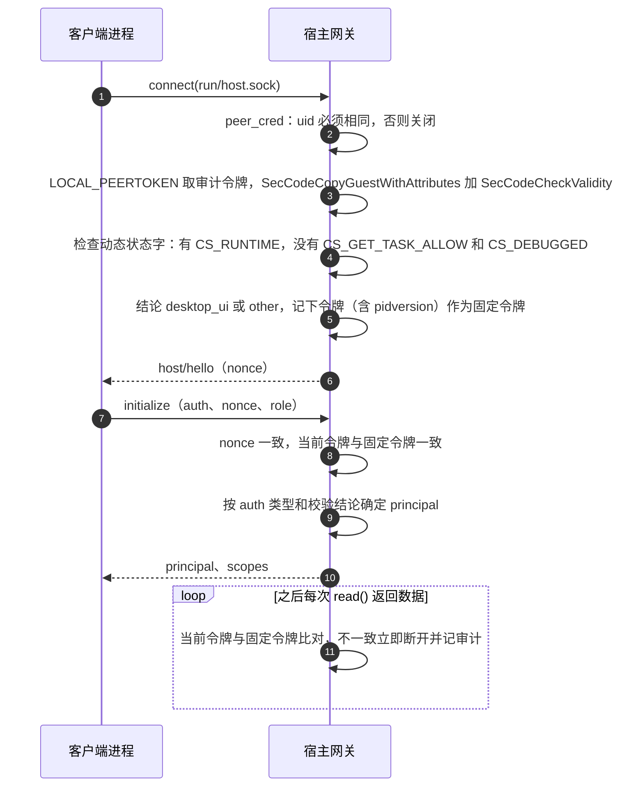
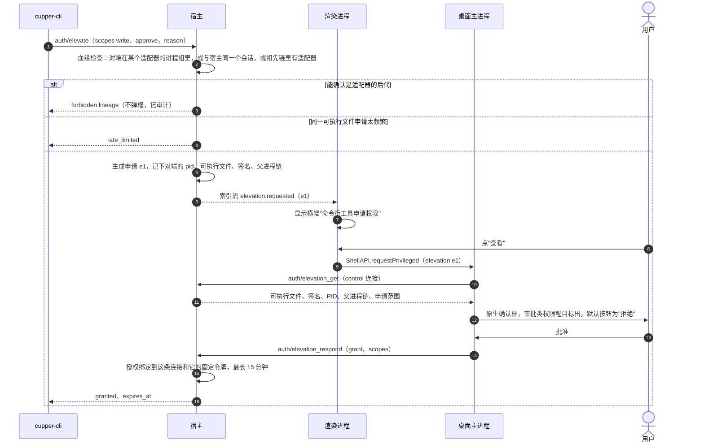

# 5.8 安全实现

- 所属：`docs/02-design.md` 第 5 节
- 依据：ADR-05（含 SP-4b、SP-4a 修订）、ADR-03（渲染进程加固）、ADR-01（宿主自检）；SEC-6、SEC-8、SEC-10
- 威胁主体：agent 本身或它拉起的子进程，与宿主是同一个系统用户，可能被提示注入驱动，目的是替自己批准、切到完全访问、选择"总是允许"（ADR-05）

## 5.8.1 认证握手（固定令牌）

**为什么要固定令牌**（SP-4b G2–G4）：`LOCAL_PEERTOKEN` 返回的是最近一次在这个套接字上做 I/O 的进程的当前映像。只在连接开始时校验一次，对端可以先写数据再 exec 成正版程序，或者 fork 出的进程共用已校验的连接。固定令牌加 nonce 回显、每次读取都比对，实测能挡住这两种攻击。

**签名要求**（编译期写进宿主和原生扩展，不从磁盘读取；Team ID 来自构建环境）

| 校验谁 | 要求 |
|---|---|
| 宿主校验 UI 主进程 | `anchor apple generic and identifier "<前缀>.app" and certificate leaf[subject.OU] = "<Team ID>" and certificate 1[field.1.2.840.113635.100.6.2.6] exists and certificate leaf[field.1.2.840.113635.100.6.1.13] exists`，再加上述动态状态字检查。Electron 的 helper（`.helper`、`.helper.Renderer` 等，electron-builder 会给它们加后缀）identifier 不同，一律不满足 |
| UI 主进程和 CLI 校验宿主 | 同上，identifier 为 `<前缀>.app.host` |

**校验出错时**：一律按拒绝处理。错误分四类记审计并给 UI 语义码（ADR-05 的 SP-4b 修订第 3 条）：对端已退出（`ENOTCONN`）、对端已 exec（`-67065`）、磁盘上的代码已变（`ENOENT`、`-67034`，多半正在升级）、其他。

**UI 校验宿主**：主进程连接时用原生扩展做一次完整校验，之后每次收到数据只比对令牌（微秒级）。校验失败时不发送任何命令（[5.7.8](07-desktop.md#578-安全加固的落点)）。

**退化模式**（开发构建、e2e 构建、自行构建，ADR-05）

- UI 主进程每次拉起宿主时生成 32 字节随机密钥，经 stdin 传入后立即关闭；`initialize` 用 `auth: dev_key` 出示，宿主做常量时间比较。密钥不出现在 argv、环境变量和任何文件里（SP-4b：同一用户能看到 argv 和环境变量）。
- 宿主在 `initialize` 结果里设 `weak_auth: true`，UI 首次启动时说明一次，之后在标题栏放标记、在设置页常驻显示（ADR-05）。
- 局限：密钥只有拉起宿主的那个 UI 实例知道。UI 崩溃后重启，新实例连不上还在运行的宿主，只能提示"需要重启宿主"，确认后向 `host.lock` 中记录的 pid 发 SIGTERM（同一用户可以发信号），运行中的回合会被中断。也就是说，退化模式下做不到 NFR-8 的"界面崩溃不影响会话"。发布构建不受影响（见待定问题 Q22）。

## 5.8.2 principal、角色与 scope

| principal（稳定 ID） | 怎样认证 | 角色 | scope |
|---|---|---|---|
| `desktop_ui`（`pr_desktop`） | 签名校验通过，或退化模式下的 `dev_key` | `control`：主进程自用 | `read`、`write`、`approve`、`privileged`、`ui_local` |
| | | `window`：转发给窗口 | `read`、`write`、`approve`、`ui_local` |
| `cli`（`pr_cli`） | uid 相同 | — | `read` |
| `cli` 已提权 | `auth/elevate` 后用户在原生确认框里批准 | — | `read`，加上批准的 `write` 和/或 `approve`；**永远没有 `privileged`** |
| `test_harness`（`pr_test`） | 继承 fd 传入的一次性密钥；只在 `test-harness` 构建中存在 | — | 全部 |
| `remote_device`（`pr_dev_<设备>`，M3 预留） | 远程桥在进程内完成认证后接入 | — | `read`、`write`、`approve`，再按 SEC-9 的方法级规则收窄 |

| scope | 含义 |
|---|---|
| `read` | 订阅、查询、历史、blob 下载、在场、标记已读 |
| `write` | 会改变会话、项目、工作区或设置的普通操作 |
| `approve` | 回答审批和提问（不含 `allow_always` 类选项） |
| `privileged` | 持久或大幅扩大权限的操作：`allow_always` 类选项、切到完全访问、安全相关的设置、提权决定、宿主退出和升级 |
| `ui_local` | 只对本机桌面界面有意义的操作：在外部应用中打开工作区、导出诊断包 |

## 5.8.3 权限矩阵

✓ 允许；✗ 拒绝；"原生确认"表示只能由主进程在用户确认原生确认框后经 control 连接发送。

| 方法 | UI control | UI window | cli | cli + write | cli + approve | test_harness | remote_device（M3 预留） |
|---|---|---|---|---|---|---|---|
| `initialize`、`ping`、`client/presence`、`host/status` | ✓ | ✓ | ✓ | ✓ | ✓ | ✓ | ✓ |
| 订阅、`history/page`、`blob/get`、`session/get`、`session/capabilities`、`agents/capabilities`、`interaction/get`、`settings/get`、`git/status`、`git/diff`、`git/file_diff`、`git/branches`、`worktree/check`、`files/search`、`session/list_archived` | ✓ | ✓ | ✓ | ✓ | ✓ | ✓ | ✓（diff 为 MB-8，P1） |
| `session/mark_read` | ✓ | ✓ | ✓ | ✓ | ✓ | ✓ | ✓ |
| `blob/put` | ✓ | ✓ | ✗ | ✓ | ✗ | ✓ | ✓（MB-9 附图，P1） |
| `project/add`、`project/remove` | ✓ | ✓ | ✗ | ✓ | ✗ | ✓ | ✗（SEC-9：只能在已有项目里新建会话） |
| `session/create`（普通配置）、`session/send`、`session/interrupt`、`session/queue_resume` | ✓ | ✓ | ✗ | ✓ | ✗ | ✓ | ✓（MB-4、MB-7；新建会话为 MB-9，P1） |
| `session/set_config`（普通值）、`session/rename`、`session/archive`、`session/restore`、`agents/refresh`、`agents/restart` | ✓ | ✓ | ✗ | ✓ | ✗ | ✓ | 仅 `set_config` 的普通值（MB-9，P1） |
| `session/create`、`session/set_config` 选择完全访问 | 原生确认 | ✗ | ✗ | ✗ | ✗ | ✓ | ✗ |
| `interaction/respond`（`requires: approve` 的选项、回答提问） | ✓ | ✓（真实输入、距创建不少于 400 ms） | ✗ | ✗ | ✓ | ✓ | ✓ |
| `interaction/respond`（`requires: privileged` 的选项） | 原生确认 | ✗ | ✗ | ✗ | ✗ | ✓ | ✗（U3） |
| `git/stage`、`git/unstage`、`git/revert`、`git/commit`、`git/push` | ✓ | ✓ | ✗ | ✓ | ✗ | ✓ | ✗ |
| `settings/update`（普通键） | ✓ | ✓ | ✗ | ✓ | ✗ | ✓ | ✗ |
| `settings/update`（安全相关的键） | 原生确认 | ✗ | ✗ | ✗ | ✗ | ✓ | ✗ |
| `workspace/open`、`diag/export` | ✓ | ✓ | ✗ | ✗ | ✗ | ✓ | ✗ |
| `auth/elevate` | ✗ | ✗ | ✓ | ✓ | ✓ | ✗ | ✗ |
| `auth/elevation_get`、`policy/describe`（主进程弹确认框前取内容） | ✓ | ✗ | ✗ | ✗ | ✗ | ✓ | ✗ |
| `auth/elevation_respond` | 原生确认 | ✗ | ✗ | ✗ | ✗ | ✓ | ✗ |
| `host/prepare_upgrade`、`host/exit` | ✓（有运行中的回合时原生确认） | ✗ | ✗ | ✗ | ✗ | ✓ | ✗ |
| `diag/recording_export` | 仅 dev/e2e 构建 | 仅 dev/e2e 构建 | ✗ | ✗ | ✗ | ✓ | ✗ |

实现：方法级规则由协议常量 `SCOPE` 驱动；资源级规则（完全访问、`privileged` 选项、安全键、400 ms 间隔、remote_device 的收窄）在 `policy` 模块注册。CI 里有一个表驱动测试，按本表逐格断言。

## 5.8.4 CLI 提权

- 血缘检查只是辅助信号（SP-4b）：进程组加会话 ID 能挡住 nohup、双重 fork、disown，挡不住 setsid、launchd、`open`、事先运行的 tmux 等。主要防线是"写操作必须由用户确认"。私有 SPI `responsibility_*` 不用，留给 SP-10 评估。
- 限频：同一个可执行文件最多 3 个未决申请，两次申请至少间隔 10 秒；全局最多 10 个未决申请。2 分钟没有决定就过期。
- 授权随连接断开立即失效；不提供不经确认就能写的"可信 CLI 凭据"（U-T4）。

## 5.8.5 进程卫生

| 进程 | 进程组 | 文件描述符 | 环境变量 | 其他 |
|---|---|---|---|---|
| 适配器（node + adapter.mjs） | 独立进程组；拉起后立即记录 pid、pgid、启动时间 | `POSIX_SPAWN_CLOEXEC_DEFAULT`，只有 0、1、2 三个管道 | 白名单（[5.6.6](06-agent-driver.md#566-cli-的发现与版本检查)），去掉所有 `CUPPER_*` | 默认信号处置、空信号掩码；拉起前核对 Node 的 cdhash 和 adapter.mjs 的 sha-256（ADR-08）；关闭和崩溃后按进程组清理 |
| git | 短命子进程 | stdin 为 `/dev/null`；Rust 默认 CLOEXEC | 宿主的白名单环境加 `LC_ALL=C`、`GIT_TERMINAL_PROMPT=0` | 超时后终止 |
| CLI `--version`、登录 shell 探测 | 独立进程组 | 同上 | 白名单 | 5 秒超时，超时后杀整个进程组 |
| 宿主自身 | UI 用 setsid 拉起 | UI 主进程到宿主的连接 fd 设 CLOEXEC，不会漏给 UI 的子进程 | 不含任何秘密；dev 密钥只经 stdin | 只用 `read(2)` 读套接字，不接收 `SCM_RIGHTS` 传来的 fd（实现时用测试确认会被内核丢弃，SP-4b 遗留项） |
| 数据与套接字 | — | — | — | 数据目录 0700 并检查属主；套接字 0600；短路径回退目录同样检查（SP-4a） |
| 网络 | — | — | — | 宿主不监听任何端口（SEC-8）；只有运行时安装器访问 npm 仓库。注意：electron-updater 在安装更新的那一刻，会在 UI 进程里临时开一个只监听 127.0.0.1 的代理端口，把下载好的包交给 Squirrel.Mac（已核对 6.8.10 源码），这不是宿主，但写进安全说明 |

SEC-6：默认不收集任何遥测；Electron 的 crashReporter 只在本地保存（`uploadToServer: false`）；运行时安装器的请求不带任何用户信息。

## 5.8.6 审计日志

写进 `audit` 表（保留 90 天）并同时写入 `host.log`。设置页的"连接与设备"显示当前的客户端（来自索引流的 `clients`），审计记录随诊断包导出。

| 事件 | 记录内容 |
|---|---|
| `conn.accepted`、`conn.rejected` | 连接 ID、对端 pid、可执行文件路径、签名 identifier、Team ID、校验结论或错误类别 |
| `conn.initialized` | principal、角色、客户端名称和版本、是否弱认证 |
| `conn.closed` | 时长、原因（含 `token_mismatch`） |
| `elevation.*` | 申请、批准、拒绝、过期、因血缘被拒、被限频；申请范围和血缘信号 |
| `privileged.executed` | 方法、操作摘要（例如"选择了会写入 Claude 权限规则的选项"、"权限模式切到 bypassPermissions"）、principal、连接 |
| `host.*` | 启动、退出、进入待升级、处于弱认证模式 |

## 5.8.7 安全边界说明

M1b 在用户文档里写清 SEC-8 能做到和做不到的（ADR-05、SP-4b 草稿），要点：

- agent 的沙箱开着时，agent 执行的命令连不上宿主；前提是 Codex 没有为工作区模式打开网络访问（打开后放行所有 Unix 套接字），Claude Code 没有配置 `allowUnixSockets`。
- 不在沙箱里的命令（用户批准过的、MCP、hooks）能连上，但只有只读权限；写操作和审批都要用户在桌面端确认。
- 冒充宿主会被 UI 识破；认证不依赖可被偷走的静态凭据。
- 挡不住同一用户下、在沙箱外有明确恶意的进程：它可以改 agent 自己的权限配置和 cupper 的数据目录、杀掉宿主、经 launchd 或 `open` 绕过血缘检查、对确认框做社会工程。
- 开发构建和自行构建的本地鉴权较弱。
- 建议用户开启 agent 自带的沙箱，并且不要给 Codex 的工作区模式打开网络访问。
