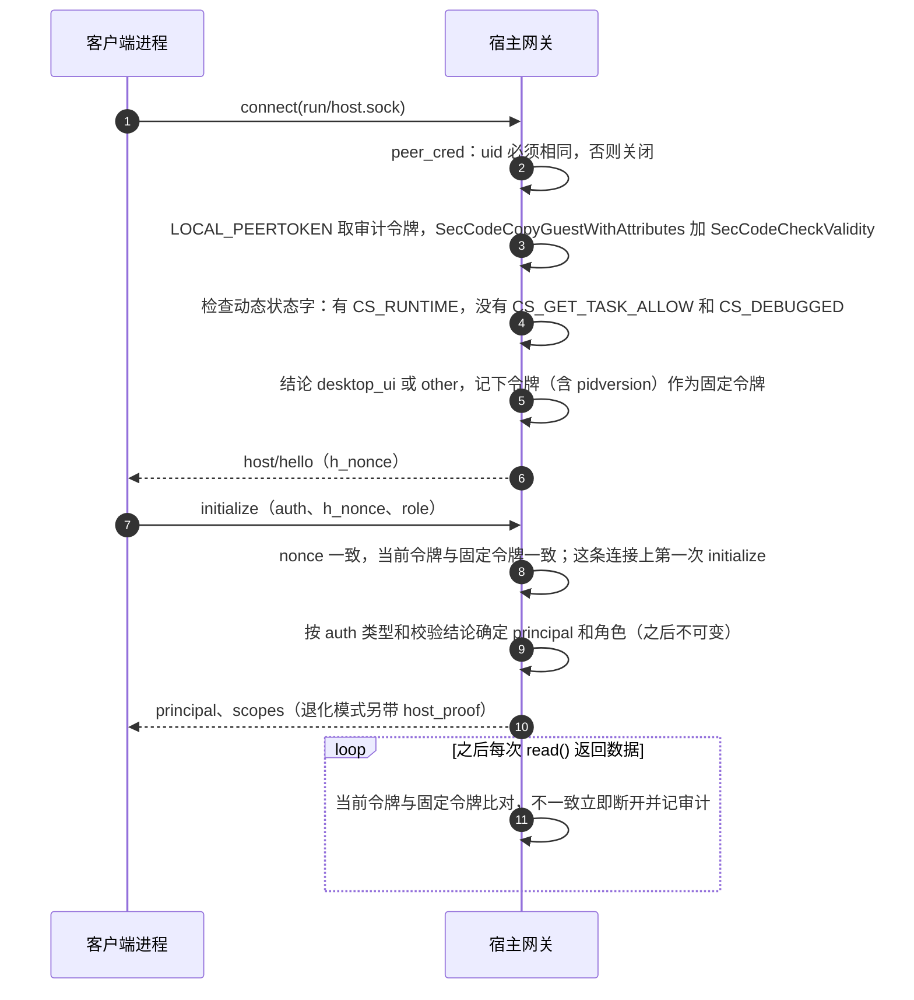
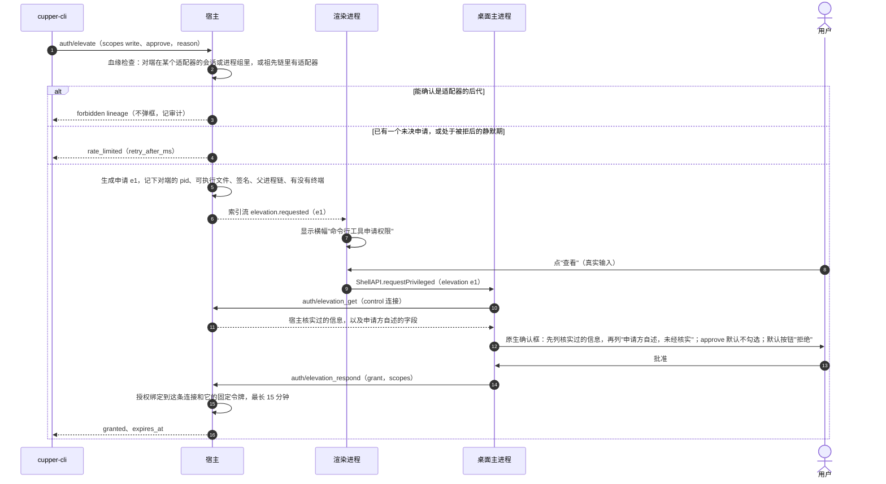

# 5.8 安全实现

- 所属：`docs/02-design.md` 第 5 节
- 依据：ADR-05（含 SP-4b、SP-4a 修订）、ADR-03（渲染进程加固）、ADR-01（宿主自检）；SEC-6、SEC-8、SEC-9、SEC-10；设计评审会（`docs/meetings/2026-10-16-design-review/`）
- 威胁主体：agent 本身或它拉起的子进程，与宿主是同一个系统用户，可能被提示注入驱动，目的是替自己批准、切到更宽松的审批档位、选择"总是允许"，或者借宿主在沙箱外执行代码（ADR-05）

## 5.8.1 认证握手（固定令牌）

**为什么要固定令牌**（SP-4b G2–G4）：`LOCAL_PEERTOKEN` 返回的是最近一次在这个套接字上做 I/O 的进程的当前映像。只在连接开始时校验一次，对端可以先写数据再 exec 成正版程序，或者 fork 出的进程共用已校验的连接。固定令牌加 nonce 回显、每次读取都比对，实测能挡住这两种攻击。

**每条连接只握手一次**（安全 #4）：宿主每条连接只接受一次 `initialize`，再收到就返回 `forbidden`（`reason: already_initialized`）并断开；角色确定后不可变；只有 `desktop_ui` 能声明 `control`、`window` 角色。window 连接的 `initialize` 由桌面主进程自己发，发完才把端口交给渲染进程（[5.7.1](07-desktop.md#571-进程与连接)）。

**签名要求**（编译期写进宿主和原生扩展，不从磁盘读取；Team ID 来自构建环境）

bundle identifier 的前缀定为 `dev.cupper`（Q5，已定（2026-10-16），见 `docs/meetings/2026-10-16-gate-design-decisions/minutes.md`）。它会写进签名要求、钥匙串 ACL、TCC 授权和通知身份；M1b 首次签名发布前可以无成本修改，之后不再改。各构建的 identifier 见 [5.7.9](07-desktop.md#579-构建种类)。

| 校验谁 | 要求 |
|---|---|
| 宿主校验 UI 主进程 | `anchor apple generic and identifier "dev.cupper.app" and certificate leaf[subject.OU] = "<Team ID>" and certificate 1[field.1.2.840.113635.100.6.2.6] exists and certificate leaf[field.1.2.840.113635.100.6.1.13] exists`，再加上述动态状态字检查。Electron 的 helper（`dev.cupper.app.helper`、`.helper.Renderer` 等）identifier 不同，一律不满足 |
| UI 主进程和 CLI 校验宿主 | 同上，identifier 为 `dev.cupper.app.host` |

**校验出错时**：一律按拒绝处理。错误分四类记审计并给 UI 语义码（ADR-05 的 SP-4b 修订第 3 条）：对端已退出（`ENOTCONN`）、对端已 exec（`-67065`）、磁盘上的代码已变（`ENOENT`、`-67034`，多半正在升级）、其他。

**UI 和 CLI 校验宿主**：主进程连接时用原生扩展做一次完整校验，之后每次收到数据只比对令牌（微秒级）。校验失败时不发送任何命令（[5.7.8](07-desktop.md#578-安全加固的落点)）。发布版的 UI 和 CLI 遇到 `weak_auth: true` 的宿主时拒绝连接（安全 #12）。各构建种类的校验方式（v1.3，计划评审安全确认）：

| 构建 | UI 校验宿主 | CLI 校验宿主 |
|---|---|---|
| 发布 | 签名要求（Developer ID） | 签名要求（Developer ID） |
| 自用 | `dev_key` 的双向证明 | **编译期写入的宿主 cdhash**：`xtask host-bundle` 先签宿主、取得 cdhash，再编译并签名 CLI；连接时经审计令牌取对端运行中的 cdhash 比对，之后每次读取都比对令牌，不一致就拒绝连接。CLI 与宿主是两个独立的 Mach-O，不存在 UI 与宿主之间那种互相依赖。Q35 通过后改为本机签名要求，cdhash 校验可以保留 |
| 开发 | `dev_key` 的双向证明 | 弱校验：运行时按同目录宿主文件的 cdhash 比对，输出里标"宿主未经签名校验" |
| e2e | `dev_key` 的双向证明 | `harness` 认证的双向证明 |

这样做是为了防止假宿主劫持 CLI 的提权。攻击过程是：假宿主抢先占住套接字，以只读客户端的身份连上真宿主，再把用户的 `cupper elevate` 转发过去；真 UI 弹出的确认框被用户批准，授权却落在假宿主的连接上。

**宿主的启动载荷**（经 stdin，适用于全部构建）

- 拉起宿主的一方（桌面主进程）经 stdin 写一行 JSON 后立即关闭 stdin：`{"dev_key": "<64 位十六进制>", "harness_key"?: "...", "test_config"?: {...}}`。
- 宿主读这一行，超时 2 s；超时或格式错误就记日志、以退出码 1 退出。读完后把自己的 stdin、stdout、stderr 指向 `/dev/null`。
- 只有 `dev-auth` 构建读取 `dev_key`；只有 `test-harness` 构建读取 `harness_key` 和 `test_config`，这两段代码在编译期门控。发布版的 UI 不写启动载荷，发布版的宿主也不读 stdin，直接把它指向 `/dev/null`。
- 密钥不出现在 argv、环境变量和任何文件里（SP-4b：同一用户能看到 argv 和环境变量）。

**退化模式**（开发构建、e2e 构建、自行构建，ADR-05）

- UI 主进程每次拉起宿主时生成 32 字节随机密钥，经上面的启动载荷传入。
- **双向证明，并绑定信道**（安全确认、纪要 D11）：
  - 客户端在 `initialize` 里出示 `auth: dev_key {c_nonce, proof}`，`proof = HMAC-SHA256(key, "c2h" ‖ h_nonce ‖ c_nonce ‖ pid_c)`。`pid_c` 是客户端自己的 pid；宿主用这条连接上 `LOCAL_PEERPID` 看到的 pid 计算并做常量时间比较。
  - 宿主在结果里返回 `host_proof = HMAC-SHA256(key, "h2c" ‖ h_nonce ‖ c_nonce ‖ pid_h)`。`pid_h` 是宿主自己的 pid；客户端用它在套接字上看到的对端 pid 计算并比较，不一致就断开。
  - 编码：方向标签是 3 字节 ASCII，两个 nonce 各 32 字节原始值，pid 是 4 字节大端整数，依次拼接。
  - 效果：假宿主不知道密钥，过不了 UI 的校验；有人在中间转发时，两端看到的对端 pid 是转发者的 pid，证明对不上。e2e 构建里"假宿主占用套接字时 UI 拒绝连接"的用例因此名副其实。
  - `harness` 认证（test-harness 构建）用同样的格式。
- **`dev_key` 只接受拉起宿主的那个进程**（v1.3，计划评审安全 #10、P-19）：
  - 宿主启动时用 `proc_pidinfo` 的 `PROC_PIDUNIQIDENTIFIERINFO` 读出自己的 `p_puniqueid`，即 fork 时写入的父进程唯一 ID，没有竞态；校验时取对端的 `p_uniqueid` 比对，不符就拒绝。字段名由 T021 实测确认；实测不可行时退回"pid 加进程启动时间"。
  - 启动时 ppid 已经是 1（父进程已退出）的，`dev-auth` 构建的宿主以错误码退出，不等待任何 `dev_key` 连接。
  - 只限 `dev_key`，`harness` 认证不受影响。
  - 父进程退出后，宿主进入"孤立"状态：不再开始新回合，运行中的回合结束后有序退出。
  - 这条的价值有限，只在密钥经崩溃转储、日志等意外途径泄露时起作用；但改动小，也不会让人误以为认证变强了。
- 客户端出示 `auth: dev_key`、证明却错误或缺失时，返回 `unauthenticated` 并断开，不降级成只读的 cli。不出示 `dev_key` 的同 uid 客户端，照常按 cli 只读接入。
- 宿主在 `initialize` 结果里设 `weak_auth: true`，UI 首次启动时说明一次，之后在标题栏放标记、在设置页常驻显示（ADR-05）。
- **局限与条件**（Q22，已定（2026-10-16），见 `docs/meetings/2026-10-16-gate-design-decisions/minutes.md`；口径记录在 PRD v1.2 第 10 节）：
  - 密钥只有拉起宿主的那个 UI 实例知道。UI 崩溃后重启，新实例连不上还在运行的宿主，只能提示"需要重启宿主"，确认后向 `host.lock` 中记录的 pid 发 SIGTERM，运行中的回合会被中断。所以退化模式下 NFR-8 的"界面崩溃不影响会话"不成立；发布构建不受影响，并由签名后冒烟测试覆盖（[5.10.7](10-release.md#5107-发布流水线)）。
  - 退化模式只由编译特性 `dev-auth` 决定，不允许运行时回退到退化模式。
  - 作者自行构建、日常使用的版本是"自用构建"：身份 `dev.cupper.app.local`，数据目录 `cupper-local/`，与发布版和开发构建都不共用（v1.3，[5.7.9](07-desktop.md#579-构建种类)）。开发构建（`dev.cupper.app.dev`、`cupper-dev/`）只用于开发和测试，不在真实项目上运行真实 agent。
  - 不把密钥存进钥匙串或文件，那样会进一步削弱认证。
  - 开发时 `pnpm dev` 重启 Electron 时一并重启宿主，避免每次都停在"需要重启宿主"。

## 5.8.2 principal、角色与 scope

| principal（稳定 ID） | 怎样认证 | 角色 | scope |
|---|---|---|---|
| `desktop_ui`（`pr_desktop`） | 签名校验通过，或退化模式下的 `dev_key` | `control`：主进程自用 | `read`、`write`、`approve`、`privileged`、`ui_local` |
| | | `window`：转发给窗口 | `read`、`write`、`approve`、`ui_local` |
| `cli`（`pr_cli`） | uid 相同 | — | `read` |
| `cli` 已提权 | `auth/elevate` 后用户在原生确认框里批准 | — | `read`，加上批准的 `write` 和/或 `approve`；**永远没有 `privileged`** |
| `test_harness`（`pr_test`） | 启动载荷里的一次性密钥；只在 `test-harness` 构建中存在 | — | 全部，含 `test` |
| `remote_device`（`pr_dev_<设备>`，M3 预留） | 远程桥在进程内完成认证后接入 | — | `read`、`write`、`approve`，再按 SEC-9 的方法级规则收窄 |

| scope | 含义 |
|---|---|
| `read` | 订阅、查询、历史、blob 下载、在场、标记已读 |
| `write` | 会改变会话、项目、工作区或设置的普通操作 |
| `approve` | 回答审批和提问（不含 `allow_always` 类选项）；把会话放宽到 `elevated` 档位也要求它 |
| `privileged` | 持久或大幅扩大权限的操作：`allow_always` 类选项、切到 `full_access`、确认会话档位、信任项目、安全相关的设置、提权决定、宿主退出和升级 |
| `ui_local` | 只对本机桌面界面有意义的操作：在外部应用中打开工作区、导出诊断包 |
| `test` | 测试专用方法（`test/*`），只在 `test-harness` 构建中存在 |

**审批档位规则**（安全 #3，纪要 D10）

- 档位是 `normal` < `elevated` < `full_access`，各取值属于哪一档见 [5.6.5](06-agent-driver.md#565-配置项映射)。`elevated` 的含义是由分类器代替用户审批（Claude 的 `auto`、`acceptEdits`，Codex 的 Auto review），所以放宽到它等于拿到 approve。
- "放宽"指目标档位高于会话当前的档位。会改变档位的入口有三个：`session/create` 的 `config`、`session/set_config`、`interaction/respond` 选中带 `mode_after` 的选项。三者按同一条规则判定（下表）。
- 宿主记录每次设定档位的 principal（`sessions.mode_set_by`）。**会话的默认档位来自用户自己的 CLI 配置时，视为由创建会话的 principal 设定。**
- 实际档位与设定者的权限不符时（例如只有 write 的 CLI 新建了会话，而 Codex 的默认档位是 `agent`；M3 的手机新建会话（MB-9）时默认档位是 `elevated`，同样算放宽），会话进入 `config_unconfirmed`（[5.2.6](02-host.md#配置项)）：暂停发送，直到桌面端经原生确认，或者有权限的一方把档位降下来。

| 目标档位 | UI control | UI window | cli + write | cli + write + approve | test_harness | remote_device（M3） |
|---|---|---|---|---|---|---|
| 收紧或同档 | ✓ | ✓ | ✓ | ✓ | ✓ | ✓ |
| 放宽到 `elevated` | ✓ | ✓（界面加提示，U6） | ✗ | ✓ | ✓ | ✗（U-R2，已定（2026-10-16）；PRD v1.2 的 SEC-9） |
| 放宽到 `full_access` | 原生确认 | ✗ | ✗ | ✗ | ✓ | ✗ |

窗口经计划确认的 `exit-plan-auto` 切到 `auto`，仍按 `allow_always` 类选项走原生确认（ADR-03），比经模式选择器切换更严。两条路径不为了一致而放宽。

## 5.8.3 权限矩阵

✓ 允许；✗ 拒绝；"原生确认"表示只能由主进程在用户确认原生确认框后经 control 连接发送；"真实输入"表示 window 角色发来的请求必须带主进程写入的 `input` 证据（[5.7.8](07-desktop.md#578-安全加固的落点)），缺了就拒绝。

| 方法 | UI control | UI window | cli | cli + write | cli + approve | test_harness | remote_device（M3 预留） |
|---|---|---|---|---|---|---|---|
| `initialize` | ✓ | 仅由主进程代发 | ✓ | ✓ | ✓ | ✓ | ✓ |
| `ping`、`client/presence`、`host/status` | ✓ | ✓ | ✓ | ✓ | ✓ | ✓ | ✓ |
| 订阅、`history/page`、`blob/get`、`session/get`、`session/capabilities`、`agents/capabilities`、`interaction/get`、`project/trust_info`、`settings/get`、`git/status`、`git/diff`、`git/file_diff`、`git/branches`、`worktree/check`、`files/search`、`session/list_archived` | ✓ | ✓ | ✓ | ✓ | ✓ | ✓ | ✓（diff 为 MB-8，P1） |
| `session/mark_read` | ✓ | ✓ | ✓ | ✓ | ✓ | ✓ | ✓ |
| `blob/put` | ✓ | ✓ | ✗ | ✓ | ✗ | ✓ | ✓（MB-9 附图，P1） |
| `project/add`、`project/remove` | ✓ | ✓ | ✗ | ✓ | ✗ | ✓ | ✗（SEC-9：只能在已有项目里新建会话） |
| `project/trust`（[5.2.6](02-host.md#项目信任)） | 原生确认 | ✗ | ✗ | ✗ | ✗ | ✓ | ✗ |
| `session/create`、`session/set_config`、`interaction/respond` 中会改变档位的部分 | 按 5.8.2 的档位规则 | | | | | | |
| `session/create`（不改变档位）、`session/send`、`session/interrupt`、`session/queue_resume` | ✓ | ✓ | ✗ | ✓ | ✗ | ✓ | ✓（MB-4、MB-7；新建会话为 MB-9，P1） |
| `session/set_config`（非档位的配置项）、`session/rename`、`session/archive`、`session/restore`、`agents/refresh`、`agents/restart` | ✓ | ✓ | ✗ | ✓ | ✗ | ✓ | 仅 `set_config` 的模型和推理强度（MB-9，P1） |
| `session/confirm_config` | 原生确认 | ✗ | ✗ | ✗ | ✗ | ✓ | ✗ |
| `interaction/respond`（`requires: approve` 的选项、回答提问） | ✓ | ✓（真实输入，距创建不少于 400 ms） | ✗ | ✗ | ✓ | ✓ | ✓ |
| `interaction/respond`（`requires: privileged` 的选项） | 原生确认 | ✗ | ✗ | ✗ | ✗ | ✓ | ✗（U3） |
| `git/stage`、`git/unstage`、`git/commit`、`git/push` | ✓ | ✓ | ✗ | ✓ | ✗ | ✓ | ✗ |
| `git/revert` | ✓ | ✓（真实输入） | ✗ | ✓ | ✗ | ✓ | ✗ |
| `settings/update`（普通键） | ✓ | ✓ | ✗ | ✓ | ✗ | ✓ | ✗ |
| `settings/update`（安全相关的键，[5.2.11](02-host.md#5211-文件服务与设置)） | 原生确认 | ✗ | ✗ | ✗ | ✗ | ✓ | ✗ |
| `workspace/open`、`diag/export` | ✓ | ✓ | ✗ | ✗ | ✗ | ✓ | ✗ |
| `auth/elevate` | ✗ | ✗ | ✓ | ✓ | ✓ | ✗ | ✗ |
| `auth/elevation_get`、`policy/describe`（主进程弹确认框前取内容） | ✓ | ✗ | ✗ | ✗ | ✗ | ✓ | ✗ |
| `auth/elevation_respond` | 原生确认 | ✗ | ✗ | ✗ | ✗ | ✓ | ✗ |
| `host/prepare_upgrade`、`host/exit` | ✓（有运行中的回合时原生确认） | ✗ | ✗ | ✗ | ✗ | ✓ | ✗ |
| `diag/recording_export` | 仅 dev/e2e 构建 | 仅 dev/e2e 构建 | ✗ | ✗ | ✗ | ✓ | ✗ |
| `test/*` | ✗ | ✗ | ✗ | ✗ | ✗ | 仅 test-harness 构建 | ✗ |

实现：方法级规则由协议常量 `SCOPE` 驱动；资源级规则（档位、`privileged` 选项、安全键、真实输入证据、400 ms 间隔、项目信任、remote_device 的收窄）在 `policy` 模块注册（[5.2.5](02-host.md#525-策略与命令账本)）。CI 里有一个表驱动测试，按本表逐格断言；另有一次不带任何特性的运行，断言发布构建里 harness 认证、`dev_key`、`test/*`、`diag/recording_export` 都不存在（[5.1.6](01-repo-build-ci.md#516-ci-流水线)）。

## 5.8.4 CLI 提权

- **血缘检查**只是辅助信号（SP-4b）。适配器用 `POSIX_SPAWN_SETSID` 拉起、自成一个会话（[5.8.5](#585-进程卫生)），所以只认三类信号：对端与某个适配器同一个会话、同一个进程组，或者祖先链里有适配器。宿主自己拉起的 git、登录 shell 和 M2 的集成终端都不在适配器的会话里，不会被误判。挡不住 setsid、launchd、`open`、事先运行的 tmux 等；主要防线是"写操作必须由用户确认"。私有 SPI `responsibility_*` 不用，留给 SP-10 评估。
- **对 Claude 工具命令的实际效果**（v1.6，T003 关闭 SP-4b 遗留第 7 条）：Claude Code 拉起每条 Bash 命令时都会 setsid，命令（`zsh -c` 及其子进程）在 CLI 新建的会话和进程组里。所以对 Claude 的工具命令，"同一会话""同一进程组"两个信号永远命中不了，只剩祖先链；命令一旦经 nohup、双重 fork 或 disown 脱离父进程，三个信号全部失效。CLI 本身和它拉起的 MCP、hooks 留在适配器的进程组里，仍能被前两个信号识别。结论不变：血缘检查只是辅助信号，主要防线是"写操作必须由用户确认"。T038 按这个结论设定各信号的期望。
- **限频**（安全 #8）：
  - 非 UI 的申请，全局同一时间只允许 1 个未决；
  - 10 分钟内被拒 2 次后静默 10 分钟，期间的申请直接返回 `rate_limited`，只计数；
  - 2 分钟没有决定就过期。
- **确认框的内容**：
  - 先列宿主核实过的信息：可执行文件路径、签名身份（或"未签名"）、pid、父进程链；
  - 父进程链断在 launchd、或者进程没有控制终端时，标"无法确认来源"；
  - 是否本 App 自带的命令行工具（`bundled_cli`，T133，2026-10-20）：申请方的可执行文件路径等于按宿主自己的位置推出的 `Contents/Helpers/cupper`，并且申请方**运行中的代码**（经审计令牌取）的签名 identifier 是 CLI 的、签名证书与宿主自己的相同。全程不读 App 包里的文件（宿主运行期间不读包内文件）：包里的 CLI 被替换后再拿来申请，按文件比对会得出"是自带的"，误导用户。ad-hoc 签名的构建没有证书，一律判为否；
  - 申请方自填的 `client_name` 和 `reason` 放在"申请方自述，未经核实"下面，各限 200 字符，控制字符和双向控制符显示为转义；
  - 申请范围里的 approve 单独一个勾选项，默认不勾。
- 授权随连接断开立即失效；不提供不经确认就能写的"可信 CLI 凭据"（U-T4）。
- CLI 完成的 `interaction/respond` 写审计。

## 5.8.5 进程卫生

所有子进程都经 `cupper-sys::spawn` 拉起：`POSIX_SPAWN_CLOEXEC_DEFAULT`、显式指定 stdio、默认信号处置、空信号掩码、环境变量白名单。

| 进程 | 会话与进程组 | 文件描述符 | 环境变量 | 其他 |
|---|---|---|---|---|
| 适配器（node + adapter.mjs） | `POSIX_SPAWN_SETSID`：自成会话和进程组；拉起后立即记录 pid、pgid、启动时间 | 只有 0、1、2 三个管道 | 白名单（[5.6.6](06-agent-driver.md#566-cli-的发现与版本检查)），去掉所有 `CUPPER_*` | 拉起前核对 Node 的 cdhash 和 adapter.mjs 的 sha-256（ADR-08）；关闭和崩溃后按进程组清理；ACP 客户端能力里的 `fs`、`terminal` 永远声明为不支持，要改必须经过安全评审 |
| git | 短命子进程；用启动时解析出的绝对路径，工作目录是 cupper 自己的目录 | stdin 为 `/dev/null` | 宿主的白名单环境加 `LC_ALL=C`、`GIT_TERMINAL_PROMPT=0`；PATH 只保留可信条目（不在任何项目、工作区、临时目录下的绝对路径） | 按三档调用（[5.2.10](02-host.md#5210-git-与-worktree-服务)）：宿主自动发起的调用不执行仓库配置指定的任何程序；只有用户点"提交""推送"时运行仓库的 hooks；超时后终止 |
| CLI `--version`、登录 shell 探测 | 独立进程组 | stdin 为 `/dev/null` | 白名单 | 5 秒超时，超时后杀整个进程组；登录 shell 取到的环境只放在内存里，不写日志，不进诊断包 |
| 宿主自身 | 桌面主进程经原生扩展调用 `cupper-sys::spawn` 拉起，`POSIX_SPAWN_SETSID` | 主进程到宿主的连接 fd 设 CLOEXEC，不会漏给 UI 的子进程；宿主读完启动载荷后，把自己的 stdio 指向 `/dev/null` | 环境变量白名单，不含任何秘密；密钥只经启动载荷 | 读 cupper 的套接字一律经 `cupper_sys::recv_closing_fds`（带控制缓冲区读取，收到的 fd 全部关闭），收到 fd 就断开连接并记审计（v1.8 更正：T021 实测发现，不带控制缓冲区的 `read`/`recv` 照样会把 `SCM_RIGHTS` 传来的 fd 装进读方，并且不设 CLOEXEC；原写法"只用 read(2)、会被内核丢弃"不成立）。原生扩展和 CLI 读宿主的套接字时同样如此 |
| 数据与套接字 | — | — | — | 数据目录、日志目录 `~/Library/Logs/cupper`、worktree 根目录都建成 0700 并检查属主；套接字 0600；路径过长时回退到每个用户自己的 `DARWIN_USER_TEMP_DIR`（[5.2.13](02-host.md#5213-进程监护与宿主生命周期)） |
| 网络 | — | — | — | 宿主不监听任何端口（SEC-8）；只有运行时安装器访问 npm 仓库。electron-updater 会在 UI 进程里开一个只监听 127.0.0.1 的代理端口，把下载好的包交给 Squirrel.Mac：从下载完成时开始监听，直到调用 `quitAndInstall` 才关闭，可能持续数天；根路径要求随机生成的 Basic 认证，zip 在 128 位随机路径下（安全 #14）。这不是宿主，但写进安全说明 |

SEC-6：默认不收集任何遥测；Electron 的 crashReporter 只在本地保存（`uploadToServer: false`）；运行时安装器的请求不带任何用户信息。

## 5.8.6 审计日志

写进 `audit` 表（保留 90 天）并同时写入 `host.log`。设置页的"连接与设备"显示当前的客户端（来自索引流的 `clients`），审计记录随诊断包导出。

| 事件 | 记录内容 |
|---|---|
| `conn.accepted`、`conn.rejected` | 连接 ID、对端 pid、可执行文件路径、签名 identifier、Team ID、校验结论或错误类别 |
| `conn.initialized` | principal、角色、客户端名称和版本、是否弱认证 |
| `conn.closed` | 时长、原因（含 `token_mismatch`、`already_initialized`） |
| `elevation.*` | 申请、批准、拒绝、过期、因血缘被拒、被限频；申请范围和血缘信号 |
| `privileged.executed` | 方法、操作摘要（例如"选择了会写入 Claude 权限规则的选项"、"权限模式切到 bypassPermissions"、"信任了项目"）、principal、连接 |
| `interaction.responded` | 由 CLI 或 test_harness 完成的回答：请求、选项、principal |
| `config.unconfirmed`、`config.confirmed` | 会话进入或离开 `config_unconfirmed`：实际档位、设定者、原因 |
| `project.trust.*` | 信任、变为 stale、扫描失败；摘要的前 16 位 |
| `git.unsafe_repo_config` | 宿主拒绝执行的 git 调用：命令类别、配置来源位于工作区内的键 |
| `host.*` | 启动、退出、进入待升级、处于弱认证模式 |

## 5.8.7 安全边界说明

M1b 在用户文档里写清 SEC-8 能做到和做不到的（ADR-05、SP-4b 草稿）。M1b 发布之前必须写进去，要点：

- agent 的沙箱开着时，agent 执行的命令连不上宿主；前提是 Codex 没有为工作区模式打开网络访问（打开后放行所有 Unix 套接字），Claude Code 没有配置 `allowUnixSockets`。
- 不在沙箱里的命令（用户批准过的、MCP、hooks）能连上，但只有只读权限；写操作和审批都要用户在桌面端确认。
- 冒充宿主会被 UI 识破；认证不依赖可被偷走的静态凭据。
- 未经信任的项目，Claude 只加载用户级配置，Codex 不能使用；项目自带的 hooks、MCP 服务器、`env`、`apiKeyHelper` 在用户确认信任之前不会生效。扫描覆盖从工作区到 git 根目录的各级目录，并跟随符号链接；来自工作区之外的链接目标在确认框里醒目标出。信任之后项目配置又变了，cupper 最迟在下一个 prompt 之前发现并要求再次确认；但会话进行中被改写的配置，CLI 可能在当前回合内就加载（[5.2.6](02-host.md#项目信任)）。
- 宿主自动执行的 git 不会运行仓库配置里的程序（fsmonitor、hooks、过滤器、diff 驱动）。用户在 cupper 里点"提交"时会运行仓库的 hooks，风险与在终端里提交相同；本会话期间仓库的 hooks 或配置有变化时，cupper 会在提交前提示。
- `elevated` 档位（Claude 的 auto、acceptEdits，Codex 的 Auto review）由分类器代替用户审批；切到这一档需要审批权限。
- **系统权限会被 agent 继承**（安全 #13）：agent、它运行的命令、MCP 和 hooks 触发的系统授权提示（辅助功能、自动化、文件夹访问等）都显示成 Cupper，授权也记在 Cupper 名下。cupper 自己永远不申请辅助功能、自动化、屏幕录制权限，两个 Info.plist 都不写这几项的用途说明（对自动化有效；辅助功能没有对应的用途说明键，提示照样会弹，未核实）。**不要因为 agent 的操作而授予 Cupper 辅助功能权限**：有了它，agent 能合成点击，替你点掉 cupper 的原生确认框。给适配器做 disclaim 由 SP-10 评估。
- 挡不住同一用户下、在沙箱外有明确恶意的进程：它可以改 agent 自己的权限配置和 cupper 的数据目录、杀掉宿主、经 launchd 或 `open` 绕过血缘检查、对确认框做社会工程。
- 开发构建和自行构建的本地鉴权较弱。
- 建议用户开启 agent 自带的沙箱，并且不要给 Codex 的工作区模式打开网络访问。
