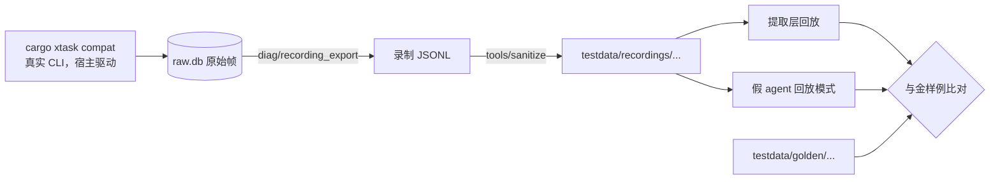

# 5.9 测试策略

- 所属：`docs/02-design.md` 第 5 节
- 依据：ADR-03（Vitest、Playwright）、ADR-04（金样例、性质测试）、ADR-06；SP-1 的录制、SP-4a 的测试骨架（端到端测试 1–7、测量）、SP-5 的边界用例、SP-2 的安装故障用例
- 原则：所有自动化测试都不需要登录任何 agent，也不消耗额度；只有兼容矩阵用真实 CLI，并且只在维护者机器上手动触发

## 5.9.1 测试分层

| 层 | 工具 | 覆盖 | 运行时机 |
|---|---|---|---|
| Rust 单元测试与性质测试 | `cargo test`、proptest | 协议（分帧、合并、视图与快照、schema 往返）；账本；流的不变式；回合状态机；交互代理；策略矩阵；git 服务；运行时安装器；迁移；脱敏规则 | 每个 PR |
| 提取层回放 | `cargo test`，直接喂录制 | 把一份录制里适配器发来的全部帧喂给提取层和 normalizer，输出的 cupper 事件与金样例比对 | 每个 PR |
| 宿主集成测试 | `cargo test`（`test-harness`），真实宿主进程 + 假 agent + cupper-cli 库 | 由 SP-4a 的端到端测试 1–7 扩充：多客户端一致、先到先得、续传、慢客户端、`kill -9` 恢复、命令幂等、帧上限、适配器隔离；加上排队、Steer、中断兜底、自发回合、适配器崩溃、多会话共用适配器 | 每个 PR |
| TS 单元测试 | Vitest | `host-client` 的连接状态机、命令重试、视图 reducer（与 Rust 视图用同一批金样例交叉验证）；`ui-core` 组件 | 每个 PR |
| 界面截图回归 | Playwright（Chromium）+ 浏览器版 ShellAPI + TS 写的 mock 宿主 | 主要页面和状态：亮色和暗色、中文和英文、各类条目与卡片、长文本、未知事件的占位 | 每个 PR |
| 端到端 | Playwright `_electron` + e2e 构建 + 真实宿主 + 假 agent + cupper-cli | NFR-1 的全部验收项、S1–S4 的主要流程、安全加固项 | PR 跑冒烟子集，每晚跑全集 |
| 兼容矩阵 | `cargo xtask compat`，真实 CLI | 锁定的适配器 × CLI 版本 | 手动 |
| 性能 | `measure` 测试、SP-6 的脚本 | [5.9.6](#596-性能预算) | 每晚；SP-6 一次性完整测量 |

## 5.9.2 假 agent

`cupper-fake-agent` 用官方 SDK 的 agent 角色实现，有两种模式：

**脚本模式**（沿用 SP-4a）：prompt 文本就是剧本，例如 `say`、`think`、`flood`、`big`、`tool`、`tool_done`、`permission`、`question`、`sleep`、`wait_cancel`、`whoami`、`probe`、`spawn_child`、`exit`。M1 补充：

| 新命令 | 用途 |
|---|---|
| `terminal <id> <exit> <lines>` | 带 `_meta.terminal_output` 和 `terminal_exit` 的命令，覆盖退出码和输出的提取 |
| `diff <id> <path>` | 带 diff 的编辑工具调用 |
| `plan_update <markdown>`、`plan_confirm` | 计划和计划确认（Claude 和 Codex 两种形态） |
| `form <schema>` | 多字段表单提问（Claude 的多问题 AskUserQuestion） |
| `steer_ok`、`steer_new_turn` | 响应 `_session/steering` 的不同结果 |
| `late_tool <id> <ms>` | 回合被取消后过一段时间才推工具的输出（Codex K3） |
| `autonomous <ms>` | prompt 返回后再推一段不属于任何 prompt 的更新（K9） |
| `crash_cli` | 返回 `-32603`，之后的请求都返回 "Session not found"，直到 `session/resume`（K6） |
| `restartable` | 返回 `1001` 加 `restartable: true`（K7） |
| `thread_status <state>` | 推 Codex 的 `threadStatus` |
| `unknown_enum` | 发送带未知枚举值的消息（K19） |
| `auth_none` | 推 `_auth/status_update {kind: none}`，prompt 返回 `-32000` |

**回放模式**：读一份录制（SP-1 格式），扮演适配器。

- 收到宿主的请求时，与录制里下一个 `send` 帧比对：方法相同；参数按规则比较（JSON-RPC 的 id 重新映射；`cwd` 等路径换成占位符；`_meta` 忽略；prompt 文本默认精确比较）。比对失败就让测试失败并打印差异。
- 比对通过后，按顺序发出其后的 `recv` 帧，直到下一个需要等待宿主的 `send` 帧。时间间隔按比例压缩（默认 1/100），顺序不变。
- 适配器发起的请求（审批、提问）要等宿主的应答，并默认要求宿主应答的选项与录制一致，保证结果确定。
- 只用于宿主的请求序列与录制一致的场景。SP-1 的部分录制故意制造了宿主永远不会做的事（例如 s06 的并发 prompt），这些录制只用于"提取层回放"，不用于回放模式。

## 5.9.3 录制与金样例

- **来源**：M1 开始时导入 SP-1 的 48 份录制；之后的新录制都由 cupper 宿主自己驱动产生（这样请求序列与宿主的行为一致，可以直接用于回放模式）。宿主的原始帧格式就是录制格式（[5.4.2](04-data-model.md#542-sqlite-表结构)），导出即得。
- **脱敏**：由 SP-1 的 `sanitize.ts` 迁移到 `tools/sanitize`，规则不变（路径、用户名、主机名、邮箱、密钥、账号字段、用户自己的 skill 名和 MCP），写完后重新扫描，命中就失败。
- **金样例**：宿主输出的规范化事件。规范化时把生成的 ID 按出现顺序换成 `s_1`、`t_1`、`i_1` 等，去掉 `ts`，时长只保留"有没有"。更新金样例用 `UPDATE_GOLDEN=1`，变化在 PR 里人工评审。
- **严格模式**：CI 中"类型已知但数据残缺"的事件直接判失败（ADR-04 修订第 4 条）。

## 5.9.4 端到端测试与 NFR-1 验收

环境：e2e 构建的 App（打包方式、fuses 与发布构建相同，只放开调试，见 [5.7.9](07-desktop.md#579-构建种类)）、每个用例一个临时数据目录、临时 git 仓库、脚本模式或回放模式的假 agent；cupper-cli 以 `test_harness` 身份作为第二客户端。

**NFR-1 的 M1 验收**（M1a 的退出标准，全部自动化）

| NFR-1 验收项 | 测试 |
|---|---|
| 订阅会话列表和任意一个会话，内容与桌面一致 | UI 和 CLI 同时订阅；测试钩子导出 UI 的 `host-client` 视图 JSON，与 CLI 的 `Mirror` 视图 JSON 规范化后逐字段相等 |
| 发送、排队、中断、处理审批、回答提问，桌面同步更新 | CLI 依次执行这些命令，Playwright 断言 UI 上的相应变化（新回合、排队条、回合结束为"已取消"、卡片状态） |
| 任何一端处理了审批或提问，另一端自动收起 | 两个方向各一个用例：UI 批准后 CLI 看到 `resolved`；CLI 批准后 UI 卡片收起并显示"已在 cupper-cli 处理"；两端同时回答恰好一个成功 |
| 客户端断开期间产生的事件，重连后补齐，不丢不重 | 断开 CLI 和重载渲染进程两种情况；`Mirror` 检查 `from` 连续性；断开期间用 `flood` 产生大量事件，含区间事件 |
| 宿主被强制结束后重新启动，会话可以继续 | 运行中和等待审批时各 `kill -9` 一次宿主；UI 自动重新拉起；回合为"已中断"、请求为"已失效"、残留进程被清理；下一条消息经 `session/resume` 成功 |

**M1b 的端到端**（作为 M1b 退出标准的一部分）：S1（两个会话分别在两个 worktree 中运行）、S2（审批和提问、通知意图）、S3（审查、行内评论、按 hunk 暂存、提交）、S4（排队、Steer、中断），以及 NFR-2（断线后用同一个 `command_id` 重发不重复执行）和 NFR-9（适配器崩溃、CLI 崩溃）。

**安全相关的端到端**：发布构建带调试参数启动应立即退出；渲染进程注入的脚本不执行；不经真实输入的 `interaction/respond` 被拒；渲染进程无法发出 `privileged` 方法；假宿主占用套接字时 UI 拒绝连接。

## 5.9.5 兼容矩阵

| 维度 | 取值 |
|---|---|
| 适配器 | 当前锁定的版本；准备升级时加上候选版本 |
| CLI | 已验证范围的下限、当前稳定版、最新版 |
| 剧本 | 新建会话与能力；普通回合；执行命令（含非零退出码）；审批允许与拒绝；结构化提问；计划确认；取消（命令执行中、审批挂起时）；CLI 或 app-server 被杀后恢复；宿主重启后 resume；图片输入；Steer；**两个会话在同一个适配器上并发 prompt**（ADR-09 的前提，SP-1 没测过） |

- 由 `cargo xtask compat` 在维护者机器上运行：真实账号、最便宜的模型、临时 git 仓库、只选 `allow_once` 和 `reject_once`。
- 运行前后对 `~/.claude/settings.json`、`~/.codex/config.toml` 等做哈希对比，有变化就在结果里标出（SP-1、SP-4b 都遇到过配置被改动的情况）；运行留下的 CLI 会话记录列入清理清单。
- 产出：新的录制（脱敏后）、金样例的更新、`runtime/manifest.json` 中各适配器版本的"已验证 CLI 范围"。三者一起提交，评审后合并。
- 时机：升级适配器之前必须跑；新的 CLI 版本发布后每月跑一次；`codex-drift` 任务发现 app-server 方法变化时立即跑。

## 5.9.6 性能预算

| 指标 | 预算 | 依据 / 测量 |
|---|---|---|
| 冷启动到可用 | p95 ≤ 2 s | NFR-6；e2e 从进程启动到输入框可用的标记 |
| 宿主冷启动（含签名校验） | p95 ≤ 400 ms（预期 ≤ 50 ms） | ADR-01；`measure` 测试 |
| 索引快照（200 个会话） | ≤ 50 ms | `measure` |
| 宿主内存（6 个活跃会话） | ≤ 64 MiB | SP-4a 实测 22.5 MiB |
| agent 输出到屏幕的延迟 | p95 ≤ 100 ms（写入时合并 40 ms + 转发 16 ms + 渲染） | SP-6 |
| 流式输出时的帧时间 | 6 个会话同时流式输出，渲染帧时间 p95 ≤ 16.7 ms | SP-6 |
| 长会话滚动 | 1,000 和 5,000 条消息，滚动帧时间 p95 ≤ 16.7 ms，渲染进程内存 ≤ 600 MB | NFR-6；SP-6 |
| 主进程事件循环延迟 | p99 < 5 ms | ADR-03；SP-6 |
| 同时运行的会话 | ≥ 6 个 | NFR-11；端到端用假 agent |
| 回合快照（无改动） | 9.6 万文件的仓库 ≤ 0.5 s | SP-5 实测 0.33 s；CI 用 1 万文件的合成仓库，每晚用 10 万文件 |

## 5.9.7 SP-6 测试计划（UI 渲染压力测试）

- **时间**：M1b 打磨界面之前（ADR-03、技术选型讨论会 D3）。前提是 M1a 的最简界面、宿主和假 agent 的 `flood` 系列命令已经可用。
- **环境**：打包后的 e2e 构建（fuses 与发布构建一致）；作者的 Apple Silicon Mac，以及 CI runner（用于重复测量）；用宿主的测试钩子预先灌入 1,000 和 5,000 条消息的会话。

| # | 场景 | 测量 |
|---|---|---|
| 1 | 冷启动和热启动各 10 次 | 到输入框可用的 p50、p95 |
| 2 | 单会话流式输出：每秒 200 个片段，持续 2 分钟，期间在输入框打字 | 帧时间、输入延迟、CPU |
| 3 | 6 个会话同时流式输出，同时拉取一个 5 MB 的 blob，并触发一次 5,000 个事件的重新同步 | 主进程事件循环延迟 p99、渲染帧时间、是否发生流重置 |
| 4 | 打开 1,000 和 5,000 条消息的会话，从顶滚到底，再向前翻页加载历史 | 首次渲染时间、滚动帧时间、内存 |
| 5 | 浸泡 8 小时：每 5 分钟一个带工具调用的回合 | 主进程、渲染进程、宿主的内存增长 |
| 6 | 中文输入法（人工）：流式输出期间在输入框里用拼音输入，按 Enter 选词不应发送 | 检查表 |

- **判定与后续**：
  - 主进程事件循环延迟 p99 ≥ 5 ms：按 ADR-03 改用"utilityProcess 宿主桥 + 委托票据"；
  - 冷启动或内存不达标：先在应用代码里优化（长会话窗口化、减少挂载）；仍不达标时，按 ADR-03 的改变条件提出讨论；
  - 其余不达标项进入 M1b 的任务。
- **产出**：带数据和 trace 的报告；场景 2、3、4 改写成每晚运行的性能回归测试。

## 5.9.8 其他关键测试

| 对象 | 测试 |
|---|---|
| 回合状态机 | 基于模型的性质测试：随机生成发送、Steer、中断、驱动事件（含晚到的输出、适配器退出）的序列，断言：同一 agent 会话同时最多一个 prompt；队列按 FIFO 出队；每个回合最终都有结束事件；中断后 10 s 内回合一定结束 |
| 流的不变式 | 性质测试：并发的订阅与追加，任何订阅者看到的 seq 都连续、不重复（SP-4a 的不变式） |
| 策略 | 按 [5.8.3](08-security.md#583-权限矩阵) 的矩阵逐格断言 |
| git 服务 | 把 SP-5 的 82 个 hunk 用例、快照和 worktree 的边界用例改写成 Rust 测试，在临时仓库上运行；7 条清理规则逐条覆盖 |
| 运行时安装器 | SP-2 的 5 种故障：哈希不一致、网络失败、提交前被杀、安装后被篡改、重复运行；加上"复制过程中包被替换" |
| 迁移 | 每个已发布的 schema 版本保留一个样例数据库，升级后与预期比对；"数据库比程序新"时退出码为 4 |
| 脱敏 | 含各类敏感信息的样例，经日志层和原始帧层后都不出现 |
| 进程卫生 | 适配器只继承 fd 0、1、2，没有 `CUPPER_*` 和白名单外的变量（SP-4a 已有，含"去掉 CLOEXEC 应失败"的变异检查） |
