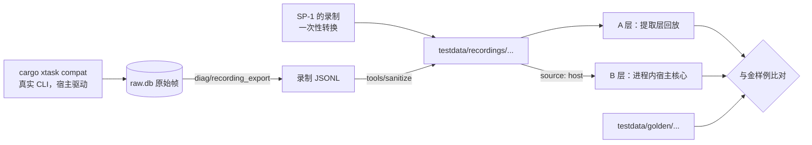

# 5.9 测试策略

- 所属：`docs/02-design.md` 第 5 节
- 依据：ADR-03（Vitest、Playwright）、ADR-04（金样例、性质测试）、ADR-06；SP-1 的录制、SP-4a 的测试骨架（端到端测试 1–7、测量）、SP-5 的边界用例、SP-2 的安装故障用例；设计评审会（`docs/meetings/2026-10-16-design-review/`）
- 原则：所有自动化测试都不需要登录任何 agent，也不消耗额度；只有兼容矩阵用真实 CLI，并且只在维护者本机手动运行。时序相关的逻辑一律用虚拟时钟确定性地测（[5.2.16](02-host.md#5216-时间与可测性)），进程级测试用事件做屏障，不用 sleep

## 5.9.1 测试分层

用例编号的规则见 [5.9.10](#5910-测试编号与人工验证清单)。

| 层（编号前缀） | 工具 | 覆盖 | 运行时机 |
|---|---|---|---|
| Rust 单元测试（UNIT） | `cargo test` | 协议（分帧、合并、视图与快照、schema 往返、JCS）；账本；策略矩阵；git 服务；运行时安装器；迁移；脱敏规则。另有一次**不带任何特性**的运行，断言发布构建里没有 harness 认证、`dev_key`、`test/*`、`diag/recording_export`，并且收到带 `harness_key` 的启动载荷时拒绝 harness 认证、忽略 `test_config` | 每个 PR |
| 性质测试（PROP） | proptest、shuttle；纯核心 + `ManualClock` | 回合状态机、队列、交互代理、自发回合判定、写入合并（[5.9.8](#598-其他关键测试)）；流的并发不变式 | 每个 PR |
| 提取层金样例（GOLD-A） | `cargo test`，直接喂录制 | 逐帧的纯函数：录制里适配器发来的帧 → 规范化后的 `DriverEvent`。全部录制都用（[5.9.3](#593-录制与金样例)） | 每个 PR |
| 会话层金样例（GOLD-B） | 进程内运行宿主核心 + 内存传输 + 虚拟时钟 | 规范化后的协议事件；只用宿主自己驱动产生的录制 | 每个 PR |
| 宿主集成测试（IT） | `cargo test`（`test-harness`），真实宿主进程 + 假 agent + cupper-cli 库 | 由 SP-4a 的端到端测试 1–7 扩充：多客户端一致、先到先得、续传、慢客户端、`kill -9` 恢复、命令幂等、帧上限、适配器隔离；加上排队、Steer、中断兜底、自发回合、适配器崩溃、K 清单（[5.6.9](06-agent-driver.md#569-已知问题的规避清单)）、故障点、项目信任、配置档位。**6 个会话在同一个假适配器进程上同时流式输出**，每条输出带会话标识，断言没有串扰（NFR-11、Q8 的宿主侧）；Q8 的后备方案（这种 agent 的 prompt 全局串行）也有用例。外发检查：宿主进程放在拒绝出站网络的 Seatbelt 配置里运行（只用于宿主，纪要 D13） | 每个 PR |
| TS 单元测试（UNIT） | Vitest | `host-client` 的连接状态机、切帧、命令重试；视图 reducer（与 Rust 视图用同一批金样例交叉验证）；主进程的 `inputGuard`、`windowBridge`（用帧级的 TS mock 宿主，覆盖白名单、真实输入、原生确认、流控、"超过 8 MB 暂停读取 → 宿主重置 → 按游标重新订阅"）；`ui-core` 组件 | 每个 PR |
| 界面截图回归 | Playwright（Chromium）+ 浏览器版 ShellAPI + TS 写的 mock 宿主 | 主要页面和状态：亮色和暗色、中文和英文、各类条目、请求面板、发送按钮三态、窄窗口、长文本、未知事件的占位；发布 CSP 下 `securitypolicyviolation` 为 0 | 每个 PR；基线由专用脚本生成，渲染因素固定（字体随测试夹具附带），元数据记录系统和 Chromium 版本（v1.3，见 `docs/03-plan.md` 1.8） |
| 端到端（E2E） | Playwright `_electron` + e2e 构建 + 真实宿主 + 假 agent + cupper-cli | NFR-1 的全部验收项、S1–S4 的主要流程、安全加固项（[5.9.4](#594-端到端测试与-nfr-1-验收)） | PR 跑冒烟子集（按改动路径过滤），每晚跑全集 |
| 差分测试 | Rust 用 proptest 生成事件序列，交给 Node 进程里的 TS reducer | TS 与 Rust 视图对同一序列给出相同结果，包括 `late_by_ref` | 每晚 |
| 兼容矩阵（COMPAT） | `cargo xtask compat`，真实 CLI | 锁定的适配器 × CLI 版本（[5.9.5](#595-兼容矩阵)）。框架本身每晚在 CI 里用假 agent 跑一遍 | 手动；框架每晚 |
| 性能（PERF） | `measure` 测试、SP-6 的脚本 | [5.9.6](#596-性能预算) | 每晚看趋势；判定在参考硬件上做 |
| 人工（MAN） | 检查表 | [5.9.10](#5910-测试编号与人工验证清单) | 按清单 |

## 5.9.2 假 agent

`cupper-fake-agent` 用官方 SDK 的 agent 角色实现，分三部分（测试 #3）：

**1. 启动配置**（经 `--test-config` 传给宿主，宿主再传给假 agent，[5.9.9](#599-测试替身与注入点)）

| 项 | 内容 |
|---|---|
| `persona` | `claude` 或 `codex`：`initialize` 返回的能力（steering、promptQueueing、image 等）、`session/new` 返回的 configOptions 和默认模式、随后的 `available_commands_update`，以及权限请求的选项 ID，都按 SP-1 录制里的真实形态给出，选项映射、#556 的"拒绝即结束回合"、Claude 用 `$/cancel_request` 撤回审批、Codex 不撤回审批都测得到 |
| 登录状态 | 已登录；Claude 形态未登录（`session/new` 成功，`session/prompt` 返回 `-32000`）；Codex 形态未登录（`session/new` 就报错） |
| 故障注入 | 启动即退出、`initialize` 超时、`set_config_option` 报错等 |
| 进程分段 | 回放多实例录制时，告诉假 agent 从第几段开始（见下文） |

**2. 剧本命令**（prompt 文本就是剧本）：沿用 SP-4a 的 `say`、`think`、`flood`、`big`、`tool`、`tool_done`、`permission`、`question`、`sleep`、`wait_cancel`、`whoami`、`probe`、`spawn_child`、`exit`，M1 补充：

| 新命令 | 用途 |
|---|---|
| `flood_rate <每秒片段数> <秒> <长度>` | 按固定速率输出文本片段（`flood` 是全速、不限速的），产生测量闸门和 SP-6 需要的定速负载（测试核对 2） |
| `terminal <id> <exit> <lines>` | 带 `_meta.terminal_output` 和 `terminal_exit` 的命令，覆盖退出码和输出的提取 |
| `diff <id> <path>` | 带 diff 的编辑工具调用 |
| `write_file <path> <content>` | 真的在工作区里写文件，S1、S3 的快照和 diff 才有内容 |
| `plan_update <markdown>`、`plan_confirm` | 计划和计划确认（按 persona 的形态） |
| `form <schema>` | 多字段表单提问（Claude 的多问题 AskUserQuestion） |
| `steer_ok`、`steer_new_turn`、`steer_hang` | 响应 `_session/steering` 的不同结果；`steer_hang` 一直不回，测 5 s 超时转排队 |
| `hang` | 不响应取消，prompt 永不返回：CP-7 的 10 s 兜底和 K1 的"先 close 再 resume" |
| `late_tool <id> <ms>` | 回合被取消后过一段时间才推工具的输出和 `completed`（Codex K3） |
| `autonomous <ms>` | prompt 返回后再推一段不属于任何 prompt 的更新（K9），可以设"静默一段后又继续输出" |
| `crash_cli` | 返回 `-32603`，之后的请求都返回 "Session not found"，直到 `session/resume`（K6） |
| `output_then_crash` | 先产生输出再 `crash_cli`（K6 的"不重发"分支） |
| `restartable` | 返回 `1001` 加 `restartable: true`（K7） |
| `upstream_retry <n>` | 推 `_meta.codex.error` 且 `willRetry`（K18） |
| `thread_status <state>` | 推 Codex 的 `threadStatus` |
| `echo_env` | 回显收到的 cwd 和 `clientInfo`（K13、K26），以及环境变量名单（进程卫生） |
| `auth_none` | 推 `_auth/status_update {kind: none}`，prompt 返回 `-32000` |

**3. 原始行通道**：`raw <json>` 原样写一行 ACP 消息，不经过 SDK 的类型层。未知枚举值（K19）、原样的 `_meta`、`$/cancel_request`、`_auth/status_update` 都靠它发。回放模式整体走原始行通道。

**全局不变式**：假 agent 在同一个会话上收到第二个在途的 prompt 时立即报错退出。这样 K1 成为所有测试都会检查的不变式。

**回放模式**：读一份录制（格式见 [5.9.3](#593-录制与金样例)），扮演适配器。

- 收到宿主的请求时，与录制里下一个 `send` 帧比对：方法相同；参数按规则比较（JSON-RPC 的 id 重新映射；`cwd` 等路径换成占位符；`_meta` 忽略；prompt 文本默认精确比较）。比对失败就让测试失败并打印差异。
- 比对通过后，按顺序发出其后的 `recv` 帧，直到下一个需要等待宿主的 `send` 帧。进程级的回放按比例压缩时间间隔（默认 1/100）；进程内的 B 层回放用录制里的 `t` 推进虚拟时钟。
- 适配器发起的请求（审批、提问）要等宿主的应答，并默认要求宿主应答的选项与录制一致，保证结果确定。
- **多实例录制**：录制按适配器实例分段。一段以"进程退出"的 note 结束时，假 agent 照样退出；宿主重新拉起适配器后，假 agent 从下一段继续。
- 只用于宿主的请求序列与录制一致的场景，也就是宿主自己驱动产生的录制。SP-1 的录制来自 SP-1 自己的客户端（`clientInfo`、配置项请求序列、故意的并发 prompt 都与宿主不同），只用于 A 层。

## 5.9.3 录制与金样例

**录制格式**（规格，测试 #5）

- 第一行是头：`{"format": "cupper-rec", "v": 1, "source": "sp1" | "host", "adapter", "adapter_version", "cli", "cli_version", "scenario", "usage": ["gold-a", "gold-b", "replay"]}`。
- 之后每行一帧：`{"seq", "t", "instance", "dir", "msg"? , "data"?, "note"?}`：
  - `t` 是相对这一段开始的毫秒数；
  - `dir` 取 `send`、`recv`、`recv_nonjson`、`stderr`、`note`；
  - JSON 帧放 `msg`，非 JSON 的行和 stderr 放 `data`，`note` 行放 `{event, ...}`，例如 `instance_started`、`instance_exited`。
- 一个会话跨多个适配器实例时，按实例分段，每段以 `instance_started` 开始。
- `diag/recording_export` 从 `raw.db` 导出这个格式（`raw.db` 的 `ts` 换算成段内的相对时间）。SP-1 的 48 份录制由一个一次性的转换脚本改成这个格式：note 行的 `note`/`data` 统一成 `note`，`recv-nonjson` 改为 `recv_nonjson`，补上头行，`usage` 只有 `gold-a`。
- 目录：`testdata/recordings/<adapter>/<adapter-ver>/<cli-ver>/<scenario>.jsonl`。已验证范围内的旧版本录制和金样例都保留，不删。

**两层金样例**

| 层 | 被测对象 | 金样例里装什么 | 用哪些录制 |
|---|---|---|---|
| A 层（提取层） | 逐帧的纯函数：帧 → `DriverEvent`；不知道回合和取消 | 规范化后的 `DriverEvent` 序列 | 全部录制 |
| B 层（会话层） | 进程内的宿主核心（纯核心、写入合并、视图），经内存传输回放，虚拟时钟按 `t` 推进 | 规范化后的协议事件 | 只用 `source: host` 的录制 |

- M1a 早期由维护者用 Claude 跑一次兼容套件，产出第一批 B 层录制（U-R5 已定，允许运行，见 `docs/meetings/2026-10-16-gate-design-decisions/minutes.md`）。
- 晚到的输出（纪要 D4）按三层分别断言：A 层只断言晚到的帧被提取成带原 `toolCallId` 的 ToolUpdate；回合结构（`abandoned` 加 `may_still_run`、当前回合里的 `late_tool_output`）由宿主集成测试加 codex 形态的假 agent 断言；B 层等 M1b 用宿主重新录到 codex 的取消场景后再补。
- CI 检查每份录制都有它 `usage` 里列出的金样例。

**规范化**（测试 #6）

- 同一条目、同一 `field` 的连续 delta 先折叠成一条再比较（delta 怎样切分受 40 ms 合并和机器负载影响）。
- 去掉 `seq` 和 `from`，按顺序重新编号。
- 字段的性质由 schema 注解决定：`x-id` 的值按出现顺序换成占位（`s_1`、`t_1`、`i_1`、`a_1`、`cause.command_id` 也在内）；`x-time` 的值去掉，时长只保留"有没有"；`x-path` 的值换成占位。新加的字段按注解自动纳入。
- 摘要（`d_…`）按出现顺序换成占位。
- 金样例一行一个事件，键排好序，方便评审。
- 更新金样例用 `UPDATE_GOLDEN=1`，变化在 PR 里人工评审；CI 里设置了 `UPDATE_GOLDEN` 直接判失败。
- **严格模式**：CI 中"类型已知但数据残缺"的事件直接判失败（ADR-04 修订第 4 条）。

**脱敏**：由 SP-1 的 `sanitize.ts` 迁移到 `tools/sanitize`，规则不变（路径、用户名、主机名、邮箱、密钥、账号字段、用户自己的 skill 名和 MCP），写完后重新扫描，命中就失败。另外每个 PR 对 `testdata/` 做一次通用模式的扫描：`/Users/` 后跟非占位符的路径、邮箱、token 样式、`/var/folders`，命中就失败（测试建议 #25；只靠运行环境里的用户名查不出维护者的用户名）。

## 5.9.4 端到端测试与 NFR-1 验收

**环境**（接线方式见 [5.9.9](#599-测试替身与注入点)）：e2e 构建的 App（打包方式与发布构建相同，签名和 fuses 的差异见 [5.7.9](07-desktop.md#579-构建种类)）；每个用例一个临时根目录，数据目录、userData、worktree 根目录都在里面；临时 git 仓库；脚本模式或回放模式的假 agent。**只有 UI 拉起宿主**，测试和 CLI 都不拉起；cupper-cli 用 `--harness-key-fd` 以 `test_harness` 身份作为第二客户端。原生确认框由 Playwright 在主进程里替换，替换函数记录调用参数，用例断言确认框里显示的操作描述。

**NFR-1 的 M1 验收**（M1a 的退出标准，全部自动化）

| 编号 | NFR-1 验收项 | 测试 |
|---|---|---|
| E2E-NFR1-1 | 订阅会话列表和任意一个会话，内容与桌面一致 | UI 和 CLI 同时订阅；等两端都到达同一个 `head_seq` 后，经测试钩子导出 UI 的 `host-client` 视图，与 CLI 的 `Mirror` 视图比较。只比窗口内的内容，排除 `notification.intent`；视图的序列化格式在 schema 里定义 |
| E2E-NFR1-2 | 发送、排队、中断、处理审批、回答提问，桌面同步更新 | CLI 依次执行这些命令，Playwright 断言 UI 上的相应变化（新回合、排队消息、回合标题显示"你在 … 后停止了"、请求面板与记录行的状态）。至少一个用例走真实用户的路径：CLI 以 `cli` 身份 `elevate`，原生确认框由替换函数批准，之后再发送 |
| E2E-NFR1-3 | 任何一端处理了审批或提问，另一端自动收起 | 两个方向各一个用例：UI 批准后 CLI 看到 `resolved`；CLI 批准后 UI 的请求面板收起并显示"已在 cupper-cli 处理"。"两端同时回答"：等请求面板的"可以操作"标记（`data-ready`，待命期结束后才设，[5.7.8](07-desktop.md#578-安全加固的落点) 的 RP-1）出现，再让两端同时回答，断言恰好一个成功、另一端显示"已在别处处理"，不预设谁赢 |
| E2E-NFR1-4 | 客户端断开期间产生的事件，重连后补齐，不丢不重 | 三种情况：断开 CLI；重载渲染进程（走快照）；经主进程的测试钩子只断开这个窗口的数据连接、不重载（走按游标续传）。断开期间用 `flood` 产生大量事件，含区间事件；`Mirror` 检查 `from` 连续性，`host-client` 的缺口、重置、重复计数为 0 |
| E2E-NFR1-5 | 宿主被强制结束后重新启动，会话可以继续 | 运行中和等待审批时各 `kill -9` 一次宿主，`kill` 的时机用事件做屏障（等某个条目或交互请求出现）；UI 自动重新拉起宿主；回合为"已中断"、请求为"已失效"、残留进程被清理；下一条消息经 `session/resume` 成功 |

**NFR-2、NFR-9**（M1b 的退出标准）：E2E-NFR2-retry（断线后用同一个 `command_id` 重发，不重复执行）、IT-NFR2-epoch（[5.9.8](#598-其他关键测试) 的 epoch 用例）、E2E-NFR9-adapter-crash、E2E-NFR9-cli-crash、IT-NFR9-failpoints（故障点全集）、IT-NFR9-crash-under-load（高负载写入中反复 `kill -9`，每次做完整性检查）。

**DOM 标记**（v1.4，只是 DOM 属性，生产代码里没有测试分支）：

- 请求面板：`data-testid="request-panel"`、`data-request-id`、`data-ready`（待命期结束后才设）、`data-activation="auto|manual"`（RP-3 的两种情况）；
- 选项：`data-option-index`（从 1 起，与数字键一致）、`data-option-id`、`data-privileged`、`data-effect-unknown`；
- 输入框：`data-testid="composer"`、`data-send-state="disabled|send|stop"`、`data-esc-armed`（"再按一次 Esc 停止"状态）；
- 排队消息：`data-queue-id`；请求记录行：`data-request-record`；回合改动卡片：`data-turn-changes`。

**M1b 的端到端**：E2E-S1（两个会话分别在两个 worktree 中运行）、E2E-S2（请求面板上的审批和提问、通知意图）、E2E-S3（审查、行内评论作为附件发出、按 hunk 暂存、提交）、E2E-S4（默认插话、⌘Enter 排队、编辑排队消息、两次 Esc 中断），用假 agent 跑；用真实 agent 的完整流程走人工检查表（MAN-S1、MAN-S2、MAN-S3、MAN-S4）。

**安全相关的端到端**

| 编号 | 用例 | 在哪种构建上跑 |
|---|---|---|
| E2E-SEC-switches | 带未知命令行开关启动，应立即退出 | 每晚的"发布配置、不签名"构建 |
| E2E-SEC-csp | 渲染进程注入的脚本不执行；创建名为 `default` 的 Trusted Types 策略失败 | e2e |
| E2E-SEC-real-input | 不经真实输入的 `interaction/respond` 被拒；冷却期内的 Enter 被拒、之后成功；输入证据来自 `before-input-event`；数字键的证据与选项序号不符时被宿主拒绝 | e2e |
| E2E-SEC-panel-arming | 请求面板（v1.4）：面板出现时正在输入框里打字，按键不会落到面板上，面板要按 Tab 或点击才响应；待命期内的按键和点击被吞掉；面板出现前按下、出现后松开的点击不算；连续两个请求时第二个重新待命；面板上方有弹出菜单时不响应（[5.7.8](07-desktop.md#578-安全加固的落点) 的 RP-1 至 RP-9） | e2e |
| E2E-SEC-privileged | 渲染进程无法发出 `privileged` 方法、无法绕过原生确认框 | e2e |
| E2E-SEC-fake-host | 假宿主占用套接字时 UI 拒绝连接（靠 dev_key 的双向证明） | e2e；发布路径由签名后冒烟覆盖 |
| E2E-SEC-review-iso | 审查文档与主文档跨源，`parent.document` 访问抛错；别的端口发来的消息被忽略；iframe 的 `revert` 不会直接执行；注入金样例（[5.7.8](07-desktop.md#578-安全加固的落点)） | e2e（M1b） |
| SMOKE-SIGNED-codesign-auth | 宿主认 UI 走的是 `codesign` 认证 | 只在发布流水线签名之后（[5.10.7](10-release.md#5107-发布流水线)），下同 |
| SMOKE-SIGNED-no-weak-auth | `weak_auth` 为 false | 同上 |
| SMOKE-SIGNED-cli-readonly | CLI 默认只读 | 同上 |
| SMOKE-SIGNED-reattach | 杀掉主进程后新 UI 接上旧宿主（NFR-8） | 同上 |
| SMOKE-SIGNED-handshake-matrix | 握手矩阵 | 同上 |
| SMOKE-SIGNED-reject-fake-host | 拒绝假宿主 | 同上 |
| SMOKE-SIGNED-reject-weak-host | 拒绝 `weak_auth` 宿主 | 同上 |
| E2E-SEC-egress | SEC-6、NFR-4：App 运行期间除更新检查和运行时安装外没有外发连接。整个 App 放进 Seatbelt 会让 Chromium 的子进程崩溃（测试工程师实测），所以改用 `nettop` 对 App 的进程树采样，具体方法由 Q27 确定；宿主单独的外发检查用 Seatbelt，在宿主集成测试里做 | e2e（每晚） |

## 5.9.5 兼容矩阵

| 维度 | 取值 |
|---|---|
| 适配器 | 当前锁定的版本；准备升级时加上候选版本 |
| CLI | 已验证范围的下限、当前稳定版、最新版 |
| 剧本 | 新建会话与能力；普通回合；执行命令（含非零退出码）；审批允许与拒绝；结构化提问；计划确认；取消（命令执行中、审批挂起时）；CLI 或 app-server 被杀后恢复；宿主重启后 resume；图片输入；Steer；**两个会话在同一个适配器上并发 prompt**（Q8）；**未信任项目**（`settingSources: ["user"]` 时，项目的 hooks 不运行、`.mcp.json` 里的服务器不启动、项目的 `env` 和 `apiKeyHelper` 不生效，安全确认 ③） |

- **Q8 的通过条件**：两个会话同时各发 3 个 prompt，全部在 5 分钟内返回，输出没有串到另一个会话，重复 3 轮。
- **只在本机运行**（纪要 D13，测试 #8、安全 #10）：由维护者在本机手动执行 `cargo xtask compat`，不经任何 CI runner；用最便宜的模型、临时 git 仓库，只选 `allow_once` 和 `reject_once`。
- **运行环境**（U-R4，已定（2026-10-16），见 `docs/meetings/2026-10-16-gate-design-decisions/minutes.md`）：在 Q30 确认 OAuth 刷新令牌不会轮换之前，用**真实配置**运行，并在运行前后对 `~/.claude/settings.json`、`~/.codex/config.toml` 等做哈希对比，有变化就在报告里标出（与 SP-1 的做法相同）。确认之后再改用隔离的 `CLAUDE_CONFIG_DIR`、`CODEX_HOME`：临时目录放在每个用户自己的临时目录下、权限 0700、用完即删。
- **报告**：每次运行产出一份机器可读的报告，有 JSON schema。内容：cupper 的提交、运行模式（真实配置或隔离配置）、模型、适配器和 CLI 的版本、每个剧本的结果（通过、失败、不确定）、耗时、重试次数、配置文件哈希的前后对比、需要清理的 CLI 会话。
- **产出**：新的录制（脱敏后，经 `tools/sanitize` 和通用扫描）、金样例的更新、报告；三者一起以 PR 提交，评审后合并。CI 校验报告符合 schema，并从报告重新生成 `runtime/manifest.json` 里的"已验证 CLI 范围"，与提交的清单比对，不一致就失败（"已验证范围"不手填）。
- **框架本身**：`xtask compat` 的框架每晚在 CI 里用假 agent 跑一遍（不调用真实 CLI），防止这段只在本机偶尔运行的代码慢慢坏掉。
- **断言只检查结构**，例如"出现了一个 `exit_code` 不为 0 的工具调用"。模型不配合时允许重试，结果标为"不确定"。
- **升级适配器时的评审**（测试 #7）：`tools/rec-shape-diff` 对比新旧录制里的方法、update 种类、`_meta` 键路径、`option_id`、`stopReason`、错误码，生成形态差异报告；评审看这份报告，不看事件全文。CI 检查锁定版本的录制里出现的每个 `option_id`、每个权限模式取值，都在选项对照表和档位表里，否则失败，新的取值不会悄悄走兜底。
- **进程卫生**：用 `lsof` 断言适配器的所有后代都不持有宿主的管道和套接字（安全建议 #19）。
- SP-1 的 TS 客户端产出的录制只能进 A 层。
- **时机**：升级适配器之前必须跑；新的 CLI 版本发布后每月跑一次；`codex-drift` 任务发现 app-server 方法变化时立即跑。

## 5.9.6 性能预算

**判定口径**（测试 #20）

- 绝对预算只在参考硬件上判定，报告里记下机型（存档时可以换成泛称）。CI 的 runner 是虚拟机，只看趋势：取历史中位数的 1.5 倍作为阈值。
- 每项至少 30 个样本，报告 p50、p95 和最大值（样本太少时 p95 就是最大值）。
- **冷启动与热启动**（测试核对 3）：冷启动是 App 和宿主都没有运行（宿主由 App 拉起）；不清系统的文件缓存（清缓存要管理员权限），报告里写明这一点。热启动是宿主仍在运行、只重新启动 App（UI 接上已有的宿主）。首次运行新二进制时系统的安全检查单独计时，不计入冷启动。

| 指标 | 预算 | 测量方法 |
|---|---|---|
| 冷启动到可用 | p95 ≤ 2 s（NFR-6） | 从进程启动计到渲染进程的 `performance.mark('cupper:ready')`：索引快照已应用、当前会话已渲染、输入框可用。数据集：200 个会话，当前会话 1,000 条消息，由 `test/seed` 灌入 |
| 宿主冷启动（含签名校验） | p95 ≤ 400 ms（预期 ≤ 50 ms） | ADR-01；`measure` 测试 |
| 索引快照（200 个会话） | ≤ 50 ms | `measure` |
| 宿主内存（6 个活跃会话） | ≤ 64 MiB | SP-4a 实测 22.5 MiB |
| agent 输出到屏幕的延迟 | p95 ≤ 100 ms（写入时合并 40 ms + 转发 16 ms + 渲染） | 假 agent 在输出片段里嵌入时间戳，渲染进程在提交后的那一帧记录上屏时间 |
| 流式输出时的帧时间 | 4 个订阅中的会话同时流式输出，渲染帧时间 p95 ≤ 16.7 ms | requestAnimationFrame 的间隔或 trace（Long Animation Frames 只报告超过 50 ms 的帧，不能用来测这一项） |
| 长会话滚动 | 1,000 和 5,000 条消息，滚动帧时间 p95 ≤ 16.7 ms，渲染进程内存 ≤ 600 MB | 同上 |
| 切换会话到首屏可见 | p95 ≤ 150 ms；命中缓存（LRU 里的会话）时 ≤ 1 帧 | 从切换命令到目标会话首屏渲染完成的 mark |
| 流式输出期间的输入延迟 | p95 ≤ 50 ms | 从按键（`sendInputEvent` 的时刻）到字符出现在输入框的那一帧（requestAnimationFrame 里读取输入框内容） |
| 向前翻页时的视口稳定 | 锚点元素的位移 ≤ 1 px | 插入历史前后，用视口顶部那一行的 `getBoundingClientRect().top` 比较 |
| 主进程事件循环延迟 | p99 < 5 ms（ADR-03） | `monitorEventLoopDelay({resolution: 1})`；判定负载见 [5.7.1](07-desktop.md#571-进程与连接) 的测量闸门（M1a） |
| 浸泡 8 小时的内存增长 | 预热 30 分钟后：主进程 ≤ 50 MB、渲染进程 ≤ 100 MB、宿主 ≤ 20 MB | 每 5 分钟采样 |
| 同时运行的会话 | ≥ 6 个 | NFR-11；端到端用假 agent |
| 回合快照（无改动） | 9.6 万文件的仓库 ≤ 0.5 s | SP-5 实测 0.33 s；快照档每次多 15–25 ms（[5.2.10](02-host.md#5210-git-与-worktree-服务)）。CI 用 1 万文件的合成仓库，每晚用 10 万文件 |

## 5.9.7 SP-6 测试计划（UI 渲染压力测试）

- **时间**：M1b 打磨界面之前（ADR-03、技术选型讨论会 D3）。主进程的连接方案已在 M1a 的测量闸门里定下（[5.7.1](07-desktop.md#571-进程与连接)），SP-6 只管渲染。前提是 M1a 的最简界面（按最终形态的架构实现）、宿主和假 agent 的 `flood` 系列命令已经可用。
- **环境**：打包后的 e2e 构建（fuses 与发布构建一致）。**判定以作者的机器为准**；CI runner 只用于重复测量、看趋势。
- **夹具**：按 SP-1 录制里的分布生成（每个回合的条目数、各类条目的比例、文本长度），另加一个"单个回合 2,000 个条目"的极端用例；用 `test/seed` 预先灌入（[5.9.9](#599-测试替身与注入点)）。定速的流式负载由假 agent 的 `flood_rate` 产生。

| # | 场景 | 测量 |
|---|---|---|
| 1 | 冷启动和热启动各 30 次（定义见 5.9.6） | 到 `cupper:ready` 的 p50、p95 |
| 2 | 单会话流式输出：`flood_rate 200 120 <长度>`，期间在输入框打字 | 帧时间；输入延迟（预算 p95 ≤ 50 ms）；CPU；输出到屏幕的延迟 |
| 3 | 4 个订阅中的会话同时流式输出，同时拉取一个 5 MB 的 blob，并触发一次 5,000 个事件的重新同步；另跑 6 条流作为压力报告 | 渲染帧时间、是否发生流重置 |
| 4 | 打开 1,000 和 5,000 条消息的会话，以及单回合 2,000 个条目的会话，从顶滚到底，再向前翻页加载历史 | 首次渲染时间、滚动帧时间、内存；翻页时视口不跳动：锚点元素的位移 ≤ 1 px |
| 5 | 浸泡 8 小时：每 5 分钟一个带工具调用的回合 | 主进程、渲染进程、宿主的内存增长，对照 5.9.6 的上限 |
| 6 | 中文输入法（人工）：流式输出期间在输入框里用拼音输入，按 Enter 选词不应发送 | 检查表 |
| 7 | 切换会话：LRU 里的会话、不在 LRU 里的会话、从通知和"下一个需要处理的会话"跳过去的会话 | 到首屏可见的时间 |
| 8 | 主进程在 App 窗口上方放一个同样大小、不透明、置顶的窗口，把它完全遮住；测量前先在渲染进程里断言 `document.visibilityState === 'hidden'`，不满足就判为环境不合格、不计结果。持续流式输出 10 分钟，再移开遮挡窗口 | 不应出现 `stream/reset`；切回后的首帧时间。CI 虚拟机上遮挡检测是否可靠未核实，以作者机器上的结果为准 |
| 9 | 审查面板打开 5,000 行的 diff，在发布 CSP 下 | 审查文档的冷启动时间、内存、滚动帧时间、`securitypolicyviolation` 为 0；Q29 的其余验证项（[5.7.5](07-desktop.md#审查文档m1b)） |

- **判定与后续**：
  - 冷启动或内存不达标：先在应用代码里优化（长会话窗口化、减少挂载）；仍不达标时，按 ADR-03 的改变条件提出讨论；
  - 场景 9 不通过：审查面板改用 `DiffHunksRenderer` 的后备方案；
  - 其余不达标项进入 M1b 的任务。
- **产出**：带数据和 trace 的报告；场景 2、3、4、7、8 改写成每晚运行的性能回归测试。

## 5.9.8 其他关键测试

| 对象 | 测试 |
|---|---|
| 回合状态机（PROP） | 基于模型的性质测试，直接驱动纯核心、用 `ManualClock`：随机生成发送、Steer、中断、驱动事件（含晚到的输出、适配器退出）的序列，断言：同一 agent 会话同时最多一个 prompt；队列按 FIFO 出队；每个回合最终都有结束事件；中断后 10 s（虚拟时间）内回合一定结束；有 prompt 在途时，任何 `RunState` 都不会结束回合；由静默判定结束的自发回合，30 s 内不出队 |
| 回合快照（PROP） | 不变式：回合快照写入之后，日志里不再出现 `turn_id` 指向这个回合的事件（纪要 D4，也作为金样例检查） |
| 流的不变式（PROP） | 用 shuttle 穷举 `StreamState` 的追加与订阅的线程调度：任何订阅者看到的 seq 都连续、不重复（SP-4a 的不变式）。另外四条：窗口快照加上全部 `history/page` 等于从头重放日志；检查点加其后的事件等于从头重放；按保留规则裁剪后重建结果不变；合并后应用等于逐条应用（ADR-04） |
| 写线程（UNIT、IT） | 组提交打开时，同一批里一个操作失败，只回滚它自己的 savepoint，其他操作照常提交；存储层单元测试和下面的崩溃测试都在开着攒批时跑 |
| 策略（UNIT） | 按 [5.8.3](08-security.md#583-权限矩阵) 的矩阵逐格断言，含档位规则、真实输入证据、项目信任；另有一次不带任何特性的运行（[5.9.1](#591-测试分层)） |
| 故障点（IT，测试 #9） | test-harness 构建里加编译期门控的故障点，测试打开"执行到此处就退出"：命令受理后、事务提交前；提交后、扇出前；`session/create` 提交后、第一个回合开始前；`worktree add` 进行中；`pending_external` 写入后、git 执行前，以及 git 执行后；两个迁移脚本之间；写检查点和回合快照的过程中。每个故障点都断言：`PRAGMA integrity_check` 通过；seq 连续；崩溃前客户端看到的历史，是崩溃后历史的前缀；用同一个 `command_id` 重试，结果符合账本的语义；第一条消息没有丢 |
| 数据代次（IT，纪要 D5） | ① 纯函数的决策表：正常退出或异常退出 × 同一次开机或重启过，只有"异常退出并且重启过"时 epoch 加 1，`kill -9` 不加；② 模拟断电丢数据：客户端停在 seq N，停掉宿主，把 `host.db` 和 WAL 换成 seq M（M < N）时的副本，改掉注入的启动会话 UUID 并标成异常退出，重启后客户端带旧 epoch 和 N 订阅必须走快照，之后从 M+1 起重用的 seq 让 `Mirror` 和 `host-client` 整体重置、不报"seq 重复"；③ epoch 相同但 `after_seq` 大于 head 时按 `cursor_ahead` 走快照；④ `kill -9` 之后正常重启电脑也被判成断电，只多一次全量快照，用例记下这个行为 |
| 崩溃一致性（IT） | 高负载写入中反复 `kill -9`，每次重启后做完整性检查（[5.2.8](02-host.md#528-事件存储) 的持久性配置靠文档决定，不做 VM 断电实验） |
| git 服务（UNIT、IT） | 把 SP-5 的 82 个 hunk 用例、快照和 worktree 的边界用例改写成 Rust 测试，在临时仓库上运行；7 条清理规则逐条覆盖；**快照档与 SP-5 方案在各种 index 形态下 tree 相同**（split index、sparse index、untracked cache、linked worktree、sha256、autocrlf）；**racy 用例**（测试核对 1）：不靠真实时钟碰运气，而是显式设置被改文件和 index 文件的 mtime，构造"同一秒内改过、大小不变"的状态，断言快照里是新内容；另加一个单元断言：复制出的临时 index 的 mtime 等于原文件；**自定义过滤器**：只在 `info/attributes` 里声明的过滤器也被标为 `filter_unsupported`，快照里只有占位 blob，`git/stage` 被拒；**"恶意配置仓库"**：每类可执行键（fsmonitor、hooks、过滤器、diff 驱动、include 进来的配置、`info/attributes`）都指向一个写标记文件的脚本，跑完全部快照档和仓库档的调用后断言标记不存在；配置来源在工作区内时仓库档拒绝执行；`required` 过滤器置空后报错、不重试 |
| 项目信任（UNIT、IT） | 扫描跟随符号链接：`.claude/settings.json`、`.mcp.json`、整个 `.claude/` 是指向工作区外的链接时，findings 里能看到目标里的 hooks，确认框标出"来自工作区之外"；改写链接目标后项目转为 `stale`；悬空、成环的链接让扫描失败；工作区是仓库子目录时，上级目录直到 git 根目录的项目配置也计入；每次发送 prompt 前重新扫描 |
| 配置档位（IT） | 回合进行中假 agent 推一个越权的 `ConfigChanged`：宿主先把档位改回原值；改回失败时中断当前回合；然后进入 `config_unconfirmed` |
| 运行时安装器（UNIT、IT） | SP-2 的 5 种故障：哈希不一致、网络失败、提交前被杀、安装后被篡改、重复运行；加上"复制过程中包被替换"。registry 地址可以注入（只在 test-harness 构建），用本地的包夹具离线覆盖 |
| 迁移（UNIT、IT） | 每个已发布的 schema 版本保留一个样例数据库，升级后与预期比对；从第二个发布版起，CI 用上一个发布版的宿主加假 agent 生成真实的数据库，再用新宿主迁移；"数据库比程序新"时退出码为 4；迁移失败时退出码为 6；两个脚本之间崩溃后不重跑已执行的脚本 |
| 协议兼容（IT） | 从第二个发布版起，用上一版的 CLI 连接新宿主（N−1） |
| 命令顺序（IT） | 在一条连接上连发 `session/send` 和 `session/interrupt`，不等回复，断言执行顺序 |
| 自检（IT） | 把 ad-hoc 签名的宿主复制到临时 bundle，运行后替换磁盘上的文件，断言进入"待升级" |
| 脱敏（UNIT） | 含各类敏感信息的样例，经日志层、原始帧层（只做结构化脱敏，[5.11.2](11-diagnostics.md#5112-脱敏)）后都不出现 |
| 进程卫生（IT） | 适配器只继承 fd 0、1、2，没有 `CUPPER_*`、禁用清单里的变量和白名单外的变量（SP-4a 已有，含"去掉 CLOEXEC 应失败"的变异检查） |

## 5.9.9 测试替身与注入点

测试 #2，纪要 D13。全部注入点只在 `test-harness` 特性或 e2e 构建里存在，在编译期门控，发布构建中不存在，检查方式见 [5.10.7](10-release.md#5107-发布流水线) 和 5.9.1 的无特性测试。**决定 agent 运行哪个程序的注入点只能在编译期门控**，不能做成设置项或环境变量；SP-4a 用数据目录里的 `agents.json` 指定假 agent 的做法不保留。

| 注入点 | 方式 | 所在构建或特性 | 默认值 |
|---|---|---|---|
| agent 命令（假 agent 的路径和参数），跳过运行时安装和 CLI 发现 | 启动载荷的 `test_config.agents.<agent>` | test-harness | 走正常的安装和发现 |
| npm registry 地址 | `test_config.runtime.registry_url` | test-harness | `registry.npmjs.org` |
| 登录 shell 的环境（PATH、`CLAUDE_CONFIG_DIR`、`CODEX_HOME` 等） | `test_config.login_env` | test-harness | 运行登录 shell |
| 系统通知 | `test_config.notifier: record`：写到测试接收端，不调用 UserNotifications，避免授权弹窗抢走焦点 | test-harness | 系统通知 |
| 时钟和全部时长 | `test_config.clock`、`test_config.durations`；`test/clock_advance`（[5.2.16](02-host.md#5216-时间与可测性)） | test-harness | `SystemClock` 和设计值 |
| 合成数据集（冷启动、长会话、SP-6 的夹具） | `test/seed {profile}`：经正常的写入路径灌入，profile 规定会话数、回合数、条目类型的比例、文本长度、单个超大回合（[5.2.16](02-host.md#5216-时间与可测性)） | test-harness | 不灌入 |
| 定速负载 | 假 agent 的 `flood_rate`（[5.9.2](#592-假-agent)） | 假 agent | — |
| 故障点 | `test_config.failpoints` | test-harness | 关闭 |
| 启动会话的 UUID（`data_epoch`） | `test_config.boot_session_uuid` | test-harness | 读 `kern.bootsessionuuid` |
| 资源采样值（K20） | `test_config.rss_samples` | test-harness | 真实采样 |
| harness 密钥 | 启动载荷的 `harness_key`；CLI 用 `--harness-key-fd` | test-harness；CLI 的测试构建 | — |
| 宿主的 pid | `host/status` 的 `pid` | test-harness | 不返回 |
| e2e 的临时根目录（数据目录、userData、worktree 根目录、harness 密钥文件） | e2e 版主进程读取环境变量 `CUPPER_E2E_DIR` | e2e 构建（Vite `define` 门控） | — |
| 原生确认框 | Playwright 经 `electronApp.evaluate` 在主进程里替换 `dialog.showMessageBox`，替换函数记录调用参数 | e2e 构建（保留 `enableNodeCliInspectArguments`） | — |
| 渲染进程的视图导出 | `window.__cupperTest`，导出 `host-client` 的视图和计数 | e2e 构建 | — |
| 只断开某个窗口的数据连接 | 主进程的测试钩子 | e2e 构建 | — |

规则：

- e2e 里只有 UI 拉起宿主。主进程把启动载荷留在内存里，`kill -9` 之后重新拉起宿主时原样再传一次，harness 密钥因此一直有效。
- 宿主读 stdin 有 2 s 超时，防止拉起方忘了关 stdin、启动一直卡住（[5.8.1](08-security.md#581-认证握手固定令牌)）。
- 发布特性的宿主不读 stdin；5.9.1 的无特性测试断言：收到带 `harness_key` 的启动载荷时拒绝 harness 认证，并忽略 `test_config`。

## 5.9.10 测试编号与人工验证清单

**编号**：`<层>-<范围>-<名称>`，层取 `UNIT`、`PROP`、`GOLD-A`、`GOLD-B`、`IT`、`E2E`、`UI`（界面截图回归）、`SMOKE-SIGNED`、`COMPAT`、`PERF`、`MAN`。引用时一律写完整编号，不用缩写、通配或区间。截图回归的名称以字母开头（如 `UI-layout`），与 PRD 的需求编号（UI-0 等）区分。

**编号与测试的一致性检查**（测试核对 5）：`tools/trace-ids` 从 `docs/design/` 里抽出全部用例编号，与代码里的测试名（Rust 测试函数、Playwright 用例标题都以编号开头）和人工清单比对。每个编号在登记表 `tests/ids.toml` 里写明里程碑、产出任务和所属套件；"待完成"由 trace-ids 根据测试运行报告自动推导，确认用例确实执行并通过，并支持子编号、MAN 证据和"不适用"状态（v1.3，规则见 `docs/03-plan.md` 1.6）。某个里程碑退出时，属于它的编号必须全部完成或标为不适用。CI 的 `testdata-scan` 作业运行这项检查（[5.1.6](01-repo-build-ci.md#516-ci-流水线)）。
追溯矩阵（[5.12.4](12-milestones.md#5124-追溯矩阵m1-的全部-p0-需求)）和规避清单（[5.6.9](06-agent-driver.md#569-已知问题的规避清单)）都引用编号，并注明在哪个套件里跑：每个 PR、每晚、发布流水线、人工。

**人工验证清单**（结果存档在对应任务的目录或发布记录里）

| 编号 | 内容 | 谁、什么时候 |
|---|---|---|
| MAN-S1、MAN-S2、MAN-S3、MAN-S4 | S1–S4 × Claude 和 Codex 两种 agent 的逐步检查表：步骤、通过条件、CLI 和适配器的版本、日期 | 作者，M1b 退出前 |
| MAN-keyboard | 实体键盘：Enter 批准、Esc 拒绝、数字键选择并提交、用输入法选词时不触发（[5.7.8](07-desktop.md#578-安全加固的落点)） | 作者，M1a 一次，之后每次升级 Electron 大版本 |
| MAN-ime | SP-6 场景 6：流式输出期间用拼音输入 | 作者，SP-6 |
| MAN-notification | AP-3 的系统通知、helper 的通知身份和点击跳转（Q2、SP-10） | 作者，M1b 开始前 |
| MAN-tcc | Q21：宿主由 UI 拉起时的 TCC 归属；适配器的 disclaim（SP-10） | 作者，SP-10 |
| MAN-ui6 | UI-6（v1.3）：与作者本机的 Codex 同尺寸窗口、同一主题并排比对 | 作者，M1b |
| MAN-upgrade | 升级演练：首次正式发布前一次，之后每个改动了 schema 或运行时的版本一次；含两项负面测试（其他 Team 签名的包被拒、被篡改的 zip 被拒）和安装空窗的处理 | 维护者，发布前 |
| MAN-node-notarize | U-R3：随 App 公证的 Node 首次执行的耗时 | 维护者，第一次有 Developer ID 的发布构建 |
| MAN-compat | 兼容矩阵（[5.9.5](#595-兼容矩阵)），产出报告 | 维护者，按 5.9.5 的时机 |
| MAN-security-doc | 安全边界说明（[5.8.7](08-security.md#587-安全边界说明)）已写进用户文档，含"系统权限会被 agent 继承"的警示 | 维护者，M1b 发布前 |
