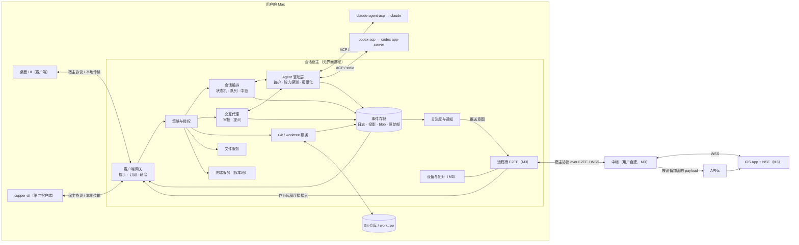
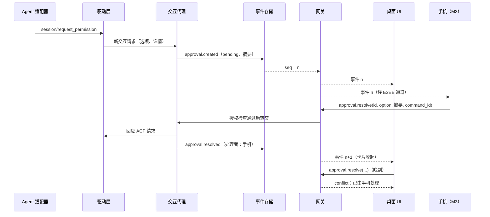

# 产品-架构对齐会：架构师评审意见

- 日期：2026-10-16
- 角色：架构师（子 agent），独立发言
- 评审对象：PRD v0.1（`8eed5a1`）
- 依据：议程；R01、R02、R03 的报告和 review；需求访谈 #1、#2 及截图笔记；`CLAUDE.md`、`docs/00-process.md`

## 核心结论

1. **我支持"会话宿主"这个方向，但 NFR-1 只写了目标，没写出决定 M3 是否返工的约束。** 真正不可逆的是"宿主与客户端之间的契约"，包括进程边界、协议语义、事件日志、审批和提问对象、命令授权钩子、版本协商。这些要写进 NFR-1，并在 M1 验收。UI 技术、加密方案、中继、Codex 的接入路径都可以晚点定。
2. **宿主从 M1 起就做成独立的无界面进程，由 App 拉起并监护，同时交付一个命令行的第二客户端。** 这样做在 M1 内部就有收益：UI 崩溃或升级不会打断会话，可以做自动化测试，多窗口也自然支持。它不单是为手机预付的成本。到 M2/M3 再视需要改成登录项常驻。
3. **PRD 有几处与调研事实不一致，要在 v0.2 修正。**
   - AG-1 要求"用本机 CLI"，但适配器默认使用自带的 agent 二进制，这与 NFR-5 的版本锁定冲突，还牵涉 Anthropic SDK 的再分发许可。
   - NFR-7 把 Steer 列为"cupper 自己实现"，实际上 Steer 只能靠 agent 的私有扩展。
   - S2/AP-2 写的"本会话都允许"在 ACP 中不存在；Claude 的"总是允许"会写入持久规则。
   - G3/SEC-1 的保密承诺比实际能做到的宽。
4. **最大的遗漏是 agent 的结构化提问**（AskUserQuestion、request_user_input、计划确认）。ACP 已经把它定为稳定能力，两个适配器都在用，不处理就会卡住回合。此外还缺：重启后会话能继续、宿主生命周期、崩溃恢复、数据和协议的迁移、本地接口鉴权（防止 agent 自己批准自己）、防休眠。
5. **同意把 worktree 提到 P0，但 P0 只做"最小 worktree"**：基于所选分支新建分支和 worktree，cwd 指向它，清理时保证安全。setup 脚本、复制被忽略的文件、detached HEAD、Handoff、快照放到 P1。不管优先级怎么定，worktree 相关字段都必须进 M1 的会话模型。
6. **M1 建议减负。** 集成终端（UI-1）和"生成提交信息"（GT-4 的一部分）挪到 P1；新增的提问、重启续聊、崩溃恢复放进 P0。M1 内部建议先做"宿主骨架 + Claude"，再扩到 Codex 和 Git。
7. **M3 建议缩小密码学的范围。** M3 的中继只做无状态转发和推送发送。密文缓存（RL-2）和离线历史（MB-10）一起放到 M4。推送采用"桌面按设备加密、手机上由通知扩展（NSE）解密"的方式。断线续传靠游标，中继不需要存储。自建 iOS 加自有 APNs 的方案可行，但前提是付费的 Apple 开发者账号和 NSE/App Group，这些要写进 PRD。
8. **阶段 ② 需要 11 份 M1 前的 ADR、4 份 M3 前的 ADR，M1 前还要做 6 个原型实测（其中 2 个可选）。** 最关键的两项是"两个适配器的行为实测"和"宿主骨架走通"（双客户端、断线续传、强杀后恢复）。

---

## 议题 1：平滑演进

### 1.1 先回答"会话宿主"这个方向本身

**结论：方向成立，我支持。** 三份调研从不同角度得出了同一结论，外部也有现成的先例：
- Codex 桌面 App 就是"Electron 外壳 + app-server 进程"，同一套协议服务本机、SSH 和手机（R01 §十二）。
- Claude Code Remote Control 的 server 模式和 Happy 的 daemon 也都是"宿主持有会话、界面只是视图"（R03 §1）。

我考虑过三个替代方案，都不建议采用：

| 替代方案 | 问题 |
|---|---|
| A. M1 让桌面 UI 直接持有 ACP 连接，M3 再抽出宿主 | M3 时要把会话状态、审批、队列、Git 从 UI 进程里挖出来，这正是"推倒重来"；M1 期间 UI 和会话逻辑也会缠在一起 |
| B. 宿主对外也讲 ACP（宿主是一个 ACP 代理） | ACP v1 没有运行状态、多客户端、游标续传、队列，也没有项目、Git、worktree、设备这类工作区级的 API（R02 §6 #32–#42），大部分要靠 `_` 扩展补。而且 ACP 每 1–2 周发一版，客户端协议会被上游的节奏牵着走。可以借用它的 ContentBlock、ToolCall 数据形状，但不借用它的会话语义 |
| C. 宿主对外采用 Codex app-server 协议 | 大约 175 个方法，没有语义化版本，大量实验接口，语义是 Codex 专有的（R02 §5）。借鉴它的 thread/turn/item 模型和 seq/ack 信封就够了 |

在支持这个方向的前提下，我提三点修正：

1. **宿主的价值在 M1 内部就要成立。** 它带来崩溃隔离（UI 挂了或重载，会话不受影响）、App 升级时不打断会话、多窗口（PS-7）、可以写自动化端到端测试（命令行客户端加假 agent）。这样它就不是"为 M3 预付"的成本，M1 期间也不会被当成过度设计而砍掉。
2. **保持简单。** 单机，单写者（只有宿主写数据），用 SQLite。客户端只订阅投影、发送命令。不做 CRDT，不做多主同步，不做插件框架。
3. **"宿主"首先是一份契约，其次才是一个进程。** 契约（协议语义加事件模型）是不可逆的。进程形态可以调整，但 M1 用独立进程最能防止边界被悄悄穿透。

代价也要说清楚：多一个进程要管理（启动、单实例、版本一致、崩溃），本地接口要鉴权，M1 前期的设计量更大。这些主要是一次性成本。

### 1.2 NFR-1 是否足以保证 M1 到 M3 不返工

**不够。** NFR-1 写清了目标，但缺了下面几条，而 M3 是否返工恰恰取决于它们：

1. **没有规定边界怎么强制执行。** 一个在同一进程里的"测试客户端"可以绕过协议，照样通过验收。验收必须要求第二客户端是独立进程，使用和桌面 UI 相同的协议和传输抽象。
2. **验收只覆盖了"订阅 + 审批"。** 手机在 P0/P1 用到的每条命令（发送、排队、Steer、中断、回答提问、读取 diff、新建会话）都应该能由第二客户端完成，否则 M3 时还会发现"这个能力只在 UI 里"。
3. **没有版本协商和能力协商。** iOS App 和桌面 App 的版本一定会错开，尤其 iOS 是用户自己构建的。
4. **没有命令幂等，也没有客户端身份和授权。** 移动网络会重试；手机的权限边界需要在每条命令上检查。
5. **没有"事件日志是唯一事实来源"和"瘦客户端"原则。** 如果状态、分组、耗时、未读这些是在桌面 UI 里算出来的，iOS 就得再写一遍，而且两端会不一致。
6. **没有说宿主的生命周期**（谁来启动、UI 退出后怎么办），见议题 4。
7. **"M3 只增加一种传输和配对能力"这个说法低估了 M3 的工作。** 实际还要加远程桥、设备表、手机权限范围、推送生成，以及桌面端的配对和设备管理界面。这些都是新增，不是改写。建议改写这句措辞，免得将来被误判为"违反 NFR-1"。

改写后的 NFR-1 文本见议题 6。

### 1.3 M1 必须一次做对的不可逆决定

| # | 决定 | M1 的最低要求 | 做错的后果（M3 时） |
|---|---|---|---|
| 1 | 访问边界 | UI 只能通过宿主协议访问会话数据和能力。UI 不读宿主的数据库，不直接调用 agent、git 或 PTY | 手机要用的能力散落在 UI 里，M3 要一个个搬出来 |
| 2 | 协议语义（不是编码） | 握手：协议版本区间、能力、客户端身份。订阅加游标续传；游标太旧时先发快照再重同步。历史可以向前分页。命令带唯一 ID（幂等）和前置条件（`expected_turn_id`、审批内容摘要）。大内容用引用，按需拉取。统一的错误码 | 移动网络下重复执行、丢事件、整段重传；iOS 和桌面版本错开时无法协商 |
| 3 | 事件日志 | 只追加。每条流的 seq 单调递增，落盘之后才下发。ID 全局唯一（包含 host_id）。条目按 ID upsert（started / delta / completed）。事件带 schema 版本。保留原始 ACP 帧，以便规范化逻辑修好后重算。每条事件可以单独序列化，将来可以逐条加密。允许回合之外的事件（Claude 的自主回合 #1280、后台任务 #1285） | 规范化有 bug 时历史永久损坏；M3/M4 无法逐条加密或缓存 |
| 4 | 状态与关注度 | 五种会话状态、"需要处理"（有待审批或待回答的提问）、未读（全局、跨设备同步）都由宿主计算并下发 | 每个客户端各算一套，桌面和手机对不上 |
| 5 | 交互请求对象 | 审批和提问都是带 ID 的状态对象：pending 之后变为 resolved、expired 或 cancelled。选项来自 agent，带内容摘要，记录是谁处理的，先到先得（比较并设置）。不能用"宿主回调客户端"的方式实现 | 多端同时应答时重复处理或错配；手机批准的其实是一条已经变化了的请求 |
| 6 | 授权钩子 | 每条命令都带调用方身份（principal），统一经过 `policy(principal, command)` 检查。本地 UI 也只是一个拥有全部权限的 principal | M3 定义手机的权限边界时，要改每一个命令处理器 |
| 7 | 领域模型 | 电脑（host_id）→ 项目 → 会话（agent、工作区 {本地或 worktree、路径、分支、基线}、agent 侧的会话 ID）→ 回合 → 条目。审批和提问挂在回合上 | 事后补 worktree、补多台 Mac 都要做数据迁移 |
| 8 | 瘦客户端 | 宿主输出语义化的信息（工具类型、路径、退出码、耗时、分组、状态），不输出本地化文案或 HTML。客户端只负责排版和翻译。例如宿主给出 `{kind: read, path}`，由客户端渲染成"已读取 X" | iOS 要把分组、耗时、状态逻辑重写一遍，而且两端不一致 |
| 9 | 南向解耦 | 驱动接口用 cupper 自己的类型，ACP 类型不出驱动层。读取 ACP 流的路径永远不能被客户端的背压阻塞（Claude #1269：客户端读得慢会卡住会话） | 换成直连 Codex app-server 时改动扩散到各处；手机网络慢会拖住 agent |
| 10 | 迁移机制 | 存储有 schema 版本和前向迁移；事件有升级器（upcaster） | 第一次升级就要手工处理老数据 |

### 1.4 可以放心推迟的决定

| 决定 | 为什么可以推迟 | 最晚何时定 |
|---|---|---|
| 协议编码（JSON、CBOR、Protobuf） | 先定 schema，编码以后可以换 | M3 前 |
| 宿主是 App 的子进程，还是登录项常驻 | 只要宿主本身是能独立运行的二进制 | M3 前 |
| Codex 走 codex-acp，还是直连 app-server | 在驱动接口之后，不影响上层 | M2 |
| 何时采用 ACP v2 | 内部模型已经按 v2 的语义设计 | v2 稳定后 |
| 配对、E2EE、中继、推送的具体方案 | 只要事件能单独序列化、命令带 principal | M3 前 |
| 电脑的身份密钥、已配对设备表 | M3 迁移时再生成，不会丢任何数据。**这一点我和 R03 A4 的看法不同**：M1 真正要落下的是授权钩子和 host_id，不是密钥本身 | M3 |
| 中继是否缓存密文 | 见 3.5 | M4 |
| 手机权限范围的细则 | 授权钩子已经在了 | M3 前 |
| 一台手机对多台 Mac | ID 里已经包含 host_id | M3/M4 |
| 桌面 UI 技术 | 只要边界守住，它不影响 M3 是否返工，只影响 M1 的成本和 iOS 能复用多少 | 阶段 ② |
| 事件压缩与保留策略 | 只要条目 upsert 语义已经在 | M2 |

### 1.5 M1 不该做的事（防止过度设计）

- 不做设备密钥、配对、中继、加密。
- 宿主不监听任何 TCP 端口；M3 也只发起出站连接。
- 不做多写者同步或 CRDT，不做通用的插件或 RPC 框架。
- 不接管 agent 的配置文件（`~/.claude`、`~/.codex`、项目里的 `.claude/`、`AGENTS.md`）。

---

## 议题 2：架构骨架（概念层面）

### 2.1 组件清单

| 组件 | 职责 | 里程碑 |
|---|---|---|
| **桌面 UI** | 渲染宿主下发的投影，发送命令。只在本地处理窗口、快捷键、主题、多语言、输入草稿、系统通知的展示 | M1 |
| **cupper-cli** | 第二客户端：NFR-1 验收、端到端测试、开发调试 | M1 |
| **会话宿主**（无界面进程） | 下面各模块的容器；单实例，由 App 拉起 | M1 |
| └ 客户端网关 | 握手、版本与能力协商、连接管理、订阅与游标、命令分发、每个客户端独立的发送队列（慢客户端会被断开，之后按游标重同步，不会反压 agent） | M1 |
| └ 策略与授权 | `policy(principal, command)`。本地 UI 拥有全部权限；手机的权限范围在 M3 定义 | M1 有钩子，M3 有规则 |
| └ 会话编排 | 会话生命周期（新建、resume、关闭、归档），回合状态机，宿主自己的消息队列，Steer 路由，中断与超时兜底，会话能力描述 | M1 |
| └ 交互代理 | 审批和提问对象的创建、先到先得的处理、失效处理，并回应 ACP 请求 | M1 |
| └ 事件存储 | 事件日志（索引流和各会话流）、投影、按内容寻址的 blob、原始 ACP 帧、回合快照引用、迁移 | M1 |
| └ Agent 驱动层 | 驱动接口；ACP 驱动（Claude、Codex），将来可加 app-server 驱动；启动、监护、重启适配器进程；能力探测；规范化器（ACP 转 cupper 事件） | M1 |
| └ Git 与 worktree 服务 | 状态、各种范围的 diff、按 hunk 暂存和还原、提交、推送；worktree 的创建和清理；回合开始和结束时给工作区拍快照 | M1 |
| └ 文件服务 | `@` 引用的模糊搜索（遵守 .gitignore）；文件预览（P1） | M1 |
| └ 终端服务 | 每个会话一个 PTY，只对本地客户端开放 | M2（建议） |
| └ 关注度与通知 | 计算状态迁移，产生"通知意图"；桌面通知由 UI 弹出；M3 起交给推送生成 | M1 |
| └ 设备与配对 | 电脑身份、已配对设备表、二维码配对、撤销 | M3 |
| └ 远程桥 | E2EE 通道（每台设备一条），把手机作为网关上的又一个连接接入；推送生成（按设备加密） | M3 |
| **Agent 适配器**（子进程） | claude-agent-acp 驱动本机 `claude`；codex-acp 驱动 `codex app-server` | M1 |
| **假 agent**（测试资产） | 按录制的剧本输出 ACP 帧，用于确定性的回归测试（NFR-5） | M1 |
| **中继** | WSS 路由（只看路由信封），设备认证与吊销，发送 APNs；M3 不存会话数据 | M3 |
| **iOS App + NSE** | 同步客户端、E2EE 通道、本地加密缓存、界面；NSE 负责解密推送 | M3 |

### 2.2 组件图

### 2.3 接口

| # | 接口 | 双方 | 形式 | 关键语义 |
|---|---|---|---|---|
| I1 | 宿主协议 | 所有客户端 ↔ 网关 | 消息帧，不依赖具体传输 | 见下表 |
| I2 | 本地传输 | 桌面 UI、CLI ↔ 宿主 | Unix 域套接字或 XPC（由 ADR 决定） | 只限本机；必须带本地凭据（SEC-8） |
| I3 | 远程传输 | 远程桥 ↔ 中继 ↔ iOS | WSS，上面套 E2EE 通道 | 中继只看到路由信封（host_id、device_id、消息 ID、密文） |
| I4 | 驱动接口 | 会话编排、交互代理 ↔ 驱动 | 进程内接口 | 新建、resume、关闭会话；发送 prompt；steer；cancel；设置配置项；回应交互请求；能力。输出规范化后的事件 |
| I5 | ACP | 驱动 ↔ 适配器 | JSON-RPC，走 stdio | v1 stable，加上探测到的扩展 |
| I6 | Git | Git 服务 ↔ git | 子进程（或库，由 ADR 决定） | porcelain v2、`apply --cached`、`worktree`、临时 index 拍快照 |
| I7 | 推送 | 远程桥 → 中继 → APNs → NSE | 中继 API；APNs 走 HTTP/2 token 认证 | payload 是按设备加密的密文，不超过 4KB |
| I8 | 存储 | 宿主内部 | SQLite 加文件 | 只有宿主写入 |

宿主协议（I1）的消息类别草图（只描述语义，编码留给 ADR）：

| 类别 | 消息 | 说明 |
|---|---|---|
| 握手 | `hello` / `welcome` | 协议版本区间、客户端能力、身份证明；宿主返回自己的能力和 host_id |
| 订阅 | `subscribe(stream, cursor)` | stream 为 `index`（项目、会话、状态、待处理的交互请求）或 `session/<id>`；游标太旧时先发快照 |
| 事件 | `event(stream, seq, id, type, v, ts, payload)` | 下发时已经落盘 |
| 历史 | `history.page(stream, before, limit)` | 长会话向前分页（NFR-6，手机端） |
| 命令 | `command(command_id, type, args, precondition)` → `result` | 幂等；错误码统一，例如 `conflict`、`forbidden`、`unsupported` |
| 内容 | `blob.get(hash, range)` | 图片、长输出、整文件 diff 按需拉取（Claude 的 diff 是整个文件的新旧全文，R02 §3.2） |

### 2.4 关键数据流

**流式输出**：适配器的 stdout → 驱动层（按条目 upsert 规范化，同时记录原始帧）→ 事件存储（分配 seq 并落盘）→ 网关按订阅分发 → 各个客户端。读 ACP 和向客户端发送之间通过日志解耦，慢客户端只会被断开再重同步。

**审批（先到先得）**：

**断线续传**：客户端重连时带上每条流的游标，网关补发游标之后的事件；如果游标早于保留范围，就先发快照（条目的当前状态），再发增量。手机在 M3 也走同一条路径：桌面在线时，从桌面补齐就够了，所以中继不需要存储。

**推送（M3）**：状态迁移为"需要处理"或"完成"时，关注度服务产生通知意图 → 如果桌面在场则抑制 → 推送生成把摘要按每台设备的公钥分别加密 → 中继 → APNs → NSE 解密并改写通知；解不开时显示通用文案。

### 2.5 PRD 能力到组件的映射

| PRD 能力 | 主要组件 | 协作组件 | 备注 |
|---|---|---|---|
| AG-1、AG-2、AG-5 接入、就绪检测、版本 | 驱动层（进程监护、探测） | 设置存储 | 就绪状态由宿主下发给所有客户端 |
| AG-3、AG-4 agent 标识、按能力显示功能 | 会话编排（会话能力描述） | 驱动层（`initialize`、配置项） | 客户端只按能力描述渲染（R03 A9） |
| PS-1、PS-6、PS-7 布局、导航、⌘K、多窗口 | 桌面 UI | — | 纯客户端功能；多窗口靠宿主天然支持 |
| PS-2、PS-3 项目与会话管理 | 会话编排、事件存储（索引流） | Git 服务（判断是否为仓库） | 归档是宿主自己的概念，不调用 agent 的 delete（Codex 的 delete 实际是归档，#537） |
| PS-4 状态指示 | 关注度服务 | 事件存储 | 状态由宿主计算 |
| PS-5 导入 CLI 历史 | 驱动层（`session/list`、`load`） | 事件存储（导入） | 回放不完整，只能尽力而为 |
| CP-1 输入 | 桌面 UI | — | 草稿不跨设备同步 |
| CP-2 图片、@ 文件 | 文件服务、blob 存储 | 驱动层（image 块） | — |
| CP-3、CP-4 斜杠命令、模型、推理强度、权限模式 | 驱动层，汇入会话能力描述 | 策略（手机不能切到完全访问） | 发送第一条消息之前就要能显示，见 3.2 |
| CP-5、GT-5 worktree | Git 与 worktree 服务 | 会话编排（cwd） | — |
| CP-6、CP-8 Steer、排队 | 会话编排（宿主队列） | 驱动层（Steer 扩展） | — |
| CP-7 中断 | 会话编排（超时兜底） | 驱动层 | — |
| MS-1 至 MS-7 消息流 | 规范化器、事件存储 | 桌面 UI（渲染） | 耗时、分组由宿主计算 |
| AP-1、AP-2、AP-4、（新）AP-5 审批与提问 | 交互代理 | 策略、事件存储 | — |
| AP-3 系统通知 | 关注度服务 | 桌面 UI 负责弹出 | — |
| GT-1 至 GT-4、GT-6 审查与 Git | Git 服务 | 事件存储（回合快照） | 与 agent 无关 |
| UI-1 终端 | 终端服务（PTY） | 策略（只对本地开放） | — |
| UI-2 至 UI-7 设置、主题、多语言、视觉 | 桌面 UI；设置存储 | — | — |
| MB-1、SEC-2、SEC-3 配对、撤销 | 设备与配对 | 远程桥、中继 | — |
| MB-2 至 MB-5、MB-7 手机端列表、输出、发送、审批、中断 | 网关（手机作为 principal），走与桌面相同的模块 | 策略 | **不新增会话逻辑** |
| MB-6 推送 | 关注度服务 → 推送生成 | 中继 → APNs → NSE | — |
| MB-8、MB-9 diff、新建会话 | Git 服务；会话编排 | 策略 | — |
| MB-10 离线历史 | 中继缓存 | — | 建议 M4 |
| SEC-1、SEC-5 端到端加密、拒绝降级 | 远程桥 | 中继 | — |
| SEC-4 指令来源校验 | 远程桥、策略、交互代理 | — | — |
| RL-1 至 RL-3 中继 | 中继 | — | — |
| RL-4 局域网直连 | 远程桥（多一种传输） | — | E2EE 在传输之上，不受影响 |
| NFR-1、NFR-2 | 网关、事件存储 | cupper-cli | — |
| NFR-3 | 宿主进程形态 | — | 进程独立后几乎不用额外工作 |
| NFR-5、NFR-7 | 驱动层 | 假 agent（回归测试） | — |

### 2.6 候选方案及取决因素（不是选型）

| 决策点 | 候选 | 取决于 | 架构师的初步倾向（仅供参考） |
|---|---|---|---|
| 宿主形态 | a. App 进程内的模块（靠消息边界隔离） b. App 拉起并监护的独立子进程 c. launchd 登录项常驻（SMAppService） | 崩溃隔离；App 升级是否打断会话；关窗后手机能否继续用；复杂度 | M1 用 b，M2/M3 可以平滑切到 c |
| 宿主语言 | TypeScript/Node、Rust、Swift | ACP SDK 的成熟度（TS、Rust 是官方的，Swift 不是）；Node 反正要带（claude-agent-acp 需要 Node ≥ 22）；PTY、SQLite、git 的生态；M3 的加密代码能否和 iOS 共用（Rust 可以通过 UniFFI 给 iOS 用）；子 agent 写这种语言的效率 | 在 TS 和 Rust 之间选 |
| 桌面 UI | Electron + React；Tauri + Web 前端；SwiftUI/AppKit 原生；原生外壳 + WebView 混合 | 复刻 Codex 的保真度（Codex 本身就是 Electron + React，R01 §十二）；终端、diff、流式 Markdown、Mermaid 有多少现成组件；NFR-6；包体和内存；能否和 iOS 共享渲染代码 | 不影响 M3 是否返工，按 M1 成本来选 |
| 协议编码 | JSON（JSON-RPC 风格）、CBOR/MessagePack、Protobuf | 调试是否方便、移动端带宽、代码生成 | 先定 schema，M1 用 JSON |
| 本地传输与鉴权 | Unix 域套接字 + 存在钥匙串里的凭据；XPC（校验代码签名）；App 拉起宿主时继承的 socketpair；localhost WebSocket + token | 能否挡住同一用户下的其他进程（包括 agent 自己）连进来；CLI 客户端怎么认证 | 不用 TCP |
| iOS | SwiftUI 原生；备选是把共享的 Web 渲染组件放进 WKWebView | NSE 和钥匙串必须用原生；渲染一致性 | SwiftUI |

---

## 议题 3：可行性与范围

### 3.1 材料之间的不一致

**调研报告之间**

| # | 不一致之处 | 我的判断 |
|---|---|---|
| 1 | 宿主的进程形态：R02 说是"常驻的本地后端进程"；R03 A1 说"哪怕和 UI 在同一个进程里"；R01 #9 说"可以独立运行的守护进程" | 交给 ADR-01 决定。我建议 M1 用独立子进程 |
| 2 | 内部事件模型参照谁：R02 #3 主张参照 ACP v2 草案；R01 #2 主张参照 Codex 的 item 模型 | 两者兼容（都是按 ID upsert，都有生命周期），由 ADR-06 选定一种写法 |
| 3 | R03 A1 论证"手机不能直接讲 ACP"的理由之一，是 agent 会反过来调用客户端的 `fs/*` 和 `terminal/*`。但 R02 核实发现两个适配器都**不使用**这两组方法，v2 草案还删掉了它们 | 结论仍然成立（stdio 是一对一的，加上权限请求、提问、断线补发、多客户端这些需求），只是这条理由不对 |
| 4 | R03 结论 5 和 A7 说"推送凭据归发布者所有，需要发布者运营推送网关" | 用户的决策 D4（自建 iOS、使用自己的 APNs 凭据）已经让这个前提不再适用，但隐藏前提没有写进 PRD，见 3.2 |
| 5 | R03 A4 主张"设备身份一期就进数据模型" | 我认为可以推迟，见 1.4 |

**PRD 与调研之间**

| # | PRD 条目 | 与调研的出入 |
|---|---|---|
| 1 | AG-1"使用本机已安装的官方 CLI" | 适配器默认用自带的 agent 程序：claude-agent-sdk 以可选依赖的形式带着原生 Claude Code；codex-acp 锁定 `@openai/codex` 0.160.1，而 Codex 最新版是 0.163.0（R02 §3.1、§4.1）。要用本机 CLI，就得通过 `CLAUDE_CODE_EXECUTABLE`、`CODEX_PATH` 覆盖，这时 agent 的版本就不在 NFR-5 的锁定范围之内了 |
| 2 | NFR-5"随 App 锁定适配器版本"加上 §8 开源 | 如果把 claude-agent-acp 连同依赖一起打进 App，就等于再分发了受 Anthropic 商业条款约束的 SDK 和原生 Claude Code 二进制（R02 §3.1） |
| 3 | NFR-7 把 Steer 列入"由 cupper 自己实现" | Steer 只能靠 agent 的私有扩展 `_session/steering`（R02 §7），cupper 没法自己实现 |
| 4 | S2 和 AP-2 写的"本次 / 本会话都允许" | ACP 的选项是 allow_once、allow_always、reject_once、reject_always，没有"本会话"。Claude 的 allow_always 会写入持久的权限规则（R02 §3.2）；Codex 有时拒绝审批只能结束整个回合（#556） |
| 5 | G3"任何一方都看不到会话内容" | 模型提供方（Anthropic、OpenAI）必然能看到 prompt 和输出。承诺应该限定在 cupper 自己的链路上 |
| 6 | SEC-1"中继只能看到设备 ID 和密文" | 与 SEC-7 和 R03 §4.5 矛盾：中继还能看到 IP、在线时段、消息大小和频率、推送 token 和推送时间 |
| 7 | RL-2 说缓存"用于推送拉取"，MB-6 却写的是"推送内容加密" | 前者是"唤醒后拉取"（N-3），后者是"推送里带密文"（N-2），两种做法要选一种。建议选 N-2，见 3.5 |
| 8 | 背景第 3 点"有官方组织维护的 ACP 适配器" | 这里的"官方组织"是 ACP 组织（agentclientprotocol），由 Zed 和 JetBrains 主导，不是 Anthropic 或 OpenAI 的官方产品。claude 适配器还是 0.x；codex-acp 在 2.0.0 有过破坏性变更 |
| 9 | 全文没有"结构化提问" | R02 #24 表明 elicitation 已稳定，两个适配器都在用；R03 §2 把"回答提问"列为移动端普遍具备的功能 |
| 10 | PS-3"恢复会话"与 GT-5"归档时清理 worktree"（PRD 内部） | 恢复一个已归档会话时，它的 worktree 可能已经被删了，行为没有定义 |

### 3.2 做不到、代价过高或有隐藏前提的需求

| ID | 问题 | 依据 | 建议 |
|---|---|---|---|
| AG-1、NFR-5 | 见 3.1 第 1、2 条；另外 claude-agent-acp 需要 Node ≥ 22，PRD 没提 Node 从哪里来 | R02 §3.1、§4.1，启示 6 | 交给 ADR-08、ADR-11 和 SP-2。首选方案：不再分发 Anthropic 的 SDK 和二进制；首次运行时按锁定版本安装适配器并做完整性校验，跳过它内置的 agent 程序，指向本机的 `claude`；本机 CLI 版本超出验证范围时给出提示 |
| AG-2 | 没有稳定的"查询登录状态"方法：ACP 的 `auth/status` 还是 Draft，Claude 只有 `_auth/status_update` 扩展 | R02 §1.3、§3.2 | 改为尽力而为：能探测时提前提示，否则在 `session/new` 或发送 prompt 失败时识别出原因并给指引 |
| AG-4、CP-3、CP-4 | 按 ACP 的会话模型，模型、推理强度、权限模式和斜杠命令都要等会话建立后才由 agent 给出；但"新建会话"页在发第一条消息之前就要显示这些选择器 | R02 §1.3 | 宿主缓存每个 agent 最近一次的能力描述，或者在打开"新会话"时就预建 ACP 会话。由 SP-1 核实给出的时机，以及预建会话会不会在 agent 那边留下空会话 |
| CP-6 | Steer 只有私有扩展，而且 Claude 在工具流式输出时 Steer 会让回合失败（#1267），自主回合中不能 Steer（#1280） | R02 §3.3 | 排队是 P0 的主路径。Steer 探测到才启用，失败时自动转为排队。Steer 必须带 `expected_turn_id`，回合已经结束的话就转为排队 |
| CP-7 | Codex app-server 中途退出时，`session/prompt` 永远不返回（#600） | R02 §4.3 | 宿主监护适配器进程，并做超时兜底 |
| AP-2、S2 | 见 3.1 第 4 条 | R02 | 选项和文案都以 agent 给出的为准；PRD 不承诺"本会话"这种语义；拒绝后回合结束的情况要在 UI 上说清楚 |
| MS-3 | 命令输出和退出码要靠 Zed 的 `_meta.terminal_*` 约定，否则只能拿到代码块形式的文本 | R02 §3.2 | 宿主声明支持这个约定；拿不到退出码时降级显示；耗时由宿主打时间戳计算 |
| MS-4 | Codex Plan 模式的 Markdown 计划依赖 unstable 的 `plan_update` | R02 §4.2 | P0 只做条目式的计划；Markdown 计划跟随 Plan 模式（CP-8，P1） |
| GT-1 | "最近一回合"的 diff 需要宿主在回合开始时给工作区拍快照（包括未跟踪的文件）。在本地模式下，用户自己的改动和其他会话的改动会混进来 | R02 §7 | 宿主记录回合开始和结束时的快照（用临时 index 加 `write-tree`）。本地模式下在 UI 上注明这一点。快照也给将来的"回滚某个回合"打下基础（ACP 没有回滚，R02 #41） |
| GT-4 | "生成提交信息"需要一次独立于会话的模型调用。cupper 没有自己的模型凭据，codex-acp 也不支持临时会话（#448） | R02 §4.3 | 降到 P1。实现方式交给 ADR：要么作为一条可见的消息发给当前会话的 agent，要么调用 CLI 的非交互模式 |
| GT-5 | 归档就清理 worktree，有丢数据的风险；PS-3 恢复时 worktree 可能已不存在 | PRD 内部 | 有未提交或未推送的内容时不删除；恢复时按分支重建 worktree，分支也不在了就只读展示 |
| UI-1 | 终端放在宿主里，意味着 PTY 字节流要走协议，还要处理回滚缓冲和窗口尺寸同步，成本不低；S1–S4 并不依赖它 | — | 建议降到 P1；P0 改为"在外部终端或编辑器中打开当前会话的目录" |
| NFR-6 | 没有定义什么叫"可用"；agent 进程（Node 加 CLI）的启动时间通常远超 2 秒 | — | 把"可用"定义为"会话列表和历史可见、可以输入"；agent 懒启动，不计入这 2 秒 |
| RL-3、MB-6 | 自建 iOS 要用推送，需要付费的 Apple Developer Program。按我的了解，免费的个人开发团队不支持推送能力，安装的 App 7 天后失效（待 SP-7 核实）。NFR 读取密钥还需要用 App Group 共享钥匙串 | Apple 平台约束；R03 §5 | 写进 PRD 的前提条件和 README |
| G2 | 手机能审批的前提是 Mac 醒着而且 cupper 在运行；合上盖子就断了 | R01 G21；R03 §3 | 新增 NFR-13 防休眠；在 SEC-7 的文档里说明这个限制 |

### 3.3 关于把 worktree 提到 P0

**同意，但要限定范围。** 理由：S1 写的就是"同一个仓库里并行"，没有 worktree，两个 agent 会互相踩文件；GT-1 的"最近一回合"在共用一个目录时也会混进别的会话的改动。另外，**worktree 进入数据模型这件事本身就是 M1 必须做的不可逆决定**，和它的功能优先级无关。

建议的切分：

- **P0（最小 worktree）**：新建会话时可以选"新建 worktree"，基于所选的起始分支**直接建一个有名字的分支**（例如 `cupper/<短名>`），会话的 cwd 指向它；会话页显示分支名；归档时提示是否清理，有未提交或未推送的内容就不删除。
- **P1**：setup 脚本；按清单复制被忽略的文件（类似 `.worktreeinclude`，比如 `.env`、`.claude/settings.local.json`）；detached HEAD 模式加"在这里建分支"（也就是现在的 GT-5 前半句）；Handoff（E3）；删除前存快照和恢复；永久 worktree。
- **风险提示**：在 worktree 里，被 .gitignore 忽略的文件不存在，测试可能跑不起来。Claude Code 把每个 worktree 路径当作一个新项目，本地的权限规则不会带过去，审批会变多。如果 SP-1 显示这对日常使用影响大，就把"复制被忽略的文件"升到 P0。

这样 GT-5 的"一键建分支"在 P0 就不需要了，因为 P0 创建时已经是有名字的分支。

### 3.4 M1 P0 范围调整

| 动作 | 条目 | 理由 |
|---|---|---|
| 新增 P0 | AP-5 结构化提问（新增） | 不处理就会卡住回合 |
| 新增 P0 | PS-8 重启后会话可以继续（新增） | G1 要求日常使用，App 重启后会话不能"死掉" |
| 新增 P0 | NFR-8、NFR-9、NFR-10 的 M1 部分（生命周期、崩溃恢复、迁移机制） | 见议题 4 |
| 新增 P0 | SEC-8 本地接口鉴权（新增） | 防止 agent 自己批准自己 |
| 降到 P1 | UI-1 集成终端（P0 改为"在外部终端打开"） | 成本高，S1–S4 不依赖 |
| 降到 P1 | GT-4 中的"生成提交信息"（提交和推送仍是 P0） | 有隐藏前提 |
| 降到 P1 | GT-5 的"一键建分支"；CP-5 中 setup 脚本等增强 | 见 3.3 |
| 保留 P0 | CP-6（排队为主路径，Steer 尽力而为） | 排队由宿主实现，成本可控 |
| 建议 | M1 内部分两步：M1a 做宿主骨架、Claude、消息流、审批和提问、cupper-cli、崩溃恢复；M1b 做 Codex、审查和 Git、worktree、打磨 | 尽早用一个 agent 把架构跑通；退出标准不变 |

### 3.5 M3 范围意见

1. **RL-2 和 MB-10 一起放到 M4。** M3 的中继只做三件事：无状态转发、发送推送、维护设备路由表。理由如下：
   - 手机在 M3 能做的操作（审批、发消息、中断）都要求桌面在线；桌面在线时，手机靠游标从桌面补齐就够了。
   - 推送采用 N-2（payload 本身就是按设备加密的摘要），不需要"唤醒后拉取"。
   - 去掉缓存后，M3 不需要"每会话数据密钥加按设备包裹"那套密钥模型（R03 D-2），撤销设备也变成了"删掉公钥、吊销中继 token"，SEC-3 很容易满足。M3 的密码学面和安全评审工作量大约减半。
   - 事件本身已经能单独序列化，所以 M4 加缓存时不需要返工。
2. **MB-6 明确采用 N-2**：桌面按每台设备分别加密摘要，NSE 解密，解不开时显示通用文案；用户在桌面前时不推送（R03 §5 第 5 点）。
3. **手机权限边界要正式写成需求**（SEC-9）。目前 6.2 的那段【默认】描述里没提到一点：手机上能不能选 allow_always？它会持久扩大权限，建议默认不允许。
4. **M3 的退出标准增加两项**：安全设计评审通过；用"恶意中继替换配对应答"做测试，并且必须失败（对应 SEC-2）。

### 3.6 一个产品侧的观察

截图笔记显示，用户当前在 Codex 里用的权限模式是"帮我批准"（Approve for me）。PRD 把它列为非目标，而 codex-acp 的模式里也没有它（R02 §4.2）。这意味着改用 cupper 之后，审批次数会明显上升，可能直接影响 G1（替代 Codex App）。替代方案是 Claude 适配器提供的 Auto 模式，以及 Codex 的 Agent 模式。建议把这一点作为待确认事项交给用户。

---

## 议题 4：遗漏

| 建议 ID | 需求 | 优先级 | 理由 |
|---|---|---|---|
| PS-8 | cupper 创建的会话，在 App 或宿主重启之后仍能继续对话（通过 agent 的 `session/resume`）；历史从 cupper 的事件日志渲染 | P0 | 日常使用的基本要求；不依赖 agent 回放（回放不完整） |
| AP-5 | agent 的结构化提问（AskUserQuestion、request_user_input、计划确认、MCP OAuth 链接）在消息流中以表单卡片呈现，任何客户端都能回答；会话状态计为"需要处理" | P0 | 见 3.1 第 9 条 |
| MB-5（扩展） | 手机除了处理审批，也能回答提问 | P0（M3） | R03 §2 中属于普遍具备的功能 |
| NFR-8 宿主生命周期 | 单实例，由 App 拉起；UI 崩溃或重载不影响宿主；退出 App 时如果有会话在运行就先提示；App 升级时如果有回合在运行，推迟重启宿主；（M2/M3）可以选择后台常驻，关窗后手机仍能操作 | M1 P0；常驻 P1 | 原 NFR-3 并入这一条 |
| NFR-9 崩溃恢复 | 宿主崩溃后：清理孤儿适配器进程，运行中的回合标记为"已中断"，待处理的交互请求标记为"已失效"，会话可以 resume。适配器崩溃后：自动重启并 resume，消息流里显示错误条。事件日志在崩溃时保持一致 | P0 | 适配器每天发版、问题多（R02） |
| NFR-10 升级与迁移 | 存储有 schema 版本和前向迁移，迁移前自动备份，明确说明不支持降级。宿主协议做版本协商，桌面和 iOS 允许相差若干个版本 | P0（M1 打基础） | iOS 由用户自己构建，版本一定会错开 |
| NFR-11 容量 | 同时运行的会话数目标（例如不少于 6 个）；事件日志、blob、worktree 的磁盘占用要可见、可清理 | P1 | 每个会话都有 Node 和 CLI 进程，资源开销不小 |
| NFR-12 诊断 | 本地日志按大小轮转并做脱敏；收集适配器的 stderr；可以导出诊断包；不上传任何数据 | P0 | 排查适配器问题是常态 |
| NFR-13 电源 | 有回合在运行或在等审批时，阻止空闲睡眠；合盖的限制写进文档 | M1 P1；M3 P0 | G2 的前提 |
| SEC-8 本地接口鉴权 | 宿主只接受经过认证的本地客户端；agent 子进程和集成终端都拿不到这份凭据；宿主不监听网络端口 | P0 | agent 以同一个用户身份执行命令，可能连上宿主替自己批准，或者切到完全访问（这是纵深防御，不是绝对隔离） |
| SEC-9 手机权限边界 | 把 6.2 的【默认】描述正式写成需求：不提供远程 shell，不写文件，不能切到完全访问或跳过审批，默认不能选 allow_always，只能在已有项目里新建会话 | P0（M3） | 由授权钩子执行 |
| SEC-10 交互请求的绑定 | 每个处理结果都绑定请求 ID 和内容摘要；防止重放；请求所属的 agent 进程退出后自动失效 | M1 打数据基础，M3 P0 | 防止批准了一条已经变化的请求 |
| SEC-11 静态数据 | 说明桌面的事件日志以明文存在本机（依赖 FileVault）；iOS 缓存使用 Data Protection；密钥存在钥匙串 | P0（M3） | 让承诺完整 |
| MB-11 多台 Mac | 一台手机可以配对多台 Mac，会话列表按电脑分组 | P1（M3 打数据基础） | MB-2 已经隐含了"所属电脑" |
| MB-12 推送防打扰 | 用户正在桌面上操作时不推送 | P1（M3） | R03 §5 |
| RL-5 中继运维 | 健康检查；设备 token 会过期、可以吊销；限流；部署文档；中继与客户端的版本兼容 | P0（M3） | 用户自建，必须容易部署和排障 |
| — | 电脑身份丢失（重装、换机）后需要重新配对所有手机，在文档中说明 | P0（M3） | 信任根在桌面 |
| — | 读状态的语义：未读是全局的，任何一端读过，其他端都同步为已读 | 待用户确认 | 影响 PS-4 和手机 |
| — | 原则：cupper 不改写 agent 的配置文件，唯一的例外是 agent 自己因"总是允许"而写入的规则 | 写入 §8 | 边界清晰 |
| — | 卸载与清理（worktree、数据目录）；会话导出 | P2 | — |

---

## 议题 5：阶段 ② 的输入

### 5.1 ADR 清单（编号暂定）

**M1 开工前（`gate/design` 前）需要定的**

| 编号 | 标题 | 要决定什么 | 候选项 |
|---|---|---|---|
| ADR-01 | 会话宿主的进程形态与生命周期 | 进程边界、谁来启动、单实例、升级时如何处理、通知由谁弹出、终端放在哪里 | 进程内模块；App 拉起的子进程；登录项常驻 |
| ADR-02 | 宿主的实现语言 | 宿主核心用什么语言 | TypeScript/Node；Rust；Swift |
| ADR-03 | 桌面 UI 技术 | 外壳和渲染技术 | Electron + React；Tauri + Web；SwiftUI/AppKit；混合 |
| ADR-04 | 宿主与客户端之间的协议 | 消息语义（见 2.3）、编码、schema 的来源与代码生成、版本协商、错误码 | JSON-RPC 风格的 JSON；CBOR；Protobuf；schema 用 JSON Schema、TypeSpec 或 .proto |
| ADR-05 | 本地传输与本地客户端认证 | 传输方式和凭据怎么存放 | Unix 域套接字 + 钥匙串凭据；XPC + 代码签名校验；继承的 socketpair |
| ADR-06 | 事件模型与存储 | 条目模型（参照 ACP v2 还是 Codex 的 item）、流的划分（每会话一条加一条索引流，还是全局一条）、blob、原始帧、快照加增量、保留和压缩 | — |
| ADR-07 | Agent 驱动路径 | Codex 走 codex-acp 还是直连 app-server；Claude 走 claude-agent-acp 还是 Agent SDK | 两条路径各自对照 SP-1、SP-3 的结果 |
| ADR-08 | Agent 程序来源、适配器分发与版本锁定 | 用本机 CLI 还是适配器自带的程序；适配器是随包分发还是首次运行时按锁定版本安装；Node 运行时；兼容矩阵；回归方式（录制回放加假 agent） | — |
| ADR-09 | 适配器进程拓扑 | 每个会话一个适配器进程，还是每种 agent 一个进程承载多个会话 | 取舍在隔离性、资源占用和崩溃影响范围之间 |
| ADR-10 | Git 与 worktree | 用 git 命令行还是 libgit2/gitoxide；worktree 放在哪里、怎么命名；回合快照的方法；清理时的安全规则 | — |
| ADR-11 | 开源许可证与第三方依赖的再分发 | cupper 用什么许可证；哪些依赖不能随包分发 | MIT、Apache-2.0、GPL 系 |

**M3 开工前需要定的**

| 编号 | 标题 | 要决定什么 | 候选项 |
|---|---|---|---|
| ADR-12 | 配对与 E2EE 通道 | Noise 模式、二维码的内容、密钥存放、撤销方式 | `XXpsk`、`IKpsk2`、`KK`；libsodium / snow / CryptoKit |
| ADR-13 | 中继设计 | 是否有状态、路由信封、设备认证、部署形态 | 无状态转发；有限期的密文缓存（M4） |
| ADR-14 | 推送方案 | payload 的形式、NSE、App Group、防打扰 | N-1、N-2、N-3（R03 §5） |
| ADR-15 | iOS 技术与跨端代码共享 | 协议类型如何生成；加密代码是共用还是两端各写一份 | 共用 Rust 核心（通过 UniFFI）；Swift 单独实现加测试向量 |

### 5.2 需要先做原型实测的问题

| 编号 | 要验证什么 | 怎么验证 | 预计（人日） | 服务于 |
|---|---|---|---|---|
| SP-1 适配器行为实测 | R02 矩阵里标为 🟡 的项：回放是否完整、有没有时间戳；排队行为；Steer 的成功率和失败形态；cancel 的时序（含 #600）；拒绝审批后回合怎样（#556）；提问（AskUserQuestion、request_user_input）；配置项和斜杠命令什么时候给出；预建会话会不会留下空会话；`_meta.terminal_*` 能否拿到输出和退出码；未登录、额度用尽时的错误形态；适配器重启后能否 resume | 写一个最小的无界面 ACP 客户端脚本，对两个适配器跑固定剧本，录下全部 JSON-RPC 帧。录制结果之后可以直接用作回归测试和假 agent 的素材 | 2–3 | ADR-06、ADR-07、ADR-08；AP-2、CP-6、MS-3 |
| SP-2 本机 CLI 与适配器的版本耦合、分发 | claude-agent-acp 通过 `CLAUDE_CODE_EXECUTABLE` 使用本机 `claude`、不安装可选的内置程序时能否正常工作；codex-acp 通过 `CODEX_PATH` 使用更新版本的 codex 时，实验 API 会不会失配；Node 22 从哪里来（随包带 Node，还是用 bun 编译成单个文件）；体积和启动耗时 | 在干净的机器或新用户账户上实际跑一遍 | 1–2 | ADR-08、ADR-11；AG-1 |
| SP-3 直连 Codex app-server 的对照（可选） | 用最小驱动跑 thread/start、turn/start、turn/steer、turn/interrupt、审批和 item 流，与 SP-1 中 codex-acp 的结果对照，估算维护成本 | 写一个最小驱动 | 2 | ADR-07；如果 SP-1 显示 codex-acp 够用，可以推迟到 M2 |
| SP-4 宿主骨架走通 | 独立的宿主进程、本地传输、一个 Claude 会话、事件日志，加上两个客户端同时订阅；审批先到先得；客户端断开后按游标补齐；`kill -9` 宿主后恢复；慢客户端不会拖住 agent；agent 子进程能否连上宿主的本地接口（SEC-8） | 做一个能跑的最小骨架，配一组自动化检查 | 3–5 | ADR-01、ADR-04、ADR-05、ADR-06；代码可以作为 M1 第一批任务的起点 |
| SP-5 Git 快照与审查操作 | 在大仓库（例如 10 万个文件）上，用临时 index 加 `write-tree` 拍回合快照要多久；按 hunk 暂存（`apply --cached`）是否正确；worktree 创建要多久；未跟踪文件和子模块的边界情况 | 用脚本在真实的大仓库上测 | 1 | ADR-10；GT-1、GT-3 |
| SP-6 UI 渲染压力测试（仅在 ADR-03 有争议时做） | 1000 条以上消息、流式 Markdown、长 diff、终端在各候选技术下的滚动帧率、内存和冷启动时间 | 每种候选技术各做一页 | 2–3 | ADR-03；NFR-6 |
| SP-7（M3 前）iOS 自建与推送链路 | 用自己的开发者账号构建；中继用 .p8 直接发 APNs；NSE 从 App Group 共享的钥匙串取密钥，解密不超过 4KB 的 payload；失败时显示通用文案；核实免费账号是否可行 | 做一个最小的 App 加脚本 | 2 | ADR-14；RL-3、MB-6 |
| SP-8（M3 前）E2EE 通道互通 | 选定的 Noise 模式在宿主语言和 Swift（或通过 UniFFI 使用的 Rust 核心）之间能否互通；二维码里的 psk 能否认证回程应答；模拟恶意中继替换应答时必须失败 | 两端各写一个最小实现，加测试向量 | 2–3 | ADR-12、ADR-15；SEC-2 |
| SP-9（M3 前）睡眠与网络切换 | Mac 空闲睡眠、合盖、切换网络时中继连接的表现；电源断言是否有效；重连和续传 | 实机测试 | 1 | NFR-13 |

---

## 议题 6：重点条目的建议文本

**G3**：除用户自己的设备外，cupper 自身链路上的任何一方（包括中继和推送服务）都看不到会话内容。agent 的模型提供方按照各自的条款处理会话内容，不在这个承诺的范围内。

**NFR-1 平滑演进（替换原文）**：
1. 会话、事件历史、审批与提问、排队、Git、worktree、终端都由一个无界面的会话宿主进程持有。桌面界面是它的客户端，除宿主协议之外，不读写任何会话数据，也不直接调用 agent、git 或 PTY。
2. 宿主协议从第一版起具备：版本与能力协商；客户端身份，以及对每条命令的授权检查；按游标续传，游标过旧时用快照重同步；命令幂等；大内容按需拉取。
3. 宿主输出语义化的事件和状态，界面只负责排版和本地化。
4. M3 接入手机时，新增远程传输、端到端加密、设备与配对、推送、手机权限范围，以及桌面端的配对和设备管理界面；不改写已有的界面、会话逻辑和事件模型。

**M1 验收**：一个独立进程的命令行客户端，通过和桌面界面相同的协议完成以下操作：
- 订阅会话列表和任意一个会话，看到的内容与桌面一致。
- 发送消息、排队、中断、处理审批、回答提问，桌面界面同步更新。
- 任何一端处理了审批或提问，另一端自动收起。
- 客户端断开期间产生的事件，在重连后补齐，不丢也不重复。
- 宿主被强制结束后重新启动，会话可以继续。

以上验收由自动化测试覆盖（使用假 agent）。

**NFR-2（补充一句）**：客户端发出的命令带唯一 ID，网络重试不会造成重复执行。

**NFR-7（替换原文）**：宿主自行实现排队、运行状态、回合和会话级的 diff、worktree、会话索引、审批与提问的路由。依赖 agent 私有扩展的能力按探测结果启用，不可用时降级，包括：Steer（降级为排队）、子代理展示、Markdown 计划、后台任务状态。

**AP-2（替换原文）**：审批的范围选项和文案以 agent 给出的为准（例如"仅本次"或"总是允许"），cupper 不另行承诺"本会话"这类语义。agent 的"总是允许"可能会持久写入它自己的权限规则，界面要标明这一点。

**AP-5（新增，P0）**：agent 发起的结构化提问（选择题、表单、计划确认、需要打开的授权链接）在消息流中以卡片呈现，任何客户端都能回答。一处回答之后，其他客户端自动收起。

**PS-8（新增，P0）**：cupper 创建的会话，在 App 或宿主重启后可以继续对话。历史以 cupper 的事件日志为准。

**SEC-1（改写后半句）**：中继只能看到路由所需的元数据（电脑和设备的 ID、IP、时间、消息大小）和密文，具体范围见 SEC-7。

**SEC-4（改写）**：桌面在执行来自手机的指令之前，要能确认三点：它来自一台未被撤销的已配对设备；它没有被重放；如果是审批，它针对的正是当前这条请求（请求 ID 加内容摘要）。

**SEC-8（新增，P0）**：宿主只接受经过认证的本地客户端。agent 子进程和集成终端都拿不到这份凭据。宿主不监听任何网络端口。

**RL-2（改为 M4，P1，和 MB-10 一起做）**：M3 的中继不保存会话数据，断线续传由桌面按游标补齐。

**RL-3（补充前提）**：需要付费的 Apple Developer Program 账号；中继保存用户自己的 APNs 密钥；推送 payload 由桌面按设备加密，由 iOS 的通知扩展解密。

---

## 附：PRD 修改建议汇总表

优先级说明：**高**表示事实错误或影响 M1 架构，v0.2 必须改；**中**表示影响范围或体验，建议改；**低**表示措辞问题，或者可以以后再议。

| ID | 建议 | 理由 | 优先级 |
|---|---|---|---|
| §1 背景第 3 点 | 改为"ACP 组织维护、Zed 和 JetBrains 主导的适配器（不是 Anthropic、OpenAI 的官方产品），变化频繁" | 与 R02 不符，会误导对风险的判断 | 低 |
| G3 | 承诺限定在 cupper 自身的链路上，说明模型提供方不在范围内 | 原承诺做不到 | 高 |
| G2 | 衡量方式加上前提："Mac 醒着而且 cupper 在运行" | 合盖或退出后无法远程操作 | 中 |
| §3 核心概念 | 增加"宿主""电脑（host_id）""工作区（本地或 worktree）""交互请求（审批和提问）"；定义清楚五种状态和未读语义 | 统一术语，为多台 Mac 和手机打基础 | 中 |
| S2 | "本次或本会话"改为"按 agent 提供的范围选项" | ACP 没有"本会话" | 高 |
| §5 M1 退出标准 | 增加 NFR-1、NFR-2、NFR-9 的验收；M1 内部建议分 M1a 和 M1b | 尽早验证架构 | 中 |
| §5 M3 退出标准 | 增加安全设计评审，以及"恶意中继替换配对应答"测试 | 对应 SEC-2 | 中 |
| AG-1 | 明确"agent 程序用本机 CLI，适配器由 cupper 锁定版本"，写清 Node 运行时的来源；最终由 ADR-08 定 | 与适配器自带的程序、版本锁定冲突 | 高 |
| AG-2 | 改为尽力而为的检测，加上失败时识别原因并给指引 | 没有稳定的状态查询接口 | 中 |
| AG-4 | 能力描述由宿主统一下发；新建会话页使用缓存的能力 | 配置项要等会话建立后才拿得到 | 中 |
| AG-5 | 其中的"本机 CLI 版本超出验证范围时提示"提升到 P0 | 采用本机 CLI 之后这一点是刚需 | 中 |
| PS-3 | 规定恢复已归档会话时 worktree 的行为（按分支重建，或只读） | 与 GT-5 冲突 | 中 |
| PS-4 | 明确状态由宿主计算，未读全局同步（交用户确认） | 两端一致 | 中 |
| PS-8（新增） | 重启后会话可以继续，P0 | 日常使用的基本要求 | 高 |
| CP-5 | P0 只做"基于所选分支新建有名字的分支和 worktree"；setup 脚本、复制被忽略的文件、detached HEAD、Handoff 放 P1 | 控制 M1 成本 | 中 |
| CP-6 | 排队由宿主实现，是主路径；Steer 探测后启用，带 expected_turn_id，失败转为排队 | Steer 只有私有扩展，而且有缺陷 | 中 |
| CP-7 | 增加"agent 无响应时由宿主超时兜底" | Codex #600 | 中 |
| MS-3 | 注明输出和退出码依赖适配器的 `_meta` 约定，拿不到时降级 | R02 §3.2 | 低 |
| MS-5 | 增加"agent 进程崩溃后自动重启并恢复会话"，关联 NFR-9 | 适配器不稳定 | 中 |
| AP-2 | 改为"选项和文案以 agent 为准"，并标明会持久生效的选项 | 与 ACP 语义不符 | 高 |
| AP-4 | 推广到审批和提问；明确先到先得，晚到的操作返回"已被某端处理" | 多端一致 | 中 |
| AP-5（新增） | 结构化提问，P0 | 遗漏，不处理会卡住回合 | 高 |
| GT-1 | 把"最近一回合"定义为宿主快照之间的变化；本地模式下注明会混入其他改动 | 避免误解 | 中 |
| GT-4 | "生成提交信息"降到 P1，实现方式交 ADR；提交和推送保留 P0 | 有隐藏前提 | 中 |
| GT-5 | "一键建分支"降到 P1；清理时有未提交或未推送内容就不删除 | 丢数据风险 | 高 |
| UI-1 | 降到 P1；P0 改为"在外部终端或编辑器中打开当前会话目录"（交用户确认） | 成本高，S1–S4 不依赖 | 中 |
| PS-1 | 右侧工作区在 M1 只放审查面板 | 跟随 UI-1 的调整 | 低 |
| MB-2 | 明确支持多台 Mac 时按电脑分组（MB-11） | 多台 Mac | 低 |
| MB-5 | 扩展为"处理审批和回答提问" | 与 AP-5 对应 | 高 |
| MB-6 | 明确采用"桌面按设备加密、NSE 解密、失败时显示通用文案"，并加上防打扰 | 与 RL-2 的说法不一致，要统一 | 中 |
| MB-10 | 与 RL-2 一起放到 M4 | 见 3.5 | 中 |
| 6.2 手机权限边界 | 正式写成 SEC-9；增加"默认不能选 allow_always" | 现在是【默认】描述，有缺口 | 中 |
| SEC-1 | 改为"路由元数据加密文"，与 SEC-7 一致 | 自相矛盾 | 中 |
| SEC-3 | 撤销机制与中继是否有状态挂钩；M3 无状态时，撤销就是删除公钥、吊销 token | 简化 | 低 |
| SEC-4 | 改写为面向结果的要求：来源、防重放、绑定到具体请求 | 不在 PRD 里规定机制 | 中 |
| SEC-8（新增） | 本地接口鉴权，P0 | 防止 agent 自己批准自己 | 高 |
| SEC-9、SEC-10、SEC-11（新增） | 手机权限边界、交互请求绑定、静态数据说明 | 见议题 4 | 中 |
| RL-2 | 改到 M4、P1；M3 的中继无状态 | 缩小 M3 的密码学面 | 中（需用户决策） |
| RL-3 | 补充前提：付费开发者账号、NSE、App Group | 隐藏前提 | 高 |
| RL-5（新增） | 中继运维要求 | 用户自建 | 中 |
| NFR-1 | 按议题 6 替换，加强验收要求 | 原文不足以防止返工 | 高 |
| NFR-2 | 补充"命令幂等"和"游标过旧时用快照重同步" | 移动网络会重试 | 高 |
| NFR-3 | 并入 NFR-8 | 归入生命周期 | 低 |
| NFR-5 | 增加许可证要求：不再分发受 Anthropic 商业条款约束的 SDK 和二进制（以 ADR-11 为准） | 合规 | 高 |
| NFR-6 | 定义"可用"；agent 懒启动不计入 2 秒 | 指标可以衡量 | 中 |
| NFR-7 | 按议题 6 替换，把 Steer 移到"依赖扩展"一类 | 事实错误 | 高 |
| NFR-8 至 NFR-13（新增） | 宿主生命周期、崩溃恢复、升级与迁移、容量、诊断、电源 | 遗漏 | 高（8、9、10）；中（11、12、13） |
| §8 合规 | 增加"cupper 不改写 agent 配置文件"的原则；许可证 ADR 要覆盖依赖再分发 | 边界和合规 | 中 |
| §9 风险 | 增加五条：适配器自带程序与本机 CLI 版本不一致；agent 通过本地接口自己批准自己；Mac 睡眠导致无法远程操作；清理 worktree 丢数据；自建 iOS 需要付费账号 | 遗漏 | 中 |
| §10 待确认 | 新增：RL-2 延后到 M4、UI-1 降到 P1、手机能否选 allow_always、未读是否全局同步、是否后台常驻、失去"帮我批准"之后的替代方案 | 需要用户拍板 | 中 |

---

## 附：关键文件

- /Users/boris/self/idea/cupper/docs/01-prd.md
- /Users/boris/self/idea/cupper/docs/tasks/R02-acp-adapters/report.md
- /Users/boris/self/idea/cupper/docs/tasks/R03-mobile-e2ee-remote/report.md
- /Users/boris/self/idea/cupper/docs/tasks/R01-codex-ui-teardown/report.md
- /Users/boris/self/idea/cupper/docs/meetings/2026-10-16-prd-arch-alignment/agenda.md
