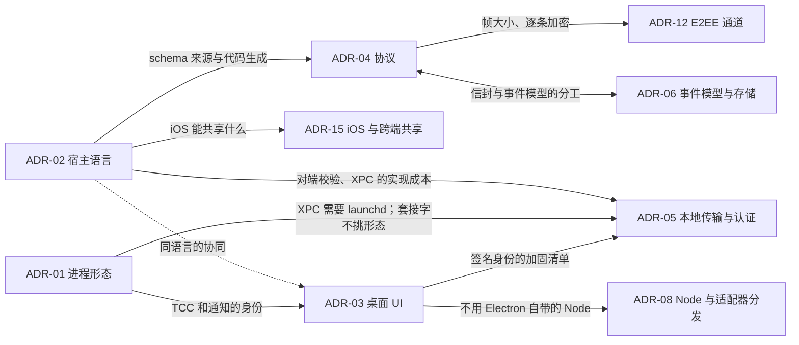

# 技术选型讨论会：架构师意见（宿主与协议）

- 日期：2026-10-16
- 角色：架构师（子 agent），负责宿主与协议方向，独立发言
- 讨论范围：ADR-01、ADR-02、ADR-04、ADR-05；ADR-03 只从架构角度发表意见
- 依据：议程；PRD v1.0；对齐会架构师意见（1.3、2.1–2.6、5.1）；R02 报告；R01 第十二节；R03 第 4–6 节；`CLAUDE.md`、`docs/00-process.md`
- 事实核实：2026-10-16 通过 npm、crates.io、GitHub API、官方文档和本机 Xcode 自带的 macOS SDK 头文件核对，来源列在文末。标注沿用 R02 的约定：没有标注的是已核实；"二手"指只拿到第三方资料；"推测"指推断出来的结论。

## 核心结论

1. **ADR-01：宿主是一个独立的无界面进程。M1 由 App 按需拉起，但不随 UI 一起退出；M2 用同一个二进制注册为 LaunchAgent（SMAppService），实现后台常驻。** 否决"进程内模块"和"App 内嵌 XPC service"。前者违反 NFR-8，而且边界只能靠自觉；代码主要由 AI 写，进程边界是最可靠的护栏。
2. **ADR-02：宿主用 Rust。** 理由有三条。第一，官方 ACP Rust SDK（3.3.0）就是 Zed 作为 ACP 客户端在生产中用的那一个。第二，M3 可以通过 UniFFI 把同一份协议类型、客户端同步逻辑和加密代码交给 iOS。第三，宿主是单个签名的 Mach-O，不需要 V8 那些放宽 hardened runtime 的 entitlement。Node 仍然要有，但只给适配器用，来源由 ADR-08 决定。
3. **ADR-04：用自有协议。** 具体是：JSON-RPC 2.0 信封，长度前缀帧，JSON 编码；用"整数主版本 + 特性标志"做协商；错误码用字符串；Rust 的 `cupper-protocol` crate 是唯一来源，由它生成 JSON Schema 并提交到仓库，再从 schema 生成 TS（类型加 zod 校验）和 Swift。ACP 和 Codex app-server 都是这么做的。
4. **ADR-05：Unix 域套接字。不开 TCP，也不用 XPC。**
   - 桌面 UI 靠代码签名身份认证：用 `LOCAL_PEERTOKEN` 取对端的审计令牌，再按签名要求校验。这样不存在可被偷走的静态凭据。
   - CLI 默认只读。写操作要在桌面 UI 上确认，授权绑定到那个 CLI 进程的连接。
   - agent 子进程的环境变量和文件描述符都要清洗。
   - 这里修正对齐会上的一个候选方案：**"钥匙串里的凭据"挡不住 agent**，因为 agent 可以直接执行钥匙串 ACL 里的 cupper-cli。
5. **SEC-8 是纵深防御，天花板是"同一个用户"。** agent 处于完全访问模式时，本来就能做用户能做的一切。我们要挡的是受限模式下"借一条看起来无害的命令连上宿主，替自己批准"。这条边界要写进文档，并由 SP-4 实测。
6. **ADR-03（架构意见）：用 Web 技术栈（React + TS）。我倾向 Electron，Tauri 是同样可以接受的备选；M1 不建议用 SwiftUI。**
   - 不管选哪个，UI 都要按"渲染不可信内容"来加固，因为 agent 的输出可能注入脚本，替自己点"批准"。
   - 选 Electron 就必须关闭 runAsNode 等 fuse。否则任何本地进程都能借 cupper 的签名身份执行任意 JS，ADR-05 的前提就不成立了。
7. **推荐的组合和 Codex 自己的架构同构：Rust 宿主 + Electron/React 外壳 + JSON-RPC。** 区别有两点：我们用 Unix 套接字代替 stdio，因为宿主要比 UI 活得久，还要服务多个客户端；另外加上了客户端认证和逐条命令的授权。
8. **这几个 ADR 互相牵连。**
   - 宿主语言决定三件事：XPC 是否可行（Rust、Node 都没有可用的 XPC 库）、schema 从哪里来、iOS 怎么共享代码。
   - UI 选型决定 ADR-05 的加固清单，同时排除了"用 Electron 自带的 Node 跑适配器"这条路（ADR-08）。
   - 需要 SP-4 先验证的假设列在各节末尾。

## 对对齐会意见的沿用与修正

| 对齐会的说法 | 本次立场 | 原因 |
|---|---|---|
| 宿主形态 M1 用 b（App 拉起并监护的子进程） | 沿用，并补充：宿主要脱离 UI 的生命周期（新建会话组），UI 崩溃后由新启动的 UI 重新连接；"监护"只在 UI 活着的时候进行 | NFR-8 |
| 宿主语言在 TS 和 Rust 之间选 | 选 Rust | 见 ADR-02。新发现：官方 Node 二进制带着 `get-task-allow` 等 entitlement |
| 本地传输候选"Unix 套接字 + 存在钥匙串里的凭据" | 修正：UI 用代码签名身份；CLI 经 UI 确认后提权 | 钥匙串挡不住会执行 cupper-cli 的 agent |
| I2"Unix 域套接字或 XPC" | 选 Unix 域套接字 | XPC 会迫使 M1 就上 launchd，而且 Rust 没有可用的库 |
| 协议编码可以推迟到 M3 前 | M1 定为 JSON；帧格式和大小上限现在就定 | 编码以后好换，帧格式和大小上限会牵动 ADR-12（Noise 单条消息上限 65535 字节） |
| 宿主协议的消息类别（2.3） | 沿用，补上握手认证、流控、查询和命令的区分、错误码表、在场信号 | — |
| （新增） | 深链接（PS-7）只能导航，不能执行任何写操作；UI 渲染按不可信内容加固 | 这两条都是"agent 替自己批准"的旁路 |

---

## ADR-01 会话宿主的进程形态与生命周期

### 约束

- NFR-8：单实例；由 App 启动；UI 崩溃或重载不影响宿主；退出 App 时如果有会话在运行要先提示；升级时如果有回合在运行要推迟重启；后台常驻为 P1，M3 前完成。
- NFR-9：崩溃恢复。NFR-1：CLI 是独立进程的客户端，M3 的远程桥接入同一个网关。SEC-8：不监听网络端口。NFR-6：冷启动 2 秒内可用。

### 候选方案

- **A 进程内模块**：宿主作为 UI 进程里的一个模块，靠消息边界隔离。
- **B 随 UI 生死的子进程**：例如 Electron 的 utilityProcess，或者 UI 退出时一并结束的子进程。
- **C 独立宿主进程，由 App 按需拉起，脱离 UI 的生命周期。**
- **D launchd LaunchAgent**：用 `SMAppService.agent(plistName:)` 注册，登录时启动，由 KeepAlive 守护。
- **E App 内嵌的 XPC service。**

### 按评判标准比较

| 标准 | A 进程内 | B 随 UI 生死 | C 独立进程，按需拉起 | D LaunchAgent | E 内嵌 XPC service |
|---|---|---|---|---|---|
| 1 保真度与打磨成本 | 中性 | 中性 | 中性 | 中性 | 中性 |
| 2 iOS 共享 | 差：边界靠自觉，M3 时要把能力从 UI 里搬出来 | 良 | 优：从 M1 起，契约和进程边界就与 M3 一致 | 优 | 中：只有本 App 能连接，CLI 和远程桥要另开通道 |
| 3 生态成熟度 | — | 良 | 优：POSIX 进程加套接字，任何语言都能做 | 良：macOS 13 起才有；"后台项目"的显示名有已知错误，需要用户在系统设置里批准（Apple 论坛） | 良，但只服务本 App |
| 4 AI 编码效率与出错率 | 差：AI 很容易直接跨层调用 | 中 | 优：宿主可以单独运行，测试直接起进程 | 中：要用签名构建，launchctl 和后台项目数据库很难调试 | 中 |
| 5 性能与资源 | 优：没有 IPC | 良 | 良：本地套接字的开销可以忽略 | 良：常驻进程空闲时也占一点内存 | 良 |
| 6 签名、公证、更新、分发 | 优 | 良 | 良：bundle 里多一个签名的 helper | 中：App 最好放在 /Applications；系统会提示"已添加后台项目"；用户可以在设置里关掉（状态变为 `requiresApproval`） | 良 |
| 7 贡献者上手 | 优 | 良 | 优 | 中 | 中 |
| 8 长期维护 | 差：M2/M3 要返工 | 中：违反 NFR-8，以后还得改 | 优：与 D 共用同一个二进制，只是启动方不同 | 优 | 差：形态受限 |
| NFR-8：UI 崩溃不影响会话 | 不满足 | 不满足 | 满足 | 满足 | 不满足（App 退出后服务可能被系统回收） |
| CLI 和远程桥能否接入 | 要另开通道 | 部分 | 能 | 能 | 不能 |

### 推荐

**M1 用 C；M2 增加 D，作为可选的"后台常驻"模式。M3 前是否默认开启，交用户决定。** 两种模式用同一个二进制、同一个套接字路径、同一套协议，区别只在于由谁来启动。

建议写进 ADR-01 的生命周期规则：

| 场合 | 行为 |
|---|---|
| 打开 App | UI 连接套接字。连不上就拉起宿主（`posix_spawn`，加 `POSIX_SPAWN_SETSID` 新建会话，标准输出写入日志），然后重试连接，总预算约 500ms |
| 单实例 | 宿主启动时对数据目录里的锁文件加排他 `flock`。拿到锁才删除旧套接字并绑定；拿不到锁就退出 |
| UI 崩溃或重载 | 宿主不受影响。新 UI 连上后按游标续传 |
| 宿主崩溃 | UI 发现断线后重新拉起宿主。宿主启动时执行 NFR-9：按记录的进程组和进程启动时间清理残留的适配器（防止 PID 复用），把运行中的回合标记为"已中断"，把待处理的交互请求标记为"已失效" |
| 退出 App | 有运行中的回合或待处理的请求时先提示。确认后，非后台模式下宿主有序关闭适配器并退出 |
| 空闲 | 非后台模式下，如果没有客户端、没有运行中的回合、没有待处理的请求，持续 N 分钟后退出 |
| App 升级 | 新 UI 连接旧宿主（协议允许相差一个主版本）。宿主发现磁盘上的二进制已更新，就标记"待升级"，等到没有运行中的回合和待处理的请求时自己退出，再由 UI 拉起新版本。数据迁移只由新宿主在启动时执行，迁移前先备份（NFR-10） |
| 后台常驻（M2） | plist 放在 `Contents/Library/LaunchAgents`，`BundleProgram` 指向 bundle 里的宿主；设置 RunAtLoad，KeepAlive 只在异常退出时重启。`ProcessType` 设为 Interactive 或 Adaptive，避免被系统当作后台任务限流（推测，要实测） |
| 防休眠（NFR-13） | 宿主持有 IOPMAssertion；回合结束、请求处理完就释放 |
| 系统通知 | 宿主产生"通知意图"，由 UI 弹出（沿用对齐会）。M2 后台模式下 UI 不在时由谁弹出，留到 M2 决定。选项有两个：把宿主做成一个最小的 helper app bundle，让它有自己的通知权限；或者在后台静默拉起 UI |
| 终端（M2） | PTY 由宿主持有，只对本地 principal 开放 |

Bundle 布局建议（标识都是占位）：

```
Cupper.app/Contents/
  MacOS/Cupper                           桌面 UI
  Helpers/cupper-host                    宿主（通过 -sectcreate 内嵌 Info.plist，有独立的 identifier）
  Helpers/cupper                         CLI
  Library/LaunchAgents/<id>.host.plist   M2 才启用
```

数据目录是 `~/Library/Application Support/<App>/`，权限 0700，里面放 SQLite、blob、锁文件和套接字；日志放在 `~/Library/Logs/<App>/`。

### 在什么条件下改变推荐

- SP-4 发现"脱离的子进程"在 TCC 授权归属上有问题，例如项目在 `~/Documents` 下时，宿主拉起的 agent 触发的授权弹窗归属混乱；或者残留进程清理不可靠。这时 M1 就直接用 D。
- 用户不接受系统的"已添加后台项目"提示。这时只保留 C，后台常驻改为"关窗不退出"（App 留在菜单栏）。
- ADR-02 改选 Swift。这时 D 配 XPC 会更顺手，但本地传输我仍然建议用套接字（见 ADR-05）。

### 需要 SP-4 验证

1. 宿主分别由 App 拉起和由 launchd 拉起时，agent 子进程访问 `~/Documents`、`~/Desktop` 触发的 TCC 弹窗归属在谁身上；从 C 切换到 D 之后，已给的授权是否要重新给。
2. `kill -9` 宿主之后，适配器是否会因为 stdin 关闭而自行退出；宿主重启后的清理是否可靠。
3. 冷启动：从 UI 拉起宿主到收到 index 快照，一共花多少时间。
4. 开发期（没有 Developer ID 签名）能不能用 SMAppService。

---

## ADR-02 会话宿主的实现语言

### 背景要点

- 宿主是 cupper 里权限最高的进程：它持有审批权，能执行 git，能拉起 agent。它也是 ADR-05 的信任锚。
- 不管宿主用什么语言，**Node ≥ 22 都必须有**：claude-agent-acp 0.91.0 的 `engines.node` 是 `>=22`。所以"反正要带 Node"是 ADR-08 要解决的问题，不能作为宿主必须用 Node 的理由。
- Node 的现状：
  - Node 22 已在维护期，2027-04-30 停止支持。
  - Node 24 在 2026-10-20 转入维护期。
  - Node 26 计划在 2026-10-28 成为 LTS。
  - Node 从 27 起改为每年一个大版本。
- M3 要让 iOS 共享协议类型和加密代码（ADR-15）。

### 候选方案

TypeScript/Node、Rust、Swift，另外加上 Go 作为对照。

### 按评判标准比较

| 标准 | TypeScript/Node | Rust（推荐） | Swift | Go |
|---|---|---|---|---|
| 1 保真度与打磨成本 | 中性（和 Electron 是同一种语言） | 中性 | 中性（和 SwiftUI 是同一种语言） | 中性 |
| 2 iOS 共享 | 差：只能共享生成的类型。加密代码要么在 iOS 上重写一份，要么另写一个 Rust crate，宿主通过 napi-rs 调用 | 优：同一个 crate 通过 UniFFI 交给 iOS，包括协议类型、客户端同步、Noise 和推送加解密。先例：matrix-rust-sdk 用 UniFFI 给 Element X iOS 提供 Swift 组件 | 优：SwiftPM 直接共享，两端都有 CryptoKit。前提是宿主也用 Swift | 差：gomobile 支持弱 |
| 3 ACP 和关键依赖的成熟度 | 优：官方 SDK 1.8.0，两个适配器（agent 侧）都基于它。node-pty、better-sqlite3 都是原生插件；`node:sqlite` 在 Node 26 文档里仍是 1.2（候选发布） | 优：官方 SDK 3.3.0。Zed 作为 ACP **客户端**在生产中使用，锁定 `=3.3.0`，并打开了 unstable 和 v2 特性。rusqlite、tokio、security-framework 都很成熟；portable-pty 可用，但最近一次发版是 2025-02 | 中：只有社区 SDK（aptove/swift-sdk 0.1.x，GitHub 星标 11；据其注册页是 Kotlin SDK 0.15 的移植，二手）。GRDB 成熟；swift-subprocess 1.0.2 当天刚发布 | 中：社区 SDK（coder/acp-go-sdk） |
| 4 AI 编码效率与出错率 | 优：训练数据最多，迭代最快。但运行期类型错误多，边界数据要靠 zod 校验 | 良：编译慢一些，偶尔要和借用检查器反复拉扯。好处是枚举的穷尽匹配和类型系统能挡住大量并发错误和协议演进错误。用"actor + channel"的写法可以避开复杂的生命周期问题 | 中：Swift 6 的严格并发检查和 Apple API 的年度变化会让 AI 反复试错 | 良：语言简单，编译快 |
| 5 性能与资源 | 中：V8 的基线内存有几十 MB，还有 GC。但相对于每个会话一套"Node 适配器 + CLI"，宿主的占比不大 | 优：常驻内存在十几到几十 MB 的量级（推测，SP-4 实测） | 优 | 良 |
| 6 签名、公证、分发 | 差：要带 Node 运行时，并用我们自己的身份重新签名。官方 Node 的 macOS 二进制带有 `get-task-allow`、`disable-library-validation`、`allow-dyld-environment-variables`（本机官方 v24.13.0 和仓库里的 entitlements 文件都已核实），同一用户的进程可以注入它，所以不能直接用它跑持有审批权的宿主。SEA 仍是 1.1（活跃开发中）；原生插件要逐个签名 | 优：单个 Mach-O，开 hardened runtime，不需要任何放宽的 entitlement | 优 | 优 |
| 7 贡献者上手 | 优 | 良：开发者工具圈常用（Zed、Codex CLI、Tauri） | 中 | 良 |
| 8 长期维护 | 中：npm 依赖多，有供应链风险，而宿主是权限最高的进程；Node 每年一个大版本 | 优：依赖少，工具链稳定 | 良：跟着 Apple 的年度节奏走 | 良 |

### 推荐：Rust

按重要程度排列：

1. **M3 共享。** 用户明确要求 iOS 共享协议类型和加密代码。Rust 配 UniFFI 是唯一能"一份实现、两端使用"的选择，而且已经有带端到端加密的产品先例（matrix-rust-sdk 和 Element X iOS）。只实现一份加密代码，正好对应 PRD 风险表里"不自己发明密码学方案"的要求，也能降低 SP-8 两端互通的难度。
2. **宿主是信任锚。** Rust 宿主可以直接调用 `getsockopt(LOCAL_PEERTOKEN)` 和 Security 框架，不需要原生插件，签名属性也干净。TS 宿主要做到同样的程度，就得自己重新签一份 Node 运行时（去掉上面那些 entitlement），再写一个原生插件做对端校验。
3. **我们在 ACP 里是客户端。** Rust SDK 的客户端侧有 Zed 的生产验证；TS SDK 的主要用户是 agent 侧的两个适配器。
4. **AI 编码。** 宿主是一个长期运行、并发密集的守护进程，Rust 编译器对 AI 写的代码是一层兜底。UI 用 React/TS，正好放在 AI 最擅长的地方。两种语言各自用在最合适的位置。
5. **先例。** Codex 本身就是 Rust 的 app-server 加 Electron 外壳（R01 §十二）。

建议的 crate 划分：

| crate | 内容 | 使用方 |
|---|---|---|
| `cupper-protocol` | 协议类型、帧、版本常量；不依赖宿主的任何内部模块 | 宿主、CLI、iOS（M3） |
| `cupper-client` | 客户端同步：握手、订阅、游标、缺口检测、重同步、命令重试 | CLI；iOS（M3）；如果选 Tauri，也给外壳用 |
| `cupper-host` | 网关、策略、编排、交互代理、存储、驱动、git | — |
| `cupper-cli` | 第二客户端 | NFR-1 验收 |
| `cupper-fake-agent` | 按剧本输出 ACP 帧 | 测试 |
| `cupper-crypto`（M3） | 配对、Noise、推送加解密 | 宿主、iOS |

给 AI 编码 agent 的约束（写进 CLAUDE.md）：
- 用 tokio，模块之间用 channel 通信。
- `unsafe` 只能出现在一个 `sys` 模块里，例如对端令牌和 IOKit。
- 错误类型统一用 thiserror。
- git 调用命令行，由 ADR-10 确认。

### 在什么条件下改变推荐

1. SP-4（用 Rust 做）明显超出估算，比如超出 3–5 人日的 50% 以上，而且原因主要是语言本身而不是设计。这时改为 TS 宿主，加密代码仍用 Rust crate（宿主通过 napi-rs 调用，iOS 通过 UniFFI 调用），并自己签一份收紧过的 Node 运行时。
2. ADR-15 决定 iOS 不共享代码（用 Swift CryptoKit 加测试向量），同时 ADR-03 选了 Electron。这时 Rust 最大的优势变小，TS 就有竞争力了，我会重新评估。
3. ACP Rust SDK 在我们需要的功能上连续一个以上的发版周期落后于 TS SDK。
4. ADR-03 选了 SwiftUI，而且团队希望全部用一种语言。这时 Swift 宿主说得通，但 ACP 只有社区 SDK，我仍然倾向 Rust。

### 需要 SP-4 验证

- 用 Rust SDK 作为客户端，驱动 claude-agent-acp 和 codex-acp：初始化、发 prompt、审批、提问、取消。
- 宿主空闲时和同时跑 6 个会话时的常驻内存。
- 记录 AI 编码 agent 写 Rust 时的返工情况，例如编译修复轮数和卡点，作为第 1 条的判断依据。

---

## ADR-03 桌面 UI 技术（架构角度）

保真度和组件生态的细节以桌面客户端工程师的意见为主。我只给架构上的约束，以及我的倾向。

### 按评判标准比较

| 标准 | Electron + React | Tauri 2 + React | SwiftUI/AppKit | 原生外壳 + WKWebView 混合 |
|---|---|---|---|---|
| 1 保真度与打磨成本 | 优：和 Codex 是同一个引擎（R01：Electron + React） | 良：WebKit 和 Chromium 有细节差异，要在 Safari 引擎上逐项核对 | 中到差：流式 Markdown、代码高亮、diff、Mermaid 都要自建，或者嵌 WebView；超长列表的性能要专门下功夫 | 良：消息流用 Web，外壳用原生，但要维护两套 UI 技术 |
| 2 iOS 共享 | 中：渲染代码不能用于 SwiftUI；客户端同步逻辑要用 TS 再写一份（M1 用 TS 写薄客户端，M3 再评估是否改用编译成 WASM 的 `cupper-client`） | 良：Rust 外壳可以直接链接 `cupper-client`，和 iOS 用同一份 | 优：SwiftUI 组件和客户端可以与 iOS 共用 | 良：Web 渲染组件可以原样放进 iOS 的 WKWebView |
| 3 生态成熟度 | 优：xterm.js、Shiki、CodeMirror/Monaco、Mermaid、虚拟列表 | 良：前端生态同左；Tauri 本身是 2.12，生态比 Electron 小 | 中 | 良 |
| 4 AI 编码效率与出错率 | 优：AI 最熟悉 React/TS；Playwright 能驱动 Electron 截图验证（官方标为实验性，支持 v21+） | 良：前端同左；macOS 上的 WebDriver 测试要靠 WebdriverIO 的 `@wdio/tauri-service` 内置的驱动，比较新 | 中：SwiftUI 的布局细节和性能问题容易让 AI 反复试错 | 中：多一层桥接 |
| 5 性能与资源（NFR-6、NFR-11） | 中：内存和包体最大；2 秒冷启动可以做到，但要注意 | 良：用系统 WebKit，包体小 | 优 | 良 |
| 6 签名、公证、更新、分发 | 良：electron-builder/Forge 的签名、公证、更新都很成熟。但必须关闭 fuse，否则 cupper 的签名身份可以被借用，这是 ADR-05 的前提。大约 8 周一个大版本，只维护最近 3 个，必须跟进 | 良：内置签名、公证和 updater 插件 | 优：Xcode 加 Sparkle | 良 |
| 7 贡献者上手 | 优 | 良 | 中 | 中 |
| 8 长期维护 | 中：Chromium 的安全更新必须跟上 | 良 | 良 | 中：两套技术 |

### 不管选哪种，UI 都要满足的架构约束

1. **UI 只是协议客户端。** 套接字只由可信的原生侧或主进程持有，渲染层只能通过一个很窄的 API 发送命令。CI 加依赖规则：UI 代码里不能调用 `child_process`、git，也不能读写宿主的数据目录。NFR-1 的"CLI 能做的和 UI 一样多"这项测试，会顺便抓出只在 UI 里实现的功能。
2. **agent 的输出是不可信内容。**
   - 渲染：Markdown 不渲染原始 HTML；严格的 CSP，不允许内联脚本；Mermaid 放在沙箱 iframe 里渲染；链接用外部浏览器打开，并先确认。
   - 渲染层被注入脚本，就等于 agent 能替自己批准，这和 SEC-8 是同一个威胁。
3. **深链接（PS-7）只能导航**，例如打开某个会话，不能执行批准、切换模式之类的写操作。
4. **如果选 Electron，加固清单如下：**
   - 关闭 `runAsNode`、`nodeOptions`、`nodeCliInspect` 三个 fuse；打开 `embeddedAsarIntegrityValidation` 和 `onlyLoadAppFromAsar`。前三个 fuse 默认都是打开的（Electron 官方文档）。
   - 遇到 `--remote-debugging-port` 等调试参数就拒绝启动。
   - 渲染进程开 `contextIsolation` 和沙箱。
   - 由主进程连接宿主（helper 进程的签名 identifier 不同，宿主不接受）。
5. **不把宿主放进 Electron**，也就是不用 utilityProcess 或主进程。它们的生命周期跟着 App 走，而且会把宿主拉回 Node。
6. **不用 Electron 自带的 Node 跑适配器。** Electron 44.8.0 自带 Node 24.22.0，满足 ≥ 22 的要求，但要用它就得打开 `runAsNode` fuse，和第 4 条冲突。这一条转给 ADR-08。

### 倾向

**React + TS。我倾向 Electron，Tauri 是同样可以接受的备选；M1 不用 SwiftUI。** 选 Electron 的理由：保真度最高；AI 可以用 Playwright 截图自己验证；整体与 Codex 同构。代价是内存、包体和加固工作。

改变倾向的条件：
- SP-6 显示 Electron 冷启动超过 2 秒，或者 6 个会话时内存不可接受，就改用 Tauri。
- 桌面工程师倾向 Tauri，并且核实了 WebKit 下的保真度和 macOS 上的测试链路，我也支持。Tauri 的额外好处是外壳可以和 iOS 共用 `cupper-client`。

---

## ADR-04 宿主与客户端之间的协议

### 协议形式的候选与比较

候选方案：
- **P1 自有协议**：JSON-RPC 2.0 信封，JSON 编码（推荐）。
- **P2 对外讲 ACP**，缺的部分用扩展补。
- **P3 沿用 Codex app-server 协议。**
- **P4 gRPC/Protobuf。**
- **P5 自定义二进制信封**（CBOR 或 MessagePack）。

| 标准 | P1 | P2 | P3 | P4 | P5 |
|---|---|---|---|---|---|
| 1 保真度 | 优：语义由我们定，能覆盖 Codex 视图需要的全部内容 | 差：没有运行状态、队列、多端、git，要靠大量 `_` 扩展 | 良：语义贴近 Codex 视图，但绑死在 Codex 专有的语义上 | 中性 | 中性 |
| 2 iOS 共享 | 优：每条消息都能单独加密；Swift 和 Rust 处理 JSON 都容易 | 差：stdio 一对一，没有续传 | 中：约 175 个方法，iOS 要跟着 Codex 的版本走 | 中：swift-protobuf 成熟，但 HTTP/2 流和逐条端到端加密不好配合 | 良：省带宽，但调试难 |
| 3 成熟度 | 优：ACP 和 app-server 都用 JSON-RPC，工具多 | 中：规范 1–2 周一版 | 差：没有语义化版本，大量实验接口 | 优 | 中 |
| 4 AI 编码 | 优：AI 和贡献者都最熟悉，用 cupper-cli 能直接看到帧内容 | 中 | 中 | 中：`.proto` 加生成链路比较重，oneof 和 JSON 映射的坑多 | 中：二进制难排错 |
| 5 性能 | 良：JSON 体积大一些；大内容走 blob 引用 | 良 | 良 | 优 | 优 |
| 6 分发 | 无差别 | 无差别 | 无差别 | 无差别 | 无差别 |
| 7 贡献者上手 | 优 | 良 | 中 | 良 | 中 |
| 8 长期维护 | 优：节奏自己掌握 | 差：被上游的发版节奏牵着走 | 差 | 良 | 中 |

### schema 来源的候选与比较

| 标准 | S1 Rust 类型为源（serde + schemars）→ JSON Schema → 生成 TS 和 Swift（推荐，前提是 ADR-02 选 Rust） | S2 手写 JSON Schema 为源 | S3 TypeSpec 为源 | S4 `.proto` 为源 |
|---|---|---|---|---|
| 2 iOS 共享 | 优：iOS 如果用 Rust 核心，类型通过 UniFFI 直接导出；否则从 JSON Schema 生成 Codable | 良 | 良 | 优 |
| 3 先例与成熟度 | 优：ACP 是这样做的（schema crate 用 schemars 生成 `schema.json`，TS SDK 用 `@hey-api/openapi-ts` 和 zod v4 生成 `types.gen.ts`、`zod.gen.ts`）；Codex app-server 也是（schemars 加 ts-rs） | 中：判别联合写起来很冗长 | 中：多一套 Node 编译器；Rust 和 Swift 的生成器不成熟 | 优 |
| 4 AI 编码 | 优：AI 改 Rust 类型，有编译器和"生成产物不一致"检查兜底 | 中：手写 schema 容易和实现脱节 | 中 | 中 |
| 7 贡献者上手 | 良 | 良 | 中 | 良 |
| 8 长期维护 | 良：要靠"破坏性变更检查"补上 schema 优先的纪律 | 中 | 中 | 良：字段编号天然支持演进 |

标准 1、5、6 对 schema 来源的选择没有区别，表中省略。

S1 的风险是"先写代码"的做法容易把内部类型泄露到契约里。对策：
- 协议类型放在独立的 `cupper-protocol` crate 里，不依赖宿主的任何内部模块。
- 这个 crate 设 CODEOWNERS，改动按 API 变更来评审。
- CI 检查生成的 schema 与上一个发布版本的差异。

### 推荐

**P1 + S1。** 线上格式是 JSON-RPC 2.0 信封、长度前缀帧、JSON 编码；schema 以 Rust 类型为源，生成 JSON Schema 并提交到仓库，作为对外的契约。

### 协议草案要点

**分层**

```
应用消息（JSON-RPC 2.0 信封）
  └─ 帧：u32 大端长度 + 负载（负载编码在握手时协商；initialize 本身固定用 JSON；M1 只实现 JSON）
      └─ 传输：本地 Unix 套接字（M1）│ M3：E2EE 通道（ADR-12）→ WSS → 中继
```

- 帧大小上限在握手时协商，本地默认 1 MiB。快照和历史都分页，图片、长输出、整文件 diff 一律走 blob 引用，`blob/get` 按范围分块，每块不超过 48 KiB。这样 M3 套上 Noise 时（单条消息上限 65535 字节），大部分消息不用分片。
- 信封保留 `"jsonrpc":"2.0"` 字段，方便和现成工具兼容。

**消息类别**

| 类别 | 方向 | 方法（示例） | 语义要点 |
|---|---|---|---|
| 握手 | 客户端 → 宿主，请求 | `initialize` | 必须是第一条消息。内容包括协议版本区间、特性、认证方式、客户端身份；宿主返回选定的版本、principal、限额、host_id |
| 订阅 | 客户端 → 宿主，请求 | `stream/subscribe`、`stream/unsubscribe` | 带 `after_seq`。宿主返回从该位置补发（replay），或者先发快照（snapshot，带 `at_seq`）再发增量。游标太旧不报错，直接走快照 |
| 事件 | 宿主 → 客户端，通知 | `stream/events` | 批量发送；同一条流的 seq 连续；下发前已经落盘；带 `cause`（command_id、principal），方便客户端对上自己发出的命令 |
| 流控 | 宿主 → 客户端，通知 | `stream/reset` | 某个连接的发送队列超过上限时，宿主重置这条订阅，客户端按游标重新订阅。读取 ACP 的路径永远不会因此阻塞 |
| 确认（M3） | 客户端 → 宿主，通知 | `stream/ack` | 给远程连接用，以便及早释放发送缓冲 |
| 历史 | 客户端 → 宿主，请求 | `history/page` | 向前分页（长会话、手机端） |
| 查询 | 客户端 → 宿主，请求 | `session/capabilities`、`agents/status`、`git/status`、`git/diff`、`files/search` | 只读，没有副作用，可以随意重试，不需要 command_id |
| 命令 | 客户端 → 宿主，请求 | `project/add`、`session/create`、`session/send`（排队或 Steer）、`session/interrupt`、`session/set_config`、`session/archive`、`session/mark_read`、`interaction/respond`、`git/stage`、`git/commit`、`git/push`、`worktree/cleanup` | 带 `command_id` 和前置条件。返回结果表示"已受理并落盘"，实际效果从事件里看 |
| 内容 | 客户端 → 宿主，请求 | `blob/get` | 按 hash 和字节范围分块拉取 |
| 认证扩展 | 客户端 → 宿主，请求 | `auth/elevate` | CLI 申请提权，见 ADR-05 |
| 在场 | 客户端 → 宿主，通知 | `client/presence` | UI 是否在前台，用于 AP-3 和 MB-12 的推送防打扰 |
| 生命周期 | 宿主 → 客户端，通知 | `host/shutdown` | 宿主即将退出（升级或用户退出），并说明是否会自动重启 |
| 存活 | 双向 | `ping` | 本地可选；远程必需 |

**宿主不会向客户端发请求。** 审批和提问都是事件流里的状态对象，客户端用 `interaction/respond` 命令来回答（对齐会 1.3 第 5 条）。

**握手与版本协商**

```json
→ {"jsonrpc":"2.0","id":1,"method":"initialize","params":{
     "protocol":{"min":1,"max":2},
     "client":{"kind":"desktop","name":"cupper-desktop","version":"0.3.0"},
     "features":["session.steer","blob.range"],
     "auth":{"scheme":"peer-codesign"}}}
← {"jsonrpc":"2.0","id":1,"result":{
     "protocol":2,
     "host":{"host_id":"h_…","version":"0.3.1"},
     "principal":{"id":"p_…","kind":"ui","scopes":["*"]},
     "features":["session.steer","blob.range","history.page"],
     "limits":{"max_frame_bytes":1048576,"max_inflight_commands":64}}}
```

- 协议主版本是一个整数，只有破坏性变更才加 1。新增字段、方法、事件类型不改主版本，可选能力用 `features` 声明。
- 宿主至少同时支持当前和上一个主版本（N 和 N−1）。要废弃一个主版本，提前一个大版本在握手结果里给出提示（NFR-10：iOS 是用户自己构建的，版本一定会错开）。
- 客户端按"宽容读取"处理：
  - 不认识的字段忽略；
  - 不认识的枚举值当作 `unknown`；
  - 不认识的事件类型显示"此版本不支持的内容"，然后继续处理后面的事件，整条流不报错。
- 区分两类"能力"：`features` 是协议层面的可选特性；能力描述（capabilities）是每个 agent、每个会话自己的能力（AG-4），通过 `session/capabilities` 查询和 index 流下发。

**命令：幂等与前置条件**

- `command_id` 由客户端生成（UUIDv7）。宿主按 (principal, command_id) 记录"参数哈希 → 结果"，至少保留 24 小时，覆盖移动网络的重试窗口。
  - 同一个 command_id 再次到达，返回原来的结果，并标记 `replayed: true`。
  - 同一个 command_id 但参数不同，返回 `idempotency_mismatch`。
- 前置条件有三种：
  - `expected_turn_id`：用于 Steer；回合已经结束就转为排队，或者返回 `conflict`。
  - `request_digest`：用于回答审批或提问，是对请求内容做规范化后的哈希（SEC-10）。
  - `expected_version`：用于编辑队列（P1）。

**错误码**

标准的 JSON-RPC 错误照常使用：-32700 解析错误、-32600 无效请求、-32601 方法不存在、-32602 参数无效。应用错误统一用 `-32000`，客户端只按 `error.data.code` 分支处理。`message` 是给开发者看的英文；界面上的文案由客户端按错误码本地化（瘦客户端）。

```json
← {"jsonrpc":"2.0","id":7,"error":{"code":-32000,"message":"interaction already resolved",
   "data":{"code":"conflict","reason":"already_resolved","retryable":false,"resolved_by":"device/d_…"}}}
```

| code | 含义 | 能否重试 | 客户端怎么处理 |
|---|---|---|---|
| `version_unsupported` | 双方的协议版本区间没有交集；data 里带宿主支持的区间 | 否 | 提示升级 |
| `not_initialized` | 握手前就发了其他消息 | 否 | 属于程序错误 |
| `unauthenticated` | 认证失败 | 否 | 断开连接 |
| `forbidden` | 这个 principal 没有权限；data.scope 说明缺哪项 | 否 | CLI 可以申请提权；手机隐藏入口 |
| `not_found` | 会话、请求或 blob 不存在 | 否 | 刷新 |
| `conflict` | 前置条件不满足；data.reason 取 `already_resolved`、`turn_mismatch`、`digest_mismatch`、`state_changed` | 否 | 收起卡片，提示"已在别处处理"（AP-4） |
| `expired` | 交互请求已失效，例如 agent 进程已退出 | 否 | 收起卡片 |
| `unsupported` | agent 或宿主不支持；data.capability 说明是哪项 | 否 | 隐藏功能（AG-4） |
| `unavailable` | 暂时做不到；data.reason 取 `cli_missing`、`cli_not_logged_in`、`adapter_starting`、`adapter_crashed`、`quota_exhausted` | 看 reason | 显示恢复指引（AG-2、MS-5） |
| `agent_error` | 适配器返回的错误，原样附上 `agent_code` 和 `agent_message` | 否 | 显示给用户 |
| `idempotency_mismatch` | 同一个 command_id 的参数不同 | 否 | 属于程序错误 |
| `too_large` | 超过帧或内容的上限 | 否 | 改用 blob |
| `rate_limited` | 请求太多（主要针对远程）；带 `retry_after_ms` | 是 | 退避后重试 |
| `timeout` | 宿主的超时兜底触发，例如 Codex #600 | 是 | — |
| `shutting_down` | 宿主正在退出或升级 | 是 | 重新连接 |
| `internal` | 宿主内部错误 | 有限次 | 收进诊断信息 |

**标识与时间**

- 所有 ID 都是带前缀的字符串，例如 `s_` 会话、`t_` 回合、`i_` 条目、`r_` 交互请求，后面跟 UUIDv7 或 ULID。
- host_id 在首次运行时生成。跨电脑时用 (host_id, id) 组合来区分，为 MB-11 一台手机配对多台 Mac 做准备。
- 时间统一用 UTC 毫秒整数，时长也用毫秒。seq 在 2^53 以内，JSON 能精确表示。
- 文本的流式片段只追加，不用偏移量，免得出现 UTF-8 和 UTF-16 的换算问题。

**schema、代码生成和兼容性检查**

```
crates/cupper-protocol（serde + schemars）
   ├─ cargo xtask schema ─▶ protocol/schema/v<N>.json（提交到仓库，作为对外契约）
   │      ├─▶ TS：类型 + zod 校验（参照 ACP TS SDK 的生成方式）
   │      └─▶ Swift Codable（iOS 不用 Rust 核心时）
   └─ UniFFI（M3，iOS 用 Rust 核心时直接导出）
```

CI 做四项检查：
1. 重新生成 schema，和仓库里的比对，不能有差异。
2. 和上一个发布版本的 schema 做兼容性比对。以下都算破坏性变更，必须升主版本：删除字段、方法或枚举值；可选字段改成必填；改变字段类型。
3. `protocol/fixtures/` 里每种消息的示例，在 Rust 和 TS 中各做一次序列化往返。
4. 录制的会话经过假 agent 回放后，产生的事件流与黄金样本一致。

**留给 ADR-06 的部分**：条目类型（消息、思考、工具调用、计划、交互请求等）、upsert 和 delta 的具体格式、流的划分、落盘和 fsync 策略、每类事件的 schema 版本 `v` 和升级器、文本片段的合并粒度。ADR-04 只规定事件信封：`{seq, id, type, v, ts, cause, data}`。

### 在什么条件下改变推荐

- M3 实测发现 JSON 的带宽开销不可接受：在握手中加一种 CBOR 负载编码，schema 不用改。
- ADR-02 改选 TS：schema 来源改为 TS 类型配 zod 并生成 JSON Schema，或者改为手写 JSON Schema；其余不变。
- UniFFI 导出协议类型很别扭，例如任意 JSON 字段不好表示：iOS 改为从 JSON Schema 生成 Codable。

---

## ADR-05 本地传输与本地客户端认证

### 威胁模型

| 威胁 | 例子 | 本方案的应对 |
|---|---|---|
| 受限模式下，agent 借一条命令连上宿主 | `npm test` 里藏着一段代码，连接套接字并发送 `interaction/respond` | 第一层：agent 自己的沙箱可能已经挡住了（Claude Code 沙箱默认禁止连接 Unix 套接字，二手；Codex 的 Seatbelt 策略是默认拒绝，mach-lookup 只放行白名单，这是读策略文件核实的，但能否挡住套接字连接要实测）。第二层：宿主认出它不是 UI，只给只读权限；要提权，必须由用户在 UI 上确认 |
| agent 窃取凭据 | 读文件、读环境变量、继承文件描述符 | UI 没有任何静态凭据；CLI 的提权绑定到具体连接；环境变量用白名单；`POSIX_SPAWN_CLOEXEC_DEFAULT` 防止 fd 泄露 |
| agent 借用 cupper 的签名身份 | `ELECTRON_RUN_AS_NODE=1` 运行 App 的主程序执行任意脚本；加 `--remote-debugging-port` 启动；执行 bundle 里的 cupper-cli | 签名要求精确到 UI 的 identifier；Electron 关闭相关 fuse，拒绝调试参数；CLI 的 identifier 不满足 UI 的签名要求 |
| 通过 UI 的渲染面注入 | 在输出里放 HTML 或脚本，渲染时执行，再通过预加载桥发送批准 | 见 ADR-03 的约束第 2 条 |
| 通过深链接 | `open "cupper://approve?…"` | 深链接只能导航 |
| 冒充宿主 | 杀掉宿主后占用套接字路径，向 UI 推送伪造的内容 | UI 也校验对端（宿主）的签名 |
| 同一用户的天花板 | 完全访问模式；直接改数据目录；杀进程 | 不防，写进文档（与 SEC-7 的写法一致） |

### 候选方案与比较

候选方案：
- **T1 Unix 域套接字 + 对端代码签名校验 + CLI 提权确认**（推荐）。
- **T2 XPC Mach 服务 + 签名要求。**
- **T3 继承的 socketpair**：UI 拉起宿主时直接传入一端。
- **T4 localhost TCP/WebSocket + token 文件。**
- **T5 Unix 套接字 + 钥匙串或文件里的共享密钥。**

| 标准 | T1 | T2 | T3 | T4 | T5 |
|---|---|---|---|---|---|
| 1 保真度 | 无关 | 无关 | 无关 | 无关 | 无关 |
| 2 iOS 共享 | 优：同一套帧在远程传输上复用 | 中：XPC 消息要再包一层 | 良 | 良 | 良 |
| 3 成熟度 | 良：`LOCAL_PEERTOKEN` 加 `kSecGuestAttributeAudit` 有 Apple DTS 的说明（2024-08），头文件里有定义，但公开文档少 | Swift 中优；Rust 中差（`xpc-connection` crate 最后一次更新是 2020-03）；Node 要写原生插件 | 优 | 优 | 优 |
| 4 AI 编码 | 优：测试直接连套接字 | 中：开发期就要注册 launchd 服务、要签名 | 优 | 优 | 优 |
| 5 性能 | 无差别 | 无差别 | 无差别 | 无差别 | 无差别 |
| 6 签名与分发 | 良：生产版本依赖签名；开发和测试版本走测试密钥 | 中：M1 就要用 LaunchAgent | 优 | 中：开端口可能触发防火墙提示 | 良 |
| 7 贡献者上手 | 良 | 中 | 优 | 优 | 优 |
| 8 长期维护 | 良 | 中 | 差：UI 重连和 CLI 都做不到 | 差 | 中 |
| SEC-8 | 满足：没有可被窃取的静态凭据 | UI 部分满足；CLI 的问题和 T1 一样 | UI 满足，但无法重连 | 违反：监听端口，token 文件 agent 能读到 | 不满足：文件 agent 能读到；钥匙串 ACL 里的 cupper-cli 可以被 agent 直接执行 |
| NFR-8：UI 崩溃后能重连 | 能 | 能 | 不能 | 能 | 能 |

### 推荐设计（T1）

**套接字**
- 放在数据目录下的 `run/host.sock`，目录权限 0700。
- macOS 的 `sun_path` 上限是 104 字节，路径太长时退回到 `confstr(_CS_DARWIN_USER_TEMP_DIR)` 下的短路径。
- 安全不依赖路径保密，路径不写进任何环境变量，但也不把它当成秘密。

**principal 与认证方式**

| principal | 是谁 | 怎么认证 | 权限 |
|---|---|---|---|
| `ui` | 桌面 UI 的主进程 | 对端审计令牌满足 UI 的签名要求 | 全部 |
| `cli` | cupper-cli 和其他本机进程 | 同一个用户（`LOCAL_PEERCRED` 的 uid） | 只读：订阅和查询 |
| `cli`（已提权） | 用户在 UI 上确认过的 CLI 连接 | `auth/elevate` → 用户在 UI 上确认 → 授权绑定到这条连接（及对端的审计令牌） | 只包含申请的范围，连接断开就失效；默认不包括"切换到完全访问" |
| `test` | 测试工具 | 测试模式下，通过继承的 fd 传入一次性密钥 | 全部；只在测试模式下存在 |
| `device/<id>`（M3） | 已配对的 iPhone | E2EE 通道（ADR-12），由远程桥在进程内接入网关 | 按 SEC-9 |

**UI 的认证**

1. 宿主用 `getsockopt(fd, SOL_LOCAL, LOCAL_PEERTOKEN)` 取得对端的审计令牌。
2. 用 `SecCodeCopyGuestWithAttributes(kSecGuestAttributeAudit)` 拿到对端的代码对象。
3. 用 `SecCodeCheckValidity` 按预先写死的要求校验。要求的格式大致是：`anchor apple generic and identifier "<UI 的 identifier>" and certificate leaf[subject.OU] = "<Team ID>"`。
4. 再检查签名标志：必须开了 hardened runtime，不能带 `get-task-allow`。

用审计令牌而不用 PID，是为了避免 PID 复用带来的问题（Apple DTS 的建议）。UI 连上后也用同样的方法校验宿主。

**CLI 提权**
1. CLI 调用 `auth/elevate`，说明要申请哪些权限、理由是什么。
2. 宿主先做一次进程血缘检查：如果申请方是某个适配器进程的后代，直接拒绝。宿主记录了每个适配器的 PID 和启动时间。这项检查是尽力而为的：双重 fork 后被 launchd 收养的进程查不出来。
3. 宿主在 index 流里生成一条"提权请求"，只有 `ui` principal 能处理。UI 显示申请方的可执行文件路径、签名信息、PID、父进程链和申请的权限范围。
4. 用户批准后，授权在这条连接上生效。

另外可以加一个设置项"允许命令行直接执行写操作"，默认关闭，打开时给出风险说明。是否保留这个设置交用户决定。

**agent 子进程的隔离**
- 环境变量用白名单：PATH、HOME、USER、LANG 和 LC_*、TERM、SHELL、TMPDIR、代理变量、SSH_AUTH_SOCK，以及用户配置的 API key 变量。所有 `CUPPER_*` 变量一律去掉。
- 用 `POSIX_SPAWN_CLOEXEC_DEFAULT` 拉起子进程，stdio 显式建管道。
- 每个适配器单独一个进程组，便于清理和做血缘检查。

**测试和开发模式**
- 测试模式：`cupper-host --test --data-dir <临时目录> --auth-fd 3`。只使用临时目录和临时套接字，永远不碰生产路径。
- 开发构建（UI 是 ad-hoc 签名）：UI 拉起宿主时，用继承 fd 的方式传入一次性密钥。这段代码只在 debug 特性下编译，生产二进制里不存在。

**做不到的事（写进文档）**：agent 处于完全访问模式，或者用户批准了一条不在沙箱里运行的命令时，它能直接改数据目录、杀掉宿主、借助辅助功能操作界面（这一项受 TCC 限制）。SEC-8 不能防止这些，它挡的是受限模式下的低成本绕过。

### 在什么条件下改变推荐

- SP-4 发现用审计令牌校验对端签名不可靠，例如无法稳定地认出 Electron 主进程。这时改为 XPC（`xpc_connection_set_peer_code_signing_requirement` 从 macOS 12 起可用，`NSXPCConnection.setCodeSigningRequirement` 从 macOS 13 起可用），并让 ADR-01 在 M1 就用 LaunchAgent。CLI 和测试仍然走套接字。
- 用户希望 CLI 默认就能执行写操作：改为设置项默认打开，并在文档里写明风险。

### 需要 SP-4 验证

1. 在 Claude Code 的各种权限模式下，以及 Codex 的只读、工作区、Agent 模式下，分别尝试从 agent 里连接宿主的套接字，记录结果。
2. 用审计令牌做签名校验：要能认出 Developer ID 签名的 UI 主进程，并拒绝下面这些：Electron 的 helper 进程、关闭 fuse 后的 `ELECTRON_RUN_AS_NODE`、node、cupper-cli。
3. 血缘检查能挡住哪些逃逸方式、挡不住哪些：`nohup`、双重 fork、`launchctl submit`。
4. UI 校验宿主身份的流程。

---

## 这几个 ADR 之间的依赖



语言和 UI 之间的影响：
- 宿主用 TS：Electron 最顺手，全部都是一种语言。但很容易把宿主塞进 Electron，而 Tauri 反正要引入 Rust。
- 宿主用 Rust：Electron 和 Tauri 都可以。选 Electron 要从 schema 生成 TS，不过我们本来就需要这条链路。选 Tauri，外壳可以和 iOS 共用 `cupper-client`。
- 宿主用 Swift：SwiftUI 最顺手；选 Web 外壳就会出现三种语言。
- 反过来看：UI 选 SwiftUI 会把宿主推向 Swift；UI 选 Electron，对宿主用 TS 还是 Rust影响不大。所以 ADR-02 应该先于 ADR-03 定下来，ADR-03 在它的基础上按 M1 成本选择。

关于"代码主要由 AI 编码 agent 来写"，整体上的考虑：
1. 用进程边界来强制分层，不靠代码评审。
2. 协议契约由代码生成，CI 检查生成产物和兼容性。
3. 用假 agent 加 CLI 做确定性的端到端测试。
4. 宿主用 Rust，让编译器兜底；UI 用 React，放在 AI 最熟悉的地方。
5. UI 能自动截图，让 AI 可以自己验证视觉效果。

## 推荐组合

| ADR | 推荐 | 关键理由 | 在什么条件下改变 |
|---|---|---|---|
| ADR-01 | 独立的无界面宿主。M1 由 App 按需拉起，脱离 UI 的生命周期，单实例；M2 起可以注册为 LaunchAgent，实现后台常驻 | 满足 NFR-8；用进程边界防止 AI 跨层；两种形态共用同一个二进制 | SP-4 发现 TCC 或残留进程有问题，M1 就直接用 LaunchAgent |
| ADR-02 | Rust | M3 可以共享代码；宿主作为信任锚，签名属性干净；ACP 客户端用官方 SDK | SP-4 显示 Rust 的开发效率明显不达标；或者 ADR-15 不共享代码，同时 ADR-03 选了 Electron |
| ADR-03 | React + TS。倾向 Electron，Tauri 备选；M1 不用 SwiftUI | 保真度、组件生态、AI 能自己验证 | SP-6 显示 Electron 的冷启动或内存不达标，就改用 Tauri |
| ADR-04 | 自有协议：JSON-RPC 2.0、长度前缀帧、JSON；整数主版本加特性标志；字符串错误码；Rust 类型 → JSON Schema → TS 和 Swift | 与 ACP 和 Codex 的做法一致；AI 熟悉；能逐条加密 | M3 实测带宽不够，就加 CBOR 编码，不改 schema |
| ADR-05 | Unix 域套接字（0700 目录）；UI 用代码签名身份；CLI 默认只读，经 UI 确认后提权；不开端口，不用 XPC | 满足 SEC-8，而且不挑进程形态和语言 | SP-4 发现对端签名校验不可靠，就改用 XPC 加 LaunchAgent |

SP-4 用 Rust 做，范围在对齐会的基础上增加：ADR-01 的第 1–4 项、ADR-02 的三项、ADR-05 的第 1–4 项验证。

## 希望其他参会者回应的问题

**给桌面客户端工程师**

1. Electron 和 Tauri，你选哪个？ADR-03 列出的加固清单（fuse、只由主进程连接、拒绝调试参数、CSP、不渲染原始 HTML、Mermaid 放沙箱）你能接受吗？需要做 SP-6 吗？
2. 协议客户端放在 Electron 的主进程里，渲染层只拿到一个窄 API，这样会不会影响流式渲染的性能？你需要宿主每隔多久合并一次文本片段？
3. 从 JSON Schema 生成 TS 类型和 zod 校验，你能接受吗？还是更想用 ts-rs 直接从 Rust 生成？
4. 后台模式下 UI 已经退出时，系统通知由谁弹出：宿主做成一个 helper app，还是静默拉起 UI？
5. 深链接只做导航，会不会影响你对 PS-7 的设想？
6. 最低支持的 macOS 版本：SMAppService 要求 13 以上。你的 UI 选型有更高的要求吗？

**给移动与安全工程师**

1. iOS 用 Rust 核心（通过 UniFFI 提供协议类型、客户端同步、Noise 和推送解密），你能接受吗？NSE 的内存限制（推测约 24 MB）下放 Rust 库是否可行？还是你更倾向 Swift CryptoKit 加测试向量，两端各写一份？
2. SEC-8 的威胁模型，包括"同一用户的天花板"和"CLI 经 UI 确认提权，授权绑定到连接"这套设计，你认可吗？生产版本的 CLI 要不要干脆完全禁止写操作？
3. Noise 单条消息上限是 65535 字节。协议层保证"大内容走 blob，单块不超过 48 KiB"，够不够？E2EE 层还要不要再做通用分片？
4. 压缩发生在加密之前，可能带来长度侧信道。协议要不要明确规定远程链路上不压缩？
5. 手机的权限边界（SEC-9）要不要在 schema 里给每个方法标注所需的 scope，让策略检查和文档都从同一处生成？
6. 版本兼容窗口定为"宿主同时支持 N 和 N−1 两个主版本"，对 iOS 自建场景够不够？
7. M4 的中继密文缓存需要逐条加密。我的提议是事件信封里现在不预留加密字段，由 E2EE 层包住整个帧。你同意吗？

**给编排者（需要交用户确认的）**

1. 后台常驻会让系统提示"已添加后台项目"，并出现在登录项设置里。这能接受吗？
2. 是否提供"允许命令行直接执行写操作"这个设置项（默认关闭）？

## 事实核实

核实日期都是 2026-10-16。

| 事实 | 来源 |
|---|---|
| claude-agent-acp 0.91.0，`engines.node >=22`；codex-acp 2.2.2；`@agentclientprotocol/sdk` 1.8.0（2026-10-09） | npm registry（`npm view`） |
| `agent-client-protocol` 3.3.0（2026-10-09）；schema crate 1.11.0 默认启用 schemars | crates.io；agentclientprotocol/agent-client-protocol 仓库的 Cargo.toml |
| Zed 锁定 `agent-client-protocol = "=3.3.0"`，启用 `unstable` 和 `unstable_protocol_v2` 特性 | zed-industries/zed 主分支 Cargo.toml（GitHub API） |
| ACP TS SDK 从 `schema/schema.json` 生成 `types.gen.ts`、`zod.gen.ts`、`guards.gen.ts`，使用 `@hey-api/openapi-ts` 和 zod v4 | agentclientprotocol/typescript-sdk 的 `scripts/generate.js` |
| Codex `app-server-protocol` 依赖 schemars 和 ts-rs | openai/codex 主分支的 `codex-rs/app-server-protocol/Cargo.toml` |
| Node 发布时间表：22 在 2027-04-30 停止支持；24 在 2026-10-20 进入维护期；26 在 2026-10-28 成为 LTS；Node 26.12.0（2026-10-14） | nodejs/Release `schedule.json`；nodejs.org `dist/index.json` |
| Node 从 27 起改为每年一个大版本，每个版本都会成为 LTS，新增 Alpha 通道 | Node.js 博客"Evolving the Node.js Release Schedule"；InfoQ 2026-06 |
| Node 26.12.0 文档：SEA 的稳定性为 1.1（活跃开发中），v25.5.0 起有 `--build-sea`；`node:sqlite` 为 1.2（候选发布） | nodejs.org/api 的 single-executable-applications 和 sqlite 页面 |
| 官方 Node 的 macOS entitlements 包括 `allow-jit`、`allow-unsigned-executable-memory`、`disable-executable-page-protection`、`allow-dyld-environment-variables`、`disable-library-validation`、`get-task-allow` | nodejs/node 的 `tools/osx-entitlements.plist`；本机官方安装的 Node v24.13.0 用 `codesign -d --entitlements` 核对 |
| Electron 44.8.0（2026-10-15）自带 Node 24.22.0、Chrome 152；42、43、44 仍在更新 | releases.electronjs.org 的 `releases.json`；npm |
| Electron 的 `runAsNode`、`nodeOptions`、`nodeCliInspect` 三个 fuse 默认打开；`runAsNode` 控制是否响应 `ELECTRON_RUN_AS_NODE`；关闭后 `child_process.fork` 会抛错 | electronjs.org/docs/latest/tutorial/fuses；Electron 关于 run-as-node CVE 的声明 |
| Playwright 对 Electron 的支持是实验性的，支持 v21 以上 | playwright.dev/docs/api/class-electron |
| Tauri 2.12.x；有内置的 macOS 签名和公证；sidecar 用 `externalBin`；macOS 上的 WebDriver 通过 `@wdio/tauri-service` 支持 | crates.io、npm；v2.tauri.app 的 sign/macos、sidecar、tests/webdriver 页面 |
| SMAppService 从 macOS 13 起可用；`agent(plistName:)` 要求 plist 位于 `Contents/Library/LaunchAgents`；`requiresApproval` 表示需要用户在系统设置里操作，用户撤销后也会是这个状态 | developer.apple.com 的 ServiceManagement 文档 |
| SMAppService 的后台项目显示名错误、`BundleProgram` 的路径写法等实际问题 | Apple 开发者论坛 thread 732805、779379（二手） |
| `LOCAL_PEERTOKEN`（0x006）在 `sys/un.h` 中有定义；`xpc_connection_set_peer_code_signing_requirement` 从 macOS 12 起可用；`xpc_listener_create` 从 macOS 14 起；`xpc_connection_set_peer_requirement` 从 macOS 26 起 | 本机 Xcode 自带的 macOS SDK 头文件 |
| `NSXPCConnection.setCodeSigningRequirement` 从 macOS 13 起可用 | developer.apple.com 的 Foundation 文档 |
| 对 Unix 域套接字的对端，用 `LOCAL_PEERTOKEN` 取审计令牌，再传给 `kSecGuestAttributeAudit`；PID 有复用问题 | Apple 开发者论坛 thread 760972，DTS 工程师的回答（2024-08） |
| `xpc-connection` crate 0.2.3，最后一次更新是 2020-03-25 | crates.io |
| UniFFI 0.32.2（2026-09-23）；matrix-rust-sdk 的 bindings 通过 UniFFI 生成 iOS 绑定；matrix-rust-components-swift 是它的 Swift 包 | crates.io；GitHub 上的 matrix-org 仓库 |
| 社区的 Swift ACP SDK：aptove/swift-sdk（星标 11，最近一次推送 2026-04-25）；Go SDK：coder/acp-go-sdk（最近一次推送 2026-10-13） | GitHub API；Swift Package Registry 页面（"移植自 Kotlin SDK 0.15.2"这一说法是二手） |
| swift-subprocess 1.0.2（2026-10-16） | GitHub releases |
| Claude Code 的 macOS 沙箱默认禁止连接 Unix 套接字，可以用 `allowUnixSockets` 或 `allowAllUnixSockets` 放开 | Nx 文档和 GitHub issue（二手） |
| Codex 的 Seatbelt 基础策略是 `(deny default)`；mach-lookup 只放行白名单服务 | openai/codex 主分支的 `codex-rs/sandboxing/src/*.sbpl` |
| Codex 桌面端：Electron 外壳，通过 stdio 与 Rust 的 app-server 通信 | R01 §十二（已核实项）；openai/codex 仓库的 `codex-rs` |
| Noise 单条消息上限 65535 字节 | Noise Protocol Framework 规范 |

## 关键文件

- docs/meetings/2026-10-16-tech-selection/agenda.md
- docs/01-prd.md
- docs/meetings/2026-10-16-prd-arch-alignment/architect.md
- docs/tasks/R02-acp-adapters/report.md
- docs/tasks/R01-codex-ui-teardown/report.md
- docs/tasks/R03-mobile-e2ee-remote/report.md
- docs/02-design.md

（本次讨论是只读的：没有修改、创建或提交仓库里的任何文件。）
