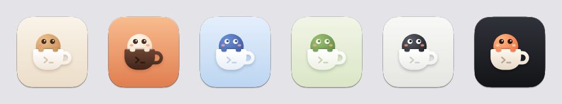

# App 图标定稿

- 日期：2026-11-10
- 类型：讨论会
- 参与者：用户、编排者
- 关联：T250、T252

## 议程

1. 定 App 图标
2. 图标颜色能不能让用户在客户端里选

## 讨论要点

- 前三轮（六个方向的初稿、其中"对话杯"的换色、带星芒和光点的杯子）用户都不满意，当时决定先放一放（计划 v1.3.90）。用户的要求：

  > 整体安静、不抢眼

  > ios风格并且要有点agent的感觉

  > 太像素材库图标, 不够精致

- 同一天又做了四轮：
  - 第四轮，马克杯加三个点、加眼睛、玻璃杯里的光球等：不满意。
  - 第五轮，不画杯子，改成字母 C 的抽象符号和衬线字母：不满意。

    > 怎么是c啊，好奇怪

  - 第六轮，问清方向后按"四种主体 × 四种风格"出了十六张。用户选了"杯里的小角色"，认为它还单调、配色奇怪。
  - 第七轮，这个方向出了六个姿势、六套配色。用户选了 V6（圆眼睛，两只手搭着杯沿，杯身印一个终端提示符），六套配色都喜欢，问能不能让用户在客户端里选颜色。
- 图标颜色在 macOS 上能做到哪一步：
  - App 运行时 Dock 里的图标可以换（Electron 的 `app.dock.setIcon`），窗口内的图标可以换。
  - 访达、启动台、聚焦搜索只读 App 包里的图标；系统通知的图标在宿主第一次连上通知服务时被系统记下，之后不再更新（T101）。这几处只能是默认配色。
  - App 没运行、只是固定在 Dock 上时也是默认配色；要让它跟随，得另写一个原生的 Dock 插件。
  - 直接改写 App 包上的图标可以到处生效，但会改动已签名的包，和代码签名、自动更新冲突，否决。这一点没有实测。
  - iOS 有正式的换图标接口，M3 再做。
- 母版按 macOS 的图标网格画：1024 的画布，中间 824 的圆角方形，带模板的投影。在 macOS 26.4 上把拿铁的母版做成 icns 放进一个测试用的 App 包，用系统接口取它的图标：系统按新的图标形状重新裁了边，大小和系统自带的 App 一致，没有被套进灰色的底板。macOS 15 上没有看过。

## 决策

| # | 决策 | 理由 |
|---|---|---|
| D1 | App 图标定为"杯里的小角色"：侧面的杯子，里面探出一个圆眼睛的小角色，两只手搭着杯沿，杯身印一个终端提示符 | 用户从七轮备选里选定 |
| D2 | 默认配色是拿铁（奶白底、白杯子、焦糖色角色），打进 App 包和宿主 bundle | 用户决定；访达、启动台和系统通知里只能有一种 |
| D3 | 六套配色（拿铁、摩卡、晴空、抹茶、墨色、夜色）都保留，用户可以在设置里选图标颜色，新增任务 T252 | 用户决定："这个要做，写到计划里面就行" |
| D4 | 图标颜色只改变 App 运行时 Dock 里的图标和窗口内的图标；不写 Dock 插件，不改写 App 包上的图标 | 见讨论要点；设置的说明里要写明范围 |

## 待办

| 事项 | 负责 | 关联 |
|---|---|---|
| 把拿铁的母版做成 icns 入库，App 和宿主都用它 | 子 agent | T250 |
| 设置里的"图标颜色" | 子 agent | T252 |
| 在 macOS 15 上看一眼图标的形状和大小 | 子 agent | T250 |
| iOS 端的图标切换 | 待定 | M3 |

## 物料

- [`icon/gen.py`](icon/gen.py)：生成六套配色的母版（SVG）；配色表在文件开头。
- `icon/cupper-<配色>.svg`、`icon/cupper-<配色>.png`：母版，1024 × 1024，透明底。PNG 由无头 Chrome 渲染 SVG 得到，命令在 `gen.py` 的开头。
- [`icon/preview.png`](icon/preview.png)：六套配色并排。

  

- 七轮备选稿（一百多张）没有入库。
