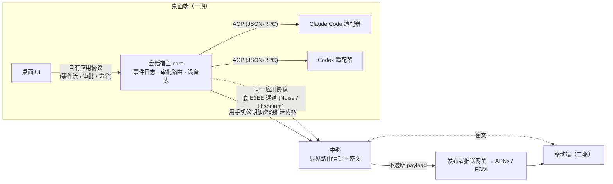

# R03 汇报：移动端远程操控与端到端加密方案调研

- 执行者：子 agent（技术调研员，移动端与安全方向）
- 分支：`research/R03-mobile-e2ee-remote`
- 完成日期：2026-10-16

> 标注约定：每条事实后面的 `[编号]` 指向 `sources.md`、`sources-happy.md`、`sources-others.md` 中的条目。**核** 表示已核实（读过源码或官方文档原文），**推** 表示推测，或者只有第三方文章、营销文案作依据。访问日期都是 2026-10-16。

## 做了什么

按 brief 的范围，调研了以下几方面：
- 现有产品：2 个官方产品，加上 Happy 和 10 余个第三方工具。
- 连接方案、加密方案。
- E2EE 下的推送。
- 移动端的功能清单。

调研方式：
- **读源码**（浅克隆到 worktree 之外的临时目录，只读，不执行）：
  - openai/codex（`e790ce2`）
  - slopus/happy、happy-desktop、happy-agent
  - Remodex、Happier、HAPI、VibeTunnel、claudecodeui、Vibe Kanban、Omnara（新旧两版）、Viberra、CUI
  - Signal-Server 的 APNs 发送代码
- **读官方文档**：
  - Claude Code（Remote Control、mobile、desktop/Dispatch、channels）
  - ChatGPT/Codex remote connections
  - Apple（NSE、filtering entitlement、APNs payload 上限、本地网络隐私、TN2277）
  - Firebase、Expo
  - Noise 规范、libsodium、Signal Sesame、RFC 9420 / 8827 / 8291
  - Tailscale、iroh、Matrix push gateway、ACP
- **分工**：派了两个并行 fork，一个深读 Happy 源码，一个调研 Omnara 和其他第三方工具。官方产品、加密、连接和推送的背景由我自己查。fork 给出的关键结论，我都回到源码复核过（见 `sources.md` 第 F 节）。

产出文件：
- `report.md`：本报告。
- `sources.md`：来源清单与摘录，覆盖官方产品、加密协议、推送平台和 ACP。
- `sources-happy.md`：Happy 源码深读笔记。
- `sources-others.md`：Omnara 与其他第三方工具的笔记。

**核心结论**

1. 官方的 Claude Code Remote Control 和 Codex Remote 都是"托管中继 + 账号信任 + 只有 TLS"，**都没有对厂商做 E2EE**。Claude 会把会话记录存在自己的服务器上；Codex 的开源传输层在中继上传的是明文 JSON-RPC [CC1][CX2]。
2. 第三方里真正做了 E2EE 的只有 Happy 系（Happy、Happier）和 Remodex，而且都有配对认证或推送明文方面的缺陷 [H14][O4][O5]。**"多 agent + 扎实的 E2EE" 目前是空白**，这是 cupper 最清晰的差异点。
3. 连接方式上，托管中继（可以自托管）加应用层 E2EE 是主流，也最适合移动端，因为它能处理推送、离线和 NAT。P2P、局域网、Tailscale 适合作为可选的加速通路，或者给极客用。
4. 加密方面：首次配对用"扫码 + 一次性秘密认证回程"，每次连接用 Noise 或 X25519 握手建立会话密钥，历史数据用每会话 DEK 加信封加密。真正需要拍板的是**中继是否保存密文历史**。
5. 推送：只有桌面拿得到明文，所以应该由桌面用手机的公钥加密推送内容，iOS 用 NSE 解密，Android 用 data 消息。推送凭据归发布者所有，即使中继自托管，推送网关也要由我们运营。
6. 架构上：桌面一期就要拆出"会话宿主 core + 自有应用协议 + 事件日志 + 可路由的审批 + 设备身份"，ACP 只留在 core 内部。这样移动端只是"第二个客户端"，接入时不用推倒重来。

## 调研结果

### 1. 现有产品对比

本节只看"在手机上操控本机正在运行的 agent"这一类产品。纯云端 agent 的移动入口（如 Claude Code 云端会话、Codex cloud）不在比较范围内。

| 产品 | 架构（连接） | 配对 | 加密 | 移动端能做什么 | 推送 | 开源与许可证 | 自托管 |
|---|---|---|---|---|---|---|---|
| **Claude Code Remote Control**（官方） | 托管中继：本地 CLI、Desktop 或 VS Code 只发出站 HTTPS，先向 Anthropic API 注册并轮询，设备连上后经流式连接路由消息。server 模式下一个进程可以带多个会话，还能按 worktree 拆分 [CC1·核] | 登录同一个 claude.ai 账号；终端显示会话 URL 和二维码。可选 Trusted Devices：每台设备注册自己的凭据（服务端只存设备公钥），登录超过 18 小时需要生物识别重新确认 [CC1·核] | **只有 TLS，不是 E2EE**。会话记录存在 Anthropic 服务器上；开了 ZDR 或 HIPAA 的组织不能用 [CC1·核] | 实时对话、发消息、上传图片和文件、审批权限、回答 AskUserQuestion、diff 面板、切换模型和 effort、部分斜杠命令、从 App 新建会话；不能切到 bypass 模式 [CC1][CC2·核] | Claude App 推送。两个开关："Claude 自己决定时推送"和"需要你操作时推送"；终端处于焦点时不推 [CC1·核] | 闭源，专有许可 [CC6·核] | 不能。必须用 claude.ai 订阅和 api.anthropic.com；不支持 API key、Bedrock、Vertex，也不支持自定义 BASE_URL [CC1·核] |
| **Codex Remote**（官方，ChatGPT App） | 托管中继：app-server 以 WebSocket 连到 `wss://chatgpt.com/backend-api/wham/remote/control/server`，在中继上收发 JSON-RPC 信封（带 seq、ack、cursor）。另有 SSH 主机模式，加上无头 daemon [CX1][CX2][CX4·核] | 主机端进入 Settings > Connections 生成二维码，手机扫码；两端必须是同一账号，并完成 MFA、SSO 或 passkey 验证。源码里有 `pairing_code`、给无摄像头设备手输的 `manual_pairing_code`，还有客户端列表和吊销接口 [CX1][CX2·核] | **TLS，应用层是明文 JSON-RPC**，中继看得到全部内容（开源 app-server 部分已核实，闭源 App 部分是推测）[CX2]。另有 userVerification：用 P-256 设备签名证明"这次批准确实是本人" [CX3·核]。第三方文章说它是 E2EE，没有一手依据 [CX6·推] | 新建或继续对话、追问、引导正在进行的工作、批准命令、查看 diff、测试结果、终端输出和截图、在主机和对话之间切换、在主机之间 handoff [CX1·核] | ChatGPT App 通知，在完成或需要关注时推送 [CX1·核]；内容是否明文未知 | Codex CLI 和 app-server 是 Apache-2.0 [CX2·核]；ChatGPT App 闭源 | 中继不能自托管：URL 只接受 chatgpt.com 或 localhost [CX2·核]；SSH 主机模式不需要中继 [CX1] |
| **Happy** | 托管中继，同时存密文：Fastify + Socket.IO + Postgres。CLI 用以下方式包装各家 agent：Claude 在本地时直接 spawn，远程时改用 Agent SDK；Codex 走 app-server；Gemini 和 opencode 走 ACP。daemon 支持远程新建会话 [H1][H2·核] | 账号就是手机生成的 32 字节 master secret。终端扫码时，二维码里只有 CLI 的临时 X25519 公钥，手机用 box 回传 content 公钥。加新手机时，把完整的 master secret 传过去 [H4][H5][H6·核] | **E2EE，但有缺陷**。每个会话一把随机 DEK（AES-256-GCM，legacy 模式用 secretbox），DEK 用 content 公钥包装 [H7][H8·核]。问题有：配对应答没有认证，恶意中继可以做中间人（#1503）；不能单独撤销某台设备；token 永不过期；用量、`seq`、RPC 方法名是明文 [H6][H9][H14·核] | 会话列表、实时输出、发消息和图片、审批（可以选"本会话一直允许"，也可以改参数）、diff、浏览、搜索和写文件、远程 bash、新建会话（选机器、目录、agent、模型）、切换模型和模式、中止、语音（付费，会把上下文发给 ElevenLabs）[H10][H12·核] | 走 Expo；**正文是明文会话标题**；有在场抑制；没有 NSE [H11·核] | MIT（App、CLI、Server、Desktop、Agent 全部）[H0·核] | 能：`happy server`（内嵌 PGlite），或者 Docker（Postgres、Redis、S3）；推送仍然走 Expo [H13·核] |
| **Happier**（Happy 的分支） | 和 Happy 相同：中继存密文，加 daemon；客户端有 Expo 版 App 和 Tauri 桌面端；"Any agent that speaks ACP" [O5·核] | 配对 v3 在二维码里加了 32 字节秘密，用 HMAC-SHA-256 认证应答（修复了 Happy 的问题），但在强制使用 v3 之前仍可能被降级 [O5·核] | 每个会话一把 DEK，用 AES-256-GCM 加密。服务器可以声明 `required_e2ee`、`optional` 或 `plaintext_only`，客户端可以固定要求 `require_e2ee`，防止被降级 [O5·核] | 新建会话、worktree、审批收件箱、逐行 diff 评论、git 和 PR、终端、语音、分享、切换 agent（来自 README 的描述，**推**）[O5] | 走 Expo，由 CLI 直接发；通知带 Allow/Deny 按钮；**默认带上命令和路径预览（明文）**，可以关闭 [O5·核] | MIT | 能（`happier relay host install`、Docker）[O5·核] |
| **HAPI** | 用户自建 hub（Bun 单二进制，SQLite 明文存储）。可选用官方 tunwg 隧道（WireGuard 加 TLS，TLS 在 hub 端终止），也可以用 Cloudflare Tunnel 或 Tailscale [O6·核] | hub URL 加一个 256 位 token（扫码或手输）[O6·核] | 没有应用层 E2EE，靠传输层加密；hub 里是明文，但 hub 是用户自己的 [O6·核] | 原生 iOS、Android、PWA、Telegram Mini App：审批、回答问题、附件、steer、文件、git diff、听写；Web 端另有终端和语音 [O6·核] | **唯一做了 E2EE 推送的产品**：每台设备一把 AES-GCM 密钥，iOS 用 NSE 解密，Android 用 data-only 消息 [O6·核] | AGPL-3.0 | hub 必须自建；push relay 也可以自建 [O6·核] |
| **Remodex**（只支持 Codex 和 OpenCode） | 中继只做转发，不存历史，一台 Mac 配一台手机；Mac 上的 bridge 对接 `codex app-server` [O4·核] | 二维码内容：relay、sessionId、Mac 的 Ed25519 公钥，5 分钟内有效；**二维码里没有一次性秘密** [O4·核/推] | **E2EE**：X25519 临时密钥，Ed25519 签名的 transcript，HKDF-SHA256 派生两个方向的 AES-256-GCM 密钥，计数器防重放，每个会话都有前向保密 [O4·核] | 原生 iOS：实时流、审批、计划模式、子 agent、git、回滚补丁、语音、SSH 终端 [O4·核] | 可选，走 APNs；标题是明文线程名；没有 NSE [O4·核] | Apache-2.0；App 收费订阅 | 能，relay 源码公开 [O4·核] |
| **Omnara** | 第一代（2025）：云端中继兼存储，CLI 用 PTY 包装 agent 并抓取屏幕 [O1·核]。第二代：本地 daemon 出站连接云端，本机离线时可以转到云沙箱继续 [O2·推]。第三代（2026-09 起）：转型做托管 agent 平台，**已经没有移动端** [O3·核] | 账号加 API Key（JWT）[O1·核] | 只有 TLS，服务器能读到全部内容；创始人公开承认没有 E2EE [O1·核][O2·推] | 第一代 RN App：实例列表、消息流、回答问题 [O1·核] | 走 Expo，内容是问题原文的前 100 字，明文 [O1·核] | 第一代和第三代 Apache-2.0，第二代闭源 | 第一代和第三代能 |
| **VibeTunnel** | 本地 Node 服务，把终端的 PTY 字节流放到浏览器里；外网访问靠 Tailscale、ngrok 或 Cloudflare [O7·核] | 系统密码或 SSH key，加 JWT [O7·核] | 没有应用层 E2EE [O7·核] | PWA 终端；原生 iOS 还在开发中 [O7·核] | Web Push（VAPID）[O7·核] | MIT | 是（纯本地运行） |
| **CloudCLI**（claudecodeui） | 本地 Node 服务读写 `~/.claude`，界面是 Web/PWA；默认在局域网内访问 [O8·核] | 本地账号密码（JWT） | 没有 E2EE | 会话、聊天、文件、git、插件；支持 4 种 agent | Web Push，标题是会话名，正文是消息或工具名 [O8·核] | AGPL-3.0 | 是 |
| **Vibe Kanban** | 主机出站 WSS 加 yamux 连到 relay tunnel，或者走 WebRTC P2P（只有 STUN）[O9·核] | **6 位码加 SPAKE2**，配对后登记 Ed25519 受信密钥，之后每个请求签名 [O9·核] | 认证很强，但 relay 能看到隧道里的明文 [O9·推] | 响应式 Web | 没看到 | Apache-2.0；公司已于 2026-04 关闭 [O9·核] | 是 |
| **Moshi** | 手机通过 SSH 或 Mosh 直连主机（配合 Tailscale），自动挂接 tmux [O10·核] | SSH 密钥；`moshi-hook pair` | SSH/Mosh 加密，终端内容不经过 Moshi 的服务器 [O10·核] | 原生终端 App、Chat View、diff、审批、Apple Watch [O10·核] | `moshi-hook` 把事件发给 Moshi API，再经 Expo 或 APNs 推送；没有声明加密 [O10·推] | 闭源，付费 | 主机自己管；推送服务不能自托管 |

其他：Viberra（WebRTC 加 coturn，属于早期项目）[O11]；CUI 已于 2026-03 归档，理由是官方功能已经覆盖了它的用途 [O12]；AgentAPI 已废弃 [O12]。

**要点**

1. **两家官方都是"托管中继 + 账号信任 + 只有 TLS"**，都不对厂商自己做 E2EE [CC1][CX2]。Claude 甚至明确说明会话记录存在服务器上，ZDR 组织不能用。
2. **真正做了 E2EE 的只有 Happy 系（Happy、Happier）和 Remodex**，代表两种思路：
   - Happy 系：中继保存密文，靠静态账户密钥加每会话 DEK；好处是有离线历史、多设备同步，代价是没有前向保密。
   - Remodex：中继只转发，每次会话做一次握手；有前向保密，但 Mac 离线时手机什么都看不到。
3. **配对和推送是普遍的薄弱点。**
   - 配对：Happy 的配对应答没有认证 [H14]；Remodex 的二维码里没有一次性秘密 [O4]；Happier 加了 32 字节秘密和 HMAC 才修好 [O5]。
   - 推送：只有 HAPI 做了 E2EE 推送 [O6]，其余产品都把会话标题或命令预览以明文交给推送服务。
4. **集成方式在收敛到结构化协议。** PTY 包装加屏幕抓取的做法已被放弃，Omnara 第一代就是因为维护不动而弃用 [O1]。仍然活跃的产品都改用 Codex app-server、Claude Agent SDK 和 ACP [H2][O4][O5]。
5. **市场信号：简单的包装器正在被官方功能挤出市场。** CUI 已归档，Omnara 已转型，Vibe Kanban 背后的公司已关闭 [O3][O9][O12]。剩下的差异化空间是：**多 agent、E2EE、自托管**。

### 2. 移动端功能清单

图例：● 有（已核实）；◐ 有（只有 README、营销文案或第三方的说法）；— 没看到或不支持。

| 功能 | Claude Code RC | Codex Remote | Happy | Happier | HAPI | Remodex | Omnara 第一代 | 归类 |
|---|---|---|---|---|---|---|---|---|
| 会话列表和在线状态 | ● | ● | ● | ◐ | ● | ● | ● | **普遍** |
| 实时输出或对话流 | ● | ● | ● | ◐ | ● | ● | ● | **普遍** |
| 发消息、追问 | ● | ● | ● | ◐ | ● | ● | ● | **普遍** |
| 审批权限请求 | ● | ● | ● | ◐ | ● | ● | ● | **普遍** |
| 回答 agent 的提问（AskUserQuestion 之类） | ● | ● | ● | ◐ | ● | ◐ | ● | **普遍** |
| 推送：需要处理时、任务完成时 | ● | ● | ● | ● | ● | ●（可选） | ● | **普遍** |
| 查看 diff | ● | ● | ● | ◐ | ● | ◐ | — | 较普遍 |
| 在手机上新建会话（远程启动） | ●（server 模式） | ● | ● | ◐ | ● | ◐ | ◐ | 较普遍 |
| 运行中插话或排队 | ◐ | ● | ● | ◐ | ● | ● | — | 较普遍 |
| 切换模型、推理档位、权限模式 | ●（不能切 bypass） | ◐ | ● | ◐ | — | ● | — | 较普遍 |
| 附件（图片、文件） | ● | — | ● | — | ● | ● | — | 较普遍 |
| 文件浏览、编辑 | — | — | ● | ◐ | ● | — | — | 差异化 |
| 远程终端或 shell | —（`!` 开头的输入也只是普通消息） | — | ● | ◐ | ●（仅 Web） | ●（SSH） | — | 差异化 |
| git 操作（commit、push、PR） | — | — | — | ◐ | — | ● | — | 差异化 |
| 语音 | — | — | ●（付费） | ◐ | ● | ● | — | 差异化 |
| 在通知上直接批准或回复 | — | — | — | ● | ● | — | — | 差异化 |
| 多主机切换或会话迁移（handoff） | ◐ | ● | ● | ◐ | — | — | — | 差异化 |
| 本机离线时转到云端继续 | ◐（云端会话是另一个独立功能） | ● | — | — | — | — | — | 差异化（官方独有） |
| 多种 agent | — | — | ● | ◐ | ● | ◐ | ● | 差异化 |
| 对服务端端到端加密 | — | — | ●（有缺陷） | ● | —（hub 归用户所有） | ● | — | 差异化 |

来源：Claude Code RC 见 [CC1][CC2]；Codex 见 [CX1]；Happy 见 [H12]；Happier 见 [O5]；HAPI 见 [O6]；Remodex 见 [O4]；Omnara 见 [O1]。

**怎么读这张表**

- **普遍具备的最小集**：会话列表、实时输出、发消息、审批、回答提问、推送。这就是用户对"手机遥控 agent"的基本预期，可以作为移动端第一期的范围。
- **较普遍**：diff、新建会话、插话、切换模型或模式、附件。多数产品在第二批迭代里补齐了这些功能。
- **差异化**：文件浏览、终端、git、语音、通知内操作、多主机 handoff、云端接续、多 agent、E2EE。其中，cupper 天然具备"多 agent"（Claude Code 和 Codex 都走 ACP）；"E2EE"是官方产品没有、第三方普遍做得不扎实的地方，两者叠加起来，是最清晰的差异点。
- **安全边界提示**：远程 shell、写文件、新建会话，等于把电脑上的代码执行权交给了手机。Happy 的经验是让这些操作受 agent 自身的权限边界约束 [H15]，Claude 的做法是手机端不能切到 bypass 模式 [CC2]。

### 3. 连接方案取舍

前提：桌面端和手机通常都在 NAT 后面，手机还会在 Wi-Fi 和蜂窝网络之间切换。iOS App 被挂起后不执行任何代码，系统可能回收它的 socket [P7·核]。所以无论选哪种连接方案，手机都不能指望后台长连接，"有事找我"只能靠 APNs/FCM 推送唤醒，App 回到前台后再重连、补齐增量。

| 方案 | 原理 | 优点 | 缺点 / 代价 | 与 E2EE 的关系 | 代表产品 |
|---|---|---|---|---|---|
| **C1 托管中继**（厂商运营，桌面和手机都只发出站连接） | 桌面向中继注册并保持 WebSocket（或 HTTPS 轮询），手机连同一个中继，中继按会话或设备路由消息 | 零配置，穿透任何 NAT 和防火墙，不开入站端口 [CC1·核]；可以缓存离线消息和历史，换设备直接同步；中继知道何时该推送，自然成为推送的发起方 | 要运营服务器，承担成本和可用性；所有流量绕一跳，延迟稍高；不做 E2EE 时中继能看到全部内容 | E2EE 要在应用层自己做；中继只能看到路由信封 | Claude Code Remote Control [CC1]、Codex Remote [CX1][CX2]、Happy/Happier（存密文）[H1][O5]、Remodex（不存历史）[O4]、Omnara 第一代和第二代（存明文）[O1][O2] |
| **C2 自托管中继** | 同 C1，只是中继由用户部署（Docker 或单个二进制） | 数据主权，适合企业和隐私敏感用户；配合 E2EE 时信任面最小 | 用户要有公网主机、域名和 TLS 证书；**推送仍然要经过 App 发布者**：APNs 密钥绑定 App 的 Bundle ID，自托管中继无法直接给官方 App 发推送，需要发布者运营一个推送网关来转发（Matrix 的 push gateway 就是这种模式 [P5·核]；**推**） | 同 C1 | Happy（`happy server`，但推送仍然走 Expo）[H13]、Happier [O5]、Remodex [O4]、HAPI（hub 必须自建，推送经官方 push relay）[O6] |
| **C3 P2P 直连**（WebRTC DataChannel，或基于 QUIC 的 iroh 等） | 借助信令服务器交换候选地址，打洞直连；打不通时走 TURN 或 relay | 延迟最低，正文流量不经过服务器；传输层自带 DTLS 或 QUIC 加密 | 仍然需要信令、STUN、TURN 或 relay 服务器，iroh 自称约 9 成网络条件能直连 [K8·核]；手机进入后台连接就会断；没有离线缓存，桌面离线时手机什么都看不到；信令服务器可以替换 DTLS 指纹做中间人，除非用户独立核对指纹 [K6·核] | 必须用配对时交换的长期公钥给 DTLS 指纹或 QUIC 身份签名，才算真正的端到端 | Vibe Kanban 的 relay-webrtc（只有 STUN，没有 TURN）[O9]、Viberra（WebRTC 加 coturn）[O11]；两者都不是主流产品 |
| **C4 组网或 VPN**（Tailscale、WireGuard、Headscale、ZeroTier） | 桌面在 tailnet 上暴露本地服务，手机装同一个组网客户端后直连 | 端到端由 WireGuard 加密，DERP 中继无法解密 [K7·核]；产品本身不用运营服务器；局域网和外网的体验一致 | 用户要在手机上安装并登录第三方 VPN；iOS 和 Android 同一时间只能开一个 VPN [N1·核]，会和公司 VPN 冲突；没有推送，要另配；面向极客，难以面向大众 | 加密由组网层负责，应用层只需鉴权 | Moshi（SSH/Mosh + Tailscale + tmux）[O10]、VibeTunnel（推荐 Tailscale）[O7]、HAPI 的 tunwg 隧道（基于 WireGuard）[O6]；Codex 文档建议通过 VPN 或 mesh 访问外网的 app-server [CX1·核] |
| **C5 局域网直连**（mDNS/Bonjour 发现加本地 WebSocket） | 同一个 Wi-Fi 里，手机直接连桌面的端口 | 最简单，延迟最低，不需要任何服务器 | 只在同一网络可用；iOS 第一次访问局域网会弹本地网络权限 [P8·核]；局域网里拿不到公认的 TLS 证书，要靠配对时固定的公钥来认证；酒店、公司等隔离设备的网络用不了 | 要自己做加密和认证（Noise 或基于配对密钥的通道） | CloudCLI 默认就是"在局域网内用浏览器打开 ip:port"[O8]；Remodex 的 README 说 iOS 上局域网 `ws://` 不稳定 [O4] |
| **C6 隧道暴露本地 Web UI**（Cloudflare Tunnel、ngrok、SSH 端口转发） | 把桌面的本地 Web 服务映射到一个公网 URL，手机用浏览器访问 | 实现最快，复用 Web UI，不用做原生 App | 隧道服务商在边缘终止 TLS，能看到明文（**推**，Cloudflare Tunnel、ngrok 的常规工作方式）；公网暴露带来攻击面，必须自己加鉴权；没有原生推送 | 想做 E2EE 只能在页面里加应用层加密，而页面代码本身就由隧道下发，信任链很弱 | VibeTunnel、CloudCLI、HAPI 都支持 Cloudflare Tunnel 或 ngrok [O6][O7][O8] |

**适用场景小结**

- **面向大众、需要推送和离线历史**：选 C1 托管中继，加上应用层 E2EE。两家官方产品和 Happy 都选了这条路。
- **企业或隐私敏感用户**：在 C1 的基础上提供 C2 自托管中继。推送需要单独的"发布者推送网关"，而且推送内容要加密或者不带内容（见第 5 节）。
- **性能优化**：可以在 C1 之上叠加 C5 局域网直连或 C3 P2P 升级，和 Tailscale DERP、iroh 的"先中继、再尝试直连"同一思路。前提是 E2EE 做在传输层之上，换哪条通路都不影响加密。
- **极客或自用**：C4 组网成本最低，但不该作为产品的主路径。
- **C6 不建议作为产品方案**，只适合原型。

### 4. 加密方案取舍

先说结论：要回答的不是"用哪个加密库"，而是三个相互牵连的决定：**信任根在哪里**（桌面设备、账号还是恢复密钥），**中继是否保存历史**，**撤销设备时要做到什么程度**。下面依次是：配对和密钥交换、消息加密、多设备与密钥层级三张取舍表（4.1–4.3），撤销与轮换的要点（4.4），以及中继能看到的元数据（4.5）。

#### 4.1 配对与密钥交换

| 方案 | 做法 | 安全性 | 体验 | 代价 / 风险 | 适用场景 | 先例 |
|---|---|---|---|---|---|---|
| **K-A 扫码传公钥 + X25519** | 二维码里放桌面的公钥（或一次性配对密钥）、中继地址和一次性 token；手机生成自己的密钥对，用桌面公钥加密后回传自己的公钥或会话密钥（libsodium `crypto_box` 或 sealed box） | 二维码是一条带外的认证信道，但**只认证了"桌面→手机"这一个方向**。回程的应答如果不认证，中继就能把它换掉：Happy 的二维码里只有 CLI 的公钥，CLI 对收到的应答照单全收，恶意中继可以把自己的公钥塞进去，进而拿到全部会话密钥（issue #1503，读源码确认属实）[H5][H14·核]。正确的做法是在二维码里再放一个一次性秘密（psk），用它认证回程应答（例如 Noise 的 `XXpsk`、`KKpsk` 模式），或者让双方比对一个短校验码。另外，只用两把静态密钥做 DH 没有前向保密，要加临时密钥 | 扫一次即可 | 两台设备必须在一起，手机要有摄像头；二维码被拍到就可能被冒用，所以要一次性、短时效，服务器端也要设过期时间（Happy 没设，issue #674 [H14·核]） | 手机和桌面的首次配对 | Happy [H5]；Remodex 的二维码带有 Mac 的 Ed25519 公钥，5 分钟内有效，但没有一次性秘密 [O4]；Happier 的配对 v3 在二维码里加了 32 字节秘密，并用 HMAC-SHA-256 认证应答，正是为了修复上面这个问题 [O5·核] |
| **K-B Noise 握手**（IK、KK、XX，可以加 psk） | 配对时交换长期静态公钥（通过 K-A），之后每次连接跑一次 Noise 握手，得到新的会话密钥 | 协议经过形式化分析；有临时 DH，所以有前向保密，还能隐藏身份 [K1·核] | 用户感知不到 | 要求有序、可靠的传输，还要维护会话状态；Swift 和 Kotlin 端需要选库（Rust 有 snow，C 有 noise-c；**推**） | 实时通道，例如终端输出流和指令 | Codex exec-server 中继用 `Noise_hybridIK_X25519+MLKEM768_AESGCM_SHA256` [CX5·核]；WireGuard 基于 Noise IK；Remodex 没用 Noise，自己实现了一个类似的握手：X25519 临时密钥，Ed25519 签名的 transcript，HKDF-SHA256 派生两个方向的 AES-256-GCM 密钥，计数器 nonce [O4·核] |
| **K-C 短码 + PAKE**（SPAKE2、CPace） | 用户手动输入 6 到 8 位短码，双方用 PAKE 推导出共享密钥 | 能抵抗离线暴力破解；服务器不知道短码 | 没有摄像头也能配对 | 成熟的跨平台实现较少（**推**） | 无头主机、桌面配桌面、不方便扫码时 | Vibe Kanban：主机显示 6 位一次性码，双方跑 SPAKE2 并做密钥确认，然后登记对方的 Ed25519 公钥，之后每个请求都要签名 [O9·核]。Codex 的 `manual_pairing_code` 是服务器发的码，靠账号绑定，不是 PAKE [CX2·核] |
| **K-D 账号信任（没有 E2EE）** | 登录同一账号即算配对，设备凭据由服务器签发；可以加设备密钥做强认证 | 服务器能读到全部内容；设备密钥只用于认证（Claude 的 Trusted Devices [CC1·核]、Codex 的 userVerification [CX3·核]），不用于加密 | 最简单 | 不满足本项目的 E2EE 要求 | 厂商官方产品 | Claude Code Remote Control、Codex Remote |
| **K-E 恢复密钥或口令** | 账户主密钥由高熵恢复密钥派生或包裹（口令要用 Argon2id 加强） | 恢复密钥泄露等于全部泄露；口令太弱会被离线爆破 | 新设备加入时不需要旧设备在场 | 用户必须妥善保管；丢了就无法恢复数据 | 加新设备、旧设备全部丢失时 | Happy 的账号本身就是一个 32 字节 master secret，以 base32 形式备份 [H4·核] |

建议：**K-A 负责首次配对，K-B 负责每次连接的会话密钥，K-E 作为可选的恢复手段**。三者并不冲突。

#### 4.2 消息加密

| 方案 | 特点 | 前向保密 | 实现成本 | 适用场景 |
|---|---|---|---|---|
| **M-1 逐条独立的 AEAD**（libsodium `secretbox`、`crypto_box`，或 XChaCha20-Poly1305，随机 nonce） | 每条消息都能单独解密，特别适合"中继保存密文、按需拉取历史"；XChaCha 的 24 字节 nonce 可以放心随机生成 | 没有。长期密钥一旦泄露，全部历史都能被解开 | 低。libsodium、tweetnacl、swift-sodium 都很成熟（**推**） | 存储转发和历史同步 |
| **M-2 会话流加密**（`crypto_kx` + `secretstream`，或 Noise 的传输阶段） | 每个方向一把密钥，用计数器当 nonce [K2·核]；能检测截断、重排、重放，支持 `REKEY` [K3·核] | 有会话级前向保密（前提是用了临时密钥） | 中。有状态，断线后要重新握手或续传 | 实时流 |
| **M-3 平台原生 AES-256-GCM**（CryptoKit、WebCrypto、Android Keystore） | 硬件加速，不用引入第三方依赖 | 取决于上层设计 | 中。nonce 只有 96 位，随机生成有碰撞上限，要用计数器；KDF 要自己选（HKDF） | 原生 App 优先时 |
| **M-4 Double Ratchet**（Signal） | 每条消息换一次密钥，同时有前向保密和泄露后安全；多设备要靠 Sesame 那样逐台设备扇出 [K4·核] | 强 | 高。要处理乱序消息和复杂状态 | 人与人之间的高安全通信；对"一个用户的几台设备"来说过重 |
| **M-5 MLS**（RFC 9420） | 群组级的前向保密和泄露后安全；增删设备的开销按设备数的对数增长 [K5·核] | 强 | 最高。需要投递服务保证顺序；有 OpenMLS 等库（**推**） | 将来做"团队共享会话"或多人协作时再考虑 |

建议：**历史数据用 M-1，实时流用 M-2 或 Noise**。M-4 和 M-5 对"一个人的手机和电脑"来说过重，留作团队协作阶段的选项。

#### 4.3 多设备与密钥层级

| 方案 | 做法 | 加新设备 | 撤销设备 | 代价 |
|---|---|---|---|---|
| **D-1 所有设备共享一把账户主密钥** | 所有设备持有同一把对称主密钥，各会话的密钥由它派生 | 扫码或输入恢复密钥，把主密钥交给新设备 | 难。被撤销的设备已经知道主密钥，要彻底撤销，就得轮换主密钥、重新加密或重新分发 | 最简单。Happy 的所有手机和浏览器共享同一个 master secret，属于这一类；官方文档承认"cannot list or selectively revoke phones" [H6·核] |
| **D-2 每会话一把数据密钥，再用各设备公钥包裹**（信封加密） | 每个会话一把数据密钥（DEK），对每台授权设备用其公钥 `crypto_box_seal` 包一份 | 由一台已授权的设备为新设备补包 DEK | 不再为它包新的 DEK，并轮换后续 DEK；它已经拿到的旧数据收不回来 | 要存 N 份包裹；加设备时要有一台已授权设备在线 |
| **D-3 每台设备独立会话**（Sesame 式扇出） | 设备两两之间各建会话，每条消息为每台设备分别加密 | 新建会话即可，但历史要重新加密后发给它 | 删掉会话即可 | 流量和存储随设备数线性增长 |
| **D-4 中继不存历史，只做实时通道** | 中继只转发；手机连上后由桌面从本地数据库补发历史 | 只需登记公钥 | 删除它的公钥即可 | 桌面离线时，手机什么都看不到 |

#### 4.4 撤销与轮换

- **两种撤销都要做**：一是访问控制，让中继拒绝这台设备的 token（Claude、Codex 都只做了这一层 [CC1·核][CX2·核]）；二是密码学上的撤销，通过轮换密钥，让它即使拿到密文也解不开。
- **桌面是信任根**：已配对设备的列表由桌面维护并签名，手机丢了可以在桌面上撤销；桌面本身丢了，只能靠恢复密钥（K-E）或者重新配对。
- **定期轮换会话密钥**：可以用 Noise 的 rekey 或 secretstream 的 `TAG_REKEY` [K3·核]。长期身份密钥不常轮换；一旦怀疑泄露，就要求重新配对。

#### 4.5 中继能看到什么元数据

即使做了 E2EE，中继仍然能看到以下这些。可以把它们写进 PRD 的隐私说明。

| 元数据 | 托管中继 + E2EE | P2P（C3） | 组网（C4） | 能否缓解 |
|---|---|---|---|---|
| 账号 ID、设备 ID、设备数量 | 可见 | 信令服务器可见 | 协调服务器可见 | 用匿名 ID 部分缓解 |
| IP 地址、在线时段（桌面何时开机、用户何时活跃） | 可见 | 信令和 TURN 可见 | DERP 和协调服务器可见 | 难以缓解 |
| 消息的大小和频率（能推断输出长度、是否在流式生成） | 可见 | TURN 中转时可见 | DERP 可见 | 做 padding 或批量发送，有一定成本 |
| 会话数量、会话 ID、消息条数 | 存历史时可见 | 不可见 | 不可见 | 只能尽量少存 |
| 会话标题、机器名、项目路径、git 分支 | 不加密就可见，**最容易漏** | 不经过服务器 | 不经过服务器 | 必须一并加密。Happy 加密了会话 metadata（路径、主机名、摘要），但推送正文用的是明文会话标题；用量和费用、RPC 方法名（如 `bash`）、`seq` 也都是明文 [H9][H11·核] |
| 推送 token 和推送时间（能推断"有审批在等"） | 可见，APNs 或 FCM 也能看到 | 同样需要推送服务 | 同样需要推送服务 | 只能用不带内容的推送（见第 5 节） |

### 5. 端到端加密下的推送通知

推送链路是：**发起方（中继或桌面）→ 推送服务（APNs、FCM，或者 Expo 这类代理）→ 手机系统 →（可选）App 扩展**。

**现状：推送是 E2EE 最常见的漏洞。** 本次调研的产品里，只有 HAPI 做了端到端加密的推送 [O6]。下面这些都把明文交给了第三方：
- Happy：正文是会话标题，经过 Happy 服务器、Expo 和 APNs [H11]。
- Happier：默认带上命令、文件路径和问题文本 [O5]。
- Remodex：标题是线程标题 [O4]。
- Omnara：问题原文的前 100 个字符 [O1]。
- Moshi：未声明加密，视为明文 [O10]。

E2EE 要防的不只是我们自己的中继，还有 Apple、Google 以及中间的推送代理。比如 Expo 的推送接口默认不需要鉴权，由它把推送转发给 APNs 和 FCM [P9·核]，所以 Expo 能看到 payload（**推**）。

| 方案 | 做法 | 泄露什么 | 代价 | 先例 |
|---|---|---|---|---|
| **N-1 不带内容的通用推送** | 推送正文只写"有一个会话需要你处理"之类的固定文案 | 只泄露时间点和 App 身份 | 最简单；用户要打开 App 才知道是什么事 | 常见做法（**推**） |
| **N-2 推送里带密文，iOS 用 NSE 解密** | payload 设 `mutable-content: 1`，带一段占位的 `alert`，再放入密文字段；iOS 的 Notification Service Extension 在大约 30 秒内解密、改写标题和正文，解不开时显示占位文案 [P1·核]；Android 用 FCM data 消息，在 App 里解密后发本地通知 [P6·核] | 只泄露时间点和密文长度 | NSE 是独立进程，要通过 App Group 共享的钥匙串读密钥；payload 上限 4 KB [P3·核]，密文和 base64 都要算进去 | Apple 官方示例就是解密推送 [P1·核]。**HAPI 是调研范围内唯一这样做的产品** [O6·核]：hub 用每台设备各自的 AES-256-GCM 密钥加密，iOS payload 是 `mutable-content:1` 加固定占位文案 "HAPI / New activity" 加密文信封，Android 走 data-only 消息；官方 push relay 只持有 APNs 和 FCM 凭据，只能看到 token、时间和大小 |
| **N-3 唤醒后拉取（Signal 模式）** | 推送不含任何内容，只是唤醒；NSE 去中继拉取密文、解密后再展示 | 几乎只泄露时间点 | NSE 里要做网络请求，30 秒内必须完成；中继要保存待取的密文 | Signal 的 APNs payload 只有 `mutable-content` 和占位文案 `APN_Message` [P4·核]；Matrix 的 `event_id_only` 同理 [P5·核] |
| **N-4 静默过滤** | 在 N-2 或 N-3 的基础上，NSE 判断这条推送是否已经处理过（比如已在电脑上批准），处理过就不展示 | 同 N-2 或 N-3 | 需要向 Apple 申请 filtering entitlement [P2·核] | 可选的增强 |
| **N-5 Web Push**（PWA 或浏览器） | 推送 payload 用浏览器的公钥加密，推送服务读不到 [K9·核] | 推送服务知道发送方和接收方 | 只适合 Web 客户端 | RFC 8291 |

**设计要点**

1. **谁来生成推送内容**：只有桌面持有明文，所以应该由桌面用手机的公钥把推送内容加密好，交给中继，中继只负责把这团不透明的数据发给 APNs 或 FCM（N-2）。这样中继不需要知道"发生了什么"。
2. **推送凭据归发布者所有**：APNs 密钥绑定 App 的 Bundle ID。即使中继支持自托管，推送也要经过发布者运营的推送网关，或者 Expo、ntfy 这类代理（C2 那一行已经说明）。自托管中继只能把加密后的数据交给这个网关（**推**）。
3. **锁屏直接批准**：iOS 通知的 action 可以要求先解锁设备，回传给桌面的批准消息必须由手机的设备密钥签名并加密，防止中继伪造批准。这一点 Codex 的 userVerification（用 P-256 对 challenge 签名）思路相近 [CX3·核]，具体做法属于设计推断（**推**）。
4. **Live Activities 和灵动岛**：这类更新由 APNs 直接送达，不经过 NSE，所以没法在端上解密（**推**，需要在设计阶段核实）。如果要显示"进度条"之类的内容，只能放不敏感的字段。
5. **避免重复打扰**：用户在电脑前时不推送。Claude Code 的做法是终端处于焦点时跳过推送，也可以用一个"在场文件"来判断 [CC1·核]。

### 6. 对架构的启示

出发点是"桌面端先行、移动端平滑接入"。以下几点建议都可以在桌面一期就以很低的成本落地，这样二期接入移动端时不需要推倒重来。这一节作为 PRD 产品-架构对齐会的输入。

下图是建议的分层结构，用来说明各条启示之间的关系，不是最终设计。



**A1. 桌面端拆成"会话宿主（core）"和"UI 客户端"两层，中间是我们自己的应用协议，不是 ACP。**
- ACP 是 client 和 agent 之间的协议。agent 会反过来调用 client 的 `fs/read_text_file`、`terminal/create` 和 `session/request_permission` [ACP1·核]，这些调用只能在有文件、有终端的那台机器上应答。所以 ACP client 必须留在桌面的 core 里，手机不能直接讲 ACP。
- 两家官方都是这样分层的。Codex 把同一套 app-server JSON-RPC 本地走 stdio 或 unix socket，远程走 remote_control 中继 [CX2·核][CX4·核]。Claude Code 的手机端只是本地会话的一个窗口 [CC1·核]。Happy 也是"CLI 或 daemon 包装 agent，App 只是远程视图"的结构，并通过能力声明 metadata 让手机按 agent 的能力渲染界面 [H1][H3·核]。
- 一期就让桌面 UI 通过这套协议和 core 通信，哪怕两者在同一个进程里。这样移动端只是"第二个客户端"。

**A2. 会话以"带序号的事件日志"为核心数据模型。**
- 把 ACP 的 `session/update`（消息片段、工具调用、计划、模式变化等 [ACP1·核]）规范化成一串带单调递增 `seq` 的事件，客户端订阅时带上自己最后看到的 `seq` 续传。Codex remote control 的信封里就有 `seq_id`、`ack` 和 `cursor` [CX2·核]。
- 好处有三个：断线重连只需补增量；多个客户端（桌面窗口、手机、网页）看到的内容天然一致；以后要加密存储到中继，只需对事件逐条加密（对应第 4 节的 M-1）。

**A3. 审批是一种"可路由的请求"，从一开始就按多客户端来设计。**
- 每个审批请求带唯一 ID 和状态（待处理、已批准、已拒绝、已过期），任何一个已授权的客户端都能应答，先到先得，其他客户端同步撤掉提示。Claude Code 也是这样：权限请求一直等到有人回答，其他转发的对话框有超时 [CC1·核]。
- 远程批准应该带设备签名（Codex 的 userVerification [CX3·核]），桌面在执行前校验签名，防止中继伪造。
- 手机端支持哪些权限模式，要单独做产品决策。例如 Claude 的 App 不能切到 bypass 模式 [CC2·核]。

**A4. 设备身份和"已配对设备表"从一期就进数据模型。**
- 桌面首次启动时生成长期身份密钥（X25519 用于密钥协商，Ed25519 用于签名），存在系统钥匙串里。即使一期不做移动端，也把"设备列表、配对、撤销"作为 core 的一部分，表里可以先是空的。

**A5. 传输层可替换，E2EE 放在传输之上、应用协议之下。**
- 分三层：应用协议（A1、A2）→ E2EE 通道（Noise 或 libsodium，见 4.1、4.2）→ 传输（本地 IPC、局域网 WebSocket、中继 WebSocket，将来可加 P2P）。中继只看到"路由信封"（设备 ID 和不透明的密文），换中继、加局域网直连或 P2P 都不影响上两层。
- Codex 的两条链路正好是两种对照：remote_control 把明文 JSON-RPC 交给 chatgpt.com 中继 [CX2·核]，exec-server 在中继之上跑 Noise [CX5·核]。我们应该选后一种结构。

**A6. 要请用户和产品先拍板的决策：中继是否保存历史。**
- **保存密文历史**（Happy、Happier [H1][O5]）：桌面离线时，手机仍然能看历史；推送可以用"唤醒后拉取"；但需要会话级密钥和信封加密（D-2），撤销也更复杂。
- **只做实时通道**（D-4，Remodex 和 HAPI 的 relay 都不存数据 [O4][O6]）：最简单、最安全，但桌面一关，手机就什么都看不到。
- 这个选择决定了密钥模型和中继的存储设计，应该在 PRD 里写明，可对应访谈问题 5、6。
- 折中做法：中继只缓存一段有限时间内的密文，例如最近 N 天，用来补齐断线期间的增量和推送拉取；完整历史以桌面本地为准。

**A7. 推送和自托管要分开考虑。**
- 中继可以设计成可自托管的轻量服务（Happy、Happier、Remodex 都开源了中继 [H13][O4][O5]），但 iOS 推送仍然要经过发布者运营的推送网关，推送内容要加密或者不带内容（第 5 节）。
- 如果 PRD 承诺"可自托管"，就要同时说明"推送经过官方网关，但官方网关读不到内容"。

**A8. 端到端加密本身就是差异点。**
- Claude Code Remote Control 会把会话记录存在 Anthropic 服务器上，开了 ZDR 或 HIPAA 的组织不能用 [CC1·核]。Codex 的开源传输层也是 TLS 内的明文 JSON-RPC [CX2·核]。官方方案都不对厂商做端到端加密，加密是 Happy 等第三方的主要卖点 [H8·核]。
- 再加上我们同时支持多个 agent（Claude Code 和 Codex），差异化定位成立。代价是我们不能在服务端做任何"读内容"的功能，比如服务端搜索或摘要，PRD 要写清楚。

**A9. 用"能力声明"把手机端和具体 agent 解耦。**
- Happy Agent 把能力写进加密的会话 metadata，包括：能否中止、是否支持附件和文件、可选模型列表、带语义类别的权限模式、可用的 RPC 方法。手机端只按这份声明渲染界面 [H3·核]。
- ACP 本身也有 capability 协商（`initialize`）[ACP1]。我们可以把 ACP 的能力和自己补充的能力合并成一份"会话能力描述"，手机端据此决定显示哪些按钮。以后新增 agent 时，手机端就不用跟着改。

**A10. 安全设计清单（从先例的问题中总结）**
- **配对**：二维码里放一次性秘密，用它认证回程应答（Noise 的 psk 模式或 HMAC），或者让双方比对短校验码。服务器端也要给配对请求设过期时间。这样可以避开 Happy 的 #1503、#674 和 Remodex 的同类问题 [H14][O4][O5]。
- **凭据**：每台设备一把自己的密钥，一个自己的 token；token 能过期、能吊销；吊销后还要轮换后续密钥（第 4.4 节）。Happy 的 token 永不过期，也不能单独撤销设备 [H4][H6]。
- **推送**：正文不能带明文，用 NSE 解密或者"唤醒后拉取"（第 5 节，参考 HAPI [O6]）。
- **元数据**：会话标题、路径、主机名、用量和费用、RPC 方法名都要加密，或者干脆不上传。Happy 在这些地方都有泄露 [H9]。
- **E2EE 之外的旁路**：语音、分析统计、第三方 token 托管，都会把数据带出 E2EE 的范围（Happy 的语音会把会话上下文发给 ElevenLabs [H10]）。PRD 要写清楚哪些功能不在 E2EE 范围内。
- **防降级**：客户端可以在本地固定要求 E2EE，防止服务器把会话降成明文（Happier 的 `require_e2ee` [O5]）。
- **Web 端**：如果网页客户端由中继下发，恶意中继可以直接下发恶意 JS，这一点 Happier 的文档自己也承认 [O5]。所以 E2EE 的承诺只对原生 App 和本地安装的客户端成立。

**A11. 移动端的分期建议**（依据第 2 节的功能清单）
- **第一批（移动端第一版）**：会话列表和在线状态、实时输出、发送消息、审批权限请求、推送（需要审批或任务完成）。这是各家产品普遍具备的最小集合。
- **第二批**：查看 diff、在指定项目里新建会话、切换模型或模式、附件。
- **第三批**：差异化功能，例如语音、多主机切换和 handoff、文件浏览、终端。

## 关键取舍

本节说的是调研方法上的取舍。按 brief 的要求，不做最终选型。

- **以源码为准，不信二手文章**：网上有多篇第三方文章称"Codex 移动端用 X25519、Ed25519 和 AES-GCM 做端到端加密"，但它们的依据其实是第三方工具 Remodex [CX6]。读 openai/codex 源码后发现，remote_control 传输层是 TLS 内的明文 JSON-RPC [CX2]；Noise 只出现在另一条链路（exec-server 中继）上 [CX5]。所以报告按源码下结论，二手说法标为"推"，并在 sources 里注明。
- **闭源部分如实标注**：Claude App、ChatGPT App 和桌面 App 都是闭源的，只能以官方文档为准，没法断言它们在端上有没有额外加密。凡是推断的地方都标了"推"。
- **广度和深度的分配**：Happy 是最接近本项目目标（多 agent 加 E2EE）的先例，单独深读了它的源码。其他第三方工具以覆盖不同的架构类型为目的，选取有代表性的几个，不求穷举。
- **只给选项和适用场景，不给结论**：每张取舍表后面附的"建议"，只是作为对齐会的讨论起点。

## 验证方式

这是纯文档调研，没有构建、测试或 lint 可以跑。下面逐条对照 brief 的验收标准。

| 验收标准 | 完成情况 | 位置 |
|---|---|---|
| 产品对比表：产品、架构、加密、移动端功能、开源与许可证、自托管 | ✅ 共 11 个产品，表里还额外加了"配对"和"推送"两列；另有 3 个产品作简述 | 第 1 节 |
| 连接方案和加密方案各一张取舍表，并说明适用场景 | ✅ 连接方案 C1–C6，附适用场景小结。加密方案拆成 3 张取舍表（配对与密钥交换、消息加密、多设备与密钥层级），各附适用场景和建议，另有撤销与轮换的要点和一张"中继可见元数据"表 | 第 3、4 节 |
| 移动端功能清单，标注哪些普遍具备、哪些是差异化 | ✅ 20 项功能对比 7 个产品，按"普遍、较普遍、差异化"归类 | 第 2 节 |
| 每条事实附来源，标注日期，区分已核实和推测 | ✅ 正文的每条事实都带 `[编号·核/推]`。来源清单在 3 个 sources 文件里，每条有 URL 或"仓库 + 提交 + 文件路径"，访问日期统一为 2026-10-16 | 全文；`sources*.md` |
| "对架构的启示"一节 | ✅ A1–A11，并附分层示意图 | 第 6 节 |

自查做了这几件事：
- 抽查 fork 的关键结论，回源码 grep 复核，包括 Happy 的 `ui/auth.ts`、`pushNotifications.ts`，HAPI 的 `relay/README.md`，Remodex 的 `secure-transport.js`，Happier 的 `docs/encryption.md`，Vibe Kanban 的 `trusted-key-auth`。
- 第三方文章称"Codex 移动端是 E2EE"，与源码对照后不采信，标为"推"。
- 源码克隆都在 worktree 之外，没有提交进仓库。

## 提交列表

```
<本提交> docs(task): add R03 mobile E2EE remote control report
0dc5a4f docs(task): add R03 research source notes
```

## 遗留问题 / 范围外发现

**遗留问题**

1. **闭源客户端无法核实**：Claude App、ChatGPT App 和桌面 App 在端上的实现都看不到，比如推送内容是否明文、闭源桌面 App 是否在 app-server 之外另加了一层加密。报告里相关结论已标为"推"。
2. **没有实际运行任何产品**：Happy #1503（恶意中继伪造配对应答）、Remodex 抢先配对、HAPI tunwg 理论上可被中间人攻击，这些都是读源码得出的分析结论，没有实测验证。
3. **还没核实的平台细节**：
   - iOS Live Activities 能否和 E2EE 兼容。推测更新内容不经过 NSE，需要在设计阶段核实。
   - 锁屏通知里的 action 怎样安全地完成签名批准。
4. **上游实现没有展开**：Tailcat（Happy 桌面端组网用）和 tunwg（HAPI 用）只看了文档。
5. **无法访问的来源**：Catnip 的仓库和 Omnara 的 App Store 页面在 2026-10-16 都返回 404；Omnara 第二代的信息主要来自 HN 帖子的摘要（标"推"）。
6. **待产品决策的问题**：
   - 中继是否保存密文历史（A6）。
   - 是否承诺可自托管，以及与之配套的推送网关运营（A7）。
   - 移动端第一期的功能范围（A11）。
   - 手机端是否允许远程 shell 或写文件，允许哪些权限模式（A3、第 2 节）。
   这些问题可以并入需求访谈的待澄清问题 5、6。
7. **工具层面的说明**：本次环境里，Write 工具拒绝子 agent 直接写 `report.md`（提示应改为以文字回复）。但 brief 和仓库约定都要求提交这个文件，所以先在临时目录写好草稿，再用 shell 复制进任务目录。内容与回复里的摘要一致。

**范围外发现**

- **对 R02 有用**：
  - Happy 的 CLI 源码注释写明，`@openai/codex-sdk` 只包了 `codex exec`，没有审批回调，所以 Happy 改为直接驱动 `codex app-server` 的 JSON-RPC [H2]。
  - Codex 的 app-server 本身就有 `remoteControl/*` 方法和多客户端传输层 [CX2]。
  - Happy 仓库的 `docs/competition/` 目录里有 Claude、Codex、OpenCode 的协议对比资料（2026-03 至 04），可作为 R02 的旁证。
- **市场信号**：简单的远程包装器正在被官方功能取代。CUI 已归档，Omnara 已转型，Vibe Kanban 的公司已关闭 [O3][O9][O12]。PRD 的差异化定位应该落在"多 agent + E2EE + 自托管"上，而不是"能在手机上看 Claude Code"。
- **安全提醒**：如果后续实现阶段想参考或复用 Happy 的代码，要注意它公开但仍未修复的配对认证问题（#1503）和 token 不过期的问题 [H14]。
