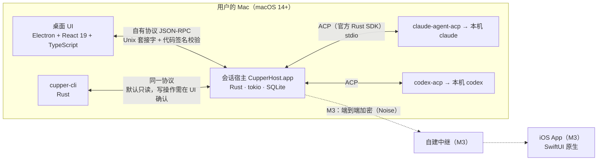

# cupper 技术栈总览

- 日期：2026-10-16
- 状态：M1 前需要的 ADR-01 至 ADR-11 已全部提议，在 `gate/design` 时交用户确认。原型实测 SP-1、2、4a、4b、5 已完成。
- 依据：
  - 技术选型讨论会：`docs/meetings/2026-10-16-tech-selection/`
  - 调研：R04（桌面框架与同类产品）；R05（热门 App 技术栈）
  - 实测：SP-1（适配器行为）、SP-2（分发）、SP-4a（宿主骨架）、SP-4b（本地安全）、SP-5（Git）

## 一图看懂

## 分层清单

| 层 | 选择 | 状态 | 关键理由 | 出处 |
|---|---|---|---|---|
| 桌面 UI | **Electron + React 19 + TypeScript**；组件：streamdown、Shiki、@pierre/diffs、TanStack Virtual、mermaid、xterm.js（备选 ghostty-web）、i18next | 提议 | 与 Codex 同构；避免写 WKWebView 的补丁代码；AI 写得快，还能自己验证；Claude、Cursor 等主流产品都用它 | ADR-03 |
| UI 加固 | 关闭三个危险 fuse；严格 CSP，不渲染原始 HTML；危险操作走原生确认框；审批必须由真实的用户输入触发；发布构建不开调试端口 | 提议 | agent 的输出是不可信内容，要防止它借渲染进程替自己批准 | ADR-03 |
| 会话宿主 | **Rust** 写的独立无界面进程，打包成 helper App 放在 App 包内；M1 由 App 拉起，M2 改为开机常驻 | 提议 | 签名干净，适合作信任锚；Rust ACP SDK 有 Zed 的生产验证；M3 可以和 iOS 共享代码 | ADR-01、ADR-02 |
| 宿主与客户端的协议 | 自有 JSON-RPC。帧格式：长度 + 类型 + 负载，单帧不超过 64 KB；seq 连续，并支持合并的区间事件；命令幂等；由 Rust 类型生成 JSON Schema，再生成 TS 和 zod | 提议 | 和 ACP、Codex 的做法一致；M3 能直接套上加密，不用返工 | ADR-04 |
| 本地认证 | Unix 套接字；用审计令牌加代码签名识别 UI；**每条消息都核对对端身份**；命令行工具默认只读 | 提议，已有 SP-4b 实测支持 | 不存可以被偷走的凭据；实测能挡住 exec 和 fork 冒充 | ADR-05 |
| agent 接入 | ACP：`claude-agent-acp` 驱动本机的 claude，`codex-acp` 驱动本机的 codex；**排队、历史、崩溃恢复都由宿主负责**；每种 agent 只起一个适配器进程，多个会话共用 | 提议，有 SP-1 实测支撑；分发方式待 SP-2 | 实测：并发发送 prompt 会丢回复或卡死；适配器回放的历史没有时间戳，也不完整；Codex 拒绝审批会结束整个回合 | ADR-07、ADR-09；ADR-08（待定） |
| Node 运行时与适配器分发 | 随 App 带一份官方 Node LTS，**用 cupper 的身份重新签名，只保留 allow-jit**，只用来运行适配器；每个适配器打包成一个 JS 单文件；claude 适配器在用户机器上从 npm 安装、本机打包，并核对固定哈希；runtime 清单随 App 签名 | 提议，有 SP-2 实测支持 | Anthropic 的 SDK 绝不由 cupper 分发；entitlement 最少；单文件在升级替换时不会出错 | ADR-08、ADR-11 |
| 存储与事件模型 | SQLite WAL，只有宿主写入；每条流 seq 连续；事件按条目 upsert；回合由宿主推导；快照就是一串事件，分页下发；原始 ACP 帧保留 14 天；历史以宿主的日志为准，不依赖适配器回放 | 提议，有 SP-4a 实测支持 | 骨架实测：冷启动 p95 4.6 ms；宿主常驻内存 6–23 MiB；`kill -9` 后能恢复 | ADR-06 |
| Git | **git 命令行**（不用 libgit2，暂不用 gix）；快照用临时 index，写入 cupper 私有的对象库，用户的 `.git` 一个字节都不写；hunk 操作用 `git apply`；worktree 放在仓库外，清理前按 7 条规则检查 | 提议，SP-5 实测支持 | libgit2 在 linux 等仓库上直接失败；git 命令行最正确，9.6 万个文件的仓库快照约 0.3 s | ADR-10 |
| 打包与更新 | Developer ID 签名、公证；更新时先让宿主退出再安装，不原地覆盖可执行文件；electron-builder 还是 Forge 在详细设计时定 | 提议 | SP-4b 实测：宿主运行时替换 App 包会出问题 | ADR-01、ADR-03 |
| 测试 | Rust 单元测试和集成测试；假 agent 回放录制的会话；Vitest；Playwright 截图回归和端到端测试 | 提议 | 确定性回归；AI 能自己验证 | ADR-03、ADR-04 |
| 最低系统 | macOS 14+；不为兼容旧系统写任何代码 | 已确认 | 用户决定 | 设计文档"平台约束" |
| 开源许可证 | cupper 自身用 **Apache-2.0**（`LICENSE` 已加入仓库）；CI 设许可证门禁；绝不分发 Anthropic 的 SDK 和 Claude Code 二进制 | Apache-2.0 已确认；门禁和再分发规则为提议 | 与 ACP 生态一致，带专利授权 | ADR-11 |
| iOS（M3） | SwiftUI 原生；要不要和桌面共用 Rust 客户端代码（UniFFI），M3 前再定 | 方向 | — | ADR-15（M3 前） |
| 中继与加密（M3） | 自建的无状态中继；Noise 协议，扫码配对，用一次性 psk 认证；推送由桌面按设备加密 | 方向 | — | ADR-12 至 ADR-14（M3 前） |

## 桌面框架为什么选 Electron（证据摘要）

- **Codex 自己**：本机只读核实，ChatGPT.app 26.1007 的界面代码是按 Electron 编程模型写的 React，macOS 上跑在 OpenAI 自研的 Chromium 运行时 OWL 上。用到的组件和我们选的一样。
- **同类产品**：Claude、Cursor、VS Code、Goose、opencode、Happy 用 Electron；Conductor、CodexMonitor、Codeg 用 Tauri；Zed 自己的 Delta 用 GPUI。
- **反向迁移**：opencode 和 Happy 都从 Tauri 换回了 Electron，opencode 给出的原因是 WebKit 性能和各平台不一致。
- **系统 WebView 未必更省**：Raycast 改用 WKWebView 后内存反而升高，还要处理输入法、节流、闪烁等问题，需要专门的补丁代码。
- **全 Rust 界面（GPUI）**：可行，但界面工作量估计是 Electron 方案的 1.5 到 2.5 倍，API 不稳定，AI 可参考的资料少。
- **代价**：安装包几百 MB，Electron 大约每 8 周一个大版本要跟进，安全加固要做到位。

- **热门 App（R05，33 个）**：78% 用 Web 技术渲染主界面。Manus、Kimi、千问、智谱、Granola、Figma、Slack、Discord、Notion、Obsidian 用 Electron。飞书、豆包用自研的 Chromium 运行时；Teams 在 Mac 上自带了一整份 Edge。大厂离开 Electron 后，换的是自己掌握的 Chromium，**界面仍然是 Web，没有一家改用系统自带的 WebKit**（元宝除外）。
- **分发**：只做官网直接下载，不上 Mac App Store，与同类 agent 产品一致。

完整对比见 `docs/tasks/R04-desktop-framework-survey/report.md` 和 `docs/tasks/R05-hot-apps-desktop-stack/report.md`。

## 还在验证中的

| 实测 | 验证什么 | 影响 |
|---|---|---|
| SP-6 | Electron 界面的长时间运行和多会话性能（M1b 前做） | ADR-03 的性能门槛 |
